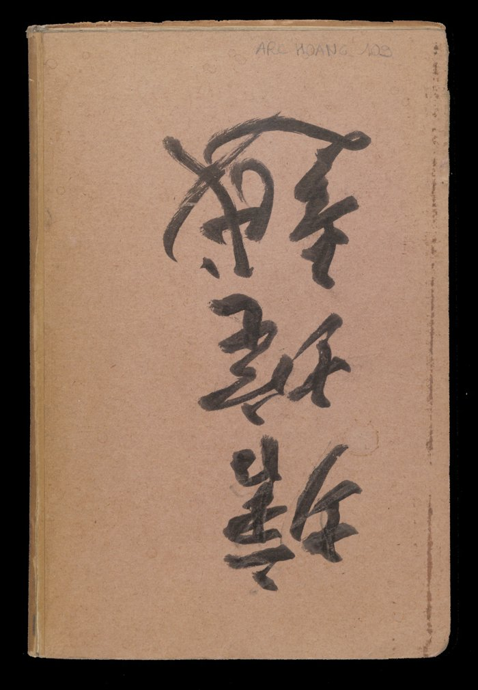
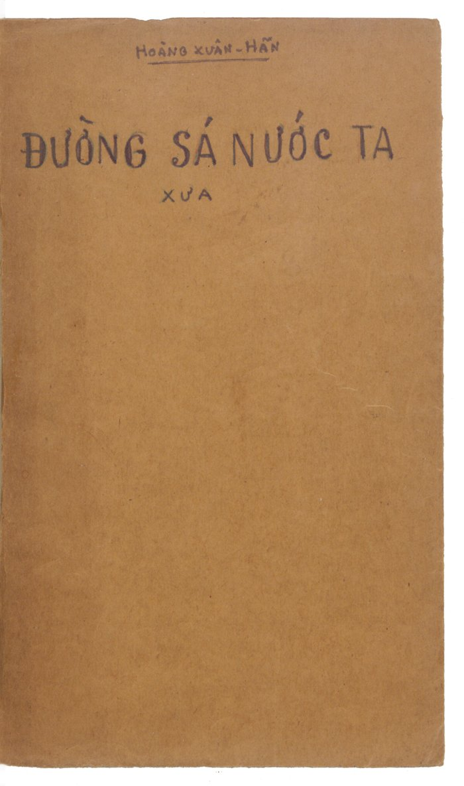
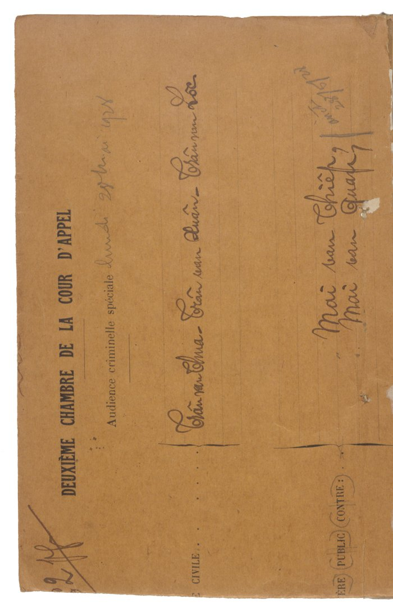
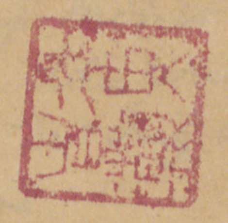

# Quy ước trình bày

- Mỗi mục "Trang PDF N" ứng với một trang trong file PDF gốc (383 trang). Số trang bản thảo do tác giả đánh (góc phải trên) và số trang con của từng phần (ví dụ "TTNĐ 3") được ghi lại ngay dưới tiêu đề.
- Chữ quốc ngữ của tác giả được chép theo chính tả hiện nay, giữ nguyên lời văn. Các chữ tác giả gạch xóa không chép lại.
- **Chữ Hán**: ghi theo dạng *phiên âm Hán Việt* (漢字). Câu hoặc đoạn chữ Hán thì có thêm bản dịch: **Dịch:** ...
- **Chữ Nôm**: nếu gặp sẽ chuyển sang quốc ngữ và để chữ Nôm trong ngoặc. Trong 16 trang đầu chưa thấy chữ Nôm.
- [?] = chữ đọc chưa chắc. [ND: ...] = ghi chú của người chép, không có trong bản gốc.
- Hình (bìa, ấn, và sau này là bản đồ, sơ đồ) được cắt từ ảnh scan gốc và đặt đúng vị trí.
- Chữ viết tắt tác giả dùng: TTNĐ = *Thiên tải nhàn đàm* (千載閒談); TLYL = *Trình lục yếu lược* (程錄要略); TLTT = *Trình lục tập thành*; GCDĐC = *Giao Châu dư địa chí* (交州輿地志).

---

# Trang PDF 1 - Bìa ngoài

{width=55%}

- Góc trên, bút chì: ARC. HOANG. 109 (số hiệu lưu trữ của BULAC).
- Giữa bìa là ba chữ Hán viết thảo bằng bút lông, khổ lớn. [ND: chữ thảo quá phóng, chưa đọc chắc. Sẽ đối chiếu khi gặp tên gọi chữ Hán của tập sách ở các trang sau.]

# Trang PDF 2 - Tờ lót bìa

[Tờ giấy màu hồng, để trống.]

# Trang PDF 3-4 - Tờ lót

[Hai trang giấy màu xanh nhạt, để trống.]

# Trang PDF 5 - Bìa trong

{width=55%}

HOÀNG XUÂN HÃN

**ĐƯỜNG SÁ NƯỚC TA**

**XƯA**

# Trang PDF 6 - Bìa hồ sơ tòa án cũ (dùng làm bìa sau)

{width=55%}

[ND: Bìa giấy vàng in sẵn, đặt nằm ngang. Đây chính là "bìa vàng cũ" mà tác giả nói đến ở trang sau.]

- Chữ in (tiếng Pháp): DEUXIÈME CHAMBRE DE LA COUR D'APPEL - Audience criminelle spéciale [Phòng thứ hai Tòa thượng thẩm - Phiên tòa hình sự đặc biệt]
- Viết tay: lundi 25 [?] ... 1928 [?] [ngày thứ Hai ... năm 1928 [?]]
- Tên bị cáo viết tay: Trần văn Chua [?], Trần văn Xuân [?], Trần văn Lộc [?]; Mai văn Thiếp [?], Mai văn Quát [?]
- Chữ in mờ ở lề: ... CIVILE; (MINIS)TÈRE PUBLIC CONTRE: [Viện công tố kiện:]

# Trang PDF 7 - Lời ghi của tác giả năm 1973 (trang bản thảo 1)

Bìa vàng cũ nguyên là bìa của một hồ-sơ tòa-án ĐẠI HÌNH THỰC-DÂN xử các nhà cách mạng Việt-nam ở Hà-nội. Sau khi quân Trung-quốc tới Việt nhận sự Quân Nhật đầu hàng Đồng minh, quân nhân cư đóng ở Tòa án rồi bán các hồ sơ cho người ta để làm giấy loại. Tôi đã mua ở lề đường Hà-nội (chợ hàng Da) rất nhiều hồ-sơ loại này, kể cả hồ sơ tất cả các nhân vật Việt Nam Quốc dân đảng bị xử tử ở Yên-Bái. Sau khi quân Pháp trở lại Hà-nội, tôi đã giấu các hồ sơ ấy trên mái nhà số 69 phố Tràng-thi. Không biết sau có ai lấy đi không?

> Pa-ri ngày 3/3/1973
>
> Hoàng Xuân Hãn

T.B. Nay tôi đóng lại tác-phẩm này mà tôi đã viết vào thời kì thiếu giấy ấy. Nhân tiện nhắc lại chuyện cũ và giữ cái bìa kia để làm chứng cho một thời-đại qua khổ [?] mà đau ta [?].

{width=22%}

[ND: Ấn son vuông, chữ triện, chưa đọc chắc. Phía dưới còn một ấn son mờ khác và dấu tròn "BULAC" của thư viện. Giấy viết là mặt sau giấy tiêu đề in sẵn của hãng VERRERIE DU NORD, 71 Borgnis Desbordes, Hà Nội (hãng thủy tinh, dụng cụ phòng thí nghiệm); chữ in hiện ngược qua giấy ở nửa dưới trang. Gần như toàn bộ bản thảo viết trên loại giấy này.]

# Trang PDF 8 - Trang trắng

[Mặt sau của tờ trước: chỉ có giấy tiêu đề in sẵn VERRERIE DU NORD, Hanoi, le ... 194..; nét chữ tờ bên kia hiện qua giấy. Không có chữ viết.]

# Trang PDF 9 - Mục lục (trang bản thảo 3)

## MỤC-LỤC

**A.** Muốn xem các đường thiên lý (số 1). Các khoảng một thứ theo tên tỉnh.

(Con số là số Tầm = 2m,045; chỗ chỉ nơi tham khảo thì dùng tên mục, rồi số trang, rồi số dòng; ví dụ Sơn tây 2/5 (số dòng là theo cái thước đo kèm theo sách); về Dịch lộ có lúc bỏ tên mục, ví dụ 34/19.)

Bên phải, tác giả ghi thêm: T.L đi Bắc; T.L đi Nam; *(mực tím)* Dịch lộ; T.L - Phú Xuân. [ND: T.L = Thăng Long.]

**B.** Tên các tỉnh bây giờ - Tra mục:

| Tên tỉnh bây giờ | Tra mục | Tên tỉnh bây giờ | Tra mục |
|---|---|---|---|
| Bắc Cạn | Thái nguyên | Lào cay | Hưng hóa |
| Bắc Giang | TL. đi Bắc | Long xuyên | Vĩnh thanh |
| Bạc Liêu | | Mỹ tho | Trấn định |
| Bắc Ninh | B.N.; TL. đi Bắc | Nam định | Sơn nam hạ |
| Bà rịa | | Ninh bình | Thanh bình |
| Bến tre | | Nghệ an | Nghệ an |
| Biên hòa | Trấn biên | Phan rang | Bình thuận |
| Bình Định | Bình định | Phú thọ | Sơn tây |
| Bình Thuận | Bình thuận | Phú yên | Phú yên |
| Cao bằng | Cao bằng | Phúc yên | Sơn tây |
| Cần thơ | Vĩnh thanh | Quảng bình | Q. Bình |
| Châu đốc | Vĩnh thanh | Quảng Nam | Q. Nam |
| Chợ lớn | Phiên trấn | Quảng Ngãi | Q. Ngãi |
| Gò công | | Quảng trị | Q. Trị |
| Gia định | Phiên trấn | Quảng Yên | Q. Yên; Quảng [?] |
| Hà đông | Sơn nam th. | Rạch giá | Vĩnh trấn |
| Hà giang | Tuyên quang | Sa đéc | Vĩnh trấn |
| Hà nam | Sơn nam th. | Sóc trang | Vĩnh trấn |
| Hà tĩnh | Nghệ an | Sơn la | Hưng hóa |
| Hà tiên | Vĩnh trấn | Sơn tây | Sơn tây. TL đi tây |
| Hải dương | Hải dương | Tân an | Phan an |
| Hải ninh | Yên Quảng [?] | Tây ninh | Phan an |
| Hòa bình | Hưng Hóa | Tuyên quang | Tuyên quang |
| Hưng Yên | Sơn nam hạ | Thái bình | Sơn nam hạ |
| Kiến an | Hải dương | Thái nguyên | Thái nguyên |
| Khánh hòa | Bình Hòa | Thanh hóa | Thanh hóa |
| Lạng sơn | Lạng sơn | Thủ dầu một | Phan an |
| | | Thừa thiên | Quảng Đức |
| | | Trà Vinh | Trấn định |
| Vĩnh long | Vĩnh thanh | Vĩnh Yên | Sơn tây |
| Yên bái | Hưng hóa | | |

[ND: "th." = thượng (Sơn nam thượng); "hạ" = Sơn nam hạ. Cột "Tra mục" là tên trấn/dinh thời Gia Long dùng làm mục tra cứu trong sách.]

# Trang PDF 10 - Mục lục (tiếp)

[ND: Danh sách các mục, kèm số tờ ("t." = tờ) của từng mục.]

| Số | Mục | Số tờ | Số | Mục | Số tờ |
|---|---|---|---|---|---|
| 1 | Khảo về các sách dùng | | 30 | Thăng long đi bắc | 6 t. |
| 2 | An quảng | 2 t. | 31 | Thăng long đi đông | 4 t. |
| 3 | Bắc kỳ thủy đạo | 3 t. | 32 | Thăng long đi Nam | 57 t. |
| 4 | Bình định | 8 t. | 33 | Thăng long đi Tây | 4 t. |
| 5 | Bình hòa | 1 t. | 34 | Thăng long - Nam (Lê) xem Lê | 10 t. |
| 6 | Bình thuận | 8 t. | 35 | Thăng long - Phú xuân | 6 t. |
| 7 | Cao bằng | 2 | 36 | Tuyên quang | 3 t. |
| 8 | Dịch lộ (1817) | 6 t. | 37 | Trấn biên | 10 t. |
| 9 | Dịch lộ cương | 1 t. | 38 | Trấn định | 4 t. |
| 10 | Dịch lộ mục | 4 t. | 39 | Vĩnh trấn | 14 t. |
| 11 | Hải dương | 1 t. | 40 | Các cửa bể | |
| 12 | Hưng hóa | 7 t. | 41 | Trung-Việt | |
| 13 | Kinh bắc | 4 t. | 42 | Tuyên quang hành dịch | |
| 14 | Nghệ an | 36 t. | 43 | Tây chinh thực lục | |
| 15 | Phiên trấn | 4 t. | | | |
| 16 | Hành trình Phiên an | 4 t. | | | |
| 17 | Phú Yên | 3 t. | | | |
| 18 | Quảng Bình | 3 t. | | | |
| 19 | Quảng Đức | 1? t. [?] | | | |
| 20 | Quảng Nam | 6 t. | | | |
| 21 | Quảng Nghĩa | 6 t. | | | |
| 22 | Quảng Trị | 6 t. | | | |
| 23 | Sơn tây | 1 t. | | | |
| 24 | Sơn Nam thượng hạ | 4 t. | | | |
| 25 | Sơn Nam thượng | 4 t. | | | |
| 26 | Thái nguyên | 1 t. | | | |
| 27 | Thanh bình | 4 t. | | | |
| 28 | Thanh hóa | 13 t. | | | |
| 29 | Thăng long - Thăng [?] | 2 t. | | | |

# Trang PDF 11 - Thiên tải nhàn đàm (trang bản thảo 4)

## *Thiên tải nhàn đàm* (千載閒談) - A. 584

[ND: tên sách nghĩa là "Chuyện nhàn nghìn năm". A.584 là ký hiệu sách ở thư viện Trường Viễn Đông Bác Cổ.]

Sách chép mới (giấy bạc-cô [?]) chữ đẹp. Chắc có bản cũ có chỗ đứt, trên đầu [chú thích ở trên các trang 4b, 5a].

Gồm có các mục:

**A**

1. Tựa *Thiên tải nhàn đàm* - Đề năm 1810. Kinh bắc Đàm Nghĩa Am. ......... 1a
2. *Nhàn đàm tổng luận* - Đề: "Đề ở quán trọ tại Thăng long". ......... 2a
3. *Thiên Nam tứ lộ đồ thư dẫn* (天南四路圖書引) [Lời dẫn sách bản đồ bốn đường nước Nam]. ......... 3a
4. *Giao Châu dư địa chí* (交州輿地志) [Sách địa lý đất Giao Châu] (*Mộc Thạnh* 沐晟, *Lý Phụ* [?] 李輔 ? *soạn* 撰): nói qua về cương vực và các đường ở Tàu sang ta. ......... 4a
5. *Thiên Nam toàn đồ* (天南全圖) [Bản đồ toàn cõi nước Nam]. ......... 6b
6. *Thiên Nam hình thế lược thuyết* (天南形勢畧說) [Nói qua về hình thế nước Nam] (viết đời Gia long). ......... 7b
7. *Tây Nam tái chư lân quốc* (西南塞諸鄰國) [Các nước láng giềng ở biên ải phía tây nam]. ......... 8b
8. Địa đồ Thăng long và 13 xứ. [Sau Thăng long đến Kinh bắc.] ......... 9b-23a

   Trên địa đồ Thăng long có đề câu thơ hoài cổ, nhớ Lê: *Văn Thiên Tường thi vân: "Phong cảnh sơn hà nguyên vô dị, thành quách nhân dân bán dĩ phi"* (文天祥詩云：風景山河原無異，城郭人民半已非).
   **Dịch:** Thơ Văn Thiên Tường rằng: "Phong cảnh núi sông vốn chẳng khác, thành quách người dân đã đổi khác quá nửa."
   [ND: vế sau trong bản thảo viết tựa như 「城郭人民不勝可」[?]; câu thơ gốc của Văn Thiên Tường là 「城郭人民半已非」.]

   Cuối 23b lại có nói: "Khách có kẻ hỏi: ta thấy đồ cũ các bản đồ chép đầu là Thăng long, sau là Thanh hóa. Nay cớ sao chép đầu là Thăng long, sau là Kinh bắc (京北), mà thứ tự ở sau lại không đúng, là cớ sao? Ta nói: Xưa như vậy, mà nay như vậy. Việc ấy chỉ lấy ý hiểu, mà không thể nẩy ra lời mà truyền..." Thế tỏ rằng tác giả vẫn để Lê lên trên Nguyễn và tôn Kinh bắc quê mình.
9. *Nam hành trình lục* (南行程錄) [Ghi chép đường đi vào nam]. Về đời Lê. ......... 24a
10. *Thanh Nghệ Thuận Quảng chư hải môn hình thế danh thắng tích* (清乂順廣諸海門形勢名勝跡) [Hình thế và danh thắng các cửa biển Thanh Hóa, Nghệ An, Thuận Hóa, Quảng Nam]. ......... 26a
11. *Phụ lục Nhị Hà dĩ nam số đoạn trình* (附錄珥河以南數段程) [Phụ lục: mấy chặng đường từ sông Nhị (sông Hồng) trở về nam] (chép lộ mô [?]) *cập ngự chế đề tại Thanh Hóa thắng cảnh chư thi* (及御製題在清化勝景諸詩) [cùng các bài thơ ngự chế đề ở thắng cảnh Thanh Hóa] (vua Lê Thánh [tông], Hiến tông, Trịnh.., các quan đời Lê Thánh tông). ......... 37b
12. Dịch lộ chép tóm tắt: có các cung và một vài quán cầu. Đến Huế. Ở đầu có lược biên về nam tiến. ......... 46a
13. Địa đồ Dịch lộ từ Thăng long đến Đề thiên Đề thích (đời Lê? Nguyễn?). ......... 49b-76b

**B**

14. *Trình lục yếu lược ký* (程錄要畧記) [Ghi tóm tắt các lộ trình] (như TLYL tựa nhưng đủ). Đề năm 1817.
15. *Thăng Long thành tứ độ cương lĩnh* (昇隆城四度綱領) [Đại cương bốn đường đi từ thành Thăng Long]. ......... 77b
16. 〃 *Bắc Nam dịch lộ mục* (北南驛路目) [Mục lục đường trạm Bắc - Nam]. ......... 79a
17. 〃 *Tứ độ liệt mục* (四度列目) [Liệt kê bốn đường] (kỹ hơn ở TLYL nhiều). ......... 84b
18. *Tứ trấn thông hành trình lộ* (四鎮通行程路) [Các đường đi lại trong bốn trấn]: *Kinh Bắc* (京北), *Sơn Nam thượng, hạ* (山南上，下), *Sơn Tây* (山西), *Hải Dương* (海陽). ......... 129a
19. *Ngoại trấn chư thông lộ* (外鎮諸通路) [Các đường thông ra các trấn ngoài]: *Thái Nguyên* (太原), *Lạng Sơn* (諒山), *Hưng Hóa* (興化), *Thanh Hoa* (清華).
20. *Ngoại phiên trấn chư đại lộ* (外藩鎮諸大路) [Các đường lớn tới các trấn phiên ngoài]: *Cao Bình* (高平), *Nghệ An* (乂安), *Tuyên Quang* (宣光), *An Quảng* (安廣), *Thuận Hóa* (順化), *Quảng Nam* (廣南), *chư xứ* [?] (諸處 [?]). ......... 150a

    (Thực ra chỉ có đến Quảng nghĩa. Các mục 18, 19, 20 thì như TLYL.)
21. *(mực tím)* Cuối: về tên các triều (chú: Lê, Tây Sơn, Trịnh [?]!) ......... 189a

# Trang PDF 12 - TTNĐ 2 (trang bản thảo không đánh số)

Sách "*Thiên tải nhàn đàm*" này, thật là do ông *Đàm Nghĩa Am* (譚義庵) làm ra.

Đàm Nghĩa Am là người họ Đàm ở xã *Ông Mặc* (翁墨), huyện *Đông Ngàn* (東岸), tỉnh Bắc ninh bây giờ. Ông là con cháu ông *Đàm Thận Huy* (譚慎徽), tiến sĩ đời Hồng đức 1490, làm quan đến thượng thư, nhập thị kinh diên, hàn lâm [?], sau vì không chịu theo Mạc mà chết. [Chứng cớ là trong TTNĐ, lúc sao cái bài thơ hoa [?] thơ Lê Thánh tôn, Nghĩa-am chép "tổ ta là Đàm Thận Huy".] Ông húy là gì không biết rõ, nhưng xem nội dung sách, biết rằng ông sinh trưởng đời Lê, cha ông là trọng thần trung thành với Lê. Cho nên đời Nguyễn, ông ẩn dật, mà vẫn quyến luyến với Lê. Vì thế cho nên trong các hành trình ông vẫn lấy Thăng long làm trung tâm. Về thứ tự các đồ mười ba thừa tuyên, ông để Thăng long đầu rồi đến Kinh bắc. Ông viết rằng: phải lấy ý mà hiểu, chứ không lấy lời mà truyền (xem mặt kia). Ấy là vì lòng quyến luyến Lê, mà không thể bộc bạch được.

Xem bài "TLYL tự" và so sánh các bài dẫn và tựa trong những bản "TTNĐ, TLYL, G.CDĐC" ta thấy rằng ông có tâm sưu tập các hành trình trong nước. Vào năm 1810 ông có đã [?] sách *Dư địa chí* (xem Giao châu dư địa chí), sách *Trình lục tập thành* (khuyết phần từ Thanh hóa vào) của Bắc Kỳ. Với tài liệu ấy ông bắt đầu viết sách *Thiên tải nhàn đàm* mà bài tựa đề vào năm ấy (1810) và bài "*Tổng luận*" cũng vậy. Bài TLYL tự chắc cũng đã viết vào năm ấy (bản lược).

Sau đó ông có tìm tòi, và năm 1816 ông mới nhờ được để sao được quyển *Nhất thống chí* ở Thuận hóa. Bây giờ ông bổ khuyết sách *Thiên tải nhàn đàm*, chép lại Hành trình từ Thăng long vào nam, sửa lại các bài tựa, dẫn. Cho nên bài TLYL kia ở sách "TTNĐ mới" đề năm 1817. Rồi sau lại TTNĐ (A584) gồm có tài liệu của *Dư địa chí* (nay gọi là Giao châu dư địa chí), *Trình lục yếu lược* ~~Bắc Kỳ~~ và *Nhất thống chí*.

*(mực tím, ở lề dưới)* (1) Trình lục tập thành → Trình lục yếu lược và...

[ND: Nửa dưới trang có chữ in tiêu đề VERRERIE DU NORD in ngược.]

# Trang PDF 13 - TTNĐ 3 (trang bản thảo 5)

## THIÊN TẢI NHÀN ĐÀM - Tựa

Hoặc có kẻ hỏi ta rằng: "Người sao mà mê dư địa chí? mà vui cho là câu chuyện nhàn trong muôn năm?" Ta trả lời: "Việc trong vũ trụ là phận sự [?] con trai. Cho nên tuy sinh ở nơi ngõ khuất, lớn ở chốn đồng quê. Không ra khỏi cửa nửa bước, nhưng muốn thỏa lòng đi chơi Trung-quốc. Đã sinh trong thiên hạ, không thể không tưởng tượng đi chơi thiên hạ một vài lần."

Hoặc giả nói: "Lời người thành đó. Nhưng sao không tìm đi Trung-quốc, lại riêng vui ở dư địa miền *Viêm thiên Quế hải* (炎天桂海) [trời nóng biển Quế] (nước Nam) mà thôi?" Ta trả lời: "Dư địa Trung quốc, ta cũng đã tìm. Tuy chưa thấy chỗ rõ ràng, nhưng từng biết qua cái đã được. Nhưng đã sinh ở Việt, Sở, không thể không nói đến Việt, Sở. Cho nên đặc hữu ý khảo về nước ta."

Hoặc giả nói: "Dư địa Trung quốc hình như cũng nói qua đến nước ta." Ta trả lời: "Xem *Thượng thư đồ* (尚書圖) [bản đồ sách Thượng thư] mà thấy phong thổ chín châu, xem *Mao thi đồ* (毛詩圖) [bản đồ Kinh Thi họ Mao] mà thấy phong thổ mười lăm nước. Đó là lược như thế."

Hoặc giả nói: "Vậy thì khắp dưới vòm trời, nam bắc tây đông, mấy ngàn vạn dặm, người có biết không?" Ta trả lời: "Nghe Hồ thị có nói, Nam cực trời ở 36 độ dưới đất, Bắc cực 36 độ trên đất. Một ngày đêm đi hơn 90 vạn dặm. Thấy trên mặt đất 24 độ hơn 30 vạn dặm mà đông tây nam bắc bằng nhau."

Hoặc giả nói: "Từ mặt đất lên [?] đến trời, dưới đến trời có mấy ngàn vạn dặm?" Ta nói: "Nam bắc hơn 30 vạn dặm chia đôi, trên dưới đều hơn 15 vạn dặm."

Hỏi: "Sao lại biết vậy?" Nói: "Trời bao ngoài đất, như cái khuyên. Đất ở trong trời như cái vạch. Một khuyên bốn 90 vạn dặm, thì một vạch bốn 30 vạn dặm. Bốn bề như vậy, trên dưới như vậy. Thế chẳng phải trên đến trời, dưới đến trời đều hơn 15 dặm hay sao?"

Hỏi: "Vậy thì nước ta ứng vào tinh phận nào trên trời, châu vực nào ở đất?" Ta trả lời: "Ở đất là vực *Kinh* (荊), *Dương* (揚). Về tinh phận thì cùng nam bắc tây đông cách nhau bao nhiêu vạn dặm, đi mất bao nhiêu ngày? Sách này sẽ chép đủ."

# Trang PDF 14 - TTNĐ 4 (trang bản thảo không đánh số)

Người hỏi chuyện ừ ừ rồi lui, và nói: "Nhất [?] thực như vậy thì thật đủ làm câu chuyện nhàn nghìn năm. *Thiên tải chi nhàn đàm* (千載之閒談) [Chuyện nhàn của nghìn năm]." Vì đó mà làm tựa mà bèn đặt tên sách.

> Quốc triều Gia long thứ 9, năm Canh Ngọ [?] (1810)
>
> tháng 5, ngày Tân mùi
>
> *Kinh Bắc* (京北) *Đàm Nghĩa Am* (譚義庵) đề tựa.

[ND: Gia Long 9 (1810) là năm Canh Ngọ; nét chữ ở đây trông giống "Canh sửu", có lẽ do viết nhanh.]

[ND: Phần còn lại của trang để trống; nửa dưới là tiêu đề in VERRERIE DU NORD in ngược.]

# Trang PDF 15 - TTNĐ 5 (trang bản thảo 6)

## *Nhàn đàm tổng luận* (閒談總論) [Bàn chung về sách Nhàn đàm]

Địa đồ quả bắt đầu có từ ai? Ban đầu thấy ở tàng thư của *Tần tướng phủ* (秦相府) [phủ thừa tướng nước Tần], trong quan tài [?] *Hán Vũ đế* (漢武帝). Và *Tống tổ* (宋祖) có đồ nước *U* (幽) *Yên* (燕), thì địa đồ có đã từ lâu.

Sách này vốn tên là *Dư địa chí* (輿地誌), và chú rằng Minh tướng soạn ra để hiến. Nhưng xét cho kỹ thì thấy rằng *Minh tướng* (明將) chỉ gọi nước ta là *Giao Châu* (交州) (*Minh tướng chỉ chi vi Giao Châu* 明將指之為交州 - **Dịch:** tướng nhà Minh gọi đất ấy là Giao Châu), cũng chép về giới cận đông tây nam bắc về sở tại ở tinh phận. Còn như từ đường đi từ Trung Châu ra đến hình thế 13 *tuyên* (宣), thì ai chép ra, chưa kỹ biết rõ (*... tha diệc vị hạ cập* [?] ...他亦未暇及 - **Dịch:** việc khác cũng chưa kịp xét đến), và cái sách gọi là *Thiên Nam tứ chí lộ đồ* (天南四至路[圖]) [Bản đồ đường đi bốn phía nước Nam] cũng không phải Minh tướng làm ra. Sự ấy đã rõ. Nhưng đồ mười ba tuyên, không biết thật gốc từ đâu? Trả lời rằng "cựu bản không chú rõ, nay tạm để khuyết" là phải.

Nhưng xem thì thấy đồ ấy vào thời Cao bằng còn hợp với Thái nguyên, Sơn nam chưa chia ra thượng, hạ.

Nói về hình thế, thì mười phần cũng giống được hai, ba. Tuy về núi sông cũng không thể chép hết. Há phải đâu tiền nhân trí lự bất cập đâu (前人智慮不及 [?] - **Dịch:** người trước suy tính không tới). Cũng chỉ vì lấy một mảnh giấy mà thu hết núi sông thì rườm rà quá, không thể xem xiết. Cho nên chỉ chép lấy cái danh sơn, đại xuyên mà thôi. Thế mà, ở đông nam nhiều sông, ở tây bắc nhiều núi, núi sông hiểm dễ, hình thế mạnh hèn, cũng có thể thấy đại lược được.

Nếu không biết điều gì mà muốn tìm thì trước tìm ở "*Thiên Nam tứ chí lộ*" để tìm địa mạch ở đâu lại; rồi tra *Dư địa chí* để tìm 4 cận của Thiên Nam và các đường thủy lục từ *Trung Châu* (中州) đi ra, sau lại xem "*Thiên Nam toàn đồ*" và "*Tây Nam tái chư lân quốc đồ*" (西南塞諸鄰國圖) [Bản đồ các nước láng giềng ở biên ải tây nam] và "*Thập tam tuyên đồ*" [Bản đồ mười ba thừa tuyên] để tìm địa mạch bằng hay hiểm. Xong rồi, lấy "*Nam hành trình lục*" và "*Nam hành địa diện*" [?] (南行地面 [?]) để cho biết từ gian nam khởi thác [?]. Rồi mới xem "*Trình lục yếu lược*" để biết các bề dài ngắn thế nào.

Đến như sổ tổng kê các trấn, phủ, châu, huyện

# Trang PDF 16 - TTNĐ 6 (trang bản thảo không đánh số)

phong thổ Kinh bắc, Hưng hóa, để tầm mà khảo cứu ngắm thấy thiên hạ như ở trên bàn tay.

Như có dùng ta, thì tự

*Như hữu dụng ngã, tự bất giả Phục Ba chi tụ mễ, nhược thủy chi đạo [?] ... hĩ* (如有用我，自不假伏波之聚米，若水之道[?]矣).

**Dịch:** Nếu có ai dùng đến ta, thì tự không cần mượn đến cách dồn gạo (đắp sa bàn) của Phục Ba, [mà rõ đường như dòng nước chảy [?]].

[ND: "Phục Ba tụ mễ": tướng Phục Ba Mã Viện nhà Hán dồn gạo làm mô hình núi sông để bày thế trận. Vế cuối chữ viết nhanh, chưa đọc chắc.]

Quyển sách này, có thể viết qua loa mà xem qua, rồi ủy cho vào hòm đến một sao!

> Đề ở lữ thứ tại thành Thăng long.

(Chú: Sách *Giao Châu dư địa chí* (交州輿地志) chép y như trên, nhưng ở cuối có đề rõ niên hiệu:

> "Gia long thứ 9 Canh Ngọ [?] (1810) tháng 6 ngày sóc. Đề.")

Sách TTNĐ có thêm ra - bằng chữ con:

1. Lê Thánh tông, năm Quang thuận thứ 8, Đinh hợi (14..) sai 12 thừa tuyên khám trong hạt mình núi sông hiểm trở bằng bản thế nào, tìm cổ kim sự tích, rồi vẽ đồ cho rõ. Đưa cho hộ-bộ làm *Địa lý dư đồ* (地理輿圖) [Bản đồ địa lý].
2. Năm thứ 10, Kỷ sửu (14..) định bản đồ phủ châu, huyện, xã, trang, sách ở 12 thừa tuyên.
3. Hồng đức Canh tuất (14..) thứ 21, mồng 5 tháng 4 định thiên hạ bản đồ:

| Cấp trên | Cấp cơ sở |
|---|---|
| 13 xứ thừa tuyên | 6851 xã |
| 52 phủ | 322 thôn |
| 178 huyện | 637 trang |
| 50 châu | 40 sách |
| 20 hương, 3 [?] | 40 động |
| 36 phường | 30 nguồn |
| | 30 trường [?] |

Xã từ xưa [?] chỉ hơn 8000.

[ND: tác giả để trống hai chữ số cuối của các năm (14..). Theo niên biểu: Quang Thuận 8 Đinh Hợi = 1467; Quang Thuận 10 Kỷ Sửu = 1469; Hồng Đức 21 Canh Tuất = 1490.]

---

*Hết bản thử (trang PDF 1-16). Còn lại: trang PDF 17-383.*
