# Bản scan gốc

Bản chép này đối chiếu với bản scan 383 trang của bản thảo, có thể xem trực tuyến tại:

- **Thư viện số BULAC (BiNA):** <https://bina.bulac.fr/s/bina/ark:/73193/bnkb7b>
- **Internet Archive:** <https://archive.org/details/ARC.HOANG.109> (giấy phép CC BY-NC 4.0)

# Quy ước trình bày

- Mỗi mục "Trang PDF N" ứng với một trang trong file PDF gốc (383 trang). Số trang bản thảo do tác giả đánh (góc phải trên) và số trang con của từng phần (ví dụ "TTNĐ 3") được ghi lại ngay dưới tiêu đề.
- Chữ quốc ngữ của tác giả được chép theo chính tả hiện nay, giữ nguyên lời văn. Các chữ tác giả gạch xóa không chép lại.
- **Chữ Hán**: ghi theo dạng *phiên âm Hán Việt* (漢字). Câu hoặc đoạn chữ Hán thì có thêm bản dịch: **Dịch:** ...
- **Chữ Nôm**: nếu gặp sẽ chuyển sang quốc ngữ và để chữ Nôm trong ngoặc. Trong 16 trang đầu chưa thấy chữ Nôm.
- [?] = chữ đọc chưa chắc. [NC: ...] = ghi chú của người chép, không có trong bản gốc.
- Hình (bìa, ấn, và sau này là bản đồ, sơ đồ) được cắt từ ảnh scan gốc và đặt đúng vị trí.
- **Chữ Nôm** xuất hiện nhiều trong tên đất ở các bảng lộ trình (ví dụ 𢄂 chợ, 求/梂 cầu, 滝 sông, 我巴 ngã ba, 核 cây, 𨷯 cửa). Chữ không có trong Unicode được ghi theo cấu tạo, ví dụ [石+多] hoặc ⿰氵机, kèm [?] nếu chưa chắc. Cột có tiêu đề "Chữ Hán" trong bảng thực tế gồm cả chữ Nôm.
- Tiêu đề cột trong ngoặc vuông (ví dụ [Địa danh], [Tầm], [Loại]) là do người chép đặt khi tác giả không ghi. Cột [Loại]: c = cầu, q = quán, ch = chợ...
- Hình thuyền buồm nhỏ vẽ ở góc trang là ký hiệu của tác giả đánh dấu lộ trình đường thủy; hình thuyền kèm xe là đường bộ - thủy.
- Mức tin cậy: chữ quốc ngữ và con số đọc khá chắc; chữ Hán/Nôm viết nhỏ trong các bảng còn nhiều chỗ [?] cần đối chiếu với ảnh gốc.
- Chữ viết tắt tác giả dùng: TTNĐ = *Thiên tải nhàn đàm* (千載閒談); TLYL = *Trình lục yếu lược* (程錄要略); TLTT = *Trình lục tập thành*; GCDĐC = *Giao Châu dư địa chí* (交州輿地志).

---

# Trang PDF 1 - Bìa ngoài

{width=55%}

- Góc trên, bút chì: ARC. HOANG. 109 (số hiệu lưu trữ của BULAC).
- Giữa bìa là ba chữ Hán viết thảo bằng bút lông, khổ lớn. [NC: chữ thảo quá phóng, chưa đọc chắc. Sẽ đối chiếu khi gặp tên gọi chữ Hán của tập sách ở các trang sau.]

# Trang PDF 2 - Tờ lót bìa

[Tờ giấy màu hồng, để trống.]

# Trang PDF 3-4 - Tờ lót

[Hai trang giấy màu xanh nhạt, để trống.]

# Trang PDF 5 - Bìa trong

{width=55%}

HOÀNG XUÂN HÃN

**ĐƯỜNG SÁ NƯỚC TA**

**XƯA**

# Trang PDF 6 - Bìa hồ sơ tòa án cũ (dùng làm bìa sau)

{width=55%}

[NC: Bìa giấy vàng in sẵn, đặt nằm ngang. Đây chính là "bìa vàng cũ" mà tác giả nói đến ở trang sau.]

- Chữ in (tiếng Pháp): DEUXIÈME CHAMBRE DE LA COUR D'APPEL - Audience criminelle spéciale [Phòng thứ hai Tòa thượng thẩm - Phiên tòa hình sự đặc biệt]
- Viết tay: lundi 25 [?] ... 1928 [?] [ngày thứ Hai ... năm 1928 [?]]
- Tên bị cáo viết tay: Trần văn Chua [?], Trần văn Xuân [?], Trần văn Lộc [?]; Mai văn Thiếp [?], Mai văn Quát [?]
- Chữ in mờ ở lề: ... CIVILE; (MINIS)TÈRE PUBLIC CONTRE: [Viện công tố kiện:]

# Trang PDF 7 - Lời ghi của tác giả năm 1973 (trang bản thảo 1)

Bìa vàng cũ nguyên là bìa của một hồ-sơ tòa-án ĐẠI HÌNH THỰC-DÂN xử các nhà cách mạng Việt-nam ở Hà-nội. Sau khi quân Trung-quốc tới Việt nhận sự Quân Nhật đầu hàng Đồng minh, quân nhân cư đóng ở Tòa án rồi bán các hồ sơ cho người ta để làm giấy loại. Tôi đã mua ở lề đường Hà-nội (chợ hàng Da) rất nhiều hồ-sơ loại này, kể cả hồ sơ tất cả các nhân vật Việt Nam Quốc dân đảng bị xử tử ở Yên-Bái. Sau khi quân Pháp trở lại Hà-nội, tôi đã giấu các hồ sơ ấy trên mái nhà số 69 phố Tràng-thi. Không biết sau có ai lấy đi không?

> Pa-ri ngày 3/3/1973
>
> Hoàng Xuân Hãn

T.B. Nay tôi đóng lại tác-phẩm này mà tôi đã viết vào thời kì thiếu giấy ấy. Nhân tiện nhắc lại chuyện cũ và giữ cái bìa kia để làm chứng cho một thời-đại qua khổ [?] mà đau ta [?].

{width=22%}

[NC: Ấn son vuông, chữ triện, chưa đọc chắc. Phía dưới còn một ấn son mờ khác và dấu tròn "BULAC" của thư viện. Giấy viết là mặt sau giấy tiêu đề in sẵn của hãng VERRERIE DU NORD, 71 Borgnis Desbordes, Hà Nội (hãng thủy tinh, dụng cụ phòng thí nghiệm); chữ in hiện ngược qua giấy ở nửa dưới trang. Gần như toàn bộ bản thảo viết trên loại giấy này.]

# Trang PDF 8 - Trang trắng

[Mặt sau của tờ trước: chỉ có giấy tiêu đề in sẵn VERRERIE DU NORD, Hanoi, le ... 194..; nét chữ tờ bên kia hiện qua giấy. Không có chữ viết.]

# Trang PDF 9 - Mục lục (trang bản thảo 3)

## MỤC-LỤC

**A.** Muốn xem các đường thiên lý (số 1). Các khoảng một thứ theo tên tỉnh.

(Con số là số Tầm = 2m,045; chỗ chỉ nơi tham khảo thì dùng tên mục, rồi số trang, rồi số dòng; ví dụ Sơn tây 2/5 (số dòng là theo cái thước đo kèm theo sách); về Dịch lộ có lúc bỏ tên mục, ví dụ 34/19.)

Bên phải, tác giả ghi thêm: T.L đi Bắc; T.L đi Nam; *(mực tím)* Dịch lộ; T.L - Phú Xuân. [NC: T.L = Thăng Long.]

**B.** Tên các tỉnh bây giờ - Tra mục:

| Tên tỉnh bây giờ | Tra mục | Tên tỉnh bây giờ | Tra mục |
|---|---|---|---|
| Bắc Cạn | Thái nguyên | Lào cay | Hưng hóa |
| Bắc Giang | TL. đi Bắc | Long xuyên | Vĩnh thanh |
| Bạc Liêu | | Mỹ tho | Trấn định |
| Bắc Ninh | B.N.; TL. đi Bắc | Nam định | Sơn nam hạ |
| Bà rịa | | Ninh bình | Thanh bình |
| Bến tre | | Nghệ an | Nghệ an |
| Biên hòa | Trấn biên | Phan rang | Bình thuận |
| Bình Định | Bình định | Phú thọ | Sơn tây |
| Bình Thuận | Bình thuận | Phú yên | Phú yên |
| Cao bằng | Cao bằng | Phúc yên | Sơn tây |
| Cần thơ | Vĩnh thanh | Quảng bình | Q. Bình |
| Châu đốc | Vĩnh thanh | Quảng Nam | Q. Nam |
| Chợ lớn | Phiên trấn | Quảng Ngãi | Q. Ngãi |
| Gò công | | Quảng trị | Q. Trị |
| Gia định | Phiên trấn | Quảng Yên | Q. Yên; Quảng [?] |
| Hà đông | Sơn nam th. | Rạch giá | Vĩnh trấn |
| Hà giang | Tuyên quang | Sa đéc | Vĩnh trấn |
| Hà nam | Sơn nam th. | Sóc trang | Vĩnh trấn |
| Hà tĩnh | Nghệ an | Sơn la | Hưng hóa |
| Hà tiên | Vĩnh trấn | Sơn tây | Sơn tây. TL đi tây |
| Hải dương | Hải dương | Tân an | Phan an |
| Hải ninh | Yên Quảng [?] | Tây ninh | Phan an |
| Hòa bình | Hưng Hóa | Tuyên quang | Tuyên quang |
| Hưng Yên | Sơn nam hạ | Thái bình | Sơn nam hạ |
| Kiến an | Hải dương | Thái nguyên | Thái nguyên |
| Khánh hòa | Bình Hòa | Thanh hóa | Thanh hóa |
| Lạng sơn | Lạng sơn | Thủ dầu một | Phan an |
| | | Thừa thiên | Quảng Đức |
| | | Trà Vinh | Trấn định |
| Vĩnh long | Vĩnh thanh | Vĩnh Yên | Sơn tây |
| Yên bái | Hưng hóa | | |

[NC: "th." = thượng (Sơn nam thượng); "hạ" = Sơn nam hạ. Cột "Tra mục" là tên trấn/dinh thời Gia Long dùng làm mục tra cứu trong sách.]

# Trang PDF 10 - Mục lục (tiếp)

[NC: Danh sách các mục, kèm số tờ ("t." = tờ) của từng mục.]

| Số | Mục | Số tờ | Số | Mục | Số tờ |
|---|---|---|---|---|---|
| 1 | Khảo về các sách dùng | | 30 | Thăng long đi bắc | 6 t. |
| 2 | An quảng | 2 t. | 31 | Thăng long đi đông | 4 t. |
| 3 | Bắc kỳ thủy đạo | 3 t. | 32 | Thăng long đi Nam | 57 t. |
| 4 | Bình định | 8 t. | 33 | Thăng long đi Tây | 4 t. |
| 5 | Bình hòa | 1 t. | 34 | Thăng long - Nam (Lê) xem Lê | 10 t. |
| 6 | Bình thuận | 8 t. | 35 | Thăng long - Phú xuân | 6 t. |
| 7 | Cao bằng | 2 | 36 | Tuyên quang | 3 t. |
| 8 | Dịch lộ (1817) | 6 t. | 37 | Trấn biên | 10 t. |
| 9 | Dịch lộ cương | 1 t. | 38 | Trấn định | 4 t. |
| 10 | Dịch lộ mục | 4 t. | 39 | Vĩnh trấn | 14 t. |
| 11 | Hải dương | 1 t. | 40 | Các cửa bể | |
| 12 | Hưng hóa | 7 t. | 41 | Trung-Việt | |
| 13 | Kinh bắc | 4 t. | 42 | Tuyên quang hành dịch | |
| 14 | Nghệ an | 36 t. | 43 | Tây chinh thực lục | |
| 15 | Phiên trấn | 4 t. | | | |
| 16 | Hành trình Phiên an | 4 t. | | | |
| 17 | Phú Yên | 3 t. | | | |
| 18 | Quảng Bình | 3 t. | | | |
| 19 | Quảng Đức | 1? t. [?] | | | |
| 20 | Quảng Nam | 6 t. | | | |
| 21 | Quảng Nghĩa | 6 t. | | | |
| 22 | Quảng Trị | 6 t. | | | |
| 23 | Sơn tây | 1 t. | | | |
| 24 | Sơn Nam thượng hạ | 4 t. | | | |
| 25 | Sơn Nam thượng | 4 t. | | | |
| 26 | Thái nguyên | 1 t. | | | |
| 27 | Thanh bình | 4 t. | | | |
| 28 | Thanh hóa | 13 t. | | | |
| 29 | Thăng long - Thăng [?] | 2 t. | | | |

# Trang PDF 11 - Thiên tải nhàn đàm (trang bản thảo 4)

## *Thiên tải nhàn đàm* (千載閒談) - A. 584

[NC: tên sách nghĩa là "Chuyện nhàn nghìn năm". A.584 là ký hiệu sách ở thư viện Trường Viễn Đông Bác Cổ.]

Sách chép mới (giấy bạc-cô [?]) chữ đẹp. Chắc có bản cũ có chỗ đứt, trên đầu [chú thích ở trên các trang 4b, 5a].

Gồm có các mục:

**A**

1. Tựa *Thiên tải nhàn đàm* - Đề năm 1810. Kinh bắc Đàm Nghĩa Am. ......... 1a
2. *Nhàn đàm tổng luận* - Đề: "Đề ở quán trọ tại Thăng long". ......... 2a
3. *Thiên Nam tứ lộ đồ thư dẫn* (天南四路圖書引) [Lời dẫn sách bản đồ bốn đường nước Nam]. ......... 3a
4. *Giao Châu dư địa chí* (交州輿地志) [Sách địa lý đất Giao Châu] (*Mộc Thạnh* 沐晟, *Lý Phụ* [?] 李輔 ? *soạn* 撰): nói qua về cương vực và các đường ở Tàu sang ta. ......... 4a
5. *Thiên Nam toàn đồ* (天南全圖) [Bản đồ toàn cõi nước Nam]. ......... 6b
6. *Thiên Nam hình thế lược thuyết* (天南形勢畧說) [Nói qua về hình thế nước Nam] (viết đời Gia long). ......... 7b
7. *Tây Nam tái chư lân quốc* (西南塞諸鄰國) [Các nước láng giềng ở biên ải phía tây nam]. ......... 8b
8. Địa đồ Thăng long và 13 xứ. [Sau Thăng long đến Kinh bắc.] ......... 9b-23a

   Trên địa đồ Thăng long có đề câu thơ hoài cổ, nhớ Lê: *Văn Thiên Tường thi vân: "Phong cảnh sơn hà nguyên vô dị, thành quách nhân dân bán dĩ phi"* (文天祥詩云：風景山河原無異，城郭人民半已非).
   **Dịch:** Thơ Văn Thiên Tường rằng: "Phong cảnh núi sông vốn chẳng khác, thành quách người dân đã đổi khác quá nửa."
   [NC: vế sau trong bản thảo viết tựa như 「城郭人民不勝可」[?]; câu thơ gốc của Văn Thiên Tường là 「城郭人民半已非」.]

   Cuối 23b lại có nói: "Khách có kẻ hỏi: ta thấy đồ cũ các bản đồ chép đầu là Thăng long, sau là Thanh hóa. Nay cớ sao chép đầu là Thăng long, sau là Kinh bắc (京北), mà thứ tự ở sau lại không đúng, là cớ sao? Ta nói: Xưa như vậy, mà nay như vậy. Việc ấy chỉ lấy ý hiểu, mà không thể nẩy ra lời mà truyền..." Thế tỏ rằng tác giả vẫn để Lê lên trên Nguyễn và tôn Kinh bắc quê mình.
9. *Nam hành trình lục* (南行程錄) [Ghi chép đường đi vào nam]. Về đời Lê. ......... 24a
10. *Thanh Nghệ Thuận Quảng chư hải môn hình thế danh thắng tích* (清乂順廣諸海門形勢名勝跡) [Hình thế và danh thắng các cửa biển Thanh Hóa, Nghệ An, Thuận Hóa, Quảng Nam]. ......... 26a
11. *Phụ lục Nhị Hà dĩ nam số đoạn trình* (附錄珥河以南數段程) [Phụ lục: mấy chặng đường từ sông Nhị (sông Hồng) trở về nam] (chép lộ mô [?]) *cập ngự chế đề tại Thanh Hóa thắng cảnh chư thi* (及御製題在清化勝景諸詩) [cùng các bài thơ ngự chế đề ở thắng cảnh Thanh Hóa] (vua Lê Thánh [tông], Hiến tông, Trịnh.., các quan đời Lê Thánh tông). ......... 37b
12. Dịch lộ chép tóm tắt: có các cung và một vài quán cầu. Đến Huế. Ở đầu có lược biên về nam tiến. ......... 46a
13. Địa đồ Dịch lộ từ Thăng long đến Đề thiên Đề thích (đời Lê? Nguyễn?). ......... 49b-76b

**B**

14. *Trình lục yếu lược ký* (程錄要畧記) [Ghi tóm tắt các lộ trình] (như TLYL tựa nhưng đủ). Đề năm 1817.
15. *Thăng Long thành tứ độ cương lĩnh* (昇隆城四度綱領) [Đại cương bốn đường đi từ thành Thăng Long]. ......... 77b
16. 〃 *Bắc Nam dịch lộ mục* (北南驛路目) [Mục lục đường trạm Bắc - Nam]. ......... 79a
17. 〃 *Tứ độ liệt mục* (四度列目) [Liệt kê bốn đường] (kỹ hơn ở TLYL nhiều). ......... 84b
18. *Tứ trấn thông hành trình lộ* (四鎮通行程路) [Các đường đi lại trong bốn trấn]: *Kinh Bắc* (京北), *Sơn Nam thượng, hạ* (山南上，下), *Sơn Tây* (山西), *Hải Dương* (海陽). ......... 129a
19. *Ngoại trấn chư thông lộ* (外鎮諸通路) [Các đường thông ra các trấn ngoài]: *Thái Nguyên* (太原), *Lạng Sơn* (諒山), *Hưng Hóa* (興化), *Thanh Hoa* (清華).
20. *Ngoại phiên trấn chư đại lộ* (外藩鎮諸大路) [Các đường lớn tới các trấn phiên ngoài]: *Cao Bình* (高平), *Nghệ An* (乂安), *Tuyên Quang* (宣光), *An Quảng* (安廣), *Thuận Hóa* (順化), *Quảng Nam* (廣南), *chư xứ* [?] (諸處 [?]). ......... 150a

    (Thực ra chỉ có đến Quảng nghĩa. Các mục 18, 19, 20 thì như TLYL.)
21. *(mực tím)* Cuối: về tên các triều (chú: Lê, Tây Sơn, Trịnh [?]!) ......... 189a

# Trang PDF 12 - TTNĐ 2 (trang bản thảo không đánh số)

Sách "*Thiên tải nhàn đàm*" này, thật là do ông *Đàm Nghĩa Am* (譚義庵) làm ra.

Đàm Nghĩa Am là người họ Đàm ở xã *Ông Mặc* (翁墨), huyện *Đông Ngàn* (東岸), tỉnh Bắc ninh bây giờ. Ông là con cháu ông *Đàm Thận Huy* (譚慎徽), tiến sĩ đời Hồng đức 1490, làm quan đến thượng thư, nhập thị kinh diên, hàn lâm [?], sau vì không chịu theo Mạc mà chết. [Chứng cớ là trong TTNĐ, lúc sao cái bài thơ hoa [?] thơ Lê Thánh tôn, Nghĩa-am chép "tổ ta là Đàm Thận Huy".] Ông húy là gì không biết rõ, nhưng xem nội dung sách, biết rằng ông sinh trưởng đời Lê, cha ông là trọng thần trung thành với Lê. Cho nên đời Nguyễn, ông ẩn dật, mà vẫn quyến luyến với Lê. Vì thế cho nên trong các hành trình ông vẫn lấy Thăng long làm trung tâm. Về thứ tự các đồ mười ba thừa tuyên, ông để Thăng long đầu rồi đến Kinh bắc. Ông viết rằng: phải lấy ý mà hiểu, chứ không lấy lời mà truyền (xem mặt kia). Ấy là vì lòng quyến luyến Lê, mà không thể bộc bạch được.

Xem bài "TLYL tự" và so sánh các bài dẫn và tựa trong những bản "TTNĐ, TLYL, G.CDĐC" ta thấy rằng ông có tâm sưu tập các hành trình trong nước. Vào năm 1810 ông có đã [?] sách *Dư địa chí* (xem Giao châu dư địa chí), sách *Trình lục tập thành* (khuyết phần từ Thanh hóa vào) của Bắc Kỳ. Với tài liệu ấy ông bắt đầu viết sách *Thiên tải nhàn đàm* mà bài tựa đề vào năm ấy (1810) và bài "*Tổng luận*" cũng vậy. Bài TLYL tự chắc cũng đã viết vào năm ấy (bản lược).

Sau đó ông có tìm tòi, và năm 1816 ông mới nhờ được để sao được quyển *Nhất thống chí* ở Thuận hóa. Bây giờ ông bổ khuyết sách *Thiên tải nhàn đàm*, chép lại Hành trình từ Thăng long vào nam, sửa lại các bài tựa, dẫn. Cho nên bài TLYL kia ở sách "TTNĐ mới" đề năm 1817. Rồi sau lại TTNĐ (A584) gồm có tài liệu của *Dư địa chí* (nay gọi là Giao châu dư địa chí), *Trình lục yếu lược* ~~Bắc Kỳ~~ và *Nhất thống chí*.

*(mực tím, ở lề dưới)* (1) Trình lục tập thành → Trình lục yếu lược và...

[NC: Nửa dưới trang có chữ in tiêu đề VERRERIE DU NORD in ngược.]

# Trang PDF 13 - TTNĐ 3 (trang bản thảo 5)

## THIÊN TẢI NHÀN ĐÀM - Tựa

Hoặc có kẻ hỏi ta rằng: "Người sao mà mê dư địa chí? mà vui cho là câu chuyện nhàn trong muôn năm?" Ta trả lời: "Việc trong vũ trụ là phận sự [?] con trai. Cho nên tuy sinh ở nơi ngõ khuất, lớn ở chốn đồng quê. Không ra khỏi cửa nửa bước, nhưng muốn thỏa lòng đi chơi Trung-quốc. Đã sinh trong thiên hạ, không thể không tưởng tượng đi chơi thiên hạ một vài lần."

Hoặc giả nói: "Lời người thành đó. Nhưng sao không tìm đi Trung-quốc, lại riêng vui ở dư địa miền *Viêm thiên Quế hải* (炎天桂海) [trời nóng biển Quế] (nước Nam) mà thôi?" Ta trả lời: "Dư địa Trung quốc, ta cũng đã tìm. Tuy chưa thấy chỗ rõ ràng, nhưng từng biết qua cái đã được. Nhưng đã sinh ở Việt, Sở, không thể không nói đến Việt, Sở. Cho nên đặc hữu ý khảo về nước ta."

Hoặc giả nói: "Dư địa Trung quốc hình như cũng nói qua đến nước ta." Ta trả lời: "Xem *Thượng thư đồ* (尚書圖) [bản đồ sách Thượng thư] mà thấy phong thổ chín châu, xem *Mao thi đồ* (毛詩圖) [bản đồ Kinh Thi họ Mao] mà thấy phong thổ mười lăm nước. Đó là lược như thế."

Hoặc giả nói: "Vậy thì khắp dưới vòm trời, nam bắc tây đông, mấy ngàn vạn dặm, người có biết không?" Ta trả lời: "Nghe Hồ thị có nói, Nam cực trời ở 36 độ dưới đất, Bắc cực 36 độ trên đất. Một ngày đêm đi hơn 90 vạn dặm. Thấy trên mặt đất 24 độ hơn 30 vạn dặm mà đông tây nam bắc bằng nhau."

Hoặc giả nói: "Từ mặt đất lên [?] đến trời, dưới đến trời có mấy ngàn vạn dặm?" Ta nói: "Nam bắc hơn 30 vạn dặm chia đôi, trên dưới đều hơn 15 vạn dặm."

Hỏi: "Sao lại biết vậy?" Nói: "Trời bao ngoài đất, như cái khuyên. Đất ở trong trời như cái vạch. Một khuyên bốn 90 vạn dặm, thì một vạch bốn 30 vạn dặm. Bốn bề như vậy, trên dưới như vậy. Thế chẳng phải trên đến trời, dưới đến trời đều hơn 15 dặm hay sao?"

Hỏi: "Vậy thì nước ta ứng vào tinh phận nào trên trời, châu vực nào ở đất?" Ta trả lời: "Ở đất là vực *Kinh* (荊), *Dương* (揚). Về tinh phận thì cùng nam bắc tây đông cách nhau bao nhiêu vạn dặm, đi mất bao nhiêu ngày? Sách này sẽ chép đủ."

# Trang PDF 14 - TTNĐ 4 (trang bản thảo không đánh số)

Người hỏi chuyện ừ ừ rồi lui, và nói: "Nhất [?] thực như vậy thì thật đủ làm câu chuyện nhàn nghìn năm. *Thiên tải chi nhàn đàm* (千載之閒談) [Chuyện nhàn của nghìn năm]." Vì đó mà làm tựa mà bèn đặt tên sách.

> Quốc triều Gia long thứ 9, năm Canh Ngọ [?] (1810)
>
> tháng 5, ngày Tân mùi
>
> *Kinh Bắc* (京北) *Đàm Nghĩa Am* (譚義庵) đề tựa.

[NC: Gia Long 9 (1810) là năm Canh Ngọ; nét chữ ở đây trông giống "Canh sửu", có lẽ do viết nhanh.]

[NC: Phần còn lại của trang để trống; nửa dưới là tiêu đề in VERRERIE DU NORD in ngược.]

# Trang PDF 15 - TTNĐ 5 (trang bản thảo 6)

## *Nhàn đàm tổng luận* (閒談總論) [Bàn chung về sách Nhàn đàm]

Địa đồ quả bắt đầu có từ ai? Ban đầu thấy ở tàng thư của *Tần tướng phủ* (秦相府) [phủ thừa tướng nước Tần], trong quan tài [?] *Hán Vũ đế* (漢武帝). Và *Tống tổ* (宋祖) có đồ nước *U* (幽) *Yên* (燕), thì địa đồ có đã từ lâu.

Sách này vốn tên là *Dư địa chí* (輿地誌), và chú rằng Minh tướng soạn ra để hiến. Nhưng xét cho kỹ thì thấy rằng *Minh tướng* (明將) chỉ gọi nước ta là *Giao Châu* (交州) (*Minh tướng chỉ chi vi Giao Châu* 明將指之為交州 - **Dịch:** tướng nhà Minh gọi đất ấy là Giao Châu), cũng chép về giới cận đông tây nam bắc về sở tại ở tinh phận. Còn như từ đường đi từ Trung Châu ra đến hình thế 13 *tuyên* (宣), thì ai chép ra, chưa kỹ biết rõ (*... tha diệc vị hạ cập* [?] ...他亦未暇及 - **Dịch:** việc khác cũng chưa kịp xét đến), và cái sách gọi là *Thiên Nam tứ chí lộ đồ* (天南四至路[圖]) [Bản đồ đường đi bốn phía nước Nam] cũng không phải Minh tướng làm ra. Sự ấy đã rõ. Nhưng đồ mười ba tuyên, không biết thật gốc từ đâu? Trả lời rằng "cựu bản không chú rõ, nay tạm để khuyết" là phải.

Nhưng xem thì thấy đồ ấy vào thời Cao bằng còn hợp với Thái nguyên, Sơn nam chưa chia ra thượng, hạ.

Nói về hình thế, thì mười phần cũng giống được hai, ba. Tuy về núi sông cũng không thể chép hết. Há phải đâu tiền nhân trí lự bất cập đâu (前人智慮不及 [?] - **Dịch:** người trước suy tính không tới). Cũng chỉ vì lấy một mảnh giấy mà thu hết núi sông thì rườm rà quá, không thể xem xiết. Cho nên chỉ chép lấy cái danh sơn, đại xuyên mà thôi. Thế mà, ở đông nam nhiều sông, ở tây bắc nhiều núi, núi sông hiểm dễ, hình thế mạnh hèn, cũng có thể thấy đại lược được.

Nếu không biết điều gì mà muốn tìm thì trước tìm ở "*Thiên Nam tứ chí lộ*" để tìm địa mạch ở đâu lại; rồi tra *Dư địa chí* để tìm 4 cận của Thiên Nam và các đường thủy lục từ *Trung Châu* (中州) đi ra, sau lại xem "*Thiên Nam toàn đồ*" và "*Tây Nam tái chư lân quốc đồ*" (西南塞諸鄰國圖) [Bản đồ các nước láng giềng ở biên ải tây nam] và "*Thập tam tuyên đồ*" [Bản đồ mười ba thừa tuyên] để tìm địa mạch bằng hay hiểm. Xong rồi, lấy "*Nam hành trình lục*" và "*Nam hành địa diện*" [?] (南行地面 [?]) để cho biết từ gian nam khởi thác [?]. Rồi mới xem "*Trình lục yếu lược*" để biết các bề dài ngắn thế nào.

Đến như sổ tổng kê các trấn, phủ, châu, huyện

# Trang PDF 16 - TTNĐ 6 (trang bản thảo không đánh số)

phong thổ Kinh bắc, Hưng hóa, để tầm mà khảo cứu ngắm thấy thiên hạ như ở trên bàn tay.

Như có dùng ta, thì tự

*Như hữu dụng ngã, tự bất giả Phục Ba chi tụ mễ, nhược thủy chi đạo [?] ... hĩ* (如有用我，自不假伏波之聚米，若水之道[?]矣).

**Dịch:** Nếu có ai dùng đến ta, thì tự không cần mượn đến cách dồn gạo (đắp sa bàn) của Phục Ba, [mà rõ đường như dòng nước chảy [?]].

[NC: "Phục Ba tụ mễ": tướng Phục Ba Mã Viện nhà Hán dồn gạo làm mô hình núi sông để bày thế trận. Vế cuối chữ viết nhanh, chưa đọc chắc.]

Quyển sách này, có thể viết qua loa mà xem qua, rồi ủy cho vào hòm đến một sao!

> Đề ở lữ thứ tại thành Thăng long.

(Chú: Sách *Giao Châu dư địa chí* (交州輿地志) chép y như trên, nhưng ở cuối có đề rõ niên hiệu:

> "Gia long thứ 9 Canh Ngọ [?] (1810) tháng 6 ngày sóc. Đề.")

Sách TTNĐ có thêm ra - bằng chữ con:

1. Lê Thánh tông, năm Quang thuận thứ 8, Đinh hợi (14..) sai 12 thừa tuyên khám trong hạt mình núi sông hiểm trở bằng bản thế nào, tìm cổ kim sự tích, rồi vẽ đồ cho rõ. Đưa cho hộ-bộ làm *Địa lý dư đồ* (地理輿圖) [Bản đồ địa lý].
2. Năm thứ 10, Kỷ sửu (14..) định bản đồ phủ châu, huyện, xã, trang, sách ở 12 thừa tuyên.
3. Hồng đức Canh tuất (14..) thứ 21, mồng 5 tháng 4 định thiên hạ bản đồ:

| Cấp trên | Cấp cơ sở |
|---|---|
| 13 xứ thừa tuyên | 6851 xã |
| 52 phủ | 322 thôn |
| 178 huyện | 637 trang |
| 50 châu | 40 sách |
| 20 hương, 3 [?] | 40 động |
| 36 phường | 30 nguồn |
| | 30 trường [?] |

Xã từ xưa [?] chỉ hơn 8000.

[NC: tác giả để trống hai chữ số cuối của các năm (14..). Theo niên biểu: Quang Thuận 8 Đinh Hợi = 1467; Quang Thuận 10 Kỷ Sửu = 1469; Hồng Đức 21 Canh Tuất = 1490.]

# Trang PDF 17 - Thiên Nam tứ chí lộ đồ thư dẫn (trang bản thảo 7)

*Đầu trang: TTNĐ 7; số trang bản thảo: 7*

## *Thiên nam tứ chí lộ đồ thư dẫn* (天南四至路圖書引) [Lời dẫn sách bản đồ đường đi bốn phía nước Nam]

Trời đất khai tịch, tự nhiên có giới hạn. Trời thể tròn, nghiêng về tây bắc mà đến núi (致山 [?]). Đất hình vuông, khuyết ở đông nam mà chứa bể. Cho nên đất ở trưa là Trung quốc (中國), bốn góc là tứ di (四夷). Phía đông nam, khí [?] nở ra văn minh như trung quốc, phía tây bắc khí đúc ra cương kính [?] với trung quốc khác. Đó là phong khí như thế mà thôi (*phong khí nhiên nhĩ* 風氣然耳).

Nước Việt ta ở về phía nam trung quốc, kéo dài về đông, hình như cái dải áo, trên rộng dưới hẹp. Đất bắt đầu từ núi Côn lôn (崑崙) mà ra, từ Hắc thủy (黑水) ở Vân nam làm cạn [?]. Đến khoảng Ngũ lĩnh (五嶺), mạch chia làm ba chi mà vào nước ta.

Trên có đường sông Xích thủy (赤水), chảy xuống Thao giang (洮江).

Chi trưa, tranh vanh đột ngột từ núi Tiểu Côn lôn thiếu tổ (小崑崙少祖) mà tới, dằng dặng kéo xuống. Nổi cao lên thành Tam đảo (三島). Địa giới là Thái nguyên (太原), Kinh bắc (京北), tiếp với các xứ Sơn nam và Hải dương (山南，海陽).

Chi tả trước hết chia ra một dãy núi, kéo ngang, chạy bọc, quanh co nghìn dặm đến Khâm châu (欽州), Niêm châu (念州) [?], thành cái khóa thành-môn, lưng đến tầng mây. Chi ấy có một ngành tên Kheo-lĩnh (窖嶺 [?]) lô nhô, dài dằng (*tinh phong la thành* 星峰羅城) [núi sao nhọn, vòng thành bao bọc] trở trở [?] nổi lên núi Yên tử (安子), dãy Khiên văn (牽文 [?]). Phía tây đến núi Cổ Phao (古抛山 [?]), thu sông Lục đầu (六頭) chầu lại. Cõi đất của chi này là Lạng sơn (諒山), An quảng (安廣), Hải dương (海陽).

[NC: "Niêm châu 念州" có lẽ là Liêm châu (廉州) bên Quảng Đông; sau chữ 欽州 có hai chữ Hán bị gạch.]

Chi hữu dẫn qua Ai lao (哀牢). Núi chọc trời trùng trùng điệp điệp, nước giòng trông [?] đồng đồng đặng [?], nhấp nhô trên nghìn dặm, đến nước Chiêm thành (占城), mà làm thành quách cho nước ấy.

Ở khoảng trưa, kể từ nam chí bắc, nổi lên cao ngất có núi Tản viên. Bày các núi chạy ra như gọng bánh xe, nhóm trăm sông chầu về đó. Đất của chi này là Tuyên quang (宣光), Hưng hóa (興化), Sơn tây (山西), Sơn nam (山南).

# Trang PDF 18 - TTNĐ 8 (trang bản thảo không đánh số)

*Đầu trang: T.T.N.Đ. 8*

Thanh hóa (清化), Nghệ an (乂安), Thuận hóa (順化), Quảng nam (廣南).

Ba chi ấy có núi, có sông, có đường bộ, đường thủy. Cho nên thảo cái đường đi bốn góc, họp thành một sách gọi THIÊN-NAM TỨ CHÍ ĐỒ THƯ (天南四至圖書), may gì có thể cung cho khách nằm yên vừa đi chơi (*ngọa du* 臥遊) mà thôi!

> [TTNĐ và G.C.D.Đ. chép như nhau]

[NC: Phần còn lại của trang để trống; nửa dưới là tiêu đề in VERRERIE DU NORD in ngược.]

# Trang PDF 19 - Thiên Nam hình thế lược thuyết (trang bản thảo 8)

*Đầu trang: TTNĐ 9; số trang bản thảo: 8*

## *Thiên nam hình thế lược thuyết* (天南形勢畧說) [Nói qua về hình thế nước Nam]

(theo TTNĐ) (1)

Cõi đất Thiên nam, thuở xưa đường đi bốn bề, sách *Dư địa chí* (輿地誌) chép đã đủ. Đường đi bốn bề ngày nay, xem sách "*Trình lục yếu lược*" (程錄要畧) sẽ rõ.

Đất chia làm 17 trấn. Nói về hình thế thì Hưng hóa (興化) ở miền thượng du mà chiếm một phần tư đất. Núi sông ở đó đủ và chắc, lương-thực phong-túc. Đồ binh dụng sẵn đủ. Đó là chỗ hình thắng vào bậc nhất ở Thiên nam.

Thứ hai là Thanh hóa (清華), là chỗ cuống họng của thiên hạ. Nghệ an (乂安) thật là cái dải lưng, chớ nên quên.

Tuyên quang, Thái nguyên (宣光，太原) cũng là thượng lưu, nhưng đất xấu dân ít, sợ chưa phải là đáng quí.

Gia định (嘉定), An quảng (安廣), Thuận hóa (順化), Quảng nam (廣南), địa thế cũng là rộng rãi mà hiểm trở, phì nhiêu thì Gia định là nhất, nhưng mà cõi ở đông nam, về phía chân thiên hạ, không phải chỗ quí về việc dụng võ. An quảng, Quảng nam cũng vậy.

Ở phía bắc sông Nhị (珥河), chỗ giáp giới Kinh bắc và Lạng sơn (京北，諒山), thông phía đông, đạt phía tây, thật như là xương sống rắn. Mà phía bắc có căn bản của Cao bằng (高平). Đó cũng là đất hình thắng, nhưng tài phú không bằng xứ đông nam. Đó cũng là cái bệnh của anh-hùng!

Trên đây là bàn qua về hình thế của Thiên nam.

Đến như việc phế hưng, thì không phải vì đó. Cho nên từ khi sinh người đến giờ, sự hưng các đời vua thì Sơn tây có Hùng vương (雄王), Thanh hoa có Đinh (丁), Lê (黎), Hoàng Lê (皇黎), Kinh bắc có Lý (李), Sơn nam có Trần (陳), Hải dương có Mạc (莫), Quảng nam có Tây sơn (西山), Gia định nổi lên, đó là đất mà Vua ta bắt đầu ở đó. Các đất ấy cũng có hiểm, cũng có dễ, chứ không cần vì ở hình thế! Nhưng mà hình thế, đối với kẻ có nước cũng không nên bỏ qua.

(1) Ở sách Giao châu dư địa chí bài này ấy có nhưng lược ngắn.

[NC: "Vua ta" ở đây là vua Gia Long, chứng tỏ bài viết vào đời Nguyễn. Nửa dưới trang có chữ in VERRERIE DU NORD in ngược.]

# Trang PDF 20 - TTNĐ 10 (trang bản thảo không đánh số)

*Đầu trang: TTNĐ 10*

Ấy vì, đế vương dấy lên, vốn vì đức. Nhưng hiểm là để giữ nước. Thánh kinh chép thế; xét như sau sẽ nghiệm: Cao bằng làm họ Mạc (莫) kéo dài; Hoành sơn (橫山) bảo toàn họ Thanh-hoa (Nguyễn P.) [?]; Thanh Tam vạn (三萬) giữ trọn đời tên Chất (質), Trấn ninh (鎮寧) dung cho Mật (宓 [?]); Ngọc bội (玉佩) là nơi giặc Ngụ [?] (五十 ?) nổi; Mường thanh (芒青) làm chỗ cho Thái quận (太郡); Định hóa giữ cho họ Vũ (武) (定化); Đương đạo làm yên Chánh Phụng (正奉) (當道). Lại như Phượng nhãn (鳳眼) là tổ của tụi Bích (碧), Vũ nhai (武崖) là hang của tụi Cúc (菊). Ấy đều nhờ ở địa thế.

[NC: "Nguyễn P." có lẽ là Nguyễn Phúc (chúa Nguyễn, gốc Thanh Hóa). "Chất" có lẽ là Lê Duy Chất; "Thái quận" có lẽ là Hoàng Công Chất [?]. Các tên "Bích", "Cúc", "Chánh Phụng" là các thủ lĩnh khởi loạn thời Lê-Trịnh; người chép chưa xác định được. Chữ "(五十 ?)" do tác giả để dấu hỏi.]

Kẻ có nước nên lấy đó để ngừa răn, lo cho binh thiên hạ được nghỉ ngơi, dựng quốc gia cho trường cửu thì phải xét phép phong kiến (封建) đời xưa.

Các chỗ trên kia, và các châu ở Hưng hóa (興化): Ninh biên (寧邊), Mã nam (馬南), Chiêu phổ (昭普), Quỳnh nhai (瓊崖), Mai (枚), Mộc (木), Thuận (順), Thủy vĩ (水尾), các huyện Thanh xuyên (清川), Yên lập (安立), Trấn an (鎮安); các trấn hạt Gia định (嘉定), Thanh (清), Nghệ (乂), Quảng (廣), Thuận (順), Cao bằng (高平), Thái nguyên (太原), Tuyên quang (宣光), Lạng sơn (諒山), An quảng (安廣); các xứ địa hình như Lục ngạn (陸岸), Hữu lũng (右隴), Phượng nhãn (鳳眼) ở Kinh bắc (京北), Đương đạo (當道), Đông lan (東蘭), Tây lan (西蘭) ở Sơn tây (山西), Đông triều (東潮), Chí linh (至靈) ở Hải dương (海陽); nên đặt cái phiên bình (藩屏) để duy trì với nhau, thì quốc gia sẽ vững như Thái sơn, Bàn thạch, khó lay chuyển được.

Ta vững [?] thiển kiến bạc thức, vốn không đủ để bàn về hình thế cõi Thiên nam. Tạm thuật lại điều đã nghe để bàn lược vậy.

[NC: Nửa dưới trang là tiêu đề in VERRERIE DU NORD in ngược.]

# Trang PDF 21 - Trình lục yếu lược: mô tả và mục lục (trang bản thảo 9)

*Đầu trang: 1; số trang bản thảo: 9*

## *Trình lục yếu lược* (程錄要畧) [Ghi tóm tắt các lộ trình]

Sách chép cũ, bản rất xưa. Giấy khổ rộng, đã vàng úa. Chữ lối cổ. Không húy chữ 宗, 時... Đây chắc là bản của công [?] đời xưa, còn lại. Chắc là ông Hoàng Thụy Chi [?], nguyên Tổng đốc, người làng Phù lưu, phủ Từ sơn biếu Viện Đông dương bác-cổ (coi thư cám ơn của P. Mus ngày 30/6/1931). Mục lục như sau:

[NC: "Không húy chữ 宗 (tông), 時 (thời)": tức không kiêng tên húy vua Thiệu Trị (Miên Tông) và Tự Đức (Hồng Nhậm, tên tự Thì 時), nên đoán là bản chép trước các đời ấy. P. Mus là Paul Mus, học giả Trường Viễn Đông Bác Cổ.]

| Số | Mục | Tờ |
|---|---|---|
| 1° | *Trình lục yếu lược tự* (程錄要畧序) [Tựa sách Trình lục yếu lược] (sơ lược, sót). xem TTNĐ số 14 | 1a |
| 2° | *Thăng Long thành tứ độ yếu lĩnh* (昇隆城四度要領) [Đại yếu bốn đường đi từ thành Thăng Long] (T.TNĐ đề *cương lĩnh* 綱領) | 1a |
| 3° | 〃 *Bắc Nam độ liệt mục* (北南度列目) [Liệt kê các đường Bắc, Nam] (sót nhan) sơ lược hơn ở TTNĐ (17) | 2a-13a |
| 4° | Dịch lộ (từ năm 1817) | 13b |
| 5° | *Thăng Long thành Tây, Đông độ, Chính Bắc độ...* (昇隆城西，東度，正北度...) [Các đường Tây, Đông, chính Bắc từ thành Thăng Long] (như TLYL) | 1-5 |
| 6° | *Tứ trấn thông hành lộ* (四鎮通行路) [Các đường đi lại trong bốn trấn] (như TLYL số 18 | 1-7 |
| 7° | *Ngoại trấn chư đại lộ* (外鎮諸大路) [Các đường lớn ra các trấn ngoài] ( 〃 19) | 8-18 |
| 8° | *Ngoại phiên trấn chư đại lộ* (外藩鎮諸大路) [Các đường lớn tới các trấn phiên ngoài] | 19. |

[NC: ở mục 5° và 6°, "TLYL" có lẽ là chỉ phần "Trình lục yếu lược ký" trong sách TTNĐ (các mục 18, 19 của TTNĐ ở trang bản thảo 4).]

Các trấn trong mục 8° (số tờ):

| Trấn | Tờ | Trấn | Tờ | Trấn | Tờ |
|---|---|---|---|---|---|
| Cao bằng | 19 | Nghệ an | 20 | Quảng bình | 37 |
| Tuyên quang | 39 | An quảng | 40 | Quảng trị | 41 |
| Quảng đức | 44 | Quảng nam | 49 | Qu. Nghĩa | 53 |
| Bình định | 56 | Phú yên | 59 | Bình Hòa | 61 |
| Bình thuận | 62 | Phiên trấn | 66 | Trấn biên | 68 |
| Trấn định | 73 | Vĩnh trấn | 75-80 | | |

| Số | Mục | Tờ |
|---|---|---|
| 9° | *Thăng Long thành tứ đạt thủy trình* (昇隆城四達水程) [Đường thủy từ thành Thăng Long đi bốn phía] | 1.2 |
| 10 | *Trấn phủ châu huyện kế số* (鎮府州縣計數) [Số trấn, phủ, châu, huyện] (đời Lê) cuối đề *Hồng Đức* (洪德) 20 [?] | 1-9 |
| 11 | *Tổng kế số* (總計數) [Tổng số] (lấy ở *Nhất thống dư địa chí* 一統輿地志). Cuối có chép kích thước về Thăng long thành, Đại la thổ thành [?] | 10-12 |
| 12 | *Quốc nội điền thổ số* (國內田土數) [Số ruộng đất trong nước] (năm 1814) | 13-14 |
| 13 | 〃 *Đinh điền thuế lệ số* (丁田稅例數) [Số lệ thuế đinh, thuế điền] | 15-18 |
| 14 | 〃 *Thuế lệ* (稅例) [Lệ thuế] | |
| 15 | *Đại Thanh hội điển* (大清會典) [Hội điển nhà Thanh] (Càn long 18) tên các tỉnh, phủ, cương giới | 19-21 |
| 16 | *Kinh thế trường biên* (經世長編) niên hiệu các vua Trung quốc | 1-12 |
| 17 | *Ngã Việt thế thứ* (我越世次) [Thứ tự các đời nước Việt ta] (đến Tây sơn) | 1-5 |
| 18 | *Quốc sự chung thủy* (國事終始) [Đầu cuối việc nước] (đến Mạc Đăng Dung) | 1-2 |

[NC: Càn Long 18 = 1753. Nửa dưới trang là chữ in VERRERIE DU NORD hiện ngược.]

# Trang PDF 22 - Trình lục yếu lược: chú thích (trang bản thảo không đánh số)

*Đầu trang: Trình lục Y.L 2*

## Chú thích

Sách *Trình lục yếu lược* này, là do Đàm Nghĩa Am góp nhặt cái tài liệu lại mà làm ra (xem TLYL Tự). Xong rồi ông lại nhập sách ấy vào bộ "*Thiên tải nhàn đàm*" và cho nên bộ này (A    ) có thêm những mục từ số 10 trở xuống (xem mặt kia). Và trong khi biên tập bộ T.T.N.Đ. ông góp cả sách *Địa dư chí* (xem mục ấy) và thêm thắt vào nữa: như cái tựa (TLYL. tự), cái dẫn (TN. hình thế lược thuyết). Và nhất là mục Thăng-long đi nam thì chép kỹ lưỡng hơn ở (TLYL) nhiều.

[NC: Sau chữ "A" tác giả để trống chỗ ghi số hiệu sách. Phần còn lại của trang để trống; nửa dưới là tiêu đề in VERRERIE DU NORD in ngược.]

# Trang PDF 23 - Trình lục yếu lược: Tựa (trang bản thảo 10)

*Đầu trang: T.L.Y.L. 3; số trang bản thảo: 10*

## TRÌNH-LỤC YẾU-LƯỢC - Tựa

Bản cũ của Bác-cổ A 2717. có tựa nhưng rất ngắn. Trong sách *Thiên tải nhàn đàm* (千載閒談) có bài *TLYL ký* (程錄要畧記), chắc là bài tựa kia, nhưng đủ hơn. Sau đây tôi dịch bài ký ấy. Chỗ nào ở bài tựa kia có thì sẽ đánh dấu ngoặc kép [" "].

Sách *Trình lục* (程錄) từ ta làm đã lâu.

Ban đầu, "lúc đời Vua năm thứ 4, Kỷ sửu [?] ("Ất sửu" 1805)" chiếu đạc các quan-lộ ("thông-lộ") đi đông, tây, nam, bắc và các thông-lộ ở mọi trấn. Năm thứ 5 (1806) đạc xong ("Trình-lục tập thành"). Năm thứ 7, Mậu thìn (1808) ta mượn được một tập": (đoạn sau, bài tựa viết nối "mà đầu đuôi chưa đủ. Biết rằng chưa thành sách. Muốn tiện sự xem vui riêng, ta tạm lấy thành Thăng long làm trưa mà đo bốn phía, để định số cách nhau ở bốn phương. Nay là năm thứ 9, Canh ngọ (1810) may lại mượn được đủ, để bổ cho trọn"). Từ Thanh về bắc.

[NC: Gia Long 4 là năm Ất Sửu (1805); chữ tác giả viết trước có lẽ là "Kỷ sửu", sau ghi "Ất sửu" theo bài tựa bản A 2717. Sau chữ "chưa thành sách." có một câu trong ngoặc bị gạch.]

Từ đó (Thanh hóa) về nam, tuyệt nhiên còn khuyết.

Ngày kia, bạn thân ta theo trưởng bộ quan (長部官) về chầu Phú xuân (có lẽ Nguyễn văn Thành ?), ta nhân đó, dặn tìm đoạn khuyết. Nhưng chỉ được một đoạn dịch-lộ, từ Cung Đồng hải (洞海) đến cửa tây bắc thành Phú xuân (富春). Còn từ Thanh hoa (清華) đến Đồng hải, cùng từ Phú xuân vào Nam, còn là chỗ khuyết. Ta lo rằng sách ấy, rất là khó đủ.

Năm thứ 8 (1809) lại có bạn thân, vì công cán, vào Phú xuân, ta lại dặn khẩn khoản. Nhưng chỉ được cái cương đường Phú xuân về nam, mà cái mục [...] và các thông lộ ở các trấn từ Thanh hóa trở vào, vẫn còn khuyết.

Năm thứ 9 (1810) lại tìm được đoạn dịch lộ từ Thanh hoa đến Đồng hải.

"Muốn một nhà xem riêng làm vui ta bèn lấy thành Thăng long làm trưa mà đo ra bốn phía, để định số cách ở tứ phương. Và các thông lộ ở các trấn từ Thanh hóa trở ra, cương mục cũng lần lượt mà chép

[NC: Nửa dưới trang có chữ in VERRERIE DU NORD in ngược.]

# Trang PDF 24 - Trình lục yếu lược: Tựa (tiếp) (trang bản thảo không đánh số)

*Đầu trang: TLYL. 4*

đủ. Còn từ đó (Thanh hóa) về nam, không có cách tìm ra mà lòng chưa yên.

Mấy năm Ất hợi (1815) Bính tí (1816) em đường đệ là Dực (翼 [?]) hầu án ở Phú xuân. Ta đinh ninh dặn dò. Nhân sao được sách *Nhất thống chí* (一統志) một bộ, đem về.

Trong ấy, cái mục dịch lộ từ Phú xuân trở vào nam cùng các thông lộ ở các trấn từ Thanh hoa trở vào, không có gì không đủ. Mà các số đinh, điền, tiền, lúa trong nước, cùng lương-lệ các nhật trình đi gấp tốt (*cấp hành nhật trình lương lệ* 急行日程糧例 [?]) [lệ lương cấp theo ngày đường khi đi gấp], cho đến cái hạn dịch lộ đi gấp, hay đi thường lại được em ta chép tỉ mỉ.

[NC: sau chữ 翼 có một chữ Hán nhỏ trong ngoặc, mờ, chưa đọc được [...].]

Ta mừng khôn xiết, như được của báu đáng ngàn vàng. Nghĩ rằng sách *Trình lục* này, trải mười năm, năm lần tìm mới đủ. Tự cho rằng "Có chí thì nên (有志竟成), hoàng thiên không phụ (皇天不負)" thật là không phải sức người mà làm được.

Ngày thường, lấy tưởng tượng mà đi (*tâm hành* 心行) một vài lần, tưởng có thể làm câu chuyện trong duy-ốc (帷幄) [trong màn trướng].

Nhân lấy mà bổ vào. Đến như các đề trình do *Nhất thống chí* (一統志) chép, tôi để nguyên, không dụng chữa đến.

Thật là không biết là cuồng giản vậy (狂簡).

> Gia long thứ 16, năm Đinh sửu (1817) ngày sóc
>
> (1) tháng mạnh thu (7) làm bài ký.

[NC: "cuồng giản" (狂簡): chí lớn mà sơ suất, lời tự khiêm. "Tháng mạnh thu" là tháng 7 âm lịch. Nửa dưới trang là tiêu đề in VERRERIE DU NORD in ngược.]

# Trang PDF 25 - Giao Châu dư địa chí: chú thích và mục lục (trang bản thảo 11)

*Số trang bản thảo: 11*

## GIAO-CHÂU DƯ ĐỊA CHÍ (交州輿地誌)

(Đời Minh Vĩnh lạc (永樂), cai tướng Mộc Thạnh (沐晟), Lý Phụ [?] (李輔) đánh Hồ Quí Li (胡季犛), xong rồi, soạn để hiến).

[NC: dấu [?] ở chữ "Lý Phụ" là do tác giả ghi (dấu hỏi đỏ ở trên).]

**Chú thích.** Sách này có bản cũ, ông Hoàng Thụy Chi (黃翠芝) cho Viện Bác cổ năm 1931. Trước đó ông Đàm "Nghĩa Am" (譚義庵) tác giả sách *Thiên tải nhàn đàm* cũng đã dùng và sao lại trong bộ sách TTNĐ này. Trong bài "*Nhàn đàm tổng luận*" viết năm 1810, ông "Nghĩa am" đã thấy rằng sách ấy không phải của tướng nhà Minh soạn ra cả. (xem

Mà chính tên "*Giao châu dư địa chí*" cũng là do "Nghĩa am" đặt ra. Theo bài tổng luận kia thì tên cũ sách ấy là "*Dư địa chí*" (輿地志) và có chú thích là do tướng minh soạn hiến. Ông "Nghĩa am" nghĩ rằng các tướng minh gọi nước ta (xem trong sách) là Giao châu, nên ông gọi sách ấy là "Giao châu dư địa chí".

"Nghĩa Am" chép quyển ấy vào trong bộ T.T.N.Đ. Cho nên quyển GCDĐC của ông H.T.Chi gồm có nguyên phần GCDĐC cũ và dư-phần của TT.N.Đ. Mà trong nguyên phần cũng chỉ có một chính phần có thể thật là từ tướng Minh soạn ra. Sau này tôi kê mục lục bản G.C.D.Đ.C của H.T.Chi biếu, rồi trong ấy tách riêng chính phần, nguyên phần, dư phần.

[NC: H.T.Chi = Hoàng Thụy Chi. Ở trang bản thảo 9 (trang PDF 21) tên này đã được nhắc là người biếu sách cho Viện Đông Dương Bác cổ.]

### MỤC LỤC

- *Nhàn đàm tự* (閒談序) [Tựa sách Nhàn đàm]
- *Nhàn đàm tổng luận* (閒談總論) [Bàn chung về sách Nhàn đàm]
- *Thiên Nam tứ chí lộ đồ thư dẫn* (天南四至路圖書引)
- *Phân dã cương vực* (分野疆域) [Phân dã (ứng với sao) và cương vực] } chính phần (theo Đàm nghĩa am)
- *Lý chí, tứ chí, bát chí* (里至四至八至) [Số dặm tới bốn phía, tám phía] } chính phần
- *Trung Châu xuất Giao Châu đạo* (中州出交州道) [Đường từ Trung Châu ra Giao Châu] } *(mực tím)* (có tên đất theo Lê)
- *Phụ lục tự Thăng Long tựu Lạng Sơn thành Nam Quan trình lộ* (附錄自昇龍就諒山城南關程路) [Phụ lục: đường từ Thăng Long đến thành Lạng Sơn, ải Nam Quan]
- *Sơn hành các điều lộ* (山行各條路) [Các đường đi núi]
- *Thiên Nam toàn đồ* (天南全圖)
- *Thiên Nam hình thế thuyết lược* (天南形勢說畧)
- *Tây Nam chư lân quốc đồ* (西南諸鄰國圖)
- *Thăng Long cộng thập tam tuyên đồ* (昇龍共十三宣圖) [Bản đồ Thăng Long cùng mười ba thừa tuyên]
- *Nam hành trình lục* (南行程錄) (*lục, thủy, hải, hải môn, tiến kinh* 陸，水，海，海門，進京 [?]) [đường bộ, đường sông, đường biển, cửa biển, về kinh]
- *Nam hành địa diện đồ bản* (南行地面圖版) (*tự Thăng Long chí Cao Miên quốc* 自昇龍至高綿國) [Bản đồ mặt đất đi về nam, từ Thăng Long đến nước Cao Miên]
- *Đại Thanh hội điển* (大清會典)
- *Kinh thế trường biên* (經世長編) (Tàu)
- *Ngã Việt thế thứ* (我越世次)
- *Hồi kinh nhật trình* (回京日程) [Lộ trình ngày đường về kinh].

[NC: Trong bản thảo, ba mục *Phân dã cương vực*, *Lý chí...*, *Trung Châu xuất Giao Châu đạo* được móc lại, ghi "chính phần (theo Đàm nghĩa am)" và dòng mực tím "(có tên đất theo Lê)". Một đường chấm dọc bên phải bao từ mục *Phân dã cương vực* đến mục *Nam hành địa diện đồ bản*, ghi "nguyên phần". Bốn mục cuối (từ *Đại Thanh hội điển*) không ghi chú; theo lời tác giả ở trên, đó là "dư phần". Nửa dưới trang có chữ in VERRERIE DU NORD in ngược.]

# Trang PDF 26 - Giao Châu dư địa chí: Phân dã cương vực, Lý chí (trang bản thảo không đánh số)

*Đầu trang: Giao châu ..2*

Nay xét Phần chính.

### I. Phân dã cương vực (分野疆域) [Phân dã (vùng sao ứng với đất) và cương vực]

Theo *Văn hiến thông khảo* (文獻通考), Giao châu ở vào thứ (次) "Khiên ngưu (牽牛), Vụ nữ (婺女)". Ba quận Giao chỉ (交趾), Cửu chân (九真), Nhật nam (日南) đều ở đó. Theo *Đường thư* (唐書) thì ở thứ Thuần vĩ (鶉尾). Chưa biết là ai phải. Nay Sơn tây, Kinh bắc trở lên (山西京北) là Giao chỉ. Các xứ Sơn nam (山南), Hải dương (海陽) là Cửu chân (九真); Thanh hóa (清化), Nghệ an (乂安) là Nhật nam (日南).

[NC: ở lề trái, mực tím, có chữ 獻 ghi lại cho rõ chữ trong tên sách *Văn hiến thông khảo*.]

Đông tây cách nhau 880 dặm, Nam bắc cách nhau 2300 d.

### II. Lý chí, tứ chí, bát chí (里至四至八至) [Số dặm tới bốn phía, tám phía]

Phía đông đến phủ Phụng hóa (奉化), huyện Dao thủy (膠水) ở cửa bể Dao thủy. 320 dặm. Phía tây đến Vân nam (雲南) Lão qua (老撾), tuyên úy ti (宣慰司) [?] 560 dặm. Phía nam đến Chiêm thành (占城) 1900 dặm. Phía bắc đến h. Bằng tường (憑祥) (廣西，思明) 400 dặm [Quân đi Đ-T 27 ngày, N.B 76 ngày]

[NC: 膠水 đọc là Giao thủy; tác giả ghi âm "Dao thủy". Đ-T = đông tây; N.B = nam bắc. 廣西，思明 = Quảng Tây, (phủ) Tư Minh.]

#### b, Kể từ Long biên

Đông đến bể. Tây đến Lão qua, nam đến bể, Bắc đến Bằng tường (老撾，憑祥), có 470 dặm. Đông nam đến bể, đông bắc đến Khâm châu (欽州) (廣東) 1000 dặm. Tây nam đến Chiêm thành 2400 dặm. Tây bắc đến phủ Thuận an (順安) (廣西) 1500 dặm. Tây nam [?] đến Nam kinh Giang nam (南京江南) qua Quảng Tây có 7720 d. qua Quảng đông có 6.620 dặm.

*Chí lược* nói rằng: Tống Văn đế (宋文帝), đời Nguyên gia (元嘉), nam chinh Lâm ấp (林邑), dựng biểu đo mặt trời; mặt trời ở về phía bắc biểu 7 tấc 2 phân [?], giao-ảnh ở phía nam 3 tấc 3 [?]. Giao châu (交州) cách Lạc thủy (洛水) hơn 7000 dặm, đó là vì núi sông quanh co; chỉ dùng biểu mà tính thì chỉ 6.000 dặm. Đời Đường Khai nguyên (唐開元) thứ 12 (  ) đo bóng ở Giao châu nhằm ngày Hạ chí cũng thấy bóng ở phía nam 3 tấc 3 ph. như đời Nguyên gia.

[NC: tác giả để trống trong ngoặc năm dương lịch của Khai Nguyên 12 (= 724).]

Vương Sung *Luận hành* (王充論衡) nói: Nam quan [?] cách sông Lạc chừng 10.000 dặm. Lý Thuyên (李筌) nói: "An nam đến

[NC: Nửa dưới trang là tiêu đề in VERRERIE DU NORD in ngược.]

# Trang PDF 27 - Giao Châu dư địa chí (tiếp) (trang bản thảo 12)

*Đầu trang: Giao châu 3; số trang bản thảo: 12*

Trường an (長安) có 7.250 dặm. Mạnh [  ] (孟琯) nói: "đo bóng bốn phương thấy An nam vừa ở cuối đất Trung quốc mà thôi. Nay từ La thành (羅城) đến Kim lăng Giang lăng (金陵，江陵) ước chừng 115 trạm, tính thành hơn 7.700 dặm. (Từ Kim lăng đến Yên kinh (燕京) có 2.226 dặm - Mỗi trạm = 67 dặm)

[NC: Tác giả để trống chỗ phiên âm chữ thứ hai của tên 孟琯 (Mạnh Quản).]

### III. Từ Trung châu đi Giao châu

(xem Trung Việt)

[NC: Phần còn lại của trang để trống; nửa dưới chỉ có chữ in VERRERIE DU NORD hiện ngược.]

# Trang PDF 28 - Trang trắng

[Mặt sau của tờ trước: chỉ có giấy tiêu đề in sẵn VERRERIE DU NORD, Hanoi, le ... 194..; nét chữ tờ bên kia hiện qua giấy. Không có chữ viết.]

# Trang PDF 29 - Bằng trình thản bộ; Thông quốc dịch điếm; Nam hải du trình thông chí (trang bản thảo 13)

*Số trang bản thảo: 13*

## *Bằng trình thản bộ* (鵬程坦步) [Bước phẳng trên đường chim bằng] - A 802

Là một sách chép mới, kiểu giấy riêng Viện Bác-cổ. Sách gồm nhiều bài chép hành trình. Có lẽ kẻ sao đã góp nhặt các nơi lại và bịa tên sách.

| Số | Mục | Tờ |
|---|---|---|
| 1. | *Bằng trình thản bộ* (鵬程坦步). chép hành trình từ điếm Hoàng Mai (黃梅) đến Kinh (vào khoảng đời Minh mạng thứ 3 trở xuống vì đã có các tỉnh Ninh bình, Hà tĩnh). Chép tên các điếm và một vài chợ quán làng. | 2a-14a |
| 2 | *Thượng kinh nhật trình* (上京日程) [Lộ trình ngày đường lên kinh]. chép hành trình của một vị quan lớn khởi hành ngày 5 tháng 7 năm (?) vào đời Gia long (còn đạo Thanh bình). Bắt đầu đi từ Học đường (學堂). Đến các trấn dừng lại nói chuyện với quan trấn. Tới kinh ngày 24 tháng 7., lưu trú ở dinh quan Tiền quân (前軍) | 15a-22b |
| 3.. | Dịch lộ và thông lộ theo *Thiên tải nhàn đàm*, nhưng chỉ có trọn dịch lộ, và một phần thông lộ (ở các trấn 京北，山南，山西，海陽，太原，諒山，興化). Đoạn này là người chép tự thêm vào và chép y như TTNĐ | 23-131 *(mực tím)* (giả) |
| 4 | Thơ vịnh các nơi thắng cảnh lượm lặt các nơi (Giả) | 132-137 |

[NC: Các trấn trong mục 3: Kinh Bắc, Sơn Nam, Sơn Tây, Hải Dương, Thái Nguyên, Lạng Sơn, Hưng Hóa. "(Giả)" có lẽ tác giả muốn nói phần này là do người sao thêm vào, không phải của sách gốc.]

## *Thông quốc dịch điếm* (通國驛站) [Các trạm dịch trong cả nước] A 482

Là một sách chép lại, giấy của Viện Bác-cổ.

Chỉ chép dịch lộ. Lấy Quảng đức làm trung ương. Chép tên các điếm trạm và số tầm. Theo tên và số tầm thấy giống mục Dịch lộ (1817) sau này. Các tên Quảng đức, Thanh bình còn có, vậy trước đời Minh mạnh 3.

## NAM-HẢI DU-TRÌNH THÔNG CHÍ  A 1246

(Xem Cửa bể)

[NC: tác giả không viết chữ Hán của tên sách; có lẽ là *Nam hải du trình thông chí* (南海遊程通志) [?]. Nửa dưới trang có chữ in VERRERIE DU NORD in ngược.]

# Trang PDF 30 - Trang trắng

[Mặt sau của tờ trước: chỉ có giấy tiêu đề in sẵn VERRERIE DU NORD, Hanoi, le ... 194..; nét chữ tờ bên kia hiện qua giấy. Không có chữ viết.]

# Trang PDF 31 - An Quảng - Bạch Long Vĩ (trang bản thảo 14)

*Đầu trang: An quảng 1..; số trang bản thảo: 14*

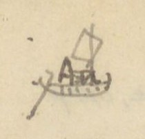{width=12%}

Chữ trên hình: An (chữ viết tắt An quảng, bị gạch chân/che một phần).

## AN-QUẢNG - BẠCH-LONG-VĨ

[NC: Bảng không có tiêu đề cột; cột số có lẽ là số tầm. Cột chữ Hán ở đây phần lớn là chữ Nôm (tên nôm của các địa danh); những chữ Nôm không chắc được ghi kèm [?].]

| [Địa danh] | [Chữ Hán/Nôm] | [Khoảng cách] | [Ghi chú] |
|---|---|---|---|
| Cửa Hữu | *Cửa Hữu* (𨷯右) [?] | 1812 | |
| Sông Tranh | *Sông Tranh* (榑 [?] 江) | 1.780 | Rộng 164 T. (Bến đò Tranh) Có tuần. |
| Bến đò Lá | *Bến đò Lá* (濮 [?] 蓂 [?]) | 1.800 | Xã La khê (羅溪) |
| Sòi Mòi | *Sòi Mòi* [chữ Nôm, không gõ được: bộ hỏa + 雷; bộ thổ + 某] | 670 | Có một chi đi tuần Phượng hoàng (鳳凰) huyện Hoa phong (華封), ra bể. |
| Lại đàn | *Lại đàn* (獺彈) | 570 | Vì có đá trồi như đoàn rái cá. |
| Hang luồn | *Hang luồn* [chữ Nôm, không gõ được: 香 + 谷; 首 + 侖] | 772 | Vì dưới núi có hang, có thể cho thuyền chui qua. |
| Bờ lội | *Bờ lội* (埔涞) | | |
| Sở Tuần châu | *Sở Tuần châu* (所 [?] 州) | 2.375 | 所 [?]. Có tuần. |
| Cửa Lục | *Lục hải môn* (錄海門) | 450 | Rộng 153 T. Có chi đi Vân đồn (雲屯). |
| Núi Bài thơ (núi Truyền đăng) | *Sơn bài thi* (山牌詩) (*Truyền Đăng* 傳燈) | 1.625 | Bên sườn núi, cách nước chừng 3T, có mài đá khắc hai bài thơ và tựa. (xem dưới) |

Một bài đề: Năm Quang thuận thứ 9, mùa xuân tháng 2, ta thân dẫn lục sư, duyệt võ ở sông Bạch đằng. Ngày ấy gió hòa, cảnh đẹp. Bể không dậy sóng. Ta bèn dong bể Hoàng hải (黃海) tuần xứ An bang (nay là An quảng). Dừng quân ở dưới núi Truyền đăng. Thơ rằng:

*Quang Thuận cửu niên xuân nhị nguyệt, dư thân suất lục sư duyệt võ vu Bạch Đằng giang, thị nhật phong hòa cảnh tễ. Hải bất dương ba. Nãi phiếm Hoàng hải tuần Quảng [An] bang. Trú sư vu Truyền Đăng sơn hạ. Kỳ thi vân: Cự tẩm uông dương triều bách xuyên. Loạn sơn kỳ bố bích liên thiên. Tráng tâm sơ cảm hàm [?] tam đoạn [?] (1), tín thủ cầm đề điện [?] nhị quyền [?]. Thần (2) bút [?] cự cơ tồn [?] hổ lữ, Hải đông phong toại tức lang yên. Thiên Nam vạn cổ sơn hà tại, chính thị tu văn yển võ niên. Thiên Nam động chủ đề.*

(光順九年春二月，余親率六師閱武于白藤江，是日風和景霽。海不揚波。乃泛黃海巡廣安邦。駐師于傳燈山下。其詩云：巨浸汪洋朝百川。亂山碁布碧連天。壯心初感咸[?]三段[?]，信手擒提奠[?]二權[?]。神筆[?]柜机[?]存[?]虎旅，海東烽燧息狼烟。天南萬古山河在，正是修文偃武年。天南洞主題)

**Dịch:** (lời tựa tác giả đã dịch ở trên) Bài thơ: Biển lớn mênh mông, trăm sông chầu về; núi non bày ngổn ngang như quân cờ, xanh biếc liền trời. Lòng tráng sĩ mới cảm ... [?]; tay ... [?]. ... quân hổ, ở bể đông khói lửa báo giặc đã tắt. Núi sông trời Nam muôn thuở còn đó, chính là năm sửa văn dẹp võ. Thiên Nam động chủ đề.

*Ở lề phải, móc ghi dị bản:* 1 股 [?]; 2 𡰥 [?]; 一統志 (*Nhất thống chí*).

[NC: Đây là bài thơ của vua Lê Thánh Tông (hiệu Thiên Nam động chủ) khắc ở núi Bài Thơ (Hạ Long), năm Quang Thuận 9 (1468). Câu 3-5 tác giả chép chữ thảo, người chép chưa đọc chắc; số (1), (2) đánh dấu chỗ dị bản ghi bên lề theo *Nhất thống chí*.]

Một bài đề: *Thời điều ngọc chúc, tuế nhẫm kim nhương. Thích vạn vụ chi dư nhàn, thức nhất du chi hữu độ. Dư suất lục sư, giá dư hoàng lâm vu Đông minh. Lãm đảo dữ chi như họa [?]. Giao thất [?] trừng thanh. Diệu thủy bộ chi như lôi [?], hổ sư hùng tráng. Đan thần dật hứng. Trì trúc dũng sinh [?]. Viên thuật đề nhai di vận. Trác tựu thất ngôn, vĩnh lưu vu thạch. Kỳ thi vân: Minh bột vô nhai hối [?] tổng xuyên. Sơn liên lam [?] thủy thủy liên thiên. Thần kỳ mạc trạng an bài chưởng, tạo [?] nhuận nan danh hóa dục quyền. Đại viễn thượng di [...] [...] xú [?], xuân quang điệp kiến lạn hoa [?] yên. Tái tuân nhất dự [...] duyệt. Quần thứ hàm ca hải yến niên. Nhật Nam Trịnh chủ (chắc là Nguyên chủ 元主) đề. Bảo Thái Kỷ dậu trọng xuân sơ thất nhật.*

(時調玉燭，歲稔金穰。適萬務之餘閒，式一遊之有度。余率六師，駕艅艎臨于東溟。覽島嶼之如畫[?]。蛟室[?]澄清。妙水步之如雷[?]，虎師雄壯。丹神逸興。池竹湧生[?]。爰述題崖遺韻。琢就七言，永留于石。其詩云：溟渤無涯匯[?]總川。山連藍[?]水水連天。神奇莫狀安排掌，造[?]潤難名化育權。代遠尚遺[...][...]臭[?]，春光疊見爛花[?]烟。載遵一豫[...]悅。群庶咸歌海晏年。日南鄭主（chắc là 元主）題。保泰己酉仲春初七日)

1729 - Trịnh Cương

**Dịch:** Bốn mùa hòa thuận, năm được mùa lúa vàng. Nhân lúc muôn việc rảnh rang, làm một cuộc chơi có chừng mực. Ta dẫn sáu quân, ngự thuyền lớn tới bể Đông. Ngắm đảo nhỏ như tranh vẽ ... quân hổ hùng tráng ... Bèn theo vần thơ cũ đề trên vách đá, gọt thành bài bảy chữ, để lưu mãi trên đá. Thơ rằng: Bể cả không bờ, thu nhóm muôn sông; núi liền nước biếc, nước liền trời. Thần kỳ không tả xiết, (như ai) bày trên bàn tay; ơn thấm khó gọi tên, quyền hóa dục ... Muôn dân đều ca năm biển lặng. Chúa Trịnh nước Nhật Nam đề. Ngày mồng bảy tháng hai năm Kỷ dậu niên hiệu Bảo Thái.

[NC: Chữ ở đây viết tay khá thảo, nhiều chữ người chép chưa đọc chắc; nên đối chiếu với bản khắc đá núi Bài Thơ hoặc *Đại Nam nhất thống chí*. "Nhật Nam Trịnh chủ" tức Trịnh Cương; Bảo Thái Kỷ dậu = 1729 (tác giả ghi 1729 ở lề phải, và tên "Trịnh Cương" viết thêm phía dưới).]

| [Địa danh] | [Chữ Hán/Nôm] | [Khoảng cách] | [Ghi chú] |
|---|---|---|---|
| Giếng Hầm [?] | *Giếng Hầm* (汫頷) | 2125. | Nước trong, uống được. Đi qua thì núi bể dáng khói [?] y như bức họa. |

# Trang PDF 32 - An Quảng 2 (trang bản thảo không đánh số)

*Đầu trang: An quảng 2.*

| [Địa danh] | [Chữ Hán/Nôm] | [Khoảng cách] | [Ghi chú] |
|---|---|---|---|
| Núi đầu Mỏi [?] | *Núi đầu Mỏi* (𡶀頭蟒 [?]) | 3.925 | Dọc đường, núi đá rải rác, trông thiên diệu vô cùng. |
| Ao Hanh | *Ao Hanh* (泑亨 [?]) | 7.506 | Chỗ đi qua, núi đá la liệt. Duy ba hòn có tiếng. Một tòa, trên có đá hình giống con gái, gọi là núi Bà Lanh (婆冷 [?]); một hình tròn như đũa, gọi núi Chiếc đũa (隻筯 [?]). Một tòa có đá hình thầy tăng, gọi Thầy Tiêu (柴宵 [?]). Vua Lê thánh Tông (聖宗) có thơ vịnh (không khảo) (xem dưới). |

[NC: ở dòng "Ao Hanh", tác giả gạch chữ "Đình" (Ao Đình Hanh). Ở dòng "Núi đầu Mỏi", chữ "Mỏi" viết đè, phía trên ghi thêm "ỏi" [?].]

Bài thơ của vua Lê Thánh Tông (tác giả chép bằng quốc ngữ, xen chữ Nôm):

> Đôi răng cửa Lục có thầy tiêu.
> Ngồi tựa Câu lơn (句 [?]) nghe mõi (蟒 [?]) kêu.
> Chuông kích (劇) phó cho thằng nộm (傖 [?]) đóng (棟 ?),
> Đền tàn để mặc cái dơi khêu.
> Phẳng da trời sương lạt móc
> Dò dốn bể sóng in rêu.
> Dù ai mà hỏi bao nhiêu tuổi
> Non nước bao nhiêu tuổi bấy nhiêu.

[NC: Đây là bài thơ Nôm vịnh núi Thầy Tiêu (Hạ Long), tương truyền của Lê Thánh Tông. Các chữ Nôm tác giả ghi kèm rất thảo, chưa đọc chắc; dấu "?" sau 棟 là do tác giả ghi.]

| [Địa danh] | [Chữ Hán/Nôm] | [Khoảng cách] | [Ghi chú] |
|---|---|---|---|
| Cẩm phả | *Cẩm phổ* (錦普) | 1.288 | Có phần đồn. Qua đường trông xa thấy núi Vân đồn (雲屯山) |
| Cửa Bốt [?] | *Cửa Bốt* (𨷯門卒 [?]) | 3.331 | Trên bờ có núi tên núi Đức ông (𡶀翁 [?]) |
| Voi hạ mọp [?] | *Voi hạ mọp* [chữ Nôm, đọc chưa chắc: 𤠄 [?] 河 + một chữ không gõ được] | 5.855 | Vì đá giống voi phục. Dọc đường có giếng (𣙩 [?] 水), nước rất ngọt |
| Cửa s. Tiên Yên | *Tiên Yên giang khẩu* (先安江口) | 5.580 | Bắc có núi Mồng gà [chữ Nôm, không gõ được]. Một chi đi Thác Than (托灘) |
| Núi gềnh [?] | *Núi gềnh* (崆 [?] 𥕄 [?]) | 2.573 | |
| Núi Hỏi [?] hứa | *Núi Hỏi hứa* (兀許 [?]) | 2.800 | Giáp Đàm hà (潭河) |
| Già môn (cửa) | *Giá môn* (駕門) | 1.030 | Phía tả có Bích thanh mai sơn (壁淸枚[山]) |
| Cửa Vạn cống | *Vạn Cống* (萬貢) | 3.500 | 門 |
| Cửa Tiểu | *Tiểu môn* (小門) | 9.920 | Phía tả có đá Cồn bè (𡓁筏 [?]) |
| Cửa Đại | *Đại môn* (大門) | 10.250 | Thường có cá voi ra vào. Bên tả có 2 hòn đá, tên Cái Mão, Cái Mèo (丐帽，丐猫) |
| Cửa Tán [?] | *Tán môn* (贊門) | 5.100 | |
| Lạch Dương | *Lạch Dương* (㴔洋 [?]) | 5.700 | Trở lên đến qua Thanh mai bích (清枚壁山) |
| Bạch long vĩ | *Bạch Long Vĩ* (白龍尾) | | |

[NC: ở dòng "Núi Hỏi hứa", tác giả gạch chữ "Phạm" và viết "Hỏi" [?] bằng mực tím phía trên. Nửa dưới trang là tiêu đề in VERRERIE DU NORD in ngược.]

# Trang PDF 33 - Bắc Kỳ thủy đạo 1 (trang bản thảo 15)

*Đầu trang: Bắc Kỳ thủy đạo 1; số trang bản thảo: 15*

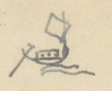{width=12%}

[NC: Cột chữ Hán ở các bảng thủy đạo có nhiều chữ Nôm: *ngã ba* (我巴), *cầu cháy* (求烓 [?]). Cột số có lẽ là số tầm. Số trong ngoặc sau tên đường là tổng số tầm.]

## THĂNG LONG - THỦY VĨ (163.511)

| [Địa danh] | [Chữ Hán/Nôm] | [Khoảng cách] | [Ghi chú] |
|---|---|---|---|
| Bến Cầu Cháy | *Cầu Cháy* (求烓 [?]) | 18.183 | *tân thứ* (津次) [bến đỗ]. Đi về Tây |
| Cửa Hát giang | *Hát giang khẩu* (喝江口) | 8.200 | |
| Bến trấn Sơn tây | *Sơn Tây trấn* (山西鎮) | 8.750 | *thành tân thứ* (城津次) [bến ở thành] |
| Ngã ba Hạc | *Ngã ba Hạc* (我巴鶴) | 8.010 | |
| Bến trấn Hưng hóa | *Hưng Hóa trấn* (興化鎮) | 42.639 | 城津次 |
| Đồn Bạch-Lạm [?] | *Bạch Lạm đồn* (白廩屯 [?]) | 43.720 | |
| Đồn trấn hà | *Trấn Hà đồn* (鎮河屯) | 30.960 | Ở châu Văn bàn (文盤) |
| Bảo thắng (đồn) | *Bảo Thắng đồn* (保勝屯) | 3.500 | Ngã ba Thao giang (洮江), châu Thủy vĩ (水尾) |
| Ngã ba Sông Can [?] (giáp Nội địa) | *Ngã ba sông Can* (滝[?]汧 [?]) | | |

[NC: "giáp Nội địa": giáp đất Trung Quốc (Vân Nam).]

## THĂNG LONG - BẢO LẠC (162.589)

| [Địa danh] | [Chữ Hán/Nôm] | [Khoảng cách] | [Ghi chú] |
|---|---|---|---|
| Bến Cầu cháy | 求烓 [?] | 35.133 | Đi về Tây |
| Ngã ba Hạc | 鶴 | 48.100 | [Xem /6] |
| Bến trấn Tuyên quang | *Tuyên Quang trấn* (宣光鎮) | 79.356 | 津次 |
| Bảo lạc, bến (Đồn Ninh biên) | *Bảo Lạc* (保樂); *Ninh Biên đồn* (寧邊屯) | | Cách Ngã ba Hạc 127.456 |

[NC: "[Xem /6]": xem dòng 6 của trang (theo cách tra cứu tác giả nói ở Mục lục).]

## THĂNG-LONG - CỬA BIỂN (67.173)

| [Địa danh] | [Chữ Hán/Nôm] | [Khoảng cách] | [Ghi chú] |
|---|---|---|---|
| Bến Cầu Cháy | 求烓 [?] | 29.268 | Đi cửa Liêu 67.173 |
| Ngã ba Lạnh | *Ngã ba Lạnh* (我巴冷) | 3.800 | |
| a, Ngã ba Lược | 〃 淥 [?] | 11.580 | |
| Ngã ba Thủy đồn | 〃 水屯 | 3.020 | |
| Bến Vị hoàng | *Vị Hoàng* (渭潢) | 11.850 | 津次 Ở trấn Sơn nam hạ (山南下) |
| Ngã ba Đục | *Ngã ba Đục* (我巴濱 [?]) | 7.650 | |
| Cửa bể Liêu | *Liêu hải môn* (遼海門) | | |
| b, Ngã ba Lược | 〃 淥 [?] | 39.946 | [Xem /26] |
| Cửa Diêm hộ | *Diêm Hộ* (塩戶) | | |
| c, Ngã ba Vị hoàng | 渭潢 | 20531 | [Xem /28] |
| Cửa Lạc | *Lạc* (樂) [?] | | |

[NC: Tên đường gạch chữ "Biển" viết đè [?]; tổng số 67.173 trùng với ghi chú "Đi cửa Liêu 67.173". Nửa dưới trang có chữ in VERRERIE DU NORD in ngược.]

# Trang PDF 34 - Bắc Kỳ thủy đạo 2 (trang bản thảo không đánh số)

*Đầu trang: Bắc Kỳ đường thủy 2*

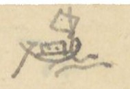{width=12%}

| [Địa danh] | [Chữ Hán/Nôm] | [Khoảng cách] | [Ghi chú] |
|---|---|---|---|
| d, Bến cầu cháy | | | |
| Ngã ba Lạnh | 我巴冷 | 15.618 | |
| Ngã ba Cầu châu | *Cầu Châu* (求珠) | 33.552 | Ở Sơn nam Thượng-trấn (山南上) |
| Ngã ba Nanh | *Ngã ba Nanh* (我巴獰 [?]) | | Ở đạo Thanh bình (清平道) |
| e, Bến cầu cháy | | 72.060 | |
| Phủ Kiến xương | *Kiến Xương* (建昌) | | Sơn nam hạ |
| Thượng hộ, Hạ hộ | 上戶，下戶 | | |
| Cửa Trà lý | *Trà Lý* (茶里) | | |

## THĂNG-LONG - CẦU CHẦU

| [Địa danh] | [Chữ Hán/Nôm] | [Khoảng cách] | [Ghi chú] |
|---|---|---|---|
| Bến Cầu chay | 求烓 [?] | 18.182 | Qua Hát giang (喝江) đến Cầu châu |
| Cửa Hát giang | 喝江口 | 2.200 | |
| Bến Đại phùng | *Đại Phùng xã* (大馮社) | 17.524 | *tân độ* (津渡) [bến đò] |
| Bến Ninh sơn | *Ninh Sơn xã* (寧山社) | 31.725 | 津渡 Ở huyện Chương đức (彰德) |
| Ngã ba Đục | 我巴濱 [?] | 13.469 | |
| Ngã ba Cầu châu | 求珠 | | Cách Thăng long 83.100 |

[NC: Tiêu đề viết "CẦU CHẦU" (dấu huyền), trong bảng viết "Cầu châu" (求珠).]

## THĂNG LONG - HẢI DƯƠNG

| [Địa danh] | [Chữ Hán/Nôm] | [Khoảng cách] | [Ghi chú] |
|---|---|---|---|
| Bến Cầu cháy | 求烓 [?] | 29.268 | |
| Ngã ba Lạnh | 冷 | 3.800 | |
| Ngã ba Lược | 淥 [?] | 32.026 | |
| Ngã ba Thái Công | *Thái Công* (太公) | 15.300 | Gò [?] |
| Ngã ba Kênh Tre | *Kênh Tre* (涇椥 [?]) | 9.320 | Trấn Hải dương (海陽) |
| Ngã ba Tuần lâu | *Tuần Lâu* (巡樓) | | Cách Thăng long 89.714 |

[NC: Nửa dưới trang là tiêu đề in VERRERIE DU NORD in ngược.]

# Trang PDF 35 - Bắc Kỳ đường thủy 3: sông Nguyệt Đức (trang bản thảo 16)

*Đầu trang: Bắc Kỳ đường thủy 3; số trang bản thảo: 16*

## SÔNG NGUYỆT-ĐỨC

[NC: Các chữ a, b, c, d khoanh tròn đỏ trong bản thảo.]

| [Địa danh] | [Chữ Hán/Nôm] | [Khoảng cách] | [Ghi chú] |
|---|---|---|---|
| (a) Bến đồn Na miệt [?] | *Na Miệt* (那蔑) | 10.500 | *đồn thủy thứ* (屯水次) [bến nước của đồn] |
| Bến thành Thái nguyên | 太原 | 38.018 | *thành thủy thứ* (城水次). Ở Đồng Mụ (同姥) |
| Ngã ba Lương | 良 | 14.500 | |
| Đò Sông Cầu | *Cầu giang độ* (求江渡) | 14.750 | |
| Đồn Phả lại | *Phả Lại* (普賴) | 1.300 | |
| Cửa sông Thiên đức | *Thiên Đức giang* (天德江) | 1.800 | 口 |
| Ngã ba Lâu | 樓 | 7.790 | |
| Ngã ba Kiều | 橋 | 19.700 | |
| Mỏ Kẽm | *Bạch duyên trường* (白鉛壙) | | Ở Đông triều (東潮縣). Cách Đồn Na miệt (那蔑) 108.358T |
| (b) Ngã ba Kiều | 喬 | 7.150 | [X/10] |
| Ngã ba Tre | 椥 | | Bến trấn Hải dương |
| Bến trấn Hải dương | 海陽 | | |
| Ngã ba Tre | 椥 | | |
| (c) Ngã ba Lương | 我巴良 | 15.250 | [X/5] |
| Bến Phù lỗ | *Phù Lỗ xã* (扶魯社) | | Ở huyện Kim hoa (金華) |
| (d) Bến Cầu cháy | 求烓 [?] | 107.344 | đến Hải dương Trấn, giáp sông Nguyệt đức (月德) |
| Ngã ba Kiều | 橋 | | |
| Mỏ Kẽm | 白鉛壙 | | |

[NC: "Mỏ Kẽm", chữ Hán 白鉛壙 [?] nghĩa là mỏ chì trắng (kẽm). Ở mục (b), dòng thứ hai tác giả gạch tên "Ngã ba Tre" nhưng để lại chữ Hán và ghi chú. "[X/10]" = xem dòng 10. Ở mục (d), dòng cuối tác giả viết "Mỏ Kẽm" đè lên chữ khác.]

## THĂNG-LONG - CỬA HOA-PHONG

| [Địa danh] | [Chữ Hán/Nôm] | [Khoảng cách] | [Ghi chú] |
|---|---|---|---|
| Cầu Cháy (Bến) | 求烓 [?] | 33.068 | |
| Ngã ba Lược | 淥 [?] | | |
| Ngã ba Thái Công | 太公 | 22.638 | |
| Ngã ba Mây | *Mây* (𧀒 [?]) | 11.803 | |
| Ngã ba Kênh Mèo | *Kênh Mèo* (涇猫 [?]) | 11.000 | |
| Trấn An quảng | 安廣 | 9.580 | |
| Cửa Hoa phong | *Hoa Phong* (華封) | | Cách Thăng long 124.395. |

[NC: Nửa dưới trang có chữ in VERRERIE DU NORD in ngược.]

# Trang PDF 36 - Trang trắng

[Mặt sau của tờ trước: chỉ có giấy tiêu đề in sẵn VERRERIE DU NORD, Hanoi, le ... 194..; nét chữ tờ bên kia và vết ấn son của trang sau hiện qua giấy. Không có chữ viết.]

# Trang PDF 37 - Sông lớn: vè các sông Bắc Kỳ (trang bản thảo 17)

*Số trang bản thảo: 17*

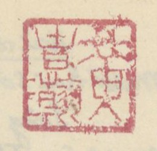{width=12%}

[NC: Ấn son vuông, chữ triện, giống ấn ở trang bản thảo 1 (trang PDF 7); người chép chưa đọc chắc.]

## Sông lớn (Địa đồ sở Địa dư)

(Rút ở sách *Dịch lộ phụ hành trình* (易路附行程) [?] A 1979)

[NC: "Địa đồ sở Địa dư": có lẽ là bản đồ của Sở Địa dư (Service géographique) thời Pháp. Tên sách chữ Hán viết thảo, chưa đọc chắc. Bài vè lục bát chép bằng quốc ngữ, tên sông viết hoa; cột bên phải là chú thích của tác giả: tên tỉnh (chữ Hán, gạch chân, kèm số nhỏ) và tên các sông bằng chữ Hán/Nôm (滝 = *sông*, 𨷯 = *cửa*).]

| Câu vè | Chú thích bên phải |
|---|---|
| Đông Kinh (東京) lắm thủy giang hồ | |
| Đố ai nhớ hết bản đồ Lang-sa (Pháp) | |
| NHỊ kia ĐÁY nọ trường hà | *Hà Nội* (河內)²: 珥河, 底河 |
| Còn như PHỦ LÝ lại là Ca-nan (Canal de Phủ lý) | *Hà Nam* (河南)³: Pp. [?] 珠江, 珥底 [?] |
| Hải phòng có THÁI BÌNH loan | *Hải Phòng* (海防)⁵: 太平 |
| Có dòng sông BẠC, có lan sông VĂN | 滝泊 [?], 涇文澳 [?] |
| Lạch TRAI nước trắng như ngân | 㴔漈 [?] |
| Mà nghe cửa CẤM cũng gần đâu đây | 𨷯禁; 南召 (ở 安陽) |
| Đây là sông ĐÁY thành Tây | *Sơn Tây* (山西)⁴: 底江, 清江 |
| Trắng đen hai vẻ như mây ngân hà | 黑江 珥河 |
| Thái bình riêng một sông BA | *Thái Bình* (太平)⁴: 滝巴淥 [?], 滝茶里 |
| Buôn chè buôn muối sông HÓA đi về | 滝塩戶, 滝花 |
| Hỏi ai buôn bán tỉnh Hòa | *Hòa Bình* (和平)¹: 黑江 |
| HẮC giang một dải đi về mấy lâu | |
| Bắc giang gần nẻo sông CẦU | *Bắc Giang* (北江)³: 滝梂, 滝陸岸 |
| Muốn sang Lục ngạn đáp tàu Bắc giang sông THƯƠNG | 滝滄 |
| Ninh bình thì có ĐÁY GIANG | *Ninh Bình* (寧平)²: 底江, |
| Ri-vi-e (Rivière de Phủ Nho quan) là đường Phủ Nho | 儒関 |
| Thái nguyên thì hạt chợ Chu | *Thái Nguyên* (太原)⁴: 滝𢄂朱 [?], 滝功 |
| Sông CÔNG thả lưới; ĐÒN-ĐÔ treo cầu | 滝屯都, 滝梂 |
| Thành Nam cửa 1 ở đâu | *Nam Định* (南定)⁴: 滝巴淥 [?], 底江 |
| ĐÁY, sông, NHỊ-thủy nâng đầu VỊ XUYÊN | 珥河, 渭川 (滝南定) |
| Lạch VĂN thì ở Quảng yên | *Quảng Yên* (廣安)⁰: 文澳, 冊喧 [?] |
| SÁCH-HUYỀN, NAM-TRIỆU gần miền sông HUY | 南召, 滝輝, 𨷯禁 |
| CẤM-môn, LIỆP thủy chưa kỳ | 滝獵; 𢷀浦 [?], 冰 [?] |
| BỐ kia BẰNG ấy chữ thì ROAY-ĐÔ (Arroyo de Hoành bồ, de Bằng) | |
| Trên Hưng tìm ngọn sông MÔ | *Hưng Hóa* (興化)⁷: 滝摸 [?] |
| AN-LƯƠNG bên ấy RI-VI-E-RƠ (Rivière de An lương | 安良 |
| MÂY, NAM nước chảy lững lờ | 滝𦹵 [?], 滝南 (ở 安 [?]) |
| Sông THANH, sông HẮC còn chờ giăng giăng | 清江, 黑江, 紅江 |
| Sông LÔ cầu bắc ngang ngang | [...]³: 盧江 (𣄀 [?]) |
| Ca-nan Ra-pít (CANAL DES RAPIDES) rõ ràng hướng tây | 滝梂, 滝隴 [?] (canal..) |
| Hải dương gần ở đâu đây | |

[NC: Các chữ viết hoa (NHỊ, ĐÁY, PHỦ LÝ...) là tên sông, tác giả viết hoa nét đậm. "Roay-đô" phiên âm tiếng Pháp *arroyo*, "Ri-vi-e" là *rivière*, "Ca-nan" là *canal*. Chữ ở cột phải viết nhỏ và thảo, nhiều chữ Nôm chưa đọc chắc. Nửa dưới trang có chữ in VERRERIE DU NORD in ngược.]

# Trang PDF 38 - Sông lớn (tiếp) (trang bản thảo không đánh số)

| Câu vè | Chú thích bên phải |
|---|---|
| Hải dương gần ở đâu đây | *Hải Dương* (海陽)¹²: 涇漈 [?]; |
| Mười hai sông ấy Lạch TRAY là đầu | |
| Sông THẢY, sông GIÁ về đâu | 滝荊柴 [?], 滝架 |
| Mà sông TAM BẠC hỏi đâu KINH MÔN (荊門) | 三泊，荊門 |
| THÁI BÌNH, VĂN-ÚC hai con | 太平，文澳 |
| ĐÔNG GIANG, ĐÀ-BẮC hãy còn xa xa | 東江，陀北 |
| Ca-nan (canal) hai dải BAM (des Bambous) HOA | 氷連 [?]，花 |
| Còn như KẺ ĐỒNG lại là ri-vi (rivière) | 几東 |
| Hưng yên thì có sông gì? | *Hưng Yên* (興安)²: 滝𨷯錄 (鎒 [?]) |
| Này TRE, này ĐỒNG, này thì HỒNG GIANG | 几東，紅江 |
| , theo dòng CẨM, ĐÁY Tuyên quang | *Tuyên Quang* (宣光)⁴: 滝漈 (泸江 [?] 底江) |
| TRẢY, THANH hai ngọn tiền chàng bên sông | 滝𣘛 [?] (上流 [...] 娘 [?]) 清. |
| Bái kia chỉ có sông HỒNG | *Yên Bái* (安沛 [?])¹: 紅江 |
| mà sông Thành Lạng này CÔNG này THƯƠNG | *Lạng Sơn* (諒山)⁴: 淇窮 [?], 滄; 㴗 [?] |
| TRẢY, THANH hai ngọn Hà giang | *Hà Giang* (河陽 [?]): 清，漈，㠊 [?] (永綏 [?]) |
| TRẢY-giang hai ngọn về đàng Lào Kay | *Lào Cai* (老街)²: 紅，漈 |
| Hỏi thăm Sài Mù cùng ai | 灒[?]濼 [?]²: 馬，黑 |
| MÃ giang, HẮC THỦY có dài hay không | |
| Vĩnh yên ba ngọn sông trong | *Vĩnh Yên* (永安 [?])³: [...] |
| Sông LÔ, sông ĐÁY lại dòng sông THANH | 底，清 |
| Sông BẰNG, sông TÁT Cao bằng | *Cao Bằng* (高平)⁴: 朋，薩 (bảo lạc) |
| Sông PHIÊN lại nở một cành QUẾ chi | 番般 [?]; 仗桂 [?] |
| Sang miền Bắc cạn xa gì | *Bắc Cạn* (北㳥 [?])²: 娘， |
| CẦU, sông NƯƠNG ấy thì đi một vòng | 梂 |

> Xin bạn ai thuộc lấy làm lòng
> Kiếm năm ba chữ để phòng có khi.

[NC: Hai câu cuối viết cách ra, là câu kết bài vè. Một số chữ Hán/Nôm ở cột phải viết thảo, chưa đọc chắc. Góc trái trên có vết ấn son của trang trước in sang. Nửa dưới trang có chữ in VERRERIE DU NORD in ngược.]

# Trang PDF 39 - Bình Định - các đồn (trang bản thảo 18)

*Đầu trang: Bình định 1.; số trang bản thảo: 18*

## BÌNH-ĐỊNH - các đồn

(TTNĐ không chép)

[NC: Số thứ tự 1°, 2° khoanh tròn đỏ trong bản thảo. Cột số có lẽ là số tầm. Một số địa danh viết bằng chữ Nôm.]

| [Địa danh] | [Chữ Hán/Nôm] | [Khoảng cách] | [Ghi chú] |
|---|---|---|---|
| (1°) Cửa Tây | *Tây môn* (西門) | 8.293 | Theo đại-lộ đi lên |
| sông Thiết trường | *Thiết Trường* (鐵場) | | Trên đến sông Thái bình (太平) dưới vào sông Khu cường (𡋂區𡋂岡 [?]) |
| Chợ Nho lâm | *Nho Lâm* (儒林) | | |
| Cầu Tân sung | *Tân Sung* (新銃) | | Cầu sa (沙) |
| Cầu Sa đôi | *Sa Đôi* (沙堆) | | |
| Chợ Vân tường | *Vân Tường* (雲祥) | | Chợ Đình (𨤮亭 [?]) |
| Khe Trường định | *Trường Định* (長定) | | |
| Cầu Suối Bầu | *Suối Bầu* (溪瀌 [?]) | | |
| Điếm Kiên Mỹ (đi về Tây) | *Kiên Mỹ ấp* (堅美邑) | 21.695 | Lò Giấy (爐紙). Từ đây có đường rẽ đi về nam, ngược 5.571, qua Sông Kiên Mỹ (堅美), Chợ Phúc lộc (福祿) (chợ Sung bông (梡[?]芃 [?])) đến Đồn phần thủ Đồng hươu [?] (仝 [...]) |
| Khe Kiên thành | *Kiên Thành* (堅城) | | Khe suối Nhân (溪仁) |
| Sông Đồng phú | *Đồng Phú giang* (仝富江) | | Trên đến Cầu bông (求芃 [?]), chảy ra sông Sung bông (梡[?]芃 [?]) |
| Khe Đồng phú | 〃 溪 | | |
| Núi Tây sơn | *Tây Sơn lĩnh* (西山嶺) | | Tên Đá đa [?] (多 [?]) |
| Suối Bối | *Suối Bối* (溪溳 [?]) | | |
| Nguồn Cầu bông | *Cầu Bông nguyên* (求芃源 [?]) | | Quê quán họ Tây sơn (西山). Có đồn phân thủ |
| Sông Ba | *Sông Ba* (滝波) | | |
| Tào vào [?] | (曹 [...]) | | Có đồn thủ |
| (2°) Cửa Tây nam | *Tây Nam* (西南) | 4.849 | Theo đại lộ. |
| sông Nhạn tháp | *Nhạn Tháp* (雁塔) | | Tên Sông Ha [?] (滝車 [?]), trên đến sông Thiết trường (鐵場), dưới vào sông Đập đá (蹋砢 [?]) |
| Sông Quan quang | *Quan Quang* (觀光 [?]) | | Trên đến s. Thái bình (太平江), dưới đến s. Lam cầu (藍求) |
| Chợ Chí thiện | *Chí Thiện* (至善) | | Chợ Cây hoa (核花) |
| Sông Thiện hiếu | *Thiện Hiếu* (善孝) | | Tên sông bến bộng (滝𣴓[?]芃 [?]). Trên đến sông Chiến khung [?] (戰拳 [?]), dưới chảy vào s. Tân an [?] 路 |
| Rừng Trường Uy | *Trường Uy lâm* (長威林) | | |
| Nguồn An tượng | *An Tượng* (安象) | | Có đồn phân thủ |

[NC: Ở dòng "Núi Tây sơn", chữ trước "Đá đa" bị gạch. Ở dòng "Sông Thiện hiếu", chữ 路 viết riêng một dòng dưới chữ "Tân an". Nửa dưới trang có chữ in VERRERIE DU NORD in ngược.]

# Trang PDF 40 - Bình định 2

*Đầu trang: Bình định 2*

[NC: Bảng lộ trình 4 cột: địa danh | chữ Hán | số tầm | ghi chú. Số khoanh đỏ là số thứ tự đường. Trong trang có nhiều chữ Nôm (tên chợ, cầu, cây). Chữ "chợ" tác giả viết bằng một dạng chữ Nôm (trên như 耳口, dưới như 巾); ở đây chép theo dạng thường gặp 𢄂 [?].]

| [Địa danh] | Chữ Hán | [Số tầm] | [Ghi chú] |
|---|---|---|---|
| **③** Cửa Nam | 南門 | 7.180 | Theo dịch lộ đi Nam |
| Vĩnh thế | 永世 | 7.257 | Chợ Phủ trung 府忠 [TL đi nam 34/18 [?]]. Có đường rẽ phía đông |
| Cầu Vinh thịnh | 榮盛 | | Cầu Mụ Cảnh (媒景) |
| Cầu S. Trung tín | 忠信 | | Trên đến S. Vân (雲江), dưới vào đầm Hải Khô (海涸潭) |
| Cầu Khe Lão nghĩa | 老義 | | |
| Cầu Hội thủy | 會水 | | |
| Chợ Bình thịnh | 平盛 | | Chợ Mụ Hào (𢄂 [?] 媒豪) |
| Cầu S. Phú hòa đông | 富和東 | | 江求 [?]. Bến Cầu Ngói (求堄). Trên tre [?] bến cầu Thông (桶求津), chảy ra đầm Hải Khô (海涸潭) |
| Cầu Tân hội | 新會 | | Bến Cầu đôi (求堆), chỗ cuối đầm Hải Khô |
| Chợ Cẩm thượng | 錦上 | | Bến chợ Triều (𢄂 [?] 朝) |
| Chợ Thượng lộc | 上祿 | | Bến chợ Giã (𢄂 [?] 艝 [?]). Quan *Tư đồ* (司徒) Tây Sơn quản chu-sư (quân thuyền) thua ở đó |
| Cửa Thi Nại | 施耐 | | Có đồn Phân thủ [?] |
| **④** Cửa Nam | 南門 | 7.180 | Theo dịch lộ đi nam |
| Vĩnh thế | 永世 | 2.043 | Xem trên [B.định 2/s.2] |
| Sông Vân sơn (rẽ về Tây) | 雲山江岸 | 12.237 | Bến Bà [?] sông Cây Na (𣘃 [?] 那 [?]) [TL đi nam 34/s 12 [?]]. Chợ [...] 核 [...]. Sông ? Cây Gia. Vậy trên đây chắc là Cây da [...]. Ở đây có đường rẽ: |
| Chợ An Kính | 安敬 | | Chợ Quán mít (館 [...]) |
| Cầu Suối Khái | 求 [...] [...] | | |
| Trường Kỳ | 坤 [?] 椅 [?] | | |
| Sông Quang hiển | 光顯 | | Bến Sông Cây Trôi (核檑) |
| Hà hiểu [?] | 河澆 [?] | | |
| Hà Nha đạo [?] | 河牙 [?] 道 | | Có đồn Phân thủ [?] |

[NC: Bên lề trái, cạnh dòng "Vĩnh thế" của đường ③ và ④, có ký hiệu vẽ tay (giống dấu chỉ đường rẽ). "34/18", "34/s 12": tham chiếu tới mục "TL đi nam" (Thăng long đi nam), trang 34, dòng 8, 12. Chữ "核" tác giả dùng như chữ Nôm "cây".]

# Trang PDF 41 - Bình định 3

*Đầu trang: Bình định 3; số trang bản thảo: 19*

| [Địa danh] | Chữ Hán | [Số tầm] | [Ghi chú] |
|---|---|---|---|
| **⑤** Cửa Bắc | 北門 | 436 | Theo dịch lộ đi bắc |
| Điếm Khu Cường (rẽ về đông) | 塸堈 | 9.471 | Trạm [TL đi nam 33/s.5]. Có đường con đi về đông |
| Chợ Cầu ngói | 求堄市 | | |
| Cầu Phú thạnh | 富成求 | | Bến Cầu Lão lẩn [?] (老謹 [?]) |
| Cầu Mỹ chí | 美志 | | Bến Cầu Bàu da (泡耶) |
| Cống Thủy quan | 水関 | | *Cống khẩu* (槓口) [miệng cống] |
| Chợ Chánh lộc | 政祿 | | Chợ quán Lương (館梁). Từ đây nhiều hổ |
| Nền kho Càn dương | 乾陽 | | *Cố khố chỉ* (故庫址) [nền kho cũ] |
| Đường Thạch cốc | 石谷 | | Bến Đá chẹt [?] |
| Điếm Phương phi | 芳菲 | | Bến Quán Kẻ Thử [?] (几暑 [?]) |
| Bờ bể [?] Nha phiên | 鴉鶣 [?] | | Có đồn phân thủ [NC: dòng ghi chú này bị gạch] |
| Hải chử | 海渚 | | Đồn phân thủ [NC: chữ Hán 海渚 ở cột ghi chú và chữ "Đồn phân thủ" có nét gạch, có lẽ tác giả đã bỏ] |
| **⑥** Cửa Bắc | 北門 | 436 | Theo dịch lộ đi về bắc |
| Điếm Khu Cường | 塸堈 | 855 | [Xem trên B.định 3/s.2] |
| Điếm Hòa dũng | 和勇 | 13.572 | Đường con đi về tây [T.L đi Nam 33/s.4] |
| Khe suối Độc | 溪㵢 [?] 瀆 | | |
| Trường Kiên nhất | 堅一林 [?] | | *Lộ* (路) [đường]. Truông Nước Nóng (渃濃) |
| Cầu Bàu Sung | 泡克 [?] | | |
| Sông Hợp long | 合隆江 | | Bến truông Cây Gai (坤核 [...]). Trên đến S. An long (安隆), dưới vào sông Phù li (苻離) |
| Sông An long | 安隆江 | | Tên đò Xa (渡車). Trên đến sông Đá bàn (𥒥盤), dưới vào S. Hợp long (合隆) |
| Chợ Long định | 隆定 | | Bến chợ Tả liềm (左 [...]) |
| Suối Thạch bàn | 石盤 [...] | | Tên bến Mụ hội (渡媒會) |
| Suối Hội sơn | 會山 〃 | | Tên bến Cây Mây (核楣 [?]) |
| Nguồn Thạch bàn | 石盤源 | | Có đồn phân thủ |
| **⑦** Cửa Bắc | 北門 | 1.291 [?] | Theo dịch lộ đi về Bắc [T.L đi nam tr 33/s.4] |
| Điếm Hòa dũng | 和勇 | 5.874 | |
| Điếm Vĩnh trường (rẽ về đông) | 永長 | 9.673 | Bến Quán Đá đôi (𥒥 [...]) [TL đi nam 32/s.24]. Có đường rẽ về đông |
| Rừng Vĩnh trường | 永長林 | | Bến Truông rễ (坤 [...]). Rất nhiều cọp |
| Chợ Hòa Mỹ | 和美 | | Bến Chợ Bồ đề (菩提) |
| Cầu An trường | 求安長 | | Bến Cầu Đập đất (墶坦) |
| Cầu Khánh trường | 慶長 | | Bến Cầu Cát (求葛) |
| Cầu Hiên | 軒求 | | [Hào [...] [...]] |
| Cầu An quang | 安光 | | Bến Cầu Lầm [?] cửa [...], qua đường Hàn [?] |
| Cửa Đề di | 提夷 | | *Hải môn* (海門) [cửa biển]. Có đồn phân thủ |

[NC: Ở dòng "Chợ Hòa Mỹ", tác giả viết "Hòa nghĩa" rồi viết chữ "Mỹ" lên trên. Bên lề trái cạnh nhóm ⑤, ⑥, ⑦ có ký hiệu vẽ tay như ở trang trước. Nhiều tên bến, cầu ở cột ghi chú viết bằng chữ Nôm, nhiều chữ chưa đọc được.]

# Trang PDF 42 - Bình định 4

*Đầu trang: Bình định 4*

| [Địa danh] | Chữ Hán | [Số tầm] | [Ghi chú] |
|---|---|---|---|
| **⑧** Cửa Bắc | 北門 | 7.165 | Theo dịch lộ đi bắc |
| Điếm Vĩnh trường | 永長 | 5.440 | Xem B.định 5/s 32 [?] |
| Điếm Trà quang (rẽ về tây) | 茶光 | 14.398 | Bến Quán Lang [?] cả (館 [?] 哥 [?]) [TL đi Nam 32/10]. Có đường nhỏ rẽ về Tây |
| Điếm Phú thiện | 富善 | | Tên quán Suối Củi |
| Cầu Lão thạc | 老碩 | | |
| Cầu Lão an | 老安 | | |
| Cầu Mụ Hoạch | 媒 [...] | | |
| Chợ Trà đường | 茶堂 | | |
| Điếm Trung hội | 忠會 | | Bến quán Lò luyện (炉煉) |
| Điếm Phụng sơn | 奉山 | | Tên quán Lập (館 [...]) |
| Đèo Màn [?] rừng | 槾棱 [?] | | |
| Suối chân đèo | 溪 [...] [...] | | |
| Suối Đá | 溪𥒥 | | |
| Chợ Long giang | 隆江 | | Tên điếm Chợ quán (𢄂 [?] 館) |
| Rừng Lộc giang | 祿江林 | | Truông Ba Khu. Nhiều hổ |
| Cầu Lộc giang | 〃 求 | | Cầu Đầu sông (頭滝) |
| Chợ cầu Tân thịnh | 新盛 | | Cầu Mụ Dâu (媒 [...]) |
| Ấp An hòa | 安和 | | Bến Na nổ (椰 [?] [...]) |
| Sông Hội tỉnh (ngược) | 會省江 | 308 | Tên sông Đồng Kho (滝 [...] 庫). Trên đến nguồn Ô liêm (烏鐮), dưới xuống bến Chợ Hàn (𢄂 [?] 翰). [Đoạn này TLYL chỉ là từ ấp Phú hòa 富和, có lẽ là 安和? cho nên tôi chép nối đây]. |
| 9a. Ấp Phú hòa | 富和邑 | | |
| Sông Hội tỉnh (ngược) | 會省江 | 308 | |
| Chợ Hội tỉnh (rẽ về nam) | 會省市 | 4.503 | Chia hai ngả |
| Rừng Tân sơn | 新山林 | | Truông Lão thịnh (老盛). Nhiều hổ |
| Suối Cây sơn | 核山 [...] | | Bến nước Lạnh (渡渃冷 [?]) |
| Rừng Cây sơn | 核山林 | | Truông Mũ Tào [?] (媒 [...]). Nhiều hổ |
| Nguồn Ô liêm | 烏鐮源 | | Đồn Côn dung (昆庸 [?]) |
| Đồn Côn dung | 昆庸 [?] 屯 [?] | | Đồn thủ |

[NC: Bên lề cạnh dòng "Sông Hội tỉnh" đầu có dấu, và số "9a" ghi trước "Ấp Phú hòa"; dòng "Chợ Hội tỉnh" có số "a" khoanh đỏ. Ghi chú dài ở dòng "Sông Hội tỉnh" đầu tiên được viết kéo xuống ngang các dòng dưới, có ngoặc ở lề nhóm các dòng này.]

# Trang PDF 43 - Bình định 5

*Đầu trang: Bình định 5; số trang bản thảo: 20*

| [Địa danh] | Chữ Hán | [Số tầm] | [Ghi chú] |
|---|---|---|---|
| **b)** (rẽ đi bắc) | | 3.749 | 3.749 |
| Đèo Hội đăng | 會登 | | Tên đèo Cò Kè (孤 [?] [...] 鷄 [?]). Rất nhiều hổ |
| Sông Hội đăng | | | Tên Bến Vực tròn (渡域 [?] 輪 [?]). Trên đến nguồn Ô liêm (烏鐮), chảy vào bến Nước hợp (渃合津) |
| Nguồn Ô liêm | 烏鐮 | | Có đồn phân thủ |
| **10°** Phú hòa ấp | 富和邑 | 5.946 | [X. Bình định 2/10] |
| Suối Phú hòa | 〃 [...] | | Bến suối Luôn (淪). Trên tới nguồn Ô liêm, dưới chảy vào S. Hội tỉnh (會省) |
| S. Kim sơn | 金山江 | | Trên tới nguồn Ô liêm, dưới tới chợ Hàn (𢄂 [?] 翰) |
| Cầu Mang vàng | [...] 鐄 | | |
| Chợ Mới | 𢄂 [?] 買 | | |
| Đồng than | 仝灘 [?] | | |
| Truông Đồng lau | 坤仝 [...] | | Nhiều hổ |
| Suối An sơn | 安山 [...] | | Tên bến Mụ Chú [?] (媒注) |
| Nguồn Ô liêm | 烏鐮 | | |
| (Đồn Nước lân) | 渃潾 [?] | | Đồn phân thủ |
| **11°** Cửa Bắc | 北門 | 12.605 | Do dịch-lộ đi về Bắc |
| Điếm Trà quang | 茶光 | 1.691 | [B.định 4/3] |
| Điếm Tường An (rẽ về đông) | 祥安 | 9.769 | Tên quán Trạp (館 [...]). Có đường rẽ ở về đông |
| Rừng Tường an | 祥安 | | Tên Truông Mít |
| Điếm La thiên | 羅 [?] 迁 | | 羅 [?] 迁. Bến: Điếm làng Thiên (𨻫 [?] 迁) |
| Khe 〃 | 溪 | | |
| Chợ An hoan | 安歡 | | Chợ chay (𢄂 [?] [...]) |
| Chợ Thanh xuân | 青春 | | Chợ làng Đằng [?] (𨻫 [?] [...]) |
| Phú thọ man [?] | 富寿蔓 [?] | | Bến gềnh Hàu (𥕄 [?] [...]) |
| Cầu Phú xuân | 富春 | | Cầu phường Chử [?] (芳楮 [?]) |
| Phường mới | 坊買 | | |
| Hải chử | 海渚 | | Đồn phân thủ |
| **12°** Cửa Bắc | 北門 | 14.296 | Đi dịch lộ về bắc |
| Điếm Tường an | 祥安 | 7.036 [?] | [B.định 5/24] |
| Điếm Trà Ổ | 茶塢 | 4.566 | [TL đi Nam 31/33]. Có đường nhỏ rẽ về đông |

[NC: Bên lề trái cạnh nhóm 11° có ký hiệu vẽ tay như các trang trước.]

# Trang PDF 44 - Bình định 6

*Đầu trang: Bình định 6*

| [Địa danh] | Chữ Hán | [Số tầm] | [Ghi chú] |
|---|---|---|---|
| Cầu Lão lãng | 老 [...] | | |
| Rừng Phú hòa | 富和 | | Truông Suối (坤 [...]). Nhiều hổ |
| Chợ Hà la | 河羅 | | |
| Cầu Lò Gốm | 炉 [...] | | |
| Cửa Hà la | 河羅 | | *Hải môn* (海門) [cửa biển]. Đồn Phân thủ |
| **13°** Cửa Bắc | 北門 | 21.832 | Theo dịch lộ đi bắc |
| Trà ổ | 茶塢 | 8.054 | |
| Chợ Lệ dương | 棣楊 | | [TL đi Nam 31/17]. Có 2 đường rẽ: |

[NC: Từ đây trang chia hai cột: bên trái là nhánh "Về Tây", bên phải là nhánh "Về Nam".]

**(Về Tây)** - 390

| [Địa danh] | Chữ Hán | [Số tầm] |
|---|---|---|
| Huyện Bồng sơn | *Bồng Sơn trị sở* (蓬山治所) [lỵ sở huyện Bồng Sơn] | 9.902 |
| Rừng Tuấn đức (Truông Bằng [?]) | 俊德 [?] (坤 [?] 氷 [?]) | |
| Cầu Ô long thượng (Cầu quán Lương) | 烏隆上 (館梁) | |
| Điếm Tuấn đức (Quán Lò thổi) | 俊德 [?] (炉 [...]) | |
| Cầu Vải Vông | 求 [...] [...] | |
| Cầu Hội long (Cầu Mụ Đằng [?]) | 會隆 (媒 [...]) | |
| Chợ Mới | 𢄂 [?] 買 | |
| Sông Tân An (Bến Khái) | 新安 (渡檗 [?]) | Qua sông, đến bến, tên Bến Sông Ngại [?] (滝 [...]), trên đến Trà đình (茶釘), xuống đến Lệ dương (棣楊). Có 2 đường |

**(Về Nam)** - 7.215

| [Địa danh] | Chữ Hán |
|---|---|
| Sông Phú thịnh (Bến đò Trường) | 富盛 (渡場) |
| Quán Chợ Hàn | 𢄂 [?] 翰 |
| Chợ Đồng Dài | 仝 [...] |
| Suối Cái Lý | 各 [...] |
| (Trên tới nguồn Trà đình 茶釘, bến Đồng dài 仝 [...], chảy xuống chợ, bến Đập dài) | |
| Nguồn Trà đình | 茶釘 |
| Bến Đồng Dài (đồn) | 仝 [...] *phòng thủ* (防守) |

**a)** (về tây) - 5.776

| [Địa danh] | Chữ Hán | [Ghi chú] |
|---|---|---|
| Chợ Hưng long | 興隆 | Chợ bến Mít (𢄂 [?] 渡 [...]) |
| Sông Hưng long | 〃 江 | Bến Truông (?) Bến mít, trên đến nguồn Trà đình, dưới đến Lệ-dương |
| Sông Bố [?] | 沛 [?] 江 | Trên đến Trà đình, dưới xuống Hưng long |
| Nguồn Trà đình | 茶釘 | |
| Mộc Đốc sở [?] | 木篤 [?] | *Thủ sở* (守所) [?] [nơi đóng quân giữ] |

**b)** (về nam) - 2.273

| [Địa danh] | Chữ Hán | [Ghi chú] |
|---|---|---|
| Chợ Chánh thuế | 正稅 | Tên chợ Bến Nại |
| Nguồn Trà đình (Bến Chánh thuế) | 茶釘 | Đồn phân thủ |

[NC: Bên lề trái cạnh nhóm 13° có ký hiệu vẽ tay như các trang trước.]

# Trang PDF 45 - Bình định 7

*Đầu trang: Bình định 7; số trang bản thảo: 21*

| [Địa danh] | Chữ Hán | [Số tầm] | [Ghi chú] |
|---|---|---|---|
| **14°** Cửa Bắc | 北門 | 29.886 | Do dịch lộ đi Bắc |
| Lệ dương | 棣楊 | 250 | [Bình định 6/9] |
| Điếm Trung An | 忠安 | 4.978 | [TL đi nam 31/16]. Có đường rẽ về đông |
| Khô giang | 涸江 | | Sông Cạn, trên đến bến Đồng Đáp (仝 [...] 谷 [?]), chảy ra cửa Bồng hải (蓬海門) |
| Chợ Đồng tháp | 仝墖 | | |
| Chợ Thiện cường | 善堈 | | Chợ Lò Gốm (炉 [...]), làm nghề rèn thép |
| Cầu quán thi | 館試 | | |
| Cầu An hòa | 安和 | | Cầu Hói lở (𣴓 [?] 坫 [?]) |
| Chợ Cầu xuân | 求春 | | Chợ Bàu Vời (泡 [...]) |
| Cửa Thì phú | 時富 | | Có đồn phân thủ |
| **15°** Cửa Bắc | 北門 | 30.136 | Theo dịch lộ đi về bắc |
| Điếm Trung an | 忠安 | 4.967 | [Bình định 7/3] |
| Cầu Ngọc-an | 玉安 | 2.024 | Cầu Bồ đề [TL. đi Nam 31/12] |
| Cầu Mồ điều [?] | 模 [?] [...] | | |
| Điếm Phượng du | 鳳油 | | Quán Lão Câu (老句) |
| Đường cát Lộc An | 祿安 | | *Sa lộ* (沙路) [đường cát]. Truông Quế (坤桂) |
| Điếm Thịnh An | 盛安 | 3.515 | Quán Quất. Có đường nhỏ rẽ về bắc: |
| **a)** Cầu Gia An | 嘉安 | | Cầu sông Nam (求滝南) |
| Quán Khu Thơ [?] | 坵 [?] 秋 [?] | | |
| Cầu S. Chương hòa | 彰和 | | Cầu Bàu Sâu (泡 [...]), trên đến sông Liêu đê [?] (... 堤), dưới ra cửa Kim bồng (金蓬) |
| Quán Chân đèo | 真岧館 | | |
| Núi Cung Quang | 宮光 [?] 山 | | Trên núi |
| **b)** (về đông) | | 1430 | |
| Cầu Định-thiện | 定善 | | Bến Cầu Phố (求庯) |
| Chợ Tân quan | 津関 | | |
| Sông Trường-an | 長安 | | Bến Tân quan (津関). Trên đến sông Lệ dương (棣楊), chảy ra cửa Kim bồng (金蓬) |
| Cửa Kim bồng | 金蓬海 | | [海] 門. Có tên cửa Tân quan (津関). Có đồn phân thủ |
| **16°** Cửa Bắc | 北門 | 35.103 | Đi bắc theo dịch lộ |
| Cầu Ngọc an | 玉安 | 4.719 | [Bình định 7/15] |
| Đường cát Lâm đê | 璘 [?] 堤 | | [TL đi Nam 30/24]. Có hai đường rẽ |

[NC: Bên lề trái cạnh các nhóm 14°, 15°, 16° có ký hiệu vẽ tay như các trang trước. Ở dòng "Cửa Kim bồng", tác giả viết 金蓬海 ở cột chữ Hán và chữ 門 ở đầu cột ghi chú, tức *Kim Bồng hải môn*.]

# Trang PDF 46 - Bình định 8

*Đầu trang: Bình định 8*

[NC: Tiếp hai đường rẽ ở Đường cát Lâm đê (nhóm 16°, trang trước). Phần đầu trang chia hai cột: bên trái "a) Đường đi về Bắc", bên phải đóng khung "b) Đường đi Tây".]

**a) Đường đi về Bắc** - 3.567

| [Địa danh] | Chữ Hán | [Số tầm] | [Ghi chú] |
|---|---|---|---|
| Cầu Phượng hoàng (Quán lương) | 鳳凰 (館 [...]) | | |
| Cống trường Trà vân | 茶雲公 [?] 場 | | |
| Khe An thuận | 安順 | 1.490 | Suối đá Bà chánh (溪𥒥妑 [?] [...]). Chia một ngả về tây đi 1.229T đến Nguồn Trà vân (茶雲), đồn Lão thước (老 [...]) (phân thủ). Nhiều hổ |
| Đèo Hương Hôn [?] | 𡏽 [?] 𡏽 [?] | | Nhiều hổ |

**b) Đường đi Tây** - 950

| [Địa danh] | Chữ Hán | [Số tầm] |
|---|---|---|
| Đình xã Bồ đề | 蒲堤 | 2.660 |
| Nguồn Trà vân | 茶雲源 | |
| Đồn Nước Cao | 渃滈 [?] *phân thủ* (分守) | |

| [Địa danh] | Chữ Hán | [Số tầm] | [Ghi chú] |
|---|---|---|---|
| **17°** Cửa Bắc | 北門 | 39.822 | Theo dịch lộ đi Bắc |
| Đường cát Lâm đê | 璘 [?] 堤 | 3.483 | [Bình định 7/37] |
| Đèo Bến đá | 渡𥒥 | | |
| Cầu Suối Cả | 溪奇 [?] | 1050 | [TL đi Nam 30/13]. Có đường rẽ về đông |
| Đường rẽ Sa huỳnh (Quảng Nghĩa) | 沙黃 (廣義) | | *Lĩnh lộ* (嶺路) [?] [đường đèo] |

[NC: Bên lề trái cạnh nhóm 17° có ký hiệu vẽ tay như các trang trước. Phần dưới trang bỏ trống; chỉ có tiêu đề in VERRERIE DU NORD in ngược.]

# Trang PDF 47 - Bình Hòa 1

*Đầu trang: Bình Hòa 1; số trang bản thảo: 22*

## BÌNH-HÒA

| [Địa danh] | Chữ Hán | [Số tầm] | [Ghi chú] |
|---|---|---|---|
| Công đường | 公堂 | | Ở xã Phú mỹ (富美), huyện Phúc điền (福田) |
| **1)** Điếm Cờ Phấy | 旗 [?] [...] | 5.329 | Ở Bình hòa phủ (平和府), nguồn Đồng hương (同香源) |
| Điếm Giếng Vũng | 汫 [...] | | |
| Chợ Quán Tre | 館 [...] | | |
| Sông lớn (Đại giang) | 大江 | | Đi lên 3.560T đến điếm Cờ Phấy (旗 [?] [...]), xuống 3.900 đến cửa Nha Du (芽 [?] 蔄 [?] 海門) |
| Cầu Rau Dớt | 蓳 [?] [...] | | |
| Đường Dịch lộ | 驛路 | | |
| Chợ Cây mít | 核 [...] | | |
| Bến Lão | 老 [...] | | Đi lên 2080T [?] đến Cầu Chính đô [?] (正 [...]), xuống 2.000T đến Cửa Nha du (芽 [?] 蔄 [?] [海]) |
| Cửa Nha du | 芽 [?] 蔄 [?] 海 | | [海] 門. Đồn phân thủ |
| **2)** Ngã ba đồn cũ | 我巴苗 [?] 分 | 8.984 | [分] 守. (Đường *yếu lộ* 要路 [đường hệ trọng]) |
| Cầu Ba hương | 巴香 | | Lên 300T đến Bàu Núi Miệt [?] (尚 [?] [...] 泡), xuống 100T đến Đại giang |
| Rừng Trảng [?] Cây | [...] 核 [?] | | Nhiều hổ, lang |
| Chợ Thịnh toàn | 盛全 | | |
| Cầu Hà dừa | 河栓 [?] | | Chảy xuống Đại giang (大江) |
| Cầu thứ hai | | | |
| Đồn Tiên cũ | 苗 [?] 遷屯 | | |
| Thành Diên khánh | 延慶城 | | |
| Chợ Dinh | 營市 | | |
| Đường Dịch lộ | | | |
| Phúc lộc tây | 福祿 | | 西 |
| Bàu Tương tào [?] | [...] 曹泡 | | |
| Cầu Dù | [...] 求 | | |
| Sông Cầu Kho | 滝求庫 | | Đi lên 1000 đến Đại giang, xuống 8000 đến cửa bể |
| Cửa Cù Huân | 虬勲 | | Cửa bể, có đồn phân thủ. Năm Ất mão (1795) thuyền bể vào cửa này đại phá thuyền quân Tây sơn |

[NC: Ở dòng "Ngã ba đồn cũ", chữ 苗 có lẽ là dạng viết tắt tác giả dùng cho chữ "cũ" (舊 [?]); cụm 我巴 là chữ Nôm "ngã ba". Ở dòng "Phúc lộc tây", chữ 西 viết lệch sang cột ghi chú.]

# Trang PDF 48 - Trang trắng

[Mặt sau tờ trước: chỉ có tiêu đề in sẵn VERRERIE DU NORD, Hanoi, le ... 194..; nét chữ trang Bình Hòa 1 hiện ngược qua giấy. Không có chữ viết.]

# Trang PDF 49 - Bình Thuận 1

*Đầu trang: Bình Thuận 1; số trang bản thảo: 23*

## BÌNH-THUẬN - PHAN-RANG

| [Địa danh] | Chữ Hán | [Số tầm] | [Ghi chú] |
|---|---|---|---|
| **1)** Phan rang | 潘 [...] | (52.427) | → Chợ Mụ Ni (媒尼) có đường nhỏ về tây |
| (Chợ Mụ ni) [TL đi nam 43/20] | 媒尼 | 2.110 | (52.427T đến Phan Rý Mỹ trường 潘哩美場) |
| Khe Tầm La | 尋 [?] [...] 羅 [?] | 5.380 | Rộng 12T. Lên 4.500 đến cuối nguồn Cây Thẻ (椅 [...]), xuống 2.600 ra ruộng thôn Toàn Giao (全交) |
| Sông Ma Nại | 麻乃 [?] 江 | 400 | Rộng 16T. Lên 3.770 đến cuối nguồn Mọi Giai sơn (佳山), xuống 4.800 vào sông Mai nương (枚娘) |
| Đồn phân thủ | 分守屯 | 5.451 | |
| Tà nội man sách [?] | 斜 [?] [...] [...] | 10.010 | *Man sách* (蛮册) [sách, xóm của người Thượng]. Nhiều hổ, voi |
| Núi Dốc Liệt | [...] [...] | 1.635 | Dài 15.000T |
| S. Tà Kai gia | 斜該加 | 1.736 | Rộng 12T. Trên quanh co trong rừng, dưới 9.988 vào sông Trí (致 [?]). Nhiều hổ |
| Sông Trí | 滝致 [?] 江 | 453 | Rộng 13T, lên 465 đến sông Tà Kai gia, xuống 2.115 vào sông Tà cấu (斜構). Đường nhiều hổ tượng |
| Sông Tà Cấu | 斜構江 | 1.509 | Rộng 17T. Lên 2.115 đến sông Trí (致江), xuống 3.105 vào S. Cây Na lông (核椰篭 [?]) |
| S. Cây Na lông | 椅椰篭 [?] | 4.210 | 江. Rộng 15T. Lên 3150 (?) đến Sông Tà Cấu. Xuống 9.938 giáp sông Lương (粮江) |
| Xứ Cây tan | 椅散 [?] | 4.063 | Có đường đi 4.448 đến Phan rý Mỹ trường (潘哩美場) (đường chính). Có đường con như sau (đi về tây) |
| Sông Dương | 楊江 | 3.915 | Rộng 10T. Đi lên 280T đến sông Cây Na (椅那), xuống 9.735 đến S. Cây Quai (核楷江 [?]). Nhiều hổ |
| Đèo Tà Kai gia | 斜該加 | | Dài 1088. Nhiều hổ. Có ngang [?] đi về tây |

[NC: Từ đây chia hai cột, ngăn bằng một nét dọc: bên trái là nhánh rẽ Tây bắc, bên phải là nhánh đi về tây (464).]

**(rẽ Tây bắc)** - 1.703

| [Địa danh] | Chữ Hán | [Số tầm] | [Ghi chú] |
|---|---|---|---|
| Sông Ma đế (21T) | 麻帝江 | | |
| (Nguồn La Khương) | 羅 [?] [...] 蛮 | | |
| (Xứ Ma đế) | 麻帝處 | 1.666 | |
| Sông Tà long | 斜 [...] | | |
| (lên Nguồn Tà long) | | 328 | |
| Núi Tà long | 斜 [...] 山 | | Dưới núi, đường thông với các man sách |

**(đi về tây)** - 464

| [Địa danh] | Chữ Hán | [Số tầm] |
|---|---|---|
| Sông (rộng 20T) | 江 | |
| Cuối Nguồn Gia liên | [...] 蓮蛮 | 2.882 |
| Xứ La ngư | 羅 [?] [...] | |
| Đồn Ngư cho dân Thuận thành | | |

# Trang PDF 50 - Bình Thuận 2

*Đầu trang: Bình Thuận 2*

| [Địa danh] | Chữ Hán | [Số tầm] | [Ghi chú] |
|---|---|---|---|
| **2)** Phan Rang đạo | 潘 [...] | | *Nhậm sở* (任所) [nơi đóng quan sở] |
| Cầu Đắc nhân x. | 得仁社 | | [TL đi nam 43/14] |
| Cầu Mụ Bảo | 媒保 | | |
| Chợ Kinh dinh x. | 經營社 | | |
| Cầu Trà la | 茶羅 | | |
| Cầu Lão Hựu [?] | 老祐 [?] | | |
| Chợ Phan Rang | 潘 [...] 市 | | |
| Cửa Phan Rang | 〃 海 | | 港. Đi lên 1.180 đến chợ Cũ (𢄂 [?] 舊 [?]) thôn An hòa (安和) |
| **a)** (Bờ bể đông bắc) | 東北渚 | 14.617 | |
| Cửa Ma văn | 麻汶海 | | 港 |
| Đò Bắc chử | 北渚津 | | 次 |
| An Cư thôn | 安居 | | Thuộc Khánh hội (慶會) |
| Đèo Thanh hảo | 清好岧 | | |
| Khánh nhiên th. | 慶然村 | | |
| Mỹ tường th. | 美祥村 | | |
| Đèo Thị hồng | 柿紅 | | Nhiều hổ lang |
| Đèo Bãi lúa | [...] 穭 [?] | | |
| Điếm 〃 | 〃 坫 | | |
| Phường Yên thái | 安泰 | | |
| Đèo Vĩnh Cạnh | 詠 [...] | | |
| Đầm 〃 to 〃 | | | 潭所 [?] |
| Cõi phủ Diên khánh | 延慶界 | | |
| **b)** (Bờ bể đông nam) | 東南渚 | 16.546 | |
| Vĩnh tròn | 泳 [?] 輪 [?] | | Có thể cho thuyền nấp, tránh gió nam |
| Miếu Hải thần | 海神廟 | | Thờ *Nam hải Cự tộc Ngọc lân tôn thần* (南海巨族玉鱗尊神) [Thần Ngọc Lân, giống lớn ở biển Nam, tức cá voi]. |

[NC: "x." = xã, "th." = thôn. Các chữ 港, 次 ở cột ghi chú có lẽ là phần cuối tên: *Ma Văn hải cảng*, *Bắc Chử tân thứ* [bến đò Bắc Chử].]

(Tiếp ghi chú về Miếu Hải thần:) Người ta nói rằng năm Bính ngọ (1786), ngày mồng 2 tháng 2 thấy một đoạn xương sống cá voi vào đó. Nhân thường [?] đóng vào tên Văn tài (文才) báo dân lập miếu thờ. Khách có thơ rằng:

> *Nguyên thị phù sinh quán thủy cung,*
> *Thân tài xuất loại chúng nhân tông.*
> *Lượng hoằng thổ nạp thôn [?] giang chử,*
> *Vĩ trạo tung hoành nhậm bắc đông.*
> *Thương hải ngoại vi quần vật trưởng,*
> *Phong đào trung hữu tế [?] nhân công.*
> *Duy dư hải chử di từ tại,*
> *Vạn cổ danh truyền thủy quốc ông [?].*
>
> (元是浮生貫水宮，身材出類衆人宗。量弘吐納吞[?]江渚，尾掉縱橫任北東。滄海外為群物長，風濤中有濟[?]人功。惟餘海渚遺祠在，萬古名傳水國翁[?]。)

**Dịch:** Vốn là loài sống nổi, đứng đầu chốn thủy cung; thân hình vượt loài, được muôn người tôn kính. Sức lượng rộng lớn, thở hút nuốt cả sông bãi; đuôi quẫy ngang dọc mặc sức bắc đông. Ngoài biển xanh làm trưởng muôn loài; giữa sóng gió có công cứu người. Nay chỉ còn ngôi đền cũ nơi bãi biển; muôn đời danh truyền là "Ông" nước thủy quốc.

[NC: chữ thứ 6 câu 6 bị dấu in đè, đọc là 濟 [?]; chữ cuối bài tự dạng giống 翁, hợp vần với 宮, 宗, 東, 功 (cá voi được gọi là "Ông").]

# Trang PDF 51 - Bình Thuận 3

*Đầu trang: Bình Thuận 3; số trang bản thảo: 24*

| [Địa danh] | Chữ Hán | [Số tầm] | [Ghi chú] |
|---|---|---|---|
| Điếm Vĩnh diên | 永延店 | | |
| Ngã ba Sơn hải | 山海村 | | Tên là đầm Vĩnh diên (永延 [...]). Có thể đỗ thuyền để tránh gió đông. Ở ngoài có dãy núi có chỗ khúc như ngón tay, chắn ngang ngoài bể. Thuyền qua đó rất bị ngăn ngại |
| Khe Tam lang | 三朗溪 | | |
| Điếm Phố Giai | 庯佳店 | | |
| Quán Rầm cũ | 苗 [?] 館 [...] | | Phía đông nam có núi Trà bang (茶 [?] 邦 [?]) nhọn như mũi kiếm |
| Lăng Bô | 𨻫 [?] 補 [?] | | |
| Truông Sẩy tay | 坤 [?] 仕 [?] 𢬣 [?] | | |
| Đường Dịch lộ | 驛路 | | Đoạn này nhiều hổ, voi |
| **3°** Phan rang | 潘 [...] | | |
| (Đại định thôn) | 大定村 | 100 | |
| Sông | 江 | 5.911 | Rộng 20T. Lên 45.010 đến cuối nguồn Chư sơn (渚 [?] 山), xuống 2.020 vào sông Ma bố (麻布) |
| Đèo Lũy lam | 壘藍 [?] | 130 | Nhiều hổ, lang. Dài 8989 |
| Điếm Làng Thiêu | 𨻫 [?] 燒 | 1.050 | |
| Điếm Chiêu quân | 昭均 | | |
| Điếm Cây dừa | 核 [...] | 200 | |
| Sông Chiêu quân | 昭均江 | 800 | Rộng 20T [?]. Lên 1.840 đến S. Cao Các (高閣), xuống 900 đến sông Làng Sông (𨻫 [?] 滝) |
| Phú điền thôn (quán Chu huyết) | 富田 (朱血) | 1.410 | |
| Sông Cao Các | 高閣江 | 960 | Rộng 20T. Lên 15.580 đến cuối nguồn mọi Tà Oan (斜 [...]). Xuống 1.840 đụng [?] với sông Chiêu Quân (昭均江) |
| Điếm mới | 坫買 | 1.080 | |
| Làng Thuyết | [...] 說 | 1.620 | |
| Điếm Cũ | 坫 [...] | 460 | |
| Giếng vuông | 汫 [...] | 2.700 | |
| Suối Tà Bô | 斜 [...] | 1.120 | Đây có dãy núi mùa nắng to, lửa phát chảy lan, ngày đêm có lửa luôn. Tên là Hỏa diệm sơn (火焰山). Rộng 2T chảy ra cửa Rơn (渃 [?] 海門 [?]) |
| Trường thịnh | 長盛村 | 400 | |

[NC: Ở dòng "Ngã ba Sơn hải" có chữ gạch xóa giữa câu; đã bỏ qua.]

# Trang PDF 52 - Bình Thuận 4

*Đầu trang: Bình Thuận 4*

| [Địa danh] | Chữ Hán | [Số tầm] | [Ghi chú] |
|---|---|---|---|
| Sông Lương | 粮江 | 860 | Lên 2.817 đến cuối Lương sơn (粮山), xuống 389 hợp với S. Tà bá [?] (斜 [...]) chảy ra cửa Rơn (渃 [?] 海 [門]). Rộng 4T |
| Long bàn th. | 龍蟠 | 990 | Giáp |
| Phan Rý (Mỹ trường) | 潘哩 (美場) | | |

[NC: Phần còn lại của trang để trống; nét chữ trang trước hiện ngược qua giấy, nửa dưới có tiêu đề in VERRERIE DU NORD.]

# Trang PDF 53 - Bình Thuận - Công đường (1)

*Số trang bản thảo: 25*

## BÌNH-THUẬN - Công đường

| [Địa danh] | Chữ Hán | [Số tầm] | [Ghi chú] |
|---|---|---|---|
| **1°** Công đường | 公堂 | 1136⁴ [?] | Về đông |
| Cầu Thanh tu xã | 清脩社 | | |
| Thuế trường Công khố | 稅場公 | | 庫 |
| Chợ Ngân hà th. | 銀河 | | Chợ Hôm (𢄂 [?] 歆 [?]) |
| Chợ Cam hải | 甘海 | | Chợ Mai (〃 埋) |
| Cửa Phan Rý | 潘哩 | | *Hải môn* (海門). Phía bắc có đồn phân thủ (分守). Trên có sông Kỳ xuyên (奇川) |
| **2°** Công đường | 公堂 | 3.535 | Về tây |
| Long cầu | 竜求 | | Lên 19.182 đến cuối núi Dương luật (楊律), xuống 195 hợp với sông Kỳ xuyên. Ra cửa Phan Rý (潘哩) |
| Chợ Long cầu | 〃 市 | | |
| Bình thủy th. | 平水 | | Phía nam có miếu thần Thiên Y (天依神廟). Tường đất, thếp vàng. Có 4 cây đá nhỏ (四枚). Người ta nói đó là gỗ Chân hương (眞香之朴 [?]) không biết ở đâu bay tới. Người ta lấy không được; lâu ngày thành đá. Năm Nhâm thìn (1772 ?) lập miếu thờ. Năm Giáp dần (1794) trấn quan là Chấn Uy hầu (振威侯) đặt cái từ thừa sai phu |
| Miếu Thần nông | 神農廟 | | Thờ Viêm đế (炎帝), Hoàng đế (黃帝) và Hậu tắc (后稷) |
| Chợ Tăng long | 增隆社 | | Tên chợ Dinh (𢄂 [?] 营) |
| Cầu Hồng phúc | 洪福社 | | |
| (Phan Rý Mỹ trường) | 潘哩美 | | 場 |
| Xuân An thôn | 春安村 | 307 | |
| Sông Xuy [?] | 滝 [...] | 564 | Rộng 46T. Lên 4352T đến Sông Lương. Xuống 4.835 đến sông Kỳ xuyên (奇川). Ra cửa Phan Rý (潘哩) |
| Trấn sở Thuận thành | 順城 | 1690 | *Trấn sở* (鎮所). Lê Thánh tôn (聖宗) đánh Chiêm thành (占城) chúng bèn dựng nên. Con cháu Chiêm nối ngôi, xưng là Thuận thành vương (順城王). Sau, từ đời Tây sơn, xưng là Trấn |
| Sông Lương | 粮江 | 4.795 | Lên 9.090 đến S. Lũy giang (壘江), xuống 4.352 vào sông Xuy (滝 [...]) |
| Sông Lũy | 壘江 | | Đường nhiều cọp. Rộng 40T |
| Giang tây th. | 江西 | 192 | Hồi đánh Tây sơn, tướng sĩ có thơ rằng: |

> *Đồn doanh tam ngũ liệt giang biên,*
> *Tiến chỉ cơ quan tại vạn toàn.*
> *Thiên tuấn [?] hoàng [?] cừ lâm thủy thứ,*
>
> (屯營三五列江邊，進止機關在萬全。天浚[?]潢[?]渠臨水次，)

[NC: Bài thơ còn tiếp ở trang sau. Ở dòng Bình thủy th., tác giả ghi "1772 ?" (năm Nhâm Thìn); "từ thừa sai phu" chưa rõ nghĩa, có lẽ là đặt phu coi giữ đền [?].]

# Trang PDF 54 - Bình Thuận - Công đường (2)

*Đầu trang: Bình Thuận [...]*

> *Lũy trận nham sách trĩ sơn điên.*
> *Ngã quân khí tráng hoàn [?] cường vi,*
> *Tây tặc tâm hàn tuyệt tái yên.*
> *Bất chiến cổ lai xưng thượng sách,*
> *Hà [?] thuận [?] xuyến [?] thảo [?] cộng [?] quyền kiên [?].*
>
> (壘陳岩柵峙山巔。我軍氣壯完[?]強圍，西賊心寒絕塞煙。不戰古來稱上策，何[?]順[?]串[?]草[?]共[?]權堅[?]。)

**Dịch (cả bài):** Doanh trại ba năm dãy bày bên sông; tiến dừng mưu cơ đều vẹn toàn. Kênh hào sâu ven bến nước; lũy, trại đá dựng trên đỉnh núi. Quân ta khí mạnh, vòng vây vững chắc; giặc Tây (Tây Sơn) lạnh lòng, khói nơi ải xa tắt hẳn. Không đánh mà thắng, xưa nay vẫn gọi là thượng sách; [câu cuối chưa đọc chắc].

[NC: Câu cuối bài viết nhanh, nhiều chữ chưa chắc; không dịch để tránh đoán.]

(Tiếp ghi chú dòng Giang tây th.:) Lên 17.072T đến cuối núi Vó lò (蹄 [?] 炉山), xuống 9.090 vào sông Lương (粮江).

| [Địa danh] | Chữ Hán | [Số tầm] | [Ghi chú] |
|---|---|---|---|
| **a)** Đường rẽ về Tây | | 961 | |
| Thôn Giang tây | 江西 | 2.120 | |
| Sông Điền Khiên [?] | 滇 [?] [...] | 1.620 | Rộng 11T. Lên 1.200 đến cuối Núi La hà (羅 [?] 河) |
| Sông La Hà | 羅 [?] 河江 | 320 | Rộng 12. Lên 2.480 đến cuối Mọi Ma lỗ (麻魯蛮) |
| Sông Ma lỗ | 麻魯 | | Rộng 11. Lên 3.760 đến cuối đập Tà lung (斜 [...] 塡 [?]) |
| **b)** Đường chính | | 4.012 | |
| Ngã ba Nghi chỉ [?] (Phố Giầy thủy đạo) | 蟻 [?] 蛭 [?]; 庯踏上 [?] | 2.150 | 道. Cách thôn Xuân Yên (春安) 11.686T. Phía đông có núi Rễ (𡶀 [?] [...]), phía tây có núi Ách (厄 [?]). Có đường rẽ về đông gặp dịch lộ ở Giếng Lão tùng (老松汫) [TL đi Nam 45/21] qua 5.543 + 443 + 389 + 397 + 646 + 198 + 3933. Nhiều hổ báo |
| Suối Tai (Do lai) | 由來佑 [?] | 430 | 泉 [?]. Rộng 5T. Đường nhiều hổ |
| Suối Chế Mang | 制 [?] [...] 泉 [?] | 1.419 | Rộng 2T |
| Suối đá | 石泉 [?] | 5.179 | Rộng 2T |
| Sông | | 411 | Rộng 32T. Lên đến cuối núi Cây Tùng (椅 [...]), xuống vào kênh Phố Giầy (庯踏港). Có một đường nhỏ dọc sông về đông, qua 3.030T + 1.116 đến Sông Cạn (滝 [...]), rộng 10T; lại 808 đến xã Vĩnh Hòa (永和) |
| (Mỹ trường) | 美場 | | |
| Bình Man thủ sở [?] | 平蠻 [?] | 1309 | 守所. Có 3 đường rẽ: |

1. Đi về nam 1024 đến Quán Cây Xuy ba (核 [...] 巴); 1166 đến sông Lão hoàng (滝 [?] 黃) rộng 14, (lên đến cuối núi Nha xuất [?] (芽 [...] 山), chảy vào sông Phố Dày [?] (庯踏)); 526 đến Suối Môn (溪 [?] 門) rộng 10T; 1019T đến Thôn Bình lâm (平林).

[NC: Bên lề trái dòng "Ngã ba Nghi chỉ" có ghi thêm 庯踏上道 (*Phố Giầy thượng đạo* [đường trên Phố Giầy]). Dãy số "5.543 + 443 + ..." là các chặng cộng lại, dẫn tới mục "TL đi Nam" trang 45 dòng 21.]

# Trang PDF 55 - Bình Thuận (tiếp)

*Số trang bản thảo: 26*

2. Đi về Đông 4275 đến xã Sơn thủy (山水), gặp dịch-lộ (驛路).
3. Đi thẳng về nam 1534 đến Cầu Cù chi (糾 [?] 支 [?]), dài 4 tầm; 1.100T đến Suối Tre (溪 [...]), dài 5T; 1.790 Cầu Độc mộc (獨木), dài 5T (cầu một ván 沒板); 524 đến Phan thiết (潘 [...]), đường trạm cũ Phan thiết (潘 [...]).

| [Địa danh] | Chữ Hán | [Số tầm] | [Ghi chú] |
|---|---|---|---|
| Suối A la | 阿羅 [?] | 895 | Rộng 3T |
| Điếm La Ngao | 羅 [?] [...] | 29 | |
| Suối Phân | 分泉 | 805 | Rộng 4T |
| Suối Sông Lau | 滝 [...] | 2389 | Rộng 4T |
| Suối Cỏ Mâm [?] | [...] [...] | 2.332 | Rộng 3T. Đường nhiều hổ |
| Suối Lô tô | 炉 [...] | 1.296 | Rộng 3T. Bên đông đường có Núi Chế A (制阿), phía tây có Núi Chế Bồng (制 [...]), Núi Lô tô (炉 [...]). Nhiều hổ báo |
| Suối Mô hâu [?] | [...] [...] | 657 | Rộng 3T. Nhiều hổ báo |
| Ngả ba | 岐路 | 7.835 | |

[NC: Từ dòng "Ngả ba" chia hai cột: bên trái là đường tiếp tục, bên phải là nhánh "Đi về tây".]

**Cột trái:**

| [Địa danh] | Chữ Hán | [Số tầm] | [Ghi chú] |
|---|---|---|---|
| Điếm Đàn lâm (xưa có đồn. Có đường rẽ về đông, 2.200 đến xã Đức thắng 德 [?] 勝, gặp Dịch lộ [TL đi Nam 45/36]) | 壇 [?] 林 | 1.620 | |
| Suối Dầu (hổ) rộng 10T | 油泉 | 1.540 | |
| Sông Mụ Liễu (10T) | 媒柳 | 789 | |
| Sông Đá Mài (12T) | 𥒥埋 [?] | 8.973 | Trên tới cuối núi Dương (楊山), chảy vào Kênh Phan thiết (潘 [...]) |
| Núi Tà Câu (xứ Đá Lang) | 斜 [...] (𥒥 [...]) | | [Từ trên đến đây đường đầy hổ, báo, tê, tượng] |
| Cõi Ma li thượng đạo | 麻離 [?] 上道 | 2.060 | Cách Ngã ba Nghi chỉ (蟻 [?] 蛭 [?]) 41.063 tầm |
| Suối Giếng Phụng | 汫捧 [?] | 2.107 | Rộng 4T |
| Đồng Cây nho | 仝椅 [...] | 70 | |
| Suối Lão Đẻo | 老 [...] | 270 | Rộng 4T |
| Đồng La Măng | 仝 [...] [...] | 120 | |
| Sông Tà Môn | 斜門 | 565 | Rộng 63T |
| Điếm Ve cũ | 苗 [?] 站 [...] | | Đất rộng [?] dài 72T |

**Cột phải - Đi về tây:**

| [Địa danh] | Chữ Hán | [Số tầm] |
|---|---|---|
| Đăng Cao | 登高 | 5.215 |
| Đèo Linh đàn | 靈壇 [?] | 1.340 |
| Đường rừng (nhiều ác thú..) | | 1.336 |
| Suối Mô ác (5T) | [...] [...] | 6.300 |
| Suối Tà Rô (10T) | 斜 [...] | 3.235 |
| Sông La ngư (39 [?]) | 羅 [?] [...] | |
| Xứ Phố chăm (xưa trấn Thuận thành 順城, cùng Ba vô [?] 巴 [...] và Mọi Đê 氐蛮 nổi loạn ở đó. Nay thành rừng rú) | 庯 [...] | |

[NC: Bên lề trái dòng "Cõi Ma li thượng đạo" có ghi lại 麻離上道. Chữ 苗 lại được dùng cho "cũ" như ở trang Bình Hòa 1.]

# Trang PDF 56 - Bình Thuận 8

*Đầu trang: Bình Thuận 8 [?]*

[NC: Trang chia hai cột bằng nét dọc: bên trái là đường chính (dưới núi), bên phải là đường phía Bắc.]

**Đường chính (dưới núi)** - 3.683

| [Địa danh] | Chữ Hán | [Số tầm] |
|---|---|---|
| Bàu Lão Đê | 老 [...] | 995 |
| Truông Xa Hao (312T) | 舍 [?] [...] | 2.388 |
| Sông La di (80T) | 羅 [?] 夷 [?] | 3.700 |
| Xứ Truật thủy (6T) (Lên đến cuối nguồn Tuyền thủy 泉水. Chảy vào sông Phù mi 扶眉) | [...] 水 | 1.785 |
| Xứ Trư thủy (66T) | [...] 水 | 1.372 |
| Đồng Nước nóng | 仝渃 [...] | 140 |
| Suối Nước Nóng (Rộng 2T, xuống ruộng hoang. Nước rất nóng; lên tới đồng cỏ?) | 渃 [...] 泉 | 175 |
| Suối Bưng Cai yên [?] (rộng 1T, trên từ Trư thủy [...] 水; xuống vào đồng) | [...] 該 [?] 安 [?] | 3.161 |
| Suối Lâm (Rộng 3) (Trên từ cuối lâm dã [?], chảy xuống đồng bằng) | 林泉 | 809 |
| Suối Đằng (Rộng 2T) (Trên từ cuối nguồn, dưới chảy vào đồng) | 藤泉 | 1.372 |
| Cây Trâm | 核 [...] | |
| Cõi Mới Xuy thượng đạo | [...] [...] 上道界 | |

**Đường phía Bắc** - 8.577

| [Địa danh] | Chữ Hán | [Số tầm] |
|---|---|---|
| Định sơn th. | 定山 | 7.100 |
| Phương giang | 芳江 | 1.184 |
| Suối Nại (2T) | 𣘃 [?] 泉 | 1.475 |
| Núi Trà cổ (quanh) | 茶固 | 1.837 |
| Suối Hạt (4T) | 曷 [?] 泉 | 1.850 |
| Sông Lách (2T) | 涯 [?] 江 | 700 |
| Suối Tà Lao (3T) | 斜 [...] | 2.305 |
| Suối Cát (1T) | 吉泉 | 2.803 |
| Bàu Kê (27T) | 泡雞 | 1.700 |
| Xứ Vại Ổ | 爲 [?] 〃 屋 [?] | 1000 |
| Bàu Lẫn (50T) | 泡吝 [?] | 1.360 |
| Bàu Nô (60T) | 泡奴 | 3.110 |
| Hồ Nao lạnh | 𣳔 [?] 冷湖 | 160 |
| Sông Nao lạnh (7) (từ Đèo Ông 岧翁 [?]) | 〃 江 | 625 |
| Rừng Mục Ác | 媒 [?] [...] | 2.517 |
| Sông Phố Chăm (5T) (từ dãy núi Bì Khái 皮槩 [?]) | 庯 [...] | |

# Trang PDF 57 - Cao Bằng 1

*Đầu trang: Cao Bằng 1; số trang bản thảo: 27*

## CAO-BẰNG - THÁI-NGUYÊN (14.165)

| [Địa danh] | Chữ Hán | [Số tầm] | [Ghi chú] |
|---|---|---|---|
| Cửa Tiền | 前門 | | |
| Chợ Mục mã | 牧馬 | 6.163 | |
| Phố Bắc Cận | 博近 [?] | 4.441 | Có tuần |
| Bắc trà th. | 博茶 [?] | 3.460 | Có tuần. Có đồn biên binh |
| Suối Ực [?] | 源 [?] 或 [?] | | Có chi tuần |
| Cõi Thái nguyên | | | Đi qua có núi Khâu Ủy [?] (丘 [...]) rất cao |

## CAO BẰNG - LẠNG SƠN

(Xem Lạng sơn Cao bằng ở mục T.L đi Bắc)

## CAO BẰNG - ải Tư Tâm - AN BÌNH

(Xem T.L đi Bắc (Cao bằng))

[NC: Phần còn lại của trang để trống; nét chữ trang sau hiện ngược qua giấy.]

# Trang PDF 58 - Cao Bằng 2

*Đầu trang: Cao Bằng 2*

## CAO-BẰNG - ải Bình Vu - TIỂU TRẤN AN (21.717)

| [Địa danh] | Chữ Hán | [Số tầm] | [Ghi chú] |
|---|---|---|---|
| Cửa hữu | 右門 | 82 | |
| Mục mã xứ | 牧馬 | 128 | |
| Sông Hiến | 憲江 | 9.984 [?] | Rộng 35,3. Thông Thái nguyên (太原), dưới nội địa (Tàu) |
| Ngã ba Hà Hoàng | 河湟 [?] | 887 | Một chi tới núi Trống lan (𡶀 [?] [...]) giáp Thái nguyên (太原) |
| Sông Mãng | [...] 江 | 1.464 | Rộng 42T |
| Phố Cao bằng đò | 高平庯 | 20 | Sông rộng 72T. Trên suốt nội địa, dưới hợp với sông Mãng ([...] 江) |
| Na lư phường | 那閭 [?] | 2.128 | Phía nam đường có thành gạch đời xưa dài và rộng đều 280T. Có bốn cửa. Truyền rằng Phục ba (伏波) đắp. Trong thờ Lê Thái tổ (黎太祖) |
| Sông Cao bằng | 高平江 | 1.487 | Lần thứ hai. Rộng 53T |
| Ngã ba Bá đông x. | [...] 東 | 12.471 | Một chi qua đồn Trung thắng (中 [?] 尚 [?] 屯), suốt châu Bảo lạc (保樂) ở Tuyên quang (宣光) |
| Đồn Hồng Sóc | 洪朔 | 908³ | Đồn thủ |
| Ải Bình Vu | 平盂 | | |
| Tiểu trấn An | 小鎮安 | | *Địa giới* (地界) (Tàu) |

[NC: Tác giả đã gạch bỏ một dòng "Phố Cao bằng đò 高平庯 887 - Sông rộng 72T" ở trên dòng "Ngã ba Hà Hoàng" và viết lại ở vị trí đúng phía dưới; ghi chú "Một chi tới núi Trống lan..." có mũi tên chỉ về dòng Ngã ba Hà Hoàng. "Phục ba" là Phục Ba tướng quân Mã Viện. Tiểu Trấn An là đất Quảng Tây (Trung Quốc).]

# Trang PDF 59 - Các cửa bể Thanh Nghệ Thuận Quảng (1)

*Số trang bản thảo: 28*

## Các cửa bể Thanh Nghệ Thuận Quảng

*Thanh Nghệ Thuận Quảng chư hải môn* (清乂順廣諸海門) [Các cửa biển Thanh Hóa, Nghệ An, Thuận Hóa, Quảng Nam]

[NC: Đây là phần chép/dịch mục số 10 của TTNĐ (tờ 26a): *Thanh Nghệ Thuận Quảng chư hải môn hình thế danh thắng tích*.]

**1. THẦN-PHÙ** (神符) - Có Kênh Lẫm [?] (凜港 [?]) thông với Hổ hà (虎河). Bên hữu có núi Tiêm thạch (尖石), tên ở núi Chiếc đũa (隻 [...]), ở trước dòng nước từ cửa chảy ra. Đời Hùng vương (雄王) có đạo sĩ tên La viện (羅 [?] 援). Vua nam chinh, đến đó. Bị gió ngược hơn tháng. Vua trông giời, sai Viện cỡi thuyền đi trước. Vì thế, bể không sóng. Quân vua đi qua khỏi. Lúc khải hoàn, Viện đã chết. Vua hạ chiếu phong làm *Yểm lãng chân nhân* (壓浪真人) [Vị chân nhân dẹp sóng], lập đền ở phía nam cửa bể, dưới chân núi Khiêu sơn (跳山), trong tự điển, liệt vào hạng trung đẳng thần. Sau gia tước vương. Cuối Trần, Hồ Quí Ly (胡季犛) xưng làm *Tổ chương hoàng đế* (祖章皇帝), mặc áo bồ hoàng (蒲黄 [?]), ra vào dùng 12 long xa [?]. Đến lúc lên ngôi, nghe tin quân Minh tới xâm, sai mang đá lấp kênh Lẫm, để ngăn thủy đạo. Làm không được bèn lui quân. Lại truyền rằng Từ Thức (徐式) đi chơi cửa Thần phù, gặp tiên. Vì đó mà gọi cửa là Cửa Tiên hôn (仙婚門). Năm Hồng đức đầu (洪德), Canh dần (1470), vua Thánh tông đi đánh Chiêm thành, dừng quân ở đó. Ngự chế rằng:

> *Xuyên vân hiệp kính nhất điều vu,*
> *Liễn giá du xa tác viễn du.*
> *Địa tuấn giang trì thông thượng quốc,*
> *Thiên tương chỉ trụ chướng đồi lưu.*
> *Chương hoàng tải bồ [?] điền hà thạch,*
> *Tốn [?] bát khinh thừa áp lãng chu.*
> *Thử khứ giang môn tam thập cửu,*
> *Kế trình hà nhật đáo Ô châu.*
>
> (穿雲峽徑一條紆，輦駕輶車作遠遊。地浚江池通上國，天將砥柱障頹流。章皇載蒲[?]填河石，巽[?]撥輕乘壓浪舟。此去江門三十九，計程何日到烏州。)

**Dịch:** Đường hẻm xuyên mây một dải quanh co, xe liễn xe nhẹ làm cuộc đi xa. Đất khơi sông ngòi thông với nước lớn, trời đặt cột đá ngăn dòng chảy xiết. Chương hoàng (Hồ Quý Ly) chở cói [?] lấp đá lòng sông, [người kia] chèo thuyền nhẹ đè sóng mà đi. Từ đây đi, cửa sông còn ba mươi chín; tính đường, ngày nào đến Ô châu?

(Từ đây đến Cửa Thi nại 施耐 trải cửa cạn còn 39 cửa)

Ngự giá bái yết lăng tẩm (ở Lam sơn) qua Thần phù, lên núi Chiếc đũa, nhân làm một bài thơ đường, một bài quốc âm:

> *Phàn vân tọa nhược tĩnh quan lan,*
> *Ngật lập trung lưu chúng sở nan.*
> *[...] [?] tốt [?] tây lưu phù thủy thượng,*
> *Bồng Lai tả cổ tại nhân gian.*
> *Lục ngao bất động khôn duy tráng,*
> *Vạn phái xu triều hải tạng khoan.*
> *Kình lãng thu kỳ [?] kim dĩ tức,*
> *Anh hùng nhất nhật tiểu trần hoàn [?].*
>
> (攀雲坐若靜觀瀾，屹立中流衆所難。兆[?]卒[?]西流浮水上，蓬萊左股在人間。六鰲不動坤維壯，萬派趨朝海藏寬。鯨浪鰍[?]旗今已息，英雄一日小塵寰[?]。)

**Dịch:** Vin mây ngồi như lặng xem sóng; đứng sừng sững giữa dòng là điều người ta khó làm. [...] dòng phía tây nổi trên mặt nước; một chân trái của Bồng Lai ở chốn nhân gian. Sáu con ngao không động, giềng đất vững mạnh; muôn dòng chầu về, kho biển rộng lớn. Sóng kình, cờ giặc nay đã yên; anh hùng một ngày thấy cõi trần nhỏ bé.

Bài quốc âm [NC: tác giả chép bằng quốc ngữ, không kèm chữ Nôm]:

> Cắm chặt Nam minh nẻo thuở xưa.
> Đời Nghiêu nước cả ngập hay chưa.
> Sớm tuôn dòng xuống tanh nhờ sạch,
> Hôm dẫy triều lên mặn ngọt vừa.
> Chóp [?] (拔 [?]) xương kình tăm chẳng động.
> Dỗ dồi bể sóng khôn lừa.
> Thiên danh để An nam muôn [...],
> Vạch chước bình Ngô mãi mới vừa.

[NC: Ở câu 5 bài quốc âm, tác giả viết "Chóp", phía trên có chữ "Chóc [?]" và bên lề có chữ Hán 拔 [?]; câu 6 chỉ có 6 chữ, có lẽ sót một chữ. Ở đầu dòng tiêu đề có số "1" ghi bằng mực tím nhạt.]

# Trang PDF 60 - Các cửa bể Thanh Nghệ Thuận Quảng (2)

**2. HỘI TRIỀU** (會潮) - Có sóng to ba cấp như núi. Nghe tiếng người đi thuyền qua thì từ trong nước nổi lên như cồn núi, chắn ngang, làm đổ úp thuyền, ba lần mới thôi.

**3. NGỌC GIÁP** (玉夾) - Phía tả và hữu có hai xã Khang lạc (康樂) và Hào môn (豪門). Ngự chế thơ rằng:

> *Vạn khoảnh pha lê bích hoán dung,*
> *Khách phàm cao phiếm ngọc đài trung.*
> *Mạn thiên tế [?] [...] nghênh triều vũ,*
> *Lạc hải hàn xuy sấn bạc phong.*
> *Khang Lạc diêm điền đôi mộ tuyết,*
> *Hào Môn [...] nguyệt quải tân cung.*
> *Hạo [?] nhiên bất phản quy hà xứ,*
> *Chiêu [?] dục bằng hư lãng mãn [?] bồng.*
>
> (萬頃玻璃碧浣溶，客帆高泛玉臺中。漫天細[?][...]迎潮雨，落海寒吹趁舶風。康樂鹽田堆暮雪，豪門[...]月掛新弓。浩[?]然不返歸何處，招[?]欲憑虛浪滿[?]蓬。)

**Dịch:** Muôn khoảnh nước biếc như pha lê dập dềnh, buồm khách lướt cao giữa đài ngọc. Khắp trời [mưa bụi] đón mưa theo con nước, rơi xuống biển gió lạnh thổi đưa thuyền buôn. Ruộng muối Khang Lạc chất như tuyết chiều, nơi Hào Môn trăng treo như cánh cung mới. [Câu 7-8 đọc chưa chắc: ... muốn cưỡi hư không theo sóng đến Bồng (Lai)].

[NC: Bên lề trái câu thứ 7 có chữ 悟 [?] bằng mực tím, có lẽ là chữ tác giả đề nghị sửa cho chữ đầu câu (悟然 [?]). Ở chữ 返 có dấu x nhỏ.]

**4. DU XUYÊN** (渝川) - Phía đông và tây có hai xã Nguyệt áng (月盎) và Điêu bàn (琱盤). Ngự chế thơ rằng:

> *Triều tông nhất phái xuất quyên quyên,*
> *Hạo diểu hồng đào tiếp hải [...] [?].*
> *Nguyệt Áng hà minh thiềm lộng ảnh,*
> *Điêu Bàn xuân noãn ngọc sinh yên.*
> *Mạn [?] bà [?] sái ngạn ngư thôn võng,*
> *Thiều đệ xung phong cổ khách thuyền.*
> *Nhật mộ ba tâm kiều thủ vọng,*
> *Bồng Lai chỉ xích tịch dương biên.*
>
> (朝宗一派出涓涓，浩渺洪濤接海[...]。月盎河明蟾弄影，琱盤春暖玉生煙。漫[?]婆[?]晒岸漁村網，迢遞衝風賈客船。日暮波心翹首望，蓬萊咫尺夕陽邊。)

**Dịch:** Một dòng chầu về biển, chảy ra róc rách; sóng lớn mênh mông nối liền [khói] biển. Ở Nguyệt Áng sông sáng, bóng trăng (thiềm) đùa giỡn; ở Điêu Bàn xuân ấm, ngọc bốc khói. [...] lưới xóm chài phơi trên bờ; xa xa thuyền khách buôn xông gió. Chiều tối giữa lòng sóng ngẩng đầu trông, Bồng Lai gần gang tấc bên bóng tà dương.

Ngoài bể huyện Ngọc sơn (玉山) có một núi, mọc một mình đứng, hình như chữ Ất (乙), ôm bọc trùng tâm như cái ao; gió sóng khó vào. Có thể làm nơi tránh gió cho thuyền mành. Tên là Biện sơn (汴山). Có tuần ở đó. Các kênh như Khe Bà mười (溪婆 [...]), Khe Cát (溪葛), Khe Sơn (溪 [...]) rất cạn. Trên bờ, có cây rậm rạp. Từ cửa Kênh Hàng [?] ([...] 門 [...] [...]) đến Cửa Xước ([...] 門綽) có sông nhỏ, nước sâu, bờ rộng, sông ấy thông hai cửa.

**5. CẦN** (乾) - Đời Trần vì húy, đổi ra Cần (芹門 [?]). Vua Trần Anh tông (陳英宗) nam chinh dừng đó. Ban đêm mộng thấy một con gái thung dung đến trước thưa rằng: "Thiếp là Triệu nương-tử (趙娘子) bị sóng gió bức đến đây, vậy thường để làm hải thần đã lâu. Nay nghe Bệ hạ nam chinh, xin giúp." Rạng ngày sau, vua hỏi các cố

[NC: Số thứ tự 2, 3, 4, 5 ở lề trái viết bằng mực tím nhạt. Cửa Cần vốn tên chữ là 乾 (Càn), đời Trần kiêng húy nên đổi.]

# Trang PDF 61 - Các cửa bể Thanh Nghệ Thuận Quảng (3)

*Đầu trang: Cửa biển 3; số trang bản thảo: 29*

lão. Sau khi khải hoàn, hạ chiếu lập đền, sai quan cúng tế, và ban thượng đẳng thần. Thần rất thiêng. Nay càng thiêng. Ngự chế thơ rằng:

> *Triều đầu phiếm phiếm lục chu di,*
> *Cần hải xuyên đầu tưởng đáo thì.*
> *Nhất thủy bạch toàn thiên tiệm hiểm,*
> *Quần sơn thúy kết thạch bình nguy.*
> *Phong đào hỏa [?] tỉnh anh hùng mộng,*
> *Hương hỏa do khâm thánh nữ từ.*
> *Tại tại cù đồng ca đế lực [?],*
> *Hà hoang vô xứ bất ung hi.*
>
> (潮頭泛泛綠舟移，芹海川頭想到時。一水白攢天塹險，群山翠結石屏危。風濤火[?]醒英雄夢，香火猶欽聖女祠。在在衢童歌帝力[?]，遐荒無處不雍熙。)

**Dịch:** Đầu con nước thuyền xanh lững lờ trôi, đến đầu sông biển Cần lại nhớ thuở trước. Một dòng nước trắng dồn lại, hào trời hiểm trở; núi non xanh biếc kết thành bình phong đá chênh vênh. Sóng gió [...] làm tỉnh giấc mộng anh hùng; hương khói vẫn kính thờ đền thánh nữ. Khắp nơi trẻ ngoài đường hát ca ơn vua; chốn xa xôi không đâu không vui hòa.

**QUYỀN** (權) - **HIỀN** (賢) - Hai cửa này đều có đá. Thuyền lớn không ra vào được.

**BÍCH** (碧) - Hai bên không có giới hạn núi. Nước cạn khó vào Kênh Dâu [?] ([...] 梘) (đoạn này nguyên văn không rõ rệt).

*(Bích môn lưỡng biên vô sơn giới hạn, thủy đáo tắc thiển thiển nan [?] nhập; [...] Kiển Thai môn thiên trường, Quyền môn thiên đoản.)* (碧門兩邊無山界限，水到則淺淺難[?]入；[...]梘台門偏長，權門偏短。)

**Dịch:** Cửa Bích hai bên không có núi làm giới hạn, nước đến thì nông cạn khó vào; cửa Thai bên [kênh ...] dài lệch, cửa Quyền ngắn lệch.

"Cửa Thai bên dài, cửa Quèn bên ngắn" *(mực tím)* [*Giao Châu dư địa chí* (交州輿地志) chép nôm: "Cửa thai; Cửa quèn"]

**Thai** (台) - Cá muối nhiều thứ ngon. Hạ An bài (安排) nhiều hải sâm. Kênh Mày [?] ([...] 眉) bằng, không đá ngăn. Thế kênh khuất khúc như khánh, như bầu.. (其勢[?]之玄[?]屈曲如磬如瓢者多 - **Dịch:** thế [kênh] phần nhiều quanh co như cái khánh, như cái bầu). Ở xã Đông lũy (東壘) huyện Đông thành (東城) có một tòa thành gọi Cổ trĩ thành (古雉城), tục gọi thành Bể (城 [...]). Tục truyền tướng Minh đắp giữ ở đó.

Kênh Sắt ([...] 鐵 [?]) từ Cầu Nhị (求 [...]) đến Cầu Mây (求 [...]), Bến Than (渡灘) đến Ngã ba Khá cạn. Từ ngã ba đến chợ Đông giã (東者) nước khá sâu.

**Xá** (舍) - Ngoài có hai dãy đá đi đôi, hình như mống dài ước 30 dặm, nối từ núi La nham (羅岩) qua núi Song ngư (双魚). Vịnh ngoài núi giáp huyện Nghi xuân (宜春), đến cửa Hội thống (會統). Núi ở ở trước nước. Nước xuống thì hiện, nước lên thì khuất. Đầu đuôi, trước có ra 3 đoạn đi [?]. Thuyền theo chỗ ấy mà ra vào.

**HỘI-THỐNG** (會統) tức là Cửa **ĐAN NHAI** (丹崖) ở xã Đan nhai huyện Chân lộc (真祿). Ngoài bể có hai núi, đứng chơ vơ trước bể, hai hòn đều có một đầu cao, một đầu thấp, hình như ngựa. Tên là núi Song ngư (双魚). Truyền rằng *(mực tím, viết chen trên dòng: "[...] đó [?] tạo [?] tòa: ở")* Nghệ an [có ...] Lam sơn (藍山) *(mực tím: "Lam thành sơn")*, Thanh long (青竜) *(mực tím: "Sông Lam giang")*, Tam châu (三州) [*Thế truyền Nghệ An Lam Sơn, Thanh Long, tam tòa* (世傳乂安藍山青竜三座) - **Dịch:** Đời truyền rằng ở Nghệ An có ba tòa (núi): Lam Sơn, Thanh Long ...].

[NC: Bên lề phải, cạnh hai dòng cuối, có ghi chú mực tím trong ngoặc nhọn, đọc được "Đây là [...] [...] của Thơ [?] Sơn [?]", chưa rõ. Tác giả bắt đầu viết "Hội -" rồi gạch đi, viết lại "HỘI-THỐNG". Các mục từ "Thai", "Xá" viết chữ thường, không in hoa như các mục khác.]

# Trang PDF 62 - Các cửa bể Thanh Nghệ Thuận Quảng (4)

*Đầu trang: Cửa bể 4 [?]*

Con thứ tám vua Lý thái tổ; tên [?] là Nhật Quang (日光), được phong làm Minh uy vương (明威王); coi Nghệ an, có chính tích. Sau khi được triệu về Kinh, dân lập đền thờ. Sau được phong thượng đẳng thần. Đến nay còn. Ngự chế thơ rằng:

> *Thanh Long triều trướng thủy liên thiên,*
> *Phủng [?] hịch nam lai tạm nghĩ thuyền.*
> *Dương hải yến nhiên yêu thận tức,*
> *Tâm cơ vong xứ chử âu miên.*
> *Hi kỳ tam tọa thanh u cảnh,*
> *Đoạn tục song ngư [...] thúy điên.*
> *Sở khách hoài [?] sa chung cổ hận,*
> *Bằng thùy tác phú điếu Tương xuyên.*
>
> (青龍潮漲水連天，捧[?]檄南來暫艤船。洋海宴然妖蜃息，心機忘處渚鷗眠。希奇三座清幽景，斷續双魚[...]翠顛。楚客懷[?]沙終古恨，憑誰作賦弔湘川。)

**Dịch:** Ở Thanh Long nước triều dâng, nước liền trời; vâng hịch vào nam, tạm ghé thuyền. Biển khơi yên lặng, yêu thận (thuồng luồng) đã tắt hơi; nơi quên hết cơ tâm, chim âu ngủ trên bãi. Ba tòa (núi) cảnh thanh u lạ lùng; đôi núi Song Ngư nối nhau, đỉnh [...] xanh biếc. Khách nước Sở ôm cát (Khuất Nguyên) mối hận ngàn xưa; nhờ ai làm phú viếng sông Tương?

(Sách TTNĐ chép lại sai nhiều lắm)

[NC: Bên lề trái câu thứ 2 có chữ 祥 [?] bằng mực tím, có lẽ là chữ đề nghị sửa (祥 thay 洋 ở đầu câu 3 [?]).]

**NAM GIỚI** (南界) tức Luật môn (律門), tục gọi Cửa Sót ([...] 門卒), ở huyện Thiên lộc (天祿). Cháu điệt [?] vua Lê thái tổ (黎太祖) là Khôi (魁), làm quan tư mã, tham dự triều chính. Năm Thái hòa (太和) thứ hai, (năm      ) nam chinh Chiêm thành. Bắt được Chiêm chúa là Bôn cai (賁核), lúc trở về mất. Dân lập đền ở phía nam cửa, dưới núi Long ngâm (龍吟). Đến nay làm phúc thần.

Ở hai cửa Nam Giới, Kỳ la (奇羅), người làng thờ bởi vì thánh nương, phối từ [?]. Có núi Mạt (沫山) ở ngoài bể tên Quỳnh viên (瓊園), lại truyền có Âm Chử đồng tử ([...] 渚童子). Nay suối Chỉ đào (止濤泉) ở đó. Ngự chế thơ rằng:

> *Nam Giới triều đầu tuyết loạn phiên,*
> *Đình chu bả lãm [?] [...] vân căn.*
> *Kiều biên thương bạc long cao hỏa* (1),
> *Xuyên ngoại nhân hao [?] độc tị côn* (2).
> *Di miếu mạn truyền kim Vũ Mục,*
> *Danh sơn do thuyết cổ Quỳnh viên.*
> *Sạ lai ngẫu tỉnh giang hồ mộng,*
> *Chuẩn nghĩ thừa sà khấu đế hôn.*
>
> (南界潮頭雪亂翻，停舟把覽[?][...]雲根。橋邊商舶竜膏火，川外人蒿[?]犢鼻褌。遺廟謾傳今武穆，名山猶說古瓊園。乍來偶醒江湖夢，準擬乘槎叩帝閽。)

**Dịch:** Ở Nam Giới đầu con nước tuyết (bọt sóng) tung tóe; dừng thuyền ngắm nhìn chân mây (núi đá). Bên cầu, thuyền buôn đốt lửa mỡ rồng (1); ngoài sông, người mặc khố mũi nghé (2). Miếu cũ đồn rằng thờ Vũ Mục đời nay; núi danh tiếng vẫn gọi là Quỳnh viên xưa. Mới đến, chợt tỉnh giấc mộng giang hồ; toan cưỡi bè gõ cửa nhà trời.

Xứ Nghệ đúng cửa Hội thống lớn và sâu. Qua cửa này vào được. Các hải đạo to nhỏ ở Nghệ an thì Cửa Sót là thứ nhì.

Núi Nghĩa liệt có thành xưa một tòa, bao la trên núi. Tên là Thành Nghĩa (城義). Tương truyền tướng nhà Minh là Mộc Thạnh đắp nên.

Huyện Nghi xuân (宜春) có núi Hồng lĩnh (洪嶺), tên là núi Hồng (鴻 [?] 山 [?]). Có một nhỏn tên Chót Đụn ([...] [...]), một nhỏn tên Thành đụn (城 [...]). Đền có vực sâu, và

*Chú thích ở cuối trang:*

(1) Người đi bể cỡi thuyền rằng [?] (霞 [?] 舟), lấy dầu sám [?] đứng [?] long cao hiến vua Yên chiêu vương (燕昭王). Vua đốt thấy sáng đến tới 100 dặm.

(2) Áo mũi nghé; cũng Tương-như (相如), dùng 3 thước vải may, hình mũi trâu ...

[NC: Chú thích (2) còn tiếp sang trang sau. "Tương-như" = Tư Mã Tương Như, tích mặc khố mũi nghé (犢鼻褌) bán rượu. Tác giả để trống năm dương lịch sau "năm Thái hòa thứ hai" (Thái Hòa 2 đời Lê Nhân Tông = 1444). Ở dòng có "Ngự chế thơ rằng" và "Thành đụn" có chữ gạch xóa, đã bỏ qua. Bên lề phải bài thơ có dấu x.]

# Trang PDF 63 - Cửa bể 5: Kỳ La, Hà Hoa

*Đầu trang: Cửa bể 5; số trang bản thảo: 30*

[NC: dòng đầu tiếp nối câu ở trang trước.]

bàn cờ tiên [?].

Sông Cầu Man (求槾江) khuất khúc khó qua. Do cầu Nghiễn (求巘 [?]) vào thì theo mé Thạch hà (石河), ra thì theo mé Thiên lộc (天祿): tục ngữ nói: Vào Thạch hà, ra Thiên lộc.

Xã Trảo nha (爪牙) có núi nhỏ. Trên núi có tháp, tên tháp Nghiễn (塔巘 [?]).

## KỲ-LA (奇羅)

**KỲ-LA** (奇羅) tức cửa Nhượng bạn (讓畔). Bên tả có nhiều núi, sẽ cánh như chim từ trời tới đậu. Tên là Thiên Cầm (天禽). Núi ấy tú dị lạ thường. Trên núi có chùa. Tương truyền rằng ngày xưa [...] mã [?] tham dự triều chính [ý nói Lê Khôi; xem mục Nam giới]. Vua đi chơi qua đó nghe tiếng sáo trời (天籟聲), cho nên đặt tên Thiên Cầm (天琴). Lúc Hồ Quí Ly bị quân Minh đuổi, nhân hỏi núi trước mặt mình tên gì. Người ta nói: "Thiên Cầm (天琴)". Quí Ly lên núi bèn bị bắt. Sau đổi tên là Thiên Cầm (天擒 [?]). Ngự chế thơ rằng:

> *Phá hiểu thừa phong đáo hải môn,*
> *Hàm triều hung hung nộ đào bôn.*
> *Viên lâm thủy thị ngư hà tứ,*
> *Tường lỗ giang hồ cổ võng thôn.*
> *Phúc địa linh chiêu tham dự [?] ...,*
> *Không sơn mộng đoạn Quí Ly hồn.*
> *Bất thắng khảng khái trung lưu niệm,*
> *Kích [?] tiếp trùng thân cổ nhã [?] ngôn.*
>
> (破曉乘風到海門，鹹潮洶洶怒濤奔。園林水市魚蝦肆，檣艣江湖罟網村。福地靈昭參預[?]，空山夢斷季犛魂。不勝慷慨中流念，擊[?]楫重申古雅[?]言。)

**Dịch:** Sáng sớm cưỡi gió đến cửa biển, nước triều mặn cuồn cuộn sóng giận xô. Vườn rừng chợ nước, hàng tôm cá; buồm chèo sông hồ, xóm chài lưới. Đất phúc linh thiêng [...], núi vắng mộng tan hồn Quí Ly. Không xiết khảng khái nỗi niềm giữa dòng, vỗ mái chèo nhắc lại lời [thề] xưa.

[NC: bài thơ ngự chế (có lẽ của Lê Thánh Tông). Chữ thứ 7 câu 5 và chữ đầu câu 8 chưa đọc chắc; câu cuối có lẽ dùng điển "trung lưu kích tiếp" (Tổ Địch giữa dòng gõ mái chèo thề).]

Quán Tạm (館暫) ở Kỳ la (奇羅) [...] [NC: sau chữ 奇 có mấy chữ Hán viết đè, chưa đọc được]. Tục truyền xưa có trai gái hẹn nhau, đến đó hành lạc. Vì quên đường mắc sông, nhân duyên không thành; đều tự tận, thành hai núi: nhân đặt tên núi Ông hương (翁香) (→ [...]) Bà Xã (婆社).

## HÀ-HOA (河華)

**HÀ-HOA** (河華) tức cửa Hải Khẩu (海口). Phía tả cửa có núi Bàn độ (盤度). Núi có suối. Người làng Đình Chử (亭渚) thường thấy hai người tiên nữ từ trong đầm ra, chơi trên bãi thạch [?]. Trong cửa có miếu. Vua Trần Duệ tôn (陳睿宗) nam chinh đến đó bị gió to; bèn trai giới rồi lấy cung nữ là Trần Thắng (陳勝夫人) [phu nhân], đặt trên mâm vàng, thả trên mặt nước, để tiến thần coi vịnh. Phu nhân chết ở đó, thường linh ứng. Người ta lập đền thờ ở phía tả. Nay được phong hạ đẳng thần. Đền ở bên vịnh gọi là Vịnh....

Ngự chế thơ rằng:

> *Hà Hoa đáo xứ vũ sùng triêu,*
> *Hàn [?] hải mang nhiên tứ vọng diêu.*
> *Xúc thạch du du vân [...] tụ [?],*
> *Bài nhai hung hung lãng tùy triều.*
> *Thủy Tiên đàm thượng yên hà cổ,*
> *Chế Thắng từ trung thảo mộc kiều.*
> *Túy ỷ bồng song ngâm hứng hậu,*
> *Thi hoài trước [?] tứ bội vô liêu.*
>
> (河華到處雨崇朝，寒[?]海茫然四望遙。觸石悠悠雲[...]岫[?]，排崖洶洶浪隨潮。水仙潭上煙霞古，制勝祠中草木喬。醉倚蓬窗吟興後，詩懷著[?]思倍無聊。)

**Dịch:** Đến Hà Hoa mưa suốt buổi sớm, biển lạnh mênh mang trông bốn phía xa vời. Chạm đá mây lững lờ [quanh hang núi], xô vách sóng cuồn cuộn theo triều. Trên đầm Thủy Tiên khói ráng từ xưa, trong đền Chế Thắng cây cỏ cao vút. Say tựa cửa sổ thuyền sau lúc hứng ngâm, lòng thơ vương vấn càng thêm buồn tẻ.

[NC: "Chế Thắng từ" = đền thờ Chế Thắng phu nhân (Trần Thắng phu nhân nói ở trên).]

# Trang PDF 64 - Cửa bể 6: Xích Lỗ, Di Luân, Bố Chánh

*Đầu trang: Cửa bể 6*

## XÍCH-LỖ (赤鹵)

**XÍCH-LỖ** (赤鹵). Xưa, lúc Chu [?] Tông Ý [?] (宋宗慤) còn trẻ có chí muốn vượt bể đi xa. Năm Nguyên gia (元嘉) thứ 25 làm tướng tiên phong đem quân sang theo Giao châu thứ sử (交州刺史), đánh Lâm Ấp; chế ra hình sư tử (mang vào đầu ngựa) để đánh với voi Lâm Ấp. Voi quả sợ chạy. Lấy được trân châu. Ý không tự lấy tí nào. Ngự chế thơ rằng:

[NC: chữ Hán 宋宗慤 đọc là Tống Tông Xác, tướng nhà Lưu Tống; năm Nguyên Gia 23 (446) theo Đàn Hòa Chi đánh Lâm Ấp. Chữ quốc ngữ tác giả viết ở đây đọc chưa chắc.]

> *Xích Lỗ giang trung sấn [?] khách thuyền,*
> *Hương hoài lữ tứ cộng du nhiên.*
> *Đào đầu hải thú hà vi bảo,*
> *Phiến dữ [?] nhân gia lãn tác [...] chuyên [?].*
> *Mạo vũ phàm quy Ngư Tử quốc,*
> *Dục lưu triều trướng Lạc hầu điền.*
> *Tráng hoài thặng [?] tương [?] hi tiền triết,*
> *Khóa lãng thừa phong khoái trước tiên.*
>
> (赤鹵江中趁[?]客船，鄉懷旅思共悠然。濤頭海戍河為堡，片嶼[?]人家懶作[...]椽[?]。冒雨帆歸魚子國，浴流潮漲駱候田。壯懷剩[?]將[?]希前哲，跨浪乘風快著鞭。)

**Dịch:** Giữa sông Xích Lỗ thuyền khách ghé, nỗi quê tình khách cùng man mác. Đầu sóng là đồn biển, sông làm lũy; đảo nhỏ có nhà người lười dựng [...]. Đội mưa buồm về nước Ngư Tử, tắm dòng triều lên ruộng Lạc hầu. Lòng tráng chí còn mong theo bậc hiền xưa, vượt sóng cưỡi gió mau ra roi.

## DI-LUÂN (瀰淪)

**DI-LUÂN** (瀰淪) tục gọi *Cửa Ròn* (𨷶[?]門嗃 [?]) (bản *Giao châu dư địa chí* (交州輿地志) nói cửa Xích lỗ là cửa Ròn). Ở xã Hoằng hóa (弘化). Nam chiếu (南詔) (?) thường qua đó chống Đường, cách núi Ma cô (麻姑) thuộc châu Bố chánh (布政) một ngày. Núi ấy tục gọi là núi Lễ Thê [?] (禮梯). Truyền rằng Ma cô (麻姑) tu ở.

[NC: "Cửa Ròn" tác giả ghi bằng chữ Nôm (mấy chữ viết tháu, có chữ 門 và chữ 嗃 [?]), chưa đọc chắc tự dạng.]

> *Hoành Sơn tây vọng thị Di Luân,*
> *Hạo hạo bình sa tiếp hải tân.*
> *Yên thủy bộ đầu phân dịch thứ,*
> *Phong thanh giang thượng kiến quan tân.*
> *Tề [?] diêm trường phố yêu thương khách,*
> *Lỗ tửu bôi [?] bàn túy thị nhân.*
> *Khoản phỏng Ma Cô dao ký ngữ,*
> *Nam minh kim dĩ tức dương trần.*
>
> (橫山西望是瀰淪，浩浩平沙接海濱。煙水步頭分驛次，風清江上建關津。齊[?]鹽場圃邀商客，魯酒盃[?]盤醉市人。款訪麻姑遙寄語，南溟今已息揚塵。)

**Dịch:** Từ Hoành Sơn trông về tây là Di Luân, bãi cát phẳng mênh mông liền bờ biển. Bến nước khói sương chia trạm dịch, trên sông gió mát dựng cửa quan. Ruộng muối như đất Tề mời khách buôn, chén mâm rượu Lỗ làm say người chợ. Ân cần hỏi thăm Ma Cô, xa gửi lời: biển Nam nay đã hết tung bụi (yên bình).

## BỐ-CHÁNH (布政)

**BỐ-CHÁNH** (布政) tức là cửa Thanh [?] (清[?]門). Đời Lý Thánh tông (李聖宗), năm Thiên chúc bảo tượng (天貺寶象) thứ hai đánh Chiêm thành (占城), bắt được Chế Củ (制矩) đưa về. Củ xin lấy ba châu Địa lý (地哩), Ma linh (麻令), Bố chánh (布政) chuộc tội. Bèn tha cho Củ về. Đời vua Nhân tông (仁宗), niên hiệu Thái ninh (太寧) đổi Địa lý (trên kia cũng như đây TTNĐ chép lý địa 里地) làm Lâm bình châu (臨平), Ma linh làm Minh linh (明靈), Bố chánh để nguyên. Vua Trần Duệ tông (陳睿宗) đổi Lâm bình làm Tân bình (新平). Lê đổi ra Tiên bình (先平). Ngự chế thơ rằng:

[NC: tác giả ghi "Thiên chúc bảo tượng" (天貺寶象); sử thường chép "Thiên Huống Bảo Tượng". Nửa dưới trang là tiêu đề in VERRERIE DU NORD in ngược; bài thơ chép ở trang sau.]

# Trang PDF 65 - Cửa bể 7: Nhật Lệ, Việt, Yêu, Tư Khách

*Đầu trang: Cửa bể 7; số trang bản thảo: 31*

[NC: bài thơ ngự chế về cửa Bố Chánh, tiếp trang trước.]

> *Sơn bão hồi hoàn hải [?] di,*
> *Bố Chánh tòng cổ hiệu hoang ty (nhất tác thùy).*
> *Tịnh hà thôn lạc mao vi ốc,*
> *Tùng tiệt [?] phố giang tân trúc tác kỳ.*
> *Nữ (phong) hiệp phong tình ca [...] [...],*
> *Dân điều quyết (cô) thiệt ngữ chu ly.*
> *Kỵ Nam thánh hóa hoằng nhu viễn,*
> *Khẳng hạn đê [?] phong ngoại đảo di.*
>
> (山抱迴環海[?]瀰，布政從古號荒司 (一作陲)。並河村落茅為屋，叢截[?]浦江津竹作旗。女挾風情歌[...][...]，民調鴂舌語侏離。暨南聖化弘柔遠，肯限隄[?]封外島夷。)

[NC: bên lề trái, cạnh câu 5, tác giả ghi chữ 蜂 (phong); bên lề phải, cạnh câu 6, ghi chữ 鴣 [?]: có lẽ là dị bản cho chữ 女 và chữ 鴂. Câu 2 có chú "一作陲" (nhất tác thùy: có bản chép là chữ 陲).]

**Dịch:** Núi ôm quanh, biển mênh mang; Bố Chánh từ xưa gọi là đất hoang (biên thùy). Ven sông xóm làng lợp tranh làm nhà; bến sông lùm cây [...] cắm tre làm cờ. Gái mang phong tình hát [...]; dân nói giọng líu lo như chim. Thánh hóa đến tận cõi nam, rộng ơn vỗ về phương xa, há chịu giới hạn ở rợ ngoài đảo.

## NHẬT-LỆ (日麗)

**NHẬT-LỆ** (日麗) tức cửa Thầy (柴門) (TTNĐ viết 棠 [?]). Trong có Phá Can (瀕泮) (TTNĐ viết 泮) dài rộng 30 dặm. Cạn (*thiển đãng lỗ nhược bất am hiểu lưu phái* 淺蕩鹵若不諳曉流派 [?] - **Dịch:** nông và mặn, nếu không thuộc dòng chảy), thuyền không vào được. Phía nam cửa có các xã Trú nha (住牙), Hà cừ [?] (河渠). Năm Lý Minh đạo (李明道) thứ 2, vua thân chinh Chiêm thành, đến núi Ma cô (麻姑) mây đẹp đỡ mặt trời. Qua vịnh Hà Não (河腦灣) có mây che ngự thuyền, theo thuyền đi hay dừng lại. Nhân trú lại ở Trú nha (住牙) nghỉ quân. Ngày hôm sau mới đi. Vua Trần Giản định (陳簡定) bắt quan nhà Minh (người ta) là Phạm Thế Căng (范世矜) ở đó.

> *Hiểu phát lâu thuyền độ vĩ lư,*
> *Phiên phiên [?] chinh bái trú Hà Cừ.*
> *Sa hàn địa lão tà dương ngạn,*
> *Sương lẫm phong phiêu túc thảo khư.*
> *Long ngự cửu truyền tiên Lý [?] tích,*
> *Kình phong do ký hậu Trần thư.*
> *Chỉ kim quân bá [?] tuần Nam quốc,*
> *Quốc tịch phong cương vạn lý dư.*
>
> (曉發樓船渡尾閭，翩翩[?]征旆駐河渠。沙寒地老斜陽岸，霜凜風飄宿草墟。龍御久傳仙李[?]迹，鯨封猶記後陳書。只今君伯[?]循南國，國辟封疆萬里餘。)

**Dịch:** Sáng sớm thuyền lầu ra đi qua chốn cuối dòng, cờ chinh phạt phấp phới dừng ở Hà Cừ. Cát lạnh đất già bên bờ nắng xế, sương buốt gió lùa trên gò cỏ cũ. Xe rồng còn truyền dấu tiên đời Lý, chuyện chém kình còn ghi trong sách Hậu Trần. Đến nay [...] tuần du nước Nam, nước mở bờ cõi hơn muôn dặm.

## VIỆT (越)

**VIỆT** (越) tới trại Toàn thắng (全勝) đi 2 canh, đến chợ Cam lộ (甘露), lại hai canh rưỡi; đến tuần Ba giăng [?] (巴陵). Lại 1 ngày; đến lũy Ba ngư (巴魚). Lại 2 ngày; đến Sĩ phường (仕坊), 5 ngày. Đá hàn [?], Nghi giang [?] (石[?]捍[?]沂[?]江) đến Ba giăng, thuyền đi 3 ngày.

Dinh Cát (葛營) có đồn, 600 lính đồn [đã có ở Mục Lê 5/6].

[NC: "Mục Lê 5/6" = mục Lê, trang 5, dòng 6, theo cách dẫn tác giả nêu ở trang Mục lục.]

## YÊU (腰)

**YÊU** (腰) [Xem Lê 5/23] phùng [?] hơi khác; sau chữ "Kho lúa 5/26" thì nói vào thông đồ [?] kho Tạm (暫度庫) [Kho Tạm độ 5/12].

## TƯ-KHÁCH (思客)

**TƯ-KHÁCH** (思客). Đời Lý gọi là cửa Ô long (烏龍). Trên thì tự thủy [?], trong thì phá Khô [?] dài rộng chừng 100 dặm. Đắp một núi đất ở bên hữu sông Sa đôi (沙堆). Đêm đêm đốt lửa ở trên núi. Thuyền đi ban ngày nhìn núi, ban đêm nhìn lửa. Ở các hải khẩu chỉ có đây là có núi hùng tuấn, sóng gió hiểm ác. Vua Trần Anh tông gả Huyền Trân công chúa (玄珍公主) cho vua Chiêm thành là Chế Mân (制旻). Đến đây, rồi đổi tên cửa ra Tư Dung (思容). Đời Mạc (莫) vì húy lại đổi ra Tư Khách (思客). Vua Chiêm lấy công chúa, bèn nộp hai châu

# Trang PDF 66 - Cửa bể 8: Tư Khách (tiếp), Bến Hải

*Đầu trang: Cửa bể 8*

châu Ô (烏 [?]), Lý (里) làm lễ cưới. Cận ở chỗ này. Vua Anh tông (英宗) đổi làm Thuận châu (順州) và Hóa châu (化州). Đời Hồng đức (洪德) đổi Thuận châu ra hai huyện Hải lăng (海陵) và Vũ xương (武昌); Hóa châu làm ba huyện Kim trà (金茶), Tư vinh (思榮) và Đan điền (丹田) đều thuộc phủ Triệu phong (肇豐). Các đời Lý (李), Trần (陳), Lê (黎) nam chinh đều trú quân ở đây. Ngự chế thơ rằng:

> *Lâu thuyền kích [?] cổ đáo Ô Long,*
> *Nhị bách quan hà thử yếu xung.*
> *Liệt chướng huyền nhai thanh [...] [...],*
> *Kê thiên bạc [?] lãng bích trùng trùng.*
> *Tiên triều đế nghiệp truyền [?] di tích,*
> *Nam quốc dư đồ ngữ [?] cổ phong.*
> *Nạp cấu tàng ô hà hải lượng,*
> *Nhân gian vô xứ bất triều tông.*
>
> (樓船擊[?]鼓到烏龍，二百關河此要衝。列嶂懸崖青[...][...]，稽天泊[?]浪碧重重。先朝帝業傳[?]遺跡，南國輿圖語[?]古封。納垢藏污河海量，人間無處不朝宗。)

**Dịch:** Thuyền lầu nổi trống đến cửa Ô Long, hai trăm quan ải sông núi, đây là nơi hiểm yếu. Dãy núi vách đá xanh [...]; sóng ngút trời biếc lớp lớp. Dấu tích cơ nghiệp đế vương triều trước, bản đồ nước Nam [nói] bờ cõi xưa. Lượng sông biển dung chứa cả nhơ bẩn, cõi người không nơi nào không chầu về.

## BẾN HẢI (濱[?]海)

**BẾN HẢI** (濱[?]海). Trên có núi Hải vân (海雲), đứng một mình như mây. Từ rừng núi chắn ngang đến trửa bể. Cao tận mây cho nên đặt tên ấy. Phía nam có đầm tên Trà [?] (茶[?][...]). Đầm đã rộng lại sâu có thể cho thuyền nấp ở đó, dùng người bắn qua núi. Chính có thể gọi là "một người cứ hiểm, nghìn người không đương." Bên nam Hải vân có đường Vịnh Đồng long (銅龍). Người nước Hạc (鶴) hay qua đó buôn bán. Sau khi Lê Hồng đức (洪德) đánh Chiêm bắt chúa Trà Toàn (茶全) về, bèn đổi Thăng châu (升州), Hoa châu (華州) ra ba huyện Hà đông (河東), Hi giang (熙江), Lê giang (黎江), thuộc phủ Thăng hoa; đổi Tư châu (思州), Nghĩa châu (義州) làm ba huyện Bình sơn (平山), Nghĩa sơn (義山), Mộ hoa (慕華) thuộc phủ Tư nghĩa (思義府). Chia đất Chiêm thành cũ là thành Đồ bàn (闍槃) làm ba huyện Bồng sơn (蓬山), Phù li (符離), Tuy viễn (綏遠) thuộc phủ Hoài nhân (懷仁). Đặt ra hai chỗ lưu (流); để đầy người bị tội hạng ba.

[NC: Nửa dưới trang là tiêu đề in VERRERIE DU NORD in ngược.]

# Trang PDF 67 - Cửa bể 9: Hội An, Châu My, Châu Ổ, Sa Kỳ, Mỹ Á, Nước Mặn, Xuân Đài

*Đầu trang: Cửa bể 9; số trang bản thảo: 32*

Ngự chế thơ rằng:

> *Hỗn nhất xa thư cộng bức [?] [...],*
> *Hải Vân hoành giới Việt Nam thiên.*
> *Tam canh dạ tĩnh Đồng Long nguyệt,*
> *Ngũ cổ phong thanh lộ [?] hạc thuyền.*
> *Di lạc phụng sâm kỳ khoản tắc,*
> *Quan thần thụ [?] quốc xảo trù biên.*
> *Thử thân na đắc sinh hoàn hạnh,*
> *Cảm vọng Ban Siêu đáo Tửu Tuyền.*
>
> (混一車書共幅[?][...]，海雲橫界越南天。三更夜靜銅龍月，五鼓風清路[?]鶴船。夷落奉琛期款塞，關臣受[?]國巧籌邊。此身那得生還幸，敢望班超到酒泉。)

**Dịch:** Xe chung trục, sách chung chữ, cõi đất thống nhất; Hải Vân chắn ngang làm giới hạn trời Việt Nam. Canh ba đêm vắng, trăng vịnh Đồng Long; trống năm gió mát, thuyền [...]. Các bộ lạc mọi dâng ngọc quý mong được vào cửa ải; bề tôi giữ ải [...] khéo lo việc biên cương. Thân này may được sống trở về, dám đâu mong như Ban Siêu về đến Tửu Tuyền.

## HỘI AN (會安)

**HỘI AN** (會安) phố. Ngoài có một đầm tên Vũng Trà nhiêu ([...]蕘 [?]), có thể dung các tàu bè các nước. Trên chợ có đồn binh 200 tên. Trửa sông có một núi. Trên đỉnh có chùa, gọi là Chùa *Non nước* (嫩渃).

[NC: "Non nước" ghi bằng chữ Nôm 嫩渃.]

## CHÂU MY (朱眉)

**CHÂU MY** (朱眉). Ngoài bể có bãi cát, tên *Bãi Cát vàng* (壩[?]吉鐄). Dài ước hơn 400 dặm, rộng ước hơn 20 dặm. Nổi lên trửa bể. Phàm các thuyền các nước từ cửa Đại chiêm (大占) đi vào cửa Sa vinh (沙榮), nếu đi trong thì khi bị gió tây nam sẽ xiêu dạt tới đó; nếu đi ngoài thì khi bị bão đông bắc cũng xiêu dạt tới đó. Người đói, hàng bỏ [?], chìm trôi chất ở mặt cát. Mỗi năm đến cuối mùa đông nước xuống [?], đem 18 chiếc thuyền tới đó thu hàng về. Từ cửa Đại chiêm (大占) tới đó 1 ngày rưỡi, từ cửa Sa vinh (沙榮) đến đó nửa ngày. Từ cửa Châu my (朱眉) tới đó 2 ngày đêm. Bãi cát ấy sản nhiều đồi mồi.

[NC: "Bãi Cát vàng" ghi bằng chữ Nôm (壩[?]吉鐄); chữ đầu viết tháu, chưa chắc tự dạng.]

## CHÂU Ổ (朱塢) - SA-KỲ (沙淇)

**CHÂU Ổ** (朱塢), **SA-KỲ** (沙淇) hai cửa gần nhau. Ngoài bể có một núi sản gỗ hương du (香油木), tên là núi Du trường (油場 [?] 山). [Có chú thích: Sách *Vũ bị* (武備) nói Chiêm thành có thể đi ngược gió. Có lẽ nơi có du mộc.]

## MỸ Á (美亞)

**MỸ Á** (美亞). Trên bờ có núi. Núi có mỏ sắt ở xã Lò Sắt thượng (炉[?][...]鉄上).

## NƯỚC MẶN (渃漫)

**NƯỚC MẶN** (渃漫). Ngoài bể có hai dãy núi gần nhau. Tục gọi là Trộ [?] đó ông Khổng lồ (孔路).

[NC: "Nước Mặn" ghi bằng chữ Nôm 渃漫; "Khổng lồ" ghi bằng chữ 孔路 (mượn âm).]

## XUÂN ĐÀI (春臺)

**XUÂN ĐÀI** (春臺) ven thượng lưu có núi, tên Đèo Cau, sản nhiều gỗ lựu (榴) và con tinh tinh (猩猩) (đười ươi). Có nhiều đười ươi bắt được người, thì cầm tay, ngửng mặt lên trời mà cười. Người qua đó, lấy ống tre xâu vào tay. Nếu gặp đười ươi bắt thì đợi nó ngửng mặt lên trời, rút tay mà đi. Lại có thứ quỉ, tên là Ma lưỡi ([...]) hay ăn phân người. Nếu bị

# Trang PDF 68 - Cửa bể 10: Hồ Dương, Ràn Rần, Tái Câu, Nha Trang, Bến Sứ

*Đầu trang: Cửa bể 10*

nó ăn thì suốt thối mà chết. Cho nên bản thảo nói: "Giáp [?] nước Chiêm thành, có một giống ôn (瘟) gọi là phi [?] đầu ôn (鬼[?]頭瘟)". Từ cửa Xuân đài (春臺) đến cửa Bồ trì (蒲持) và các vùng, khe ở nước Chiêm thành, chỗ nào cũng có Ngạc ngư (鱷魚), tên là *Cá Sấu* ([...]瘦 [?]). Hay hại người. Ai đi qua, dẫu nước cạn cũng phải cưỡi thuyền bè để tránh, chứ không giám lội.

[NC: "Cá Sấu" ghi bằng chữ Nôm, viết tháu, chưa đọc chắc tự dạng.]

## HỒ DƯƠNG (呼陽海)

**HỒ DƯƠNG** (呼陽海). Ngoài cửa [NC: bỏ dở].

## RÀN RẦN (粦[?]々門)

**RÀN RẦN** (粦[?]々門) ngoài có một núi, tên Quế sơn (桂山), trên có giếng.

[NC: "Ràn Rần" ghi bằng chữ Nôm, viết tháu.]

## TÁI CÂU (塞句)

**TÁI CÂU** (塞句) ngoài có núi Nhụ nương (乳娘). Núi có hai vật gọi là Nhụ nương. Mài ra như gươm,? (劍) [...] vẻ như ngọc. Đàn bà hay đeo làm dáng.

## NHA TRANG (牙莊)

**NHA TRANG** (牙莊) ở xã Trường an (長安). Ngoài bể có một núi. Trên núi có một khối đá, khắc một chữ Nan (難), tên là núi Chữ Nan (難字山). Cửa ấy phía bắc sâu, phía nam cạn.

## BẾN SỨ (濱[?]使)

**BẾN SỨ** (濱[?]使). Trên có một dãy núi, sản nhiều long tất [?] (竜[?]滕[?]) hoa đẹp cũng ([...]好勤 [?]). Có tuần. Tả giang (左江) có đồn binh, có kho lúa. Địa phận Nha lang (茹廊 [?]) có một dãy núi, liền liền đến bể như hình cái lũy. Nguyễn Hiền (阮賢) đánh Chiêm thành. Chiêm thua, giữ thạch bi (石碑); lui chống giữ ở đây. Hơn [?] thắng chạy hết vào thành, dùng "thổ độc" (土櫝 [?]) chắn các cửa. Đến nay còn truyền. Tên là lũy *Nhà ra* [?] (壘茹梛 [?]).

[NC: Nửa dưới trang là tiêu đề in VERRERIE DU NORD in ngược.]

# Trang PDF 69 - Cửa bể 11: Giằng; bài thơ "Tư gia tướng sĩ"

*Đầu trang: Cửa bể 11; số trang bản thảo: 33*

## GIẰNG (苓 [?])

**GIẰNG** (苓 [?]). Ngoài bể có một núi, đứng một mình, nhọn và cao như hình bút nhọn. Tục gọi *Mũi Khói* ([...]𤈜 [?]) ấy có tên là Hỏa hiệu (火號). *Đèo Bầu đế* [?] (岧[?][...][...]低 [?]) là một dãy núi từ trên bờ xuống. Thường có cướp tên là Thằng Cơi [?] (尚[?]垓[?]) (hay là Quảy?) vì nó cướp của qua cõi để bán. Xã [...] dương (萊[?]陽) có di tích đồn của hầu Toàn nghĩa (全義). Địa phận Lỗi [?] phương ([...]芳) thì ngoài bể có hai dãy núi gần nhau, ở trửa có dòng nước có thể đi thuyền được. Xã Minh linh (明靈) ở la [?] sơn ở bên sông có mỏ bạc và tuần.

[NC: các tên Giằng, Mũi Khói, Đèo Bầu đế, Thằng Cơi ghi bằng chữ Nôm (hoặc chữ Hán mượn âm), viết tháu, chưa đọc chắc tự dạng.]

Ở địa phận xã Liêm hóa (廉化) giáp cõi nước Chiêm thành (占城). Có một dãy núi kéo dài, đến hải phận chưa đổi [?]. Có cây đến chia ra làm hai. Lại có hai khối đá, hình như bia đá. Một cái nghiêng về tây, một cái nghiêng về đông, như người làm lễ. Hồi vua Lê Thánh Tông ta nam chinh thấy thế cây cỏ ở đó như vậy: than rằng: "Trời mở đất đã chia cõi. Nó trái với trời nên bị trời phạt." Sau khi bình định xong về, bèn khắc vào khối đá để chia cương giới; để tiện đời [?] giữ gìn. Lại chia nước Chiêm thành cũ ra hai nước Đồ bàn (闍槃) và nước Chi chi [?] (遲遲 [?]). Sau khi lập nước Chiêm, sai người coi giữ trên ấy [?].

Ngày nhàn, ngự chế thơ *Tư gia tướng sĩ* (思家將士) [Tướng sĩ nhớ nhà]:

> *Bắc phong huề thủ cộng thùy câu,*
> *Bất dạ thiên cao nguyệt ảnh cô.*
> *Mai lạc ngũ canh tăng viễn hận,*
> *Sầu lai nhất nhật tự tam thu.*
> *Hồn năng dẫn mộng tồn tâm phủ,*
> *Tửu đáo vong hình tích túy vô.*
> *Dục vấn cố [...] nhân tiêu tức,*
> *Khủng hi tiện nhạn đáo Thần Châu.*
>
> (北風攜手共誰俱，不夜天高月影孤。梅落五更增遠恨，愁來一日似三秋。魂能引夢存心否，酒到忘形惜醉無。欲問故[...]人消息，恐稀便雁到神州。)

[NC: câu 7 có một hai chữ bị gạch, chưa rõ tác giả giữ chữ nào.]

**Dịch:** Gió bấc, nắm tay cùng ai? Trời cao không đêm, bóng trăng lẻ loi. Mai rụng canh năm thêm mối hận xa; sầu đến một ngày như ba thu. Hồn có dẫn được giấc mộng về, lòng còn chăng? Rượu đến quên mình, tiếc chẳng say. Muốn hỏi tin tức người quê cũ, e hiếm cánh nhạn bay về Thần Châu.

(Bài này ở *Tao đàn tập* (騷壇集) nói là làm khi đi Lam kinh). [Chắc rằng nói thế là đúng, vì trong bài không có ý gì là việc đi đánh, và đi đánh Chiêm?, có các bài họa của cả 20 văn quan. Các người ấy chắc không theo vua đi đánh Chiêm.]

1. **Thân Nhân Trung** (申仁忠). Người h. Yên dũng (安勇) làng Yên Ninh (安寧), Tiến sĩ hội nguyên 1469. Lại bộ thượng thư, coi Hàn lâm viện, Đông các đại học sĩ, Kiêm Tế tửu, Nhập nội phụ chính.
2. **Đỗ Nhuận** (杜潤). Người h. Kim hoa (金華), xã Kim hoa (金華), Tiến sĩ 1466. Thượng thư, Đông các đại học sĩ.
3. **Lương Thế Vinh** (梁世榮). Người h. Thiên bản (天本), xã Cao hương (高香), Trạng nguyên 1463 (23 tuổi). Coi Hàn lâm viện (H.L. thị thư [?]). Coi Sùng văn các (崇文閣).
4. **Đàm Thận Huy** (譚慎徽). Người xã [?] Đông Ngạn (東岸), xã Ông mặc (翁墨), đậu TS khoa 1490. Đi sứ. Thượng thư. Nhập thị kinh diên.

[NC: "h." = huyện; "TS" = Tiến sĩ. Danh sách là các văn thần họa thơ trong *Tao đàn* đời Lê Thánh Tông.]

# Trang PDF 70 - Cửa bể 12: Danh sách các văn thần họa thơ (tiếp)

*Đầu trang: Cửa bể 12*

Tước hầu. Tiết nghĩa. Phong thượng đẳng thần. "Tổ ta" (tức là tổ tác giả *Thiên tải nhàn đàm*).

5. **Đào Cử** (陶舉). Người h. Siêu loại (超類), xã Thuần Khang (淳康) đậu Tiến sĩ khoa 1466 (18 tuổi). Hộ bộ thượng thư.
6. **Ngô Luân** (吳綸). Người h. Đông ngạn (東岸), xã Tam sơn (三山), Tiến sĩ khoa A.Vị (14 ). Thượng thư Kiêm Đông các.
7. **Lê Tuấn Ngạn** (黎俊岸). h. Cẩm giang (錦江), xã Vĩnh bảo (永保). ở xã Ngọc bộ (玉步); Tiến sĩ khoa N.Th (14 ) Giải nguyên, đi sứ. Thượng thư.
8. **Phạm Phúc Chiêu** (范福昭). Huyện Đông ngạn (東岸), xã Từ hồ (慈湖). Hoàng giáp khoa N.Th (14 ) Phụng sứ. Đông các.
9. **Nguyễn Trọng Ý** (阮仲懿). H. Vũ giang (武江), xã Kim đôi (金堆). Tiến sĩ khoa K.Su (14 ) Lễ bộ, tả thị lang. Coi Hàn lâm. Em Nhân Bị (仁被) (12).
10. **Vũ Dương** (武暘). ng. h. Thanh lâm (青林), xã Mạn nhuế (蔓汭), thôn Vạn niên (萬年). Trạng nguyên khoa Q.Su (  22 tuổi) Làm nguyên [?]. Đi sứ. Thượng thư.
11. **Ngô Hoán** (吳煥). h. Thanh lâm (青林), xã Thượng xá (上舍). Bảng nhãn khoa C.Tu ( ). Lại bộ thượng thư. Tiết nghĩa. Thượng đẳng phúc thần.
12. **Nguyễn Nhân Bị** (阮仁被). Anh Trọng Ý (số 9). TS khoa B.Tu ( 19t) tứ [?] sơn [?]. Thượng thư. Đi sứ.
    Lại đậu TS khoa T.Su (34 tuổi).
13. **Nguyễn Ích Cửu** (阮益咎 [?]). h. Vĩnh xương (永昌) ở h. Đông an (東安), TS khoa Đ.Vị 28 tuổi.
14. **Trần** [...] (陳[...][...]). h. Tứ Kỳ (四岐), xã Ngọc tái (玉塞). Hàn lâm.
15. **Trần Kỳ** (陳琦). h. Thiên bản (天本), x. Yên thái (安泰). Đông các.
16. **Phạm Khắc Thận** (范克慎). h. Nam chân (南真), x. Cổ lũng [?] (古[...]). Hoàng giáp khoa Q.Su ( ) 53 tuổi. Thượng thư, tước bá.
17. **Nguyễn Ích Tốn** (阮益遜). h. Đan phượng (丹鳳), xã Mậu hòa (茂和). TS. khoa G.Th. ( ). Lại bộ hữu thị lang.
18. **Trình Chí Sâm** (程志森). h. Vĩnh Xương (永昌), phường Phúc phố (福浦 [?]) ở h. Đông an (東安), x. Từ hồ (慈湖), TS khoa Đ.Vị 28 tuổi. Thượng thư. 6 bộ.
19. **Thân Nhân Tín** (申仁信). Con Nhân Trung (số 1) 22 tuổi T.Đ [?] khoa C.Tu [?].
20. **Phạm Quang Hiến** [?] (范廣[?][...]). h. Thanh lâm (青林), xã Uông hạ (汪下). 40 tuổi TS khoa C.Tu ( ). Hàn lâm đãi chế.

[NC: tác giả viết tắt tên khoa thi bằng can chi (A.Vị = Ất Mùi, N.Th = Nhâm Thìn, K.Su = Kỷ Sửu, Q.Su = Quý Sửu [?], C.Tu = Canh Tuất [?], B.Tu = Bính Tuất, T.Su = Tân Sửu [?], Đ.Vị = Đinh Mùi, G.Th = Giáp Thìn); các ngoặc "(14 )" để trống năm dương lịch. Nửa dưới trang là tiêu đề in VERRERIE DU NORD in ngược.]

# Trang PDF 71 - Cửa bể 13: Nam hải du trình thống chí (1)

*Đầu trang: Cửa bể 13; số trang bản thảo: 34*

## NAM HẢI DU-TRÌNH THỐNG CHÍ - *Nam hải du trình thống chí* (南海舳[?]程統志) [Sách chép chung đường thuyền đi biển Nam] - A.1246

Sách chép mới. Bản cũ có lẽ viết và vẽ rất cẩn thận và đẹp như để in (bản cung chầy [?]). Vì bản chép, vẽ nét cũng đẹp, và tên sách lời viết in. Chỉ có bản đồ, chứ không có bài. Sau này tôi theo bản đồ mà lần lượt kê các tên.

*(mực tím)* (Lời chú thích theo chữ viết ở bản đồ hay theo sự nhận xét ở đồ.)

[NC: tác giả đọc tên sách là "du trình"; chữ thứ ba viết giống 舳, chưa chắc. A.1246 là ký hiệu sách ở thư viện Viễn Đông Bác Cổ. Cột đầu là tên trấn tác giả ghi bên lề trái.]

| [Trấn] | [Tên] | [Chữ Hán] | [Ghi chú] |
|---|---|---|---|
| *Quảng An* (廣安) | Quảng Yên | 廣[?] | Giáp nước Đại thanh. Đường theo Dần thân thiên Giáp canh (寅申偏甲庚) |
| | Cửa Đối [?] | 對海口 | Ở trong có đảo, có bờ bể. Đường theo Đinh quí (丁癸), thiên Sửu mùi (丑未). Ở cạnh bắc đảo Vân đồn (雲屯) |
| | Đảo Vân đồn | 雲屯 | Có pháo đài. Đường đi phía ngoài theo Dần thân (寅申) thiên Mão cấn [?] (卯艮) |
| | Đảo Cát bà | 吉婆 | Từ Vân đồn đến Cát bà có vẽ 4 cửa không đề tên |
| *Hải Dương* (海陽) | Cửa Bạch đằng | 白藤 | Viết lầm ra Tự lân [?] (自[...]) |
| | Cửa Lô | 炉 [?] | |
| | Cửa Dao | 瑤 | |
| | Cửa Trinh | 貞 | |
| | Đảo Đồ sơn | 塗山 | |
| | Cửa Đồ sơn | 〃 | |
| | Cửa Dương Úc | 湯澳 | |
| | Ngãi long | 艾龍 | |
| | Thái bình | 太平 | |
| *Nam Định* (南定) | Diêm hộ | 鹽戶 | Ở trửa Diêm hộ và Cửa Lân có một cửa không tên. Ngoài khơi có bãi cát có vẽ có cây |
| | Cửa Lân | 麟 | |

[NC: "Dần thân thiên Giáp canh", "Đinh quí thiên Sửu mùi"... là hướng đi theo la bàn (24 hướng). Nửa dưới trang có chữ in VERRERIE DU NORD in ngược, mờ.]

# Trang PDF 72 - Cửa bể 14: Nam hải du trình thống chí (2)

*Đầu trang: Cửa bể 14*

| [Trấn] | [Tên] | [Chữ Hán] | [Ghi chú] |
|---|---|---|---|
| | Cửa Ba lạt | 巴辣 [?] | |
| | Cửa Hà lan | 霞爛 | Ngoài khơi; đường theo Khôn cấn tức [?] thiên Sửu mùi (丑未) |
| | Cửa Lạc | 樂 [?] | Ở khoảng trửa cửa trên và cửa này có pháo đài. Ngoài có bãi cây |
| *Ninh Bình* (寧平) | Cửa Liêu | 遼 | |
| *Thanh Hóa* (清化) | Cửa Chính đại | 正大 | Đường ngoài theo trửa dần (寅) và thân (申) (分寅申針) [chia giữa kim Dần Thân] |
| | Cửa Bạch Câu | 白駒 | Ngoài có đảo Lưu sơn (瑠山) và bãi |
| | Cửa Ỷ bích | 漪碧 | |
| | Cửa Triều | 潮 | |
| | Cửa Hàn | 澣 [?] | Ở trửa có một cửa không tên |
| | Cửa Bạng | 蚌口 | Có hai cửa, ngoài có nhiều núi. Núi Vân thọ (雲壽) và đảo Ngạn sơn (岸[?]山). Đảo có chùa |
| *Nghệ An* (乂安) | Cửa Càn | 乾 | |
| | Cửa Quyền | 權 | Ở khoảng trửa có núi Quì sơn (葵[?]山) |
| | Cửa Âu | 幺 [?] | |
| | Cửa Vạn | 漫 [?] | |
| | Cửa Hội | 會 | Ở khoảng trửa có cửa không tên. Ngoài có Đảo Ngư sơn (魚山). Ngoài khơi có đường tàu theo hướng đinh quí (丁癸) rồi trửa Tị, hợi (巳亥針) |

[NC: Tên trấn ở cột đầu do tác giả ghi bên lề trái, đặt ngang khoảng các dòng tương ứng. Nửa dưới trang là tiêu đề in VERRERIE DU NORD in ngược.]

# Trang PDF 73 - Cửa bể 15: Nam hải du trình thống chí (3)

*Đầu trang: Cửa bể 15; số trang bản thảo: 35*

| [Trấn] | [Tên] | [Chữ Hán] | [Ghi chú] |
|---|---|---|---|
| | Cửa Sót | 津 [?] | Ngoài có hai đảo Phì trĩ [?] (肥寘 [?]) và đảo Côn trĩ [?] (昆寘 [?]) |
| | Cửa Nhượng | 讓 | |
| | Cửa Cái Ứ | 蓋澳 | Đường theo trửa Càn tốn (乾巽) |
| *Quảng Bình* (廣[?]平) | Cửa Ròn | 洊 [?] | Ở khoảng trửa có Hoành sơn, ngoài khơi có núi La sơn (罗山). Phía nam núi có vũng Từ Úc (慈澳) |
| | Linh giang | 靈江 | Ngoài có đảo Ông đảo (翁島). Đường theo Tị dần (巳寅) thiên Nhâm bính (壬丙) |
| | Nhật lệ | 日麗 | Phía nam có Mũi [...] (鼻[?]漾). Ngoài khơi đường theo phương trửa Càn và tốn |
| *Quảng Trị* (廣治) | Cửa Tùng luật | 從[?]律 | Ngoài có đảo Thảo dữ [?] (草嶼 [?]) cách cửa 5 dặm. Đường ngoài khơi theo phương Kỷ hợi (巳亥) đi |
| | Cửa Việt yên | 越安 | Đường theo trửa thìn tuất (分辰戌針) đi |
| *Thừa Thiên* (承天) | Cửa Thuận an | 順安 | Đường theo hướng thìn tuất thiên Tân ất |
| | Cửa Tư hiền | 思賢 | |
| | Cảnh dương (cửa) | 境[?]場 [?] | |
| | Chu mãi (cửa) | 朱買 | |
| | Cửa Hải vân | 海雲 | |
| *Quảng Nam* (廣南) | Cửa Đà nẵng | 沱灢 | Phía bắc có cửa không đề tên. Ngoài khơi có núi Đà nẵng |
| | Đại Chiêm (cửa) | 大占 | Đam [?] bán đảo. Trước có đảo |
| | Đại Yểm (cửa) | 大壓 | |
| *Quảng Nghĩa* (廣義) | Cửa Thái Cần [?] | 菜芹 [?] | Đường ngoài khơi theo hướng Kỷ canh thiên bính nhâm |
| | Quất [?] Ổi | 檣[?]澴[?] | Phía nam có núi Yến sơn (燕山) |

[NC: tác giả ghi "Kỷ hợi" cạnh chữ 巳亥 (Tị Hợi), có lẽ viết nhầm. "Mũi" ở dòng Nhật lệ ghi bằng chữ Nôm (鼻...). Nửa dưới trang có chữ in VERRERIE DU NORD in ngược, mờ.]

# Trang PDF 74 - Cửa bể 16: Nam hải du trình thống chí (4)

*Đầu trang: Cửa bể 16*

| [Trấn] | [Tên] | [Chữ Hán] | [Ghi chú] |
|---|---|---|---|
| | Cửa Sa Kỳ | 沙淇 [?] | Phía bắc có Vũng tàu (艚[?]澳). Ngoài khơi có đảo Lý sơn (里山) và các đảo khác có chùa |
| | Cửa Đại chiêm lũy | 大占壘 | Có ba cửa. Phía bắc có vũng Vĩnh an (永安). Ngoài có đảo |
| | Cửa Mỹ Ý | 美懿 | Có hai cửa. Phía nam có Sa huỳnh (沙黄) |
| *Bình Định* (平定) | Cửa Kim Bồng | 金蓬 | |
| | Cửa An dụ | 安裕 | |
| | Cửa Đề di | 提夷 | |
| *Phú Yên* (富安) | Cửa Thị nại | 施耐 | Đường theo Bính tí (丙子) thiên Tý ngọ (子午). Ngoài có núi Thanh châu (清州), tục gọi là Cầu Tân [?] (枸[?]榛[?]) |
| | Cửa Cù Mông | 虬[?][...] | |
| | Cửa Vĩnh lâm | 泳淋 | |
| | Cửa Xuân đài | 春臺 | |
| | Cửa Phú sơn | 富山 | |
| | Cửa Đà diễn | 沱演 | |
| | Cửa Đà Nông | 沱濃 | |
| *Khánh Hòa* (慶和) | Vũng Thăng ma | 升麻 | Đường theo Tý ngọ |

[NC: Ở dòng Thị nại, trên chữ "Bính tí" tác giả ghi thêm chữ "nhâm" [?] (丙壬 [?]). Tên trấn ở cột đầu do tác giả ghi bên lề. Nửa dưới trang là tiêu đề in VERRERIE DU NORD in ngược.]

# Trang PDF 75 - Cửa bể 18: Nam hải du trình thống chí (6)

*Đầu trang: Cửa bể 18 (Xem trang 17 ở mặt sau - đóng lầm!); số trang bản thảo: 36*

[NC: tác giả ghi chú rằng tờ đánh số "Cửa bể 17" bị đóng lầm ra sau tờ này (xem trang PDF 76). Tên trấn ghi bên lề trái bị xén mép, chỉ còn chữ cuối: ...定 (cạnh Cửa Đông Ninh), ...祥 (cạnh Cửa Tiểu, Cửa Đại), ...隆 (cạnh Cửa Băng côn), ...江 (cạnh Cửa Trấn di), ...仙 [?] (cạnh Cửa Mỹ thanh).]

| [Trấn] | [Tên] | [Chữ Hán] | [Ghi chú] |
|---|---|---|---|
| ...定 | Cửa Đông Ninh | 仝寧 | |
| | Cửa Soi rạp | 檑[?]櫟[?] | Đường ngoài theo hướng Đinh quí (丁癸) |
| ...祥 | Cửa Tiểu | 小海口 | |
| | Cửa Đại | 大海口 | |
| | Cửa Ba lai | 巴淶 | |
| ...隆 | Cửa Băng côn [?] | 彬[?]昆 | Cửa có bãi cát to và một bãi nhỏ ở trên |
| | Cửa Cổ đàn | 古坛 | Có bãi cát to. Đường hướng Sửu mùi (丑未) |
| | Cửa Định an | 定安 | Phía bắc có 2 cửa không tên và có bãi |
| ...江 | Cửa Trấn di | 鎮夷 | |
| ...仙 [?] | Cửa Mỹ thanh | 美清 | Ngoài có Đảo Côn lôn (崑崙), cách cửa Trấn di 148 dặm. Đường theo Giáp Canh thiên Mão Dậu, Dần Thân |
| | Cửa Gành Mông [?] | [chữ Nôm: 石+京 [?], 石+蒙 [?]] | |
| | Cửa Bồ đề | 菩提 | |
| | Cửa Thập đà [?] | 拾沱 [?] | Ngoài có đảo Đồi mồi (玳瑁), đường vòng [chắc là mũi Camau] rồi vành lên theo Tý ngọ |

[NC: Tên "Soi rạp", "Gành Mông" ghi bằng chữ Nôm. Nửa dưới trang là tiêu đề in VERRERIE DU NORD in ngược.]

# Trang PDF 76 - Cửa bể 17: Nam hải du trình thống chí (5)

*Đầu trang: Cửa bể 17*

[NC: tờ này đóng lầm sau tờ "Cửa bể 18" (trang PDF 75), như tác giả đã ghi chú. Ở góc trái trên có nét chữ ghi chú của tờ bên kia hiện qua giấy.]

| [Trấn] | [Tên] | [Chữ Hán] | [Ghi chú] |
|---|---|---|---|
| | Cửa Tiểu | 小海口 | Trên cái đảo. Phía trong có núi nhiều |
| | Cửa Mâu phu | 茅[?]數[?] | |
| | Cửa Cù huân | 虬勲 | Ngoài có đảo Độn sơn (鈍山) và Đại sơn (大山). Đường theo Tý ngọ thiên Đinh canh (丁庚) |
| | Cửa Tiểu | 小海口 | |
| | Cửa Cam linh | 柑[?]棂[?] | Trước có Tử sơn (子山) |
| *Bình Thuận* (平順) | Cửa Xích vấn | 赤文 | Đường đi Sửu vị (丑未). Phía nam có Vũng tàu (艚澳) |
| | Cửa Phan lang | 潘郎 | Phía nam có Vũng Sơn hải (山海澳) và Vũng Cây liễu (椅[?]柳澳) |
| | Cửa Cảnh Vĩnh | 竟永 | Ngoài khơi có đảo Tân lang [?] (梹[?]榔[?]). Trước đó, đường theo Khôn Cấn (坤艮) thiên Dần thân |
| | Cửa Ròn tấn [?] | 洊汛 [?] | |
| | Phan Lý cửa | 潘里 | Trước có đảo Thuận tĩnh (順靜山) cách cửa Phan lý 130 dặm |
| | Dung hải cửa | 庸諧 [?] | Phía bắc có Vũng Trĩ nê (潪[?]泥) |
| | Cửa Phan thiết | 潘切 | |
| *Biên Hòa* (边和) | Cửa Cạn | [...]門泮 [?] | Đường theo Dần thân (寅申) thiên Giáp canh (甲庚) |
| | Cửa Ma Duy | 麻蜼 | |
| | Cửa La di | 罗夷 | |
| | Cửa Châu my | 株眉 | |
| | Cửa Xích lam | 赤藍 | |
| | Cửa Long | 隆 [?] | |
| | Cửa Cần Giờ | 芹[?]𣉹[?] | Phía bắc có Vũng Tàu (艚澳). Đường theo Mão dậu (卯酉) thiên Giáp canh |

[NC: "Cửa Cạn", "Cần Giờ", "Vũng Tàu" ghi bằng chữ Nôm (hoặc chữ mượn âm). Nửa dưới trang có chữ in VERRERIE DU NORD in ngược, mờ.]

# Trang PDF 77 - Dịch lộ (1817) 1: Thăng Long đi Bắc, Thăng Long đi Nam

*Đầu trang: Dịch lộ (1817) 1; số trang bản thảo: 37*

## DỊCH LỘ (1817) (1)

(Theo TLYL A.2717 - 13a)

Năm thứ 16 đời Vua nay, Đinh sửu (1817), thấy sách *Nhất thống dư địa chí* (一統輿地志) chép về dịch lộ, thì tên trạm cùng số tầm khá khác so với trước. Ấy bởi vì trấn phủ đã chia đặt khác thì đường sá cũng sửa chữa khác. Theo đó lục ra đây để bị khảo.

[NC: "Vua nay" là vua Gia Long; năm thứ 16 là Đinh Sửu 1817. "13a" = tờ 13 mặt a.]

### THĂNG-LONG - ĐI BẮC

| Số | [Địa danh] | Chữ Hán | [Số tầm] | [Ghi chú] |
|---|---|---|---|---|
| 1° | Thăng long | 昇隆 | 11.579 | |
| | Lượng giang điếm | 涼[?]江 | 11.324 | |
| | Mỹ Cầu 〃 | 渼求 | 13.648 | |
| | Cần dinh 〃 | 芹營 | 10.744 | |
| | Hòa Lạc 〃 | 和樂 | 13.699¹ | *(mực tím)* 13670 / 13679 |
| | Nhân-lý 〃 | 仁里 | 9.851 | |
| | Mai-pha 〃 | 枚坡 | 6.954³ | |
| | Đồng Đăng 〃 | 同登 | 1.514 | |
| | Nam Quan | 南關 | | 79.293 → 160 [km] |
| 2° | Thăng long Cửa Nam | 南門 | 14.692 | |
| | Kinh bắc trấn | 京北鎮 | | Cửa Đông Bắc. [Cộng] 70.912 → 140 km |
| | 〃 | 〃 | 56.220¹ | Cửa Đông Nam |
| | Lạng sơn trấn | 諒山 〃 | 8.381³ | Cửa Đông Bắc |
| | Nam quan | 南關 | - | Cộng 79.293 → 160 km |

[NC: tác giả ghi "điếm" (quán trạm) sau tên trạm thứ nhất, các dòng dưới đánh dấu 〃 (như trên). Các chữ số nhỏ viết lên cao (¹ ² ³) giữ nguyên như bản thảo, có lẽ là số lẻ (thước) sau số tầm.]

### THĂNG-LONG - ĐI NAM

| Số | [Địa danh] | Chữ Hán | [Số tầm] |
|---|---|---|---|
| 1° | Thăng long | 昇隆 | 2.224¹ |
| | Hoàng Mai | 黃梅 | 7.930² |
| | Hà hồi | 河洄 | 6.221₂ |
| | Phú nguyễn | 富阮 | 7.198 |
| | Động linh | 洞靈 | 6.527² |
| | Cầu châu | 求珠 | 5.077¹ |
| | An Phú | 安富 | 10.383 |
| | Phúc Am | 福庵 | 7.508² |
| | Quán cháo | 館粥 | 7.193 |
| | Bình hòa | 屏和 | 9.823 |
| | Trinh sơn | 貞山 | 9.292 |
| | Thái lai | 泰來 | 9.360 |
| | Liên xá | 蓮舍 | 8.804 |

[NC: ở dòng Hoàng Mai và Hà hồi tác giả gạch số cũ (2.224¹ và 7.930²) và viết lại số mới; ghi theo số viết lại.]

*(mực tím, chú thích cuối trang)* (1) Sau này có nét viết chì tím, là chữ theo "TL tứ độ mục", nhưng chưa chú thích đó [?], nên xem mục "TL tứ độ chú thích". Hai bản khác nhau, và "tứ độ" là trước.

[NC: "TL tứ độ mục" = *Thăng Long tứ độ mục* (昇隆四度目) [Mục lục bốn đường từ Thăng Long]. Nửa dưới trang có chữ in VERRERIE DU NORD in ngược, mờ.]

# Trang PDF 78 - Dịch lộ (1817) 2: Thăng Long đi Nam (tiếp, đến Phú Xuân)

*Đầu trang: Dịch lộ 2 (1817)*

[NC: cột "Mực tím" là những con số và chữ nhỏ tác giả ghi thêm bằng chì tím (theo *Thăng Long tứ độ mục*, xem chú thích (1) ở trang trước), viết rất nhỏ trên số tầm; nhiều chỗ chỉ đọc được một phần.]

| [Địa danh] | Chữ Hán | [Số tầm] | [Mực tím] |
|---|---|---|---|
| Khoa trường | 科場 | 9.302³ | |
| Quỳnh Hoa | 瓊華 | 10.474 | 18 [?] |
| Tây lũy | 西壘 | 6.174 | |
| Hương Ái | 香藹 | 7.170¹ | |
| Kim Khê | 金溪 | 7.885 | |
| Dũng quyết | 勇決 | 9.323² | 1 [?] |
| Độ Liêu | 度遼 | 9.589³ | |
| Đan chế | 丹制 | 9.274² | |
| Thạch Khê | 石溪 | 9.969² | |
| Hữu lạc | 有樂 | 8.961 | |
| Dinh Cầu | 營求 | 8.674² | |
| Thần đầu | 神投 | 9.067 | |
| An lộc | 安祿 | 10.123⁴ | 06 [?] |
| Bồ Khê | 蒲溪 | 7.040^4.5^ | (清河) [*Thanh Hà*]; 2.8[...] [?] |
| Đông Cao | 東高 | 7.862¹⁵ | (安老 [?]) [*An Lão* [?]]; 8638 [?] |
| Trấn ninh | 鎮寧 | 9.924² | (洞海) [*Đồng Hới*]; 98 [?] |
| Thạch xá | 石舍 | 8.195 | 900 [?] |
| Đặng lộc | 鄧祿 | 10.377⁴ | (扶[?]宗[?]); 1009 [?] |
| Thượng lập | 上立 | 6.766 | [...] |
| Cao xá | 高舍 | 7.066³ | 9421 [?] |
| An lạc | 安樂 | 9.443³ | 61 [?] |
| Thượng xá | 上舍 | 6.873³ | 2586 [?] |
| Mỹ xuyên | 美川 | 8.155 | 6561 [?] |
| Thượng An | 上安 | 7.320¹⁵ | 576 [?] |
| Phú xuân | 富春 | | |
| (cửa Tây bắc) | (西北門) | | |
| (cửa Đông Nam) | (東南門) | 9.695⁴ | 63 |
| An Nông | 安農 | 9.621⁴ | 10 |
| Cao đôi | 高堆 | 5.766⁴ | |
| Kiến Kiến | 虔[?]々 | 6.402⁴ | |
| Phúc An | 福安 | 4.954¹ | |
| Chân sảng | 真爽 | 3.488³ | |
| Hoa ổ | 花塢 | 8.597³⁵ | *(mực tím, trước chữ Hán)* (偵[?]低) 苗 |
| Miếu bông | 苗芃 | 8.113 | 44 |

*(mực tím, cuối trang)* Sách *Thông quốc dịch lộ* (通國驛路) [Đường trạm khắp nước] A.432 lấy Quảng đức làm trung độ, nhưng cũng chép tên điếm và số tầm như đây [?]. (Sách ấy chỉ chép tên điếm mà thôi [?]).

[NC: Quảng Đức = Thừa Thiên (Phú Xuân). Nửa dưới trang là tiêu đề in VERRERIE DU NORD in ngược.]

# Trang PDF 79 - Dịch lộ (1817) 3: Từ Phú Xuân vào Nam

*Đầu trang: Dịch lộ 3 (1817); số trang bản thảo: 38*

| [Địa danh] | Chữ Hán | [Số tầm] | [Mực tím] |
|---|---|---|---|
| Long phúc | 竜福 | 8.986⁰⁵ | |
| Ngọc phô | 玉鋪 | 9.305⁴⁹ | 椅[?]藍[?] |
| Tam kỳ | 三岐 | 9.252²⁵ | |
| Văn tê | 雲齊 | 7.692 | sảng, [...] |
| Trì bình | 持平 | 8.003³ | |
| Diên lộc | 延祿 | 8.848³ | |
| Đông Mỹ | 東美 | 8.345² | |
| Hoa sơn | 花山 | 8.906 | |
| Quán sứ | 館使 | 8.733¹ | |
| Bến Đá (Bình đê) | 渡砨[?] (平堤) | 8.270 | |
| Lộ đức (Bình trung) | 棣[?]德[?] (平忠) | 8.780 | 忠安 |
| Cây thị (Bình dương) | 核[?]市 (平陽) | 8.805 | |
| Quán sỏi (Bình sơn) | 館[...] (平山) | 8.409² | |
| Kiều an (Bình An) | 橋安 (平安) | 8.486¹ | 坵[?][...] |
| Hoa điền (Bình điền) | 花田 (平田) | 8.206³ | 館[?][...]; 館[...] |
| Bình phú | 平富 | 7.161²⁵ | |
| Phú Khê | 富溪 | 7.500 | |
| Phú Thường | 富棠 | 7.559³² | |
| Phú hội | 富會 | 7.557³⁸ | 富美 [?]; 富[...] |
| Phú tuyền | 富全 | 7.565²⁶ | |
| Phú đê | 富堤 | 7.683² | |
| Phú Hòa | 富和 | 4.017 | |
| Hòa mã | 和馬 | 7.900 | |
| Hòa huỳnh | 和黄 | 7.900 | 和[...] |
| Hòa mỹ | 和美 | 7.805 | |
| Hòa cát | 和吉 | 8.003 | |
| Hòa thịnh | 和盛 | 7.921 | |
| Hòa tân | 和新 | 7.879 | |
| Hòa du | 和油 | 7.902 | |
| Hòa quân | 和鈞 | 4.287 | |
| Hòa thuận | 和順 | 4.876 | |
| Thuận lai | 順來 | 7.850 | |
| Thuận Mai | 順枚 | 7.845 | |
| Thuận trinh | 順貞 | 7.840 | |

[NC: Ở các trạm có tên hai lớp, tác giả viết tên cũ (Nôm hoặc tên tục) rồi trong ngoặc tên chữ Hán mới (Bình đê, Bình trung...); chữ Hán viết so le hai dòng. Cột "Mực tím" là chữ ghi thêm bằng chì tím, chưa đọc chắc. Nửa dưới trang có chữ in VERRERIE DU NORD in ngược, mờ.]

# Trang PDF 80 - Dịch lộ (1817) 4: Các trạm Thuận..., vào Gia Định đến giáp Cao Miên

*Đầu trang: Dịch lộ 4 (1817)*

| [Địa danh] | Chữ Hán | [Số tầm] | [Mực tím] |
|---|---|---|---|
| Thuận lãng | 順浪 | 7.850¹ | |
| 〃 hảo | 順好 | 7.839 | |
| 〃 cương | 順綱 | 7.851 | |
| 〃 phú | 順富 | 7.850 | |
| 〃 Động | 順峝 | 7.850 | |
| 〃 sơn | 順山 | 7.850 | |
| 〃 tỉnh | 順井 | 7.854 [?] | |
| 〃 thanh | 順清 | 7.854 | 潘 [?] |
| 〃 nguyên | 順元 | 7.851 | [...] |
| 〃 lâm | 順林 | 7.851 | |
| 〃 trình | 順呈 | 7.850 | |
| 〃 dung | 順容 | 7.855 | |
| 〃 phương | 順芳 | 8.664 | |
| 〃 biên | 順边 | 5.620 | |
| Xích lam | 赤藍 | 10.927 | |
| Mồi mai (gùi?) sông | 枚[?]文[?]江 | 39.475 | 椒[?]每[?] |
| Sông cái Bến nghé | 渡蟻[?]大江 ? | | 柠[?]渃[?] |
| Giáp bến trấn Phiên an | (夾藩安鎮津次站) | 34.967 | |
| Bến trấn Định tường | 定祥鎮前津次站 | | 一[...][...] |
| (Sông cái Mỹ tho) | (美湫大江) | 18.164 | [...][...][...] |
| Bến trấn Vĩnh thanh | 永清鎮前津次 | | |
| (cửa s. Long hồ hợp Tiền giang) | (竜湖江口中合前江) | 43.219 | |
| R. Cái mới | 丐[?]買[?]𣳔[?] | | 東[?][...] |
| (Giáp Cao miên) | (夾高綿) | | |

[NC: "〃" = Thuận (lặp lại chữ đầu). "s." = sông; "R." = rạch. Số "7.854" ở dòng Thuận tỉnh bị sửa đè, chưa chắc. Cột "Mực tím" là chữ ghi thêm bằng chì tím, rất mờ. Nửa dưới trang là tiêu đề in VERRERIE DU NORD in ngược.]

# Trang PDF 81 - Dịch lộ (1817) 5: Thành - Trấn (khoảng cách giữa các trấn lỵ)

*Đầu trang: Dịch lộ 5 (1817); số trang bản thảo: 39*

### 2° THÀNH - TRẤN

| [Địa danh] | Chữ Hán | [Số tầm] |
|---|---|---|
| Thăng long. Cửa / Cửa nam | 昇隆 / 南門 | 29.951 |
| Sơn nam thượng tr. / Cửa Tây | 山南上 / 西門 | 15.835² |
| Thanh bình gần đầu cầu lỵ sở | 清平近 / 橋頭莅所 | 28.958 |
| Thanh hoa trấn / Cửa Đông nam | 清華鎮 / 東南門 | 63.751¹ |
| Nghệ an trấn / điếm Dũng Quyết | 乂安鎮 / 勇決 | 89.886¹ |
| Quảng bình dinh / đ. trấn ninh | 廣平營 / 鎮寧 | 50.255²⁵ |
| Quảng trị dinh | 廣治營 | 24.517¹ |
| Quảng Đức dinh / lỵ sở | 廣德營 / 莅所 | |
| **PHÚ XUÂN** thành / Cửa Đông Nam | 富春城 / 東南門 | 54.891³⁵ |
| Quảng nam dinh | 廣南營 | 46.022¹⁹ |
| Quảng Nghĩa thành | 廣義城 | 70.176⁴ |
| Bình định thành | 平定城 | 33.801³ |
| Phú an, sở lỵ cũ | 富安苗 [?] / 所莅 | |
| Phú an sở lỵ | 富安所莅 | 68.592¹⁶ |
| Diên Khánh thành / Bình hòa lỵ | 延慶城 / 平和莅 | 79.214¹ |
| Bình thuận lỵ sở | 平順莅所 | 136.817 |
| Gia định thành / Bến Phiên an trấn | 嘉定城 / 藩安鎮 | |

[NC: "tr." = trấn; "đ." = điếm. Mỗi mục tác giả viết hai dòng (tên trấn, rồi cửa thành hoặc điếm làm mốc); ở đây gộp vào một ô, ngăn bằng "/". "Phú an, sở lỵ cũ": chữ Hán thứ ba viết như 苗, có lẽ là chữ khác. Nửa dưới trang có chữ in VERRERIE DU NORD in ngược, mờ.]

# Trang PDF 82 - Dịch lộ (1817) 6: Cõi trấn (kể từ địa đầu)

*Đầu trang: Dịch lộ 6 (1817)*

### 3° CÕI TRẤN (Kể từ địa đầu)

| [Địa danh] | Chữ Hán | [Số tầm] |
|---|---|---|
| Cõi Hoài đức | 懷德 | 2.590 |
| Sơn nam Thượng | 山[?]南上 | 37.885 |
| Thanh bình | 清平 | 15.318³ |
| Thanh-hoa | 清華 | 46.300 |
| Nghệ an | 乂安 | 97.618 |
| Quảng-bình | 廣平 | 55.354 |
| Quảng-trị | 廣治 | 33.188² |
| Quảng đức | 廣德 | 54.204³ ? |
| Quảng nam | 廣南 | 55.582 |
| Quảng Nghĩa | 廣義 | 41.361⁴ |
| Bình định | 平定 | 54.335¹ |
| Phú yên | 富安 | 45.027⁴ |
| Bình hòa | 平和 | 71.514 |
| Bình thuận | 平順 | 127.296 |
| Biên hòa | 边和 | 60.006 |
| .......... | | |

(Đoạn này để hẳng [?], và có chú thích: Trên đây lấy dịch lộ mà tính. Nói về cõi là từ bắc đến nam, chứ không phải tứ giới (四界) [bốn phía cõi].)

[NC: Hoài Đức là phủ quanh kinh thành Thăng Long. Nửa dưới trang là tiêu đề in VERRERIE DU NORD in ngược.]

# Trang PDF 83 - Dịch lộ cương: Thăng Long tứ độ cương

*Đầu trang: Dịch lộ Cương; số trang bản thảo: 40*

## THĂNG-LONG TỨ-ĐỘ CƯƠNG

[NC: *Thăng Long tứ độ cương* (昇隆四度綱) [Đại cương bốn đường từ Thăng Long]. Cột cuối là số ngày quân đi, tác giả tóm lại bên phải.]

| Số | [Địa danh] | Chữ Hán | [Số tầm] | [Quân đi] | [Số ngày] |
|---|---|---|---|---|---|
| 1° | Cửa chính đông | 正東 | 14.692 | | |
| | Kinh bắc trấn sở | 京北鎮 | 56.020 | Quân đi 1 ngày, dư 1.732 t. | 1 ng... |
| | Lạng sơn 〃 | 諒山 〃 | 8.381 | Quân đi 5 ngày gần nửa | 5, ½ |
| | Nam quan | 南關 | - | Quân đi gần 1 ngày | 1 ng |
| | Cộng | | 79.293 | | 7 ngày |
| 2° | Cửa Đông nam | 東南 | 29.951 | | |
| | Sơn nam thượng tr. | 山南上 | 15.835 | Quân đi 2 ngày, dư 4.030 | 2 ng... |
| | Thanh bình đạo lỵ | 清平道 | 28.958 | 〃 1 〃, dư 2.790 | 1 ng.. |
| | Thanh hoa tr. sở | 清華鎮 | 63.751 | 〃 2 〃, dư 3.038 | 2 |
| | Nghệ an tr. sở (điếm Dũng Quyết) | 乂安鎮 (勇決站) | 89.886 | 〃 4 〃, dư 2..... | 4... |
| | Quảng bình dinh (điếm Trấn ninh) | 廣平營 (鎮寧站) | 50.255 | 〃 gần 8 〃 | ..8 |
| | Quảng trị dinh | 廣治營 | 24.517 | 〃 gần 4 〃 | ..4 |
| | Quảng đức dinh (thành Phú xuân) | 廣德營 (富春城) | 54.891 | gần 2.. | ...2 |
| | Quảng nam thành | 廣南城 | 46.022 | hơn 4.. | 4.. |
| | Quảng Nghĩa 〃 | 廣義城 | 70.176 | gần 4 | ...4 |
| | Bình định thành (xứ Qui nhơn) | 平定城 (歸仁處) | 33.810 | hơn 4 | 4.. |
| | Phú yên tr. sở | 富安鎮 | 68.592 | 2½ | 2½ |
| | Bình hòa tr. sở (Diên Khánh thành) | 平和鎮 (延慶城) | 79.214 | gần 6 | ..6 |
| | Bình thuận tr. sở | 平順鎮 | 136.817 | 7 | 7 |
| | Phiên An trấn, (bến) (thành Gia định) | 藩安.津次 (嘉定城) | 34.967 | 10½ | 10½ |
| | Định tường tr. (bến) | 定祥鎮 | 18.164 | gần 3 | ..3 |
| | Vĩnh thanh tr. (bến) | 永清鎮 | 43.219 | 1½ | 1½ |
| | R. Cái Mới (gần Cao miên) | 𣳔[?]丐買 (高綿) | - | 3½ | 3½ |
| | Cộng | | 889.020 | | 70 |

Từ Bắc đến nam cách nhau 968.313 tầm = 2.260 lý. Quân đi gần 77 ngày.

[NC: "tr." = trấn; "t." = tầm; "ng" = ngày. Các ô số ngày ở cột cuối tác giả ghi lặp lại, có dấu chấm để chỉ số lẻ. Nửa dưới trang có chữ in VERRERIE DU NORD in ngược, mờ.]

# Trang PDF 84 - Dịch lộ cương 2: Đường tây, đường đông; chú thích về đơn vị

*Đầu trang: Cương 2*

| Số | [Địa danh] | Chữ Hán | [Số tầm] | [Quân đi] |
|---|---|---|---|---|
| 3° | Cửa Tây | 西門 | 19.528 | |
| | Sơn tây trấn | 山西 | 47.667 | Quân đi 1 ngày ½ |
| | Tuyên quang tr. (đầu cõi) | 宣光鎮 (界首) | 4.056 | 〃 gần 4 ng |
| | Tuyên quang tr. sở | 宣光鎮所 | 134.943 | gần ½ ng |
| | Sông nhỏ (Giáp Nội địa) | 小河 (夾內地) | - | 10 ng ½ |
| | Cộng | | 206.194 | hơn 17 ng. |
| 4° | Cửa Đông | 東門 | 25.526 | |
| | Hải dương trấn | 海陽 | 29.554 | Quân đi 2 ngày |
| | Yên Quảng trấn (đầu cõi) | 安廣鎮 (界首) | 2.427 | 〃 2 ng. ½ |
| | Yên quảng tr. sở | 安廣鎮所 | 104.891 | 〃 gần ½ |
| | Cầu Thiên nam (Giáp Nội địa) | 天南橋 | - | |
| | Cộng | | 162.397 | 13 ng ½ |

Đông Tây cách nhau 368.591 tầm = 985 lý. Quân đi mất 29 ngày rưỡi.

[NC: "Nội địa" (內地) ở đây là đất nhà Thanh. Ở dòng Yên Quảng trấn, số "2.427" tác giả viết ở dòng "(đầu cõi)".]

**Chú thích**

1°, Tra sách *Vũ bị* (武備) [Sách về việc võ bị]:

- 360 bộ = 1 lý (步, 里)
- 1 bộ = 6 thước (尺)
- 1 tầm = 5 thước (尋)
- Vậy 1 lý = 432 tầm (360 x 6 / 5)

2°, Quân đi mỗi ngày 30 lý = 12.960 tầm

3°, Cát hành [?] 〃 50 lý = 21.600 tầm

Chú thích ở sách *Bảo lục cương lĩnh* [?] (保錄綱領) về sư hành là theo đó.

[NC: "Cát hành" có lẽ là đi gấp (cấp hành). Nửa dưới trang là tiêu đề in VERRERIE DU NORD in ngược.]

# Trang PDF 85 - Dịch lộ mục 1 (theo TTNĐ)

*Đầu trang: Dịch-lộ mục 1; số trang bản thảo: 41*

## DỊCH-LỘ MỤC (theo TTNĐ)

[NC: Bảng có ba cột bên phải do tác giả kẻ: **Thừa** (承) [NC: chiều đi ra từ Thăng Long: tên trấn và tổng số tầm qua địa phận trấn ấy, mũi tên ↓ chỉ khúc đường bắt đầu]; **Hồi** (回) [NC: chiều về Thăng Long, mũi tên ↑]; **Giới** (界) [NC: các mốc ranh giới và tổng số tầm của từng trấn]. Mỗi mục ở các cột này ghi so le giữa nhiều dòng; ở đây đặt vào dòng gần nhất với vị trí trong bản thảo. Số thứ tự 1, 5, 10, 15, 20, 25 ở lề trái viết bằng chì tím.]

| Số | [Trạm] | Chữ Hán | [Số tầm] | Thừa (承) | Hồi (回) | Giới (界) |
|---|---|---|---|---|---|---|
| 1° | Thăng long cửa Nam | 昇隆南門 | 11.579 | | Thăng long | |
| | Sông Đuống | 滝[?]江 | 11.324 | Bắc ninh ↓ | | Ái Mộ bến (愛慕) ↑ |
| | Mỹ Cầu | 美求 | 13.648 | | 47.295 | |
| | Cần dinh | 芹營 | 10.744 | 49.395 | | **Bắc Ninh** 47.799 |
| | Hòa lạc | 和樂 | 13.679 | | ↑ Bắc ninh | |
| | Nhân lý | 仁里 | 9.851 | Lạng sơn ↓ | | Chi quan (支關) ↕ |
| | Mai pha | 枚坡 | 6.954 | | 31.998 | **Lạng Sơn** 30.684 |
| | Đồng đăng | 同登 | 1.514 | 18.319 | ↑ | |
| | Nam quan | 南關 | | | Lạng sơn | Nam quan (南關) ↕ |
| | | | | | | Cầu Cháy (求烓 [?]) |
| 2° | Thăng long. C. Nam | 昇隆南門 | 2.224 | | Thăng Long | Hoài Đức 2.590 |
| 1 | Hoàng mai | 黃梅 | 7.930 | Sơn Nam ↓ | | Phương Liệt (芳烈) |
| | Hà hồi | 河洄 | 6.221 | | | |
| | Phú nguyễn | 富阮 | 7.198 | | 35.178 | |
| | Động linh | 洞靈 | 6.527 | 43.336 | | **Sơn Nam** 37.963 |
| 5 | Cầu Châu | 求珠 | 5.077 | | ↑ | |
| | An phú | 安富 | 10.383 | | Sơn Nam | |
| | Phúc am | 福庵 | 7.508 | Thanh Bình ↓ | 17.892 ↑ | S. Thanh quyết (青厥) |
| | Quán cháo | 館粥 | 7.193 | 14.701 | Thanh Bình | **Thanh Bình** |
| | Bình hòa | 屏和 | 9.823 | Thanh Hoa ↓ | | Trộ [?] Đó xứ ([...]) |
| 10 | Trinh sơn | 貞山 | 9.292 | | | |
| | Thái lai | 泰來 | 9.300 | | 44.412 | **Thanh Hóa** 46.003 |
| | Liên xá | 蓮舍 | 8.804 | 46.521 | ↑ | |
| | Khoa trường | 科場 | 9.302 | | Thanh Hoa | |
| | Quỳnh hoa | 瓊華 | 10.481 [?] | Nghệ An ↓ | | Khe Nước Lạnh (冷水) |
| 15 | Tây lũy | 西壘 | 6.174 | | | |
| | Hương ái | 香藹 | 7.170 | | | |
| | Kim khê | 金溪 | 7.885 | | | |
| | Dũng quyết | 勇決 | 9.313 | | 96.792 | |
| | Độ liêu | 渡遼 | 9.589 | 96.557 | | **Nghệ An** 97.607 |
| 20 | Đan chế | 丹制 | 9.274 | | | |
| | Thạch khê | 石溪 | 9.969 | | | |
| | Hữu lạc | 有樂 | 8.961 | | | |
| | Dinh Cầu | 營求 | 8.674 | | ↑ | |
| | Thần đầu | 神投 | 9.067 | | Nghệ An | |
| 25 | An lộc | 安祿 | 10.063 | Quảng Bình ↓ | | Đỉnh Hoành sơn (橫山嶺) |
| | Thanh hà có tên (Bồ Khê) | 清河 (蒲溪) | 7.348 | | | |

[NC: Một số con số ở đây khác với bảng Dịch lộ 1817 (trang PDF 77-78), ví dụ Hòa lạc 13.679 (bảng trước 13.699¹), Thái lai 9.300 (bảng trước 9.360), An lộc 10.063 (bảng trước 10.123⁴). "S." = sông. Nửa dưới trang có chữ in VERRERIE DU NORD in ngược, mờ.]

# Trang PDF 86 - Dịch lộ mục 2 (Quảng Bình - Quảng Nghĩa)

*Đầu trang: Dịch lộ mục 2*

[NC: Bảng tiếp nối danh sách các trạm (dịch) trên đường thiên lý; số thứ tự đỏ/tím ở lề trái (30, 35, 40, 45, 50) đánh mỗi 5 dòng. Hai cột "Thừa" và "Hồi" là tổng khoảng cách từng đoạn (mũi tên chỉ đoạn tính tới tỉnh nào); cột cuối ghi tổng khoảng cách trong mỗi tỉnh và ranh giới. Số chỗ tác giả viết chồng (sửa) đã chép theo số viết sau.]

| [Số] | [Địa danh] | Chữ Hán | [Tầm] | Thừa (承 [?]) | Hồi (回) | Cõi |
|---|---|---|---|---|---|---|
| | An lão (Đông Cao) | 安老 (東皐) | 8638 | | | |
| | Đông hải (Trấn ninh) | 洞海 (鎮寧) | 9.998 | 55.961 | 54.019 | QUẢNG BÌNH 55.077 |
| | Thạch xá | 石舍 | 8.905 | | ↑ | |
| 30 | Phù Tông (Đồng lộc) | 扶宗 (同祿 [?]) | 11.009 | | Qu. Bình | Cửa Chấp lễ 執禮 |
| | Thượng lập | 上立 | 7.761 [?] | Qu. Trị ↓ | | |
| | Cao xá | 高舍 | 9.521 [?] | | 37.652 | Qu. Trị 37.629 |
| | An lạc | 安樂 | 9.561 [?] | 34.224 | ↑ | |
| | Thượng xá | 上舍 | 7.581 | | Qu. Trị | S. Lương phúc 良福 |
| 35 | Mỹ xuyên | 美川 | 6.561 | Qu. Đức ↓ | | |
| | Thượng an | 上安 | 7.576 | | | |
| | Phú xuân (C. Tây bắc; C. Đông nam) | 富春 (西北門; 東南門) | 9.663 | (14.137); 52.581 | (21.718); 55.106 | QU. ĐỨC 50.703 |
| | An nông | 安農 | 10.533 | | | |
| | Cao đôi | 高堆 | 6.386 | | (33.388) | |
| 40 | Kiền Kiền | 虔虔 | 6.806 | (38.454) | ↑ | |
| | Phúc yên | 福安 | 5.066 | | Qu. Đức | Đỉnh Hải Vân lĩnh 海雲嶺 |
| | Chân sảng | 真爽 | 3.136 | Quảng Nam ↓ | | |
| | Cầu đê (Hoa ổ ?) | 俱低 (茴塢 [?]) | 9.844 | | | |
| | Miếu bông | 苗芃 [?] | 9.574 | | | |
| 45 | Long phúc | 竜福 | 6.929 | | 43.617 | QU. NAM 60.189 |
| | Hà lam (Ngọc phô) | 荷藍 (玉鋪) | 12.035 | 58.642 | | |
| | Tam kỳ | 三岐 | 11.606 | | ↑ | |
| | Vân trai | 雲齋 [?] | 5.518 | | Qu. Nam | |
| | Trì bình | 持平 | 8.947 | Qu. Nghĩa ↓ | | Rừng Trì bình 持平 |
| 50 | Diên lộc | 延祿 | 10.866 | | | |
| | Đông mỹ | 東美 | 8.558 | | | |
| | Hoa sơn | 花山 | 9.728 | | | |

[NC: "C." = cửa (cửa Tây bắc, cửa Đông nam của kinh thành Phú Xuân); "S." = sông; "Qu." = Quảng. Ở dòng Phú xuân, hai số trong ngoặc (14.137) và (21.718) ghi ngay hàng chữ Phú xuân, hai số 52.581 và 55.106 ghi ngang hàng cửa Đông nam. Nửa dưới trang là chữ in VERRERIE DU NORD in ngược.]

# Trang PDF 87 - Dịch lộ mục 3 (Quảng Nghĩa - Bình Thuận)

*Đầu trang: Dịch lộ Mục 3; số trang bản thảo: 42*

| [Số] | [Địa danh] | Chữ Hán | [Tầm] | Thừa | Hồi | Giới |
|---|---|---|---|---|---|---|
| | Quán sứ | 館使 | 9.732 | | Qu. Nghĩa | Đỉnh núi Bến Đá 渡碣 [?] |
| | Bến đá | 渡碣 [?] | 9.906 | Bình Định ↓ | | |
| 55 | Trung an (Lệ đức) | 忠安 (棣[?]) | 9.414 | | | |
| | Cây thị | 核柿 | 9.903 [?] | | | |
| | Quán sỏi | 館碶 [?] | 10.574 [?] | | 62.894 | |
| | Khu cường (Cầu An) | 塸堈 (橋安) | 7.601 | 57.663 | | Bình Định 61.267 |
| | Quán gạo (Hoa điền) | 館糕 (花田) | 5.764 | | ↑ | |
| 60 | Quán Lạc | 館落 | 4.501 | | Bình định | Cù mông 虬蒙 [?] |
| | Bình phú | 平富 | 3.813 | Phú Yên ↓ | | |
| | Phú-Khê | 富溪 | 7.484 | | | |
| | Phú-Thường | 富棠 [?] | 7.484 | | | |
| | Phú-Mỹ | 富美 | 7.506 | | 45.499 | Phú Yên 45.476 |
| 65 | Phú-sung | 富充 [?] | 7.484 | 45.476 | | |
| | Phú-tuyền | 富全 | 7.227 | | ↑ | |
| | Phú-đê | 富隄 | 4.478 | | Phú Yên | |
| | Phú hòa | 富和 | 4017 | Bình Hòa ↓ | | Đèo Cả 岩奇 [?] |
| | Hòa mã | 和馬 | 7.900 | | | |
| 70 | Hòa lãng | 和浪 | 7.900 | | | |
| | Hòa Hoàng | 和黄 | 7.900 | | | |
| | Hòa Mỹ | 和美 | 7.865 | | 71.697 | |
| | Hòa Cát | 和吉 | 7.995 | 71.506 | | Bình Hòa 71.506 |
| | Hòa thịnh | 和盛 | 7.921 | | | |
| 75 | Hòa tân | 和新 | 7.879 | | | |
| | Hòa Du | 和油 | 7.902 | | ↑ | |
| | Hòa Quân | 和鈞 | 4.287 | | Bình Hòa | |
| | Hòa thuận | 和順 | 4.876 | Bình Thuận ↓ | | Trường Rễ 檯[?]枇 [?] |
| | Thuận lai | 順來 | 7.850 | | | |
| 80 | Thuận mai | 順枚 | 7.845 | | | |
| | Thuận trinh | 順貞 | 7.840 | | | |
| | Thuận lãng | 順浪 | 7.850 | | | |
| | Thuận hảo | 順好 | 7.845 | | 12.6899 [?] | |
| | Thuận cường | 順綱 [?] | 7.851 | | | |
| 85 | Thuận Phú | 順富 | 7.850 | 127.292 | | Bình Thuận 127.297 |
| | Thuận Động | 順[?] | 7.850 | | | |
| | Thuận Sơn | 順山 | 7.851 | | | |
| | Thuận tỉnh | 順井 | 7850 | | | |

[NC: Ở dòng Trung an, dưới chữ (Lệ đức) có số 9.503 bị gạch bỏ. Các số ở dòng Cây thị, Quán sỏi viết chồng lên số cũ. Ở cột Hồi, số "12.6899" có lẽ là 126.899 viết nhầm dấu chấm. Chữ Hán "Đèo Cả" và "Trường Rễ" viết nhanh, chưa đọc chắc. Nửa dưới trang là chữ in VERRERIE DU NORD in ngược.]

# Trang PDF 88 - Dịch lộ mục 4 (Bình Thuận - Gia Định - Vĩnh Trấn)

*Đầu trang: Dịch lộ mục 4*

| [Số] | [Địa danh] | Chữ Hán | [Tầm] | Thừa | Hồi | Cõi (界) |
|---|---|---|---|---|---|---|
| | Thuận Phan | 順潘 | 7.854 | | | |
| 90 | Thuận U | 順[?] | 7850 | | | |
| | Thuận Lâm | 順林 | 7850 | | | |
| | Thuận trinh | 順呈 [?] | 7.850 | | | |
| | Thuận dung | 順容 | 7.850 | | ↑ | |
| | Thuận phương | 順芳 | 4.680 | | Bình Thuận | |
| 95 | Thuận biên | 順边 | 9.604 | Trấn Biên ↓ | (25.211) | Suối nhỏ 小泉 [?] |
| | Xích lam | 赤藍 | 10.927 | Bộ 20.531 | | |
| | Mụi Gui [?] | 每檜 [?] | 33.315 | 60.006; thủy 39.475 | 64.686; (39.475) | Trấn biên 60.006 |
| 97 | Ng. b. Nhà bè | [?][?]三岐 | 6160 | | | |
| | Sông Bến nghé (Bến ngự) - theo S. Tây nam | 渡犠大江 (御津汛) | 22.170 | Phiên an ↓ | Trấn biên | Bến ngự 御津 |
| | Phiên an trấn, Gia định thành | 藩安 [?] 嘉定城 | | 22.170 | 22.170 | Phiên An 22.170 |
| 98 | Sông Vĩnh Cù | 泳[?]衢大江 | 12.797 | | ↑ | |
| 99 | Bến trấn định (qua sông Mỹ tho) | 鎮定營前津汛 (美湫江) | 18.164 | Trấn định ↓ | Phiên an | Bến đại giang 大江 |
| 100 | | | | 30.961 | 30.961 | Trấn định 30.961 |
| 101 | Cửa R. Cái thia | 丐[?][?]涇口 | 2.000 [?] | Vĩnh trấn ↓ | ↑ Trấn định | Cửa R. Cái thia |
| | Bến Vĩnh trấn | 永鎮營前津汛 | 12.290 | | | |
| 102 | (qua sông Long hồ hợp S. Tiền giang) | (竜湖江口) (合前江) | | 43.219 | 43.219 | 43.219 |
| 103 | Đông khẩu đạo | 東口道 | 30.929 | | | |
| | R. Cái Vồn [?] (Giáp Cao Mên) | 丐貫[?] (夾高綿) | | Cao Mên | ↑ Vĩnh trấn | Cao mên |

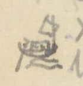{width=12%}

Chữ trên hình: không có chữ. [NC: hình thuyền nhỏ vẽ ở lề, có lẽ đánh dấu chỗ bắt đầu đi đường thủy (cột Thừa ghi "Bộ 20.531" và "thủy 39.475").]

[NC: "Ng. b." = ngã ba; "R." = rạch; "S." = sông; "Bộ" = đường bộ; "thủy" = đường thủy. Ở dòng Ngã ba Nhà bè, hai chữ đầu có lẽ là chữ Nôm ghi "Nhà Bè", viết nhanh, chưa đọc chắc; chữ 犠 (nghé) trong "Bến nghé" cũng là lối dùng chữ Hán ghi âm Nôm. Số thứ tự 98 viết hai lần (tác giả sửa 98 thành 99 ở dòng Bến trấn định). Nửa dưới trang là chữ in VERRERIE DU NORD in ngược.]

# Trang PDF 89 - Hải Dương 1: Hải Dương - Sơn Nam thượng

*Đầu trang: Hải dương 1; số trang bản thảo: 43*

## HẢI DƯƠNG - SƠN NAM THƯỢNG (13.133)

| [Địa danh] | Chữ Hán | [Tầm] | [Ghi chú] |
|---|---|---|---|
| Cửa Chính nam | 正南 | 6 | |
| Cầu Hào | 濠求 | 166 | Dài 16 Tầm |
| Đường Ngã tư | 四岐路 | 1.733 | |
| Sông Hồi | 滝灰 | 1.800 | Xã Thạch hôi 石灰. Rộng 50 T. |
| Quán Nghiên | 館研 | 985 | Xã Tăng hạ 曾下 [?] |
| Chợ Gối | 𢄂檜 | 3.399 | Xã Hội xuyên 會川. Đời Trần 陳, có người xã ấy du học Thăng long 昇竜, rất có tài năng. Vua Nhân tông 仁宗 thấy Anh-tông 英宗 mê rượu (TTNĐ và TLYL đều chép *trầm tửu* 沈酒, có lẽ *đam tửu* 耽酒), định lập con khác. Nhữ Hài (汝諧) làm biểu tạ tội cho cha. Được vừa ý. Được ban chức *trung tán* (中贊) 使 [?] sứ và lưu lại giúp Anh-tông. Sau lập đại công. Về lập chợ này. Sau vua Anh-tông lấy thuế chợ này làm tiền hương hỏa. Nay vẫn phụng sự. |
| Sông Chàng [?] (Sông Đinh đào) | 定陶社 | 1.275 | Rộng 80 T. Sông Chàng [?] 74 |
| Chợ Hậu bổng | 厚俸社 | 968 | Xã này có chùa cũ tên Quang minh 光明寺. Tục truyền rằng thiền sư Viên tịch 圓寂 trước lúc mất dặn tăng đồ viết lên vai mình 4 chữ *Quang minh tự tăng* 光明寺僧 [Sư chùa Quang Minh]. Sau Lê 黎 [?] sai sứ sang Tàu. Bấy giờ vua Tàu có vết chàm trên vai thành 4 chữ ấy. Các nước không ai hiểu ra sao. Sứ ta thuật chuyện trả lời. Trở về lấy nước giếng chùa sang rửa mới sạch. Xem *Công dư tiệp ký* (公餘捷記) [Ghi chép nhanh lúc rảnh việc công]. |
| Sông Mẫn [?] | 滝慢 | 2.622 | Xã Phụng Hoàng 鳳凰 |
| Cầu Bằng | 求憑 | | Xã Bằng bộ 憑步. Dài 13 Tầm |
| Cõi Sơn nam thượng | 山南上 | | Đầu cõi |

[NC: Trang này có chữ Nôm: *sông* (滝) trong "Sông Hồi", "Sông Mẫn"; *chợ* (𢄂) và *Gối* (檜) trong "Chợ Gối"; *cầu* viết bằng chữ 求 (mượn âm) trong "Cầu Hào", "Cầu Bằng". "T." = tầm. Nhân vật là Đoàn Nhữ Hài; sử chép ông được phong *Ngự sử trung tán* (御史中贊). Chữ sau 中贊 trong bản thảo trông như 使, chưa chắc. Nửa dưới trang là chữ in VERRERIE DU NORD in ngược (hiện qua giấy).]

# Trang PDF 90 - Trang trắng

[Trang trắng: mặt sau của tờ trước, chỉ có giấy tiêu đề in sẵn VERRERIE DU NORD, Hanoi, le ... 194..; nét chữ tờ bên kia hiện qua giấy. Không có chữ viết.]

# Trang PDF 91 - Hưng Hóa 1: Hưng Hóa - Thanh Hoa ngoại

*Đầu trang: Hưng-Hóa 1; số trang bản thảo: 44*

## HƯNG HÓA - THANH HOA NGOẠI (20.659)

| [Địa danh] | Chữ Hán | [Tầm] | [Ghi chú] |
|---|---|---|---|
| Cửa Tiền | 前門 | 962 | |
| Cầu Dát | 求戛 [?] | 1.300 | Cầu Dậu dương 酉陽. Dài 6 T. |
| Xã Hoàng cương | 黄崗 | 1.000 | |
| Chợ Quang bị | 光被 | 950 | |
| Cầu | 求 | 1.900 | Dài 6 Tầm |
| Tu vũ x. | 脩武 | 1.300 | |
| Sơn bạn x. | 山伴 | 3.500 | |
| Thái hòa x. | 太和 | 65 | |
| **Sông Đà** | 沱河 | | Rộng 50 Tầm. Trên suối Lai châu 萊州 tiếp nội địa. Chảy vào Nhị hà 珥河, theo Thao giang 洮江 chảy xuống. |
| Hoa lâm sách | 花林冊 | 1.200 | |
| Quỳnh lâm sách | 瓊林〃 | 600 | lại đến |
| Hoa lâm sách | 花林 | 2.600 | lại đến |
| Quỳnh lâm sách | 瓊林 | 1.050 | |
| Giếng Ngụt | 汫[?] | 2000 | |
| Núi Chống trụ | 㨫柱 | 150 | Đường qua rừng rú, hiểm trở, nước suối độc |
| Đào Sung sách | [?]崇 [?] | 3.100 | |
| Đèo Cao | 岧高 | | Núi độc, nước dữ |
| **Cõi Thanh hoa ngoại trấn** | 清華外鎮界 | | Đầu cõi |

[NC: "x." = xã; "T." = tầm; "sách" (冊) = đơn vị làng bản miền núi. Trang này có chữ Nôm: *giếng* (汫), *chống* (㨫), *đèo* (岧), *cầu* viết bằng chữ mượn âm 求. Nửa dưới trang để trống, chỉ có chữ in VERRERIE DU NORD hiện qua giấy.]

# Trang PDF 92 - Hưng Hóa 2: Hưng Hóa - Ninh Biên - Lao Long

*Đầu trang: Hưng Hóa 2*

## HƯNG HÓA - NINH BIÊN - LAO LONG (173.980)

| [Địa danh] | Chữ Hán | [Tầm] | [Ghi chú] |
|---|---|---|---|
| Cửa Hữu | 右門 | 850 | |
| Cầu Phương Giao | 芳膠 | 350 | Dài 40 Tầm |
| Phương Giao sách | 〃 冊 | 1.900 | |
| Đèo dài | 岧[?] | 1.703 | Dài 700 T. |
| Hùng nhị sách | 雄耳 | 1.289 | Đường dọc theo phía đông sông Mỹ hà 美河. Có Tuần ti tên Tuần Hùng nhị. |
| Sông Mỹ | 美河 | 2500 | Rộng 12 T. Nước trong mà độc. Nguồn ở Hoàng cúc 黄菊, chảy xuống sông Thao 洮. |
| Khe Lãn | 溪[?] | 200 | Rộng 4 T. |
| Sông Mỹ | 美河 | 2.300 | Rộng 10 T. |
| Long cốc điếm | 竜谷 | 1.650 | |
| Sông Dạy [?] | 滝[?] | 1.100 | Rộng 10 T. Nước trong mà độc. Trên suối Phù Hoa 扶華, dưới chảy vào Mỹ hà 美河. |
| Thu Ngạch sách | 秋[?] | 4.542 | |
| Thạch Kệ sách | 石碣 [?] | 1.350 | Qua ba khe, đều độc |
| Sông Mỹ | 美河 | 600 | Rộng 37 Tầm. Dọc đường nước độc |
| Kệ sơn sách | 碣山 [?] | 400 | |
| Lai đồng sách | 來同 | 1.500 | Dọc đường nước độc |
| Đá Hoàng Cúc | 黄菊岩 | 3.170 | Tục truyền có một người con gái bị loạn binh cưỡng gian trên tảng đá trên núi, mà chết. Sau thành yêu. Hành nhân đi đến đó, kêu tiếng dâm cho to làm cho sợ, tinh tự tan. |

[NC: "T." = tầm; "Tuần ti" = trạm tuần (thu thuế, canh gác). Chữ thứ hai của "Đèo dài" là chữ Nôm (dài), viết nhanh; chữ 岧 (đèo) và 滝 (sông) là chữ Nôm. Nửa dưới trang là chữ in VERRERIE DU NORD in ngược.]

# Trang PDF 93 - Hưng Hóa 3 (tiếp đường Hưng Hóa - Ninh Biên - Lao Long)

*Đầu trang: Hưng hóa 3; số trang bản thảo: 45*

| [Địa danh] | Chữ Hán | [Tầm] | [Ghi chú] |
|---|---|---|---|
| Sông Mỹ | 美河 | 200 | Rộng 20 T. Dọc đường nước độc |
| Sông Mỹ | 〃 | 575 | Rộng 19 T. |
| Đường Đèo Bụt | 岧孛 | 4.402 | Dài 200 T. |
| Dạng cây triền [?] | [?]核纏 [?] | 2.616 | Dọc đường nước trong mà độc |
| Hang Bân | [?]彬 | 1.150 | |
| Hang Sải Đèo | [?]岧 | 1.850 | Đèo năm bậc, dài 300 T. Trên đèo có khe nước độc |
| Sông Hoa | 華江 | 500 | Rộng 5 T. |
| Động Quang hoa | 光華 | 3.922 | 峝 |
| Động Phù tường [?] | 祥[?] | 4.360 | |
| Động Tường phong | 祥豊 | 3.100 | |
| **Sông Đà** | 沱江 | 6034 | Rộng 65 Tầm. Trên suối Lai châu 來州, dưới vào Nhị hà 珥河 |
| Động Hướng Càn | 向乾 | 5.250 [?] | |
| Động Mộc hạ | 木下 | 9.458 | |
| Động Mộc thượng | 木上 | 8.580 | |
| Xứ Tàng Lang | 藏郎 | 8.065 | |
| Suối Thập thác lặc | 溪十 | 3.883 | 托勒 |
| Động Sách lâm | 冊林 | 5.288 | |
| Động Trình đông | 呈東 | 5.769 | |
| Xứ Hăm .. | [?][?] | 10.550 | Dọc đường rừng rậm. Không suối uống được |
| Điếm Muộn | 店悶 | 7.680 | |
| Xứ Đá rồng | 碣[?] | 7.897 | Dọc đường nước độc |
| **Cõi Thuận châu** | 順州 | | |
| Động Hoàng Mai | 黄枚 | 10.300 | |
| Đèo Tham triệu | 参招 [?] | 5.550 | Đường qua Trường sơn 長山 rất cao và khó đi |
| Đèo Khâu Khương long | 岧丘薑龍 [?] | 3.605 | Thuộc Châu Ninh biên 寧边. Nhiều voi |
| Cáo Phó | 告付 | 4.250 | |
| Ngũ lai | 五來 | 3.850 | |
| Bản Cung | 本供 | 2.300 | |
| **Thành Tam Vạn** | 三萬 | 1.300 | Phía đông đường có cổ lũy dài 307 tầm. Truyền rằng đời Lê 黎, giặc Chất 質 đóng đồn ở đó. Phía tây đường có cổ thành |

[NC: "T." = tầm; "Động" (峝) = đơn vị hành chính miền núi; chữ 峝 tác giả ghi riêng ở cột ghi chú dòng Động Quang hoa. Ở dòng "Đèo Khâu Khương long", tác giả gạch chữ "Khương" ở dòng trên rồi viết "Khương long" xuống dòng dưới. "Giặc Chất" có lẽ chỉ Lê Duy Chất [?]. Các chữ Hán của "Dạng cây triền", "Hang Bân", "Hang Sải", "Xứ Hăm", "Xứ Đá rồng" phần nhiều là chữ Nôm viết nhanh, chưa đọc chắc. Nửa dưới trang có chữ in VERRERIE DU NORD hiện qua giấy.]

# Trang PDF 94 - Hưng Hóa 4 (tiếp: Thành Tam Vạn, cõi nước Lao Lung)

*Đầu trang: không ghi; số trang bản thảo: không đánh số*

[NC: Tiếp ghi chú dòng Thành Tam Vạn ở trang trước.]

| [Địa danh] | Chữ Hán | [Tầm] | [Ghi chú] |
|---|---|---|---|
| (tiếp Thành Tam Vạn) | | | ... dài 950 Tầm, rộng 400 tầm. Vì lâu đời hư đổ. Không biết đời nào đắp nên. Người ta nói trong thành có ba vạn cối đá, đâm ngày đã gạo cho quân. Cho nên đặt tên ấy. |
| **Cõi nước Lao lung** | 牢籠國界首 | | Đầu cõi. Đi qua rừng núi to. Từ Hoàng Mai 黄枚 đến Xuân dương 春陽 qua 6 đỉnh núi cực cao. Khó đi. |

[NC: Phần còn lại của trang để trống; nửa dưới là chữ in VERRERIE DU NORD in ngược.]

# Trang PDF 95 - Hưng Hóa 5: Hưng Hóa - Thủy Vĩ - Vân Nam

*Đầu trang: Hưng Hóa 5; số trang bản thảo: 46*

## HƯNG HÓA - THỦY VĨ - VÂN NAM (91.454)

| [Địa danh] | Chữ Hán | [Tầm] | [Ghi chú] |
|---|---|---|---|
| Cửa Tiền | 前門 | 2.627 | |
| Cổ lôi x. điếm | 古雷 | 2.110 | |
| Chợ Tứ mỹ x. | 四美 | 415 | |
| Sông Bá [?] | 滝[?] | ? | Xã Tứ mỹ 四美, rộng 30 T. Trên suối huyện Thanh xuyên 青川 sang Hùng Nhị 雄耳, dưới vào sông Thao 洮 |
| Sông Phong vực x. | 風域 | 4.314 | Rộng 105 T. |
| Cầu Trí Chủ x. | 置主 | 5.725 | Dài 6 T. |
| Nhị thượng x. | 尔上 | 1.710 | |
| Lạnh sơn x. điếm | 冷山 | 3.823 | |
| Chợ Đông lũng | 同[?] | 3.715 | |
| Bạch lẫm trang | 白廩 | 2.360 | 庄. Có tuần quan 巡[?], có đồn lính biền 弁 và chợ |
| Bái dương 〃 | 沛陽 | 2.325 | |
| Nghĩa phương 〃 | 義方 | 3.205 | |
| Trúc đình trang | 竹亭 | 1.610 | |
| Linh A 〃 | 灵阿 [?] | 3.002 | |
| Cầu Khe Thạnh | 溪晟 | 2.525 | Dài 6 Tầm |
| Mậu A trang | 茂阿 | 1.620 | |
| Cầu Khe Điệu | 溪調 | 3.852 | Dài 6 Tầm |
| Cầu Khe Khai | 〃 開 | 2.253 | Dài 8 Tầm |
| Cầu Khe Lẫm | 〃 廩 | 2.256 | Dài 8 Tầm |
| Châu quế động (Văn bàn) | 珠桂 (文盤州) | 499 | 峝. (Thuộc châu Văn Bàn) |
| Khe Lỗ | 溪[?] | 3.158 | Rộng 20 T. Nước trong mà độc |
| Khe Tăng | 〃 增 | 2.424 | Rộng 10 T. Nước độc |
| Khe Trúc | 〃 [?] | 1.620 | Rộng 12 T. Nước độc |
| Khe Bút | 〃 笔 | 3.985 [?] | Rộng 8 T. Nước độc |
| Lão bàn xã | 老槃 [?] | 1.320 | |
| Đèo Nghe | 岧[?] | 1.362 | Đường núi 250 T. |
| Khe Bùn | 溪[?] | 513 | Rộng 10 T. Nước độc |
| Khe Tạp [?] | 〃 [?] | 1.967 | Rộng 8 T. |
| Khe Phương | 〃 方 | 2.338 | Rộng 9 T. |
| Văn bàn động | 文盤 | 843 | 峝 |
| Khe Vạn | 溪[?] | 2.965 | Rộng 10 T. Nước độc |
| **Sông Thao** | 洮江 | | Rộng 105 T. Trên thông sông Két [?] ([?]) ở Thủy vĩ 水尾; dưới chảy xuống Ngã ba Hạc 我巴鶴 |

[NC: "x." = xã; "T." = tầm; 〃 = như trên (lặp chữ 溪 "khe" hoặc chữ "trang"). Số ở dòng Khe Bút viết chồng, chưa chắc. Nhiều tên khe viết bằng chữ Nôm hoặc chữ ít gặp, chưa đọc chắc. Chữ "A" trong "Linh A" tác giả gạch rồi viết lại. Nửa dưới trang có chữ in VERRERIE DU NORD hiện qua giấy.]

# Trang PDF 96 - Hưng Hóa 6 (tiếp đường Hưng Hóa - Thủy Vĩ - Vân Nam)

*Đầu trang: Hưng hóa 6*

| [Địa danh] | Chữ Hán | [Tầm] | [Ghi chú] |
|---|---|---|---|
| Khe Nhu | 溪濡 | 1.906 | Rộng 12 T. Nước độc |
| Xuân Giao động | 春膠 | 3.400 | 峝 |
| Khe Bô | 溪[?] | 1.805 | Rộng 50 T. Nước trong mà độc |
| Mường Bát | 芒鉢 | 209 | |
| Khâu Hiên | 丘軒 | 1.665 | |
| Đèo Thị | 岧示 [?] | 910 | Đường núi dài 210 T. |
| Gia phú động (Thủy vỹ châu) | 嘉富 (水尾) | 2.432 | 峝. Thuộc châu Thủy vĩ 水尾 |
| Cam trại động | 甘寨 | 15 | |
| Khe Trại | 溪寨 | 3.035 [?] | Rộng 13 Tầm. Nước độc |
| Hương sơn động | 香山峝 | 1.060 | (số này tác giả đặt ngoặc chung cho hai dòng Hương sơn động và Đèo Trong) |
| Đèo Trong | 岧重 | | Đường đèo [?] dài 236 T. |
| Phố **Bảo thắng** | 保勝 | 256 | Có đường con đi tới Tụ long 聚竜 ở Tuyên quang. Người khách bán hàng bạc và các thuốc Phục linh 茯苓, Hoàng cầm 黄芩 và các Mã phu 馬夫 mua muối hoa 花鹽 [?] đưa về bắc |
| Sông Ngâu đầu [?] | [?]頭 | | Rộng 58 Tầm. (Nội địa 夾內地界首 [?]) |
| **Cõi Vân nam** | 雲南 | | |

[NC: "T." = tầm; "Mã phu" (馬夫) = người đánh ngựa thồ (thương nhân Vân Nam). Chữ Hán ghi chú cuối (giáp giới nội địa [Trung Quốc]) viết nhanh, chưa chắc; chữ "Thuộc" trước đó bị gạch. Nửa dưới trang là chữ in VERRERIE DU NORD in ngược.]

# Trang PDF 97 - Hưng Hóa 7: Đạo Đà Hà - Châu Ninh Biên

*Đầu trang: Hưng hóa 7; số trang bản thảo: 47*

## Đạo ĐÀ HÀ - Châu NINH BIÊN (phụ lục nhất trình)

[NC: Cột "ngày" là số ngày đường; tác giả viết số ở khoảng giữa hai dòng địa danh, ở đây ghi vào dòng của chặng đến.]

**1°**

| [Địa danh] | Chữ Hán | Ngày | [Ghi chú] |
|---|---|---|---|
| **Đê Long-thủy** | 龍水 | | 堤 |
| Mai châu | 枚州 | 1 | |
| Mộc châu | 木州 | 4 | |
| Việt châu | 越州 | 1 | |
| Sơn la | 山[?] | 2 | |
| Thuận châu | 順州 | 1 | |
| Tuần giáo | 遵教 | 3 | |
| Đồn Ứng thuận | 應順 | 2 | |
| Đèo Bầu thất | [?]匹 | 2 | |
| Trình ly (chính) | 呈[?] | 1 | 正呈 |
| **Tam vạn thành** | 三萬城 | 1 | |
| | | **18** | |

**2°** Đường khác

| [Địa danh] | Chữ Hán | Ngày | [Ghi chú] |
|---|---|---|---|
| **Hưng Hóa trấn sở** | 興化 | | |
| Đồn Hùng nhị | 雄耳 | 1 | |
| Mường Bi | 芒碑 | 2 | |
| Mường Cúc | 〃 菊 | 3 | |
| Kẻ | 几[?] | 4 | |
| Suối | 㵢 [?] | 5 | |
| Hoa châu | 花州 | 6 | |
| Canh Bi | 梗碑 | 7 | |
| Vạn Sâm | 萬森 | 8 | |
| Vạn Bản | 萬[?] | 9 | |
| Tà điền | 邪滇 | 10 | |
| Sơn la | 山[?] | 11 | |
| Trình Bồn | 呈奔 [?] | 12 | |
| Mỗ Mả | 堁馬 [?] | 13 | |
| Mường Động | 芒洞 | 14 | |
| Mường Sử | 〃 史 | 15 | |
| **Tam vạn thành** | 三萬城 | 16 | |

[NC: Ở đường thứ hai, số ngày ghi lũy kế (1 đến 16). Số ở dòng Kẻ viết chồng (4/5), số ở dòng Hoa châu trông như "16", có lẽ là 6. Chữ "Sơn la" (chữ thứ hai), "Mường" (芒), "Kẻ", "Suối", "Đèo Bầu thất" là chữ Nôm hoặc chữ ghi âm, chưa đọc chắc. Nửa dưới trang có chữ in VERRERIE DU NORD hiện qua giấy.]

# Trang PDF 98 - Trang trắng

[Trang trắng: mặt sau của tờ trước, chỉ có giấy tiêu đề in sẵn VERRERIE DU NORD, Hanoi, le ... 194..; nét chữ tờ bên kia hiện qua giấy. Không có chữ viết.]

# Trang PDF 99 - Kinh Bắc 1: Kinh Bắc - Sơn Nam

*Đầu trang: Kinh-Bắc 1; số trang bản thảo: 48*

## KINH BẮC - SƠN NAM (16.646)

| [Địa danh] | Chữ Hán | [Tầm] | [Ghi chú] |
|---|---|---|---|
| Cửa Tây nam | 西南門 | 2.411 | |
| Quán Trắng | 館[?] | 772 | Quán Lũng sơn 隴山 |
| Quán Hoài bão | 懷抱 | 1485 | |
| Núi Chè [?] | 崗[?] | 1.260 | Đường núi Đông Trừ [?] 揀[?]除 dài 30 T. |
| Chợ Dương húc | 陽旭 | 2.688 | |
| Chợ Phù Đổng | 扶董 | 994 | (xem ghi chú dưới bảng) |

Phía tây chợ có đền Đổng thiên vương 董天王. Sử ký chép đời Hùng vương 雄王, Phù đổng có người sinh con trai, ba tuổi không biết nói. Gặp lúc có giặc Ân 殷. Vua sai sứ mộ kẻ phá được giặc. Người con trai ấy bỗng nhiên nói được, thưa mẹ đòi sứ giả tới. Sứ đến nơi, y nói: "Xin một ngựa sắt và gươm cùng nón. Vua không nên lo." Vua bèn cho. Y bèn nhảy ngựa mà tiến. Ba quân theo sau. Phá giặc ở núi Vũ ninh 武寧. Bèn nhảy ngựa lên không mà hóa ở chân núi Vệ linh 衛灵. Vua nhớ công ơn. Sai lập đền thờ. Về sau đời Lý phong làm *Xung thiên thần vương* (沖天神王) [Thần vương bay lên trời]. [Ở sách TTNĐ và TLYL chép hơi khác nhau một tí.]

| [Địa danh] | Chữ Hán | [Tầm] | [Ghi chú] |
|---|---|---|---|
| Sông Thiên đức | 天德江 | 1.900 | Rộng 20 T. |
| Chợ Phù thị | 富市社 | 866 | |
| Chợ Dương xá | 楊舍 | 1.951 | |
| Cầu Chùa | 求廚 | 930 | Cầu Hạ tôn 下[?]. Dài 11 Tầm |
| Chợ Chung | 𢄂鐘 | 1.109 | Chợ Như lân 如[?]. TLYL chép 金竜 [?] |
| Chợ Bờ | 𢄂把 | 900 | Chợ Ngọc bộ 玉步 |
| Quán Trạch điếm | 館澤 | 120 | |
| **Cõi Sơn nam Thượng trấn** | | | Đến đầu cõi |

[NC: "T." = tầm. Chữ Nôm trên trang: *chợ* (𢄂), *cầu* (求, mượn âm), *chùa* (廚), *bờ* (把). Nửa dưới trang có chữ in VERRERIE DU NORD hiện qua giấy.]

# Trang PDF 100 - Kinh Bắc 2: Kinh Bắc - Sơn Tây

*Đầu trang: Kinh-Bắc 2*

## KINH BẮC - SƠN TÂY (17.921)

| [Địa danh] | Chữ Hán | [Tầm] | [Ghi chú] |
|---|---|---|---|
| Cửa Tây trấn | 西門 | 493 | |
| Cầu Khúc Toại | 曲遂 | 1.787 | Dài 15 T. |
| Quán Đông an | 東安 | 2.094 | |
| Cầu Tiên trà | 先[?] | 925 | Dài 3 T. |
| Chợ Trừ | 𢄂除 | 2.648 | Chợ Nội trà 内[?]. (xem dưới) |

(Chợ Trừ) Phía nam chợ có đền thần Hàm sơn [?] ([?]山). Gặp đại hạn, cầu đảo hay ứng. Đời Hồng thuận 洪順 triều Lê, bị đại hạn. Cầu ở đền Phù đổng vương. Nằm mộng thấy thần nói: "Vũ hạn này vì quỷ thần Bạt 魃 gây ra. Mưa rất ít. Chỉ có thần Hàm sơn còn một lọ nước, tới cầu đi." Vua sai quan đến cầu đảo. Mưa bèn xuống. Vua nghe chuyện, sắc phong làm Tối linh từ. Nay còn linh ứng.

| [Địa danh] | Chữ Hán | [Tầm] | [Ghi chú] |
|---|---|---|---|
| Chợ Ma-lôi | 魔雷 | 1.769 | Chợ Xuân lôi 春雷. Phía nam đường có một đỉnh núi, gọi núi Vũ-đương 武當. Tục truyền có yêu núi Thất Diệu 七曜, làm hại dân nhiều lần. Một hôm có thần trên trời xuống trừ được. Dân thôn bèn lập đền trên đỉnh núi. Gọi là *Bắc phương chân vũ quán* (北方真武舘) [Quán thờ Chân Vũ phương bắc]. |
| Quán Nhạn tháp [?] | 雁[?]塞 [?] | 1.422 | ([?]) (Nhạn tái) |
| Quán Hoán khê | 浣溪 | 1.601 | Phía tây quán có sông Đào 陶江 tiếp hai sông Nhị hà 珥河 và Nguyệt đức 月德. Nay bị lấp. Còn dấu. |
| Cầu Chu-lão | 周老 | 997 | Dài 6 Tầm |
| Quán Da thượng | 椰上 | 3.225 | |
| Cầu Ngăn | 求[?] | 26 | Cầu Lâm hộ 林户. Dài 10 Tầm |
| **Cõi SƠN-TÂY** | 山西界 | | 首. Đầu cõi |

[NC: "T." = tầm; "Vũ hạn" có lẽ là "hạn hán" (tác giả viết "Vũ hạn" [?]). Chữ ghi chú sau tên Quán Nhạn tháp bị gạch một phần, chưa đọc chắc. Chữ Nôm: *chợ* (𢄂), *cầu* (求). Nửa dưới trang là chữ in VERRERIE DU NORD in ngược.]

# Trang PDF 101 - Kinh Bắc 3: Kinh Bắc - Hải Dương

*Đầu trang: Kinh Bắc 3; số trang bản thảo: 49*

## KINH BẮC - HẢI DƯƠNG (15.420)

| [Địa danh] | Chữ Hán | [Tầm] | [Ghi chú] |
|---|---|---|---|
| Cửa Đông bắc trấn | 東北 | 995 | |
| Quán Phúc đức | 福[?] | 630 | |
| Núi Bồ sơn | 蒲山 | 1.300 | Đường núi dài 307 Tầm |
| Núi Nghi-vệ | 儀衛 | 1.997 | Đường núi dài 50 Tầm |
| Cầu Phan Trạch | 潘澤 | 1.794 | Cầu Châm 求針 dài 11 Tầm |
| Sông Hồ | 滝湖 | 48 | Sông Thiên đức 天德 ở xã Chi-nê 芝泥 |
| Chợ Hồ | 𢄂湖 | 2.630 | Chợ Lạc thổ 樂土. Bán nhiều vàng bạc, giấy, hồ. |
| Chợ Ngâm điền | 吟田 | 1.383 | |
| Cầu Đại bái | 大拜 | 2.550 | Dài 12 Tầm |
| Cầu Quảng Nạp | 廣納 | 1.281 | Dài 3 Tầm |
| Cầu Bảo thao [?] | 宝洮 | 391 | Dài 1 Tầm |
| Cầu Bảo Khám [?] | 宝[?] | | Dài 11 Tầm |
| **Cõi HẢI-DƯƠNG** | 海陽界 | | Đầu cõi |

[NC: Chữ Nôm: *sông* (滝), *chợ* (𢄂), *cầu* (求). Ở dòng cuối tác giả gạch tên cũ rồi viết lại "Khám" [?]. Nửa dưới trang để trống, chỉ có chữ in VERRERIE DU NORD hiện qua giấy.]

# Trang PDF 102 - Kinh Bắc 4: Kinh Bắc - Thái Nguyên

*Đầu trang: Kinh Bắc 4*

## KINH BẮC - THÁI NGUYÊN (21.138)

(Đường riêng đi thông với các trấn ngoài)

| [Địa danh] | Chữ Hán | [Tầm] | [Ghi chú] |
|---|---|---|---|
| Cửa Tây | 西門 | 1.064 | |
| Cầu Đặng xá | 鄧舍 | 1.782 | Dài 16 tầm |
| Chợ Trục | 𢄂[?] | 1.596 | Chợ Đông gạo 揀[?]糕 |
| Quán Rạng | 館[?] | 1.527 | Yên lãng 安朗 |
| Quán Ngã tư | 我四 | 1.640 | Đông xuyên 東川 |
| Phố Như nguyệt | 如月 | 1.070 | (xem dưới) |

(Phố Như nguyệt) Phía bắc phố có đền thần Đại-đương giang 大当江. Sử chép thần họ Trương 張, tên Hống [?] (吼 [?]), em tên Hát 喝. Đều là danh tướng Triệu Việt vương 趙越王. Nhà Triệu mất, thần ẩn ở núi Phù long 扶竜. Lý Nam đế 李南帝 lấy ngân vàng mua chuộc, đều tự sát. Đến đời Lê Đại hành 黎大行, Tống 宋 tới xâm. Vua tự cầm quân chống. Mộng thấy hai ông tới, đều xưng tên họ, xin theo đánh giặc. Giặc yên, vua phong anh làm *Đại đương giang hộ quốc thần vương* (大当江護国神王) [Thần vương giữ nước ở sông Đại Đương], lập đền ở sông Như Nguyệt 如月; em làm *Tiểu đương giang hộ quốc thần vương* (小...), đền ở sông Nam bình 南平. Đến sau, quân Tống lại đến. Vua sai Lý Thường Kiệt chống. Đi đường qua đền. Đêm nghe trong đền có tiếng ngâm:

*Nam quốc sơn hà Nam đế cư, hoàng thiên tiệt định tại thiên thư. Như hà nghịch Bắc lỗ lai xâm phạm, nhữ đẳng hành khan thủ bại hư* (南国山河南帝居，皇天截定在天書。如何逆北虜來侵犯，汝等行看取敗虛).

**Dịch:** Sông núi nước Nam vua Nam ở, trời xanh đã định rõ ở sách trời. Cớ sao giặc Bắc nghịch tới xâm phạm, bọn bay rồi sẽ thấy chuốc lấy bại vong.

Quân Tống quả thua.

| [Địa danh] | Chữ Hán | [Tầm] | [Ghi chú] |
|---|---|---|---|
| Sông Lương phúc | 良福 | 1008 | Tức sông Nguyệt đức 月德, rộng 35 T. |
| Quán Rồng | 館[?] | 3.436 | Quán Tăng long 增隆 |
| Chợ Ngô đạo | 吾道 | 506 | |
| Cầu Cốc lương | 穀良 | 3.323 | Dài 10 tầm |
| **THÁI-NGUYÊN** | 太原 | 304 | trấn sở |
| Sông Bình Kỳ | 平岐 | 1.273 | Sông Giang dã 江野, rộng 50 T. Ít độc |
| Chợ Đình | 𢄂亭 | 1.962 | Chợ Thượng dã 上野 |
| Quán Thung Hạc | 椿鶴 | 536 | |
| **Cõi Thái nguyên** | 太原界 | | Đầu cõi |

[NC: "T." = tầm. Bài thơ thần "Nam quốc sơn hà" ở đây chép theo bản thảo; câu thứ hai bản thường gặp là 截然定分在天書, câu thứ ba là 如何逆虜來侵犯, câu cuối là 汝等行看取敗虛. Tên thần thường chép là Trương Hống (張吼), Trương Hát (張喝); chữ quốc ngữ tác giả viết trông như "Kêu" [?]. Nửa dưới trang là chữ in VERRERIE DU NORD in ngược.]

# Trang PDF 103 - Lạng Sơn đoàn thành 1 (Hòa Lạc - Quang Lang)

*Đầu trang: Lạng-sơn - Đoàn thành 1; số trang bản thảo: 50*

## *Lạng Sơn đoàn thành đồ* (諒山團城圖) [Bản đồ đoàn thành Lạng Sơn], tên sai; A1220 - 19a

[NC: A.1220 là ký hiệu sách ở thư viện Trường Viễn Đông Bác Cổ; "tên sai" là lời tác giả nhận xét về nhan đề sách. Các số 19a, 20a ở lề là số tờ của sách gốc. "T" = tầm; mũi tên "↓" dưới con số là của tác giả, chỉ khoảng cách tính đến chặng sau.]

**Hòa lạc điếm** (和樂站) - 1.601 T ↓. Giáp xã Chi lăng 枝陵 thuộc Ôn châu 溫州 (Lạng sơn). Hai bên đường rừng cây rậm. Thỉnh thoảng có dân cư, ruộng nương. Có một khe, tên tục Suối Nang 㵢囊 [?], phát nguyên từ núi Khảo mẹ (Lạc cao mẫu 落靠母山), chảy quanh co xuống sông Đại hóa 大化江.

**Quán Bầu** (館[?]) - 930 T ↓. Tên tục là Bầu Chi lăng [?]枝陵. Có một khe nhỏ, nước, khí rất độc. Dân sợ tại uống, sắc vàng như bị bệnh hoàng đản. Phía tây đường có thành xưa 古城 ở chân núi, chu vi phỏng chừng ngoài 300 Tầm, tục gọi là Thành Kho 城庫. Tục truyền là tướng Phục ba 伏波 đời Hán đắp để trữ lương thảo. Nay đá gạch còn, người ta không dám lấy. Dọc đường ở hai bên có dân cư, ruộng nương.

**Đền Quỷ-môn** (鬼門祠) - 868 T [?] ↓. Đền ở phía đông đường, có một pho tượng, như hình đàn bà. Xưa nay rất linh. Sứ thần qua đó, có lễ dâng tam-sinh để cáo yết. Lại có thuyết nói đó là đền Phục ba 伏波. Chưa khảo được sự thật. Bắc sứ cho là tên của quan không nhã (xem sử 1680) mới đổi tên ra Úy-thiên quan 畏天關. Nhưng tục quen gọi khó đổi được. Phía đông đường có dân cư, ruộng vườn. Phía tây theo dõi một dãy núi đá 石山.

**Phố Yên thịnh** (安盛庯) - 58 T. Nùng 儂 và Khách 客 ở lẫn, làm nghề nấu rượu, nuôi súc vật. Phố xá trù mật. Người đi đường rất có thể trú nghỉ. Có một thành, gọi là đồn Quang lang 桄榔屯. Có tuần đóng thu thuế ở đó.

*(lề: 20a)* **Đồn Quang-lang** (桄榔屯) - 1923 T ↓. Đồn ở phía đông đường. Trước mặt có điếm-xá. Người Kinh 京 và Khách ở lẫn nhau. Người đi đường có thể trú nghỉ. Đường → thì hai bên có núi đá, cây cối sầm uất. Thỉnh thoảng có dân cư, ruộng triền. Phía đông đường có một phiến đá dài 2 T. 3 th., hình như người nằm úp. Gọi là Đá Liễu thăng 碣柳昇. Tương truyền rằng vua Lê Thái tổ 黎太祖 giết Liễu Thăng ở đó; đá ấy là thân Liễu Thăng hóa

[NC: "th." = thước. Trang viết bằng mực tím (bút máy), nét khác các trang trước. "Tam-sinh" = ba con vật tế (bò, dê, lợn). Chữ Hán của "Suối Nang", "Quán Bầu", "Bầu" là chữ Nôm, chưa đọc chắc. Nửa dưới trang có chữ in VERRERIE DU NORD hiện qua giấy.]

# Trang PDF 104 - Lạng Sơn đoàn thành 2 (Hổ Lao - Lạc Cao Mẫu)

*Đầu trang: không ghi; số trang bản thảo: không đánh số*

[NC: Tiếp câu cuối trang trước ("đá ấy là thân Liễu Thăng hóa").]

ra. Trước mặt, có một khe chảy qua (tác giả sửa thành "phải qua"), tên là Lãng Hay 浪咍. Nước sâu 2 th. Tương truyền, khe có rắn độc 毒蛟, tục gọi là thuồng luồng 蝩蠬. Nếu gặp mùa lụt, người qua đường không dám lội qua.

**Đền Hổ-lao** (虎牢祠) - 1.904 T ↓. Có tiếng thiêng. Sứ-thần qua đó, có lễ yết cáo. Sau có núi đá, hình như voi phục, tên tục là Núi Voi 崗[?]. Đường → hai bên lau lách, cây cỏ rậm. Có một khe tên Thành mã 城馬. Tương truyền khe có rắn độc 毒蛟. Nếu gặp mùa lụt, người ta không dám lội qua.

*(lề: 20b)* **Chợ Mai-Sao** (枚稍市) - 2.975 ↓. Tục gọi là Chợ Đồn 𢄂屯. Có phố điếm. Người đi đường có thể trú đêm. Trước chợ có một dãy núi đá, bắt đầu từ xã Vân nham 雲岩社 thuộc Ôn Châu 溫州, kéo dài đến xã Hòa lạc 和樂社 thuộc h. Hữu lũng 右隴, cao và giáp giác như một bức trường. Đường → Hai bên có núi đất. Cây cối um tùm.

**Điếm Nhân-lý** (仁里站) - 1.492 ↓ (Cách đồn Quang lang 6.799 T và cách điếm Mai pha 枚坡 thuộc trấn Lạng sơn 諒山鎮 9.975 T). Đi 90 T. đến phố Nhân lý 仁里, tục gọi là phố Đồng Cốt 同骨庯. Nùng và Khách ở lẫn. Người đi đường có thể trú nghỉ đêm. Đường → phía đông có núi đá. Phía tây có ruộng vườn. Có một khe gọi là Khe chân Đèo 溪[?]岧. Nước cạn, có thể lội qua.

**Núi Lạc Cao Mẫu** (落靠母山) - 2.114 ↓. Tên tục là Đèo Khảo 岧靠. Cao chót vót. Đó là nơi chỗ rất xung-yếu cho nước ta. Trèo lên, nhìn bốn bề thấy đầy những núi bọc mây. Đường → phía tây là chân núi. Phía đông có ruộng vườn.

[NC: "T" = tầm; "th." = thước; "h." = huyện. Chữ Nôm trên trang: *thuồng luồng* (蝩蠬), *chợ* (𢄂), *đèo* (岧), *voi* (chữ thứ hai sau 崗, chưa đọc chắc), *chân* (chữ giữa trong "Khe chân Đèo"). Nửa dưới trang là chữ in VERRERIE DU NORD in ngược, chữ viết đè lên dòng in "Hanoi, le ... 194".]

# Trang PDF 105 - Lạng Sơn đoàn thành 3 (Lạc Cao Tử - Nhị Thanh)

*Đầu trang: Lạng-sơn 3 ĐT; số trang bản thảo: 51*

[NC: "ĐT" = Đoàn thành (sách *Lạng Sơn đoàn thành đồ*). Các số 21a, 21b ở lề phải là số tờ sách gốc.]

*(lề: 21a)* **Núi Lạc-Cao-tử** (落靠子山) - 2.345 T ↓. Tên tục: Đèo Khảo con 岧靠[?]. Đường →: theo chân núi, thỉnh thoảng có dân cư, ruộng nương.

**Phố Tam-tài** (三才庯) - 2.774 ↓. Nùng, Khách ở lẫn. Người đi đường có thể trú đêm. Đường → theo chân núi. Hai bên có núi đất. Phía đông đường có ruộng vườn.

**Quán Lũng** (館隴) - 1.302 T. Nùng, Khách ở lẫn. Có điếm xá. Khách qua đường có thể nghỉ một ít. Đường → Hai bên rừng rậm. Qua một đỉnh núi, gọi là Đèo Dướng 岧[?]. Chân núi có một khe, tên tục là Suối Lũng 㵢隴. Nước cạn có thể lội, đi 68 T đến

**Điếm Mai-pha** (枚坡站) - 60 ↓. Phía tây đường là lũy của trấn 鎮壘. Phía bắc là sông Kỳ Cùng 淇窮.

**Thành trấn Lạng Sơn** (諒山) - 133 ↓. 鎮城. Cửa Bắc 北門 thành thuộc xã Mai pha 枚坡, Ôn châu 溫州, phủ Trường Khánh 長慶. Đường →: Phía nam có đền tướng quân Phục-ba 伏波 nhà Hán; Sứ thần qua đó, lễ có yết-cáo.

*(lề: 21b)* **Phố Trường Thịnh** (長盛庯) - 185 ↓. Phố xá liên lạc. Nhà buôn Nam Bắc hội tụ. Phố có chợ. Mỗi tháng 6 phiên. Mua bán các hàng hóa. Đường →: phía Tây có Văn miếu 文廟聖, phía Nam có đền Quan đế 關帝祠: Có tuần thành 城巡 thu thuế các nhà buôn Nam Bắc.

**Bến đò Kỳ Cùng** (淇窮津) - 260 T. 3 ↓. 渡. Sông rộng 43 T. Nước ngọt nhạt, không độc; thượng lưu từ châu Tiên yên 先安 thuộc Quảng yên trấn 廣安鎮 quanh co chảy xuống; hạ lưu thông vào cửa sông Bình nhi 平兒 thuộc Long châu 龍州 ở Tàu 内地. Đường →: bên tây có miếu Hội đồng 會同廟, lại có đền thiêng Kỳ-Cùng 淇窮灵祠, rất là linh ứng. Phàm có việc sứ, voi ngựa đến đó, thì làm lễ yết cáo, rồi mới qua sông.

**Phố Nhị Thanh** (二青庯) - 307 T. 2. Phố xá thưa thớt. Người ta có thể nghỉ một ít. Đường → phía tây có một núi đá nhỏ, trên núi nổi lên một tảng đá

[NC: "T" = tầm; "260 T. 3", "307 T. 2" có lẽ là 260 tầm 3 thước, 307 tầm 2 thước. "内地" = nội địa (Trung Quốc). Chữ Nôm trên trang: *đèo* (岧), *suối* (㵢), *con*, *Dướng* (chưa đọc chắc). Tên sông Kỳ Cùng tác giả viết 淇窮 với chữ thứ hai có bộ thủy, chép theo chữ thường dùng. Chữ "đền" trước "thiêng Kỳ-Cùng" bị gạch rồi viết lại. Nửa dưới trang có chữ in VERRERIE DU NORD hiện qua giấy.]

# Trang PDF 106 - Lạng Sơn đoàn thành 4 (Nhị Thanh - Đồng Đăng)

*Đầu trang: không ghi; số trang bản thảo: không đánh số*

*(lề: 22a)* [tiếp: "trên núi nổi lên một tảng đá"] trông như hình người. Tương truyền xưa có nàng Tô thị 蘇氏 nhớ chồng đi lính thú lâu ngày không về, trèo lên núi ngóng trông. Đá ấy là bởi hình Tô thị hóa ra. Cho nên tên núi là Vọng phu 望夫. Phía tây núi có núi đá. Trong núi có động. Đó là một danh lam cổ tích. Có tô vẽ tượng Phật để thờ, gọi là Động Tam-thanh 三青峒. Phía nam động có núi đá. Đời Lê xưa (舊黎 [?]) có Ngô thì Sĩ 吳時仕 người xã Thanh oai 青威, h. Thanh-Oai, làm quan đốc-trấn, coi trấn này. Nhân đến động này, khắc truyền-thần tượng mình, đặt tên là động Nhị-thanh 二青峝.

**Phố Kỳ lừa** (駈驢庯) - 3.350. Thuộc châu Thoát lãng 脫朗. Phố xá liên lạc. Người Thổ, người Khách ở lẫn. Phố có chợ. Mỗi tháng 6 phiên, buôn bán các hàng hóa. Phía đông chợ, có đền Tả phủ Thân công 左府申公. Ông người Kinh-triệu 京兆, đời Lê được ở xa mà coi trấn này. Ông cai trị tốt, làm ơn cho dân nên người ta nhớ mãi, lập đền thờ, có tiếng rất thiêng. Đường →: dọc theo chân núi. Thỉnh thoảng có dân ở, ruộng vườn.

*(lề: 22b)* **Xứ Na-Khảo** (那考[?]) (to [?]) - 2.603 T. Thuộc châu Văn-uyên 文淵. Phía tây đường có một con đường đi đến đầu đất h. Vũ-nhai 武崖. Đường →: theo chân núi. Thỉnh thoảng có dân cư, ruộng vườn. Phải qua hai khe, nước cạn, có thể lội. Chỉ có một khe tên Suối đanh 㵢釘, nước có khí độc. Người đi qua đó, dẫu khát cũng không thể uống.

**a) Điếm Đồng đăng** (同登站) - 231 T. Cách trấn Lạng sơn 諒山 6.812 T và cách Nam quan 南關 1.591 T. 1. Có đồn thủ, phố xá. Khách và Nùng ở lẫn. Người đi đường rất có thể trú đêm. Lại có chợ. Mỗi tháng họp 6 phiên, buôn bán hàng hóa.

[NC: "h." = huyện; "T" = tầm. Ở dòng "Phố Kỳ lừa", tác giả viết "Khâu" rồi sửa "Kỳ" (viết nhỏ phía trên). Chữ "to" dưới "Na-Khảo" chưa rõ nghĩa. Ngô Thì Sĩ (吳時仕, 1726-1780) làm Đốc trấn Lạng Sơn. Chữ "khắc" viết đè lên chữ khác. Chữ Nôm: *suối* (㵢), *đanh* (釘, mượn âm). "a)" trước dòng Điếm Đồng đăng là ký hiệu đường thứ nhất; đường thứ hai ("b.") ở trang PDF 108. Nửa dưới trang là chữ in VERRERIE DU NORD in ngược.]

# Trang PDF 107 - Lạng Sơn đoàn thành 5 (Đồng Đăng - Ải Nam Quan)

*Đầu trang: Lạng sơn 5 ĐT; số trang bản thảo: 52*

Đường →: Hai bên có ruộng nương.

**Trại Thồm Kiếm** ([?]劍砦) - 122 [?]. Phía đông đường có một con đường dài 400 tầm, đi theo sông, khe đến ải Do-thôn 油村. Ải ấy có quân canh giữ. Người Bắc sang buôn hoặc giao-thông vật gì đều qua ải ấy.

*(lề: 23a)* **Đền Pha-duy** (坡維祠) - 1.126. Đền là một cổ tích, rất có tiếng thiêng. Sứ-thần qua đó, đã có lễ yết cáo. Đường →: phía đông và tây có núi đất liên lạc. Thỉnh thoảng có ruộng nương; đường đi theo chân núi.

**Đền Mao-tướng quân** (毛將軍祠) - 113. Đền ở phía tây đường. Trong khoảng đời Minh Gia-tĩnh 明嘉靖 vua Minh sai thượng thư Mao Bá Ôn 毛伯溫 đem quân sang đánh ta. Trước hết, ông đưa bài thơ vịnh bèo 萍詩 cho nước ta. Thơ rằng:

> 隨田逐水冒秧針，到底原來植不深。
> 空有苗芽空有葉，敢生枝節敢生心。
> 寧知聚処安知散，但識浮時不識沉。
> 大抵中天風浪 [?] 惡，掃歸湖海竟無尋。

*Tùy điền trục thủy mạo ương châm, đáo để nguyên lai thực bất thâm. Không hữu miêu nha không hữu diệp, cảm sinh chi tiết cảm sinh tâm. Ninh tri tụ xứ an tri tán, đãn thức phù thì bất thức trầm. Đại để trung thiên phong lãng ác, tảo quy hồ hải cánh vô tầm.*

**Dịch:** Theo ruộng đuổi nước, trùm lên ngọn mạ, rốt cuộc vốn rễ cắm chẳng sâu. Chỉ có mầm lá suông, mà dám sinh cành mắt, dám sinh lòng. Biết đâu chỗ tụ, biết đâu chỗ tan, chỉ biết lúc nổi chẳng biết lúc chìm. Đại để giữa trời sóng gió dữ, quét về hồ biển, rốt cuộc chẳng còn tìm thấy.

*(lề: 23b)* Nước ta họa lại mà đáp rằng:

> 錦鱗密〃不容針，帶葉連根不計深。
> 常與白雲爭水面，肯容明月照波心。
> 千條雨箭穿難破，萬頃風 [?] 濤激不沉。
> 多少魚龍藏裡面，太公無計下鈎尋。

*Cẩm lân mật mật bất dung châm, đới diệp liên căn bất kế thâm. Thường dữ bạch vân tranh thủy diện, khẳng dung minh nguyệt chiếu ba tâm. Thiên điều vũ tiễn xuyên nan phá, vạn khoảnh phong đào kích bất trầm. Đa thiểu ngư long tàng lý diện, Thái công vô kế hạ câu tầm.*

**Dịch:** Vảy gấm dày đặc, kim cắm không lọt, lá liền gốc rễ chẳng kể sâu nông. Thường cùng mây trắng tranh mặt nước, nào để trăng sáng soi lòng sóng. Nghìn tia mưa tên xuyên khó thủng, muôn khoảnh sóng gió dồn chẳng chìm. Bao nhiêu cá rồng ẩn ở trong, Thái công không cách thả câu tìm.

Mao tướng quân thấy thơ, ý cho là trong nước ta được yên-ổn (*ý dĩ vi đắc kỳ an dật* 意以為得其安逸), không thể đánh được, bèn rút quân mà về; cấm quân sĩ không được phạm đến gì. Thổ dân nhớ đức, lập đền thờ. Sứ thần qua đó, lệ có cúng tam-sinh để yết cáo.

**Ải Nam-quan** (南關隘). Phía đông cửa, có dãy núi đất. Phía tây có dãy núi đá. Tiếp với quan có đài Ngưỡng đức 仰德臺. Hai bên có hai tòa công quán. Mỗi lúc có giao quan 交關 tiếp sứ thì đem binh mã bày ở đó. *(lề: 24a)* Trên quan có phi lâu 飛樓. Trên lâu có biển. Ngoài đề ba chữ Trấn nam quan 鎮南關. Trong đề 4 chữ Trung ngoại nhất gia 中外一家 [Trong ngoài một nhà]. Từ cửa

[NC: Hai bài thơ là bài "Vịnh bèo" tương truyền của Mao Bá Ôn và bài họa của bên ta. Trong bản thảo, ở câu 7 bài đầu có một chữ viết đè (đọc là 浪 [?]); ở câu 6 bài họa chữ sau 頃 viết lạ (đọc là 風 [?]). Ở câu 1 bài họa tác giả dùng dấu lặp 〃 (密密). "Tam-sinh" = ba con vật tế. "Giao quan" = lễ giao nhận ở cửa quan. Trang viết mực tím; nửa dưới có chữ in VERRERIE DU NORD hiện qua giấy.]

# Trang PDF 108 - Lạng Sơn đoàn thành 6 (Nam Quan; đường Đồng Đăng - Cao Bằng)

*Đầu trang: không ghi; số trang bản thảo: không đánh số*

[tiếp: "Từ cửa"] quan đi về bắc 12 tầm lại có đài Chiêu đức 昭德臺. Biển đề bốn chữ vàng Vạn xuyên hội hải 萬川滙海 [Muôn sông về biển] (viết lầm ra 涯海). Cửa quan thường đóng. Chỉ lúc có việc sứ mới mở. Còn việc giao-thông và vãng lai thường thì đi qua ải Do-thôn 油村.

**b. Điếm Đồng đăng** (同登站) - 7.284 T. Thuộc châu Văn-uyên 文淵. Cách đầu cõi Cao-bằng 40.652 T. 4; đến cửa ải Bạc Nạm 剝[?] ở Cao bằng trấn 74.728, 1 [?]. Đường →: phía bắc có núi đá, phía nam có núi đất. Hai bên đều chân núi. Thỉnh thoảng có dân-cư ruộng vườn.

**Đồn Đồng Lầm** (同林屯) - 571 T. 3. Thuộc châu Thoát lãng 脫朗. Đồn đặt ở phía tây đường. Phía đông đường có phố xá. Nùng, Khách ở lẫn, làm nghề nấu rượu, nuôi súc vật. Bốn mặt đồn, dân cư trù mật, đồng ruộng mông mênh. Đường →: phía đông theo sông. Phía tây có núi đất. Làng mạc và đồng ruộng xen nhau.

**Đò Khát Gia** (渴[?]津) - 1.404. 渡. Sông rộng 25 T. Thổ dân dùng thuyền độc-mộc mà đưa khách qua lại. Đường →: Phía đông theo sông, phía tây có núi đất. Có dân cư ruộng vườn xen nhau.

**Phố Tân-lang** (檳榔庯) - 3.300. Nùng Khách ở lẫn. Có điếm xá. Người đi đường có thể nghỉ đêm. Đường →: phía đông theo sông, phía tây có núi đất. Thỉnh thoảng có dân cư, ruộng vườn.

[NC: "T" = tầm; các số như "40.652 T. 4", "571 T. 3" có lẽ là tầm và thước. Mục "b." mở đầu đường thứ hai đi từ Đồng Đăng (mục "a)" ở trang PDF 106 là đường Đồng Đăng - Nam Quan). Sau "Cao-bằng" có một số bị gạch xóa. Chữ "của" trước "ải Do-thôn" bị gạch. Nửa dưới trang là chữ in VERRERIE DU NORD in ngược.]

# Trang PDF 109 - Lạng Sơn (tiếp): Phố Đông Lai đến phố Giao Phong

*Đầu trang: Lạng sơn 7 [?] ĐT; số trang bản thảo: 53*

[NC: chữ số 7 ở đầu trang bị viết đè, chưa đọc chắc. Cột cuối ghi số tờ của sách nguồn ở lề phải.]

| [Địa danh] | Chữ Hán | [Số tầm] | [Ghi chú] | [Tờ] |
|---|---|---|---|---|
| Phố Đông Lai | 同萊庯 | 2.905,3 | Nùng, Khách ở lẫn. Có điếm xá. Người đi đường có thể nghỉ đêm. Đường →: phía đông theo sông, phía tây chân núi, cây cỏ um tùm. | |
| Thác [?] Hỗn | 混灘 | 1.311 | Rộng 36 T, từ sông Hát-gia [?] chảy xuống 渴嘉 [?], chảy vào Hoa-sơn (花山). Sông cạn có thể lội. Khi mưa lụt, có thuyền độc mộc qua. Đường →: Tây theo sông, ph. đông theo chân núi. | 25a |
| Phố Bình Ngâm | 平吟庯 | 6.775 [?] | Thuộc ch. Thất-tuyền (七泉). Nùng, Khách ở lẫn. Có điếm xá. Khách đi đường có thể trú. Phía Tây-nam phố có sông nhỏ, từ trấn Thái-nguyên (太原) chảy về thông tới cửa Bình-nhi (*Bình Nhi thủy khẩu* 平兒水口) thuộc Long châu (竜州). Khách buôn thường dùng thuyền sam bản (杉板) tới trấn Thái nguyên mua vũ dư lương (*vũ dư lương* 禹餘糧) (mạch-môn (麥門), lại là phấn vàng ở trong các động, dùng chỉ huyết, theo *Từ Hải*) chở về Tàu bán. Đường →: ph. Tây-nam theo sông, ph. đông bắc theo núi (山谿 ?). Thỉnh thoảng có dân cư, ruộng vườn. | |
| Bến s. Hoa sơn | 花山江 | 181 | *tân* (津) [bến]. Sông rộng 66 Tầm. Có thuyền độc mộc chở qua. Ph. Tây sông, phía đông dân cư. | |
| Phố Hoa-sơn | 花山庯 | 2.700 | Nùng, Khách ở lẫn. Có điếm xá. Khách đi đường có thể trú đêm. Lại có một chi của tuần thành (城巡 [?]) để thu thuế buôn. Đường →: đông theo sông, ph. Tây có dân cư, ruộng vườn. | 25b |
| Sông Giao phong | 茭葑江 [?] | 75 [?] T | Rộng 34 T. Cạn, có thể lội. Lại mưa lụt thì có thuyền độc mộc chở qua. Sông này từ trấn Cao-bằng (高平鎮) chảy xuống, với sông Hoa-sơn (花山) hợp lưu, rồi qua cửa Bình nhi (平兒水口), vào đất Tàu. | |
| Phố Giao phong | 茭葑庯 [?] | 566 T | Thổ, Khách ở lẫn. Có điếm xá. Khách đi đường có thể nghỉ lại. Có một chi tuần thành (巡城) để thu thuế hàng. Đường →: đông theo sông, Tây có xen dân cư, ruộng vườn. | |

- Ghi chú bên lề (cạnh dòng "vũ dư lương"): có lẽ là củ nâu, vì ĐKĐD nói: "dân Yên-bạc [?] mặc áo màu chàm và màu vũ dư lương". [NC: ĐKĐD có lẽ là *Đồng Khánh địa dư chí*. *Vũ dư lương* (禹餘糧) là tên một vị thuốc (quặng limonit), Từ Hải giải là phấn vàng trong hang đá.]
- [NC: Ở hai dòng "Sông Giao phong" và "Phố Giao phong", tác giả viết "Hoán" rồi viết "Giao" lên trên. Chữ "ch." = châu; "ph." = phía; "T" = tầm. Chữ "mạch-môn 麥門" viết chen phía trên dòng.]

# Trang PDF 110 - Lạng Sơn (hết): đến trấn Cao Bằng; nhận xét về sách A.1220

[NC: trang không có số trang bản thảo và chữ đầu trang; chữ "Lạng sơn ĐT" và số 53 ở trên là nét chữ trang trước hiện qua giấy. Số tờ của sách nguồn ghi ở lề trái.]

| [Tờ] | [Địa danh] | Chữ Hán | [Số tầm] | [Ghi chú] |
|---|---|---|---|---|
| | Đồn Lạc dương | 洛陽屯 | 3.947,3 | Thuộc châu Thoát-lãng (脫朗). Đường →: núi đất, cây cối um tùm. |
| | Đồn Cây Bông | 核[chữ Nôm, không gõ được]屯 | 7.358,3 | Đường →: đông có núi đá; tây có núi đất. Đi rất hiểm nghèo. Khí trời [?] độc ác, trùng độc. Người đi đường khá lo sợ. |
| 26a | Điếm Na-lạnh | 那冷店 | 1.115,3 | Người đi đường có thể nghỉ một ít. Đường →: Hai bên có núi đất. Cây cỏ um tùm. Có khe nhỏ, theo sông quanh co đến 30 đoạn. Nước cạn có thể lội. |
| | Núi Chông | [chữ Nôm, không gõ được]山 | 13.923,2 T | Thuộc đất xã Nhã-nam (雅南), châu Thạch lâm (石林), trấn Cao bằng (高平). Tên tục là Đèo Chông (岩 + [chữ Nôm, không gõ được]). Ở đầu trấn Cao bằng. |
| | Trấn Cao bằng | 高平鎮 | | |

[NC: "Cây Bông" và "Chông" ở đây được viết bằng chữ Nôm. Chữ thứ hai của "Cây Bông" là một chữ ghép bộ 扌 với 芃/蓬 [?], chữ "Chông" ghép bộ 艹 với chữ 終 [?], không có trong bảng mã thông dụng. Chữ "khí trời" viết đè, chưa đọc chắc.]

Sách này (A.1220) chép riêng về Lạng sơn, là chép vào khoảng (1809 [?] - 1823) (1) lúc các tỉnh còn là trấn, chữ *tuyền* (泉) chưa húy. Mà không phải đời Lê (vì nói *miêu* [?] ... (苗[?])). Về kích thước và tên các nơi y như ở sách *Thiên tải nhàn đàm* (千載閒談) A 584 (xem mục TL đi Bắc) và như *Trình lục yếu lược* (程錄要略). Nhưng ở đây chép kỹ hơn nhiều. Còn tên đất thì có chỗ vì chép đi chép lại, lầm, nên khác.

(1) vì trong sách (13b) có nói đến việc Sứ năm Mậu Dần (戊寅) (1818) và năm [...]

[NC: năm đầu của khoảng thời gian bị viết đè (1809 hoặc 1802 [?]). Chữ cuối của chú thích (1) bị dấu in sẵn của giấy che mất. Nửa dưới trang là tiêu đề in VERRERIE DU NORD in ngược.]

# Trang PDF 111 - Lạng Sơn: đường sông Kỳ Cùng

*Đầu trang: Lạng sơn 9 ĐT; số trang bản thảo: 54*

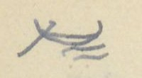{width=12%}

[NC: Ở góc trái trên trang tác giả vẽ một ký hiệu nhỏ hình chiếc thuyền trên sóng, có lẽ để đánh dấu đây là đường thủy. Trước số 9 ở đầu trang có một chữ số bị gạch.]

## Sông Kỳ-Cùng

| [Địa danh] | Chữ Hán | [Số tầm] | [Ghi chú] | [Tờ] |
|---|---|---|---|---|
| Thác Kỳ-viện | 托峙院 | 1.440 T | Giang-phận (giáp) xã Định-lập (定立), th. châu Tiên (先安), trấn Quảng Yên (廣安). Rộng 15 T, sâu 1 th. Thuộc giang-phận xã Tĩnh-gia (淨嘉), châu Lộc bình (祿平). Dòng →: 2 bên tả hữu đều thuộc sơn-phận xã Tĩnh-gia. | 16a |
| Thác Lạc đầu | 托樂頭 | 1.470 | Giang phận xã Khuất xá (屈舍). Rộng 17 Tầm, sâu 1 thước. Dòng →: 2 bên đều thuộc xã Khuất xá. | |
| Thác Khoan đầu | 托寬頭 | 2.060 | Giang-phận xã Sằn-viện (潺湲 [?]). Rộng 19 Tầm, sâu 1 thước. Dòng →: 2 bên đều thuộc hai xã Sằn-viện, Khuất xá. | 16b |
| Thác Xao | 托敲 | 4.020 | Giang phận xã Cẩm đoạn (錦段). Rộng 28 T, sâu 1 thước 5 tấc. Dòng →: 2 bên thuộc sơn phận xã Cẩm đoạn. | |
| (Sông) Thạch thiết | 石鉄 | 4.000 | Giang phận trang Thạch thiết (庄). Rộng 28 T, sâu 1 thước. Dòng →: 2 bên thuộc sơn phận thôn Lục (陸村) (thuộc trang Thạch thiết), trang Đồng bộc (同仆) và Tản-ngọc ([?]玉). | |
| (Sông) Vân-mộng | 雲夢庄 | 4.280 | Giang phận trang Vân-mộng. Rộng 28 T, sâu 1 thước. Dòng →: hai bên thuộc sơn phận trang Vân mộng. | |
| (S.) Hoài viễn | 懷遠庄 | 1.020 | Giang phận trang Hoài viễn. Rộng 25 Tầm. Sâu 1 thước. Dòng →: 2 bên thuộc sơn phận các trang Hoài viễn và Như ngao (如遨). | |
| Bến phố Như ngao | 如遨庯 | 1.710 | *tân thứ* (津次) [bến đò]. Phố có Nùng, Thổ ở lẫn. Rộng 30 Tầm, sâu 1 thước. Dòng →: 2 bên thuộc sơn phận 2 trang Trinh nữ (貞女) và Quảng trữ (廣儲). | 17a |
| S. Trinh nữ | 貞女庄 | 1.800 | Giang-phận. Rộng 29 T, sâu 1 th. 5. Dòng: 2 bên đều thuộc xã Mai-pha (枚坡) (Ôn châu 溫州). | |
| S. Mai-pha / Thác Bàn cờ | 枚坡社 / 托盤碁 | 960 | Giang-phận. Chỗ này có một tảng đá lớn nổi lên, chắn ngang sông. Nước chảy rất [...]. Thuyền bè qua | |

[NC: "th." = thước; "T" = tầm. "Dòng →" là hai bên dòng sông. Chữ 托 ở đây dùng theo lối Nôm để ghi "thác"; chữ 碁 trong 托盤碁 ghi "cờ" (Bàn cờ). Dòng cuối (S. Mai-pha và Thác Bàn cờ) được tác giả gộp bằng một dấu ngoặc; câu ghi chú tiếp sang trang sau. Mấy chữ sau "rất" bị gạch xóa rồi viết lại, chưa đọc được.]

# Trang PDF 112 - Lạng Sơn: sông Kỳ Cùng (tiếp)

[NC: trang không có chữ đầu trang và số trang bản thảo (chữ ở trên là nét trang trước hiện qua). Số tờ sách nguồn ghi ở lề trái.]

(tiếp dòng Thác Bàn cờ ở trang trước:) ... lại rất khó. Tên tục là Thác Bàn cờ (托盤碁). Rộng 30 T, sâu 2 th. Dòng →: bên tả thuộc xã Mai pha (枚坡) (Ôn ch.), bên hữu thuộc xã Vĩnh-trại (永寨) (ch. Thoát lãng 脫朗).

| [Tờ] | [Địa danh] | Chữ Hán | [Số tầm] | [Ghi chú] |
|---|---|---|---|---|
| | Bến trạm Trấn thành | 鎮城 | | *tân thứ* (津次) [bến đò]. Từ đây đến cửa sông Bình nhi (平兒水口) giáp đất Tàu, có 51.049 T., lòng sông có nhiều thác, chỉ có thuyền độc mộc và bè tre có thể đi thông. Đi xuôi mất 4 ngày; đi ngược 8 ngày. |
| 17b | Đò Kỳ-cùng | 淇[?]渡 | 846 [?] | Ở Trấn thành (鎮城), ở bờ hữu có đền Kỳ-cùng (淇[?] [?]祠) ở xã Vĩnh-trại (永寨), châu Thoát lãng (脫朗). Bờ tả thuộc phố Trường thịnh (長盛庯) thuộc Trấn thành, đất xã Mai pha (枚坡), châu Ôn (溫). Sông rộng 36 T, sâu 2 th. Dòng →: bên tả là xã Mai pha (枚坡), bên hữu là ruộng nương xã Vĩnh-trại (永寨). |
| | Bến trạm Mai pha | 枚坡 | 3.405 | *tân thứ* (津次). Rộng 36 T. Dòng →: tả là sơn phận xã Quảng nhân (廣仁), có xen ruộng; bờ hữu là sơn phận xã Hoàng đồng (黃同) (ch. Thoát lãng 脫朗) và xã Hoa giáp (花甲) (Văn uyên 文淵), có xen dân cư và ruộng vườn. |
| | S. Hoa giáp | 花甲社 | 1.535 | Giang phận. Thuộc ch. Văn Uyên (文淵). Dòng →: 2 bên là sơn phận xã Hoa giáp. |
| 18a | S. Khánh Khê | 慶溪 | 4067 | Giang phận. Thuộc ch. Văn quan (文關). Dòng →: bên tả thuộc sơn phận các xã Khánh Khê và Chi Khai (芝開), có xen dân cư; bên hữu thuộc sơn phận các xã Sơn tăng (山增), Chi Khai (芝開), Phú nhuận (富潤). Có xen dân cư, ruộng vườn. |

[NC: Chữ thứ hai của tên sông Kỳ Cùng tác giả viết bộ 氵 bên chữ 穷 (窮 viết tắt) [?]; tên thường gặp là 淇窮. Chữ trước 祠 chưa đọc chắc. Số tầm của Đò Kỳ-cùng bị viết đè (846 hoặc 946). Ở dòng Khánh Khê, tác giả viết chữ "tả" chen lên trên chữ "2 bên" (ý là sửa "2 bên" thành "bên tả"). Nửa dưới trang là tiêu đề in VERRERIE DU NORD in ngược.]

# Trang PDF 113 - Lạng Sơn: sông Kỳ Cùng (tiếp) đến cửa Bình Nhi

*Đầu trang: Lạng sơn 11 [?] ĐT; số trang bản thảo: 55*

[NC: góc trái trên lại có ký hiệu thuyền trên sóng như ở trang PDF 111 (đánh dấu đường thủy). Số tờ sách nguồn ghi ở lề phải.]

| [Địa danh] | Chữ Hán | [Số tầm] | [Ghi chú] | [Tờ] |
|---|---|---|---|---|
| S. Kim cúc | 金菊社 | 690 | Giang phận. Thuộc châu Văn-uyên (文淵). Rộng 27 T, sâu 2 th. 5. Dòng →: hai bên đều thuộc sơn phận xã Kim-cúc, có xen dân cư, ruộng vườn. | |
| S. Bác-lãng | 博浪社 | 4.280 | Giang phận. Thuộc châu Văn-quan (文關). Rộng 24 T, sâu 3 th. Dòng →: hai bên đều thuộc sơn phận xã Bác-lãng (Văn quan) và hai xã Thám xuân (探春), Quân-lao (均[?]) (Văn uyên 文淵). Có xen dân cư, ruộng nương. | |
| S. Phù tảo | 鳧藻社 | 3.360 | *trại* (寨) [?]. Giang phận. Thuộc châu Văn quan. Rộng 23 T., sâu 2 th. Dòng →: phía tả là sơn phận trại Phù-tảo, có xen dân cư ruộng vườn; hữu thuộc sơn-phận xã Hữu thu (有秋), ch. Thoát lãng (脫朗), có xen dân cư ruộng nương. | |
| S. Chung sơn | 鍾山社 | 15.214 | Giang-phận. Thuộc châu Thoát lãng (脫朗). Rộng 21 T, sâu 1 th. 5. Dòng →: phía tả theo sơn phận các xã Chung sơn (鍾山), Tân-lang (檳榔), Lịch-sơn (歷山 [?]), Xung minh (沖銘 [?]), Dũ-chàng (㤢[?]幢 [?]), Bác đức (博[?]), châu Thoát lãng (脫朗); thỉnh thoảng có dân cư ruộng vườn; bờ hữu là sơn phận các xã Hữu-thu (有秋), An-hóa (安化), Dũ-chàng (㤢[?]幢 [?]), có xen dân cư, ruộng vườn. | 18b |
| S. Vĩnh-điện | 永奠社 | 17.632 | Giang phận. Thuộc ch. Thất-tuyền (七泉). Rộng 43 T, sâu 3 th. Dòng →: Phía tả là sơn phận các xã Bình lâm (平林), Kim-tông (金宗), Hoa sơn (花山), Kim-gia (金嘉), Quan-khuê ([?]畦 [?]), Vũ lăng (武陵), Vũ lao (武牢), Khánh nham (慶岩), Đồng tân (同津), Bắc bình (北平), Cầu dương (臼陽), còn xen dân cư, ruộng vườn; bờ hữu là sơn phận các xã Vĩnh điện (永奠), Mạnh hác (孟壑 [?]), Phụng-a (奉阿), Văn phái (文派), Đồng luật (同律) (?), Bắc bình (北平), Cầu dương (臼陽), có xen dân cư, ruộng vườn. (Hai bờ đều thuộc châu Thất tuyền 七泉.) | 19a |
| S. Lai đầu [?] / Cửa Bình nhi | 萊[...]江 [?] / 平兒水口 | | Thuộc châu Bằng tường (平祥州) (憑 ?) đất Tàu. Sông rộng 36 T, sâu 1 T. Bên là Tàu có đặt một dây sắt chắn ngang mặt nước. | |

[NC: hai dòng cuối (sông Lai đầu [?] và Cửa Bình nhi) được tác giả gộp bằng một dấu ngoặc. "(憑 ?)": tác giả nghi chữ 平 trong tên châu Bằng Tường phải là 憑 (Bằng Tường 憑祥). Chữ "sâu 1 T" có lẽ là "1 th." (thước) [?]. Một số chữ Hán tên xã viết thảo, chưa đọc chắc, đã đánh [?].]

# Trang PDF 114 - Trang trắng

[Mặt sau của tờ trước: chỉ có giấy tiêu đề in sẵn VERRERIE DU NORD, Hanoi, le ... 194..; nét chữ tờ bên kia hiện qua giấy. Không có chữ viết.]

# Trang PDF 115 - Lý lộ trích ở "Lạng sơn đoàn thành đồ" (A.1220)

*Số trang bản thảo: 56*

Trích ở "*Lạng sơn đoàn thành đồ*" (mục bìa sau A 1220) (trước 27a): *Lý lộ* (里路) [Số dặm đường].

[mỗi dặm 270 tầm]

Chú ý khác với ở sách *Vũ bị* (武備): 1 *lý* (里) = 432 *tầm* (尋).

[NC: tức là sách *Vũ bị* tính 1 dặm = 432 tầm, còn ở đây 1 dặm = 270 tầm. "th" = thước; "t" = tấc.]

| | [Từ - đến] | Chữ Hán | [Số tầm] | [Quy ra dặm] |
|---|---|---|---|---|
| a) | Kinh-sư (lục trình) | 京師 | 450.040 tầm 2 th 5 t | = 1.666 dặm 220 tầm 2 th 5 |
| | Mũi (thủy trình) | 每[chữ Nôm, không gõ được] | 39.475 tầm | = 146 dặm 55 tầm |
| | Thành Gia định | 嘉定 | | |
| | cộng | | 489.515 tầm 2 th 5 t | = 1.813 dặm 5 tầm |
| b) | Kinh-sư (lục trình) | 京師 | 303.154 tầm | = 1.122 dặm 214 tầm |
| | Bắc thành | 北城 | | |
| c) | Gia định thành (lục ?) | 嘉定 | 96.350 tầm | = 356 dặm 230 tầm |
| | Cõi Cao mên | | | |
| d) | Bắc thành (cửa nam) (lục) | | 79.293 tầm | = 293 dặm 183 tầm |
| | Nam quan ải | 南關隘 | | |

[NC: dòng a) đọc là: từ Kinh sư đi đường bộ đến Mũi, rồi đi đường thủy đến thành Gia Định, cộng cả hai chặng. "Mũi" ghi bằng chữ Nôm: 每 kèm một chữ bộ 口 ghép 枚 [?], có lẽ là Mũi Cà Mau (Mũi Mâu) [?]. Số tầm chặng thủy trình bị viết đè, đọc theo phép tính (146 x 270 + 55 = 39.475).]

### Tóm tắt

| [Từ - đến] | [Số tầm] | [Quy ra dặm] |
|---|---|---|
| Từ cõi Cao mên đến Nam quan chưa ra | 968.312 tầm 2 th 5 t | = 3.586 dặm 92 tầm |
| Từ Kinh vào Nam | 585.865 tầm 2 th 5 t | = 2.169 dặm 235 [?] tầm |
| Từ Kinh ra Bắc | 382.447 tầm | = 1.416 dặm 127 tầm |

[NC: hai số dặm và tầm ở dòng "Từ Kinh vào Nam" bị viết đè; theo phép tính 2.169 x 270 + 235 = 585.865. Nửa dưới trang có chữ in VERRERIE DU NORD hiện ngược.]

# Trang PDF 116 - Trang trắng

[Mặt sau của tờ trước: chỉ có giấy tiêu đề in sẵn VERRERIE DU NORD, Hanoi, le ... 194..; nét chữ tờ bên kia hiện qua giấy. Không có chữ viết.]

# Trang PDF 117 - Nam hành trình lục (đời Lê): tựa và đường bộ Thăng Long - La Hà

*Đầu trang: Lê 1; số trang bản thảo: 57*

## NAM HÀNH TRÌNH LỤC

(Đời Lê)

Trích ở "Thiên tải nhàn đàm" (so với [...])

[NC: *Nam hành trình lục* (南行程錄) [Ghi chép đường đi vào nam], mục 9 của TTNĐ (xem trang PDF 11). Câu trong ngoặc ở cuối dòng "Trích ở..." viết bút chì mờ, sát mép giấy, chưa đọc được.]

### I. Tựa

Trong nước đi bốn bề, đâu lại không có hành trình. Sao lại chỉ có Nam-hành. Những phương nam giáp xứ Chiêm thành mà nạn vì Chiêm, xưa nay có đã lâu. Vua các đời từng đã nam chinh. Nhưng Chiêm lúc chịu làm tôi, lúc làm loạn.(1) Đến lúc vua Hồng đức (洪德) nhà Lê ta nam chinh, lập bia chia cõi mà nạn Chiêm mới yên.

Nam hành trình lộ (南行程路) này, vì đó mà một mình kê rõ. Mà trên mặt đất cũng vẽ đủ một đồ.

Kẻ quân tử đời trước chép đó. Cũng cho rằng địa thế xa hiểm khó phục, thiên số phân hợp không thường. Cho nên để lại để giúp việc trù biên vậy.

(1) Sót vào: "kiệt hiệt vẫn còn".

[NC: "trù biên" = lo liệu việc biên giới. Chú (1) ở cuối trang: tác giả ghi câu dịch bị sót, cần thêm vào sau chữ "làm loạn".]

### II. Đường bộ

**1° Thăng-long đến La hà (羅河 [?])** - Đi gặp tốt (吉行 [?])

| | [Địa danh] | Chữ Hán | [Ngày] | [Ghi chú] |
|---|---|---|---|---|
| A - | Thăng long | 昇隆 | | |
| | Quán Rẻ | 舘礼 | ngày 1 | |
| | Quán Guột | 〃滑 | 2 | |
| | Phố Cát | 庯葛 | 3 | |
| | Quán Vạn | 舘萬 | 4 | |
| | Bồ Cốc | 晡谷 | 5 | |
| | Hoàng Mai | 黄枚 | 6 | |
| | Quán Sồ | 舘[?] | 7 | |
| | Chợ Vinh | 聚永 | 8 | |
| | Chợ Già | 求 [?] 茄 | 9 | |
| | Quán Lạc | 舘樂 | 10 | |
| a) | Quán Khe Lau | 〃溪[?] | 11 | |
| | Chợ Phù lưu | 聚美 [?] 蕾 [?] | 12 | |
| | Lụy đăng | 屢登 | 13½ | Ở La hà (羅河 [?]) bờ bắc (x) |
| b) | Quán Suối | 舘[?] | 11 | |
| | Cầu Rộn | 求[?] | 12 | |
| | Cường Gián | 剛諫 | 13 | Ở bờ bắc La hà (羅河 [?]) |

[NC: cột số là số ngày đi. Chữ Hán ở đây phần lớn là chữ ghi âm Nôm (舘 = quán, 聚 = chợ, 求 = cầu, 晡 = bồ, 礼 = rẻ). Hai nhánh a) và b) là hai lối đi khác nhau sau Quán Lạc. Chữ đầu tên sông La hà tác giả viết như 罗/罢, chưa chắc. Dấu "(x" mực tím ở cuối dòng Lụy đăng không rõ ý. "Đi gặp tốt" có lẽ là dịch cụm chữ Hán viết bên cạnh.]

# Trang PDF 118 - Nam hành trình lục: đường quan đi (B)

*Đầu trang: Lê 2*

| | [Địa danh] | Chữ Hán | [Ngày] | [Ghi chú] |
|---|---|---|---|---|
| B | Thăng long | 昇龍 | | Quan đi |
| | Quán Ngoại lang | 舘外廊 | ngày 1 | |
| | Quán Sảo | 〃稍 | 2 | |
| | Cầu Châu | 求珠 | 3 | |
| | Quán Gột | 舘滑 | 4 | |
| | Quán Lợi | 〃浰 [?] | 5 | |
| | Quán Ngụ | 〃寓 | 6 | |
| | Kẻ Bản | 几版 | 7 | |
| | Ngã Năm | 我[chữ Nôm, không gõ được] | 8 | |
| | Cầu Đồn | 求頓 | 9 | |
| | Quán Thanh | 舘清 | 10 | |
| | Quán Thông | 〃通 | 11 | |
| | Quán Bầu | 〃[?] | 12 | |
| | Cầu Nê | 求泥 | 13 | |
| | Ngã Tư [?] | 我[?] | 14 | |
| | Đò Treo | 渡僚 | 15 | |
| | Cầu Cài | 求棋 | 16 | |
| | Cầu Họ | 求户 | 17 | |
| | Cầu Hạ | 求夏 | 18 | |
| | Dinh Cầu | 營求 [?] | 19 | |
| | Có hai đường: | | | |
| a | Dinh Cầu | 營求 | | Đường chính |
| | Mũi Đao | [chữ Nôm, không gõ được]刀 | 1 | |
| | An bài xã | 安排 | 2 | Ở bắc ngạn La Hà |
| b. | Dinh Cầu | | | Đường núi |
| | Khe Cao | 溪糕 | 1 | |
| | Sùng ái | 崇愛 | 2 | Ở bắc ngạn La Hà |

[NC: ở dòng 19 tác giả viết "Dinh Quải" rồi gạch "Quải", viết "Cầu" bên cạnh; chữ Hán cũng viết đè, chưa đọc chắc. Chữ Hán của "Ngã Năm" là 我 ghép một chữ Nôm bộ 南 + 五 [chữ Nôm, không gõ được]; "Mũi" viết bằng chữ Nôm (鼻 + 每). Nửa dưới trang là tiêu đề in VERRERIE DU NORD in ngược.]

# Trang PDF 119 - Nam hành trình lục: La Hà đến Chiêm Thành

*Đầu trang: Lê 3; số trang bản thảo: 58*

**2° La hà đến Chiêm thành**

| [Địa danh] | Chữ Hán | [Ngày] | [Ghi chú] |
|---|---|---|---|
| Sùng Ái | 崇愛 | | Ở bắc ngạn La hà |
| Kim linh | 金鈴 [?] | ngày 1 | (Đường núi) |
| Cổ Thuận | 姑順 | ngày 1 | (Đường chính) |
| Trấn ninh | 鎮寧 | 2 | |
| Truông Quán | 𥴜 [?] 舘 | 3 | |
| Truông Suối | 𥴜 [?] [chữ Nôm, không gõ được] | 4 | |
| Nhà Hồ | 茹胡 | 5 | |
| Mũi Thụy | 每瑞 | 6 | |
| Quy thuận | 歸順 | 7 | |
| Quán Cơm | 舘粓 [?] | 8 | |
| (làng Lao châu) | (廊牢州 [?]) | 9 | |
| Quán Nam | 舘南 [?] | 10 | |
| Quán Thu bài | 舘秋排 | 11 | |
| Quán Cao đôi | 舘高堆 | 12 | |
| Quán Bãi Ải | 舘𡓁 [?] 隘 | 13 | |
| Quán Chân Đặng | 〃真鄧 [?] | 14 | |
| Phố Hội an | 庯會安 | 15 | |
| Quán Mục | 舘牧 | 16 | |
| Quán Ông Cụ | 〃翁具 | 17 | |
| Quán Châu ổ | 〃朱塢 | 18 | |
| Quán Cừ mông | 〃[?]蒙 | 19 | |
| Quán Đề thơ | 〃題詩 | 20 | |
| Bến đá | 渡[chữ Nôm, không gõ được] | 21 | |
| Quán Phú quí | 舘富貴 | 22 | |
| Quán Suối Phường | 〃溪 [?] 芳 | 23 | |
| Quán Cây kè | 〃核棋 | 24 | |
| Quán Nước Mặn | 〃渃[chữ Nôm, không gõ được] | 25 | |
| Quán Đầm Rẽ | 〃潭[?] | 26 | |
| Quán Xuân đài | 〃春臺 | 27 | |
| Quán Đèo Cau | 〃岩[?] | 28 | |
| Quán Môn lương | 〃門良 | 29 | |
| Quán Kẻ Gềnh | 〃几[?] | 30 | |
| Quán Hồ dương | 〃呼陽 | 31 | |
| Quán Kẻ Ngâm | 〃几吟 | 32 | |
| Quán Câu Và | 〃㗂 [?] 吧 | 33 | |
| Quán Bến Bồn | 〃渡[?] | 34 | |
| Quán Ba Khu | 〃巴[?] | 35 | |

[NC: cột số là số ngày đi. Kim linh và Cổ Thuận là hai lối đi (đường núi và đường chính), tác giả gộp bằng dấu ngoặc, rồi cùng tới Trấn ninh. Phần lớn chữ Hán ở đây là chữ Nôm ghi âm tên nôm (Truông, Suối, Cơm, Bãi, Đá, Mặn, Rẽ, Cau, Gềnh, Câu, Bồn, Khu); nhiều chữ là chữ Nôm tự tạo, không gõ được hoặc chưa chắc tự dạng, đã ghi [?]. Nửa dưới trang có chữ in VERRERIE DU NORD hiện ngược.]

# Trang PDF 120 - Nam hành trình lục: đến Chiêm Thành; Phụ lục (La Hà trở vào)

*Đầu trang: Lê 4*

| [Địa danh] | Chữ Hán | [Ghi chú] |
|---|---|---|
| Vĩnh An | 永安 | |
| Quán Thanh Khách | 舘[?]客 | |
| Quán Phố mới | 〃庯買 | |
| Quán Bồn đồn | 〃[?]屯 | |
| Quán Phố trì | 〃浦持 | |
| Chiêm thành | 占城 | |
| Thạch thành | 石城 | |

[NC: tiếp bảng ngày đi của trang trước; ở đây tác giả không ghi số ngày.]

### Phụ lục (La hà trở vào). TTNĐ/37.

[NC: TTNĐ/37 = sách *Thiên tải nhàn đàm*, tờ 37 (mục 11, *Phụ lục Nhị Hà dĩ nam số đoạn trình*).]

| | [Địa danh] | Chữ Hán | [Thời gian] | [Ghi chú] |
|---|---|---|---|---|
| **1** | **Đường núi** | | | |
| | Lụy Đăng | 屢登 | 2 giờ | [Lê 1/32] |
| | Kim linh | 金鈴 [?] | 3 giờ ½ | |
| | Bến Kim sơn | 金山 | 1 ng. | |
| | Trường sơn | 長山 | 1 ng. ½ | |
| | Lụy Ông Hồi | 翁回壘 [?] | | |
| | (Xứ Dục sơn) | (浴山) | 1 ng. | |
| | Dinh Tạm | 暫營 | 1 ng. | |
| | Trường Nhà hồ | 茹胡 | | |
| **2.** | **Đường chính** | | | |
| | Trấn ninh | 鎮寧 | 3 giờ | |
| | Dinh Lưới [?] | 營[chữ Nôm, không gõ được] | 1 ng. | |
| | (Thạch xá xã) | (石舍) | | |
| | Dinh Tạm | 暫營 | 3 giờ | Đi đường thủy cũng 1 ngày. Từ đây đổ đường hồ, hải [?]. |
| | Phù Tông | 浮宗 | (1) | Lại có đường núi, từ chợ Thầy (柴市 [?]) qua Bối thạch (貝[?]), tới đình Quần tiên (群仙) [đình này do Nguyễn Hiền (阮賢 ?) - có lẽ Hoàng (潢) - lập ở sơn đạo [?], chỉ có 36 phường dân Bái trời (拜[?])]. Qua Sùng giang (崇江) giáp Cầu Ngói (橋[?]). Lại có một đường nguồn Cam [?]. Trú ở Cao đôi (高堆舘); qua Cây mít, trú ở Chân hương (真[?]); qua Quán Đặng-điền (鄧田 [?]), Duyên sơn (鉛山) (có mỏ chì (鉛場 [?]), có tuần sở xã Kim hộ (金户)). Hai bên sông có núi. Đều có mỏ vàng và Tuần). [chắc đoạn này là qua Lỗ vàn [?]]. |

- *(mực tím, lề trái, cạnh đoạn "Lại có đường núi...")*: cả đoạn này chép lầm vào đây. Xem (Lê 5).
- *(mực tím, lề trái, phía dưới)*: có lẽ sót một đoạn (ở đầu trang Lê 5).
- *(mực tím, chân trang)* (1) Ở bản "*Giao châu dư địa chí*" (tên bìa) chép như trên đến đây, nhưng có thêm, khác. Đoạn thêm ấy theo [?] chú thích bản đồ của "*Càn khôn nhất lãm*" (乾坤一覽).

[NC: "ng." = ngày. Tên "Dinh Lưới" (tác giả viết như "Dinh mười"; trang sau ghi rõ "Dinh Lưới") viết bằng chữ Nôm. *Càn khôn nhất lãm* [Một lần xem khắp trời đất] là tên bộ bản đồ (xem chú thích ở trang PDF 121). Nửa dưới trang là tiêu đề in VERRERIE DU NORD in ngược.]

# Trang PDF 121 - Các đồn, kho từ La Hà trở vào

*Đầu trang: Lê 5; số trang bản thảo: 59*

## Các đồn, kho từ La hà trở vào (1)

Trích ở "*Giao châu dư địa ký*" [tên bìa] tờ 39

1. Trên đường thủy chính có một kho tên là KHO QUẦN MÔNG (群[?]), trữ hết khí giới, đạn dược, súng ống. Bên sông có kho lúa ở địa phận xã Nguyệt Áng (月盎).

2. 

| [Địa danh] | Chữ Hán | [Thời gian] | [Ghi chú] |
|---|---|---|---|
| Cửa Việt | 越門 | 2 canh | |
| Toàn thắng trại | 全勝 | 2 C ½ | |
| Chợ Cam lộ | 甘露 | 1 ng. | |
| Tuần Ba giăng | 巴[?] | 2 ng. | Từ Đá hàn nghi giang (石[?]捍沂江 [?]) đến Ba giăng phải 3 ngày |
| Lụy Ba ngư | 巴魚 | 5 ng. | |
| Sĩ phường | 仕坊 | | |

3. Tạm [Lê 4/17,23] ở phía nam dinh có kho. Thủy đạo đi thuyền từ Dinh Lưới (營[chữ Nôm, không gõ được]) ra đến Kênh Nhà Hồ (涇茹胡) xuống thuyền; đổ gồng gánh thì bắt phần dân, binh, buôn bán, đều dùng xe điền xa (田車) (một bánh?) mà tải đến Đò Tạm (暫度) mà xuống thuyền. Tuy có cửa Vận thường (運常門) nhưng cạn, không đủ nước cho thuyền đi. Thuyền vào đến Đò Tạm cũng đỗ lại; dùng xe chở như trên. Đến Kênh Nhà Hồ (涇 [?] 胡) lại xuống thuyền đi đến chân núi Hải vân (海雲), đến bến Khu voi ([?][?]) thì dừng.

4. Vũ xá xã (武舍) có xưởng thuyền. Ở thượng lưu sông Chợ Thầy (柴市) có trường voi (象槽 [?]). Có đường từ chợ sông Thầy ... [nối xem Lê 4/25]

5. Dinh Cát (葛營), có 600 đồn binh.

6. Hai bên Cửa Yêu (腰門) đều có xưởng tàu 10 chiếc.

7. Dinh Lưới (營[chữ Nôm, không gõ được]) một mặt là Đại giang (大江), ba mặt là khe kênh. Hai bên đều đặt xưởng tàu. Phía tả sông có trường voi; phía hữu có kho lúa.

8. Sông Trình bái (呈沛 [?]) giáp Đại giang. Hai bên có xưởng tàu. Bên hữu Đại giang là dinh Phù xuân (浮春). Nguyễn Thụy (阮瑞) ở đó.

9. Có một đường nguồn Cam [nối xem L 4/29]. Hai bên sông có núi. Đều có mỏ vàng, có tuần; ở xã Vĩnh trường (永長) có đồn binh 1 đội 60 tên.

10. Từ cửa Xuân đài (春臺) đến cửa Bồ trì (蒲持) (có chỗ đề với Phổ (浦)) đến các cửa bể nước Xiêm, các sông, khe, kênh đều có ngạc ngư tên Con sấu ([?][?]), hay làm hại người. Ai qua đó, tuy nước cạn nhưng cũng phải đi thuyền bè để khỏi bị hại. Chớ không giám lội.

- *(mực tím, lề phải, cạnh mục 3)*: Xem cửa bể 7/21 đến 7/29.
- *(mực tím, lề phải, cạnh mục 7)*: Xem cửa bể 7/29.
- *(mực tím, chân trang)* (1) So với *Càn Khôn nhất lãm* (乾坤一覽), chú thích trên địa đồ *Thăng Long chí Chiêm Thành đồ* (昇龍至占城圖) [Bản đồ từ Thăng Long đến Chiêm Thành] (tờ 24, 25) và địa đồ (26, 27).

[NC: "C" = canh; "ng." = ngày. Ở mục 3, trước chữ "Tạm" có một chữ bị gạch (Đảo [?]), và chữ "Lê" trong ngoặc vuông cũng có nét gạch. "L 4/29" = trang Lê 4, dòng 29 (xem trang PDF 120). Chữ "Dinh Lưới" viết bằng chữ Nôm (營 + một chữ Nôm). Tên tiếng Việt "Con sấu" cũng viết bằng chữ Nôm (bộ 扌 [?] và bộ 魚 [?]). "Nguyễn Thụy" (阮瑞) có lẽ chỉ chúa Nguyễn [NC: chưa rõ].]

# Trang PDF 122 - Trang trắng

[Mặt sau của tờ trước: chỉ có giấy tiêu đề in sẵn VERRERIE DU NORD, Hanoi, le ... 194..; nét chữ tờ bên kia hiện qua giấy. Không có chữ viết, ngoài một chữ số nhỏ "6" [?] ở giữa mép trên.]

# Trang PDF 123 - Nam hành trình lục: II. Đường thủy (Thăng Long - Dinh Quải)

*Đầu trang: Lê 7 [?]; số trang bản thảo: 60*

[NC: chữ số sau "Lê" bị viết đè (6 và 7); trang sau ghi "Lê 8" đè lên 7, nên ở đây có lẽ là 7.]

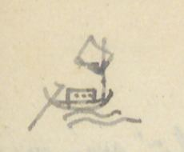{width=12%}

## II. Đường Thủy

**Thăng long - Dinh Quải**

| | [Địa danh] | Chữ Hán | [Ngày] | [Ghi chú] |
|---|---|---|---|---|
| A. | Bến Vọng lâu | 望樓津 | | Cát hành, Sĩ sơn [?] |
| | Phủ Lạnh | 府冷 | ngày 1 | |
| | Vân Sàng | 雲床 | 2 | |
| | Thần phù | 神符 | 3 | |
| | Miễu Ruà [?] | 汚[?] | 4 | |
| | Cầu Yếu | 求要 | 5 | |
| | Vũng Hang | 漨[?] | 6 | |
| | Chợ Bạng | 聚 [?] 蚌 | 7 | |
| | Cửa Cờn | 乾門 | 8 | |
| | Vạn phần | 萬汾 | 9 | |
| | Phúc Châu | 福州 | 10 | |
| | Nhượng Bạn | 讓畔 | 11 | |
| | Doanh Quải | 營[?] | 12 | Nếu gặp cạn hay mưa gió, thì kỳ theo lệ này; Quan hành cũng vậy |
| B | Thăng long thành | 昇龍 | ngày | Quân hành |
| | Bãi Bông | 𡓁 [?] [?] | 1 | |
| | Túc Mặc | 邸 [?] 墨 | 2 | |
| | Thiên phái | 天派 | 3 | |
| | Thần phù | 神符 | 4 | |
| | Vạn Thắm | 萬[?] | 5 | |
| | Vạn Tốt | 萬卒 | 6 | |
| | Bố vệ | 布衛 | 7 | |
| | Vũng Hang | 漨[?] | 8 | |
| | Chợ Bạng | 聚 [?] 蚌 | 9 | |
| | Cửa Càn | 乾門 | 10 | |
| | Cầu Thai | 求台 | 11 | |
| | Bến Đao | 渡刀 | 12 | |
| | Cầu Cấm | 求禁 [?] | 13 | |
| | Vĩnh dinh | 永營 | 14 | |
| | Cầu Nghèn | 求[?] | 15 | |
| | Cầu Nại | 求奈 | 16 | |
| | Cầu Lạc | 求樂 | 17 | |
| | Quán Tạm | 舘暫 | 18 | |
| | Dinh Quải | 營[?] | 19 | |

[NC: cột số là số ngày đi. A là lối "Cát hành" (đi gặp tốt [?]), B là lối "Quân hành" (quân đi). Ở dòng 12 (A) tác giả viết "Doanh Cầu" rồi sửa thành "Quải"; ở dòng 19 (B) viết "Dinh Cầu" rồi ghi "Quải" bên dưới; chữ Hán cũng có hai dạng (營 + một chữ bộ 木 [?], và một chữ bộ 扌 viết thêm bên dưới). Đây là cùng địa điểm mà ở trang PDF 118 tác giả sửa "Dinh Quải" thành "Dinh Cầu". Phần lớn chữ Hán là chữ Nôm ghi âm (求 = cầu, 聚 = chợ, 渡 = bến). Nửa dưới trang có chữ in VERRERIE DU NORD hiện ngược.]

# Trang PDF 124 - Nam hành trình lục: Đường bể

*Đầu trang: Lê 8*

[NC: số 8 viết đè lên một chữ số khác (7 [?]). Trang này ở mặt sau tờ giấy (chữ được viết ở nửa trên, nửa dưới là tiêu đề in VERRERIE DU NORD in ngược).]

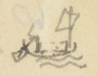{width=12%}

## ĐƯỜNG BỂ

Vượt bể, dùng thuyền buồm lớn, và thuyền buôn bốn ván (四板) hoặc mành (艋[?]). Cái thuyền ấy ra bể được. Ban ngày ngóng Hạc sơn [?] ([?]山), ban đêm thì xem sao và trăng; lại dùng phép đo bóng mà làm chứng. Ví như đi từ

| [Địa danh] | Chữ Hán | [Thời gian] | [Ghi chú] |
|---|---|---|---|
| Cửa Lạc | 落門 | ½ ngày | Mùa đông, xuân nên đi; mùa thu, hạ không nên đi. Đường khi gió bấc thổi mạnh. Để cửa Lạc ở phương Cấn (艮), đi thẳng về phương Khôn (坤). |
| Biện-sơn | 卞山 | ½ ngày | Để Biện sơn (卞山) phương Nhâm (壬), đi thẳng phương Bính (丙). |
| Cửa Hội thống | 會統 | 1 ngày | Để Cửa Hội thống ở phương Càn (乾), đi thẳng phương Tốn (巽). |
| Cửa Bố chánh | 布政門 | 1 ng. | Cửa Thanh (清[?]). Để Bố chánh ở phương Tân (辛), đi thẳng phương Ất (乙), một ngày. |
| Cửa Tư Khách | 思客門 | 1 ng. | Để cửa Tư Khách ở phương Canh (庚), đi thẳng phương Giáp (甲). |
| Cửa Đại chiêm | 大占門 | 1 ng. | Để cửa Đại chiêm ở phương Dậu (酉), thẳng đi phương Mão (卯). |
| Cửa Ô Lô | 烏[?]門 | | Từ đây theo phương Chấn (震) sẽ đi đến nước Chiêm thành (占城). |
| Cửa Phố Trì | 浦持 | | |

[NC: các phương (Cấn, Khôn, Nhâm, Bính, Càn, Tốn, Tân, Ất, Canh, Giáp, Dậu, Mão, Chấn) là các hướng trên địa bàn 24 hướng: "để cửa ... ở phương X, đi thẳng phương Y" nghĩa là giữ cửa biển ấy ở hướng X sau lưng và đi về hướng Y đối diện. Ở dòng Cửa Đại chiêm tác giả viết "phương Dậu 丙"; chữ Hán viết nhầm thành 丙, đúng ra là 酉.]

# Trang PDF 125 - Các hải môn quốc âm ca

*Đầu trang: Lê 9; số trang bản thảo: 61*

## Các Hải môn quốc âm ca

*Các hải môn quốc âm ca* (各海門國音歌) [Bài ca tiếng nước ta về các cửa biển]

(Trích ở *Càn Khôn nhất lãm* II/22)

[NC: bài ca thể lục bát, nguyên bản viết bằng chữ Nôm; tác giả chép ra quốc ngữ, chữ Hán (tên cửa biển) ghi ở cột bên phải, cùng thời gian đi. Các chữ gạch dưới trong bản thảo là tên đất. Chữ viết ở lề trái (in nghiêng trong ngoặc dưới đây) là chữ tác giả thêm vào đầu câu.]

| [Câu ca] | [Chữ Hán] | [Thời gian] |
|---|---|---|
| Nam hà (南河) từ cửa Sông Tranh (淨) | 門滝淨 | ½ ngày |
| Phỏng bán nhật trình vượt đến Thuận Cô | 順姑 | |
| Cửa An miếu [?] nọ sóng xô | 安[?] | |
| Ngọn từ xã Thái (蔡) ồ ồ chảy tuôn | | |
| Vượt qua đến Nhật lệ môn | 日麗門 | 1 ng. |
| Minh linh cửa ấy sắt chồn làm hàn | 明灵 | 1 〃 |
| Một ngày trải phiếm giang san | | |
| Đến miền Cửa Việt sắt hàn kém sao | 門越 | 1 〃 |
| Một ngày lại đến Cửa Yêu | 門腰 | 1 〃 |
| Cửa hàn ngạn sắt (垠鐵), sông (bớt nào ?), dây dầy | | |
| Đến Tư Khách cũng một ngày | 思客門 | 1 canh |
| Một canh vượt thủy nảy nảy Cảnh dương | 景陽 | 1 ng ½ |
| Một ngày rưỡi [?] lại sang cửa Sót | 門[?] | 3 canh |
| Vượt ba canh lại đến Câu đê | [?]低 | |
| Đà nẵng Cửa đặt tuần ti | 陀[?] | 1 ngày |
| Đại Chiêm (大占) Cửa ấy phỏng đi một ngày | 大占 | 1 canh |
| Thủy hành suốt một canh chầy | 合和 | 1 〃 |
| Hiệp hòa bến nọ, nảy đây An hòa | 安和 | (gộp với dòng trên) |
| Thủy, một canh, lại qua Châu Ổ | 朱塢 | 2 〃 |
| *(S)* Sa trạm [?] (沙湛) kìa đi bộ hai canh | 沙湛 | 1 〃 |
| Một Canh thủy hải bộ hành | | |
| Đại nẫm [?] Ba Cổ thủy trình bao xa | 大岩巴[?] | 1 ng. |
| Một ngày đến huyện Mộ hoa | 慕[?] | |
| Mỹ trũng (美虫) cửa nọ thật là hiểm thay | 美虫 | ½ ng |
| Thủy-trình phỏng độ nửa ngày | | |
| *(Thất)* Bồng sơn huyện (蓬山) thật đây Sa hoàng | 沙黄 | 2 canh |
| Hai canh sang Kim bồng hải khẩu | 金蓬海口 | 1 〃 |
| *(Phơ [?])* Phỏng vượt qua Phong phú một canh | 封富 | 1 ng. |
| Vào Nước ngọt một nhật trình | 渃[?] | 1 ng |
| *(Lối miền)* Nước Mặn bộ hành một ngày (暄 [?]) | 渃漫 | |
| Cù Mông đây Xuân đài đó nọ | 句[?], 春臺 | ½ ng |
| Mấy nước vào An phú đà Nông [?] | 安富陀農 | |
| Sông Ngang thủy thế mênh mông | 滝昂 | |
| *(Qua miền)* Nha lò [?] phỏng trong nửa ngày | 牙[?] | 1 ngày |

- *(bút chì, lề phải)*: năm chữ "bỏ" (hoặc "bộ" [?]) kèm dấu ngoặc, đặt cạnh các dòng: Cửa hàn ngạn sắt ...; Một canh vượt thủy ...; Đại Chiêm ...; Đại nẫm Ba Cổ ...; Qua miền Nha lò ... [NC: có lẽ tác giả đánh dấu các chặng đi đường bộ, hoặc các câu định bỏ; chưa rõ. Trang sau cũng có dấu như vậy.]

[NC: nhiều chữ Hán ở cột phải là chữ Nôm ghi tên nôm (滝 = sông, 渃 = nước, 門 = cửa đặt trước tên), đã ghi [?] những chữ chưa đọc chắc. Lời ca nhiều chỗ chưa chắc vì viết nhanh: "An miếu", "Câu đê", "Đại nẫm", "Nha lò". Nửa dưới trang có chữ in VERRERIE DU NORD hiện ngược.]

# Trang PDF 126 - Các hải môn quốc âm ca (hết)

*Đầu trang: Lê 10*

| [Câu ca] | [Chữ Hán] | [Thời gian] |
|---|---|---|
| Đến Nha trang một ngày chầy | 牙莊 | ½ ng |
| Cũng trong nửa ngày, đến Tiểu Nha trang | 小牙莊 | 3 canh |
| Cam-linh cửa ấy lênh lang | 甘[?] | 1 ng. |
| Thủy ba canh suốt, đi đường năm canh | | |
| Qua Man Rạng một nhật trình | 蠻[?] | 1 ng |
| Đến cửa Man Rý thủy hành một ngày | 蠻哩 | ½ |
| Kho [...] đây kìa kìa cửa cạn | 庫[?] | |
| Đến Mali phỏng bán nhật trình | 麻[?] | 3 canh |
| Thủy hành phỏng độ ba canh | | |
| Xích lam cửa ấy nước xanh như chàm | 赤藍 | 4 canh |
| Từ Xích lam đến miền Nước lộn | 渃論 | 2 ngày |
| Phỏng bộ hành đến bốn trống canh | | |
| Đến Cao Miên nhị nhật trình | | |
| Ấy là đã đến Thuận thành phong cương | 順城 | |

- *(bút chì, trước cột chữ Hán)*: chữ "bộ [?] (" ghi cạnh bốn dòng: Nha trang, Tiểu Nha trang, Man Rạng, Mali.

[NC: tiếp bài ca ở trang trước. Chữ ghi bên cạnh (đọc như "bỏ" hoặc "bộ"), ở cả trang này và trang trước, chưa rõ nghĩa: có thể đánh dấu chặng đi đường bộ. Tên đất trong ca (Nha trang, Cam linh, Man Rạng, Man Rý, Mali, Xích lam, Nước lộn, Cao Miên, Thuận thành) được tác giả gạch dưới. Chữ sau "Kho" ở dòng 7 để trống (có gạch dài). Nửa dưới trang là tiêu đề in VERRERIE DU NORD in ngược; phần giữa trang để trống, chỉ có nét chữ trang trước hiện qua.]

# Trang PDF 127 - Nghệ An - Quảng Bình (Cây Gạo)

*Đầu trang: Nghệ-an 1; số trang bản thảo: 62*

## NGHỆ-AN - QUẢNG BÌNH (Cây Gạo)

| [Địa danh] | Chữ Hán | [Số tầm] | [Ghi chú] |
|---|---|---|---|
| Cửa Nam | 南门 | 47.968,3 | |
| Hà-trung điếm | | | Do đường dịch lộ |
| Biều duệ [?] | 表裔 | | Từ Hà trung do đường thông hành (通行路) |
| Chợ cầu Tỉnh | 求井 [?] | | TTNĐ chép 尋 Tầm |
| Khe Vũng | 漨溪 | | |
| Lạc dị (Khe) | 樂異 | | |
| Núi Hỏa hiệu | 火號山 | | |
| Khe Trại Cày | 寨[?] | | |
| Khe Dinh vuông | 營[?] | | |
| Khe Cây Gạo | 核糕 | | |
| Khe Minh minh | 鳴鳴 | | |
| Khe Ba lô | 巴盧 | | Đường có hổ lang |
| Lũy đèo Bụt | 壘岩孛 | | |
| Ông Ninh | 翁寧 | | |
| Đồn cây gạo | 屯核糕 | | |
| Khe gạo | 糕 | | |
| Trại Cây Gạo | 核糕 | | |
| Cao cương | 高崗 | | |
| Cõi Quảng bình | 廣平界 | | Cách Hà trung (河中) 8.031 Tầm |

[NC: TTNĐ chép 尋 Tầm: ở dòng Chợ cầu Tỉnh, sách TTNĐ chép chữ 尋 (tầm) thay cho chữ 井 (tỉnh) [?]. Chữ Hán của các tên nôm (Cầu, Vũng, Cày, Vuông, Cây Gạo, Bụt) phần lớn là chữ Nôm. Trang chỉ có số tầm ở dòng đầu và dòng cuối. Nửa dưới trang để trống, có chữ in VERRERIE DU NORD hiện ngược.]

# Trang PDF 128 - Nghệ An - Quỳnh Lưu - Quỳ Châu

*Đầu trang: Nghệ an 2*

## NGHỆ-AN - QUỲNH LƯU - QUỲ CHÂU

| [Địa danh] | Chữ Hán | [Số tầm] | [Ghi chú] |
|---|---|---|---|
| Cửa đông | 東門 | 28.812,3 | |
| Chợ Bầu | [?]市 | | Ở Quỳnh Lưu. Đường Dịch lộ (驛路). |
| (Xã Bàu hậu) | [?]厚 | 56 | Bắt đầu từ Chợ Bầu, đường thông hành (通行). Đến cõi Quỳ châu (葵州) 30.949,2 |
| Cầu vực | 求域 | 715 | Dài 10 |
| Núi Can | 肝山 | 1.906 | |
| Chợ Ách | 厄市 | 800 | |
| Khe Gang | 溪[?] | 1.012 | Trên đường nhiều hổ, báo, voi. Rộng 10 T, nước độc. |
| Khe Sấy | 溪[?] | 290 | Rộng 9 T. Đường núi rừng, nhiều cướp. |
| Núi Bông | [?]山路 | | Đường dài 778 T. Rất gồ ghề. |
| Cửa núi Bông | 〃口 | 1.290 | |
| Chợ Tuần | 巡市 | 30 | Xưa có đồn Tiên lý (仙李). |
| Đồn Tam lễ | 三礼屯 | 209 | |
| Khe Măng cầu (c) | 溪[?] | 65 | Dài 2 T |
| Khe măng | 〃 | 485 | Rộng 5 T |
| Khe Đoài | 溪兌 | | Rộng 1 T |
| Truông Nhếp [?] | [?][?] | 252 | Đường dài 1000 T. Rừng, nhiều ác thú. |
| Cầu Khe Sơn (c) | 溪[?] | 520 | Dài 4 T. Đường rừng. |
| Quán Bồn phàm (q) | [?]凡 | 152 | |
| Khe Đá | 溪[chữ Nôm, không gõ được] | 455 | Rộng 2 T |
| Khe Giá | 〃[?] | 208 | Rộng 4 T |
| Thôn Tiên sinh | 先生村 | 250 | Dân cư |
| Khe làng Mẹ | 廊[?] | 100 | Rộng 15 T |
| Truông rạch | 串[?] | 100 | Đường núi; dài 225 T |
| Sách Bạc lỗ [?] | 朴魯 [?] 冊 | 325 | Dân mường (蛮 [?]) |
| Truông Ổi | 串[?] | 260 | Đường bùn, dài 910. Nhiều ác thú. |

[NC: "T" = tầm. Các chữ "c" (cầu) và "q" (quán) nhỏ viết sau một số tên đất, có lẽ là ký hiệu loại địa điểm [?]. Chữ Hán ghi tên nôm phần lớn là chữ Nôm (串 = truông, 溪 = khe, 廊 = làng), nhiều chữ chưa đọc chắc. Ở dòng "Sách Bạc lỗ", tác giả viết "Bạc" đè lên một chữ khác. Nửa dưới trang là tiêu đề in VERRERIE DU NORD in ngược.]

# Trang PDF 129 - Nghệ An - Quỳ Châu (tiếp)

*Đầu trang: Nghệ-an 3 (Quỳ châu); số trang bản thảo: 63*

| [Địa danh] | Chữ Hán | [Số tầm] | [Ghi chú] |
|---|---|---|---|
| Nghĩa liệt sách | 義烈冊 | 650 | |
| Sông Hiếu nghĩa | 孝義江 | | Rộng 58,2. Đường bùn. Nước rất độc. |
| Nghĩa Hưng sách | 義興 [?] 冊 | 100 | |
| Truông chiến | 串戰 | 800 | Đường dài 550 T. Rừng. Nhiều ác thú. |
| Truông trà [?] | 串[?] | | Đường dài 550 T |
| Cổ tiết sách | 古節 | 2310 | Đường núi, nhiều ác thú. |
| Khe Đỗ | 溪杜 | 700 | Đường núi, hiểm trở. Rộng 1 T |
| Truông Sống | 串[?] | 565 | Đường dài 700 T. Rừng núi gồ ghề. |
| Đò sông Dinh | 營江 | 300 | Rộng 40 T |
| Truông đồng cả [?] | 串[?][?] | | Phía đông đường có đền thờ Bình ngô công thần Vũ Quận công thượng đẳng thần (*Bình Ngô công thần Vũ quận công* 平吳功臣武郡公). Đường dài 2.298 T |
| Khe Mai | 溪楳 | 400 | Đường núi nhiều ác thú. Rộng 1 T |
| Truông Nêm | 串[?] | | Đường dài 1.198 T. Núi rừng |
| Khe Cát | 溪葛 | 1200 | Rộng 5 T |
| Khe Nhi | 〃[?] | 100 | Rộng 1 T |
| Truông Nhi | | | Đường dài 2.000 T |
| Truông Mộng | 串夢 | | Đường dài 300 T. Núi rừng |
| Khe Lòng | 溪[?] | 200 | Rộng 4 T. Rừng núi |
| Đèo Trạm lâu | [?]樓 | | Đường dài 2040 T |
| Núi Lèn | [?]山 | | Thuộc Tổng Phác lộ (朴魯 [?]) giáp |
| Cõi Già Vị sách | 加味 | | |
| (Quỳ châu) | 葵州府 | | |

[NC: Bình Ngô công thần [Công thần đánh dẹp quân Ngô (quân Minh)]: tác giả viết 「平吾公臣武郡公」, tôi chép về tự dạng thường dùng 平吳功臣. Chữ Hán của các tên nôm (truông 串, khe 溪, đèo, lèn) phần lớn là chữ Nôm, nhiều chữ chưa đọc chắc. Ở dòng "Núi Lèn", câu ghi chú bỏ dở ở chữ "giáp". "Sách" ở đây là đơn vị hành chính miền núi.]

# Trang PDF 130 - Nghệ An - Thượng đạo - Quỳ Châu

*Đầu trang: Nghệ an 4*

## NGHỆ-AN - Thượng đạo - QUỲ CHÂU

[NC: chữ "Thượng đạo" trong tiêu đề viết đè lên chữ khác, chưa đọc chắc. Các số 1, 5, 10, 15, 20 ở lề trái là số đếm dòng của tác giả. Các chữ nhỏ "c" (cầu) và "q" (quán) đặt trước cột chữ Hán.]

| Số | [Địa danh] | Chữ Hán | [Số tầm] | [Ghi chú] |
|---|---|---|---|---|
| 1 | Cửa Tây | 西門 | 499 | Theo Thông hàng đạo [?] |
| | Cầu An vinh (c) | 安榮 | 650 | Dài 5 T |
| | Cầu Chân địch (c) | 真的 | 150 | Dài 11 T |
| | Quán Đức (q) | 舘[?] | 900 | Điếm Chân địch (真的) |
| | Thái lão điếm | 蔡老 | 1.098 | |
| 5 | Xứ Cống khẩu | 貢口 | 115,2 | |
| | Miếu Cầu (c) | 庙求 | 734,2 | Dài 10 T, trước đường về [?] báo [?] có miếu Độc lôi (獨雷) thờ Đằng Không Phạm tướng quân (*Đằng không Phạm tướng quân* 騰空范將軍) triều Lý |
| | Chợ Hữu biệt | 有別 | 2.315 | |
| | Cầu Di | 求夷 | 360 | Dài 3 T |
| | Chợ An lạc xã | 安樂 | 122 | |
| 10 | Cầu Tự trì xã | 自持 | 770 | Dài 3 T,3 |
| | Chợ Chi lô | 支炉 | 510 | |
| | Cầu Tân đường | 新塘 | 540 | Dài 5 T |
| | Đường núi Mộ | 墓山 | | Dài 264 |
| | Vạn-an vệ | 萬安衛 | 228 | |
| 15 | Chợ Sa nam | 沙南 | 172 | |
| | Thượng thôn | 上村 | 123 | Phía bắc đường có miếu thần Mai Hắc đế (枚黑帝). Đế người xã Đông liệt (東烈) ở huyện Nam đường (南塘). Dấy binh chống Dương Tư Húc (楊思勗) tướng vua Đường Huyền Tông (唐玄宗). |
| | Ngã ba | 三岐路 | 440,4 | |
| | Cầu Vân đồn | 雲屯社 | 25 | Dài 8 T,4 |
| | Ngã ba | 三岐路 | 926 | |
| 20 | Đường núi Bồn sơn | 盆山 | | Dài 2.200 T |
| | Chợ Bồn | 盆市 | 2100 | |
| | Khe dưới | 溪[chữ Nôm, không gõ được] | 150 | Rộng 1.4 |

[NC: "T" = tầm. *Đằng không Phạm tướng quân* [Phạm tướng quân bay lên trời] là danh hiệu thần. Ghi chú dòng Miếu Cầu có mấy chữ viết nhanh, chưa đọc chắc. Chữ "dưới" trong "Khe dưới" viết bằng chữ Nôm (带 + 下). Nửa dưới trang là tiêu đề in VERRERIE DU NORD in ngược.]

# Trang PDF 131 - Nghệ An - Thuần Cam (phủ Quỳ)

*Đầu trang: Nghệ an 6 Thuần Cam (P Quì); số trang bản thảo: 64*

[NC: "P Quì" = phủ Quỳ (Quỳ châu). Trang trước là "Nghệ an 4"; không thấy trang "Nghệ an 5" trong khoảng trang này. "đg" ở đầu một số dòng = đường.]

| [Địa danh] | Chữ Hán | [Số tầm] | [Ghi chú] |
|---|---|---|---|
| Truông Vàng | 串[?] | | Dài 480. Nhiều hổ, voi |
| Khe Dặt | 溪溢 [?] | 370 | Rộng 7 T. |
| Khe Vang hạ | [?]下 | 310 | Rộng 7 T. Rừng núi |
| đg Khe Vang trung lộ | [?]中 | 940 | Rừng núi (có lẽ lội dọc khe?) |
| đg Khe Vang thượng lộ | [?]上 | 460 | Rừng núi; đường 〃 dài 20 T |
| đg Khe vang | [?]路 | 290 | Dài 60 T (lội dọc?) |
| đg Khe Vang | 〃 | | Dài 150 |
| Truông Đồng nguyên | 崗原 [?] | | Dài 80 |
| Đường khe Dinh Cây | 核[?] | 30 | Dài 130 T |
| Đường Khe Dinh | 溪[?] | 90 | Dài 90 |
| Đường Khe Dinh | 〃 | 860 | Dài 90. Trở lên đến rừng núi |
| Sông Thanh giang | 清江 | | Rộng 58 T. Nước rất trong. Thượng lưu 46.400 T đến sách Trà vị (茶[?]) phủ Quỳ châu (葵州). Hạ lưu 5.250 đến ngã ba Nam đường (南塘). |
| Tiên Kỳ ngoại th. | 仙琦外 | 250 | |
| Truông Cửa Từ | 門徐 [?] | 300 | Dài 350 T. Ác thú nhiều |
| Tiên Kỳ xã | 仙琦 | 1130 | |
| Khe Loá | 溪[?] | 640 | Đường bùn. Thú dữ. Rộng 15 T |
| Đồng xâm sách | 峝侵 [?] | 800 | |
| Khe Trình | 溪呈 [?] | 2.115 | Rộng 30 T |
| Bầu Sổ sơn | [?]數山 | | Truông dài 685 T. Núi tựa bầu. Trên có đá vuông mỗi bề hơn 4 Tầm |
| Oai lỗ sách | 威魯 | 900 | |
| Khe Đá | 石溪 | 710 | Rộng 2 T. |
| Trọng Hiệp sách | 仲合 | 800 | |
| Khe kẻ Thắm | 几[?] | 1.800 | Đường núi, nhiều ác thú. Rộng 2 T |
| Khe làng Côn | 廊[?] | | Rộng 2 T |
| Truông Khánh | 串[?] | | Dài 400 T |
| Trà la sách | 紫[?]冊 [?] | 1440 | Rừng. Nhiều ác thú |
| Khe Mông | 溪蒙 | 660 | Rộng 5 T. Rừng nhiều ác thú |
| Khe Long | 〃竜 | 800 | Rộng 7 T. |
| Thuần Cam sách | 醇甘 | 200 | ... tổng Thuần Cam, Quỳnh lưu (Thượng đạo) |
| Khe Tông | 溪[?] | 1.460 [?] | Rộng 8 T |
| Khe Muộn | 〃[?] | + 1100 [?] | Đường rừng nhiều ác thú |
| Phủ Quì | | | |

[NC: "T" = tầm; "th." = thôn [?]. Chữ Hán các tên nôm (truông 串, khe 溪, làng 廊, kẻ 几, Vang, Dặt, Loá) phần lớn là chữ Nôm, nhiều chữ chưa đọc chắc. Số tầm ở hai dòng Khe Tông và Khe Muộn bị chữ in sẵn của giấy che một phần. "Thượng đạo" viết thêm dưới chữ Quỳnh lưu, kèm dấu ngoặc. Nửa dưới trang là tiêu đề in VERRERIE DU NORD in ngược.]

# Trang PDF 132 - Nghệ An: đường Đô Lương (tiếp)

*Đầu trang: Nghệ an 5 [?]. Đô lương; số trang bản thảo: 64 [?]*

[NC: Bảng tiếp từ trang trước; tác giả đánh số dòng ở lề trái cách 5 dòng một lần. Nhiều chữ ở cột chữ Hán là chữ Nôm ghi tên khe, truông.]

| Số | [Địa danh] | Chữ Hán | [Khoảng cách] | [Ghi chú] |
|---|---|---|---|---|
| | Khe Trửa | 溪𡨌 | 320 | Rộng 2T. Đường rừng núi |
| | Khe Trên | 〃 蓮 | 380 | Rộng 1T. Đường rừng núi |
| 25 | Khe Ông Diêm | 翁塩 | 770 | Rộng 1T |
| | Khe Quất | 溪橘 | 800 | Rộng 4T |
| | Khe Lạt | 溪[氵+辣] | 200 | Rộng 4 thước |
| | Điếm Cửa trường | [?]門場 [?] | 2.243 | Đường núi |
| | Khe Ngọc-Am | 玉庵 | 2.310 | Rộng 13T |
| 30 | Đường Cồn Dồi | [土+辟]嚉 | 760 | Dài 840 |
| | Chợ Đô lương xã | 都梁 | 200 | |
| | Cầu | | 420 | Dài 4T,3 |
| | Miếu | 廟 | 930 | Thờ Thái phó Tấn quốc công (晉国公) người Đô lương, làm quan triều Lê (黎). Chống Mạc (莫). Chết ở núi Ngọc sơn (玉山). Đời Lê trung hưng truy phong thượng đẳng thần. Lập miếu thờ |
| | Khe Quẩy Đò | 溪乖 | 400 | Rộng 10 Tầm. Qua bằng đò |
| 35 | Miếu đường th. | 廟堂 | 400 | |
| | Khe Thông | 溪通 | 180 | Rộng 7 Tầm |
| | Chợ Miếu | 廟市 | 100 | |
| | Miếu Quả sơn | 果山 | 1.450 | Thờ Uy minh vương (威明王) con thứ [?] tám Lý thái tổ (李太祖) |
| | | | 2820 | |
| | Rừng Tào man sách | 曹蛮册 | 320 | Dài 300T |
| 40 | Khe Tào | 曹溪 | 380 | Rộng 2,5 [?]. Đường núi |
| | Khe Sổ | 溪擻 [?] | 1.250 | Rộng 6T,3 |
| | Cầu Nang | 求囊 | 1.050 | Dài 9T |
| | Đường rừng Vạn hộ | 萬戶村 | | Dài 330. Bên trường Hộ (場戶 [?]). Nhiều voi |
| | Khe Sung | 溪充 [?] | 420 | Rộng 5T,3 |
| 45 | Khe Cạy | 溪[扌+怠] [?] | 2.350 | Rộng 6T |
| | Trường Mạc sơn | 場莫山 | | Xã Mạc điền (莫田); dài 480T. Nhiều hổ lang |
| | Khe Kính | 溪敬 | 430 | Rộng 2T |
| | Khe Lữ | 〃 [氵+屢] [?] | 2.230 | Rộng 9T |
| | Cầu Lãng điền | 朗田梂 | 130 | Dài 4T |
| 50 | Chợ | 〃 市 | 200 | |
| | Đồn | 〃 屯 | 950 | |
| | Khe Lớn | 溪[巨+頁] [?] | | Rộng 7 Tầm |

[NC: "T" = tầm. Chữ "trường"/"truông" tác giả viết một dạng tắt giống 串 (có lẽ là 場); tạm chép 場. Chữ "Cồn" viết 土 bên trái 辟, không gõ được dạng chuẩn. Số 2820 giữa bảng có lẽ là số cộng một đoạn.]

# Trang PDF 133 - Nghệ An: Thượng đạo Thanh Hóa

*Đầu trang: Nghệ an 7; số trang bản thảo: 65*

## NGHỆ AN - Thượng đạo Thanh hóa (66.082 [?])

[NC: "Thượng đạo" = đường thượng (đường phía núi). Con số trong ngoặc có lẽ là tổng số tầm của lộ trình.]

| [Địa danh] | Chữ Hán | [Khoảng cách] | [Ghi chú] |
|---|---|---|---|
| Cửa Tây | 西門 | 27.752' | |
| Miếu đường th. | 廟堂 | 1.185 | H. Nam đường (南塘), theo thông [?] lộ (Xem Nghệ an - Thượng đạo - Qui châu) |
| Cầu Cồn | 求[土+辟] | 3.414² | Dài 10 Tầm. Rừng núi |
| Chợ Đồng than | 同灘 | 3.390 | |
| Qui lai sách | 歸來 | 2.210 | Đường rừng dài 1.100. Bên trường Dung (場容). Nhiều ác thú |
| Truông Tiên Kỳ x. | 仙琦 | | Dài 820T |
| Dũng tuyền th. | 涌泉 | 1.700 | |
| Khe Chanh | 溪[木+正] | 280 | Rộng 5T. Đường rừng |
| Đường Cồn Trường Bài | [土+辟]長排 | 167 | Dài 200T |
| Khe Cửa Gạc | [門+?][?] | 1.614 | Rộng 5T |
| Cầu Hạc | 求[?] | 540 | Có hai tòa cổ miếu, một thờ Đường quốc công (堂国公), một thờ Quế quốc công (桂国公). Hai công đều theo Lê (T.T.N.Đ) khởi nghĩa (Lê Thái tổ?). Sau khi mất, được truy phong. Nay rất thiêng. Cầu dài 3T |
| Sông Dương | 楊江 | 700 | Rộng 80 Tầm. Thượng lưu 25.900 Tầm đến bến Qui châu (葵州津次 [?]). Hạ lưu 25.750 đến ngã ba Nam đường (南塘) |
| Chợ Ngọc Thạch | 玉石 | 300 | |
| Cầu Khe quan | 溪関 | | Dài 3T |
| Tri lễ xã | 知禮 | 400 | |
| Khe Lọc | 渌溪 | 1.500 | Rộng 2T |
| Phương liên th. | 芳蓮 | 600 | Có hồ sen to |
| (1)* Vĩnh lại sách | 永頼 | 500 | Đường lầy |
| Khánh cù th. | 慶衢 | 600 | |
| Nhiêu hợp sách | 饒合 | 500 | |
| Truông Cây Me | 場核[木+眉] [?] | 1200 | Đường lầy, dài 900T. Rừng rậm |
| Núi Ngàn | 岃[?][月+旁] [?] | 300 | Đường núi nhiều ác thú, dài 500 tầm. Rừng rú, nhiều ác thú |
| Nghĩa hòa sách | 義和 | 1.235 | |
| Nghĩa hưng sách | 義興 | 651 | |
| Khe Liệu | 了溪 [?] | 160 | Rộng 2T |
| Cao lai sách | 高來 | 1.500 | |
| Khe Ấu | 溪[?] | 550 | Rộng 2T |

(1)* Sót 3 dòng, xem ở cuối trang sau.

[NC: T.T.N.Đ = *Thiên tải nhàn đàm*; chữ ghi nhỏ dưới dòng "theo Lê (T.T.N.Đ)" có lẽ để chỉ nguồn. Dấu "(1)*" ở lề trái dòng "Vĩnh lại sách" báo chỗ chép sót.]

# Trang PDF 134 - Nghệ An: Thượng đạo Thanh Hóa (tiếp)

*Đầu trang: Nghệ an 8 (Thanh hóa); số trang bản thảo: không ghi*

| [Địa danh] | Chữ Hán | [Khoảng cách] | [Ghi chú] |
|---|---|---|---|
| Sông Lạch Tiểu | 㴜小 [?] | 690 | Rộng 100T. Thượng lưu 8.300T đến bến Qui châu (葵州江次), hạ lưu 43.350 đến Ngã ba Nam đường (南塘三岐江) |
| Lai đáp sách | 來荅 | 1.800 | |
| Khe Cửu long | 九龍 | 770 | Rộng 3T |
| Hòa hợp sách | 和合 | 3.114 | |
| Đường Núi Khe | 岃[糸+?] [?] | | Dài 316T |
| Cây to núi Lẽn [?] | [石+連]山 [?] 大樹 | | Thuộc tổng Lâm la (林羅), đạo huyện Quỳnh lưu thượng đạo (瓊瑠上道) |
| Cõi Nông Cống (Thanh Hoa) | 農貢 | | Đường rất gồ ghề. Giáp Mi dạ sách (眉野册) ở Nông cống (農貢) |

[NC: Ba dòng dưới đây là ba dòng chép sót ở trang trước (xem chú "(1)*" ở trang PDF 133), viết riêng ở giữa trang, nét chì nhạt.]

| [Địa danh] | Chữ Hán | [Khoảng cách] | [Ghi chú] |
|---|---|---|---|
| Tri chỉ xã | 知止 | 1.900 | |
| Khe Muội | 溪妹 | 300 | Rộng 3T |
| Cự lâm xã | 巨林 | 1.500 | |

[NC: Nửa dưới trang là tiêu đề in VERRERIE DU NORD in ngược.]

# Trang PDF 135 - Nghệ An: đường Ngàn Phố

*Đầu trang: Nghệ an 9; số trang bản thảo: 66*

## NGHỆ-AN - Ngàn Phố (21.337³)

(đường thông hành)

| [Địa danh] | Chữ Hán | [Khoảng cách] | [Ghi chú] |
|---|---|---|---|
| Cửa Nam | 南門 | 292 | |
| Cầu | 求 | 161 | Dài 2T |
| Chợ Vịnh | 永市 | 985 | |
| Sông An pháp | 安法 | 696 | Rộng 22 |
| Quán Lươn | 館[虫+連] | 840 | |
| Cầu Đô an | 都安 | 911 | Dài 3T |
| Cầu Mai đồng | 梅仝 | 2.109 | Dài 5T |
| Chợ Cồn | 𢄂 [?][土+辟] | 23 | Chợ Phúc Hoàn (福完) |
| Sông Đò Cồn | 渡[土+辟] | | Sông Mộc Hoàn (木桓). Rộng 170T. Trên suốt nguồn Trà lân (茶鄰). Dưới chảy ra cửa Hội (會海門) |
| Bãi Phù sa | 浮沙洲 | | Dài 120T |
| Sông Tiểu chi | 小支江 | 406 | Rộng 39T |
| Bãi mới | 𡓁買 [?] | 1.942 | Giáp giới hai huyện Hưng nguyên và Thanh chương (興元，清漳) |
| Cầu Lăng | 求陵 | 480 | Giáp giới hai huyện Thanh chương (清漳) và La sơn (羅山). Dài 6T |
| Cầu Đậu đen | 豆[黑+?] [?] | 278 | Ở Thịnh quả (盛果) |
| Cầu | 求 | 900 | Dài 5T |
| Chợ Thượng | 𢄂上 | 708 | Xã Yên việt thượng (安越上) |
| Cầu Vĩnh thái | 永泰 | 955 | Dài 7 |
| Sông Tam Soa | 三义 | 625 | Rộng 50T. Một chi suốt nguồn Ngàn Phố (岸浦), một chi suốt nguồn Qui hợp (歸合). Chảy ra cửa Hội thống (會統) |
| Bến Nghiễn lạc | 蜆落 | 1.267 | Bến Địa vị (地位) |
| Bàu Đỗ xá xã | 杜舍 | 151 | 社泡 [?]. Rộng 15T |
| Cầu Cang | 求坑 | 605 | Làng Cam mỹ (甘美). Dài 4T |
| Chợ Lai | 𢄂來 | 60 | Làng Dương trai (楊柰 [?]) (chợ 来 TLYL) |
| Sông | 江 | | Rộng 20T. Từ Ngàn Phố (岸浦) đến [?] Tam soa (三义) |
| Chợ Bè | 𢄂筏 [?] | 1442³ | Mân [?] Xá (旻舍) |
| Khe Mộc | 木溪 | 927 | Rộng 3T |
| Khe Chùa | 溪廚 | 345 | Yên Mỹ (安美). Rộng 3T |
| Sông Hữu bằng | 有憑 | | Rộng 16T; trên từ Ngàn phố (岸浦), dưới xuống Tam Soa (三义) |
| Cầu Phúc dương | 福陽 | 210 [?] | Dài 5T |

[NC: "Ngàn Phố" là sông Ngàn Phố (岸浦, nay thuộc Hà Tĩnh). Chữ "chợ" tác giả viết theo lối Nôm (tạm ghi 𢄂). "Tam Soa" (三义, ngã ba sông) có lẽ là Tam Soa ở Thanh Chương/Hưng Nguyên. "(chợ 来 TLYL)": ghi chú tác giả đối chiếu với *Trình lục yếu lược*.]

# Trang PDF 136 - Nghệ An: đường Ngàn Phố (tiếp)

*Đầu trang: Nghệ an 10. (Ngàn phố); số trang bản thảo: không ghi*

| [Địa danh] | Chữ Hán | [Khoảng cách] | [Ghi chú] |
|---|---|---|---|
| Chợ Phúc Dương | 福陽 | 435 | |
| Cầu Khe | 求溪 | 1.462 | Dài 5T |
| Cầu Gềnh [?] phố th. | 崇浦村 [?] | 58 | Dài 10T,2 (TLYL chép 浦村崇求) |
| Chợ | 市 | 454³ | |
| Đồn Ngàn Phố | 岸浦 | | Đồn phân thủ. Thuộc Tĩnh thủy [?] (靖始 [?]) huyện Hương sơn (香山), phủ Đức Quang (德光). Đi ngược lên phía Tây 16.230T đến Đèo Miết [?] Ngát (蔑屹 [?]), giáp cõi Mường Ổ (芒塢) |

[NC: "Đồn phân thủ" = đồn chia quân canh giữ. Phần còn lại của trang để trống; nửa dưới là tiêu đề in VERRERIE DU NORD in ngược.]

# Trang PDF 137 - Nghệ An: đường Qui Hợp

*Đầu trang: Nghệ an 11; số trang bản thảo: 67*

## NGHỆ AN - QUI HỢP (39.127)

do thông hành lộ

| [Địa danh] | Chữ Hán | [Khoảng cách] | [Ghi chú] |
|---|---|---|---|
| Cửa Nam | 南門 | 11.615 | |
| Sông Tam soa | 三义江 | 2.070 | Xem NGHỆ AN - NGÀN PHỐ. Rộng 50T |
| Cầu Ông Hiền | 翁[?] | 1.590 | Dài 6T |
| Cầu Trại Đầu | 寨頭 | 345 | Dài 11 |
| Khe Lai Đồng | 萊同 | 250 | Rộng 10. Khe Ông Lôi (翁雷) |
| Khe Đồng Nát | 同[氵+涅] [?] | 1.146 | Rộng 5T (TLYL: 同[氵+涅]) |
| Khe Đợi | 溪[?] | 518 | Cẩm trang (錦庄). Rộng 4T |
| Cầu Dong | 洞求 [?] | 889 | Hạ Bồng t. (逢社). Dài 16T |
| Chợ Thượng Bồng | 上逢 | 971 | |
| Khe Bố | 溪布 | 293 | Rộng 15 |
| Khe Bồng | 溪逢 | 2.130 | Rộng 12 |
| Khe Lệ | 溪例 | 195 | Lâm thao (臨洮). Rộng 20 |
| Khe Hai | 溪台 [?] | 188 | Rộng 1 |
| Khe Tất | 溪[扌+悉] [?] | 564 | Hòa duyệt (和悅). Rộng 15T |
| Sông Bàu Khê | 泡溪 | 505 | Rộng 60. Có tên Chín Khúc Hội nai (九[?]曲會[?]) |
| Khe Mộc bài | 木牌 | 1.087 | Thổ Hoàng. Rộng 3T. (土黄) |
| Khe Trại | 溪寨 | 903 | Rộng 3T |
| Khe Gia | 溪嘉 | 274 | Rộng 2T |
| Khe Môi | 溪[口+某] | 2.640 | Rộng 3T |
| Chợ Vang | 𢄂[?] | 367 | Thổ hoàng (土黄) |
| Cầu Bả | 求把 | 780 | Dài 9T |
| Sông | 江 | 90 | Trên từ Qui hợp, xuống Tam soa (三义). Rộng 26 Tầm |
| Chợ Trúc | 𢄂竹 | 138 | Bàu lăng (泡淩) |
| Cầu Đất | 求坦 | 100 | Dài 6T |
| Truông Trúc Lâm | 竹林 | 266 | Dài 630 (có lẽ rừng tre) |
| Truông rừng Mây | 楣林 [?] | 1.680 | Dài 465 |
| Cầu cửa Khe | [?]門溪 | 1.679 | Chu lễ (周礼). Dài 11 |
| Cầu cây Tân | 核新 | 281 | Dài 10T |
| Chợ Sung | 𢄂[?] | 750 | Chu lễ (周礼) |
| Cầu Thổ phượng | 土鳳 | 1.858 | Dài 5T |
| Đường núi Thạch lập | 石立 | 817 | Dài 415 |
| Chợ Bàu lăng | 泡淩 | 45 | |
| Sông Tiềm | 潛江 [?] | 187 | Rộng 30T. Từ Qui hợp (歸合) xuống Tam soa (三义) |
| Khe Qui hợp | 歸合 | 11 | Rộng 1T |
| Chợ Tiềm | 潛市 [?] | 113 | |
| Đồn Qui hợp | 歸合 | 1.929 | Đồn phân thủ; đi 1.929 đến Đèo Ngang (岩昂) |
| Đèo Ngang | 岩昂 | | |

[NC: "Đèo Ngang" ở đây là một đèo trên đường Qui Hợp (miền tây Nghệ An), khác với Đèo Ngang trên đường thiên lý.]

# Trang PDF 138 - Nghệ An: đường ra các cửa biển (Cửa Sót, Cửa Nhượng)

*Đầu trang: Nghệ an 12 (Cửa Bể); số trang bản thảo: không ghi*

## NGHỆ AN - CỬA BỂ

### 1. CỬA SÓT

| [Địa danh] | Chữ Hán | [Khoảng cách] | [Ghi chú] |
|---|---|---|---|
| 1° Cửa Nam | 南門 | 13.247⁴ | Do đường Dịch lộ đến điếm Hoàng xá |
| Hoàng Xá trang | 黄舍 | 200 | Thuộc h. Thiên lộc (天祿). Từ đây theo đường thông hành 10.071 đến Cửa Sót (津) |
| Chợ Hà hoàng | 河黄 | 456 | |
| Chợ Phổ Minh | 普明 | 900 | |
| Hữu Thiên lộc | 右天祿 | 1330 | Phía bắc nhìn xa chùa Hương tích (香跡寺) trên núi Hồng lĩnh (洪嶺) |

Cầu tự ở đó hay ứng. Quan *tán lý* (贊理) [chức quan phụ tá việc quân] đời Lê là Trần danh Lâm (陳名霖) tới đó cầu, có thơ rằng:

*Tha nga [?] điệp lâm tùng hồi phàm [?], / Bảo sơn vạn cổ trĩ thiên nam. / Tùng chi nguyệt quải Trang vương chỉ, / Long lĩnh vân sinh Thánh mẫu am. / Nhất cúc ngọc tuyền thanh bách quả, / Tam thông đồng cổ tỉnh quần hàm. / Tầm thanh ngưỡng khấu hồng từ lực, / Giả thử sơn anh dục lệnh nam.*
(嵯[?]峨[?]疊林叢迴凡[?]，寶山萬古峙天南。松枝月掛莊王址，竜嶺雲生聖母庵。一掬玉泉清百果，三通銅鼓醒群酣。尋声仰叩鴻慈力，假此山英毓令男。)

**Dịch:** Núi cao rừng rậm trùng điệp vây quanh, Núi Báu muôn thuở sừng sững ở trời Nam. Cành thông trăng treo trên nền cũ của Trang vương, Đỉnh Rồng mây sinh bên am Thánh mẫu. Một vốc suối ngọc làm trong trăm quả, Ba hồi trống đồng đánh thức đám người say. Theo tiếng ngửa lạy sức từ bi lớn lao, Mượn khí thiêng núi này nuôi nên con trai giỏi.

[NC: Câu đầu chữ viết nhanh, hai chữ đầu và chữ cuối chưa đọc chắc; vần -am (南, 庵, 酣, 男) cho thấy chữ cuối câu đầu có thể là 凡. "Trang vương" chỉ Diệu Thiện công chúa con Diệu Trang vương trong truyện Phật Bà Hương Tích.]

| [Địa danh] | Chữ Hán | [Khoảng cách] | [Ghi chú] |
|---|---|---|---|
| Chợ Đình | 𢄂亭 | 1.170 | Xã Nội Thiên lộc (内天祿) |
| Truông Gỏ [?] | 場[?] | 1.300 | Ngọc sơn (玉山). Dài 300T. Nhiều hổ. Có bụi rậm (TTNĐ [?]) |
| Đường núi Biên sơn | 边山 | 358 | Dài 70 |
| Cầu Kiệt | 求傑 | 280 | Đại lữ (大呂). Dài 9T |
| Cầu Thanh lương | 清涼 | 1.600 | Dài 12 Tầm. Trên từ xã Hoa sử (花史), chảy xuống sông Cổ kinh (古涇) |
| Chợ Huyện | 𢄂縣 | 970 | Phù lưu (芙蕾 [?]). Dài 56 |
| Chân núi Côn bằng | 崑鵬 | 1.890 | |
| Khe | | 360 | Rộng 4 Tầm. Từ núi Côn (崑山) chảy ra bể |
| Đồn Cửa Sót | 津門 | | Đồn phân thủ |

### 2. CỬA NHƯỢNG

| [Địa danh] | Chữ Hán | [Khoảng cách] | [Ghi chú] |
|---|---|---|---|
| 2° Cửa nam | 南門 | 30.024 [?] | Do đường dịch lộ đến chợ Vân phong |
| Chợ Vân phong | 雲峯市 | | Thuộc huyện Kỳ hoa (奇華). Theo thông hành lộ 6.630 Tầm đến Cửa Nhượng (讓), qua các nơi: |

[NC: Tiếp ở trang sau. Nửa dưới trang là tiêu đề in VERRERIE DU NORD in ngược.]

# Trang PDF 139 - Nghệ An: đường ra các cửa biển (tiếp: Cửa Nhượng, Cửa Hải Khẩu, Cửa Hội, Cửa Xá)

*Đầu trang: Nghệ an 13 (Cửa Bể); số trang bản thảo: 68*

[NC: Tiếp đường ra Cửa Nhượng từ trang trước.]

| [Địa danh] | Chữ Hán | [Khoảng cách] | [Ghi chú] |
|---|---|---|---|
| Trường ngoại th. | 塲外 | | |
| Bến Côn | 渡昆 | | |
| Chợ Cầu Côn | 求昆市 | | |
| Cầu Mang | 求芒 [?] | | |
| Cầu Đất | 求坦 | | |
| Sông Kỳ la | 奇罗江 | | |
| Cầu Độn | 求[?] | | |
| Chợ Mai | 𢄂枚 | | |
| Chợ Hôm | 𢄂歆 [?] | | |
| Đồn Cửa Nhượng | 讓門 | | Đồn phân thủ |

### 3. CỬA HẢI KHẨU

| [Địa danh] | Chữ Hán | [Khoảng cách] | [Ghi chú] |
|---|---|---|---|
| 3° Cửa Nam | 南門 | 47.968³ | Do đường dịch lộ đến điếm Hà trung |
| Hà trung điếm | 河中 | | Thuộc h. Kỳ hoa (奇華). Theo thông hành lộ 4.276² đến Cửa Hải Khẩu (海口), qua |
| Cửa bắc Dinh Cầu | 營求屯 [?] | | |
| Sông Hà trung (lộ) | 河中江 | | Đường dọc sông? |
| Sông Hải Khẩu th. | 海口村 | | |
| Đồn Hải Khẩu | 〃 屯 | | Đồn thủ |
| Cửa Hải Khẩu | 〃 門 | | |

### 4. CỬA HỘI

| [Địa danh] | Chữ Hán | [Ghi chú] |
|---|---|---|
| Cửa Đông | 東門 | Theo thông hành lộ 9.090 đến cửa Hội: |
| Chợ Vịnh | 永市 | |
| Trạm Dũng quyết | 勇決驛 | |
| Cầu Mong | 求[?] | |
| Chợ Bồ | 𢄂蒲 | |
| Biển thịnh th. | 汴盛村 | |
| Cầu Đặng | 求鄧 | |
| Chợ Trại Bảo lân | 𢄂寨 | 保鄰 |
| Cầu Trại | 求寨 | |
| Chợ Mới Chính Vĩ | 𢄂買 | 政偉 |
| Cầu Kênh | 求涇 | |
| Đồn Cửa Hội | 會門 | |

### 5. CỬA XÁ

| [Địa danh] | Chữ Hán | [Ghi chú] |
|---|---|---|
| Cửa Đông | 東門 | Do đường dịch lộ 7.525T đến Cung trạm Kim Khê. Từ đó theo thông hành lộ 4.653 đến Cửa Xá |
| Kim Khê cung trạm | 金溪 | |
| Kim Khê trường | 〃 塲 | |

[NC: Tiếp ở trang sau.]

# Trang PDF 140 - Nghệ An: đường ra các cửa biển (tiếp: Cửa Xá, Cửa Hiền, Cửa Vạn, Cửa Quèn, Cửa Đại, Cửa Cờn)

*Đầu trang: Nghệ an 14 (Cửa Bể); số trang bản thảo: không ghi*

[NC: Tiếp đường ra Cửa Xá.]

| [Địa danh] | Chữ Hán | [Khoảng cách] | [Ghi chú] |
|---|---|---|---|
| Cầu Sáng sơn | 創山 | | |
| Vạn lộc | 萬祿 | | |
| Chợ Cầu Lò | 求炉市 | | |
| Đồn Xá hải | 舍海屯 | | |
| Sông Mai phụ | 枚阜 | | |
| Cửa Xá | 舍門 | | Cách [NC: bỏ dở] |

### 6. Cửa Hiền

| [Địa danh] | Chữ Hán | [Khoảng cách] | [Ghi chú] |
|---|---|---|---|
| Cửa Đông | 東門 | 10.686 | Theo dịch lộ đến cầu La Hoàng |
| La hoàng cầu | 罗黄 | 1.578 | Thuộc h. Hưng nguyên (興元), rồi theo thông hành lộ 1.578 đến Cửa Hiền (賢) |
| Cầu Nhị | 求[?] | | |
| Đồn phân thủ | 分守屯 | | |
| Cửa Hiền | 賢門 | | Cách La hoàng (罗黄) 1.578T |

[NC: Tác giả gạch dòng "Kho Tiên lý (仙李庫)" và số "17.948" ở mục này, sửa thành cầu La Hoàng.]

### 7. CỬA VẠN

| [Địa danh] | Chữ Hán | [Khoảng cách] | [Ghi chú] |
|---|---|---|---|
| Cửa Đông | 東門 | 17.948 | Theo dịch lộ đến Kho Tiên lý (仙李) |
| Kho Tiên lý | 仙李庫 | 690 | Thuộc h. Đông thành (東城), theo thông hành lộ 690 Tầm đến |
| Cửa Vạn | 濿門 [?] | | |

### 8. CỬA QUÈN và CỬA ĐẠI

| [Địa danh] | Chữ Hán | [Khoảng cách] | [Ghi chú] |
|---|---|---|---|
| Cửa Đông | 東門 | 28.080 | Theo dịch lộ |
| Chợ Bàu hậu | 泡厚市 | 4.894 | Thuộc h. Quỳnh lưu. Có 2 thông hành lộ: |

[NC: Từ đây tác giả chia hai cột song song: a) đường ra Cửa Đại (bên trái), b) đường ra Cửa Quèn (bên phải), có mũi tên chỉ hướng.]

a) Đường ra Cửa Đại:

| [Địa danh] | Chữ Hán |
|---|---|
| Trung thị xã | 中市社 |
| Đò Kênh Dâu | 涇[木+?]渡 |
| Đồn phân Trung thị | 中市分守 |
| Cửa Đại | 台門 |

b) Đường ra Cửa Quèn:

| [Địa danh] | Chữ Hán | [Khoảng cách] |
|---|---|---|
| Thượng-an thôn | 上安村 | |
| | 坝堰 [?] | |
| Đò Mi giang | 湄江渡 | |
| Chợ Hoàn nghĩa. Đồn | 完義市 分守屯 | |
| Cửa Quèn | 權門 | 5.838T |

### 9. CỬA CỜN

| [Địa danh] | Chữ Hán | [Khoảng cách] | [Ghi chú] |
|---|---|---|---|
| Cửa Đông | 東門 | 31.350 | Do dịch lộ |
| Trạm Quỳnh Hoa | 瓊華 | 5.721 | Do thông hành lộ |
| Bát nhã | 般若 | | |
| Cầu Bất Hủ | 不朽 | | |
| Cầu Kim lung | 金[?] | | |
| Đò Hữu lập | 有立 | | |
| Đò Nam ngạn | 南岸 | | Phía bắc có đồn thủ |
| Cửa Cờn | 乾門 | | |

[NC: Các dòng cuối viết đè lên chữ in tiêu đề VERRERIE DU NORD in ngược.]

# Trang PDF 141 - Nghệ An: Thượng đạo (đường voi đi)

*Đầu trang: Nghệ an (15) Thượng đạo; số trang bản thảo: 69*

## NGHỆ AN - Thượng đạo

(Đường voi đi)

[NC: Ở lề trái, ngang hai dòng đầu, tác giả ghi chữ Hán *Quảng Bình* (廣平) và *Kỳ Hoa* (奇華) để chỉ chỗ giáp giới hai đất.]

| [Địa danh] | Chữ Hán | [Khoảng cách] | [Ghi chú] |
|---|---|---|---|
| Cõi Quảng Bình | 廣平 | | |
| Khe trại Cây Gạo | 核糕 | 442 | Tên Khe Nặc (匿), rộng 2T. Phía bắc là h. Kỳ hoa (奇華), phía nam là Quảng bình [?] |
| Khe Đồng | 溪峝 | 500 | Rộng 3T |
| Khe Ba lạt | 巴[忄+票] [?] | 205 | Rộng 5T. Đường núi khó đi |
| Khe | 溪 | 371 | Rộng 10. Đường rừng |
| Khe Trâu | 溪[牛+娄] | 1.184 | Rộng 3T,3. Đường núi rừng |
| Khe Cây Gạo | 核糕 | 280 | Rộng 40T. Từ Hoành sơn (橫山) xuống sông xã Lũ cảng (婁巷 [?]) |
| Lũy Ba hời Ông Ninh | 巴[口+希] | 360 | 翁寧 |
| Khe Vũ | 溪[木+武] | 183² | Rộng 1T |
| Khe Nhĩ | 〃 [?] | 372 | Rộng 1T. Đường khuất khúc khó đi |
| Khe trại Tấm | 芯寨溪 [?] | 1.023 | Rộng 20T. Từ Hoành sơn (橫山) xuống sông Chánh châu (政州) |
| Khe Đồng Cưu | 峝鳩 | 206 | Rộng 6T. Đường rừng khó đi. Có hổ lang |
| Khe Truông Tràng | 場根 [?] | | Rộng 2T 〃 |
| Truông Lương | 場[木+梁] | | Dài 1.476. Đường đá khó đi. Lại rừng có hổ, lang, trùng độc |
| Khe Lạch Đài | 㴜臺 | 1.220 | Rộng 1T,3. Đường chân núi, khó đi |
| Khe Muôn | 溪[氵+悶] [?] | 440 | Ở Vọng liệu (望料). Rộng 10T |
| Điếm trại đá cũ | 寨[石+多]故 [?] | 1.400 | 故坫 [?]. Ở Vọng liệu. Điếm cũ. Từ đây có đường 8.775 đến cung Dinh Cầu (營求) |
| Khe Quần Nhai | 群涯 | 68 | Rộng 8T (涯) |
| Khe Cạn | 溪[氵+件] | 677 | Rộng 8T,1. Đường đá khó đi |
| Khe Cây da | 核椰 [?] | 270 | Rộng 2T |
| Khe Đá hàng | [石+多]行 | 464³ | Đường đá khó đi. Rộng 3T |
| Khe Lệ | 溪[木+力] [?] | 1.019 | Rộng 3T2. Núi rừng. Nhiều hổ lang |
| Khe Cả | 〃 奇 | 2.137² [?] | Rộng 17,3 |
| Truông Lưu | 場榴 [?] | | Dài 2.637,2. Khó đi. Nhiều thú dữ |
| Khe Cây da | 核耶 | 1.030 | Rộng 2T,3 |
| Khe Cây Nhã | 核雅 | 935³ | Rộng 4T |
| Khe Tiêu tương | 潇湘 | 1.272 | Rộng 1T |
| Khe đá lý | [石+多]石里 | 1.323 | Rộng 2T |
| Khe Trà | 溪茶 | 507 | Dịch não [?] (易耒[?]). Rộng 20T |
| Khe Cây Dâu | 核槐 [?] | 893 | Rộng 7T |
| Khe Cửa truông | [?]門場 | 3.630 | Rộng 2T. Đường rừng khó đi |
| Khe Viên | 溪員 | 903² | Dư lạc (餘樂). Rộng 30 Tầm |

[NC: Số ở dòng "Khe Cả" bị gạch sửa, đọc chưa chắc. "Đá" tác giả viết chữ Nôm 石+多 (𥒥).]

# Trang PDF 142 - Nghệ An: Thượng đạo (tiếp)

*Đầu trang: Nghệ an 16 (Thượng đạo); số trang bản thảo: không ghi*

| [Địa danh] | Chữ Hán | [Khoảng cách] | [Ghi chú] |
|---|---|---|---|
| Cầu Cửa Lỗ | [?]門[木+魯] | 1.596 | Dài 3,2T |
| Khe Am thị | 庵市 | 244³ | Rộng 9T |
| Khe Cây Măng | 核[木+芒] [?] | 1.088 | Rộng 4T,3 |
| Khe Gưởi [?] | 溪[口+攸] [?] | 3.418 | Rộng 5T,2 |
| Khe Mèo | 〃 苗 | 263 | Rộng 8T,3 |
| Khe Cầu đá | 求[石+多] | 904³ | Dài 3T |
| Khe mới | 溪買 | 973² | Khe Thượng triều (上潮). Rộng 4T,2 |
| Ngã ba Mua | 我巴[木+某] [?] | | |
| Sông Hoa duệ | 滝華裔 | 237 | Rộng 25T,3 |
| Cầu Hói | 求[日+每] [?] | 1.040 | Dài 1T,2 |
| Cầu Phúc | 求[?] | 1.483 | Hoa Cai (華該). Dài 2T |
| Khe cây Mảng | 核[?] | 446³ | Rộng 3T,2 |
| Khe Xanh | 溪撐 | 240² | Rộng 3T,2 |
| Khe Trĩ | 雉 | 660 | Rộng 3T |
| Sở Đồn điền | 屯田所 | 199 | Giáp giới Kỳ Hoa (奇華), Thạch hà (石河) |
| Cầu Giát | 求[?] | 835 | Dài 3T |
| Cầu Giát | 〃 | 1005 | Dài 9T |
| Cầu làng trong | 廊中 | 68 | Dài 3T |
| Cầu mới | | 116 | Dài 7T |
| Chợ Mới Hương bộc | 𢄂買 | 280 | 香瀑 [?] |
| Khe Giát Dọt | 溪[?] | 357 | Rộng 2T |
| Cầu làng Cỏi | 廊[王+鬼] [?] | 690 | |
| Cầu Ngã ba chợ Bìa | 求我巴 𢄂[?] | 1.379 | Dài 7T |
| Khe miếu chùa | 廟廚 | 530 | Rộng 10T |
| Giếng Thống | [氵+井]統 [?] | 1.370 | |
| Cầu Tứ | 求四 | 1.740 | Dài 3T. TLYL chép Cầu Điền (田) |
| Miếu Bang châu x. | 蚌珠 [?] | 500 | |
| Chợ | 市 | 914 | |
| Bãi Sở | 𡓁[?] | 300 [?] | |

[NC: Ở lề trái, ngang dòng "Cầu Giát" thứ nhất, tác giả ghi *Thạch Hà* (石河) để đánh dấu chỗ vào đất huyện ấy. Dòng cuối có chữ Hán gạch xóa và số viết chồng, đọc chưa chắc. Nửa dưới trang là tiêu đề in VERRERIE DU NORD in ngược.]

# Trang PDF 143 - Nghệ An: Thượng đạo (tiếp)

*Đầu trang: Nghệ an 17 (Thượng đạo); số trang bản thảo: 70*

[NC: Ở lề trái tác giả ghi tên huyện bằng chữ Hán ngang chỗ đường bắt đầu vào đất huyện đó: *Thiên Lộc* (天祿), *La Sơn* (羅山), *Thanh Chương* (清漳), *Nam Đường* (南塘); ghi lại ở cột cuối.]

| [Địa danh] | Chữ Hán | [Khoảng cách] | [Ghi chú] | [Lề trái] |
|---|---|---|---|---|
| Đò Sung giang | [木+充]江 | 1060 | Rộng 18T | |
| Núi Cao cao | [虫+高] [?] | 1.170 | | |
| Chợ Hoa Mai | 花梅 | 300 | Phía Đông có miếu thiêng Cao danh (高名灵廟) | |
| Chân núi Mai sơn | 梅山 | 800 | Phía bắc huyện Thạch hà (石河), phía nam huyện Thiên lộc (天祿) | |
| Nga-Khê xã | 鵞溪 | 266 | Thuộc Thiên lộc (天祿). Dài cal [?] | 天祿 |
| Khe Cửa Nghi | [?]門[?] | 686 | Rộng 26 | |
| Khe Khê Ốc | 溪沃 | 942 | Rộng 20T | |
| Khe Bạt trạc | 拔擢 | 1.130 | Khe Bồng (溪逢). Rộng 20T | |
| Xứ Eo Bồ | [月+要]蒲 | 255 | Chân núi. Giáp giới hai huyện Thiên lộc (天祿) và La sơn (羅山) | |
| Đường Lai Ổ | 萊塢 | 2006 | Dài 135. Đường núi. Nhiều hổ | |
| Khe Lương Tộ vượng | 溪良 | 327 | 祚旺 [?]. Rộng 6 Tầm | |
| Khe Khô lô | 枯芦 | 1.020 | Rộng 3T | |
| Khe Bàu đá | 泡[石+多] | 480 | Khe Yên ninh (安寧). Rộng 3T | |
| Trung Hòa xã | 中和 | 2234 | Giáp giới hai huyện La sơn (羅山) và Hương sơn (香山) | |
| Quán Dạ | 館[月+?] [?] | 1.685³ | Phụng Công (奉公) | 羅山 |
| Cầu Cha trai | 吒[米+?] [?] | 1.053 | Yên Việt (安越). Dài 3,1T | |
| Chợ Hạ | 𢄂下 | 178 | Yên việt hạ (安越下) | |
| Đò sông Kẻ Hạ | 几下 | 27 | Rộng 150T. Từ Qui hợp (歸合), ra cửa Hội (會門) | |
| Chợ Thượng | 𢄂上 | 900 | Yên việt thượng (安越上) | |
| Cầu Tẩu | 求走 | 278 | Thịnh quả (盛果), dài 5T | |
| Quán Đậu đen | 豆[黑+?] | 435 | | |
| Cầu Viện | 求[?] | 520² | Dài 5T,1 | |
| Cầu Cửa Khâu | [?]門丘 | 161³ | Dài 5T,2 | |
| Cầu xã Nam Hoa (Cầu Bồng) | 南華 | 1.4642 [?] | Dài 5T. Giáp hai huyện La sơn (羅山) và Thanh chương (清漳). Dài 4T,4 | |
| Cầu Vực | 求域 | 339² | Thuộc xã Trung Cần (忠勤). Dài 2,4 | 清漳 |
| Cầu Mới | 求買 | 1.459 | Dài 3T,4 (TTNĐ chép 4T) | |
| Đò Liệu | 渡料 | 124 | Sông Nam Hoa (南華). Rộng 260T. Từ nguồn Lãng điền (浪田), xuống Cửa Hội (會) | |
| Cầu Liệu | 求料 | 2.539 | Dài 10 Tầm. Phía nam là Hưng nguyên, phía bắc là Nam đường (興元，南塘) | |
| Chợ Hồng | 𢄂洪 | 2.562 | Thôn Thượng hồng (上洪村) | 南塘 |

[NC: Trong ghi chú "Cầu Mới", tác giả gạch số 4 rồi viết 3T,4.]

# Trang PDF 144 - Nghệ An: Thượng đạo (tiếp, hết)

*Đầu trang: Nghệ an 18 (Thượng đạo); số trang bản thảo: không ghi*

| [Địa danh] | Chữ Hán | [Khoảng cách] | [Ghi chú] | [Lề trái] |
|---|---|---|---|---|
| Vạn an vệ | 萬安衛 | 228 | Có một đường về trấn thành (鎮城) (xem Nghệ an 4) | |
| Chợ Sa nam | 沙南 | 295 | | |
| Thượng thôn | 上村 | 441 | | |
| Cầu Vân đồn | 雲屯 | 25 | Dài 8T,4 | |
| Ngã ba | 三岐路 | 575 | Một đường đi đồn Lãng điền (朗田), một đường đi phủ Qui châu (葵州) | |
| Truông Băng | 場崩 | 810 | Xã Thanh tuyền (青泉) | |
| Khe Khê cổ | 溪鼓 | 580 | Rộng 2T | |
| Khe Trửa [?] | 〃 𡨌 | 840 | Rộng 1T | |
| Khe Đá hàn | [石+多]寒 | 500 | Rộng 2T. Đường núi, rừng | |
| Khe Sâu | 溪[氵+娄] | 600 | Rộng 2T. Rừng núi, khó đi | |
| Cá lớn | 奇[?] | 430 | Đỉnh truông băng (場崩嶺) | |
| Khe Lanh canh | 冷更 [?] | 790 | Rộng 1T. Đường núi rừng | |
| Khe Cây dầu | 核油 | | Rộng 1T. Đường núi rừng | |
| Điếm Trà | 茶店 | 180 | Xã Lưu sơn (留山 [?]) | |
| Chợ Ổ | 𢄂塢 | 170 | Xã Cự đại (巨大) | |
| Khe Ổ | 溪塢 | 1.842 | Rộng 6T. Nam là Nam đường (南塘), bắc là Hưng nguyên (興元) | |
| Xứ đá Lộ Rùa | [石+多][虫+路] [?] | 2.100 | Xã Hoa lương (和良). Đường chân núi. Phía nam là Hưng nguyên (興元), phía bắc là Đông thành (東城) | 興元 |
| Cửa Truông Cốc | 場谷口 | 1.305 | Núi hang hiểm trở | 東城 |
| Quán Dinh An Xá | 安舍營 | 2.800 | Nhiều hổ lang | |
| Trung phường th. | 中坊 | 630 | Trông phía bắc có núi Di lặc (彌勒) | |
| Chợ mới Viên minh | 𢄂買 | 2.100 | 員明 [?] | |
| Đò Lửa | 渡焒 | 700 | Đò Hạnh lâm (杏林). Rộng 35 Tầm | |
| Chợ chùa Đào hoa | 𢄂廚 | 1.050 | 桃花 | |
| Cầu Chiên chiện | [?] | 805 | Bàu Phụng lịch (奉曆). Dài 5T | |
| Chợ Si [?] | 𢄂[?] | 140 | Xã Lý trai (里柰 [?]) | |
| Cầu Lý trai | 求里柰 [?] | | Giáp đường Dịch lộ (驛路) | |

[NC: Hai chữ "Lộ Rùa" viết bằng mực tím, thêm sau. Nửa dưới trang là tiêu đề in VERRERIE DU NORD in ngược.]

# Trang PDF 145 - Nghệ An: đường Trấn Ninh

*Đầu trang: Nghệ an 19 (Trấn ninh); số trang bản thảo: 71*

## NGHỆ-AN - Trấn Ninh

(Đường thông hành 106.960)

| [Địa danh] | Chữ Hán | [Khoảng cách] | [Ghi chú] |
|---|---|---|---|
| Cửa Tây | 西門 | 42.723⁴ | |
| Ngã ba Lãng điền | 朗田 | 75 | Thuộc Nam đường h. (南塘). [Xem Nghệ an - Đô lương - Qui châu, tr. 4, 5, s. 49] Một đường ngang đi Qui châu (葵州) giáp Ai lao (哀牢国) |
| Đò Lãng điền | 朗田 | 9.590 | Rộng 70T |
| Khe Động hùng | 峝雄 | 1.290 | Rộng 2T. Đường núi |
| Khe Củng | 溪拱 | 2.580 | Rộng 2T |
| Khe Mộc | 〃 木 | 3.870 | Rộng 1T |
| Khe Chi | 〃 支 | 2.850 | Rộng 2T. Đường đèo rừng |
| Khe Thanh | 〃 征 [?] | 2.349 | Rộng 4T. Đường rừng hoang |
| Khe Chủ | 〃 主 | 3.000 | Rộng 1T. Đường rừng hoang |
| Khe Đài | 〃 台 | 3.000 | Rộng 5T |
| Khe Bố | 〃 布 | 1.400 | Rộng 1T |
| Khe Bông | 〃 莲 [?] | 1.000 | Rộng 2T |
| Khe Củ | 〃 [扌+慮] [?] | 2.000 | Rộng 2T. Đường núi |
| Khe Quyên | 〃 涓 | 500 | Rộng 1T. Đường núi |
| Khe Nhỏ | 小溪 | 1.500 | Rộng 1T. Đường núi |
| Khe | 溪 | 1.500 | Rộng 4T. Đường núi |
| Khe Chấp | 〃 [?] | 6.531³ | Rộng 5T |
| Xứ [?] Thanh Nột | 青[?] | 1.000 | Đường núi |
| Khe Áng | 溪[?] | 2.000 | Rộng 2T. Đường núi rừng |
| Khe Kiền | 〃 虔 [?] | 5.000 | Rộng 3T 〃 |
| Khe Bá | 〃 伯 | 3.000 | Rộng 2T 〃 |
| Khe Cang | 〃 扛 | 8.630 | Rộng 1T 〃 |
| Sông Kiền | 虔江 [?] | 1.050 | Rộng 12T 〃 |
| TRẤN-NINH đài | 鎮寧 | | còn 〃 [?] |

[NC: "tr. 4, 5, s. 49" có lẽ là chỉ trang và số dòng trong mục Nghệ An - Đô Lương - Qui Châu. Ai Lao (哀牢) = Lào. Chữ cuối dòng "Trấn Ninh đài" đọc chưa chắc. Phần dưới trang để trống, chỉ có chữ in VERRERIE DU NORD hiện ngược qua giấy.]

# Trang PDF 146 - Đường Qui Hợp - Lạc Hồn

*Đầu trang: Nghệ an 20; số trang bản thảo: không ghi*

## QUI-HỢP - LẠC HỒN (44.990)

[NC: Tác giả viết "LẠC PHẠM" [?], gạch chữ sau rồi viết "HỒN" lên trên.]

| [Địa danh] | Chữ Hán | [Khoảng cách] | [Ghi chú] |
|---|---|---|---|
| Đồn Qui hợp | 歸合 | 1.114 | |
| | | 880 | |
| Đồng ngang đồn | 峝昂 | | Đồn phân thủ |
| Khe Kinh | 經溪 | | Rộng 3T |
| Đường núi | 山路 | 1.17 [?] | Dài 1.937 đi trên núi |
| Đồng triệu | 峝召 | 690 | Đường núi 〃 |
| Khe | 溪 | | Rộng 4T |
| Núi Mã sơn | 馬山路 | 80 | Dài 1.320 〃 |
| Khe Vực Mỹ | 域美 | 70 | Rộng 10T. Khuất khúc 33 khúc |
| Khe | 溪 | 60 | |
| 〃 | 溪 | 150 | |
| 〃 | 溪 | 80 | |
| 〃 | 溪 | 40 | |
| 〃 | 溪 | 410 | |
| 〃 | 溪 | 30 | |
| 〃 | 溪 | 51 | |
| 〃 | 溪 | 91 | |
| 〃 | 溪 | 112 | |
| 〃 | 溪 | 243 | |
| 〃 | 溪 | 70 | |
| 〃 | 溪 | 5 | |
| 〃 | 溪 | 198 | |
| 〃 | 溪 | 152 | |
| 〃 | 溪 | 53 | |
| 〃 | 溪 | 258 | |
| 〃 | 溪 | 132 | |
| 〃 | 溪 | 50 | |
| 〃 | 溪 | 110 | |
| 〃 | 溪 | 150 | |
| 〃 | 溪 | 10 | |
| 〃 | 溪 | 172 | |
| 〃 | 溪 | 120 [?] | |

[NC: Từ dòng "Khe 60" trở xuống là một loạt khe không tên, mỗi dòng chỉ ghi 溪 và khoảng cách (dấu 〃 ở cột tên). Số cuối viết đè lên chữ in, đọc chưa chắc. Nửa dưới trang là tiêu đề in VERRERIE DU NORD in ngược.]

# Trang PDF 147 - Đường Qui Hợp - Lạc Hồn (tiếp)

*Đầu trang: Nghệ an 21 Lạc Hồn; số trang bản thảo: 72*

| [Địa danh] | Chữ Hán | [Khoảng cách] | [Ghi chú] |
|---|---|---|---|
| Khe | 溪 | 323 |  |
| 〃 | 〃 | 90 |  |
| 〃 | 〃 | 50 |  |
| 〃 | 〃 | 60 |  |
| 〃 | 〃 | 40 |  |
| 〃 | 〃 | 415 |  |
| 〃 | 〃 | 75 |  |
| Mai Khê | 枚溪 |  |  |
| Núi Mã sơn | 馬山路 |  |  |
| Động Trầm | 峝沉 | 1.570 | Trên núi |
|  |  | 150 |  |
| Đường núi Côn sơn | 昆山 |  | Thuộc Động Trầm (峝沉). Dài 454 |
| Khe Xâm | 侵溪 | 130 | Đến đây toàn đường núi rừng, qua 35 khe |
| Khe nhỏ | 小溪 | 140 |  |
| Khe | 溪 | 137 |  |
| 〃 | 〃 | 142 |  |
| 〃 | 〃 | 157 |  |
| Khe nhỏ | 小溪 | 68 |  |
| Khe | 溪 | 100 |  |
| Khe | 〃 | 128 |  |
| 〃 | 〃 | 70 |  |
| 〃 | 〃 | 130 |  |
| 〃 | 〃 | 130 |  |
| 〃 | 〃 | 410 |  |
| 〃 | 〃 | 80 |  |
| 〃 | 〃 | 70 |  |
| 〃 | 〃 | 220 |  |
| 〃 | 〃 | 120 |  |
| 〃 | 〃 | 150 |  |
| 〃 | 〃 | 124 |  |
| 〃 | 〃 | 90 |  |
| 〃 | 〃 | 370 | Qua 3 Khe |
| 〃 | 〃 | 544 | Qua 2 Khe |
| 〃 | 〃 | 1240 | Qua 4 Khe |
| 〃 | 〃 | 433 | Qua 3 Khe |
| 〃 | 〃 | 965 | Qua 2 Khe |
| 〃 | 〃 | 325 |  |
| Khe Trú Cẩm | 晝錦 | 7.137 |  |

[NC: Ở đầu trang tác giả cũng gạch "Phạm" sửa thành "hồn" (Lạc Hồn). Dòng cuối, tác giả gạch chữ "Bái" [?] và viết "Trú" bên dưới: Khe Trú Cẩm (晝錦).]

# Trang PDF 148 - Đường Qui Hợp - Lạc Hồn (tiếp, hết)

*Đầu trang: Nghệ an 22 (Lạc Hồn); số trang bản thảo: không ghi*

| [Địa danh] | Chữ Hán | [Khoảng cách] | [Ghi chú] |
|---|---|---|---|
| Khe Phiêu | [票+?]溪 [?] | 9.075 | |
| Khe Ôi | [口+畏] 〃 | 1.230 | |
| Khe Thường | 常 〃 | 400 | |
| Động Giang Màn | 峝扛幔 | 1.800 | Đường núi dài 1.040, đi trên núi |
| Khe Nhâm | 壬溪 | 1.800 | Trở lên, đều đi qua rừng núi, phàm 38 Khe |
| Phá vang xứ | 破[?] | | |
| Cõi nước Lạc phàm | 樂凡国 | | Nước Lạc-Phàm |

[NC: "Lạc Hồn"/"Lạc Phàm" (樂凡) là tên một nước (mường) phía tây Nghệ An, nay thuộc Lào; tác giả sửa tiêu đề thành "Lạc Hồn" nhưng trong bảng vẫn để "Lạc phàm" theo chữ Hán 樂凡. Phần còn lại của trang để trống; nửa dưới là tiêu đề in VERRERIE DU NORD in ngược.]

# Trang PDF 149 - Đường Qui Châu - Ai Lao

*Đầu trang: Nghệ an 23 (Ai Lao); số trang bản thảo: 73*

## QUI CHÂU - AI-LAO

a)

| [Địa danh] | Chữ Hán | [Khoảng cách] | [Ghi chú] |
|---|---|---|---|
| Bờ bắc Khe Muộn | [門+?]溪 [?] | | Huyện Thúy vân (翠雲); cách Ai lao 29.852T |
| Khe con | 小溪 | | |
| Sông Lâm Khê | 林溪 | | |
| Khe Kết | 结 〃 | | |
| Khe Trà | 柰 [?] 〃 | | |
| Núi Cao hống | 高哄山 | | Đường núi đến đỉnh |
| Cõi Ai lao | 哀牢国 | | Cách Khe muộn ([門+?]) 29.852T |

b)

| [Địa danh] | Chữ Hán | [Khoảng cách] | [Ghi chú] |
|---|---|---|---|
| Cõi h. Thúy vân | 翠雲 | 645 | Đầu cõi, đến cõi Ai lao (哀牢) 30.714 |
| Sông Đò Hôm | 歆渡 | 900 | Rộng 19T |
| Ngã ba Gia vị động | 嘉味 | 1.950 | Ngã ba đường |
| Đò Sông Lái | [魚+里]江 [?] | 840 | Rộng 18T |
| Đò sông Lỗi | 㵢江 [?] | 4.340 | Rộng 17T |
| Khe Bản | 溪班 | 807 | Rộng 12T |
| Khe Vải hạng | [?]項 | 3.140 | Rộng 10T |
| Khe Việp | 曄溪 [?] | 8.697 | Rộng 11T |
| Sông Hoằng độ | 弘渡 | 1.770 | Rộng 18T |
| Sông | 江 | 7.498 | Rộng 19 |
| Eo long xứ | [月+要]龍 | | |
| Cõi Ai lao | 哀牢 | | |

[NC: Phần dưới trang để trống; chữ in VERRERIE DU NORD hiện ngược qua giấy.]

# Trang PDF 150 - Trang trắng

[Mặt sau của tờ trước: chỉ có giấy tiêu đề in sẵn VERRERIE DU NORD, Hanoi, le ... 194..; nét chữ tờ bên kia hiện qua giấy. Không có chữ viết.]

# Trang PDF 151 - Nghệ An: đường thủy Bến Nghệ An - Bến Kỳ Hoa

*Đầu trang: Nghệ an 25 Bến Kỳ hoa; số trang bản thảo: 74*

## Bến NGHỆ AN - Bến KỲ HOA (87.970³)

(Đường Thủy)

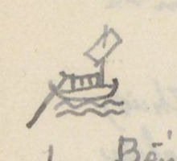{width=12%}

Chữ trên hình: không có chữ. [NC: Hình thuyền nhỏ vẽ chì ở lề trái, ngang tiêu đề.]

[NC: Tác giả đánh số dòng ở lề trái cách 5 dòng một lần; cũng ghi tên huyện bằng chữ Hán ở lề: *Nghi Xuân* (宜春), *Thiên Lộc* (天祿), *Thạch Hà* (石河).]

| Số | [Địa danh] | Chữ Hán | [Khoảng cách] | [Ghi chú] |
|---|---|---|---|---|
| 1 | Bến Lương-trường | 粮塲 | 1.932 | Cửa Nam |
| | Đò Mang | 渡[?] | 2.024 | Đò An pháp (安法). Phía Đông là h. Chân lộc (真祿), phía tây là h. Hưng nguyên (興元) |
| | Mũi hạc xứ | [口+枼]鶴 | 161T | |
| | Sông Lách [宜春] | 㴜江 | 1.738 | Thông ra Đại giang (大江) (S. Cả) |
| 5 | Khu Độc xứ | [山+區][山+賣] | 1.314 | Trên núi Khu độc, tại Nghi xuân (宜春) |
| | Ngã ba Sông Chế | 制江 | 524 | 三岐. Phía nam sông có chợ Chè (制市). Xưa, vua Lê thánh Tông đánh Chiêm thành (占城) có trú lại đó, làm thơ rằng (xem dưới) |

Thơ (tác giả chép bằng quốc ngữ):

> Bóng ác non đoài ban xế xế, Bóng đâu đã tới miền Tam Chế (三制). Mênh mang khóm nước nhuộm màu lam; chập ngất đỉnh non lồng bóng quế. Chợ họp bên sông gấm có chiếc; thuyền bày trên đất xem nhiều thể. Cảnh vật bằng đây họa có hai. Vì dân khoan giản (寬簡) bến tô thuế.

[NC: Bài thơ được ghi dưới dạng văn xuôi liền dòng; chữ "khoan giản" (寬簡) nghĩa là rộng rãi, giản dị (trong việc thu tô thuế).]

| Số | [Địa danh] | Chữ Hán | [Khoảng cách] | [Ghi chú] |
|---|---|---|---|---|
| | Bến Cồn Kho | [土+辟]庫 | 1.582² | Bến Ngũ lộc (五祿津), phía nam là h. Nghi xuân (宜春), phía bắc là h. La sơn (羅山). Đông và Tây là h. Thiên lộc (天祿) |
| | Cầu Đại minh [天祿] | 大明 | 70 | (đời sau là Văn minh 文明) Có chợ Minh (明) |
| | Cầu Tiểu minh | 小明 | 696 | Phía Tây có phủ trị Đức quang |
| 10 | Miếu Vân chàng | 雲幢 | 40 | 社神廟 [miếu thần xã] |
| | Bến | 津 | 1.373 | |
| | Đò Trai | 渡[米+?] | 3.920 | Sông rộng 10T |
| | Sông Phân thủy | 分水江 | 1.904? | Nước thủy triều cửa Hội và cửa Sót (會，津) đến đó đều lui. Cả hai bản đều chỗ trống sau chữ 九 (chắc là 十 [?]) |
| | Đò Cày | 渡耕 [?] | 2.780 | Đò Kiệt thạch (碣石) (淇 [?] mới đúng). Đò rộng 23 Tầm |
| 15 | Ngã ba | 三岐 | 1.697 | Phía nam là Thiên lộc, bắc là Thạch hà |
| | Cầu Nghền [石河] | 求[?] | 8.087 | Cầu Trảo nha (爪牙). Rộng 56T |
| | Ngã ba Đà | 我巴沱 | 2.000 | Ngã ba sông Cổ Kinh (古涇江). Rộng |

[NC: Ở cuối trang có hai dòng viết ngược chiều giấy, đã gạch bỏ: "Bến Nghệ An - Bến Kỳ hoa (87.970³)" và "Nghệ an 25 (Bến Kỳ hoa)", có lẽ là lần viết tiêu đề đầu tiên bị bỏ. Trong ghi chú "Sông Phân thủy", tác giả viết "chắc là 百" rồi gạch, viết thêm chữ nhỏ bên trên, đọc chưa chắc.]

# Trang PDF 152 - Nghệ An: đường thủy Bến Nghệ An - Bến Kỳ Hoa (tiếp)

*Đầu trang: Nghệ an 26. Bến Kỳ hoa; số trang bản thảo: không ghi*

[NC: Dòng đầu tiếp ghi chú "Ngã ba Đà" ở trang trước. Lề trái có chữ *Kỳ Hoa* (奇華) ngang dòng "Địa phận Kỳ hoa".]

| Số | [Địa danh] | Chữ Hán | [Khoảng cách] | [Ghi chú] |
|---|---|---|---|---|
| | | | | 50 Tầm. Thượng lưu 15.245 đến nguồn xã Hoa dung (花容) |
| | Ngã ba Cày | 我巴耕 [?] | 1.200 | Xã Châu lâm (珠林). Rộng 60T. Thượng lưu 7.757 đến các nguồn xã Đồng lưu (仝留). [TTNĐ chép 2.200] |
| | Ngã ba Vàng | 〃 鐄 | 8.400 | Xã Hà hoàng (河黄). Rộng 130. Ra cửa Sót (津). [Đi C. Sót. Xem NA 35 1°] |
| 20 | Cầu Nại | 求奈 | 500 | Đại nại (大奈). Rộng 25T. Có đồn thủ |
| | Địa phận Kỳ hoa | 奇華 | 1.650 | Ngoài là Thạch hà (石河) |
| | S. Đức lâm | 德 [?]林 | 400 | Rộng 35T |
| | Chợ Bến đò | 浚渡 [?] | 450 | Đáy sông nhiều đá, phải cẩn thận. Rộng 30T |
| | S. Vĩnh lại | 永頼 | 1.850 | Đáy sông nhiều đá. Rộng 40 |
| 25 | Ngã ba Kênh | 我巴涇 | 2.550 | Xã Hương Cần (香芹). Rộng 50T. Thượng lưu 2.440 đến Nguồn Hoa Duệ (花裔) |
| | Ngã ba Na | 〃 那 | 1.150 | Kênh Thạch Khê (石溪). Rộng 65T. Thượng lưu Hoa duệ (花裔) |
| | Bến Thạch Khê | 石溪津 | 7.838 | Rộng 60 |
| | Ng. ba Quyền đông | 權東 | 1.280 | Rộng 80T. Thượng lưu 4.930 đến cầu Phượng hoàng (鳳凰) giáp đường dịch lộ (驛路) |
| | Ngã ba Xá | 我巴舍 | 2.418 | Ng. b. Hoa duệ (花裔). Rộng 80T. Xuống cửa Nhượng (讓). [Đi C. Nhượng NA 35 2°] |
| 30 | Kênh Lạc xuyên | 樂川 | 1900 [?] | Rộng 70 |
| | Đập Văn đài | 文台堰 | 1.664 | 坝. Rộng 6T |
| | Kênh Eo Rồng | [月+要]蠬 [?] | 244 | Kênh Hữu-lễ (有礼港). Rộng 7T. Thủy triều cửa Nhượng đến đây thì lui |
| | Đập Dịch Nậu | 易[耒+辱]堰 | 4.849 | 坝. Rộng 5T |
| | Trạm bến Kỳ nam | 奇南港 | 10.100 | 次. Rộng 17T. Chợ Nam (南市) ở đó. (TTNĐ) chép 4.890 và rộng 70 |

[NC: "NA 35 1°", "NA 35 2°" là chỉ dẫn tác giả trỏ về các mục đường ra cửa biển (1° Cửa Sót, 2° Cửa Nhượng) trong phần Nghệ An; "NA" = Nghệ An. Số ở dòng "Kênh Lạc xuyên" bị viết chồng, đọc chưa chắc. Nửa dưới trang là tiêu đề in VERRERIE DU NORD in ngược.]

# Trang PDF 153 - Nghệ An: đường thủy Bến Kỳ Hoa (tiếp); chuyện Nguyễn Bích Châu

*Đầu trang: Nghệ an 27. Bến Kỳ hoa; số trang bản thảo: 75*

| Số | [Địa danh] | Chữ Hán | [Khoảng cách] | [Ghi chú] |
|---|---|---|---|---|
| 35 | Trạm th. Hải Khẩu | 海口村 | 800 | 港次. Rộng 59T. Phía bắc sông có miếu thần Chế thắng (制勝) |

Đời Trần Duệ tông (陳睿宗) đi đánh Chiêm thành (占城), cung nhân Nguyễn Bích Châu (阮碧珠) theo. Vua nằm mộng thấy thần xưng là Nam-minh đô đốc (南溟都督) xin lấy Bích châu. Rồi sóng gió nổi, thuyền gần chìm. Bích châu tự gieo mình xuống nước. Gió bèn yên. Đến đời Lê Thánh tông (黎聖宗) đi đánh Chiêm, thuyền dừng đó. Vua mộng thấy Bích châu xin cầu cứu. Vua viết thư đuổi (檄) Quảng lợi vương (廣利王). Hôm sau thấy thây Bích châu nổi lên mặt nước. Bèn táng theo lễ hoàng hậu và phong làm Chế thắng linh thần. Sau lập đền thờ. Vua Thánh tông có thơ rằng:

*Bản thị Chiếu [?] lăng cung lý nhân, / Lâm nguy vị quốc vẫn [?] vong thân. / Yêu phân nhất trận đào hoa lãng, / Xuân dạ tam canh Đỗ Nhược tân. / Hàn thủy vô đoan mai Sở phụ, / Hương hồn hà xứ điếu Tương quân. / Cương thường vạn cổ ưng vô hủ, / Từ hạ âu [?] cưu [?] hí thủy văn [?].*
(本是照[?]陵宮裡人，臨危爲國殞[?]亡身。妖氛一陣桃花浪，春夜三更杜若津。寒水無端埋楚婦，香魂何處弔湘君。綱常萬古應無朽，祠下鷗[?]鳩[?]戲水紋[?]。)

**Dịch:** Vốn là người trong cung lăng Chiếu [?], Lúc nguy vì nước mà bỏ mình. Một trận sóng hoa đào nổi hơi yêu quái, Canh ba đêm xuân ở bến Đỗ Nhược. Nước lạnh vô cớ vùi người đàn bà nước Sở, Hồn thơm nơi nào viếng Tương quân. Cương thường muôn thuở hẳn không mục nát, Dưới đền chim chóc đùa trên vằn sóng nước.

Lịch triều được phong tặng và dự quốc tế.

[NC: "Nam minh đô đốc" = viên đô đốc biển Nam (thần biển); "Quảng Lợi vương" = vua thủy thần biển Nam. Chữ thứ ba câu đầu, chữ thứ sáu câu hai và ba chữ của câu cuối viết nhanh, đọc chưa chắc. "Dự quốc tế" = được dự vào việc tế lễ của nhà nước.]

| [Địa danh] | Chữ Hán | [Khoảng cách] | [Ghi chú] |
|---|---|---|---|
| Hải Khẩu thôn | | | |
| Ngã ba cửa Khẩu | [?]門口 | 5.484 | Hải Khẩu thôn. Rộng 460 Tầm. Sông ra cửa Khẩu (口門) [Ra Cửa .. NA 35/3°] |
| Đò Trí giang | 知江 | | [Đâu viết là Trí (智江), TTNĐ (智江)] Rộng 20T. Kênh ra đến đây, cạn không qua được. Phía nam sông, núi lớn liên lạc đến Hoành sơn (橫山). Phía bắc đò là Dinh Cầu (營求) |

[NC: "NA 35/3°" trỏ về mục 3. Cửa Hải Khẩu trong phần đường ra cửa biển Nghệ An. Phần dưới trang để trống; chữ in VERRERIE DU NORD hiện ngược qua giấy.]

# Trang PDF 154 - Nghệ An: đường thủy Bến Nghệ An - Kênh Xước (Thanh Hóa)

*Đầu trang: Nghệ an 28 - Thanh hóa; số trang bản thảo: không ghi*

## Bến NGHỆ-AN - Kênh XƯỚC (Thanh hóa) 67.487

(Đường thủy)

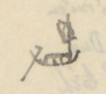{width=12%}

Chữ trên hình: không có chữ. [NC: Hình thuyền nhỏ vẽ chì ở lề trái, ngang tiêu đề.]

| Số | [Địa danh] | Chữ Hán | [Khoảng cách] | [Ghi chú] |
|---|---|---|---|---|
| 1 | Bến Lương Trường | 粮塲 | 1.196 | 津次. Cửa Nam |
| | Ngã ba Đức | 我巴[?] | 264 | Thôn Chân đích (真的). Rộng 9T, trên thượng lưu Nam Đường (南塘) |
| | Cầu Đức | 求[?] | 3.015 | Phía Tây cầu là phủ trị Anh đô (英都) |
| | Cầu Da | 求耶 | 150 | Cầu Bảo đà (保陀). Chợ Da (耶) ở đó |
| 5 | Kênh Gai | 涇[?] | 5.710 | Xứ Giao thủy (交水). Rộng 30T. Nước thủy triều hai cửa Hội (會) và Xá (舍) đến đó bèn lui |
| | Đò Trang na | 庄梛 [?] | 1.749 | Thiều Xá (韶舍). Kênh rộng 30, thủy đạo khuất khúc như dây bầu eo. Rất khó đi |
| | Đò Vạn | 渡濿 [?] | 40 | Vạn ngói (濿瓦 [?]). Rộng 20T |
| | Ngã ba Vạn | 我巴濿 [?] | 1.300 | Rộng 20T |
| | Đò Ông Hương | 翁香 | 2.560 | Rộng 18T |
| 10 | Đò Nông | 渡[火+農] [?] | 3.415 | Đò Nông đồng (農同). Rộng 25 |
| | Ng. b. Sông Cấm | 滝禁 | 1.660 | 禁江三岐. Rộng 39. Hạ lưu 8.414 [?] đến cửa Xá (舍門) [N.A 35/5°] |
| | Cầu Nhị | 求[?] | 510 | Cầu La-Hoàng (罗黄), ra cửa Hiền (賢) [NA 35/6°] |
| | Kênh Sắt | 涇[?] | 1.035 | Thiên Uy cảng (天威港). Sử chép (xem dưới) |

Sử chép, đời Nam đế (南帝) [NC: có lẽ "Nam chiếu" [?]], đang đời Hàm thông (咸通) nhà Đường (唐), sai Cao Biền (高駢) làm An nam đô hộ (安南都護). Biền sai bọn Lâm Phúng (林諷) đào sông này [lầm!] để tiện việc thủy vận. Không thành công. Thình lình tới ban ngày tháng 5, giông tố nổi, sét đánh tan sườn đá. Kênh cũng chưa thành. Tháng 6 lại có sấm đánh như trước. Cảng mới thành. Bèn đặt tên như vậy.

[NC: "[lầm!]" là lời tác giả, có ý chỉ sử chép nhầm. Chữ Hán sau "Nam" ở đầu đoạn viết là 南帝 [?] chưa đọc chắc; theo sử, việc Cao Biền đào kênh Thiên Uy là thời đánh Nam Chiếu (南詔). "N.A 35/5°", "NA 35/6°" trỏ về mục 5. Cửa Xá và 6. Cửa Hiền ở phần đường ra cửa biển Nghệ An. Nửa dưới trang là tiêu đề in VERRERIE DU NORD in ngược.]

# Trang PDF 155 - Nghệ An 29: đường thủy ra Thanh Hóa (tiếp)

*Đầu trang: Nghệ an 29 (Thanh hóa); số trang bản thảo: 76*

[NC: Trước chữ "Nghệ an 29" có chữ viết đè, không đọc rõ. Góc trái trên có một nét vẽ nhỏ (dấu ghi chú?).]

| [Số] | [Địa danh] | Chữ Hán | [Tầm] | [Ghi chú] |
|---|---|---|---|---|
| | *(lề trái: Đông Thành 東城)* Bến trạm Đường Hoa | 塘花 | 650 | |
| 15 | Kênh Cửa Tuần | 𨷯巡 [?] | 7.431 | Kênh Hương Ái (香靄 [?]). Rộng 3 tầm |
| | Ngã ba Kênh | 我巴涇 | 4.631 | Xã Hạnh Lâm (杏林). Thượng lưu 11.200 đến nguồn Vân Trụ (雲[...]) |
| | Cầu Tiên | 求仙 | 320 | |
| | Trạm Sông | 江次 | 1.760 | Phía nam có chợ và đồn lính biển [?] ([...]屯) |
| | <u>Trạm s. Vạn Phần</u> | 萬分 | 801 | *Giang thứ* (江次) [trạm bên sông]. Có chợ Vạn (萬[?]) |
| 20 | <u>Ng. b. Kênh Mưa</u> | 涇湄 | 4.576 | Chảy ra cửa Vạn (萬) [NA 35/7°] → |
| | Bến Cầu Đông Câu | 東岣 [?] | 4.765 | *Cầu cảng thứ* (求港次) [bến cầu trên kênh]. Dài 4 T. |
| | *(lề trái: Quỳnh Lưu 瓊瑠)* Bến kênh Đông Giai | 東佳 | 1.711 | Rộng 4 T. Giáp giới hai huyện Đông Thành (東城) và Quỳnh Lưu (瓊瑠). |
| | ng. b. Đông Vực | 東域 | 270 | |
| | <u>Ngã ba Thái</u> | 我巴台 | 2.795 | Xã Trung Thị (中市). Có chợ Thái (台市). Ra cửa Thái (台門) [NA 35/18°] → |
| 25 | <u>Ng. b. Đò Hàu</u> | 渡蠔 | 4.140 | Rộng 110. Ra cửa Quèn (權門). Trung đoạn có kênh Dâu (槐港 [?]) (TL.YL) [NA 35/9°] → |
| | Kênh Đồng Giá | 同稼 | 2.070 | Sông có tên Mi giang (湄江). |
| | Ngã tư Kênh Triền | 涇瀍 | 2.550 | [TTNĐ chép K. Nẵng (灢)] *Tứ kỳ cảng* (四岐港) [kênh ngã tư], trên vào Quỳnh Trụ (瓊[...]), ra các cửa. |
| | Ng. b. đò Kim Lung | 金籠 | 620 | *Tam kỳ cảng thứ* (三岐港次) [bến ngã ba kênh]. Dài 620 |
| | Ngã ba Ngọc | 我巴玉 | 3.000 [?] | Lấy Ngọc để (玉底 [?]). Thượng lưu 10150 đến nguồn Hoàng Mục (黃牧), ra ng. ba Càn (乾) |
| 30 | <u>Bến Đền Còn</u> | 乾廟村 | 650 | Bến làng Còn miếu thờ *Tống hậu tứ nương* (宋后四娘) [Bà hoàng hậu nhà Tống và bốn nàng]. |
| | <u>Ng. b. Còn giang</u> | 乾江 | 2.370 | *Tam kỳ* (三岐) [ngã ba]. Chảy ra cửa Còn [NA 35/10°] → |
| | Vũng Lèn vó | 浡硉跡 [?] | 2.390 | *Thạch sơn* [?] (石山艚 [?]) |
| | Phố đập Hàng huyện | 舖墖 行縣 | | Hay là *Quỳnh Lưu yển bá* (瓊瑠堰垻) [đập ngăn nước Quỳnh Lưu] |
| | <u>Kênh Quán Cháo</u> (Kênh Xuốc) | 館粘 (綽港) | | *Cảng* (港). Giáp Thanh hóa |

[NC: "Ng. b." = ngã ba; "T." = tầm. "NA 35/7°"... trỏ về mục số 7°... ở bảng "Bến Nghệ An - Cửa bể" (Nghệ an 35, trang PDF 161). Các tên Nôm (ngã ba = 我巴, cửa = 𨷯...) chép theo nét bản thảo. Số "3.000" ở dòng Ngã ba Ngọc bị sửa đè, chưa chắc.]

# Trang PDF 156 - Nghệ An 30: Bến Nghệ An - Nam Đường - Trà Lân

*Đầu trang: Nghệ an 30 (Trà lân)*

## Bến NGHỆ AN - NAM ĐƯỜNG - TRÀ LÂN (58.822)

(Đường thủy)

| [Số] | [Địa danh] | Chữ Hán | [Tầm] | [Ghi chú] |
|---|---|---|---|---|
| 1 | Bến Lương Trường | 粮場 | 7.169 | Cửa Nam |
| | Ngã ba Chế | 我巴制 | 1.395 | Xã Tam Chế (三制) (Xem Nghệ an - Kỳ Hoa NA 25). Rộng 200 T. |
| | Bến Phù Thạch | 浮石 | 591 | Bến Phù Thạch. Rộng 129 T. Phía bắc sông có miếu Chiêu Trưng (昭徵) (xem dưới) |

Miếu Chiêu Trưng (昭徵) thờ con anh vua Lê Thái tổ (黎太祖), tên Lê Khôi (黎魁). Ông theo Lê Thái tổ khởi nghĩa. Lúc trấn Nghệ an x[?] có thiện chính. Sau khi mất, dân nhớ công, lập đền thờ. Đời Hồng đức, vua Lê Thánh tôn đi đánh Chiêm thành [?] (占). Có đề thơ:

> Dẹp yên tám cõi mới buông tay;
> Lồ lộ thai tinh (台星) một đóa mây.
> Tể tướng [?] bếp tan mai lạnh vạc;
> Tướng quân doanh vắng liễu chau mày.
> Phong lưu phú quí ba đời thấy;
> Sự nghiệp công danh bốn bể hay.
> Thương ít tiếc nhiều khôn xiết kể;
> Miếu đường hầu lấy cột nào thay.

Lúc về triều, vua gia phong và ban tế khí và cấp *tạo dân* (皂民) [dân phu giữ đền]. Nay còn là miếu thiêng. Phía bắc đó có núi Triều Khẩu (朝[口?]) [?]. Quân Minh (明) đóng đó. Nay lũy đã còn.

| [Số] | [Địa danh] | Chữ Hán | [Tầm] | [Ghi chú] |
|---|---|---|---|---|
| | Kênh lạch Hào | 涇濠巷 [?] | 1.040 | |
| 5 | Ngã ba Phủ | 我府巴 | 1.440 | Rộng 150 [?] |
| | Bến Cồn Vạn | 塀萬 [?] | 1.596 | Rộng 170 T. |
| | Bến Tuần La Vạn | 巡羅萬 | 4.520 | *Giang thứ* (江次) [trạm bên sông]. Rộng 124 T |
| | Bến Cây Chay Vạn | 核[...]萬 | 11 | |
| | Bến Sa Nam | 沙南 | 5.936 | *Tân thứ* (津次) [bến đò]. Rộng 68 T |
| 10 | Bảng Vạn | 滂萬 [?] | 1.060 | |
| | Tuần Vũ Liệt | 武烈巡 | 966 | Rộng 71. Chợ Lộ (路 [?]) ở đó |
| | Bến Chi Quân Trang | 支均庄 | 3.161 | Rộng 70 |
| | Vạn Rạng | 萬[...] | 69 | |

[NC: Bài thơ của Lê Thánh Tông viếng Lê Khôi (thường được biết với câu đầu "Dẹp yên tám cõi mới buông tay"). Chữ Nôm của tên Cây Chay, Vạn Rạng viết thảo, chưa đọc chắc.]

# Trang PDF 157 - Nghệ An 31: Trà Lân (tiếp)

*Đầu trang: Nghệ an 31 (Trà lân); số trang bản thảo: 77*

| [Số] | [Địa danh] | Chữ Hán | [Tầm] | [Ghi chú] |
|---|---|---|---|---|
| | Sông Dương Ng. b. | 滝揚 [?] | 4.939 | *Dương giang tam kỳ* (楊江三岐) [ngã ba sông Dương] |
| 15 | Vạn Lương | 澫梁 | 1.863 | |
| | Bến s. Gáy thị | 芺市 [?] | 1.205 | 鄧芺 [?] |
| | <u>Vạn Suất</u> | 澫淬 | 2.033 | Bờ bắc có tuần <u>Khả Lôi</u> (可雷) thu thuế |
| | Vạn Lũ | 〃 屢 | 930 | |
| | Bến đồn Lãng Điền | 朗田屯 | 15.248 | Bờ nam có chợ và đồn thủ |
| 20 | <u>Tam giang</u> | 三江 | 2.050 | |
| | Bến Đá Cối | 石檜 | 800 | *Giang thứ* (江次). Trước [?] sông có đá dựng |
| | Lạch Khương Hủy | 涇羌毀 | | Thuộc huyện Nam Đường (南塘) giáp sách Tào giang (曹江), bến huyện Tương Dương (襄陽), phủ Trà Lân (茶麟 [?]). Có ngả đi nguồn Đường xá [?] (NA. 35) |
| | <u>Bến Tương Dương</u> | 襄陽 | | |

[NC: Nửa dưới trang để trống (chỉ có nét chữ trang sau hiện qua và tiêu đề in VERRERIE DU NORD in ngược). "Vạn" (bến thuyền) viết bằng chữ Nôm 澫.]

# Trang PDF 158 - Nghệ An 32: Bến Nghệ An - Quì Châu

*Đầu trang: Nghệ an 32 (Quì châu)*

## Bến NGHỆ AN - QUÌ CHÂU (106.822)

(Đường thủy)

| [Số] | [Địa danh] | Chữ Hán | [Tầm] | [Ghi chú] |
|---|---|---|---|---|
| 1 | Cửa Lương Trường | 粮場 | 55.172 | Cửa Nam. |
| | Ng. b. Sông Con (Tam giang) | 滝昆 | 2.950 | [Xem Bến Nghệ an - Trà lân tr. 31, s. 20] Rộng 74 tầm |
| | Khe Đăng bến | 溪澄 | 1.300 | Rộng 78 [?] T. Bến |
| | Bến Khe Lòe | 〃 爍 [?] | 1.000 | Rộng 50 T |
| 5 | Sông Thanh | 滝清 | 3.900 | Thanh giang (清江). Rộng 58. Nước đục. Thuyền bè tụ tập đó |
| | Vạn Ổi | 澫猥 [?] | 4.500 | Rộng 100 T |
| | Sông Ba lạch | 巴涇 | 2.400 | *Kỳ giang thứ* (岐江次) [bến ngã sông] |
| | Khe Nước Xanh | 渃撐 [?] | 2.400 | *Thanh thủy khê* (清水溪) Thanh thủy |
| | Vạn Dói bến | 澫捞 [?] | 1.600 | 捞澫江 [?]. Rộng 59 [?] T. |
| 10 | Vực Lèn Thông B. | 域磋樁 [?] | 700 | Rộng 50 T. |
| | Vực Lèn | 域磋 [?] | 5000 | Rộng 40 T. Đều vì tên núi mà đặt tên |
| | Vạn Dương | 澫楊 | 2.600 | Rộng 80 T |
| | Vạn Sen | 〃 蓮 | 3.300 | Rộng 72 T |
| | Vạn Sẻ | 〃 鴅 [?] | 600 | Rộng 70 T |
| 15 | Bến Khe Muội | 溪妹 | 1.000 | Rộng 105 T. Bờ đông đá dựng. Đáy sông nhiều đá lởm. Thuyền lên rất khó. Xuống rất dễ; nhưng khéo kẻo đâm vào đá |
| | <u>Bến Hiếu</u> | 渡孝 | 30 | *Hiếu giang* (孝江). Rộng 58. Có chợ Hiếu (孝市) |
| | Vạn Bồi | 澫培 | 170 | Rộng 80 T |
| | Bến Khe Ngang | 溪昂 | 1.100 | Rộng 90 T. Nước rất độc |
| | Sông Lách | 涇江 | 500 | Rộng 100 T. [Nước] rất mạnh. Rất khó đi. |
| 20 | Bến thác Đá Ngang | 托石昂 [?] | 600 | Rộng 100. Đáy sông nhiều đá dựng. Chảy |
| | Sông Vực Trợ | 域助 [?] | 1.000 | Rộng 80 |
| | S. thác Đá Voi | 托石𤠄 [?] | 1.000 | Rộng 40. Trên bờ có đá hình voi |
| | S. Tường Thạch | 將石江 [?] | 2.400 | Rộng 30. Phía tây có đá hình người đứng. |
| | S. Tồng [?] Tố Côn | 素媄素昆 [?] | 1.900 | Rộng 30. Có 2 chỗ có đá ngang sông *(mực tím: Cột đá cửa sông [?])* |
| 25 | S. thác Chăng | 托扎 [?] | 600 | |
| | S. thác Vẹp [?] | 托鯜 [?] | 300 | Rộng 25 |
| | <u>Bến Cửa Lộng</u> | | | Ở tổng Phác Lộ (朴[...]), Quỳnh Lưu thượng đạo (瓊瑠上道) |
| | Quì châu | | | |

[NC: Nhiều chữ Nôm (thác = 托, đá = 石+..., vạn = 澫, khe = 溪) viết thảo; các chỗ có [?] chưa đọc chắc. Dòng 20 hình như câu ghi chú "Chảy" còn dở.]

# Trang PDF 159 - Nghệ An 33: Bến Nghệ An - Ngàn Phố

*Đầu trang: Nghệ an 33 · Ngàn Phố; số trang bản thảo: 78*

## Bến NGHỆ AN - NGÀN PHỐ (24.788)

(Đường thủy)

| [Số] | [Địa danh] | Chữ Hán | [Tầm] | [Ghi chú] |
|---|---|---|---|---|
| 1 | Bến Lương Trường | 粮場 | 10.195 | Cửa Nam |
| | <u>Ngã ba Phủ</u> | 我巴府 | 840 | [Xem Nghệ an 30, số 5] Rộng 150 T |
| | Chợ Phủ | 𢄂府 | 360 | Xã Thịnh Quả (盛果) |
| | Vạn Phủ | 府澫 | 600 | |
| | Kênh Nhân Thọ | 仁壽港 | 690 | |
| 5 | Tuần Bùi xá | 裴舍 | 1.710 | Chợ Lâm (林) ở đó |
| | <u>Bến sông Thượng</u> | 越安上 | 1.530 | *Xã giang thứ* [?] (社江次) (Yên Việt thượng). Rộng 150 T. Chỗ rất đô hội |
| | Sông Tam Soa | 三叉江 | 420 | Rộng 50 T |
| | Huyện trị Hương Sơn | 香山 | 844 | *Huyện trị* (縣治) [lỵ sở huyện] |
| | Chợ Huyện bến | 𢄂縣 | 1.629 | Đỗ xá (杜舍) |
| 10 | Bến chợ Dương Trai | 楊柴 [?] | 300 | Phía đông và tây đều có chợ |
| | Vạn Đâm bến | 澫潭 | 1.770 | Đỗ Gia (杜嘉) |
| | Chợ Đâm | 〃 𢄂 〃 | 1.990 | Hữu Bằng (有憑) |
| | Chợ Trị | 〃 〃 治 | 1.540 | Phúc Dương (福陽) |
| | Chợ Phố | 〃 〃 浦 | 376 | Lạc Phố (洛浦) |
| 15 | <u>Đồn Ngàn Phố</u> | 〃 岸浦 | | *Đồn tân thứ* (屯津次) [đồn ở bến đò] |

[NC: "Chợ" viết bằng chữ Nôm 𢄂 (tác giả viết dạng 聕/𢄂). Phần dưới trang để trống.]

# Trang PDF 160 - Nghệ An 34: Bến Nghệ An - Quì Hợp

*Đầu trang: Nghệ an 34 (Quì hợp)*

## Bến NGHỆ AN - QUÌ HỢP (47.035)

(đường thủy)

| [Số] | [Địa danh] | Chữ Hán | [Tầm] | [Ghi chú] |
|---|---|---|---|---|
| 1 | Bến Lương Trường | 粮場 | 15.925 | Cửa Nam |
| | Bến S. Tam Soa | 三叉江 | 3.270 | [Xem Nghệ an 33, s. 8]. |
| | Bến chợ Phụng Công | 奉公市 | 3.600 | Chợ Nuốt (湼 [?]) |
| | Bến chợ Thượng Bồng | 上蓬市 | 840 | Chợ Bồng (蓬) |
| | Bến chợ Quang Tế | 光霽市 | 990 | Chợ Mới (買) |
| 5 | Vạn Bồng | 澫蓬 | 2.460 | Thượng Bồng (上蓬) |
| | Vạn Thục | 〃 贖 | 660 | |
| | Ngã ba Sào | 我巴漅 [?] | 3.150 | Rộng 30 T. *Tam kỳ bàu* (三岐泡) [bàu ngã ba] |
| | Suối Vạn | 溛澫 [?] | 1.650 | Trên bờ có núi Hội Nại (會泥), quanh co chín khúc. Có tên Chín khúc Hội Nại (𠃩曲會泥 [?]). Người ta có thơ: *Long xà chi bố tung hoành trận, phong thủy na tri thuận nghịch tình* (竜蛇之布縱橫陣，風水那知順逆情). **Dịch:** Như rồng rắn bày thế trận ngang dọc, phong thủy nào biết tình thuận hay nghịch. |
| | Chợ Vang bến | 𢄂榮 | 1.020 | Thổ Hoàng (土黃). *Thị tân thứ* (市津次) [bến chợ] |
| 10 | Ngã ba Trúc | 我巴竹 [?] | 60 | Bào Lăng (泡淩江). Rộng 30 T |
| | Bến chợ Bàu Lăng | 泡淩 | 1.230 | Chợ Trúc (竹市 [?]) |
| | Vực Vạn | 域澫 | 5.460 | |
| | Bến chợ Thượng Thạch | 上石市 | 810 | Chợ Đá (石[...]) |
| | Chợ Chu Lễ bến | 周礼 | 390 | Chợ Sùng (崇) |
| 15 | Vạn Sùng | 澫崇 | 1.440 | |
| | Ngã ba Huân | 我巴薰 | 1.410 | Chợ Huân (薰). Sông Phúc Lộc (福祿) |
| | Vạn Liêm [?] | 澫[...] | 2.670 | |
| | Sông Quì Hợp | 峼合江 [?] | | Đồn lính biên và chợ |

[NC: Nửa dưới trang chỉ có tiêu đề in VERRERIE DU NORD.]

# Trang PDF 161 - Nghệ An 35: Nguồn Dương Xá; Bến Nghệ An - Cửa bể

*Đầu trang: Nghệ an 35 (Nguồn - Bể); số trang bản thảo: 79*

## Bến NGHỆ AN - nguồn Dương Xá (Thanh Chương)

| [Địa danh] | Chữ Hán | [Tầm] | [Ghi chú] |
|---|---|---|---|
| Bến Lương Trường | 粮場 | 28.954 | |
| Ngã ba S. Dương | 滝楊 | 105 | (Xem Nghệ an 31 - s. 22) |
| Chợ Vạn Dương | 澫楊 | 1.001 | |
| Vạn Trà | 〃 茶 | 8.290 | Rộng 25 T. |
| Thác Đá Hàn | 石翰 [?] | 2.350 | Đá to ngăn dòng |
| Nguồn Dương Xá | 楊舍 | | Cách bến Lương Trường 40.700 T. |

## Bến NGHỆ AN - CỬA BỂ

Từ Bến Lương Trường Cửa Nam

| [Số] | [Tham khảo] | [Cửa bể] | Chữ Hán | [Tầm từ bến] | [Chỗ rẽ ra cửa] | Chữ Hán | [Tầm] |
|---|---|---|---|---|---|---|---|
| 1° | (N.A. 26 s. 19) | Cửa Sót (Có đồn phân [thủ] 屯[分]) | 津門 | 36.240 | Sông Hà Hoàng | 河潢 | 2.200 |
| 2° | (N.A. 26 s. 29) | Cửa Nhượng (Có đồn phân thủ 分守) | 譲門 | 59.724 | Ngã ba Hóa Dục | 化育 | 600 |
| 3° | (N.A. 27 s. 37) | Cửa Hải Khẩu (Có đồn phân thủ) | 海口門 | 83.015 | Ngã ba Hải Khẩu | 海口 | 529 |
| 4° | | Cửa Hội | 會門 | 14.835 | Sông Lách; Sông Cồn Mộc; Đò Tả Ao; Bến Đồn thủ (chảy Song Ngư 双魚) | 涇江; 塀木; 左澳; 屯守 | |
| 5° | (NA. 28/s. 11) | Cửa Xá | 舍門 | | Ngã ba Sông Cấm; Đồn | 禁江; 屯 | 4.410 |
| 6° | [NA. 28/s. 12] | Cửa Hiền | 賢門 | 23.412 | Kênh Cầu Nhị | 求俫港 | 2.350 |
| 7° | [AN 28/s. 20] | Cửa Vạn | 澫門 | 39.530 | Ngã ba Kênh Mưa | 萬分三岐 (Vạn Phần) | 1.320 |
| 8° | [AN 28/s. 24] | Cửa Thơi | 台門 | 50.820 | Ngã ba Trung Thị | 中市 | 1.300 |
| 9° | [AN 28/s. 25] | Cửa Quèn | 權門 | 53.527 | Ngã ba Quyền giang | 權江 | 1.154 |
| 10° | [AN 28/s. 31] | Cửa Còn | 乾門 | 63.547 | Ngã ba Còn giang | 乾江 | 820 |

[NC: Ở mục 4°, tác giả kẻ mũi tên dọc từ "14.835" xuống "Cửa Hội", chỉ lần lượt các chặng Sông Lách, Sông Cồn Mộc, Đò Tả Ao, Bến Đồn thủ ra cửa Hội. Mục 5°, chữ "Đồn" ở cột trái bị gạch. Từ mục 7° tác giả viết "AN 28" (có lẽ viết nhầm cho "NA 28"). Các chú dẫn "NA 35/7°", "NA 35/18°"... ở trang PDF 155 trỏ về các mục số ở bảng này.]

# Trang PDF 162 - Nghệ An 36: Nguồn - Sông Động Hùng - S. Canh Mai; S. Cửa Lộng - S. Thác Đỗ

*Đầu trang: Nghệ an 36 - Nguồn*

## Sông ĐỘNG HÙNG - S. CANH MAI (53.900)

| [Địa danh] | Chữ Hán | [Tầm] | [Ghi chú] |
|---|---|---|---|
| Sông Động Hùng | 峝雄 | 1.500 | |
| S. Cồng Công [?] | 塀䳍 [?] | 3.400 | Rộng 100 |
| S. Chi giang | 支江 | 7.500 | Rộng 90 |
| Sông | 江 | 5.200 | Rộng 65 |
| Sông Bố giang | 布江 | 2.700 | Rộng 40 |
| Sông Bông giang | 蒙 [?] 江 | 3.750 | Rộng 40 |
| Sông Phả Lai | 頗來 | 800 | Rộng 57 |
| Sông Nhận Sát | 仞察 | 6.200 | Rộng 43 |
| Sông Chấp giang | 劄 [?] 江 | 3.000 | Rộng 53 |
| Sông Thả Lữ | 且呂 | 100 | Rộng 53 |
| Ngã ba Chấp Bao [?] | 執慕 [?] | 4.000 | Chảy ngang 11.900 T đến Trấn Ninh |
| Sông Vũng Cơi | 漨[...] | 1,000 | Rộng 40 T. |
| Khe Vè | 溪[...] | 1.500 | |
| Sông Giáp Lạp | 甲臘 [?] | 1.300 | Rộng 2 T |
| Sông Kim giang | 今江 | 700 | |
| Sông Bổng | 俸江 | 11.250 | Rộng 7 T |
| Sông Canh Mai | 更枚江 | | Rộng 3 T. Trở lên đều có đường rừng núi. Sông này tiếp với sông Mười [?] Nhượng (迷 [?] 譲江) |

## S. CỬA LỘNG - S. THÁC ĐỖ (12.202)

| [Địa danh] | Chữ Hán | [Ghi chú] |
|---|---|---|
| Sông Cửa Lộng | 𨷯[...]江 | Đến Bến sông Thác Đỗ (ngược dòng) |
| Sông Hâm | 歆江 | |
| Sông Lái | 𦛋 [?] 江 | |
| Bến sông Thác Đỗ | 托杜 | *Giang thứ* (江次) |

[NC: Trong tiêu đề, chữ "NGHỆ AN" bị gạch, thay bằng "Sông".]

# Trang PDF 163 - Phiên trấn 1: Gia Định dinh

*Đầu trang: Phiên trấn 1; số trang bản thảo: 80*

## GIA ĐỊNH dinh

[NC: Các số thứ tự cửa thành 1°, 2°... được khoanh tròn đỏ; tên các cửa gạch chân đỏ.]

| [Số] | [Địa danh] | Chữ Hán | [Tầm] | [Ghi chú] |
|---|---|---|---|---|
| 1° | <u>Cửa Càn Nguyên</u> | 乾元門 | 386 | Hướng đông nam |
| | Bến Đại giang | 大江津 | | *Thứ* (次) |
| 2° | <u>Cửa Đoài Duyệt</u> | 兌悅門 | 155 | Hướng Tây nam |
| | Ngã tư (đường) | 四岐 | 373 | Đường đại lộ theo thành |
| | Ngã tư | 四岐 | 1.570 | |
| | Ngã ba | 三岐 | 2.982 | |
| | Điếm Mụ [?] | 媒扶斗 [?] | 611 | |
| | Ngã ba | 三岐 | 1.970 | |
| | Cầu Tham Lương | 參良 | 3.606 | Dài 21 |
| | <u>Hóc Môn</u> cầu | 旭門 | 80 | Dài 5 T |
| | Quang Oai đạo thủ | 光威道 | 2.180 | *Thủ* (守) |
| | Bến đò Đại Trạch *(mực tím: có lẽ 澤)* | 大宅渡 | 30.281 | *Tân thứ* (津次) [bến đò]. Rộng 1.835 tầm. Đầm này tên Ao Lão Đông (老楝), lại có tên bến đò Bưng (泙渡津). Tên tục là bến đò Mụ Sài (倿渡媒摟 [?]) |
| | Bến Tầm Long | 尋竜津 | (54) | Rộng 54 T. Dọc đường nhiều ác thú. Cách Cửa Đoài Duyệt (兌悅) 45.723. Qua đò. |
| | <u>Xứ Tầm Đon</u> (Cõi Cao Miên) | 尋敦 [?] 高綿 | | *Quốc giới* (国界) [biên giới nước] |
| 3° | <u>Cửa Chấn Hanh</u> | 震亨門 | 567 | Hướng Tây bắc |
| | Ngã ba Chợ Mụ Nghè cũ | 三岐 苗媒𠊚市 [?] | | |
| 4° | <u>Cửa Khảm Hiểm</u> | 坎險門 | 2.821 | Hướng Tây nam |
| | Ngã tư | 四岐 | | |
| | Cầu Cao Mên | 高綿 | | |
| | Chợ Trùm Thực | 仝食市 | | |
| | Sở Lăng viên | 陵園所 | | |
| 5° | <u>Cửa Khôn Hậu</u> | 坤厚門 | 2.393 | Hướng Tây nam ? |
| | Ngã tư | 四岐 | | |
| | Cầu Điếm Câu | 求店 | | |
| | Ngã ba | 三岐 | | |
| | <u>Hanh Thông thôn</u> | 亨通村 | | |

# Trang PDF 164 - Phiên trấn 2: Gia Định dinh (tiếp) - Cửa Li Minh và các cửa sông

*Đầu trang: Phiên trấn 2*

| [Số] | [Địa danh] | Chữ Hán | [Tầm] | [Ghi chú] |
|---|---|---|---|---|
| 6° | <u>Cửa Li Minh</u> | 離明门 | 6.205 | Đường bộ |
| | Bến Ngự tân | 御津 | | |
| | Cửa rạch Bến Nghé | 渡[...] [?] | | *Kinh khẩu* (涇口) [cửa rạch] |
| | Đình Khao | 亭犒 | | *Sở cũ* |
| | Đồn Rạch Bàng | 涇滂屯 | | Năm Mậu thân (1798) vua trở về thu phục Gia định, đắp đồn ấy |
| | Rạch Tắt Rỗi trên | 涇𤈜[...] 上 | | |
| | R. Tắt Rỗi dưới | 〃 下 | | |
| | <u>Ngã ba Nhà Bè</u> | 茹筏 | 7.787 | [chép *Phù Gia tam kỳ giang khẩu* (桴家三岐江口): ngã ba Phù Gia] hợp lưu với Đại giang. Một chi lên đến cõi dinh Trấn Biên (鎮边). Cửa ấy bởi Thủ Hoằng (首弘 [?]) chẩn bần ở đó |
| | Cửa r. Khúc Lăng | 曲棚 [?] | | Chia hai chi: một chi thông quán Mụ Phố (媒普 [?]), một chi thông cửa Rạch Cụ (涇柜口) |
| | Cửa s. Ngã ba Soài Rạp | 三岐㰢 [?] 撐江口 [?] | | Phía nam thông cửa bể Soài Rạp. Có đồn phân thủ. Cửa Rạp (撐 [?]) rộng 1050. Nhiều cá sấu |
| | Cửa s. Ngã ba Đồng Tranh | 三岐仝 爭江口 | 5.032 | Phía đông chảy đến bến trạm đạo Mũi Giui (每𣘃 [?] 道驛津汛 [?]) ở cõi Trấn Biên (鎮边). Cửa rộng 60 T |
| | Cửa s. Ng. b. Lôi giang | 三岐雷 [?] 江口 | 1.350 | Nhiều ngạc ngư [cá sấu]. Đi vài nghìn tầm chia ra hai nhánh: nhánh bắc thông với Diễn Sà (檳槎 [?]), giáp Đại giang Cần Giờ (芹蒢); nhánh nam thông cửa bể Đồng Tranh và Chợ Đồng Tranh (仝爭). Cửa bể rộng 3.325 T. Có đường khô giáp cửa bể Cần Giờ |

[NC: Mục "Cửa s. Ngã ba Soài Rạp": chữ "Soài" ở dòng đầu bị gạch rồi viết lại ở dòng dưới. "Thủ Hoằng chẩn bần" có lẽ nhắc tích Võ Thủ Hoằng phát chẩn cho dân nghèo ở Nhà Bè; chữ Hán viết tắt, chưa chắc.]

# Trang PDF 165 - Phiên trấn 3: Gia Định dinh (tiếp) - các cửa rạch, cửa bể Cần Giờ

*Đầu trang: Phiên trấn 3; số trang bản thảo: 81*

| [Địa danh] | Chữ Hán | [Tầm] | [Ghi chú] |
|---|---|---|---|
| Cửa Rạch Diễn Sà | 檳槎 [?] | 1.000 | Thông với S. Đồng Tranh (仝爭) |
| Cửa R. Cái Tắt Lão Tiểu | 丐𤈜 [?] 老 小涇口 | 1.100 | Từ cửa 6.080 T thông với Ngã ba Lão Tiểu rạch đến Lò Vôi (炉灰) hợp với Đại giang Đồng Tranh |
| Cửa Ngã ba R. Sồ | 涇楊 [?] | 3.278 | Từ cửa 2.357 đến Ngã ba Lão Tiểu (老小三岐). Thông Lò Vôi (炉灰) chảy vào đại giang Đồng Tranh |
| Cửa S. Mồng Gà | 夢䳍 [?] | 275 | Qua 1.950 đến Ngã ba, thông với lạch Lão Tiểu (老小) |
| Cửa R. Cái Gáu | 丐[...] | 1.750 | Qua 4.776, thông với sông Ngã ba Nước (渃三岐江), đến Lò Vôi (炉灰), thông Đại giang Đồng Tranh (仝爭) |
| Cửa S. Ng. b. Động Đình | 三岐洞 庭亭 [?] 江口 | 1.197 | Thông với sông Đồng Tranh (仝爭) |
| Cửa S. Cái Sức | 丐飭 [?] | 57 | Qua 3.982 đến Rạch Ốc Sên (屋蜒 [?]) thông với Ngã ba Điếm Lò (坫炉) |
| Cửa lạch Thủ Khoán | 守券 | 1.414 | |
| <u>Cửa bể Cần Giờ</u> | 芹蒢 | | Cách Ngã ba Đồng Tranh (仝爭) 16.453. Rộng 1.100 T. Phía nam, lên bộ đi 4190 đến Cầu Đồng Tranh giáp đồn phân thủ Đồng Tranh |

[NC: Nửa dưới trang để trống.]

# Trang PDF 166 - Trang trắng

[Trang trắng. Mặt sau của tờ trước: chỉ có giấy tiêu đề in sẵn VERRERIE DU NORD, Hanoi, le ... 194..; nét chữ tờ bên kia hiện qua giấy.]

# Trang PDF 167 - Hành trình ca - Đi Phiên An

*Số trang bản thảo: 82*

## Hành trình ca - Đi Phiên An

(Nguyễn Trúc [?] (阮[...]) người xã [?] Phương Đệ (芳[...]) huyện Chân Ninh (真寧) đi vào Phiên An (藩安) làm tuần phủ)

> Trong tháng một trưa [?] ngày mười chín
> Vâng chiếu trời ban đến tận nơi
>   Phận hèn giám [?] được xét soi
> Cung tên phỉ chí trai lần này
> Đằng vì nỗi áng mây gửi tác ? (擬 [?] 作)
> Hốt [?] từ thân (慈親) tuổi hạc đã cao
>   Ở đây còn vắng âm hao (音耗)
> Lại quan sơn ấy dễ trao tin nhắn
> Từng nghĩ đến, từng cơn rầu rĩ
> Song hiếu trung ai dễ kiêm [?] nên (兼 [?])
>   Bấy lâu nhờ đội ơn trên
> Phải lo [...] (𢚸 [?] 悴) mà đền cao sâu
> Chữ trung lấy làm đầu chữ hiếu
> Giục hành trang trỏ nẻo đường mây
>   Cuộc đời tan hợp sinh (生) thay
> Kẻ vô ra cũng một ngày bước đi (1)
> Ngẩn ngơ đứng chửng khi tiễn biệt
> Liễu một cành nào biết đưa đâu
>   Một chuyến đò cũng nhớ nhau
> Tình hai năm [?] ấy chẳng đâu cũng buồn
> Trước mặt đã thấy non <u>Thiên Bút</u> (天筆)
> Ngó trông chiều tươi tốt cỏ cây
>   Bút này biết mấy lâu nay
> Trổ [?] tài mới tự năm nay khai khoa (2)
> Khỏi <u>Quán Đường</u> (館塘) đó là <u>Nghĩa Mỹ</u> (義美) *(mực tím, lề phải: [...] Đồng Mỹ, trạm 28/23)*
> <u>Tạm dịch</u> (暫驛) kề sông <u>Vệ</u> (衛) một bên *(mực tím: [28/24])*
>   Qua đò sẽ bước chân lên
> Hết chừng <u>Chương Nghĩa</u> (彰義) tới miền <u>Mộ Hoa</u> (慕華) *(mực tím: 2 tên huyện)*
> Ở <u>Địa Thi</u> (地施) nay đà tới đó
> Rằng trước kia vốn có cầu đi
>   Cột cầu còn đứng trơ trơ
> Sao không thấy chữ ai đề thuở xưa
> Nghe rằng đó thần thiêng thứ đời [?] *(mực tím: (vần?))*
> Kẻ hành nhân gìn giữ giam chơi [?]

(1) chắc ông vào, vợ ông về bắc ở với mẹ.

(2) năm nhà Nguyễn khai khoa (1807), vậy bài này viết năm ấy.

[NC: Bài ca theo thể song thất lục bát; tác giả thụt lề các câu lục. Các chú dẫn mực tím "28/23", "28/24" có lẽ trỏ về trang/dòng trong mục Dịch lộ hoặc Quảng Nghĩa. Câu "Phải lo ..." tác giả để trống một khoảng rồi viết hai chữ Hán.]

# Trang PDF 168 - Hành trình ca - Đi Phiên An (tiếp)

*Đầu trang: 2*

> Ta nay đi có mệnh trời
> Quỉ thần át cũng hộ người trung trinh
> Nhớ những thuở về tình thái cổ
> Nhân vật cũng một lũ giao du
>   Vì đâu dùng địch gây thù
> Càng khôn ngoan lắm càng lo nghĩ nhiều
> Hãy giữ được mọi điều ngay thẳng
> Dẫu u-vi đâu chẳng cảm thông
>   Quỉ thần khen cũng dư công
> Hai tòa đá dựng ở trong đất bằng
> Dưới chân đèo (嶺 [?]: trèo) cây tùng đứng đó
> Cao chẳng bằng ngọn cỏ đầu non
>   Bởi nay cỏ đã héo hon (火昏 [?])
> Mà từng sáng sủa hãy còn tốt tươi
> Ấy là cũng một loài cây cỏ
> Con người ta lấy đó mà coi
>   Đỉnh đồi mấy quán lơ thơi
> <u>Quảng Nghĩa</u> (廣義) <u>Bình Định</u> (平定) chưa đời chồn này
> Có thiêng miếu *(mực tím: linh miếu)*, đường đi nẻo trước
> Kẻ hành nhân xuôi ngược hãy coi (1)
>
> *(mực tím, lề trái: sót)*
>
> Giường trung liệt trơ trơ đá dựng
> Mạch cương thường hẹn rạc rạc nước tuôn
>   Khi thiêng mở mặt nước non
> Tưởng người lúc ấy như còn đâu đây
> Ý có cũng chẳng lay trận gió
> Muôn đời sau tới đó phải khen
> ......
> Trong trấn này những người quen trước *(lề trái: trước)*
> Ghé và chơi chén nước tha hương
>   Lòng đâu như rối tơ vương
> Đã mừng kẻ ở lại thương người về

*(mực tím, cuối trang)* (1) Chắc là miếu Phúc quận công (福[...]), khi [...] Tây Sơn mà chết (30/25).

[NC: "sót" (mực tím) ở lề trái: tác giả đánh dấu chỗ có lẽ chép thiếu câu; trước câu "Trong trấn này..." có một dòng chấm. Câu "Dưới chân đèo" tác giả chua chữ Hán và nghĩa "trèo" trong ngoặc; chữ Hán viết nhỏ, chưa chắc.]

# Trang PDF 169 - Hành trình Phiên An 3

*Đầu trang: Hành trình Phiên An 3; số trang bản thảo: 83*

> Cầu Bảo hốt còn nghe đâu đó
> Trạch hoa nhi nở phụ tài hoa
>   Ngậm ngùi khi ấy bước ra
> Người thanh lịch, thú phồn hoa thêm càng
> Từng thấy cảnh lại càng mến cảnh
> Bỗng đâu đâu gặp (&) khách nguồn Đào
>   Hoa hương thanh thở muôn chiều
> Sóng thu lặp lánh ngọt ngào đến ai!
> Trường hoa liễu mặc người, trêng hỏi
> Đường <u>Vân Sơn</u> (雲山 [?]) đi cũ suốt thẳng giong *(mực tím: [34/12] gần Phú yên)*
>   Hè rèm chợt thấy vừng hồng
> Tưởng như gió dưới bệ rồng tấc gang
> Còn tưởng tượng phong quang gần đó
> Đỉnh <u>Vọng phu</u> (望夫) chợt ngó nẻo xa *(mực tím: Đèo Cù Mông [?])*
>   Xưa nay nghe chuyện người ta
> Vốn trong đông khí sẽ (翔 [?]) ra chung tình
> Trước sau giữ kiên trinh một tiết
> Trải ngàn thu tuyết tuyết chẳng lay
>   Tới đây nghe nói lạ thay!
> Rằng nay mới lại buộc dây tơ hồng
> Đá ngọc trắng giá trong chẳng bụi
> Lệ đâu còn đeo thói Vu sơn (巫山)
>   Thiên tôn (天孫) cũng phải tiếng oan
> Truyện Kim Cô (今姑 [?] ở Liễu Trai 柳齋 [?]) trước ai bàn cho ra.
>
> *(mực tím: đây chắc sót nhiều câu)*
>
>   Một bên lai láng bể khơi *(mực tím: (có lẽ đèo Cả [?] 38/5))*
> Một bên non đứng rất với xa xa
> Non với nước ngó ra cũng thú
> Chẳng trí nhân (智人) ai có biết đâu *(mực tím, lề trái: 樂 [?]; trên chữ "trí" có chữ nhỏ "ưa" [?])*
>   Nước Khoe có sóng bạc đầu
> Non Khoe có đá một màu xanh xanh
> Non hẹn nước ra tình hò hát,
> Đem Cù lao (岣嶗 [?]) (tên núi) mong lấp Doanh Ngân (瀛[...])
>   Nước thề (誓 - thề) non dặn đời ngân (耽 [?])
> Từng cây đắp đá như lần mở thành *(mực tím: (30 [?] 7 câu [?]) nhiều [?])*

[NC: Bài ca chép tiếp từ trang trước. Truyện "Kim Cô" ở *Liêu Trai* (聊齋): tác giả viết "Liễu Trai" với chữ Hán chưa rõ. Các chú mực tím là ghi chú về sau của tác giả, phần nhiều đối chiếu với chỗ tham khảo trong Dịch lộ (trang/dòng).]

# Trang PDF 170 - Hành trình Phiên An 4 (hết bài)

*Đầu trang: 4*

> Thênh thênh chèo quế khoan bơi (掛 [?] 㩌 [?] 拜 [?])
> Lòng sông nước xuống, chân trời trăng lên
>   Trăng lầu (?) (吾 [?]) nước như in một vẻ
> Bến Phước (福) rồi bến Lễ (礼) lại qua
>   Mênh mông bóng cảnh ngã ba
> Ấy (灊 [?]) Phan Kiểm (潘楝 [?]) đó là Phan An (潘安)
>
>   Nôm na chắp chảnh mà chơi
> Nói thêm một lúc hẹn người chửa đi
> Làm trai đã gặp thì minh thánh (明聖)
> Chữ Cần vương (勤王) đành tính gần xa.
>   Ta nay trên có mẹ già
> Việc vua phải giữ, việc nhà giám khuây
> Hãy thủ nghĩ từ ngày mới nở
> Cái cung dâu ngoài cửa đã treo
>   Muốn bề gần gũi nâng niu (扶 [?] 擄 [?])
> Thờ phần vụ trụ biết trao tay nào?
> Trên lượng thánh ra vào thay đổi
> Đường khi vô là lối khi ra
>   Bền lòng trời cũng chiều ta
> Nước non danh đó, đã già chi đâu!

(trích ở quyển *Đăng khoa lục sưu giảng* (登科錄搜講) [Sách sưu tập và giảng về sổ các người đỗ đại khoa] A 224 / 1489 [?], chép phụ vào sau quyển ấy)

[NC: Ký hiệu A... là số sách ở thư viện Viễn Đông Bác Cổ. Nửa dưới trang để trống.]

# Trang PDF 171 - Phú Yên

*Đầu trang: Phú Yên; số trang bản thảo: 84*

## PHÚ YÊN

| [Số] | [Địa danh] | Chữ Hán | [Tầm] | [Ghi chú] |
|---|---|---|---|---|
| 1° | <u>Phía Tây Công đường</u> | 公堂營 [?] | 9.341 | 泡所 [?] |
| | Sông Bàu Đá | 泡石 | | Đò Mụ Bá (媒伯), ra cửa Xuân Đài (春臺) |
| | Chợ Tuần cũ | | | Chợ Tuần |
| | Sông Đồng Khải | 仝[...] | | chảy vào Cây Dừa (核[...]) |
| | Chợ 〃 | 〃 市 | | |
| | Tân Lập xứ | 新立処 | | Phía Nam có Cây Mít (核櫁 [?]) |
| | Đèo Xương Cá | 岩昌[...] | | Nhiều ác thú |
| | Quán Cát | 館葛 | | |
| | Đèo Lưng Cá | 䏳[...] | | |
| | Đèo Cây Khải | 核[...] | | [Hay là Đèo Cây ?] |
| | Cầu Đèo Hổn | 魂岩[...] | | (Hay là Cầu đèo Khải hồn?) có tên Cầu Mụ Bang (邦) |
| | Chợ Lồi Long | 檑[...] | | |
| | Sông Cờ Bang | 椅梆 [?] | | |
| | Trường Giao dịch | 交易場 | 14.460 | Đồn Phân thủ. Năm Giáp Dần (甲寅) (1794), Đông Cung (東宮) (Cảnh 景) đánh Tây Sơn (西山) ở đồn Đất Cày (坦[...]). Tùng thần có thơ rằng: (xem dưới) |

*Phú An điền địa đa, sơn dã biến tang ma. Lão tráng cơ xuy mạch, hành nhân khát mại qua. Lâm sơ triêu phóng mã, thủy thiển vãn phù tra. Lĩnh thụ hàm vương khí, thời kinh đế tử xa.* (富安田地多，山野遍桑麻。老壯飢炊麥，行人渴賣瓜。林疎朝放馬，水淺晚浮槎。嶺樹含王氣，時經帝子車。)

**Dịch:** Đất Phú An ruộng nhiều, núi đồng khắp nơi trồng dâu gai. Già trẻ đói thì nấu lúa mạch, người đi đường khát thì mua dưa. Rừng thưa sáng thả ngựa, nước nông chiều thả bè. Cây trên đèo ngậm khí vương giả, vì từng có xe con vua đi qua.

| [Số] | [Địa danh] | Chữ Hán | [Tầm] | [Ghi chú] |
|---|---|---|---|---|
| | Đồng Thành xứ | 仝城 | | |
| | Sông Cây Bang | 椅邦 [?] | | |
| | Đồng Tre xứ | 仝[...] | | |
| | Đồng Cường xứ | 仝[...] | | |
| | Khe Cây Khế | 核[...] | | |
| | Khe Mây | 溪[...] | | |
| | Khe Lai Cẩn | 〃 來根 | | |
| | Đá Chồng xứ | 石[...] | | |
| | Tà Nay xứ | 邪[...] | | |
| | <u>Cây Rơi [?] xứ</u> | 椅[...] | | |
| 2° | <u>Công Đường</u> | 公堂 | 2.602 | |
| | Cửa Xuân Đài | 春臺 | | Đồn phân thủ. Năm Giáp Dần (1794) đánh Tây Sơn ở đó. Tùng thần có thơ rằng: (xem dưới) |

1°. *Hải hải [?] Xuân Đài giáp ngạn vi. Giang thôn [...] kính khởi xuy yên. Lãng hoa xúc thạch hoành cô tự. Nhất diệp ngư chu xướng vãn thiên.* (海海[?]春臺夾岸圍。江村[...]涇起炊烟。浪花觸石橫孤嶼。一葉漁舟唱晚天。)

**Dịch:** Biển [mênh mông], Xuân Đài hai bờ vây quanh. Xóm bên sông khói bếp bốc lên. Hoa sóng vỗ đá, ngang hòn đảo lẻ. Một lá thuyền chài hát dưới trời chiều.

2°. *Xuân Đài thắng địa bán khâu khư. Tự tích phong quang [?] dĩ bất như. Tuyệt ngạn sương minh đầu tái nhạn.* (春臺勝地半丘墟。自昔風光[?]已不如。絕岸霜鳴投塞雁。)

**Dịch:** Đất đẹp Xuân Đài nửa thành gò hoang. Phong cảnh đã không bằng thuở trước. Bờ cao trong sương, nhạn biên ải kêu sa xuống.

[NC: Đông Cung Cảnh = Hoàng tử Nguyễn Phúc Cảnh. Chữ Hán trong thơ viết thảo; tác giả viết "自昔" giống "白昔", "風光" giống "尾光"; bài 2° chỉ chép ba câu. Nhiều chữ Nôm của địa danh (cây = 核, đồng = 仝...) viết thảo, chưa đọc được hết.]

# Trang PDF 172 - Phú Yên 2

*Đầu trang: Phú Yên 2*

[NC: Tiếp bài thơ 2° của trang trước, rồi bài 3°.]

(tiếp 2°) *Hàn đàm thủy [?] túng dược chu ngư. [...] sơ ngạn thượng thu đông cận, ấp ấp giang hoa vũ lộ dư. [Tinh?] kích dao lâm tứ niên nhật, trừu tâm quỳ hoắc chính thư từ.* (寒潭水[?]縱躍舟魚。帯[?]疎岸上秋冬近，厭浥江花雨露餘。戚[?]戟遙臨四年日，抽心葵藿正舒徐。)

**Dịch:** Đầm lạnh, cá nhảy bên thuyền. [Cây] thưa trên bờ, thu đông đã gần; hoa bên sông ướt đẫm mưa móc. Cờ giáo từ xa tới đã bốn năm, lòng hướng về như hoa quỳ, rau hoắc, đang thong thả nở ra.

3°. *Nhuận nguyệt chu sư hướng tiểu thành, Xuân Đài ngạn thứ thả hưu binh. Ngân đăng dạ chiếu huỳnh phân ảnh, kim cổ thần [?] truyền thượng hữu thanh. Vị nhẫn can qua tồi khấu ấp, tải tương can thích vũ Miêu đình. Thư từ chính thị nhân trung vũ, chỉ nhật trùng lai hải vĩnh thanh.* (閏月舟師向小城，春臺岸次且休兵。銀灯夜照螢分影，金鼓晨[?]傳尚有声。未忍干戈摧寇邑，載將干戚舞苗庭。舒徐正是仁中武，指日重來海永清。)

**Dịch:** Tháng nhuận thủy quân hướng về thành nhỏ, đóng bên bờ Xuân Đài tạm cho quân nghỉ. Đèn bạc ban đêm soi, đom đóm chia bóng; chiêng trống ban sáng truyền, vẫn còn vang tiếng. Chưa nỡ dùng giáo mác phá ấp giặc, hãy mang can thích múa ở sân Miêu (cảm hóa bằng đức). Thong thả chính là cái võ trong lòng nhân, ngày trở lại đã gần, biển sẽ mãi yên lặng.

| [Số] | [Địa danh] | Chữ Hán | [Tầm] | [Ghi chú] |
|---|---|---|---|---|
| 3° | <u>Công đường</u> | 公堂 | 16.737 | Theo dịch lộ đi về nam |
| | <u>Đà Diễn Hành cung</u> | 沱演 | 119 | [Th. đi Nam 36/22. Chép làm Phú toàn [?]] |
| a) | Điếm nhỏ Khu Kho | 堰庫 [?] | 100 | Phía nam có núi Bảo Tháp (宝塔山) |
| | Khe Cầu Cả | 求奇 [?] | 840 | Dài 48 T |
| | Chợ Phúc Toàn | 福全 | 916 | |
| | Điếm Cây Da | 核椰 [?] | 20 | |
| | Khe | 溪 | 2.060 | Rộng 16 |
| | Cầu Phú Phúc | 富福 | 20 | |
| | Điếm Phú Phúc | 〃 店 | 2.313 | |
| | Thành Hồ | 城胡 | 400 | Thành nước Chiêm thành ở đó. Phù Quận công (扶郡公) phá đi |
| | Miếu Cao Các | 高閣 | | |
| | Đèo [?] Húc Viễn | 旭援 [?] | | Dài 260 |
| | Cầu Lò Gốm | 炉[...] | 59 | Dài 4 T |
| | Cầu Húc Viễn | 旭援 [?] | 697 | Dài 16 T |
| | Khe Cầu Vũng | 求[...] | 268 | Dài 6 T |
| | Khe Cầu Đế | 求[...] | 1.100 | Dài 12 |
| | Khe Cầu Khải | 求[...] | 3.172 | |
| | Rừng Đá Đường | 石塘林 [?] | | Dài 1.500. Từ núi Húc Viễn, nhiều hổ, voi |
| | Khe Suối Cấm | 溪[...] | 545 | |
| | Suối Rù Rì | 溪柚[...] | 1.748 | Rộng 21 T |
| | Hàn Kỳ | 翰奇 | | giáp |
| | Rừng Mật Cật | 密[...] | 903 | Dài 825 T |
| | Sông Cây Tắt [?] | 棋[...] | 1.365 | Rộng 26 T |
| | Rừng Chúc Bút | 祝笔 | | Dài 940 T |
| | Bãi Công | 堤䳍 [?] | 532 | |
| | Suối Bốn | 溪[...] | 3.230 | Rộng 3 T |
| | Suối Ngang | 溪昂 | 1.316 | Rộng 5 T |

[NC: "Phù Quận công" có lẽ là Nguyễn Hữu Dật hoặc một tướng chúa Nguyễn được phong tước này; chưa đối chiếu. Thơ chữ Hán viết thảo, nhiều chữ chưa chắc.]

# Trang PDF 173 - Phú Yên 3

*Đầu trang: Phú Yên 3; số trang bản thảo: 85*

| [Số] | [Địa danh] | Chữ Hán | [Tầm] | [Ghi chú] |
|---|---|---|---|---|
| | Suối Thùng [?] | 溪[...] | 30 | Đoạn này nhiều hổ, tượng |
| | Sông Thạch Thành | 石城 | | Rộng 23 tầm. Chảy vào sông Ba (𣴓 [?] 大江). Rộng 368 T. Tên là sông Đà Diễn (沱演). Chảy ra cửa Đà Diễn. Cách hành cung Đà Diễn (沱演) 26.679 T |
| | Giao dịch trường | 交易場 | } 14.278 | |
| | <u>Đồn Thạch Thành</u> | 石城屯 | } | |
| | Khe Mụ Đạo | 溪媒道 | | |
| | Sông Hiếu | 滝[...] | | (Sông Nghiêu [?]) |
| | <u>Sông Hinh giang</u> | 滝[...]江 | | Nhiều hổ |
| b) | <u>Hành cung Đà Diễn</u> | 沱演 | 1.763 | [Phú yên 2/8] |
| | Cầu Khe | 求溪 | | |
| | Bình Yên th. (chợ) | 平安 | | |
| | Sông Sâu | 滝[...] | | |
| | <u>Cửa Đà Diễn</u> | 沱演 | | *Hải môn* (海門) [cửa biển]. Đồn thủ |

[NC: "Giao dịch trường" và "Đồn Thạch Thành" được tác giả gộp bằng dấu ngoặc nhọn, chung khoảng cách 14.278. Chữ "Đồn" ở đầu dòng "Giao dịch trường" bị gạch. Mục b) khoanh tròn đỏ, nối tiếp mục a) ở trang trước. Nửa dưới trang để trống.]

# Trang PDF 174 - Trang trắng

[Trang trắng. Mặt sau của tờ trước: chỉ có giấy tiêu đề in sẵn VERRERIE DU NORD, Hanoi, le ... 194..; nét chữ tờ bên kia hiện qua giấy.]

# Trang PDF 175 - Quảng Bình 1: Quảng Bình - Tuần

*Đầu trang: Quảng Bình 1; số trang bản thảo: 86*

## QUẢNG BÌNH - Tuần

| [Số] | [Mục] | [Địa danh] | Chữ Hán | [Tầm] | [Ghi chú] |
|---|---|---|---|---|---|
| 1 | 1° | <u>Đồng Hới</u> | 洞海 | 830 | Cửa Nam Công đường (廣平營公堂) |
| | | <u>Đồn Nhật Lệ</u> | 日麗門 | | |
| | 2° | <u>Đồng Hới cung</u> | 洞海 | 4.100 | *Cung* (宮) |
| | | Trung Bính | 中柄 | | Thuyền tuần thủ |
| 5 | | <u>Cầu Dài</u> | 求[...] | | Có tuần rồi đến cầu |
| | | Lũy mới | 壘門 [?] | | |
| | | <u>Thượng Cổng</u> | 上槓 [?] | 6.800 | Tuần thủ. Cách Đồng Hới 4.100 T |
| | | Khe Lệ Kỳ xã | 麗奇 | | |
| | | Khe Thủy Tuy x. | 水綏 | | (Vĩnh Tuy 永〇 xem bản đồ ĐL [?]) |
| 10 | | Khe Phúc Duệ x. | 福裔 | | |
| | | Khe Hữu Phan x. | 右潘 | | 2 khe |
| | | Khe Trần xá x. | 陳舍 | | |
| | | Khe An Đại x. | 安代 | | 2 khe |
| | | Sông | 江 | | |
| 15 | | <u>Nguồn An Đại</u> x. | 安代源 | 9.227 | Có tuần thủ |
| | | Khe Dục Tài x. | 育材 | | |
| | | Khe Cao Xuân x. | 高春 | | |
| | | Khe An Đại x. | 安代 | | |
| | | Khe Phúc Tuyền x. | 福全 | | |
| 20 | | Cầu Hoằng Viễn | 宏遠 | | |
| | | <u>Bình Sơn</u> | 平山 | 7.153 | Tuần thủ |
| | | Cầu Phú Kỳ | 富期 | | |
| | | Khe Gia Phúc | 嘉福 | | |
| | | Cầu Phú An | 富安 | | |
| 25 | | Cầu Thạch Bồng | 石蓬 | | |
| | | <u>Sông An Trạch</u> | 安宅 | | |
| | | Giang điếm | 江站 | 3.832 | Khoảng này đi thuyền |
| | | An Trạch xã | 安宅 | | |
| | | <u>Đò Dâu</u> | 渡槐 [?] | | |
| 30 | | Đồng Hới Cung | 洞河 [?] | | |
| | 3° | <u>Sông Lệ Kỳ xã</u> | 麗奇 | 6.456 | Từ Đồng Hới đến đây xem trên (3...8) |
| | | Khe Điệp phố | [...]普 | | |
| | | An Nẻo [?] | 安[...] | | Tuần |

[NC: Bên lề trái cạnh ba dòng "Sông An Trạch - Giang điếm" có một chữ Hán nhỏ và một nét ngoặc dọc, chưa đọc được. Các số 1°, 2°, 3° khoanh tròn đỏ; số dòng 1, 5, 10... ở lề trái.]

# Trang PDF 176 - Quảng Bình 2

*Đầu trang: Quảng bình 2*

| [Số] | [Mục] | [Địa danh] | Chữ Hán | [Tầm] | [Ghi chú] |
|---|---|---|---|---|---|
| 1 | 4° | <u>Đồng Hới cung</u> | 洞海 | 7.724 | *Cung* (宮) đi về phương bắc |
| | | <u>Tả Bính</u> | 左柄 | | Tuần thủ (thuyền) |
| | | Khe Phú xá | 富舍 | | |
| | | Chợ 〃 | 市 〃 | | |
| 5 | | Cầu Phúc Lộc | 福祿 | | 2 cái |
| | | Phường Chính An | 政安 | | chợ |
| | | Sông 〃 | 江 | | |
| | | Phúc Tự th. điếm | 福寺村 | | *Điếm* (店) |
| | | <u>Bố Chánh nội</u> | 布政内 | 11.740 | châu trị sở ? |
| 10 | | An Lão th. chợ | 安老村 | | |
| | | 〃 cầu | 求 | | |
| | | 〃 khe | 溪 | | |
| | | Cầu Thiên Lộc th. | 天祿村 | | |
| | | Cầu Cự Nẫm th. | 巨稔村 | | |
| 15 | | Sông Cổ Bồng | 古蓬 | | |
| | | <u>Nguồn An Niêu</u> | 安[...]崙 [?] | | *Nguyên* (源). Tuần thủ. |
| | 5° | Đồng Hới Cung | 洞海 | | xem trên [Q. Bình 2/s 1, ... 10] |
| | | <u>An Lão th.</u> chợ | 安老 | 3.745 | |
| | | Cầu An Lão | 〃 求 | | |
| 20 | | <u>Cầu Lý Hòa</u> | 里和求 | 5.044 | Đến Tuần <u>Cửa Lý Hòa</u> (里和門) |
| | | Chợ Lý Hòa | 〃 市 | | |
| | | Bãi bể | 海濱 | | |
| | | Thuận An điếm | 順安 | | |
| | | Thạch Sơn | 石山 | | (núi đá ?) |
| 25 | | Bồ Khê điếm | 蒲溪 | | Khe, rừng và điếm |
| | | <u>Cầu Thanh Hà</u> | 清河 | 3.999 | Đến Tuần <u>Thanh Hà (cửa)</u> (清河門) |
| | | Sông Thanh Hà | 清河江 | | |
| | | Kênh An Lộc | 安祿 | | |

[NC: Mục 4° và 5° khoanh tròn đỏ. Dòng 26: giữa "Cầu" và "Thanh hà" có một chữ bị gạch.]

# Trang PDF 177 - Quảng Bình 3

*Đầu trang: Quảng bình 3; số trang bản thảo: 87*

| [Số] | [Mục] | [Địa danh] | Chữ Hán | [Tầm] | [Ghi chú] |
|---|---|---|---|---|---|
| 1 | | Chợ Thổ Ngõa x. | 土瓦 [?] | | |
| | | Cầu Phan Long | 攀龍 | | |
| | | <u>Bố Chánh ngoại</u> | 布政外 | 17.843 | châu trị sở. Đi Cửa Ròn (㳥 [?]) |
| | | Kênh Lũ Đăng x. | 屢登 | | |
| | | Chợ | 𢄂 [?] | | |
| 5 | | Chợ phường Lộc Điền | 祿田 | | |
| | | Cầu An Sơn x. | 安山 | | |
| | | Khe Tiên Lăng | 先陵 | | |
| | | Kênh Tiên Lang | 先郎 | | |
| | | Khe 〃 | 溪 | | |
| 10 | | Khe Lũ Trung | 屢忠 | | 2 khe |
| | | Khe Thanh Bào | 清泡 | | và |
| | | Kênh 〃 | | | 2 kênh |
| | | <u>Chợ Kênh Lỗ</u> | 魯港 | 12.114 | Đường rừng và 3 khe. Đến Tuần phân thủ Lỗ (槽 [?] 巡) |
| | | Sông con | 小江 | | |
| 15 | | Đạm Nguyên ph. | 淡源 | | *Phường xã* (坊社) |
| | | <u>Tuần Âm</u> | 喑巡 | | Phân thủ |
| | 6° | <u>Đồng Hới Cung</u> | 洞海 | | [Xem trên Q. Bình 2/5° s. 17 - tới 3/s. 3] |
| | | <u>Bố Chánh Ngoại</u> | 布政外 | 7.280 | Châu trị sở |
| | | Cầu Tú Loan x. | 秀鸞 | | |
| 20 | | Cầu Phương Đình | 芳亭 | | 2 cầu |
| | | Cầu Di Lộc | 弥祿 | | |
| | | Cầu Cảnh Dương | 景陽 | | |
| | | <u>Cửa Ròn</u> | 㳥門 [?] | | Tuần thủ |
| | 7° | <u>Đồng Hới Cung</u> | 洞海 | | [X. Q. bình 3/s. 17 ...] |
| 25 | | <u>Bố Chánh Ngoại</u> | 布政外 | | [X. Q. bình 3/s. ... 21] trị sở |
| | | <u>Cầu Di Lộc</u> | 弥祿 | 4.791 | Bờ nam |
| | | Sông Di Lộc | 〃 江 | | |
| | | Điếm Nam Khê | 南溪 | | Cầu khe sáu đoạn |
| | | Trạng [?] Sơn Tiêu | 山椒 | | Cầu khe 4 đoạn |
| | | Vĩnh Sơn | 永山 | | Cầu khe 2 đoạn |
| | | Núi | | | |
| | | <u>Đỉnh Hoành Sơn</u> | 横山 | | *Lĩnh* (嶺) [đèo]. *(mực tím: [đi Nghệ an. Xem Nghệ an 1]?)* |

[NC: Mục 6°, 7° khoanh tròn đỏ. "Cửa Ròn" viết chữ Nôm (㳥門 [?]), chưa chắc.]

# Trang PDF 178 - Trang trắng

[Mặt sau của tờ trước: chỉ có giấy tiêu đề in sẵn VERRERIE DU NORD, Hanoi, le ... 194..; nét chữ trang "Quảng Bình 3" (trang bản thảo 87) ở tờ bên kia hiện ngược qua giấy. Không có chữ viết.]

# Trang PDF 179 - Quảng Đức 1: Phú Xuân - đường bộ
*Đầu trang: Quảng Đức 1; số trang bản thảo: 88*

## PHÚ-XUÂN - đường bộ

| Số | [Địa danh] | Chữ Hán | [Khoảng cách] | [Ghi chú] |
|---|---|---|---|---|
| 1°/ | Phía tả Xuân giang | 春江 | | trước thành. Theo đường ngang mới đắp |
| | Phủ Cam | 府甘 | | |
| | Khe Thiên thai | 天台 | | |
| | Đường núi | 山路 | | |
| | Bến voi | 渡[chữ Nôm "voi", bộ 犭 + 爲, không gõ được] | | |
| | Cầu Bằng lãng | 凴朗 | | |
| | Bến đá | 渡𥒥 | | |
| | Tuần Tam Kỳ đò | 三岐 | | *tuần độ* (巡渡) [trạm tuần ở bến đò] |
| | Cầu La Khê x[ã] | 羅溪 | | |
| | Cầu Kim Ngọc | 金玉 | | |
| | Đường cát | 沙堆 | | 路 |
| | Đường núi Kim Ngọc | 金玉山 | | 路 |
| | Khe Mô nang | 模囊 | | |
| | Nguồn Bà Trạch | | | Chỗ bến tuần cũ 舊巡步處 [?] |
| 2°/ | Phía tả Phú Xuân | 富春城 | 866 | |
| | Bến Xuân dương | 春陽 | 232 | Rộng 105 T |
| | Dương nỗ } cầu | 楊弩 | | Dài 11T |
| | Hoa đường } cầu | 華堂 | 217 | |
| | Chợ Quyết mộc | 橛木 | 249 | |
| | Cầu | 求 | 93 | Dài 2T |
| | Cầu Lại thế xã | 賴世 | 307 | Dài 1,2 T |
| | Cầu Chiết ba | 淅波 | 272 | Dài 3T |
| | Cầu mâng [?] | | 482 | 巻[...] Dài 8T |
| | Cầu Vinh vệ | 榮衛 | 32 | Dài 3T |
| | Cầu Phúc linh | 福灵 | 230 | Dài 1T |
| | Cầu | 求 | 234 | Dài 2T |
| | Cầu An lưu | 安留 | 248 | Dài 12 T |
| | Cầu | 求 | 114 | Dài 14T |
| | Đầm Ếch | 潭螠 | 12.210 | *Vịnh đàm* (泳潭) |
| | Sông cả Hà trung | 河中 | 446 | Rộng 651 |
| | Chùa Rau Câu | 蔞句 | 363 | Còn dấu nền cũ chùa cũ. Đất bãi hay sinh *thạch hoa thái* (石花菜) [rau câu] |
| | Bến Nghi [?] giang | 沂江 [?] | 1.970 | Rộng 153. Đò đầm La hồng 羅洪 [?] |

[NC: "T" = tầm. "Cầu" được viết bằng chữ Nôm 求. Ở dòng "Cầu mâng [?]", tác giả gạch tên cũ (Phúc linh 福灵) rồi viết lại; chữ Hán ở cột ghi chú đọc chưa ra. Các chữ "voi" (渡+Nôm), "đá" (𥒥), "ếch" (螠), "rau" (蔞) là chữ Nôm.]

# Trang PDF 180 - Quảng Đức 2: Phú Xuân - đường bộ (tiếp)
*Đầu trang: Quảng Đức 2*

| Số | [Địa danh] | Chữ Hán | [Khoảng cách] | [Ghi chú] |
|---|---|---|---|---|
| | Đò Vĩnh hòa x[ã] | 榮和 | 375 | Rộng 42 T [?] |
| | Cầu | | 315 | dài 3T |
| | Miếu Bát vị vương | 八位王 | 90 | |
| | Chợ ph[ường] Phụ lũy | 附壘 | | 坊 |
| | Đồn phân thủ | 分守屯 | 165 | |
| | Phủ Cờ (nền phủ) | 府棊 | 1.615 | Còn dấu |
| | Cửa Tư khách | 思客門 | 15 | Cửa Biện [?] (汴海門 [?]) có đồn phân thủ |
| | Đò Cửa | 閘渡 [?] | | Rộng 150T |
| | Trường trở dù | 阻帕 [?] | 1.410 | 山路 [?]. Rừng núi hiểm. Nhiều ác thú |
| | Trường trở ngựa | 阻馭 | | Dài 375 T |
| | Bến Cảnh dương | 景陽 | 900 | Rộng 113. Sông ra cửa Cảnh chương [?] |
| | Cầu Đông an | 東安 | 2.381 | Dài 8T chảy ra cửa Chu mãi 朱買 |
| | Cầu Phú-hải | 富海 | 5.048 | Dài 21T |
| | Bến Vân quan | 雲関 | | Cách Phú Xuân 富春 33.185 Tầm. Xưa có kẻ làm thơ rằng: *Tân thứ tòng lai xưng tối khúc, hải môn tự hữu cổ quy đầu* [?] (津次從來稱最曲，海門自有古龜頭 [?]) |
| 3°/ | Phía hữu Phú Xuân | 富春 | 497 | Theo đường ngang mới đắp |
| | Bến Dục đức | 毓德祠 [?] | 627 | Ở hai xã Phú Xuân 富春 và Kim long 金竜 |
| | Chùa Long quang | 隆光寺 | 180 | Ở xã Xuân hòa 春和. Xưa tên là chùa Hà Khê 河溪 |
| | Chùa Thiên mụ | 天姥寺 | 680 | Truyền rằng tăng nhân, đêm thường thấy bà già ngồi trên tảng đá. Tâu lên. Đời trước, nhân vậy dựng chùa tứ danh [?] Thiên mụ làm chỗ thờ Phật |
| | Miếu Văn thánh | 文聖庿 | 142 | Quốc tử giám 国子監 |
| | Chợ Long hồ | 隆湖 | 210 | |
| | Chợ Khe [...] | 溪縛 [?] | 313 | |
| | Sông Long hồ | 隆湖江 | | Rộng 30 T |
| | Chùa Đức Cô | 德姑祠 | | Con chúa con vua Lê, cháu Vua [?] (靖王 [?]) |

**Dịch** (câu thơ ở Bến Vân quan, đọc chưa chắc): Bến đò xưa nay vẫn gọi là quanh co nhất; cửa biển tự có mỏm "đầu rùa" từ xưa.

[NC: Chữ 德 trong 毓德祠, 德姑祠 tác giả viết giản lược. Dòng "Đò Vĩnh hòa": chữ "Đò" viết đè lên chữ khác; số "42" viết đè, chưa chắc.]

# Trang PDF 181 - Quảng Đức 3: Phú Xuân - đường bộ (tiếp)
*Đầu trang: Quảng Đức 3; số trang bản thảo: 89*

| Số | [Địa danh] | Chữ Hán | [Khoảng cách] | [Ghi chú] |
|---|---|---|---|---|
| | Đường núi Hương Trản | 香盞 | 186 | Dài 267. Nhiều ác thú |
| | Khe Hương Khe | 香溪 | 930 | Rộng 12 |
| | Bến s[ông] Tam Kỳ | 三岐江 | 545 | |
| | Khe | 溪 | 150 | Rộng 4T |
| | Khe Lão-tiến | 老進 | 232 | Rộng 3T |
| | Khe Cây mạt | 核秣 | 190 | Rộng 4T |
| | Khe Cốt | 溪骨 | 593 | Rộng 7T |
| | Khe Mụ Ngọ | 媒午 | 1.900 | Rộng 3T |
| | Nguồn Hữu trạch | 右澤 | | 源. Rộng 8T |
| | Đường Đống cát | 沙磧路 | 700 | Dài 21 Tầm. Tên Bãi Sò [chữ Nôm, không gõ được] |
| | Bến Bãi đinh | 罷丁巡 | | Có tuần |
| 4°/ | Cửa đông bắc | 東北門 | | |
| | Cầu Tân an | 新安 | | |
| | Cầu Xuân thủy | 春水 | | |
| | Chợ Bao Vinh | 褒榮 | | |
| | Cầu " | 求 | | |
| | Đò Cây Kết | 核桔 | | |
| | Cung Thiên hậu | 天后 | | |
| | Miếu Quan đế | 関帝 | | |
| | Chợ Thanh hà | 清河 | | |
| | Đò Triều sơn | 朝山 | | |
| | Cầu " | " 求 | | |
| | Cầu Thủy tú | 水秀 | | |
| | Sông Hồng phúc | 洪福 | | |
| | Cầu " | 求 | | |
| | Cầu Tiền thành | 前城 | | |
| | Cầu Vân quật | 雲窟 | | |
| | Sông " | " 江 | | |
| | Bến s[ông] Vĩnh trị | 永治 | 440 [?] | Tên đò Cửa Cốt 閘骨 [?]. Ở đây chia 2 đường. Một đường đi về phương bắc, đi 14.608 Tầm đến Chợ Hương triền 香廛 giáp tỉnh Quảng trị. Một đường như sau (đi về nam) |
| | Đường Sa đống | 沙崗 [?] | 800 | Dài 300 |
| | Chợ Bát thát | 八撻 [?] | 260 | Thai dương 邰陽. Miếu Thai dương ở đó |
| | Sở phân thủ | 分守所 | 40 | |

[NC: Các chữ "cây" (核), "cầu" (求) là chữ Nôm. Con số ở dòng "Bến s. Vĩnh trị" viết nhỏ, mờ.]

# Trang PDF 182 - Quảng Đức 4: Phú Xuân - đường bộ (tiếp)
*Đầu trang: Quảng Đức 4*

| Số | [Địa danh] | Chữ Hán | [Khoảng cách] | [Ghi chú] |
|---|---|---|---|---|
| | Miếu Tam tòa | 三座庿 | 100 | |
| | Bến Thai dương | 邰陽 | 9.690 | 江津 rộng 225T |
| | Cõi Hà Úc phường (Phú vang) | 河澳 | | 坊. Địa phận Phú vang 富榮 |
| 5°/ | Cửa Đông Nam | 東南 | 20.209 | Theo dịch lộ đi về Nam [X. TL đi Nam 21/1.27 ~ 22/1.21] |
| | Chợ Cao Đôi | 高堆 | 280 | Có đường rẽ đi 11.319 đến Khe Trù nông 疇農 giáp Quảng Nam 廣南 (như sau này) |
| | ~~Khe Trù Nông (Cõi Quảng Nam)~~ | | 940 | |
| | Khe Mộc bài | 木牌 | } 1.282 | |
| | Khe Dầu | 油 | | |
| | Sở cũ phân thủ | 分守舊 [?] | | 所 |
| | Khe Phiên | 潘番 | } 803 | |
| | Khe Hanh | " 烹 [?] | | |
| | Ải thượng (núi) | 隘上嶺 | 627 | Chân phía bắc |
| | Đỉnh n[úi] Lĩnh-thượng | 嶺上 | 261 | Có tên là Đèo Nhà pha 茹坡. Lại có tên Đèo Mệt mỏi [chữ Nôm, không gõ được]. Trên có chuối và gỗ to |
| | Chân nam Đèo | 嶺南 | 7126 | 隘上嶺南脚 Ải thượng |
| | Khe nhật | 溪日 | | |
| | Khe Uồm | " [...] | | |
| | Khe Ao | " 泑 | | |
| | Khe Đá gián | " 𥒥[...] | | |
| | Khe Trà | " 茶 | | |
| | Khe hầm heo | " 含[...] | | |
| | Khe Trù lai | " 疇淶 | | |
| | Khe Trù Nông | " 疇農 | | Dọc đường rậm núi hổ lang |
| | Cõi Quảng Nam | 廣南 | | |

[NC: Ở dòng 5°/, hai số "20.209" và "11.319" (số này gạch bỏ) ghi ở cột khoảng cách; "X. TL đi Nam 21/1.27 ~ 22/1.21" = xem mục Thăng Long đi Nam, trang 21 dòng 1.27 đến trang 22 dòng 1.21. Dòng "Khe Trù Nông (Cõi Quảng Nam)" bị gạch, vì tác giả chuyển xuống cuối danh sách. Nhiều tên khe viết bằng chữ Nôm (đá, heo, Uồm...).]

# Trang PDF 183 - Quảng Đức 5: Phú Xuân - đường bộ (tiếp)
*Đầu trang: Quảng Đức 5; số trang bản thảo: 90*

| Số | [Địa danh] | Chữ Hán | [Khoảng cách] | [Ghi chú] |
|---|---|---|---|---|
| 6°/ | Cửa Đông nam | 東南 | 29.552 | Theo dịch lộ đi về nam |
| | Quán Phú Gia | 富家 | 3.179 | Từ đây đi rẽ [X. TL đi Nam 22/1.7] |
| | Khe ngang Gánh | 溪昂梗 | | |
| | " Mẹ | " 媄 | | |
| | Sở phân thủ | 分守所 | | |
| | Khe Mít chảnh | 溪櫗[?]柾[?] | | |
| | Khe Can | " 泮 [?] | | |
| | Khe Rễ tranh | " 梻[?]䇥[?] | | |
| | Xứ Cấm mộc cũ | 禁木処 | | |
| 7°/ | Cửa Đông Nam | 東南門 | 33.650 | Theo dịch lộ đi nam |
| | Bến Vân quan | 雲関津 | 2.786 | [TL đi nam 22/1.14] |
| | Khe hói Lương | 澮樑 | | |
| | Khe hói Bát | 澮撥 | | |
| | Đèo Đá Bàn | 𥒥盤 | | |
| | Khe Rễ tranh | 梻[?]䇥[?] | | |
| | Xứ Cấm mộc cũ | 禁木 | | |
| 8°/ | Cửa Tây bắc | 西北門 | 3.876 | Theo dịch lộ đi về bắc |
| | Cầu nhỏ Văn xá | 文舍 | | 小求頭. Có đường rẽ [TL đi Nam 21/5.20] |
| | Cồn Viên trận | 員陣 | | |
| | Cầu Bằng lại | 凴賴 | | |
| | Sông " | " 江 | | |
| | Chợ Cổ bi | 古碑 | | |
| | Khe | 溪 | | |
| | Đường núi | 山路 | | |
| | Khe (5 đoạn) | 溪 | | |
| | Nguồn Bồ nguyên | 蒲源 | | Nhiều ác thú |
| 9°/ | Cửa Tây bắc | 西北 | 6.697 | Theo dịch lộ đi về bắc |
| | Bái đáp | 拜答 | 9.934 | 埜[?]迦[?] Bến hổ. [T.L đi Nam 21/5.13] Có đường rẽ |
| | Chợ Phù ninh | 扶寧 | | |
| | Khe bến Hói | 渡澮 | | |
| | Bến Bồ điền | 蒲田 | | |
| | Khe (2 đoạn) | 溪 | | |
| | Nguồn Ô lâu | 烏楼 | | 源. Nhiều ác thú |

[NC: "hói" (澮), "đá" (𥒥), "mẹ" (媄), "gánh", "rễ", "mít"... là chữ Nôm; một số chữ Nôm không chắc tự dạng. "小求頭" = đầu cầu nhỏ (求 dùng thay cho 橋).]

# Trang PDF 184 - Quảng Đức 6: Phú Xuân - đường bộ (hết)
*Đầu trang: Quảng Đức 6*

| Số | [Địa danh] | Chữ Hán | [Khoảng cách] | [Ghi chú] |
|---|---|---|---|---|
| 10°/ | Cửa Tây bắc | 西北 | 10.136 | Theo dịch lộ đi về bắc |
| | Điếm ph[ường] Phù trạch | 扶宅坊 | | (TL đi nam 21/5.9) có đường rẽ đi |
| | Cầu Vĩnh an (2 c[ái]) | 永安 | | |
| | Chợ " | " 市 | | |
| | Cầu Hoàng liên | 黄連 | | |
| | Cầu Ô lâu | 烏楼 | | |
| | Nguồn Ô lâu | " 源 | | Chỗ bến Tuần cũ 舊巡步処 [?] |

[NC: Nửa dưới trang để trống; chỉ có chữ in tiêu đề VERRERIE DU NORD in ngược và nét chữ trang bên kia hiện qua.]

# Trang PDF 185 - Quảng Đức 7: Đường thủy
*Đầu trang: Quảng Đức 7; số trang bản thảo: 91*

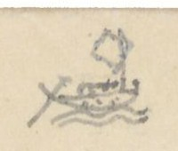{width=12%}

## Đường Thủy

| Số | [Địa danh] | Chữ Hán | [Khoảng cách] | [Ghi chú] |
|---|---|---|---|---|
| 1°/ | Bến Ngự sông Phú Xuân | 富春江 | 6.519 | 御津. Đi ngược dòng (trước thành [?]) |
| | Cửa Kênh Phủ Cam | 府甘港 | | 口 |
| | Bãi trên Xuân giang | 春江上 | | 洲 |
| | Cửa Kênh Eo bầu | 腰瓢 | | |
| | Đò Tuần Ngã ba | 我巴 | | 三岐巡渡 |
| | Mũi Thạm [?] | 塹[...] | | Chia hai phái như sau |

Hai phái (tác giả viết thành hai cột):

| a) Ng[uồn] Tả trạch - 8.440 | Chữ Hán | b) Ng[uồn] Hữu trạch - 4.720 | Chữ Hán |
|---|---|---|---|
| Vực Mồi Nông | 媒農 | Bãi Sò | 𡓁[...] |
| Vực Mồi Thì | " 時 | Bãi Tích | " 拆 [?] |
| Thác Giằng xay | 扛[...] | Bãi Đinh | " 丁 |
| Vĩnh Cây lời *(mực tím: trời [?])* | 泳核株 | Bến Bông | 渡[...] |
| Thác Bún | 拖粿 [?] | (Nguồn Hữu trạch) | 右澤 |
| Thác Thị [?] | " 柿 | | |
| Vực Tiên Kinh | 仙經 | | |
| Khe Mồi Kênh | 媒經 | | |
| Thác Khe Vàng | 溪鐄 | | |
| Thác Tần [?] | 拖[...] | | |
| Cầu Kênh | 求經 | | |
| Thác Cha sằng [?] | 吒[...] | | |
| Thác Mít | 拖櫗 | | |
| (Nguồn Tả trạch) | 左澤 | | |

| Số | [Địa danh] | Chữ Hán | [Khoảng cách] | [Ghi chú] |
|---|---|---|---|---|
| 2°/ | Bến ngự Phú Xuân | 富春江 | 8.415 | trước thành. Đi xuôi |
| | Chợ Thiên lộc | 天祿 | | |
| | Bãi giữa Xuân giang | 春江中 | | 洲 |
| | Bến Xuân dương | 春楊 | | |
| | Cầu Xuân thủy | 春水 | | |
| | Bến Non tiên | 嶺[?]仙 | | |
| | Bãi dưới Xuân [giang] | 春江下 | | 洲 |
| | Bến Triều sơn | 朝山 | | |
| | Cửa s[ông] Ngã ba | 三岐 | | |
| | Sông Cò Cò | 古鴣 [?] | | |
| | Cửa Noãn [?] (c[ửa] Eo) | 渜海門 | | Phía hữu có phái ngang, đi 17.947 Tầm đến Cửa Tư Dung 思容 |
| | (Cửa s[ông] Thai dương) | 閘邰陽 | 1.450 | |
| | Cồn ngao | 墹[...] | 2.000 | Ở phía tả; ở phía hữu có Sa đống 沙崗 |
| | Mũi Hàn [?] | 每捍 | 3.600 | Ở phía hữu |

Chữ trên hình: không có.

[NC: Cửa Eo (Noãn hải môn, sau là cửa Thuận An). Ở dòng Cửa Noãn tác giả viết rồi gạch một số khoảng cách (17.9..). Nhiều tên thác, vực, bãi viết bằng chữ Nôm (thác 拖, mồi 媒, kênh 經, cầu 求...); một số tự dạng chưa đọc ra.]

# Trang PDF 186 - Quảng Đức: Đường thủy (tiếp)
*Đầu trang: không ghi; số trang bản thảo: không đánh số*

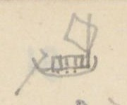{width=12%}

| [Địa danh] | Chữ Hán | [Khoảng cách] | [Ghi chú] |
|---|---|---|---|
| Đồi cát | 沙崗 | 1638 | |
| Chợ Thanh hà | 清河市 | | ở phía tả |
| Bến Hà đá | 河𥒥 | 2.560 | ở |
| Hà Úc | 河澳 | 1.399 | ở phía hữu; Hà đá ở phía tả. Dân cư |
| Diêm trường | 塩塲 | 2.295 | ở phía tả, với trường Rau Câu 句菜. Ở phía hữu có Cồn trai 墹寨 [?] |
| Cửa | | 785 | Có hai lối ngược lên |
| Đồn Thủ ngự | 守禦 | 1.770 | Ở phía hữu |
| Núi Hòa vinh | 和榮山 | 450 | Trên núi Kẻ dinh 几令 [?] |
| Cửa Tư Dung | 思容海 | | 門 |

Chữ trên hình: không có.

[NC: Trang này không ghi đầu trang, nối tiếp trang "Quảng Đức 7" (đường thủy, phái 2°/). Nửa dưới trang để trống, chỉ có chữ in VERRERIE DU NORD in ngược và nét chữ trang bên kia hiện qua.]

# Trang PDF 187 - Quảng Đức 9: Đường Bộ - Thủy
*Đầu trang: Quảng Đức 9; số trang bản thảo: 92*

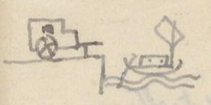{width=12%}

## Đường Bộ - Thủy

| Số | [Địa danh] | Chữ Hán | [Khoảng cách] | [Ghi chú] |
|---|---|---|---|---|
| 1°/ | Cửa đông nam | 東南 | 13.207 | Theo dịch lộ đi về Nam [T.L đi Nam 22/1.13] |
| | Xuân lai x[ã] | 春来 | | Xuống đò đi xuôi 1.349 T đến Đầm Hà trung 河中. Đi ngược thì như sau: |
| | Sư lỗ x[ã] sông | 師魯江 | 4.331 | |
| | Thác Cây Cời [?] | 核[...] | | |
| | Thác Ông | 拖翁 | | |
| | Thác Dài | " [...] | | |
| | Thác Giằng xay | 扛[...] | | |
| | Vực Nhà người | 茹㝵 | | |
| | Thác Đá mông | 𥒥[...] | | |
| | Vực Luật | 域律 | | |
| | Thác Dài | 拖[...] | | |
| | Thác Rộng | " [...] | | |
| | Thác Ao | " 泑 | | |
| | Thác Môn | " 門 | | |
| | Ngã ba Cây Di | 我巴核 | | 苡 (TTNĐ) hay là 以 [?] (TLYL) |
| 2°/ | Cửa đông nam | 東南 | 20.209 | Theo dịch lộ đi về nam (TL đi nam 22/1.22). Xuống đò, đi xuôi 551T đến đầm Minh lương 明良潭. Đi ngược: |
| | Cầu Cao đôi xã | 高堆 | 2.830 | |
| | Bến Vối | 渡[...] | | |
| | Bến Củi | " 檜 | | |
| | Vực ông nhỏ | 域翁[...] | | |
| | Vực Mít | " 櫗 | | |
| | Vực Ruộng Vây [?] | " [...] | | |
| | Vực Mộc bài | " 木牌 | | |
| | Vực Cây Liêm | " 核[...] | | |
| | Vực Mũ U [?] | " [...] | | |
| | Vực Cá Trùm [?] | " 奇[...] | | |
| | Vực cây Mít dừa | " 核櫗椰 [?] | | |
| | Nguồn Phù Âu | 浮歐 | | Khe Cây dầu 核油 |
| 3°/ | Cửa Đông nam | 東南 | 24.121 | Theo dịch lộ đi về nam (TL đi nam 22/1.32). Xuống đò, xuôi dòng 3.300T ra cửa Cảnh dương 景陽. Ngược dòng: *(viết thêm)* 壙 [?] (TLYL) |
| | Cầu Phúc An | 福安 | 1.280 | |
| | Thủy An ph[ường] | 水安坊 | | |
| | Thủy Cam " | 水甘 " | | |
| | Bái đáp " | 拜答 " | | Nguồn. Khe cùng nguồn 源窮 |

Chữ trên hình: không có.

[NC: Tên các thác, vực ở trang này phần lớn viết bằng chữ Nôm (thác 拖, cây 核, đá 𥒥, người 㝵, mít 櫗...); nhiều chữ Nôm có tự dạng không gõ được, ghi [...].]

# Trang PDF 188 - Quảng Đức 10: Đường Bộ - Thủy (tiếp)
*Đầu trang: Quảng Đức 10*

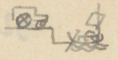{width=12%}

| Số | [Địa danh] | Chữ Hán | [Khoảng cách] | [Ghi chú] |
|---|---|---|---|---|
| 4°/ | Cửa Đông nam | | 26.480 | Do dịch lộ, đi về Nam [T.L đi Nam 22/1.2] đi xuôi, gặp 3.100T Sông Phúc An 福安江, Cửa Cảnh dương 境陽 |
| | Bến Kiền Kiền (ngược dòng) | 虔[...]江 | 870 | |
| | Khe Cùng (cuối nguồn) | [...]溪 | | |
| 5°/ | Cửa Đông nam | 東南 | 33.458 | Do dịch lộ đi về nam [TL đi nam 22/1.14] đi xuôi 90T ra cửa bể Vân quan 雲関. Đi ngược. |
| | Bến Vân quan | 雲関 | 3.806 | |
| | Đầm Ếch | 潭螠 | | Chỗ cùng |
| 6°/ | Cửa Tây Bắc | 西北 | 4.416 | Theo dịch lộ về Bắc [TL đi nam 21/1.17] đi xuôi bảy đò, 7.450 qua bãi cát, đất đến Ngã ba Trình 埕 sông Hồng phúc 洪福. Đi ngược thì: |
| | Bến Văn xá | 文舍江 | 15.723 | |
| | Thác Tuần | 拖巡 | | |
| | Thác Ông | " 翁 | | |
| | Vĩnh Kho | 泳庫 | | |
| | Vực Đá hanh | 𥒥亨 | | |
| | Vĩnh Khương cùng | 泳羌窮 | | |
| | " Nhà Thóc | " 茹[...] | | |
| | " Lăng | " 陵 | | |
| | Thác Tràm [?] | 拖[...] | | |
| | Vĩnh Đá mài | 泳𥒥[...] | | |
| | Vĩnh Đồ | " 徒 | | |
| | Thác Ngại | 拖[...] | | |
| | Vĩnh Tôm | 泳[...] | | |
| | Thác Tôm | 拖[...] | | |
| | Vĩnh Lá | 泳[...] | | |
| | Thác Lá | 拖[...] | | |
| | Vĩnh Bướm | 泳[...] | | |

Chữ trên hình: không có.

[NC: Dòng 4°/: số "25.480" gạch, viết lại "26.480". Dòng 6°/: tác giả viết "Cửa Đông Nam" rồi sửa thành "Cửa Tây Bắc", chữ Hán 東南 gạch, thay bằng 西北. "Vĩnh" (泳) ở đây là chữ dùng để ghi "vịnh/vũng" trên sông. Tên thác, vực phần lớn là chữ Nôm, nhiều chữ không gõ được.]

# Trang PDF 189 - Quảng Đức 11: Đường Bộ - Thủy (tiếp mục 6°)
*Đầu trang: Quảng Đức 11; số trang bản thảo: 93*

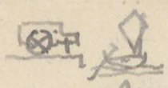{width=12%}

| [Địa danh] | Chữ Hán | [Ghi chú] |
|---|---|---|
| Vĩnh Rì rì | 泳[...]" | |
| Thác Giằng xay | 拖扛[...] | |
| Vĩnh Trái | 泳債 | |
| Thác Cây măng | 拖核[...] | |
| Vĩnh " | 泳 " | |
| Thác Ả nhi | 拖婀[...] | |
| Thác Rau | 拖蔞 | |
| Vĩnh Rau | 泳 " | |
| Thác Thai | 拖台 | |
| Vĩnh Thai | 泳 " | |
| Thác Lất | 拖[...] | |
| Thác lỗi đôi | 拖[...]堆 | |
| Vĩnh " | 泳 " | |
| Thác đá tào | 拖𥒥[...] | |
| Thác Dài | 拖[...] | |
| Vĩnh Trung | 泳忠 | |
| Thác Địa Ngục | 拖地獄 | |
| Thác Ná | 拖弩 [?] | |
| Thác Lọc-cọc | 拖祿[...] | |
| Thác trợ | 拖[...] | |
| Thác Nạc con | 拖[...]昆 | |
| Thác Nạc mẹ | 拖[...]媄 | |
| Thác mỡ cá | 拖[...]奇 | |
| Vịnh " | 泳 " | |
| Thác Lầu | 拖[...] | |
| Thác Bánh lái | 拖餅[...] | |
| Vĩnh " | 泳 " | |
| Vĩnh Ba Cầm | 泳巴琴 | |
| Thác " | 拖 " | |
| Vĩnh Phím | 泳[...] | |
| Vĩnh Cha chéo | 吒[...] | |
| Vĩnh Kiền Kiền | 泳乾" | |
| Thác " | 拖 " | |
| Thác Đỏ | 拖[...] | |
| Vĩnh Đỏ | 泳 " | |
| Thác Sơn loan | 拖山灣 | |
| Vĩnh " | 泳 " | |
| Thác Ba năng [?] | 拖巴[...] | |
| Vĩnh Cửa trăng | 泳閘[...] | |
| Thác Ao | 拖泑 | |
| Nguồn Sơn bồ | 山蒲 | Chỗ cùng |

Chữ trên hình: không có.

[NC: Danh sách thác (拖) và vĩnh/vũng (泳) trên nguồn sông, gần như toàn bộ ghi bằng chữ Nôm; nhiều chữ Nôm không gõ được, ghi [...]. Dấu " sau chữ Hán (ví dụ 泳乾") là dấu lặp chữ của tác giả.]

# Trang PDF 190 - Quảng Đức 12: Đường Bộ - Thủy (tiếp)
*Đầu trang: Quảng Đức 12*

| Số | [Địa danh] | Chữ Hán | [Khoảng cách] | [Ghi chú] |
|---|---|---|---|---|
| 7°/ | Cửa Tây bắc | 西北 | 14.278 [?] | Theo dịch lộ đi Bắc [TL đi Nam 20/1.25] |
| | Bến Lương phúc | 良福 | 11.471 | Xuống đò. Đi ngược (x. sau). Đi xuôi 17.542 |

Phía đi xuôi (tác giả ghi ở cột bên phải, có gạch ngoặc):

| [Địa danh] | Chữ Hán |
|---|---|
| Cửa Đờ (Cửa Lạc) | 閘[...] |
| Bến Cửa Cót | " 骨 |
| Cò Cò | 古鴣 [?] |
| Sông Xuân (hợp với) | 春江 |
| Cửa Nhuyễn [?] | 渜海門 |

Phía đi ngược:

| [Địa danh] | Chữ Hán |
|---|---|
| Vực Ba đá | 域巴𥒥 |
| Vĩnh Bàu ao | 泳[...]泑 |
| Thác Ngà [?] | 拖[...] |
| Sông Song Kiềm | 渡鉗江 [?] |
| Thác bến Dốc | 拖渡[...] |
| Vĩnh Ông bá | 泳翁伯 |
| Thác Ô rang | 拖烏[...] |
| Thác Mít | 拖櫗 |
| Thác Mụ Hiệp | 泳媒叶 |
| Thác mít nại | 拖櫗奈 |
| Thác dài | 拖[...] |
| Thác Tre | 拖[...] |
| Thác Mẹ chuột | 拖媄[...] |
| Vĩnh Ông Sạ | 泳翁乍 |
| Thác phường | 拖坊 |
| Thác Hạ bún | 拖下[...] |
| Thác Tiều [?] | 拖[...] |
| Thác Dài | 拖[...] |
| Thác Cây điển | 拖核典 [?] |
| Thác bến Suối | 拖渡[...] |
| Thác mít | 拖櫗 |
| Thác bình vôi | 拖[...] |
| Thác nhà Thắng | 拖茹勝 |
| Thác Cây Tất | 拖核[...] |
| Vĩnh Đá Nanh | 泳𥒥[...] |
| Thác cây Vải | 拖核[...] |
| Thác Mụ địch | 拖媒敵 |
| Thác Mụ nhứng [?] | 拖媒仍 |
| Vĩnh " | 泳 " |
| Thác lão Đặng | 拖老鄧 |
| Vực cây Nanh | 域𥒥[...] |
| Vực Mộc bài | 域木牌 |
| Vĩnh Mụ Dốc | 泳媒[...] |
| Thác Mụ Dốc | 拖媒[...] |
| Ng[uồn] Ô lâu | 烏楼源 |

Ghi chú ở dòng cuối: Đò tuần cũ.

[NC: "Cửa Nhuyễn" ở đây chính là cửa ghi 渜海門 ở trang PDF 185 (Cửa Noãn, cửa Eo). Tên thác, vực trang này phần lớn là chữ Nôm; nhiều chữ không gõ được, ghi [...]. Ở dòng "Vực cây Nanh", chữ Hán viết giống 域𥒥[...] (có lẽ tác giả chép nhầm từ dòng "Vĩnh Đá Nanh").]

# Trang PDF 191 - Quảng Nam 1: Quảng Nam - Cẩm lệ - Đồn
*Đầu trang: Quảng Nam 1 [?] (viết đè lên chữ khác); số trang bản thảo: 94*

## QUẢNG NAM - Cẩm lệ - Đồn

| Số | [Địa danh] | Chữ Hán | [Khoảng cách] | [Ghi chú] |
|---|---|---|---|---|
| | Dinh Thanh Triêm | 清沾舘 | 9.667 | Theo dịch lộ đi về bắc [TL đi Nam 25/1.7] |
| | Sông Cẩm lệ | 錦荔江 | | [TL đi Nam 24/1.27] |
| 1°/ | (về Tây) | | 8.444 | a, Đường nhỏ đi về Tây |
| | Chợ An thái | 安泰 | | |
| | Sông Thạch bồ | 石蒲 | | |
| | Nguồn Lỗ đông | 魯東 | | Đồn thủ Cảnh hóa đạo 境化道屯守 |
| 2°/ | (về đông) | | 3.381 | Đường nhỏ |
| | Chợ Cửu Mỹ [?] | 舊美 | | |
| | Nền Kho | 庫址 | | |
| | Đò Hóa Khuê | 化[...] | | |
| | Chợ Hải châu | 海洲 | | Chia hai đường |

| a) (về bắc) - 1.751 | Chữ Hán | b) (về đông) - 477 | Chữ Hán |
|---|---|---|---|
| Thanh Khê điếm | 清溪 | Cửa Đà nẵng | 沱灢海 |
| Hà Khê | 河溪 | (Đồn thủ) | 門屯守 |
| (Dịch lộ) [TL đi Nam 24/1.22] | | | |

| Số | [Địa danh] | Chữ Hán | [Khoảng cách] | [Ghi chú] |
|---|---|---|---|---|
| 3°/ | (về Tây) | | 8.066 | |
| | Rừng Cẩm-nê | 錦泥 | | |
| | Khe Bàu Lai | 泡淶 | | |
| | Sông Bàu Cau | 泡[...] | | |
| | Sở đồn cũ | 舊屯所 | | |
| | Chợ mới | 新市 | | Nhiều ác thú |
| | Nguồn Lỗ đông | 魯東 | | Công trường 工場 [?] |
| 4°/ | (về Bắc) | | 100 | Do dịch lộ đi về bắc [T.L đi Nam 24/1.26] |
| | Hóa khuê xã | 化[...] | 7300 | Đường nhỏ về Tây tới Hồng phúc xã |
| | Hồng phúc xã (về tây) | 洪福 | 6.090 | Có đường đi về Tây nam 4.568, qua rừng nhiều ác thú, tới Nguồn Lỗ đông 魯東, đồn thủ Trà Ác đạo 茶鵶道 [?] |
| | Đèo Chu lý | 岩株李 | | Qua núi Quan Khuê 関[...], nhiều hổ |
| | Chợ Phù nam | 扶南社 | | Có đường rẽ 360T đến đồn Ải tân 隘新屯守 |
| | Đò Phù nam | 扶南渡 | | Chia hai ngả |

| a) (về Tây) - 6.619 | Chữ Hán | b) (về Bắc) - 1.514 | Chữ Hán |
|---|---|---|---|
| Đồn Ải thượng | 隘上屯守 | Đồn Ải trung | 隘中屯 |
| Đỉnh Lao giáo | 勞教上嶺 | Khe Ô ô | 烏烏溪 |
| Khe Vô | 溪無 | Khe Nhà giàu | 茹[...] |
| Núi Mông | 岩[...] | Núi Kiền kiền | 虔虔山嶺 [?] |
| Khe Tô Nông | 溪蘇農 | Cõi Quảng Đức | 廣德界 |
| Cõi Quảng Đức | 廣德界 | | |

[NC: Tác giả viết chữ 舊 (cũ) theo lối thảo trông như 苗 (ở đây và ở các trang PDF 179, 184). Chữ 德 viết giản lược. "Khe Ô ô", "Núi Kiền kiền": tác giả dùng dấu lặp chữ.]

# Trang PDF 192 - Quảng Nam 2: Quảng Nam - Câu đê - Đông an
*Đầu trang: Quảng Nam 2*

## QUẢNG-NAM. Câu đê - Đông an.

| Số | [Địa danh] | Chữ Hán | [Khoảng cách] | [Ghi chú] |
|---|---|---|---|---|
| 1°/ | Điếm Thanh Triêm | 清沾 | 7.598 | Dinh Q[uảng] Nam theo dịch lộ đi bắc |
| | Sông Câu đê | 俱低 | 5.263 | [TL đi Nam 24/1.18] |
| | Đá bàn | 𥒥盘 | | |
| | Vân quan | 雲関 | | Mốc giới 木界 |
| | Cõi Triệu phong | 肇豊府 | | |
| 2°/ | Điếm Thanh Triêm | 清沾 | 9.573 | Phía Tây, đường con |
| | Miếu Văn thánh | 文圣庙 | | |
| | Khe Câu-An | 駒安 | | |
| | Chợ Bất nhị | 不貳 | | |
| | Chợ Ái Nghĩa | 愛義 [?] | | |
| | Chợ Phiếm Ái | 汎愛 | | |
| 3°/ | Điếm Thanh Triêm | 清沾 | 6.288 | Phía đông, đường con |
| | Văn đông xã | 文東 | | |
| | Đò Thanh hà | 清霞江 | | |
| | Nền miếu Bát vị | 八位廟 | | 舊址基 |
| | Cầu Lai-viễn | 来遠橋 | | |
| | Công kho Đông An | 東安公 | | 庫 |
| | Lỵ sở Công đường | 公堂莅 | | 所 |
| | Đò Thanh châu | 清洲江 | | |
| | Đò Phúc-yên xã | 福安渡 | | |
| | Cửa Đại Chiêm | 大占海門 | | |
| 4°/ | Điếm Thanh Triêm | 清沾 | 185 | Theo dịch lộ về nam |
| | Sông Đông An | 東安 | 1.897 | [TL đi Nam 25/1.10] Đường nhỏ về tây |
| | Chợ Phố hoa | 浦花 | 380 | |
| | Trị sở h[uyện] Diên Khánh | 延慶 | 2.398 | 縣衙治所 |
| | Chợ Xuân đài | 春臺 | 2.257 | |
| | Đò Văn Liêm | 文[...] | 1.719 | Rộng 61T |
| | Chợ Quảng hóa | 廣化市 | 1.097 | |
| | Chợ Phiếm ái | 汎愛 | 3.965 | |

[NC: Chữ Hán ở dòng "Chợ Ái Nghĩa" viết giống 爱美; có lẽ là 愛義 viết giản. "舊址基" (chữ 舊 viết thảo) = nền cũ.]

# Trang PDF 193 - Quảng Nam 3
*Đầu trang: Quảng Nam 3; số trang bản thảo: 95*

| Số | [Địa danh] | Chữ Hán | [Khoảng cách] | [Ghi chú] |
|---|---|---|---|---|
| | Chợ Hà nhai | 河涯 | 4.386 | |
| | Đò Phú giang | 富江 | 1.789 | Rộng 23 |
| | Chợ Hà điền | 河滇 | 3175 | Chia hai ngả. 4.798 |

| a) | Chữ Hán | b) | Chữ Hán |
|---|---|---|---|
| Nguồn Ô-Dã | 汙㙠 [?] | Sông Hà điền t. | 河滇 |
| Đồn Đồng Vạc | 銅鑊 | Nguồn Ô-Dã | 汙㙠 [?] |
| (Đạo Phú giang) | 富江道 | Đồn An-sơn | 安山 |
| | | (Đạo Đại giang) | 大江道 |

| Số | [Địa danh] | Chữ Hán | [Khoảng cách] | [Ghi chú] |
|---|---|---|---|---|
| 5°/ | Điếm Thanh Triêm | 清沾 | 185 | Dinh Quảng nam. (TL đi Nam 25/1.10) đi về nam |
| | Sông Đông an | 東安江 | 1.676 | |
| | Điếm Long phúc | 龍福站 | 1.042 | Đường nhỏ đi về tây |
| | Huyện Duy xuyên | 濰川縣 | | Trị sở |
| a, | Mỹ Khê thôn cũ | 美溪 | 750 | Chia ra hai đường |
| | Đò Thi lai (54T) → Tây | 施來渡 | 2.808 | Sang phía tây. Rộng 54T |
| | Chiêm sơn xã | 瞻山社 | 2.584 | |
| | Chợ La đáp đình | 罗答亭 | 3.731 | |
| | Chợ Thu bồn | 秋盆 | 2.376 | Sang phía nam |
| | Rừng Thạch bàn x[ã] → Nam | 石盘社 | (3.168) 3.004 | Dài 3.168 |
| | Điếm Tân an | 新安店 | | Ở phía bắc đường có hai ao nước nóng. Bốn mùa nước phun sôi [?]; Khói mù |
| | Rừng Tân an | " 林 | | |
| | Rừng Gia lộc | 嘉祿林 | 5.321 | Hai rừng dài 2.278. Nhiều hổ |
| | Điếm Phúc sơn | 福山店 | | Cách Mỹ Khê 美溪 26.074 |
| b, | Mỹ Khê thôn cũ | 美溪 | 680 | Đi phương nam. |
| | Sông Mậu hòa | 懋和江 | 2.840 | Rộng 160T |
| | Rừng Hương phúc | 香福林 | 9.100 | Dài 1.100 T. Nhiều hổ |
| | Rừng An xuân | 安春 | 500 | Dài 500T |
| | Chợ Phúc sơn | 福山 | 1850 | |
| | Điếm Phúc đức | 福德 | 730 | Gặp đường trên |
| | Sông Ly ly | 哩哩江 | 9.606 | |
| | Đò Tân an | 新安渡 | 1.600 | |
| | Rừng Phúc sơn | 福山林 | 800 | Dài 100 T. Nhiều cọp |
| | Nguồn Thu bồn | 秋盆源 | | Đồn Phúc sơn 福山屯 |

[NC: Ở dòng "Mỹ Khê thôn cũ" (a), số "2.674" gạch, thay bằng "750". Ở dòng "Chợ Hà điền", số 4.798 ghi ở cuối dòng, phía nhánh b. Chữ 德 (Phúc đức) viết giản lược.]

# Trang PDF 194 - Quảng Nam 4: Quảng Nam - Hải Lam - Chiêu đàn - Tam kỳ
*Đầu trang: Quảng Nam 4*

## Quảng Nam - Hải Lam .. Chiêu đàn . Tam kỳ

| Số | [Địa danh] | Chữ Hán | [Khoảng cách] | [Ghi chú] |
|---|---|---|---|---|
| | Dinh Thanh Triêm | 清沾 | | Do dịch lộ đi về nam (TL đi Nam 25/1.28) |
| | Hải lam | [...]藍 | | |
| 1°/ | (về đông) | | 8.320 | Theo đường con |
| | Ngọc sơn x[ã] | 玉山 | | |
| | Sông Phúc Toản | 福[...] | | |
| | Cửa Đại chiêm | 大占門 | | Có đồn phân thủ |
| 2°/ | (về nam) | | 9.615 | Theo dịch lộ |
| | Cầu Chiêu đàn | 旃檀 [?] | 13.840 | Đường con đi về tây. |
| | Chợ " | " 市 | | |
| | Huyện Hà đông | 河東所 | | |
| | Chợ Khánh thọ | 慶寿 | | |
| | Công trường Chiêu đàn | 旃檀 [?] | | 公場 |
| | Sông Cửa An | 閘安 | 2.412 | Đi trên nhiều hổ. Qua sông rồi chia hai đường, đi về tây 2.490T đến đồn Cheo reo 岩[...]屯 |
| | Rừng Dương An | 楊安林 | | (Đường này đi về tây) |
| | Sông | 江 | 19.825 | Đường nhiều hổ. Có đường dài 2.172 qua đò Dương an 楊安 đến Đồn Phú lâm 富林屯 |
| | Đồn Đá bàn | 𥒥盘屯 | | Đường này đi về nam. Giáp cõi Quảng nghĩa. |
| | Đồn Ngã hai | 我𠄩屯 | | |
| | Đồn Bình an | 平安屯 | | Giáp cõi Quảng nghĩa chia hai đường |

| a (về Tây) - 1.050 | Chữ Hán | b. (về đông) - 5000 | Chữ Hán |
|---|---|---|---|
| Đồn Hàng Tổng | 行總屯 | Đồn Thí [?] | 杳[?]屯 |

[NC: "Chiêu đàn": chữ Hán viết giống 旃桧, có lẽ là 旃檀. Ở dòng "Đồn Ngã hai" có chữ "ở" viết ở cột ghi chú, ý chưa rõ.]

# Trang PDF 195 - Quảng Nam 5
*Đầu trang: Quảng Nam 5; số trang bản thảo: 96*

| Số | [Địa danh] | Chữ Hán | [Khoảng cách] | [Ghi chú] |
|---|---|---|---|---|
| 3°/ | (về nam) | | | |
| | Cầu Chiêu đàn | 旃檀 [?] | 2.432 | Do dịch lộ vào nam [TL đi Nam 26/1.7] |
| | Trạm Tam Kỳ | 三岐 | 8.400 | Có đường con đi về đông |
| | Đò Quảng-phú | 廣富 | | |
| | Đò Hòa Thanh | 和清 | | |
| | Cửa Tiểu Yểm | 小壓海 | | 門 |
| 4°/ | (về nam) | | | Do dịch lộ vào Nam |
| | Sông Bến bản | 渡板 | | Đồn phân thủ [X. TL đi nam 26/1.14] |
| a, | (Đi về Tây) | | 5.558 | Có đường con đi về tây |
| | Nhà Não thôn | 牙[...] | | |
| | Cầu Phú quí | 富貴求 | | |
| | Nguồn Hữu bang | 右邦源 | | |
| | Đồn Đồng Cổ | 仝[...]屯 | | Có đường đi bắc 1.910 đến đồn Hữu bang 右邦屯 |
| b, | (Đi về Đông) | 渡板 | 3.055 | |
| | Cửa Đại Yểm | 大壓門 | 3.965 | Có đồn phân thủ; có đường đi nam. |
| | Trì bình xã | 持平社 | | |
| | (Cõi Quảng Nghĩa) | 廣義界 | | 首 |

[NC: Ở mục 3°/, tác giả ghi số tầm trước chữ Hán (thứ tự cột khác các mục khác); ở đây chép theo thứ tự cột chung. Ở dòng "Sông Bến bản", số 5.558 gạch, chuyển xuống dòng a. Nửa dưới trang để trống.]

# Trang PDF 196 - Quảng Nam 6: Quảng Nam - Đường thủy
*Đầu trang: Quảng Nam 6*

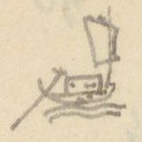{width=12%}

## QUẢNG NAM - Đường thủy

| Số | [Địa danh] | Chữ Hán | [Khoảng cách] | [Ghi chú] |
|---|---|---|---|---|
| 1°/ | Hải cảng Đại chiêm | 大占海 | 8.062 | 港 đi ngược dòng |
| | Sông Phúc-Yên | 福安江 | | Đi về bắc |
| | Viêm Minh [?] xã s[ông] | 炎[...]社 / 江灌 ? | | 江 |
| | Đò Khái-đông | 溉東 | | Phía đông có Núi Ngũ hành 五行山 (xem đoạn dưới) |

Phía đông có Núi Ngũ hành 五行山 năm đỉnh hình giống nhau. Có tên núi Non nước 嫩渃, cũng có tên núi Ngũ chỉ 五指. Đá núi trắng có thể làm nghiên, cối. Trong có tháp [?] Phổ đồng 普同, động Hoa vân 花雲. Trên vách đá có thơ của [?] thờ Khảo [?]. Có miếu ngói, lỗ thông thiên. Có thạch nhũ [?]. Nước chỉ rất ngọt. Nấu trà rất ngon.

| Số | [Địa danh] | Chữ Hán | [Khoảng cách] | [Ghi chú] |
|---|---|---|---|---|
| | Cửa Đà nẵng | 沱灢 | | 海門 |
| 2°/ | Cửa Đại chiêm | 大占海 | 400 | 門 Lên ngược dòng |
| | Sở phân thủ " | 大占分守 | 3.810 | 所. Từ đó đi ngược về nam. |
| | Cửa Đại yểm | 大壓海 | 8.140 | 門 |
| | Cửa Tiểu Yểm | 小壓海 | 5.670 | 門 |
| | Cửa Đại yểm ? | 大壓門 | | |
| 3°/ | Hải cảng Đà nẵng | 沱灢海 | 2.360 | 港 đi bộ về đông |
| | Mân Khuê xã | 閩[...]社 | | (xem đoạn dưới) |

Có một núi lớn. Núi ấy thảo mộc rườm rà, mã lộc từng bầy. Phía đông núi có một nhỏn [?], trông xa như hình sư tử, tên là Hòn Mão 㘨[...]. Phía tây núi có một hòn, xưa có chùa, gọi là Hòn chùa 㘨[...]. Phía tây nam hòn ấy có đầm lớn, tên Vĩnh lâm 泳淋. Chỗ chằm lớn ấy sâu và rộng có thể đựng nghìn thuyền. Ngoài có núi núi bình phong bài hàng, không sợ nạn sóng. Đó có núi gọi Hòn Khẩm [?] 㘨[...].

Chữ trên hình: không có.

[NC: Ở dòng "Viêm Minh [?] xã", tên quốc ngữ bị viết đè, chưa đọc chắc; dưới chữ Hán có ghi thêm 江灌 kèm dấu hỏi của tác giả. "Hòn" viết bằng chữ Nôm (bộ 土), không gõ được trọn chữ. "nhỏn" có lẽ là "hòn" viết nhầm. Ngũ Hành Sơn, bán đảo Sơn Trà và vũng Đà Nẵng được tả ở trang này.]

# Trang PDF 197 - Quảng Nghĩa: Các đồn
*Đầu trang: Quảng Nghĩa; số trang bản thảo: 97*

## QUẢNG-NGHĨA - Các đồn

| [Địa danh] | Chữ Hán | [Khoảng cách] | [Ghi chú] |
|---|---|---|---|
| Dinh Quảng nghĩa | 廣義營 | 5.722 | Công đường trị sở; [Không ở trên dịch lộ. TL đi Nam 28/1.1 chép cách sông Trà Khúc 348T. Đường lại khác. Nhưng ở trên ấy có nói có đường chi lộ dài 8.320T đến dịch lộ, có lẽ là đường này?] |
| Cầu Phúc lộc | 福祿 | | 社求. Có điếm |
| Điếm " | 店 | | |
| Cầu Xuân Liêu | 春寮 | | |
| và Phúc lộc | 福祿 | | 合求 |
| Điếm Toàn An | 全安 | | |
| Ba la xã | 波罗 | | 3 cầu (水道求) và điếm |
| Cầu Ba la x[ã] | " | | |
| và Đức An | 德安 | | 合求 |
| Sông Trà Khúc | 茶曲 | 12.891 | Gặp dịch lộ, phía bắc đi công đường. Theo dịch lộ đi về bắc qua |
| Trạm Diên-lộc | 延祿 | | [TL đi Nam 27/1.17] |
| Cầu Trì bình | 持平求 | 2.266 | Tên Cầu Tế 求济 [TL đi Nam 26/1.26]. Có đường rẽ về tây |
| Suối | 泉 | | Bốn đoạn |
| Đồn Nhà Tươi | 茹鮮 | 8.974 | |
| Suối | 泉 | | Sáu đoạn |
| Đồn Tháp súng | 塔銃 | 450 | 屯 |
| Đồn Bình hòa | 平和屯 | 680 | |
| Sông Đà bồng | 沱蓬江 | | |
| Đồn An nhân | 安仁屯 | 465 | |
| Đồn An hòa | 安和屯 | 570 | |
| Đồn Năm Giáp | [chữ Nôm "năm", 南 + 五]甲 " | 1.113 | |
| Đồn Vĩnh phú | 永富 " | 3.551 | |
| Rừng Phú yên | 富安 " | | 寨 trại |
| Đồn Khu Cao | 塸高 " | 1.667 | |
| Suối | 泉 | | Ba đoạn |
| Đồn Trường giang | 長江 " | 1.478 | |
| Sông Chanh [?] | 支江 | | 2 đoạn |
| Đồn Cù ba | 虬[...] " | 702 | |
| Đồn Khu đông | 塸東 " | 702 | |
| Suối | 泉 | | Một đoạn |
| Đồn Đá bàn | 𥒥盘 | 180 | |

[NC: Bên lề trái, từ dòng "Sông Trà Khúc" đến "Cầu Trì bình" có một ngoặc dọc và một ký hiệu nhỏ (giống chữ 叩 [?]). Dòng "và Đức An": chữ "hiệp" viết rồi gạch. Dấu " sau chữ Hán (屯) là dấu lặp chữ "đồn". "社求" = cầu của xã.]

# Trang PDF 198 - Quảng Ngãi 2: Các đồn (tiếp)
*Đầu trang: Quảng Ngãi 2*

| [Địa danh] | Chữ Hán | [Khoảng cách] | [Ghi chú] |
|---|---|---|---|
| Đồn Hồ trụ | 滸柱屯 | 340 | |
| Đồn Bạch Câu | 白駒 " | 368 | |
| Đồn hạ " | " 屯下 | 233 | |
| Đồn Eo Gió | 腰[...] | 213 | Có đường rẽ về đông rồi lên 1.689 (xem bên dưới) |
| Đồn trên Tràng Tham | [...]槮上 | 150 | |
| Đồn dưới " | " 下 | 174 | |
| Đồn Hồ-dã | 滸[...] | 400 | |
| Đồn Đá Lê | 𥒥黎 | 251 | Có đường rẽ về đông 1.330 đến đồn Trường an 長安 |
| Đồn Đá chồng | 𥒥[...] | 100 | |
| Sông Cù-ba | 虬[...]江 | | Thượng lưu sông Trà Khúc 茶曲, chảy 13.715 Tầm đến bến Trà Khúc, lại 5390 Tầm đến cửa Cổ lũy 古壘 *(mực tím: 大古壘)* |
| Đồn Đá chồng | 𥒥[...] | 536 | Có đường rẽ về đông qua đồn (xem bên dưới) |
| Đồn Đèo đá | 岩𥒥屯 | 638 | Có đường rẽ ra phía đông, có đường qua các xứ trên, dài 10.788 đến Cù mông [cũng là đường trên] |
| Đồn Hồ Dã | 滸[...] | 763 | |
| Đồn Húc Bảo | 旭宝屯 | 1.940 | |
| Đồn Hồ Kỳ | 滸奇 | 1.835 | |
| Đồn Khu Miếu | 塸庙 | 496 | |
| Đồn Khu Gai | 塸[...] | 922 | |
| Đồn Húc Vân ? | 旭芸 | 203 | |

Đường rẽ từ Đồn Eo Gió (tác giả ghi ở cột phải, có gạch dọc):

| [Địa danh] | Chữ Hán | [Khoảng cách] |
|---|---|---|
| Đồn Trường An | 長安屯 | 9.476 xuống |
| Đồn Đông dương | 東陽 | 6.760 |
| Công đường trị sở | 公堂 (廣義) | |

Đường rẽ từ Đồn Đá chồng (536):

| [Địa danh] | Chữ Hán | [Khoảng cách] |
|---|---|---|
| Đèo đá 岩𥒥 ? | 岩石𥒥 | 10.724 |
| Lộc Lâm | 祿林 | |
| An bàn | 安盘 | |
| Lâm phố | 林甫 | |
| Thạch bích | 石碧 | |
| Cù Mông (dịch lộ) | 虬蒙 | |

[NC: Đầu trang tác giả ghi "Quảng Ngãi 2" (trang trước ghi "Quảng Nghĩa"). Chữ Hồ viết 滸 (bộ thủy). Dòng "Đồn Hồ Dã" (763): chữ đầu viết đè, chưa chắc. Bên lề phải, cạnh dòng "Đèo đá", có một ký hiệu nhỏ.]

# Trang PDF 199 - Quảng Nghĩa 3: Các đồn (tiếp)
*Đầu trang: Quảng Nghĩa 3; số trang bản thảo: 98*

| [Địa danh] | Chữ Hán | [Khoảng cách] | [Ghi chú] |
|---|---|---|---|
| Đồn Đèo Tố trên | 岩[...]上 | 465 | |
| Đồn Đèo Tố hạ | " 下 | 418 | |
| Đồn Đá bàn | 𥒥盘 | 555 | |
| Đồn Húc li | 旭離 | 557 | |
| Đồn Khu giang | 塸江 | 553 | |
| Đồn Đồng Trảng | 仝[...] | 815 | |
| Đồn Húc Bồng | 旭蓬 | 780 | |
| Đồn Xà Ôn (sông) | 蛇[...] | 320 | Sông Xà ôn 蛇[...] chảy xuống 10.900T đến sông Quan-la 官罗河, 6.100 hợp với sông Long vệ 竜衛 rồi ra cửa Đại chiêm |
| Đồn Khu Diễn | 塸[...] | 782 | |
| Đồn Khu Quán | 塸舘 | 120 | |
| Đồn Ruộng Xa | [...]車 | 95 | |
| Đồn Khu Miếu | 塸庙 | 190 | |
| Đồn Mỹ lộc | 美祿 | 140 | |
| Đồn Phúc lộc | 福祿 | 221 | |
| Đồn Khu tráng | 塸壯 | 460 | |
| Đồn Phúc lộc trên | 福祿上 | 350 | |
| Đồn " hạ | " 下 | 578 | |
| Đồn Hồ Kỳ | 滸奇 | 678 | Có đường rẽ về đông chạy xuống 1.500 (xem bên dưới) |
| Đồn Húc cây | 旭[...] | 2.151 | |
| Suối Trầu ? | 㴴[...] | 457 | (Trung đoạn có đường đi về tây, qua đồn Cửa Khẩu 閘口. Lại 1270T đến Đồn Đầu voi 頭[chữ Nôm "voi"]) |
| Đồn Suối chử | 㴴渚 | 355 | |
| Đồn Khu Bát | 塸[...] | 311 | |
| Đồn Khu Thống | 塸统 | 743 | |
| Đồn Đồng Bông | 仝[...] | 245 | |
| Đồn Ma Giá | 馬稼 [?] | 226 | |
| Đồn Húc Cái | 旭[...] | 285 | |
| Đồn Khu Chùa | 塸廚 | ? | TTNĐ và TLYL [?] đều trừa trắng |
| Đồn Giằng xay | [...] | 950 | |
| Đồn Năm Sào | [chữ Nôm "năm"]巢 | 290 | |
| Đồn Vũ giáp | 武甲 | 265 | |
| Đồn Đá bàn | 𥒥盘 | 583 | |
| Đồn Đá dựng | 𥒥孕 [?] | 316 | |

Đường rẽ từ Đồn Hồ Kỳ (tác giả ghi ở cột phải, có gạch dọc):

| [Địa danh] | Chữ Hán | [Khoảng cách] |
|---|---|---|
| Đồn cũ Bàu mang | 泡[...] | 7.730 |
| Eo gió | 腰[...] | |
| Tham thi (đồn cũ) | 參施 | |
| Cầu Xuân Vinh | 春榮 | |
| Sông Suối phá | 㴴破 | |
| Cầu Đại an | 大安 | |
| Điếm Thu Phố | 秋浦 | |
| Đò Vạn Xuân | 萬春渡 | |
| Đông Dương | 東陽 | 930 |
| Trà Khúc (dịch lộ) | 茶曲 | |

[NC: "Suối" viết bằng chữ Nôm 㴴 (hoặc tự dạng gần). Dòng "Đồn Khu Chùa": tác giả ghi dấu "?" ở cột khoảng cách và chú rằng TTNĐ và TLYL (viết giống "LTYE") đều để trống số. "Điếm Thu Phố": chữ "Phố" viết đè lên chữ khác.]

# Trang PDF 200 - Quảng Nghĩa 4: Các đồn (tiếp)
*Đầu trang: Quảng Nghĩa 4*

| [Địa danh] | Chữ Hán | [Khoảng cách] | [Ghi chú] |
|---|---|---|---|
| Đồn Du | 遊屯 | 302 | |
| Đồn Sơn bụng | 山[...] | 344 | |
| Đồn Tranh | [...]屯 | 420 | |
| Đồn Đá chát | 𥒥[...] | 560 | |
| Đồn Suối Toan | 㴴[...] | 450 | |
| Đồn Nha môn hạ | 衙門下 | 671 | Qua sông Ba tê 波[...] chảy xuống 15.630 đến dịch-lộ ở bến Sông vệ giang 滝衛江. Lại 5.733 đến cửa Cổ lũy 古壘. Lại có đường rẽ về Tây lên đến Đồn Cái bi 丐[...], xuống phía Đông qua Đồn cũ Trà da 茶耶, các xứ Đèo nở 岩[...], Sông Ngang 滝昂, Đá bàn 𥒥盘. Đi 10.338 đến dịch lộ, tại điếm Trụ 柱店, và phải qua Điếm Đông Mỹ 東美 ở Hoa sơn 花山; lại 11.762T đến trị sở dinh Quảng Nghĩa |
| Đồn Khu Liêm | 塸[...] | 205 | |
| Đồn Dốc Lết | [...] | 350 | |
| Đồn Cây Sơn | 核山 | 350 | |
| Đồn huyện nhỏ | 縣[...] | 442 | |
| Đồn Khu Linh | 塸[...] | 1.136 | |
| Đồn Cây Khái | 核[...] | 1.395 | |
| Khe (6 cái) | 溪 | | |
| Đồn An sơn | 安山 | 432 | |
| Khe (2 cái) | | | |
| Đồn Khu Mộc | 塸木 | 379 | |
| Đồn Cây Ổi | 核[...] | 352 | |
| Đồn Cây Trâm | 核[...] | 209 | |
| Khe (2 đoạn) | 溪 | | |
| Đồn Đá lập | 𥒥[...] | 340 | |
| Đồn Cây gai | 核[...] | 453 | |
| Đồn Ba hồ | 巴滸 | 431 | |
| Đồn Ông Ký | 翁記 | 396 | |
| Đồn Non Kích | 岩[...] | 680 | |
| Đồn Sở hầu | 楚猴 | 792 | |
| Đồn Đá bạc | 𥒥泊 | 360 | |
| Khe | | | Chảy ra cửa Mỹ ý 美懿 |
| Đồn Ô ô | 汙汙 | 377 | |
| Đồn Đồng Trại | 仝寨 | 1.335 | |
| Đồn Cây Tấu | 核[...] | 450 | |
| Đồn Cây Khế | 核[...] | 796 | |
| Đồn Đồng Chiêu | 仝招 | | |

[NC: Ghi chú dài ở dòng "Đồn Nha môn hạ" được tác giả viết ở cột phải, kéo dài xuống ngang các dòng dưới (có gạch dọc). Tên đồn, khe ở trang này phần lớn viết bằng chữ Nôm (cây 核, đá 𥒥, suối 㴴...), nhiều chữ không gõ được.]

# Trang PDF 201 - Quảng Nghĩa 5 (tiếp lộ trình)

*Đầu trang: Quảng Nghĩa 5; số trang bản thảo: 99*

| [Địa danh] | [Chữ Hán] | [Tầm] | [Ghi chú] |
|---|---|---|---|
| Đồng Bài đồn | 仝排 | 650 | (TLYL [?] viết 仝 (trùm phần [?])) |
| Đồn Lão Thọ | 老壽 | 1.000 | |
| Đồn Lỗ Voi | 擄[?]𤠄 | 1.262 | |
| Đồn Thiêu Cây | 燒[...] | 710 | |
| Đồn Đèo Ải Thượng | 岧隘上 | 1.938 | |
| Đồn Đèo Ải Hạ | 〃 下 | 518 | |
| Đồn Đồng Bồ | 仝埔 [?] | 2.604 | Ở Đèo Hang Hùm [chữ Nôm: 嵡[?]蚶[?]]. Có đường rẽ tới cõi Bình định, đến dịch lộ [TL đi Nam |
| **Rừng Vĩnh Tuy** (Dịch lộ) | 永綏林 [?] 驛路 | 4.200 | |
| **Cao Sơn** | 高山 | 2.091 | Ở xã Miên Trường 綿長. Có đường rẽ |
| La Hồng th. | 羅紅 | | Đường dọc chân núi |
| Thạch Bi th. (chợ) | 石碑 | | |
| **Cửa Sa Huỳnh** | 沙黃 | 10.582 | Có đồn phân thủ |
| Miên Khê đò | 綿溪 | | |
| Long Trì th. | 隆池 | | |
| chợ Dốc | 𡍚 [?] | | |
| Ấp Phúc Điền | 福田 | | |
| Chợ Xảo | 巧市 | | |
| **Cửa Mỹ Ý** | 美懿 | 17.450 | Có đồn phân thủ |
| Điếm Phú Vinh th. | 富榮 | | |
| Đò Hòa Dương | 和陽 | | Trên suốt sông Vệ 衛江, dưới ra cửa Cổ Lũy 古壘 |
| Đò Thái Hòa | 泰和村 | | 渡. Bến đò nổi [?] 淩[?] 渡 浚[?]. Trên đến vực Đình 域亭, dưới là cửa Đại Cổ 大古 |
| Kho Phú Đăng | 富登庫 | | Có một đường đến trị sở, một đường đến cầu Phú Lộc |
| Cầu Phú Nhân | 富仁 | | Ra cửa Đại Cổ 大古 (3 đoạn) |
| Miếu Hội Đồng | 會同廟 | | |
| **Cửa Đại Cổ Lũy** | 大古壘 | 4.973 | Có đồn phân thủ |
| Sông Phú An | 富安 | | |
| Đò Mũi Núi | 𪖫𡶀 [?] | | Trên đến Trà Khúc 茶曲, chảy xuống cửa ấy (Đại Cổ Lũy) |
| Điếm Tư Cung x. | 思恭社 | | |
| Khê 〃 〃 | 〃 〃 溪 | | |
| Chợ Mỹ Khê x. | 美溪社 | | |
| Cầu 〃 〃 | 〃 〃 求 [?] | | |

[NC: th. = thôn; x. = xã; TL đi Nam = mục "Thăng long đi Nam" của bản thảo. Các tên gạch chân là các chặng chính có ghi số tầm. Dấu ngoặc vuông "[TL đi Nam" ở ghi chú dòng Đồn Đồng Bồ do tác giả mở mà không đóng. Nhiều tên Nôm (Lỗ Voi, Thiêu Cây, Đèo, Hang Hùm, Mũi Núi) viết bằng chữ Nôm, tự dạng chưa chắc. Chữ "Đồng" viết 仝 (dạng cổ của 同).]

# Trang PDF 202 - Quảng Ngãi 6 (hết mục Quảng Nghĩa)

*Đầu trang: Quảng Ngãi 6*

| [Địa danh] | [Chữ Hán] | [Tầm] | [Ghi chú] |
|---|---|---|---|
| **Cửa Sa Kỳ** | 沙祈 | 15.153 | Có đồn phân thủ [TL đi Nam 2?] viết [沙淇 |
| Sông Thái Cần | 菜芹 | | |
| Cửa Thái Cần | 〃 〃 海門 | 3.576 | Có đồn phân thủ |
| **Rừng Trì Bình** | 特平林路 [?] | | Đến cuối đường rừng [TL đi Nam 26/l.20 [?]] cõi Quảng nam] |

[NC: Phần còn lại của trang để trống; thấy nét chữ trang trước hiện qua giấy và tiêu đề in VERRERIE DU NORD in ngược ở nửa dưới. "l." có lẽ là "dòng" theo cách tra cứu nói ở Mục lục.]

# Trang PDF 203 - Quảng Trị 1 (công đường; đường đi Ai Lao)

*Đầu trang: Quảng Trị 1; số trang bản thảo: 100*

## QUẢNG TRỊ (công đường)

| [Số] | [Địa danh] | [Chữ Hán] | [Tầm] | [Ghi chú] |
|---|---|---|---|---|
| 1. | Phía nam | 南 | 13.953 | Theo đường dịch lộ, đi về nam |
| | Sông Lương Phúc | 良福 | ... | [x. TL đi Nam 20/l.15 - l.25] |
| | **Bàu [?] Rói Lai** | 湫淶 | . | Quán số [?] Thu Lai |
| 2. | Phía Bắc | 北 | 25.686 | Theo đường dịch lộ, đi về bắc |
| | **Cầu Tiểu Khê** (Chấp Lễ) | 小溪 執禮 | | [x. TL đi Nam 20/l.15 - 19/l.1] |

## AI-LAO

| [Số] | [Địa danh] | [Chữ Hán] | [Tầm] | [Ghi chú] |
|---|---|---|---|---|
| 3. | Phía tây | 西 | 390 | [x. TL đi Nam 20/l.5] |
| | Cầu Ái Tử | 愛子 | 4.486 | Bờ nam [〃 20/l.4] |
| | Trạm An Lạc | 安樂 | 765 | [x. TL đi nam 19/l.33] |
| | Cầu Nghĩa An | 義安 [?] | 1.226 | Dài 5 T |
| | Trường Xá | 張舍 | 427 | Phủ cũ 旧府. Nền hãy còn |
| | Chợ Thượng Đô | 上都 | 2.700 | |
| | Cầu Đại Độ | 大度 | 340 | Dài 3 T |
| | Cam Lộ | 甘露 | 2.535 | Công trường 公場 |
| | Đỉnh Thạch Sơn | 石山 | 2.636 | 頂中 [?]. Đường rừng. Nhiều hổ, lang, rắn, voi |
| | Sông Hiếu Giang | 孝江 | | ... tầm (hai bản sót) |
| | Ba Lăng phường | 巴陵 [?] | | Ở đây có ba đống đá ở phía nam đường. Cũ ở phía nam có miếu cô thờ Quế nương ngọc nữ phu nhân 桂娘玉女夫人. Tục truyền rằng phu nhân hóa ở đó. Người ta lập miếu thờ. Rất linh ứng |
| | Cây Mít | 核櫗 | | |
| | Bãi Phụ | 𡓋[?]父 | | |
| | Đường núi | 山路 | | |
| | Sông Tam Kỳ | 三岐 | | |
| | **DINH AI-LAO** | 哀牢 | | |
| 4. | Phía Tây | 西 | 390 | Đường rẽ |
| | Cầu Ái Tử | 愛子 | 6.420 | |
| | Cầu Kim Đâu | 金兜 | 5.200 | |
| | Nhà Hồng | 茹紅 | 260 | Có phủ cũ 旧府 |
| | Chợ Mai Xá | 枚舍 | 1.936 | |

[NC: "x." ở cột ghi chú = xem. "T" sau số đo (Dài 5 T, Dài 3 T) có lẽ là trượng. Chữ đầu của "Nghĩa An" viết giống 美. "Cây Mít" (核櫗), "Bãi" (𡓋), "Nhà" (茹) là chữ Nôm. Bàu Rói Lai: chữ đầu bị viết chồng, chưa chắc.]

# Trang PDF 204 - Quảng Trị 2 (đường đi Ai Lao, tiếp)

*Đầu trang: Quảng Trị 2*

| [Số] | [Địa danh] | [Chữ Hán] | [Tầm] | [Ghi chú] |
|---|---|---|---|---|
| | Cồn Tiên xứ | 𡑝[?]仙 | 5.005 | Trên núi có đá hình vuông mẹp [?], lưng có vạch ngang dọc như bàn cờ. Người ta truyền xưa có tiên vây [?] cờ. |
| | Nguồn Ô | 烏源 | 6.141 | Quán cũ. Rừng núi. Hổ lang. |
| | Mộc Bài xứ | 木牌 | 5.233 | Đời Lê, đó là cửa [?] cấm của người ta 華 và người mọi 夷 |
| | **Đỉnh núi Mang** | 芒山 | | 嶺上 [?]. Tục truyền rằng hành nhân đến đó, mang gông vào cổ, qua trên núi. |
| 5. | Phía Tây bắc | 西北 | 390 | Đến nguồn Cổ Lâm 古林. 3.3571 T |
| | Cầu Ái Tử | 愛子求 | 11.888 | |
| | Chợ Mai Xá | 枚舍 | 2.240 | |
| | Chợ Long Sơn | 隆山坊 | 2.600 | |
| | Sông xã Tiên Sơn | 仙山江 | 5.914 | |
| | Cồn Trại | 𡑝[?][...] | 3.216 | |
| | Bến Quan | 渡官 | 7.331 | |
| | Đỉnh Hắc Thạch Sơn | 黑石山 | | Một dải núi ngang, đá toàn [?] sắc đen. Không có đường qua. Có tên Đồng [?] Chăn [?] 尚[?][...] |
| | **Nguồn Cổ Lâm** | 古林源 | | |

[NC: Tổng các chặng của đường số 5 (390 + 11.888 + 2.240 + 2.600 + 5.914 + 3.216 + 7.331) là 33.579 tầm; con số "3.3571" tác giả ghi ở dòng đầu có lẽ là 33.571 (chấm đặt nhầm chỗ). "Cồn", "Cầu" (求), "Bến" (渡) ở đây là chữ Nôm hoặc chữ mượn. Tác giả viết quốc ngữ "Hạc thạch sơn" nhưng chữ Hán là 黑石山 (Hắc thạch sơn). Nửa dưới trang chỉ có tiêu đề in VERRERIE DU NORD in ngược.]

# Trang PDF 205 - Quảng Trị 3 (cửa bể)

*Đầu trang: Quảng Trị 3; số trang bản thảo: 101*

## QUẢNG TRỊ - CỬA BỂ

### 1. CỬA VIỆT

| [Địa danh] | [Chữ Hán] | [Tầm] | [Ghi chú] |
|---|---|---|---|
| Phía Đông công đường | 公堂東 | 6.487 | Đường thông hành |
| Cầu Vũ Thuận x. | 雨順 | . | |
| Sông An Việt | 安越 | . | |
| Sở Phân Thủ | 分守所 | . | |
| **Cửa An Việt** | 安越門 | . | 海門 |

### 2. CỬA LUẬT

| [Địa danh] | [Chữ Hán] | [Tầm] | [Ghi chú] |
|---|---|---|---|
| Công đường | 公堂 | 390 | Đi bắc, đường rẽ |
| Ái Tử cầu | 愛子求 | 1.6.523 [?] | Từ bờ nam [TL đi Nam 20/l.4] |
| Sông Minh Lương | 明良 | 880 | Bờ bắc. [x. TL đi Nam 19/l.19] |
| Khe Tân Trại x. | 新寨 | 2.019 | 社. Khe nhỏ |
| Chợ Tùng Luật x. | 從[?]律 | 224 | |
| | | 1.103 | |
| **Cửa Tùng Luật** | 從[?]律 | | 海門 |

[NC: Chữ "Tùng" viết gần như 徙 (hoặc 從 viết tắt). Số tầm ở dòng Ái Tử cầu viết "1.6.523", chưa rõ là 16.523 hay 6.523. Nửa dưới trang để trống, chỉ có tiêu đề in VERRERIE DU NORD in ngược và nét chữ trang sau hiện qua.]

# Trang PDF 206 - Quảng Trị 4 (đường thủy)

*Đầu trang: Quảng Trị 4*

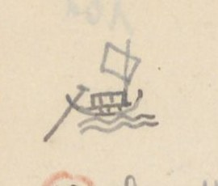{width=12%}

[NC: Hình vẽ nhỏ ở góc trái trên, bên cạnh tiêu đề. Không có chữ trên hình.]

## QUẢNG TRỊ - đường Thủy

| [Số] | [Địa danh] | [Chữ Hán] | [Tầm] | [Ghi chú] |
|---|---|---|---|---|
| 1 | Sông Hoa Viên | 華園 | 2.651 | 31.684 đến bến Cung Thượng Lập 上立 |
| | Cầu Trung Đan x. | 忠丹 | 2.114 | |
| | Chợ Phương Lang x. | 芳榔 | 1.848 | |
| | Thiển Cảng xứ | 淺港 | 1.582 | Kênh cạn |
| | Chợ Ngô Xá | 吳舍 | 1.120 | |
| | Đò Trí Lễ | 智禮 | 242 | Chỗ đò ngang |
| | Đò An Tiêm | 安暹 [?] | 1.582 | Chỗ đò ngang |
| | Cổ thành [?] | ~~吳舍~~ | 500 | |
| | | 古城 | 700 | Phía tây sông có miếu thần Qua Qua 瓜瓜 [?]. Thần này về triều Lê, cùng mấy âm trợ đánh tướng Mạc là quận Lập 立郡. Được tin, bèn lập miếu gia phong và dự tế điển |
| | Kho Ái Tử | 愛子新 | 600 | 庫. Kho mới. Phía tây có miếu thờ Luân quận công 倫郡公, đặc tiến phụ quốc công thần. Lại có miếu thổ thần |
| | Bến **Công đường** | 公堂前 | 83 | 津次 |
| | Phủ thờ cũ | 旧祀府 | 129 | |
| | | | 718 | |
| | Đò Trà Bát | 茶鉢 | 54 | Chỗ đò ngang |
| | Cửa sông Vĩnh | 永江口 | 1.200 | |
| | Phủ cũ Toàn Thắng | 全勝 | 675 | 旧..府. Vì xưa có thắng trận mà đặt tên |
| | Miếu Thanh Tương | 清湘 | 378 | Thờ quan bình chương Thanh Tương hầu 平章清湘侯. Tướng Mạc tên Lập 立, tàn bạo. Đã trách thần không giúp, bèn đốt miếu. Sau lại hiển ứng. Cho nên nay còn thờ. |

[NC: Dòng "Cổ thành": tác giả viết "Chợ Ngô xá" rồi gạch, viết chồng chữ (có lẽ "Cổ thành"), chữ 吳舍 cũng bị gạch; dòng dưới ghi 古城 với số 700. "旧..府" = 旧全勝府 (phủ cũ Toàn Thắng), hai chấm thay cho tên đã ghi ở cột trước. "津次" = bến đậu. Số 1 khoanh tròn đỏ.]

# Trang PDF 207 - Quảng Trị 5 (đường thủy, tiếp)

*Đầu trang: Quảng Trị 5 (Đường thủy); số trang bản thảo: 102*

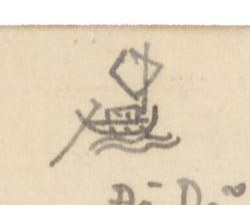{width=12%}

[NC: Không có chữ trên hình.]

| [Số] | [Địa danh] | [Chữ Hán] | [Tầm] | [Ghi chú] |
|---|---|---|---|---|
| | Đò Dã | 野渡 | 525 | Chỗ đò ngang |
| | Chợ Mai Xá | 枚舍 | 300 | |
| | Cửa Kênh | 港口 | 270 | |
| | Miếu quan Đông Trúc | 冬竹官 | 1.695 | (Đông Trúc) |
| | Chợ Nhĩ Hạ | 珥下 | 1.200 | |
| | Bến Ngự Tân | 御津 | 2.445 | 次 |
| | Đường Tam Cảng | 三港 | 1.740 | 道. Ba Kênh |
| | Đò Xuân Mỹ | 春媚 | 1.680 | Đò ngang |
| | Cuối Kênh | 港末 | 1.045 | |
| | Sông Minh Lương | 明良 | 2.737 | Bến đò ngang |
| | Chợ phường Châu Thị | 洲市坊 | 2.396 | |
| | **Trạm Cung Thượng Lập** | 上立行宮津次 | | |
| 2 | **Bến Công đường** | 公堂津 | 9.763 | 次. Đi về nam 27.179 đến nguồn Thu Lai 秋來 sông Lương Phúc 良福 |
| | Cầu Đan Trung | 丹忠社 | 2.650 | [x. Q. Trị 4/l.5, chép Trung Đan] |
| | Hoa Viên | 花園 | . | [〃 /l.3] Giáp [?] |
| | Sông Vân Trình | 雲程 | 705 | |
| | Sông An Thư | 安舒 | 1?.005 | Chỗ đò ngang |
| | Sông Câu Nhi | 駒兒 | 435 | Chỗ đò ngang |
| | Sông Lương Phúc | 良福 | 1.620 | 〃 |
| | **Thu Lai** | | | Sở tuần thủ 巡守 |
| 3 | **Bến Công đường** | 公堂津 | 1.800 | Đường thủy 21.900 đến Ngưu Kiệp 牛脇 [?] |
| | Sông Cổ Thành | 古城江 | 650 | Chỗ đò ngang |
| | Sông Thạch Hãn | 石桿 [?] | 2.200 | |
| | Kho cũ 〃 | 〃 | 750 | 旧庫 |
| | **Viên Kiều** | 員[?]蕎[?] | 5.700 | Thủy tuần 水巡 |
| | Mộc Bài xứ | 木牌 | 1.900 | Cấm ta và mọi qua đó |
| | Huyền Thủy xứ | 懸水 | 6.150 | |
| | Đò Lương Mai xứ | 良枚 | 2.750 | 坊 |
| | **Ngưu Kiệp** | | | Tuần |

[NC: Số 2, 3 khoanh tròn đỏ. Ở dòng Miếu quan Đông Trúc, tác giả viết "Đông hành", gạch chữ "hành" và viết "trúc" bên dưới. Chữ "Đò" (渡) đặt sau "Dã" theo lối chữ Hán (野渡). Số tầm sông An Thư viết chồng ở chữ số thứ hai, có thể là 10.005 hoặc 12.005. Dòng "Kho cũ 〃": tức kho cũ Thạch Hãn. Ở lề dưới có nét chữ trang sau hiện qua giấy (không chép).]

# Trang PDF 208 - Quảng Trị 6 (đường thủy, tiếp)

*Đầu trang: Quảng Trị 6*

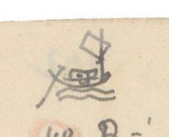{width=12%}

[NC: Không có chữ trên hình.]

| [Số] | [Địa danh] | [Chữ Hán] | [Tầm] | [Ghi chú] |
|---|---|---|---|---|
| 4 | Bến công đường | 公堂津 | 10.652 | |
| | Miếu Thanh Tương | 清湘廟 | . | |
| | Sông An Lạc | 安樂江 | . | Đò |
| | Sông Đông Hà | 東河 〃 | . | Đò |
| | Sông Thượng Đô | 上都 〃 | . | Đò |
| | Sông Bích Giang | 碧江 〃 | . | Đò |
| | **Bến Cam Lộ** | 甘露 〃 | . | Công trường 公場 |
| 5 | Bến công đường | 公堂津 | 7.200 | |
| | Cửa Cảng xứ | 港口 | . | Cảng khẩu |
| | Chợ Đại Lộc | 大祿 | . | |
| | Sở Phân Thủ | 分守所 | . | |
| | **Cửa An Việt** | 安越海 | . | 門 |
| 6 | Bến công đường | 公堂津 | 26.273 | |
| | Bến s. Minh Lương | 明良江 | | |
| | Chợ x. Kênh Môn | 涇門社 | | |
| | Bến s. Tiên An | 仙安江 | | |
| | **Nguồn Ô Giang** | 烏江源 | | Chỗ trổ [?] đò [2 chữ Nôm, chưa đọc chắc] |
| 7 | Bến công đường | 公堂津 | 23.186 | |
| | Chợ ph. Châu Thị | 洲市坊 | | |
| | Cồn Sài | 𡑝[?][...] | | |
| | **Nguồn Cổ Lâm** | 古林 | | Chỗ bến quan 渡官 |
| 8 | Bến Công đường | 公堂津 | 16.576 | |
| | Kênh Đạo Mạt | 道末港 | | Chỗ đò |
| | Đò Trai Giang | 柴[?]江 | | |
| | Đò Tùng Luật | 從[?]律 | | |
| | **Cửa Tùng Luật** | 〃 〃 門 | | |
| 9 | Xã Thâm Khê | 深溪 | 24.843 [?] | Đi dọc bờ bể về phía Bắc |
| | Cửa An Việt | 安越 | | |
| | Điếm Hà Lợi | 河利 | | |
| | Cửa Tùng Luật | 從[?]律 | | |
| | **Xã Tất Luật** | 桼律 | | Giáp Quảng Bình |

[NC: Các số 4 đến 9 khoanh tròn đỏ. s. = sông; x. = xã; ph. = phường. Dấu 〃 sau tên chữ Hán ở các dòng sông thay cho chữ 江. Dòng cuối (Xã Tất Luật) viết ở lề dưới, bên dưới tiêu đề in VERRERIE DU NORD.]

# Trang PDF 209 - Sơn Nam Hạ 1 (Sơn Nam hạ - Sơn Nam thượng, đường Nam Xang)

*Đầu trang: SƠN NAM HẠ 1; số trang bản thảo: 103*

## SƠN NAM HẠ - SƠN NAM THƯỢNG (3.673)

### Nam Xang

| [Địa danh] | [Chữ Hán] | [Tầm] | [Ghi chú] |
|---|---|---|---|
| Cửa tả Đông bắc | 左東北 | 6 | |
| Hào | 濠 | 50 | Rộng 20 T |
| Chợ mới | 新市 | 655 | Xã Vị Hoàng 渭潢 |
| Điếm Vị Hoàng | 渭潢 | 289 | |
| Cầu Nao | 求橈 [?] | 756 | Dài 4 T |
| Điếm x. Đệ Tứ | 第四社 | 230 | Phía đông có chùa Đại Thánh Quan 大聖觀. Phía tây có miếu cũ nhà Trần 陳故廟 ở xã Tức Mặc 即墨 [?], có chùa |

Phổ Minh 普明, dựng lên triều Lý 朝李. Xưa truyền rằng, đời Lý, có Không Lộ 空路 qua Trung quốc giảng đạo. Đến kho đồng lấy đầy một đãy mang về, đúc thành 4 vật đồ: Tháp Báo Thiên 報天塔, tượng Quỳnh Lâm 瓊林像, chuông Phả Lại 普賴鐘, đỉnh Phổ Minh 普明鼎. Đỉnh ấy nặng 1.000 cân (鈞 [?]) truyền là cổ tích lạ. Cuối đời Hồ, tướng Minh 明 là Vương Thông 王通 lấy đỉnh đúc bia [?]. Nay trước chùa có bia xưa khắc rằng: 四器之一 (một trong bốn đồ) đủ [?] chứng chỉ vật ấy. Trước chùa có tháp cao. Sau khi vua Trần Nhân Tông 陳仁宗 siêu hóa, tháp [?] ấy được dựng lên để giấu xá-lị.

| [Địa danh] | [Chữ Hán] | [Tầm] | [Ghi chú] |
|---|---|---|---|
| Chùa Bụt Mọc | 孛木寺 | 317 | Chùa Đường Giang 塘江. Tục truyền rằng mục đồng trên đường thấy đá trồi lên, hình giống người, bèn dựng chùa thờ. Thường tỏ ra linh ứng, bèn lập chùa. Phía tây chùa có Văn Miếu 文廟 |
| Cầu Vĩnh Tế | c. 永濟 | 758 | Dài 9 Tầm |
| Chợ Hữu Bị | ch. 有備 | 394 | |
| Hoàng Giang | đ. 黃江 | | Rộng 185 Tầm. Sông rất sâu. Ngạn ngữ rằng: "Nhất cao là núi Tản Viên 傘圓, Nhất sâu là vũng Thủy Tiên [?] 水仙 cửa Vàng 鐄". Trên suốt Ngã ba Lanh [?]. Dưới thông sông Thượng Hộ 上戶 [?]. Đến ngã ba sông [...] |
| **Cõi Huyện Nam Xang** | 南昌界 | | Đầu cõi **Sơn nam thượng** (Xem nối Sơn nam Th. - Sơn nam Hạ) |

[NC: Đoạn về chùa Phổ Minh là phần tiếp của ghi chú dòng "Điếm x. Đệ Tứ", tác giả viết tràn ra cả bề ngang trang. Chữ viết tắt trước chữ Hán ở ba dòng Cầu Vĩnh Tế, Chợ Hữu Bị, Hoàng Giang: "c" = cầu, "ch" = chợ, "đ" có lẽ = đò. "T" sau số đo = tầm hoặc trượng. Tác giả viết "Túc Mạc" ở quốc ngữ; chữ Hán viết nhanh, có lẽ là 即墨 (Tức Mặc). Số 3.673 ở tiêu đề có lẽ là tổng số tầm của chặng.]

# Trang PDF 210 - Sơn Nam Hạ 2 (đường Bình Lục)

*Đầu trang: Sơn Nam Hạ 2*

## SƠN NAM HẠ - SƠN NAM THƯỢNG (8.668)

### Bình Lục

| [Địa danh] | [Chữ Hán] | [Tầm] | [Ghi chú] |
|---|---|---|---|
| Cửa Tây bắc | 西北 | | |
| Cầu Tiểu Tức Mặc | 小即墨 | 414 | Dài 4 Tầm |
| Cầu Địa Ốc | 地沃 | 586 | Dài 9 Tầm |
| Cầu Trì thôn (Kênh) | 池村 | | Xã Đặng Xá 鄧舍, Cầu Kênh 涇 dài 4 T. |
| Đặng Xá điếm | 鄧舍社 | 220 | |
| Cầu mới | 求買 | 103 | Độn [?] thôn 杝[?]村. Dài 3 T 3 |
| Cầu Côi thôn | 瑰村 | 742 | Dài 13 Tầm |
| Cầu Chổ [?] | 求[...] | 420 | Xã Trung Quyên 中涓社. Dài 3 T |
| Chợ Huyện | 𢄂縣 | 1.096 | Xã Tiểu Phấn 小粉. Bán gạo rồng (竜米) |
| Cầu Nha | 求[...] | 551 | Xã Tiểu Phấn 小粉. Dài 2 T 4 |
| Quán Cổ Ngựa | 古馭 | 1.573 | Xã Hiển Khánh 顯慶 có điếm |
| Quán Cây Đa | 核栘 | 192 | Xã Đồng Thì 同時 có điếm |
| Cầu Ngói thôn | 㼵[?]村 | 697 | Xã Hiển Môn 顯門. Dài 17 Tầm 3. Trên suốt sông Ngã ba Chân Ninh 真寧三岐江, thông Hoàng Giang 黃江. Dưới đến sông Ngã ba Thiên Phái 天派三岐江, hợp lưu với sông Gián 諫江 |
| Cầu Gừng [?] | 求薑 | 903 | Xã Yên Nội 安內. Dài 7 Tầm |
| Bối Cầu th. điếm | 貝求 | | |
| **Cõi h. Bình Lục** | 平陸 | | Thuộc Sơn nam thượng |

[NC: h. = huyện; th. = thôn. "T" = tầm (ví dụ "3 T 3" có lẽ là 3 tầm 3 thước). Nhiều tên Nôm: Cầu (求), mới (買), Chợ (𢄂), Ngựa (馭), Cây Đa (核栘), Ngói, Gừng (薑). "Gạo rồng" (竜米): tác giả dịch chữ 竜米 (long mễ). Nửa dưới trang chỉ có tiêu đề in VERRERIE DU NORD in ngược.]

# Trang PDF 211 - Sơn Nam Hạ (sông Vị Hoàng)

*Đầu trang: SƠN NAM HẠ; số trang bản thảo: 104*

## SƠN NAM HẠ - Sông Vị Hoàng (218 T)

| [Địa danh] | [Chữ Hán] | [Tầm] |
|---|---|---|
| Cửa tả Đông nam | 東南門 | 218 |
| Sông Vị Hoàng | 渭潢 | |

Rộng 67 Tầm. Sông này trên suốt cửa Kênh Phụ Long 輔隆, dưới qua ngã ba Độc Bộ 獨步三岐, chảy qua cống Hải Liêu [?] 海遼[?]貢.

Sông Vị Hoàng nguyên là một giải bình nguyên, chỉ có khe nhỏ quanh sau làng Tức Mặc 即墨 và chảy vào sông An Dật [?] 安逸. Đời Trần, vua bị thầy phong thủy Khách đánh lừa, bảo đào kênh Phụ Long 輔隆涇口 xuống đến sông Vị Hoàng, dẫn nước chảy thẳng đến sông An La [?] 安邏[?] để cho chảo [?] làng Tức Mặc. Địa mạch bị đứt, nên Trần bèn mất ngôi. Ngạn ngữ có câu: "Hỡi thăm Tức Mặc mà chơi, Nhà Trần thuở trước mấy đời đế vương. Dù chẳng kênh sông [chữ Nôm: 涇[...]] xẻ ([...]) ngang, Nghìn năm lũy đá thành vàng khôn lay."

Xưa truyền rằng sông ấy có cá thần rất lớn, nhảy cao trông như buồm, thường xông phá đê. Dân lập đền thờ ở bến. Đời Lê Vĩnh Khánh 永慶, cống khẩu bị vỡ. Bấy giờ có quan người xã Bảo Ngũ 保伍 huyện Thiên Bản 天本, gọi là Điền quận 佃郡 vâng mệnh về đắp lại. Đắp gần xong, thình lình thấy giữa sông có cá lớn cất đuôi lên, sóng nổi như núi. Chỗ đắp lại vỡ. Như thế mấy lần. Quận Điền sai lấy đá vôi ném xuống; một chốc thấy nước sôi sục sục. Cá nổi chết rất nhiều. Cuối lại không đắp xong. Sau bèn sai quan tế các thần linh, xin giúp nước che dân. Gặp có cá lớn phơi thây trên cát. Dân sợ, bèn lấy chiếu đắp che rất nhiều. Một mặt đắp, tuần nhật hoàn thành. Con cá kia lại xuống nước đi mất, sau không làm hại nữa. Chuyện này thấy ở sách *Công dư tiệp ký* (公餘捷記) [Ghi chép nhanh lúc rảnh việc công].

[NC: "218 T" ở tiêu đề = 218 tầm. Vĩnh Khánh là niên hiệu Lê Duy Phường (1729-1732). Câu ngạn ngữ là thơ lục bát; hai chữ Nôm ở câu thứ ba viết nhỏ, chưa đọc được. Chữ "chảo" trong "để cho chảo [?] làng Tức Mặc" đọc chưa chắc. Nửa dưới trang chỉ có tiêu đề in VERRERIE DU NORD in ngược.]

# Trang PDF 212 - Sơn Nam Hạ 4 (đường đi Thanh Hóa ngoại)

*Đầu trang: Sơn Nam Hạ 4*

## SƠN NAM HẠ - THANH HÓA NGOẠI (11.984)

(ấy là một trục đạo thông ngoại trấn)

| [Địa danh] | [Chữ Hán] | [Tầm] | [Ghi chú] |
|---|---|---|---|
| Cửa Hữu Đông nam | 右東南 | 6 | |
| Hào cầu | 濠求 | 105 | Dài 18 T |
| Đường cái | 大路 | 212 | |
| Cầu Năng Lộ | 能[?][...] | 785 | Dài 6 T 2 |
| Cầu Gia Hòa | 嘉禾 | 223 | Dài 14 T |
| Cầu x. Vụ Bản | 務本社 | 231 | Dài 7 T |
| Cầu x. Tiểu Cốc | 小穀 | 292 | Dài 6 T |
| Cầu x. Dương Lai | 陽來 | 428 | Dài 10 T |
| Chợ Dương Lai | 〃 〃 市 | 460 | |
| Chợ x. Trình Xuyên | 程川 | 742 | |
| Cầu Đan Cầu | [...]求 | 2.020 | Dài 7 T 3 |
| Mỹ Côi điếm | 美瑰 | 535 | Trông ra phía đông nam điếm xa một dặm, có núi tên Động Hổ 峝虎山. Trên núi có chùa, tên Chùa Non 廚𡽫. Đời Trần, Huyền Trân công chúa từ Chiêm Thành 占城 về, trụ trì ở đó. Nay còn thờ |
| Chợ Đăng Côi | 登瑰社 | 118 | |
| Minh Côi x. điếm | 明瑰 〃 | 1.071 | |
| Cầu Trịnh Xá | 鄭舍 | 4.553 | Dài 10 Tầm |
| Sông Non Nước | 山水江 | | Rộng 124 Tầm. Trên suốt Ngã ba Thiên Phái 天派三岐, thông sông Thanh Quyết 青厥; dưới qua Ngã ba Độc Bộ 独步三岐 chảy ra cống Hải Liêu |
| **Cõi Thanh Hóa Ngoại trấn** | 清化外鎮界 | | |

[NC: "Chùa Non" viết bằng chữ Nôm 廚𡽫. Chữ thứ hai của "Năng Lộ" và chữ đầu của "Đan Cầu" viết nhanh, chưa đọc được. Nửa dưới trang chỉ có tiêu đề in VERRERIE DU NORD in ngược.]

# Trang PDF 213 - Sơn Nam Thượng 1 (Sơn Nam thượng - Kinh Bắc)

*Đầu trang: Sơn Nam Th. 1; số trang bản thảo: 105*

## SƠN NAM THƯỢNG - KINH BẮC (28.551)

| [Địa danh] | [Chữ Hán] | [Tầm] | [Ghi chú] |
|---|---|---|---|
| Cửa Bắc | 北門 | 2.145² | |
| Bích Trì | 碧池 | 1.494 | |
| Sông Đinh Xá | 丁舍江 | 1.245³ | Rộng 32 T 1 |
| Chợ x. Đội Sơn | 隊山社 | 1.359⁴ | |
| Chợ x. Lũy Sơn | 壘山社 | 2.012 | ở mục Sơn Nam - Hải Dương lại viết [Điệp Sơn 疊山 (cả hai bản)] |
| Sông Thiên Mạc | 天幕江 | 4.033³ | Rộng 30 T |
| Sông An Bảo | 安保江 | 73 | Rộng 257 T 4 |
| Chợ Đằng Châu | 藤洲 | 1.554² | |
| Chợ Cái | 𢄂棋 [?] | 762¹ | Xã Kệ Châu 偈洲 [?] |
| Chợ Lở | 𢄂[...] | 1.228³ | Xã Tuần [?] An 巡安. Bên đường có Văn miếu 文廟 |
| Chợ Bông | 𢄂[...] | 945 | Xã Hạ Tung [?] 賀悰 [?] |
| Chợ Quyết | 𢄂厥 | 2.821 | Xã Đức Tổng [?] 勿[?]總 |
| Quan Xuyên điếm | 關[?]川社 | 3.088² | |
| Chợ Bái | 𢄂拜 | 4.019² | Xã Đông Kết 東結 |
| Đa Hòa | 多禾 | 10 | Phía đông đường, ở huyện Đông An 東安, trông về phía đông chừng 1 dặm, thấy đền Dạ Trạch 夜澤. Truyền rằng Chử Đồng Tử 褚童子 cùng công chúa Tiên Dung từ đó bay lên trời. Xem *Trích quái* (摭怪). Nay xã Vĩnh Hưng 永興 thờ. |
| Chợ Mễ | 𢄂米 | 901.³ | Xã Phú Thị 富市 |
| **Cõi Kinh Bắc** | 京北界 | | Đầu cõi (Xem nối Kinh Bắc - Sơn Nam) |

[NC: Số nhỏ viết cao sau số tầm (², ³, ⁴...) có lẽ là số lẻ (thước) sau số tầm. "Trích quái" = *Lĩnh Nam chích quái* (嶺南摭怪) [Truyện quái lạ đất Lĩnh Nam]. "Chợ" viết bằng chữ Nôm 𢄂 ở hầu hết các dòng. Nửa dưới trang để trống, chỉ có tiêu đề in VERRERIE DU NORD in ngược và nét chữ trang sau hiện qua.]

# Trang PDF 214 - Sơn Nam Thượng 2 (Sơn Nam thượng - Sơn Tây)

*Đầu trang: Sơn Nam Th. 2*

## SƠN NAM THƯỢNG - SƠN TÂY (29.615,1)

| [Địa danh] | [Chữ Hán] | [Tầm] | [Ghi chú] |
|---|---|---|---|
| Cửa Tây | 西門 | 126 | |
| Cầu Châu | c. 珠求 | 1.583 | Dài 41 T. (TTNĐ chua: xem Nam Định. Có lẽ đó là người sau chua; sách TLYL chưa:) |

Sông Cầu Châu có tuần ti. Thượng lưu qua Ngã ba Đọc [?] 瀆 [?]. Qua 2 bãi Trung Hà 中河, Ngã ba Xá 舍, suốt giang phận trấn Sơn Tây 山西. Hạ lưu qua Kẽm Trống 儉[?][...], sông Thanh Quyết 青厥, cửa Kênh Ma 涇麻 [?] giáp giang phận Thanh Hoa ngoại trấn. Hoành lưu qua ngã ba Cống Bạc 貢泊, Ngã ba Mông 蒙, và ngược dòng đến giang phận sông Nhị Hà 珥河 tại Thăng Long 昇隆. Một chi thuận dòng đến giang phận trấn Sơn Nam hạ 山南下. Một chi chảy ngang qua Ngã ba Nông 農 đến giang phận trấn Hải Dương. Sông này suốt bốn bề. Thương thuyền không khỏi qua đó. Tục ngữ có câu: "Dù ai buôn đâu bán đâu, Làm sao cho khỏi Cầu Châu thì làm."

| [Địa danh] | [Chữ Hán] | [Tầm] | [Ghi chú] |
|---|---|---|---|
| Chợ Gang | 𢄂[...] | 6.580 | Xã Châu Xá 珠舍 |
| Chợ Giầu [?] | 𢄂[...] | 3.088⁴ | Xã Mỹ Đê 美堤 |
| Chợ Đặng Xá | 鄧舍 | 1.832 | |
| Chợ Nguyễn Xá | 阮舍 | 2.761 | |
| Chợ Đình Nội | 亭内 | 125 | Thôn Vân Đình 雲亭 |
| Cầu Vân Đình | 雲亭 | 170 | Cầu Lễ [?] 禮 [?]. Dài 5 Tầm |
| Chợ Đình | 𢄂亭 | 2.299 | Xã Hoa Đình |
| Chợ Bãi Ruộng | 𡓋[?][...] | 40 | Xã Bãi Ruộng |
| Cầu 〃 〃 | 〃 求 | 770 | Dài 6 Tầm |
| Cầu Rắn | 求[...] | 5.860 | Xã Xà Cầu 蛇求 |
| Chợ Trữ [?] | 𢄂[...] | 2.012 | Xã Bảo Đà 保陀 |
| Chợ Cao Bộ | 高步 | 2.316² | |
| **Cõi Sơn Tây** | 山西界 | | Đầu cõi. (Xem Sơn Tây - Sơn Nam) |

[NC: "chua" = chú thích bên lề trong sách. Ở dòng thứ hai tác giả viết "Chầu Châu" rồi sửa chữ đầu thành "Cầu". Đoạn văn về sông Cầu Châu là phần tiếp của ghi chú dòng Cầu Châu, viết tràn ra ngang trang. Nhiều tên chợ, cầu viết bằng chữ Nôm (𢄂 chợ, 求 cầu, Gang, Giầu, Ruộng, Rắn...), một số tự dạng chưa đọc được. Câu tục ngữ là thơ lục bát.]

# Trang PDF 215 - Sơn Nam Thượng 3 (Sơn Nam thượng - Hải Dương)

*Đầu trang: Sơn Nam Th. 3; số trang bản thảo: 106*

## SƠN NAM THƯỢNG - HẢI DƯƠNG (23.075,2)

| [Địa danh] | [Loại] | [Chữ Hán] | [Tầm] | [Ghi chú] |
|---|---|---|---|---|
| Cửa Bắc | | 北門 | 2.145² | |
| Chợ Đầm | ch. | 𢄂潭 | 1.494 | Xã Bích Trì 碧池 |
| Sông Đinh Xá | đ. | 丁舍 | 1.245³ | Rộng 32,1 Tầm |
| Chợ Đội Sơn | ch. | 隊山社 | 1.359⁴ | |
| Chợ Điệp Sơn | ch. | 疊山社 | 2012 | Phía tây đường có dãy núi, tên núi Đọi 𡶀[?]隊. Trên đỉnh núi có chùa Cổ tích 古跡寺. Trèo lên nhìn xa thấy sông Ngã ba Lạnh 冷. Cho nên có câu hát: "Núi Đọi ai đắp nên cao. Ngã ba sông Lạnh ai đào nên sâu" |
| Sông Thiên Mạc | đ. | 天幕 | 4.033² | Rộng 33 T. Trên hợp Ngã ba Lương 良, dưới chảy Ngã ba Mông 蒙 |
| Sông An Bảo (B. Lạnh) | | 安保 | 97 | Rộng 257 T 4. Bến Lạnh 冷. Trên thông Nhị Hà 珥河, dưới đến Ngã ba Lạnh 冷. Một chi qua ngã ba Bốc 卜, ngã ba Mông 蒙, ngã ba Cầu Châu |
| Chợ Vạn | ch. | 𢄂滿 [?] | 840 | Xã Đằng Châu 藤珠 |
| Chợ Gạo | ch. | 〃 𥺊 | 916 | Xã An Tảo [?] 安杲 [?] |
| Cầu xã Suối Khê | | 㵢[?]溪 | 2.651³ | Dài 12 T |
| Cầu xã Bình Ngang | | 平昂 | 1.345 | Dài 13 T |
| Cầu đất | c. | 求坦 | 1.062 | Xã Tạ Xá 謝舍. Dài 4 Tầm |
| Chợ Mão Cầu | ch. | 卯求 | 1.120 | |
| Cầu xã Nhân Vũ | c. | 仁武 | 2.381 | Dài 5 T 3 |
| Cầu xã Văn Nhuệ | | 文銳 | | Dài 15 T |
| **Cõi Hải Dương** | | 海陽 | | Đầu cõi (Xem nối Hải Dương - Sơn Nam thượng) |

[NC: Cột "[Loại]" là chữ viết tắt tác giả ghi trước chữ Hán: ch. = chợ, c. = cầu, đ. = đò (hoặc sông). B. Lạnh = Bến Lạnh. "Núi Đọi" ở Duy Tiên (Hà Nam), có chùa Long Đọi. Câu hát là thơ lục bát. Ở dòng Chợ Điệp Sơn tác giả viết "Chợ Điệp Sơn" đè lên chữ khác. Nửa dưới trang để trống, chỉ có tiêu đề in VERRERIE DU NORD in ngược.]

# Trang PDF 216 - Sơn Nam Thượng 4 (Sơn Nam thượng - Sơn Nam hạ)

*Đầu trang: Sơn nam th. 4*

## SƠN NAM THƯỢNG - SƠN NAM HẠ (7.489,4)

| [Địa danh] | [Chữ Hán] | [Tầm] | [Ghi chú] |
|---|---|---|---|
| Cửa bắc | 北門 | 2.145²⁴ [?] | |
| Chợ Đầm | 𢄂潭 | 2.897 | Xã Bích Trì 碧池 |
| Chợ Nội | 〃 内 | 2.447² | Xã An Bài 安排 |
| **Cõi Sơn nam hạ** | 山南下界 | | Đầu cõi. (Xem nối SƠN NAM HẠ - S.N. Thượng) |

[NC: Phần còn lại của trang để trống; nét chữ trang trước hiện qua giấy và tiêu đề in VERRERIE DU NORD in ngược ở nửa dưới.]

# Trang PDF 217 - Sơn Tây 1 (Sơn Tây - Kinh Bắc)

*Đầu trang: Sơn Tây 1; số trang bản thảo: 107*

## SƠN TÂY - KINH BẮC (24.299,2)

| [Địa danh] | [Chữ Hán] | [Tầm] | [Ghi chú] |
|---|---|---|---|
| Cửa Tiền | 前門 | 2.122 | |
| Sông xã Phù Sa | 浮沙 | 1.803² | Rộng 287 Tầm |
| Cống Hiến | 貢獻 | 5.105² | Xã Kiên Cương 堅剛 |
| Chợ Lò | 𢄂炉 | 1.223 | Xã Nghênh Tiên 迎仙 |
| Sông xã Tiên Đài | 仙臺社 | 4.641 | Rộng 25 T |
| Chợ Độ | 𢄂度 | 3.057² | Xã Kim Đà 金陀 |
| Chợ Đông Cao | 東皐 | 2.902² | |
| Chợ Bài Mai | 排枚 | 3.132² | Chợ Tổng 𢄂總 |
| Hải Bối | 海貝 | | |
| **Cõi Kinh bắc** | 京北界 | | Đầu cõi |

[NC: Phần còn lại của trang để trống; nửa dưới có tiêu đề in VERRERIE DU NORD in ngược và nét chữ trang sau hiện qua.]

# Trang PDF 218 - Sơn Tây 2 (Sơn Tây - Hưng Hóa)

*Đầu trang: Sơn Tây 2*

## SƠN TÂY - HƯNG HÓA (12.106,4)

(Biệt đạo thông ngoại trấn)

| [Địa danh] | [Chữ Hán] | [Tầm] | [Ghi chú] |
|---|---|---|---|
| Cửa tả | 左門 | 1.900 | |
| Ch. Cao Cương | 高崗 | 2465² | |
| Tây Đằng điếm | 西騰 | 416 | |
| Cầu Tây Đằng | 〃 求 | 2.757 | Dài 10 T 4 |
| Núi đất | 土山 | 1.430 | Xã Thừa Linh [?] 承[?]令 |
| Sông Phú Miên | 富綿 | | Rộng 140 T. Qua |
| Trung Hà x. | 中河社 | [...] (160) | Đường theo chân núi. Có hổ lang |
| Sông Trung Hà | 〃 江 | 1.634 | Rộng 225 T |
| Cầu Dậu Dương | 酉陽 | 962 | Dài 6 T 3 |
| Cầu Dát | 求[...] | | |
| **HƯNG HÓA trấn sở** | 興化 | | 鎮所. Ở địa giới Sơn Tây 山西 |

[NC: Ch. = chợ. Ở dòng Trung Hà x., cột số có hai chữ Hán viết nhanh (chưa đọc được), phía trên ghi số 160. Biệt đạo thông ngoại trấn = đường nhánh thông ra trấn ngoài. Phần còn lại của trang để trống; nửa dưới là tiêu đề in VERRERIE DU NORD in ngược.]

# Trang PDF 219 - Tây chinh quốc ngữ thực lục (1)

*Số trang bản thảo: 108*

## TÂY CHINH QUỐC NGỮ THỰC LỤC

*Tây chinh quốc ngữ thực lục* (西征國語實錄) [Ghi chép thực bằng quốc âm cuộc đi đánh phía tây] (73 ngày [?])

(năm Quý dậu 1753, ông thám hoa [?] Phan Kính, lĩnh quân đạo Thanh hoa để đánh giặc Chất). PHAN-KÍNH nguyên cảo.

[NC: Từ trang này tác giả chép bằng quốc ngữ một bài diễn ca lục bát (vốn viết bằng chữ Nôm) của Phan Kính; các địa danh gạch chân, chữ Hán/Nôm tương ứng tác giả ghi ở lề phải. "Giặc Chất" = Hoàng Công Chất. Cột lề phải được đưa vào ngoặc vuông ở cuối dòng tương ứng.]

> Cảnh-hưng thuở [?] thập-tứ niên (1753)
> Cõi Thanh 清 vâng mệnh nẩy quyền đổng nhung
> Quý thu 季秋 sóng dỡn kim phong 金風
> Chiến thuyền phơi phới thuận dòng **Khe Đòa** [?]
> Mắng xem sơn thủy phơi đồ
> Lễ tuần đã tới **Tây đô** đại đồn [lề phải: 西都大屯]
> Hiệu truyền ra trước quân môn
> Tuyển phong 選鋒 chọn lấy Hổ bôn 虎賁 mở đường
> Ba trăng sắm sửa huyền lương 懸粮
> Quân phân năm hiệu sẵn sàng đợi sai
> Trọng đông Quý sửu [?] mồng hai
> Thuyền ngang **Cao Mật** thân bài 申牌 tiến quân [lề phải: 高密]
> Lước qua trước bãi **Văn Bân** [lề phải: 文彬]
> Bẩy [?] 峙 [?] lên **Thúy Đại** đã gần **Đồn Trang** [lề phải: 翠黛, 屯莊]
> Dân cư lấp xấp bên đàng
> **Kẻ Sung**, **Kẻ Biền**, lại sang **Núi Mầu** (người Bảo [?] 沱 [?]) [lề phải: 充, 卞, 牟]
> Tưởng còn binh lửa bấy lâu
> Còn chùa, còn chợ, nào đâu huyện đường 縣堂
> Duyên [?] độ 沿渡 [?] **Biện hạ** đối làng [lề phải: 汴下]
> Thôn **Bằng**, thôn **Phác**(1) tiện đường trú binh [lề phải: 朋, 朴]
> Còn sương quân đã tiến hành
> Khởi làng **Biện Thượng** cờ xanh khác (?) [...] chừng [lề phải: 汴上]
> **Mường hen** [?] cảnh cũ **Kim lăng** [lề phải: [chữ Nôm, chưa đọc chắc] 怯[?]唓[?], 椰[?]抽[?]; 金陵]
> **Dạ Dù** [?] một miếu cửa rừng xanh om
> Gập ghềnh chân núi đầu mom 山夢 [?]
> Trải qua **Cẩu Ky** [?] mấy chòm dân phiêu [lề phải: 俱忌 [?]]
> **Suối Dõ** [?] nước chảy như treo 擿 [?] [lề phải: 㵢[?]漇[?]]
> Dã non **An Duệ** 安悅, lại đèo **Thúy Doanh** [lề phải: 安悅, 翠瀛]
> Năm ba nhà gạt bên doành
> Am thiền còn án, đồn binh còn lầu
> Đổi ngày sương nắng dãi dầu
> Tối nằm sớm dậy, phá [?] đâu ngại ngùng

(1) chú thích 朴, 普[?]押切.

[NC: Ở câu "Ba trăng sắm sửa...", tác giả viết "tầng" rồi sửa thành "trăng" bằng mực tím phía trên. Sau "Quý sửu" có một năm trong ngoặc bị gạch xóa (1753 [?]); năm 1753 là Quý Dậu, nên "Quý sửu" có thể là ngày can chi chứ không phải năm. Chú thích (1) là phiên thiết của chữ 朴 (đọc "Pháp/Phác"). Chữ Nôm ở lề phải (Khác, chừng, Mường hen...) viết nhỏ và nhanh, nhiều chữ chưa đọc được.]

# Trang PDF 220 - Chinh tây 2 (Tây chinh quốc ngữ thực lục, tiếp)

*Đầu trang: Chinh tây 2*

> Có nơi **Suối Ấm** lẻo [chữ Nôm, chưa đọc chắc] trong [?] [lề phải: 㵢蔭]
> Có nơi **Truông Mỏ** nẻo thông lên rừng [lề phải: 坤[...]]
> Đường đi đã hiểm thì bằng
> Cầu qua **Bình Điện**, thẳng chừng **Sông thôn** [lề phải: 平奠, [...]村]
> Nước doành **Thạch Lạm** 石廩 chảy tuôn [lề phải: 石廩]
> Hương từ ngào ngạt, cờ đồn phất phơ
> **Chén thôn** lũy cũ thưa thưa [lề phải: [...]村]
> Nào đâu **Mộ Gối** lời xưa ngoa truyền [lề phải: 墓[...]]
> Lỗ dong [?] **Suối Trám** 㵢欖 xanh in.
> Tới chiềng 呈(1) **Chu Lâm** Kẻ Miền **Kẻ Hang** [lề phải: 周覽, 几[...]]
> Kể từ **Truông Rễ** trèo sang [lề phải: 坤[...]]
> Mấy đèo **Truông Yên** đến làng **Kim Lô** [lề phải: 坤燕, 金炉]
> Đôi chòm xát xát dân cư
> Ruộng dư lúa đề, nhà dư trâu cày
> Đường trèo hẳn học [?] ghê thay
> Cuối [chữ Nôm, chưa đọc chắc] kia là một, cuối này là hai
> **Kim điền** nước rích [chữ Nôm] hạt trai [chữ Nôm] [lề phải: 金鈿]
> Vút dọt [?] quanh quất vãng lai mấy lần
> Lối chim liền ruổi chen chân
> **Ấm thôn** thấy đã hầu gần **Trương Xây** [lề phải: 蔭村, 坤[...]]
> Trập trùng gành đá thung cây
> Suối kia lối dọc, cây này trèo ngang
> Khỏi đồi **Bái Sạ** [?] trông sang [lề phải: 拜[...]]
> Nẻo thông **Khang chánh** có đường ngã ba [lề phải: 康政]
> Thẳng giong lên gò dài **Mã hà** [lề phải: 馬河]
> **Lam điếm Thiết Ủng** mấy nhà kề sông [lề phải: 藍站, 鉄甕]
> Sơn khê cao thấp trùng trùng
> Khỏi vời **Truông Ngạnh** tới đồng **Kẻ Cha** [lề phải: 坤[...], 几吒]

(1) 呈 tiếng mường: châu, huyện. Đọc (之城) 切.

[NC: Chú thích (1) ghi phiên thiết 之城切 cho chữ 呈, tức đọc là "chiềng" (tiếng Mường: trung tâm châu, huyện). "Truông" tác giả ghi bằng chữ Nôm 坤 ở lề phải, "Kẻ" ghi bằng 几. Nhiều chữ Nôm trong thân bài và lề phải viết nhỏ, nhanh, chưa đọc được.]

# Trang PDF 221 - Chinh tây 3 (Tây chinh quốc ngữ thực lục, tiếp)

*Đầu trang: Chinh tây 3; số trang bản thảo: 109*

> Chênh chênh đường dốc thuở qua
> Suối **Liên Hiên** [?] chảy, chác lạ 式[?]異[?] nhiễu oanh 遶縈 [lề phải: 漣[...]]
> Nước non chăn [?] ngắt kề xanh (trời)
> Mấy thôn **Nhân Kỷ** rộng thênh một bầu [lề phải: 仁紀]
> **Ba đèo** chênh chếch sông (xuống) trâu [lề phải: 巴[...]]
> Thử so Ba Dội 巴[...] xem đâu hiểm nghèo
> Dọc khe, khe đá; lại trèo (leo [chữ Nôm])
> Hết đèo **Cẩm thủy**, này đèo **Quan Da** [lề phải: 錦水, 関椰]
> **Trường làng** dặm chẳng mấy xa [lề phải: 長廊]
> Tới miền **Kẻ Mạ** suối pha đôi lần [lề phải: 几[...]]
> Bên rừng đường quanh nhà dân
> Vừa phần lối suối, nửa phần leo truông
> Đá xửa [?] [chữ Nôm] lạch nước treo chuông
> Khen thay **Bồ Đái** khéo tuồng đặt tên [lề phải: 輔[?]帶]
> Nẻo từ **Ái Trợ** 愛助 trở lên [lề phải: 愛助]
> Sơn xuyên dấu bút (mài dũa [?]) Võng xuyên 輞川 vẽ vời
> (dục) Kéo lòng tuyền thạch hứng xui
> **Sông Lồng** [?] sang tắt, đến đồi **Liễu thôn** [lề phải: 滝[...], [...]村]
> Quanh co mấy lớp **thạch môn** [lề phải: 石門]
> Duyên giang đôi chốn nước non hữu tình
> **Thạch kiều** cột đá trửa [?] doành [lề phải: 石橋]
> Đã qua **bến Lộc** lại quanh **Phủ Lâm** [lề phải: 渡祿, 府淋]
> Dọc ngang nào ngại trở thâm 阻深
> **Suối Báo** chợt khỏi, lại dầm **Suối Dê** [lề phải: [chữ Nôm], [chữ Nôm]]
> Trùng trùng đá mọc khất khe
> **Tai mèo** đã chán, lại xe [chữ Nôm] **Tai voi** [lề phải: 𦖻貓, 𦖻[...]]
> Cheo cheo [chữ Nôm] xuống dốc vào thôi
> Theo lòng **Khe Cạn** đến đồi **Áng Tranh** [?] [lề phải: 盎[?][...]]
> **Cổ nam** tạm trú đầu gành [lề phải: 古南]
> **Sông Lồng** [?] một dải, non xanh mấy trùng [lề phải: 滝[...]]
> Bè đâu tua tủa [chữ Nôm] bến sông
> **Lão xà** xem cũng có lòng vân nghê 雲霓 [lề phải: 牢蛇]
> Thuyền đâu đeo súng chỉnh tề
> Lang Đạp Bi 碑(1) hăm hở quyết bề tùng quân
> Đào bầy chốt có di văn 遺文
> Ắc [?] tình thăm tỏ, ước tuần giáp công 夾攻

(1) Lang Đạp = quan thổ; Bi 碑 = quan mường (蠻 [?]).

[NC: Ở câu "Sơn xuyên dấu bút...", tác giả viết "vậy" rồi sửa thành "vẽ" ở phía trên; chữ "(dục)" ghi bằng mực tím ở lề trái câu sau, có lẽ là cách đọc khác của chữ "Kéo". "Võng xuyên" (輞川) là tên chốn ẩn cư của Vương Duy, nổi tiếng về tranh sơn thủy. "Tai" ở lề phải viết bằng chữ Nôm 𦖻 (耳+思).]

# Trang PDF 222 - Chinh tây 4 (Tây chinh quốc ngữ thực lục, tiếp)

*Đầu trang: Chinh tây 4*

> Bài sai 排差 ba hiệu tuyển phong
> **Thập châu** 十州 nẻo ấy thẳng giong kiêm trình
> Chư quân giong giả [?] kế hành
> Độ hà phơi phới trèo quanh chân đồi
> Một dòng **Suối Kiệt** chảy xuôi [lề phải: 㵢[?]桀]
> Đã quanh thì tắt ba mươi sáu cầu
> Cạn tuồng **Luyện thủy** lên đầu [lề phải: 練水]
> Ngã ba bến tả, nẻo đầu **Bất Căng** 不矜
> Xe mưa 車湄 [?] lưu luyết [?] 流[...] ruổng [?] rừng
> Nông công 農功 hoà dễ đâu bằng **Kẻ Trai** [lề phải: 几[...]]
> Kiều dây 橋[...] nhiều tiếng bẻ bai
> Đỉnh non **Đào Kiệt** nọ ai đứng đứng [?] [lề phải: 特[?]桀]
> Sinh thành đội đức càn khôn
> Hang sâu có ấy lòng còn hướng vinh 向榮
> Sự hành 師行 [?] đã mấy nhật trình
> Thương người đội bác [?] 隊[...] khuya canh biếng nằm
> Mới từng qua chốn **Bầu Ngâm** [lề phải: [chữ Nôm]吟]
> Thang mây nào biết mấy tầm thẳm cao
> Tưởng khi bạt thiệp cần lao
> Giận loài đảng dữ kể bao cho cùng
> Éo le nhiều chốn lạ lùng
> Đồi hang đá nhọn [chữ Nôm] (毛 [?]) mọt [?] dòng nước sâu
> Man dân 蠻民 [?] lưu lạc mấy lâu
> Thử tra **Bến lại** nào đâu vạn thuyền [lề phải: 渡哩]
> **Mã hà** dòng kíp như tên [lề phải: 馬河]
> Giáp khe **Mai, mộc** 枚, 木, phảng bên nọ ngàn [lề phải: 枚, 木]
> Đôi nơi quan mãng 灌莽 điều tàn
> Bên canh 耕 [?] mấy đống trăm nhàn [?] [chữ Nôm] quạnh hiu [lề phải: [chữ Nôm]]
> Bên đường trúc rạp [chữ Nôm] đá rêu
> Ù ù đá [?] suối, cheo cheo [chữ Nôm] .. lại rừng

[NC: Chữ Hán, chữ Nôm chèn trong câu và ở lề phải viết rất nhỏ; nhiều chữ chưa đọc được hoặc chưa chắc. Nửa dưới trang chỉ có tiêu đề in VERRERIE DU NORD in ngược.]

# Trang PDF 223 - Tây chinh 5 (Tây chinh quốc ngữ thực lục, tiếp)

*Đầu trang: Tây chinh 5; số trang bản thảo: 110*

> Đồi [?] [chữ Nôm] phường mấy kẻ biết chừng
> Này rằng **Suối Nguyệt**, này (nơi) rằng **Suối Sâu** [lề phải: 㵢月, 㵢[...]]
> Lần lần tầm hác 尋壑 **Kênh Khâu** [lề phải: 涇丘]
> Mở tra đồ đất đã hầu **Vân Lung** [lề phải: 雲[...]]
> **Đá Bàn** mấy lớp kề sông [lề phải: [...]滝]
> Cầu vồng nào chốn ngư ông dủ [?] cần
> Cân xứng 斤稱 [?], muốn bút tao nhân 騷人
> Mấy phần giản [?] hiểm, mấy phần thanh kỳ 清奇
> Đôi ngàn vắng ngắt rậm rì
> Kia thì **Suối Nhiệt** [chữ Nôm], nọ thì **Suối Bông** [lề phải: 㵢[...], 㵢[...]]
> Bằng chừng **Chiềng Lạt** bên sông [lề phải: 呈[...]]
> **Chập lâm**(1) đã đó, **Chiềng Ngang** [?] hẳn đây [lề phải: [chữ Nôm], 呈[...]]
> Mách mao [chữ Nôm] mấy đứa tiếng đây [?]
> **Song uy** đã khỏi, này này **Suối Sum** [lề phải: 双威, 㵢森]
> Có cây một dáng xanh um
> **Non Bình** cao thấp, **Suối Cầm** nhặt thưa [lề phải: [chữ Nôm], 㵢琴]
> Chuyển vần trải mấy nắng mưa
> Miếu quan **Tư mã** dấu xưa còn truyền [lề phải: 司馬廟]
> Ghé chia 枝支 tự có 自固 sơn xuyên [lề trái: 興化]
> Cõi **Thanh** đã trải, này miền xứ **Hưng** [lề phải: 興化]
> Mở mang đôi ruộng đôi rừng
> **Chành Hào** cạnh suối, **Chành Hằng** bên giang 江 [lề phải: 呈濠; 恒]
> Thổi đây chuông giáo lây phường (phất)
> Chùa nhường **Mai Kiến** [?] 枚[...], tháp nhường **Bình Vôi** [lề phải: 枚[...], 坪[...]]
> Quanh co sườn núi đỉnh đồi
> **Suối hùm** thoắt đã khỏi vời khi nao [lề phải: 㵢[...]]
> Tiếng đồn Ác thủy 惡水 ghê bao!
> Dân đây lật lường 栗量, **Đản Lao**(2) ngẩn ngơ [lề phải: 誕牢]
> Chành niềm (chưa ra miền) hột chúc dưới mưa
> **Viễn hoài** 遠懷 trông nhớ, tâm tư thêm càng [lề phải: 遠懷]
> Khúc cầm lưu thủy nhặt xoang
> Đã qua **Suối Lộng** lại sang **Suối Sài** [lề phải: 㵢弄, 柴]
> Sương in cầu ván ngang ([...]) ngồi
> Ruổi qua mấy dặm **Lãng đài**, **Na Khảm** [lề phải: 朗臺, 那堪]
> Tư Tê [?] tới chốn **Giảng Nôm** [?] [lề phải: [chữ Nôm]]
> **Vàng Bồn** suối nọ, mâu châm mới pha [lề phải: [chữ Nôm]]

(1) 汁[...] = đọc (之[...]) 切 = chập. (2) 誕 là quan đồn ở man động.

[NC: Ở dòng đầu, chữ "nơi" viết thêm phía trên chữ "Này". Tác giả sửa bằng mực nâu/tím ở vài chỗ: "Chiêng" sửa thành "Chiềng", "Ghé" viết đè; "ông" trong "tao ông" sửa thành "nhân"; ở câu "Khúc cầm lưu thủy nhặt ... xoang" có một chữ bị gạch. Chữ "興化" ở lề trái đánh dấu chỗ bắt đầu vào đất Hưng Hóa. Ở câu "Chành niềm... hột chúc", phía trên có hai chữ Hán nhỏ mực tím, chưa đọc được. Chú thích (1) là phiên thiết cho tên "Chập lâm". Nửa dưới trang có tiêu đề in VERRERIE DU NORD in ngược.]

# Trang PDF 224 - Tây chinh 6 (thơ lục bát, tiếp)

*Đầu trang: Tây chinh 6*

[NC: Đoạn thơ lục bát (quốc ngữ) kể cuộc tây chinh; tác giả chép bên phải các địa danh bằng chữ Hán/chữ Nôm. Các chữ Nôm không có trong Unicode được ghi theo dạng mô tả cấu tạo (IDS), ví dụ ⿰氵机 = bộ thủy bên trái, chữ 机 bên phải; dấu 〻 ghi dấu nháy (cá) tác giả đánh bên chữ Nôm.]

> Cánh đồng Chành Cụ [?] phẳng xa - *Chành Cụ* (呈〻瞿)
>
> Phù-đồ (tháp) chói chói 浮屠, ánh lòa Phạn cung [?] (chùa) - *Phạn cung* (梵宮)
>
> Dặm dài Bản Hấp (版翕) thẳng giong - 版翕
>
> Chập Xuân (⿰氵机春) [chữ Nôm] lo thấy bên sông mấy nhà - ⿰氵机春
>
> Rộng đường mặc sức xông pha
>
> Đã lên Bản Vạn lại qua Chập Ngần - *Bản Vạn* (版萬 [?]), *Chập Ngần* (⿰氵机銀)
>
> Thú vui Chập Át hầu gần - *Chập Át* (⿰氵机遏)
>
> Có phần thủy quốc, có phần sơn gia
>
> Duyên giang Suối Uống, Suối La - *Suối Uống* (溪 [?] 誑 [?]), *Suối La* (羅 [?])
>
> Cánh ngàn nọ nọ nóc nhà Chành Khương - *Chành Khương* (呈〻姜)
>
> Thám nhi (探兒) [lính do thám] hỏi báo tỏ tường
>
> Sơn-la mái hữu hai đường tiến binh - *Sơn La* (山羅) [NC: chữ thứ hai viết giản thể 罗.]
>
> Bậc cũ còn cứ Mường Chanh (芒枉 [?])
>
> Đạo Tây quân đã khởi trình Việt châu (越州)
>
> Sầm Khuông Tông (岑匡宗), với thổ tù (土酋) [tù trưởng người địa phương]
>
> Ngàn quân cũng tiến thượng du ngăn [?] đường
>
> Tùy cơ phân phát vội vàng
>
> Nẻo lên Suối Lách dư (dự bị) sang Điệp Kiều - *Suối Lách* (溪浰), *Điệp Kiều* (疊橋)
>
> Lộ trình ý có hiểm nghèo
>
> Ngại đường giong ruổi tiến điều phục binh
>
> Bậc cũ tung lưới chạy quanh
>
> Ba trăm *(mực tím)* Lỗ mặc (鈩默 [?]) thám linh nẻo đường
>
> Thấy tin quân đã tiến sang
>
> Đêm thâu ẩn *(mực xanh)* chúi (𨅺 [?]) rừng hoang chạy càn
>
> Một bề tiến nẻo Bản Bàn (版盤)
>
> Nghìn dư tinh nhuệ nảy quan sai hành (差行) [sai đi]
>
> Chành Hưng từ thuở ra binh - *Chành Hưng* (呈〻㐫 [?])
>
> Giong lên Không Tị gặp ghềnh nước non - *Không Tị* (空似 [?])

[NC: Ở lề trái, mực tím, có chữ 暎 (ánh) cạnh câu thứ hai và chữ 宗 cạnh câu "Sầm Khuông Tông", có lẽ là chữ tác giả viết lại cho rõ. Chữ Nôm của "chúi" viết bằng bộ túc (足) bên trái, chưa xác định được tự dạng chuẩn. Nửa dưới trang là tiêu đề in VERRERIE DU NORD in ngược.]

# Trang PDF 225 - Tây chinh 7 (thơ, tiếp)

*Đầu trang: Tây chinh 7; số trang bản thảo: 111*

> Trải qua Bản Mỹ, Suối Mòn - *Bản Mỹ* (版美), *Suối Mòn* (溪⿸疒門 [?])
>
> Bốn ngày thẳng tới Mường Bôn, Mường Lâm - *Mường Bôn* (芒奔 [?]), *Mường Lâm* (芒淋)
>
> Suối Tư quân ruổi sang thăm - *Suối Tư* (溪司)
>
> Đột tiền 突前 (kiêu quân) đã thấy tiệp âm 捷音 [tin thắng trận] vội về
>
> Thổ dân phi báo mọi bề
>
> Mường Quai Chất 質 (1) đã dễ huề [?] lánh xa
>
> Dù khi thế cực [?] chạy pha
>
> Một là Mường Lễ 芒禮, hai là Mường Thanh 芒青
>
> Cung-sơn chưa dễ kiếm trình
>
> Kíp truyền Xà Quảng 蛇廣 suất binh ngăn phòng
>
> Thám nhân lên nẻo Nậm Công - *Nậm Công* (淰公)
>
> Voi Mèo (⿰犭為 [?] 猫) mấy lũ còn trong Mường Và - *Mường Và* (芒⿰番巴 [?])
>
> Tùy cơ hoãn cấp gần xa
>
> Vội đòi quân thổ (±) hỏi tra nẻo đường
>
> Mấy nơi eo tắt đã tường
>
> Nậm Công, Nậm Thùy 淰睡 một nhường gian nguy
>
> Dù nên cực tiễu 極勦 [đánh dẹp đến cùng] cùng truy 窮追 [đuổi đến cùng]
>
> Còn đường Nậm Ất 淰遏 cũng thì gian quan
>
> Việc công dầu dám từ nan
>
> Ước trang 約裝 (ăn mặc gọn) sớm lại gác an [?] tiến vào
>
> Băng tăng đỉnh thẳm non cao.
>
> Ai chia 支 bờ cõi nước Lào từ đâu - *Lào* (牢)
>
> Lẻo doành, xanh nước tựa dầu
>
> Suối Giang một chảy cũng thâu Suối Ngà - *Suối Giang* (溪扛), *Suối Ngà* (溪⿰角牙 [?])
>
> Hồi ......, Hồi Tạo trải qua - (海⿰金污 [?], 海造)
>
> Kìa là Yên Mã 鞍馬, nọ là Bản Quang - *Bản Quang* (版光)
>
> Băng miền Bản Phục rừng hoang - *Bản Phục* (版服)
>
> Vàng Bồn (鐄盆) một thạnh [?] 鄭 [?] ngói [?] ngang mấy lần
>
> Giăng hàng đá ⿸疒亘 [?] nước reo
>
> Trông chừng Khát Lãng 渴浪, hừng chiều Trạc Anh - *Khát Lãng* (渴浪), *Trạc Anh* (濯纓)
>
> Kìa ai một lá trưa doành
>
> Kéo bờ ngân 挎[?] 垓[?] 銀 cũng lòng thành quy dương
>
> Hồi Đốn, Hồi Hạ thuở sang - (海屯, 〃下)
>
> Na Khởm thoi đã đến làng Na Xan - *Na Khởm* (那堪), *Na Xan* (那餐)
>
> Hiên trà thánh thót suối đàn - *Hiên trà* (軒茶)
>
> Một chòm Lỗ Cụ cười ngấn thả lơi [?] - *Lỗ Cụ* (魯瞿)

*(Chú ở cuối trang)* (1) bên giặc.

[NC: Chữ 牢 (Lào) được viết cả ở lề trái và lề phải câu "Ai chia bờ cõi...". "(±)" sau chữ "thổ" là ký hiệu của tác giả. Ở câu "Hồi ......, Hồi Tạo", tác giả để trống chữ quốc ngữ của địa danh thứ nhất; "〃" là dấu láy lại chữ 海 (Hồi). Chữ 海 ở đây dùng ghi âm "Hồi". Ba chữ Nôm tác giả viết giữa câu "Hồi Đốn, Hồi Hạ ..." đã bị gạch.]

# Trang PDF 226 - Chinh tây 8 (thơ, tiếp)

*Đầu trang: Chinh tây 8*

> Phải bầu Tà Vận 斜運 đây chưa?
>
> Khen ai khơi tạc (掀 [?] 鑿) nẻo xưa nên đường!
>
> Ngựa dầm (霪 [?]) đã đổi sắc vàng
>
> Bộc phu 仆夫 [người hầu, phu khuân vác] lảng đảng tà dương còn treo
>
> Qua nơi Tả Trạng chân đèo - *Tả Trạng* (左狀)
>
> Tới gần Suối Vạch thú nhiều nước non - *Suối Vạch* (溪 [?] 播 [?])
>
> Bên doành tạm trú ba đồn
>
> Vui lòng mấy kẻ Lào, Bồn 牢, 盆 ngưỡng trông
>
> Kể lần từ tiết ba đông *(mực tím, mờ: ... [?])*
>
> Khuất tay hẳn đã (屈: quặt) đến vòng tuế chu 歲周 [tròn một năm]
>
> Tha hương 他鄉 mấy khách chinh phu 征夫
>
> Khẩu [...] xôi, nấm thay đồ ngũ tân 五辛 [năm thứ rau cay]
>
> Vật thường khao thưởng ba quân
>
> Thiên nhai mấy mọn hỏi xuân gọi là
>
> Nghinh tân ngồi đợi canh gà
>
> Trưa ngày chính đán 正旦 [ngày mồng một Tết] sớm đã tiến quân
>
> Việc vương sai, khải phải cần
>
> Trên vào Nậm Ỷ 淰倚 mấy lần sơn khê
>
> Nghĩ đường chiến hướng 戰餉 [lương quân] đôi bề
>
> Nẻo lên Hồi Dọn [?], nẻo về Xâm-nưa - *Hồi Dọn* (海⿰扌莫 [?]), *Xâm Nưa* (侵那)
>
> Đường đâu hiểm hóc nghèo ngựa (饒 [?] 馭 [?]).
>
> Cây giăng đầu ngựa, đá lừa chân voi
>
> Sư kỳ 師期 [hạn kỳ của quân] chẳng lẽ trì hồi 遲迴 [chần chừ]
>
> Triều sai kíp lại tiêu 票 (yết) đòi quân sang
>
> Khinh binh sắm sửa khinh lương
>
> Dụ truyền hỏa tốc theo đường Hồi Khuôn - *Hồi Khuôn* (海圈)
>
> Xa Lao 車牢 náu [?] ở hương thôn
>
> Truyền đòi đến trước quân môn xem tình

[NC: Đầu trang tác giả ghi "Chinh tây 8" (các trang trước ghi "Tây chinh"). Sau câu "Trên vào Nậm Ỷ..." có một chữ "nghỉ" bị gạch. Chữ nhỏ sau "Khẩu" chưa đọc được. Nửa dưới trang là tiêu đề in VERRERIE DU NORD in ngược.]

# Trang PDF 227 - Chinh tây 9 (thơ, tiếp)

*Đầu trang: Chinh tây 9; số trang bản thảo: 112*

> Hiểu từ 曉詞 [lời hiểu dụ] một bức đinh ninh
>
> Phó cho lên trấn Nậm Sanh đưa trao - *Nậm Sanh* (淰生)
>
> Một tờ chuyển đệ vua Lào 牢
>
> Mấy lời khai dụ đã vào trong thư:
>
> "Duyên biên từ phải ngụy Cừ 偽渠 [?]
>
> "Tan hoang Mường-nước, Không-hư chùa chiền
>
> "Muốn cho sáng rạng vững bền (1)
>
> *(mực tím, lề trái: (người))* "Xá 舍 nên khua đuổi, chớ nên oa tàng
>
> "Vì hay tróc nạp, dụ hàng
>
> "Đã đành quí hóa bạc vàng thưởng công"
>
> Xá-Lao lĩnh mệnh đã xong
>
> Khinh binh vừa thuở ruổi giong lên đường
>
> Hồi Khuôn 海圈 rừng vắng ngày trường - 海圈
>
> Đã lên Mường Lẫn lại sang Mường Và - *Mường Lẫn* (芒爛), *Mường Và* (芒⿰番巴 [?])
>
> Chang Lam hiểm hóc cũng già - *Chang Lam* (撞藍)
>
> Một bầu đằng đẵng kể ba ngày đường
>
> Có người Mường Vợ (芒⿰女[...] [?]) trốn sang
>
> Báo tin giặc đã khởi sang Chập Khu - (⿰氵机柜)
>
> Một phong (thư) cấp gửi đình phô 亭鋪 [trạm]
>
> Cơ nghi tiến chỉ 進止 [tiến hay dừng] dạy cho đường nào
>
> Để tường sự giặc, sự Lào 牢
>
> Huyền quân 懸軍 [quân đi sâu, xa hậu cứ] chưa lẽ tiến vào cõi xa
>
> Xảy nghe tin nẻo Sơn La 山羅
>
> Đạo Tây quân đã sớm ra khải tuyền 凱旋
>
> Đành hay mã phúc trường tiên 馬腹長鞭 [roi dài không tới bụng ngựa: sức không với tới]
>
> Truy binh bèn mới mật truyền hồi quân
>
> Địa phương mấy kẻ phiên thần
>
> Tùy nơi hiểm yếu san phân (刪 [?] 分) tuần phòng
>
> Trên từ Chành Cụ 呈〻瞿, Chành Hưng (呈〻[...] [?])
>
> Dưới thì liên lạc giáp cùng Bầu Ngâm - *Bầu Ngâm* (瓢吟)
>
> Thượng nguyên 上元 [rằm tháng giêng] ban sớm ngày rằm
>
> Hán quan 漢關 [?] thổ cũ hứng ngâm ruổi về
>
> Viễn hành để động lòng quê
>
> Mấy non đất phẳng, mấy khe đường liền
>
> Xét soi muôn đội ơn trên
>
> Trưa đường vắng thấy • chỉ truyền phụng ban.

*(Chú ở cuối trang)* (1) Tục ngữ Mường có nói: Mường nước vững bền, chùa chiền sáng rạng.

[NC: Trong câu cuối, tác giả đánh một chấm đậm sau chữ "thấy" và viết chữ "Hồi" phía trên cuối dòng, có lẽ là chữ chêm vào hoặc chữ đầu câu sau. Ở câu "Hồi Khuôn ...", sau chữ Nôm có một chữ "ngày" bị gạch; ở câu "Cơ nghi tiến chỉ...", chữ "dạy" thứ nhất bị gạch.]

# Trang PDF 228 - Trang trắng

[Mặt sau của tờ trước: không có chữ viết; chỉ thấy nét chữ trang "Chinh tây 9" hiện qua giấy và tiêu đề in VERRERIE DU NORD, Hanoi, le ... 194.. in ngược.]

# Trang PDF 229 - Thái nguyên 1 (Thái Nguyên - Sơn Tây)

*Đầu trang: Thái-nguyên 1; số trang bản thảo: 113*

## THÁI-NGUYÊN - SƠN TÂY (12.575)

[NC: "x" sau địa danh = xã; con số là số tầm. (12.575) là tổng số tầm của lộ trình.]

| [Địa danh] | Chữ Hán | [Khoảng cách] | [Ghi chú] |
|---|---|---|---|
| Cửa tả | 左門 | | |
| Cầu Vĩ | 渭永 [?] | 580 | Dài 17 |
| Hạ dã x điếm | 下野 | 2.468 | |
| Thanh-lãm x | 清攬 | 1.611 | |
| Đình-phú x | 亭富 | 3.319 | |
| Thắng trí x | 勝致 | 775 | Phía đông đường có dãy núi, nhiều ác thú. Hành nhân phải cẩn thận |
| Khe Đại lan | 大[石+蘭] [?] | | |
| (↓) | | 685 | Rộng 15 T. Trên từ núi Đằng Cao 藤 [?] 高山, chảy xuống sông Nguyệt-đức 月德 |
| Cống | 貢口 | 1.218 | Dài 5 Tầm |
| Khe Ngã ba Viêm | 我巴炎 | 1.491 | Rộng 9 Tầm, từ nguồn Tam đảo 三島 xuống sông Nguyệt đức 月德. |
| Sơn lôi xã | 山雷 | 332 | |
| **Cõi Sơn tây** | | | |

[NC: Mũi tên ↓ dưới chữ Hán của "Khe Đại lan" chỉ con số 685 và lời chú là của khe này. "T." = tầm. Nửa dưới trang để trống, chỉ có tiêu đề in VERRERIE DU NORD ngược.]

# Trang PDF 230 - Trang trắng

[Mặt sau tờ trước: không có chữ viết, chỉ có tiêu đề in VERRERIE DU NORD và nét chữ trang bên hiện qua.]

# Trang PDF 231 - Thanh-bình đạo 1 (Thanh Bình đầu cõi - sông Thanh Quyết)

*Đầu trang: Thanh-bình đạo 1; số trang bản thảo: 114*

## THANH-BÌNH đầu cõi - SÔNG Thanh Quyết (15.257)

| [Địa danh] | Chữ Hán | [Khoảng cách] | [Ghi chú] |
|---|---|---|---|
| Trộ đó [?] (phía bắc) | 漕 [?] 鎡 [?] | 648 | Đường quan lộ chính |
| Trại Dâu | 寨[...] | | qua |
| Đền công chúa Liễu | 柳香廟 [?] | 1.789 | Phía bắc đường có một đường, đường quan lộ cũ, dài 15.257 Tầm đi đến đò Thanh-Quyết 青厥. Như sau này |
| Trại Quang đỗi | 珖[...] | 1.500 | |
| Núi Đồn vọng | [...]輞 [?] | 220 | |
| Khe nhỏ | 小溪 | 220 | Rộng 4 T |
| Khe núi Trôn voi | [...] | 137 | Rộng 5 T |
| Ngã ba An bạc | 安[...]泊 | 630 | *tam kỳ* (三岐) [ngã ba] |
| Khe nhỏ | 小溪 | 950 | Rộng 4 T |
| Chợ Thiều thôn | 銚 [?] 村 | 310 | Xã An bạc 安泊 |
| Khe nhỏ | 小溪 | 70 | Rộng 3 T |
| Khe Dụ (Gốc?) | 溪裕 | 361 | T.TND chép 榕 |
| Thôn Sắt | 鐵 [?] 村 | 472 | Xã An lão 安老 |
| Lưỡng thổ sơn | 兩土山 | 29 | (Hai núi đất?). Tục truyền Đinh tiên hoàng 丁先皇 đem mục đồng tập trận ở đó |
| Chùa Me [?] | 厨楣 | 750 | |
| Đồn quán tráng | 館壯 | 2.514 | |
| Đồi cây | 隤核 | 1.400 | |
| Sông Đại hoàng | 大黃江 | 255 | Rộng 94 T. Đò sông Nghệ 滝乂 [?] |
| Ngã ba Bãi Đẻ | [...]底生 | 1.420 | |
| Ngã tư Bánh tày | 餅齊 | 720 | |
| Đồi sỏi | 隤[...] | 840 | |
| Sông Thanh quyết | 青厥 | | |

Cả hai sách TTNĐ và TLYL đều chép ba trùng đầu như là đề mục. Thế mới biết hai bản do một gốc mà ra. Có lẽ TTNĐ đã dùng bản TLYL này chăng?

[NC: "T.TND" có lẽ là TTNĐ (Thiên tải nhàn đàm). Tổng số ở tiêu đề có chỗ sửa, đọc là 15.257, khớp với số trong ghi chú. Thanh Bình (清平) là trấn Ninh Bình thời Gia Long.]

# Trang PDF 232 - Thanh bình 2 (Thanh Bình - Cửa Đại Ác; Thanh Bình - Cửa Thần Phù)

*Đầu trang: Thanhbình 2*

## Thanh bình - Cửa Đại Ác

| [Địa danh] | Chữ Hán | [Khoảng cách] | [Ghi chú] |
|---|---|---|---|
| Cửa Đông | 東門 | 1.170 | Ngoài đi đường nhỏ chuyển ngang. |
| Bích đào quán | 碧桃 | | (trông qua ngã ba) |
| Miếu ông Đồ | 翁者 [?] 廟 | | Chia ra hai đường: 1° đường thẳng đến Cửa Đại ác 大惡 6.672 T. như sau. 2° đường chuyển ngang đến cống 10.303 Tầm. |
| 1° Trầm hương | 沈香 | | |
| Yên Phúc | 安福 | | |
| Hương Du | 香油 | | |
| Yên vệ | 安衛 | | |
| Yên xuyên | 安川 | | |
| Yên lạc | 安樂 | | |
| Yên khê | 安溪 | | |
| Kim bồng | 金蓬 | | |
| Tiên yên | 先安 | | |
| Bồng hải đồn | 蓬海 | | Đồn này gần cửa Đại Ác 大惡, giáp huyện Đại An 大安 trấn Sơn nam hạ 山南下 |

## 2° Thanh-bình - Cửa Thần phù (10.303 T)

| [Địa danh] | Chữ Hán | [Ghi chú] |
|---|---|---|
| Trầm hương | 沈香 | |
| Thiện trạo | 善棹 | |
| Yên khoái | 安快 | |
| Hương du | 香油 | |
| Thạch lỗi | 石磊 | |
| Triền dương | 廛 [?] 陽 | |
| Yên liêu | 安遼 | |
| (Huyện Yên mô): | 安謨 | |
| Khương dụ | 姜裕 | |
| Bình quảng | 平廣 | |
| Côi trì | 瑰池 | |
| Yên mô | 安謨 | |
| Thôn Càn | 乾村 | Đồn Càn, ở xã Yên mô, giáp cõi xã Thiên trì 天池 gần xã Thần phù 神符 Ngã sơn 我山 |

[NC: Ở dòng "Yên khoái", tác giả viết "quyết" rồi gạch, sửa thành "khoái"; ở ghi chú cuối, "huyện" bị gạch, sửa thành "xã". Nửa dưới trang là tiêu đề in VERRERIE DU NORD ngược.]

# Trang PDF 233 - Thanh bình 3 (Thanh Bình về Tây)

*Đầu trang: Thanhbình 3; số trang bản thảo: 115*

## THANH-BÌNH - về Tây

| Số | [Địa danh] | Chữ Hán | [Khoảng cách] | [Ghi chú] |
|---|---|---|---|---|
| I | Cửa tây | 西門 | 4107 | Ở trong, qua đường ngã ba. Ngoài theo quan-lộ. Đi về phía tây có đường chia hai ngả |
| | Gián khẩu đồn | 澗口 | | |
| 1° | Cung quế | 宮桂 | 880 | (ở mé đông) |
| | Hoàng đan đồn | 黃丹 | | Ở trên sông xã Đan hoàng 丹黃 (cả hai bản TTNĐ và TLYL đều chép 丹黃) huyện Gia viễn 嘉遠, giáp huyện Vọng doanh 望瀛, trấn Sơn nam hạ 山南下. |
| 2° | Đò Hoa đế | 花蒂 | | Đường này ở mé tây dài 9672 T. |
| | Đò Vô hốt | 無忽 | | |
| | Đồn Lang phong | 閬豐 | | Xã Lang phong huyện Phụng hóa 奉化. Qua rừng núi |
| II | Trại dâu | 寨槐 [?] | | Đường núi rừng 11.977 T |
| | Quán Tráng | 館壯 | | |
| | Đồn Lang phong? | 本屯 | | |
| III | Giáp cõi Thanh hóa nội | 清化内 | | Đường rừng đến cõi huyện Gia viễn 嘉遠 6.220 T |
| | Xứ Quyến chim | 拳[...] [?] | | Xã Kỳ lão 耆老, huyện Phụng hóa 奉化 |
| | Âm dương | 陰陽 | | |
| | Đồi Nang | 隤昂 | | |
| | Quán tráng | 館壯 | | |
| | Cõi Gia viễn | 嘉遠 | | |
| IV | Cõi Quảng bình | 廣平縣 | | Sách Quảng địa 廣地, h. Quảng bình |
| | Quỳnh lưu xã | 瓊瑠 [?] | | Cõi Thanh-hoa nội 清化内 (chỉ dòng "Quỳnh lưu xã") |
| | Cửu Nại | 究奈 | | Thuộc huyện Lạc thổ 樂土 (chỉ dòng "Cửu Nại") |
| | Tức mặc | 即墨 | | |
| | Vũ Ninh | 武寧 | | |
| | Văn lãng | 文朗 | | |
| | Thiên Mụ [?] | 天姥 | | |
| | Đồi đường | 隤當 | | |

[NC: "Bản Đồn Lang phong?": chữ Hán tác giả ghi là 本屯 (bản đồn = chính đồn ấy), tức là trở lại đồn Lang phong đã kể ở trên. Ở mục IV, hai ghi chú có mũi tên chỉ vào các dòng tương ứng. "h." = huyện.]

# Trang PDF 234 - Thanh bình 4 (Sơn Tây)

*Đầu trang: Thanh Bình 4 (Sơn Tây)*

| [Địa danh] | Chữ Hán | [Ghi chú] |
|---|---|---|
| Đồi Thiều | 隤[...] | |
| Xã Kim bôi | 金盃 | Đã [?] huyện Mỹ lương 美良 trấn Sơn Tây 山西. Đường dài 21.813 T. |
| **Cõi Sơn Tây** | | |

Địa thế đồn này (Đồn Lang phong 閬豐?) rất xung yếu. Đời Lê, đồn thủ đạo Trường an 長安 ở đó. Nay đặt phủ đồn 府屯 huyện Thiên quan 天關 để ẩn thủ địa ba huyện Phụng hóa 奉化, An hóa 安化, Lạc thổ 樂土.

[NC: Phần còn lại của trang để trống; chỉ thấy nét chữ trang trước hiện qua giấy và tiêu đề in VERRERIE DU NORD ngược.]

# Trang PDF 235 - Thanh hóa 1 (Thanh Hóa - Cửa Triều)

*Đầu trang: Thanh-hoá 1; số trang bản thảo: 116*

## Thanh Hoá - Cửa Triều

| [Địa danh] | Chữ Hán | [Khoảng cách] | [Ghi chú] |
|---|---|---|---|
| Cửa Đông nam | 1. 東南 | 1.712 | Ở xã Thọ hạc 壽鶴, huyện Đông sơn (東山, phủ Thiệu thiên 紹天) 1.712 Tầm đến xã An khê 安溪. Lại 7.050 T đến cửa Triều. |
| Chợ trấn | 鎮市 | | |
| Phú cốc thôn | 富穀 | | |
| Hương bào thôn | 香袍 | | |
| Đồng hương xã | 桐鄉 | | |
| An khê xã | 安溪 | 1.020 | Thuộc huyện Quảng xương 廣昌 phủ Tĩnh gia 靜嘉. |
| Hải Yên xã | 海晏 | 1.070 | |
| Xuân độ xã | 春度 | 124 | |
| Chợ Xuân độ | 〃 市 | 1.130 | |
| Khe Đồn đò | 屯村 | 172 | Ở xã Dặc thượng 弋上. Khe rộng 20 tầm. Dọc đường, có đoạn có hồ lầy [?] |
| Khe Điều an đò | 調安村 | 540 | Rộng 20 T. Đò |
| Xuân hương th. | 春香 | 303 | |
| An lạc th. | 安樂 | 330 | |
| Khe Cá lập th. đò | 箇立 | 1221 | Xã Lương niệm 良念. Rộng 30 T |
| Bãi Cát | [土+畺] [?] 吉 | 80 | Trừa [?] bãi, có chỗ nước phải rộng 2 tầm, sâu 4 thước, khó lội qua |
| Bầu chợ | 瓢 [?] 市 | 260 | |
| Cửa Triều | 潮海門 | | |

[NC: "th." = thôn; "đò" ghi sau tên khe là chỗ phải qua đò. Phần dưới trang để trống, chỉ có tiêu đề in VERRERIE DU NORD ngược.]

# Trang PDF 236 - Thanh hoá 2 (Thanh Hóa - Quì Châu)

*Đầu trang: ThanhHoá 2*

## THANH-HOÁ - QUÌ CHÂU

| [Địa danh] | Chữ Hán | [Khoảng cách] | [Ghi chú] |
|---|---|---|---|
| Cửa tây nam | 西南 | 268 | |
| Kho Tạm | 暫庫 | 1.063 | |
| Cầu thôn Đông | 棟村橋 | 280 | Xã An hoạch 安檴. Dài 6 T |
| Thượng thôn | 上村 | 1.075 | |
| Phù lưu xã thôn | 芙蒥社 | 340 | 村 |
| Phù lưu thôn | 芙蒥 | 240 | xã Phúc khê 福溪 |
| Doãn xá thượng chợ | 尹舍上 | 800 | |
| Viên khê x | 圓溪 | 201 | |
| Thanh oai x | 青威 | 532 | |
| Đâu nguyễn thôn | 兜阮 | 404 | |
| Xuân đô x | 春都 | 442 | |
| Tam-tuyền x | 三泉 | 193 | |
| Chợ Thạch Khê | 石溪 | 1.330 | |
| Sông Thiều xá x | 韶舍 | 1.100 | Rộng 8 Tầm. Thuộc huyện Nông cống 農貢, phủ Tĩnh gia 靜嘉. Cách Thanh hoá trấn 清化鎮 7.311 Tầm |
| Trạm lộ x | 湛露 | 1.135 | |
| Chợ Hà liên x | 河蓮 | 580 | |
| Cầu Mỹ nhậm th. | 美任 | 1.190 | Dài 10 tầm |
| Chân núi Cương đôi | 鋼堆 | 1.480 | |
| Đồn Sim | 屯森 | 80 | Xã Diễn ngoại 衍外. Có đoạn có voi, cọp. |
| Chợ Diễn Ngoại | 衍外 | 1.230 | |
| Thu-vi sách | 秋圍冊 | 2.090 | |
| Chân núi Bề cầu | 齊求 | 1.240 | Rừng núi có hổ lang, voi, độc |
| Chân Kia | 首..山下 | 1.000 | Rừng núi, khe suối, hiểm trở |
| Núi Eo tôn | 腰尊 | 880 | |

[NC: Dưới dòng "Đồn Sim" có một dấu móc nhỏ (giống chữ "c") ở lề trái, ý nghĩa chưa rõ. Chữ Hán của "Chân Kia" tác giả viết 首..山下, có chấm thay chữ. Nửa dưới trang là tiêu đề in VERRERIE DU NORD ngược.]

# Trang PDF 237 - Thanh-hoá 3 (Quì châu, tiếp)

*Đầu trang: Thanh-hoá 3 (Quì châu); số trang bản thảo: 117*

| [Địa danh] | Chữ Hán | [Khoảng cách] | [Ghi chú] |
|---|---|---|---|
| Đỉnh núi Khế | 契山 | 153 | |
| Chân núi | 山下 | 800 | |
| Trên núi Đá Đát | 碭 [?] 妲 [?] | 40 | 山上 |
| Chân núi | 山下 | 300 | |
| Trên núi Cổ | 鼓山上 | 290 | |
| Chân núi | 山下 | 2.340 | (TTNĐ chép 3.340) |
| Trên núi Thối | 傕 [?] 山上 | 140 | |
| Chân núi | 山下 | 3.240 | |
| Trên núi Kiếm Hổ | 儉虎 | 30 | 山上 |
| Chân núi | | | |
| Bát-vân sách | 鉢雲 | 1.400 | |
| Trên núi Bầu đường | 瓢當 | 1.070 | |
| Chân núi | | | |
| **Lâm lự động** | 林慮 | 1.640 | Thuộc huyện Thọ xuân 壽春 phủ Thanh đô 清都. Cách sông Thiều xá 韶舍 21.826 Tầm |
| Cận Lâm lự | 〃 界 | 1.070 | Rừng núi rậm. Nước độc |
| Bàn Cống thôn | 盤貢村 | 3.600 | Sách Quân-thiên 均天冊 |
| Phó thôn | 仆村 | 7.300 | |
| Trên núi Bầu Tốn | 瓢巽 | 3.600 | |
| Chân núi | 山下 | 4.600 | |
| Phi giới thôn | 彩 [?] 界 | | địa phận Nghệ an. Cách Lâm lự động 林慮峒 21.900 T. |
| (**Quì châu**) | 葵州 [?] | | |

[NC: "山上" = trên núi, "山下" = chân núi. Ở dòng "Cận Lâm lự", chữ số thứ hai của 1.070 có chỗ tô lại. Nửa dưới trang để trống, chỉ có tiêu đề in VERRERIE DU NORD ngược.]

# Trang PDF 238 - Thanh Hoa 4 (Thanh Hoa - Phố Cát - Thanh Bình)

*Đầu trang: Thanh Hoa 4*

## THANH-HOA - PHỐ CÁT - THANH-BÌNH

| [Địa danh] | Chữ Hán | [Khoảng cách] | [Ghi chú] |
|---|---|---|---|
| Cửa Chính bắc | 正北門 | | |
| Định hương th. | 定香 | | |
| Đông khối xã | 東塊 | | |
| Vân liễu x. | 雲柳 | | |
| Sông Thanh dương | 青楊社 | | |
| **Đồng xá** x. | 桐舍 | | Thuộc huyện Hoằng hoá 弘化, phủ Hà trung 河中. Cách Thanh hoa trấn sở 清華 4.862 T. |
| Chợ Đồng xá | 桐舍市 | | |
| Vĩnh Gia th. | 永嘉 | | |
| Nga phú th. | 峩富 | | |
| Lỗ đô th. | 魯都 | | |
| Sở bào th. | 所泡 [?] | | |
| Nhuệ Hoàng th. | 銳黃 | | |
| Trà mỹ th. | 茶美 | | |
| Sông Trà thượng | 茶上江. | | thôn |
| **Đò Bông** | 芃村 | 229 | Thuộc xã Kim sơn 金山, huyện Vĩnh lộc 永祿, phủ Thiệu thiên 紹天. Cách xã Đồng xá 桐舍 4.466 Tầm |
| Chợ Bông | 芃市 | 2.576 | |
| Biện hạ x. | 汴下 | 622 | |
| Mai vực th. | 枚域 | 240² | |
| Bản thủy x. | 本始 [?] | 860 | |
| Quán Ốc | 館屋 | 120 | |
| Núi Cô | 孤山 | 488 | Có hổ |
| Cầu | 求 | 616 | Dài 5 T |
| Thọ lộc xã | 壽祿 | 1.872² | nhiều hổ |
| **Tâm qui** xã | 心歸 | 60 | nhiều hổ. Thuộc huyện Tống sơn 宋山, phủ Hà trung 河中, cách Đò bông 渡芃 7.629² |

[NC: Số mũ sau một vài con số (240², 1.872²...) có lẽ là phần lẻ của số tầm (240,2 tầm...), như tác giả viết rõ hơn ở các trang sau ("826,²", "13 T,2"). Chữ Hán ở dòng "Bản thủy" tác giả viết 本始 (bản thủy), khác với quốc ngữ. Nửa dưới trang là tiêu đề in VERRERIE DU NORD ngược.]

# Trang PDF 239 - Thanh-Hoá 5 (Phố Cát, tiếp)

*Đầu trang: Thanh-Hoá 5 (Phố Cát); số trang bản thảo: 118*

| [Địa danh] | Chữ Hán | [Khoảng cách] | [Ghi chú] |
|---|---|---|---|
| Núi Bùi và Hoạch | 裴, 鑊 | 200 | Đông có Bùi sơn, Tây có Hoạch-sơn. Có hổ |
| Chợ | 市 | 326 | |
| Chợ cũ | 舊 [?] 市 | 120 | |
| Núi | 山 | 490 | |
| Núi Giáp | 夾山 | 550 | |
| Sông | 江 | 400 | Rộng 2 T |
| Nghiễn chiêm x | 硯[...] | 895 | |
| Núi | 山 | 525 | nhiều hổ lang |
| Hoàng vân trang | 黃雲庄 | 185 | Đường nhiều hổ, voi |
| Núi | 山 | 340 | |
| Bái điện hương | 沛殿 | 303 | 3 ấp. Đường núi nhiều hổ², voi |
| Đình Đông thiên vương | 東天王亭 | 170⁴ | |
| Chợ Đền | 殿市 | 40 | |
| Động tiền trang | 洞前庄 | 88 | Nhiều voi, hổ |
| **Khe Ngọn Sạ** | 阮 [?] 乍 [?] | 1.402 | Thuộc huyện Thạch thành, phủ Thiệu thiên 紹天. Cách xã Tâm qui 心歸 5.876 T⁴ |
| Bút sách | 筆冊 | 577 | Đường rừng núi, nhiều voi, hổ² |
| Lộng ngọc sách | 弄玉 | 1.190 | |
| Lão an sách | 老安 | 125 | |
| Đồn Phố cát | 鋪葛 | 315 | Đồn phân thủ |
| Bến buồm xứ | [...]帆 | 440 | |
| Bồ lân xứ | [...]潾 | 400 | |
| Gạo đôi xứ | 糕堆 | 1000 | Đường núi nhiều voi, hổ² |
| Cầu khô xứ | 橋枯 | 790 | |
| Eo núi Quyền chim | 權[...] | | 山腰 [lưng núi] |
| **Cõi THANH-BÌNH** | | | Cách khe Ngọn Sạ 阮乍 6.239 T. |

[NC: Ở dòng "Khe Ngọn Sạ", tác giả viết chữ "ngọn" nhỏ dưới tên để sửa cách đọc; trong ghi chú có hai chữ bị gạch trước "phủ Thiệu thiên". Các số mũ (², ⁴) có lẽ là phần lẻ của số tầm (170⁴ = 170,4 tầm); sau chữ "hổ" thì chưa rõ nghĩa.]

# Trang PDF 240 - Thanh-Hoá 6 (Ngọc Sơn - Cửa Thần Phù)

*Đầu trang: Thanh-Hoá 6*

## NGỌC-SƠN - Cửa Thần phù (33.883)

| [Địa danh] | Chữ Hán | [Khoảng cách] | [Ghi chú] |
|---|---|---|---|
| Hiếu hiền điếm | 好賢 | 475 | Thuộc huyện Ngọc Sơn 玉山 |
| Sông Thạch than | 石灘 | | Rộng 546 T. Tên Bến Hàn 䡝 [?]. Lại có tên Bến Nham 岩 |
| Cự Nham xã | 巨岩 | 1.170³ | Thuộc huyện Quảng xương 廣昌 |
| Chợ Lê xá | 黎舍 | 280 | |
| Nỗ nước | 弩渃 (溢) | 463 | [...] đều chép thêm: tên Nỗ dật 弩溢, Nỗ Đột 弩突, Nỗ sanh 弩笙, Nỗ đào 弩陶 |
| Nỗ nước | 〃 (突) | 562 | |
| Nỗ nước | 〃 (笙) | 529 | |
| Nỗ nước | 〃 (陶) | 120 | |
| Bùi thôn chợ | 裴村 | 1.816³ | Xã Chàng xá 撞舍. Chợ dài 45 T |
| Dặc thượng x chợ | 弋上 | 99 | Chợ dài 60 T,3 |
| Cầu | 求 | 196 | Dài 13 T,2 |
| Sông Xuân độ đò | 春度江 | | Rộng 227 T,4. Đò Đông Lộng 弄同 [?]. Thuộc huyện Hoằng hoá 弘化, phủ Quảng Xương 廣昌 |
| Xã Đông lộng | 同弄 | 826,² | |
| Quán Xuân Nông | 春農 | 766,³ | |
| Chợ Mầy | 𢄂眉 | 320 | Xã Đại tiền 大錢. Đường nhiều hổ. Chợ dài 40 T |
| Nỗ nước | 弩渃 | 303² | |
| Chợ Quàng | 胱 [?] 市 | 2.002⁴ | Chợ giáp giới hai xã Bột thượng 渤上 và Bột hạ 渤下. Chợ dài 72 T. Đầu chợ có miếu ngói thờ Quan thị đại vương 關市大王 (關帝 chăng?) |
| Chợ Cúng | 供市 | 136⁴ | Xã Phú-vinh 富榮. Chợ dài 54 T |
| Cầu đá | 石求 | 671 | Dài 9 T,1 |
| Chợ Bút sơn | 筆山 | 1.973² | Dài 74 T. Đầu chợ có miếu ngói thờ 4 vị Nam Hải tứ vị hồng nương 南海四位洪娘 |

[NC: Ở ghi chú dòng "Nỗ nước" đầu tiên, tên sách (có lẽ "LTYL") bị gạch, viết chữ "đều" lên trên. Cột chữ Hán của bốn dòng "Nỗ nước" tác giả ghi thêm trong ngoặc chữ thứ hai khác nhau (溢, 突, 笙, 陶), "〃" là láy chữ 弩. Ở dòng "Sông Xuân độ", hai chữ "Cho Đà" [?] bị gạch trước "Đông Lộng". Chữ Hán "Đông lộng" tác giả viết 同弄 (ghi chú) và 弄同 [?] (đảo thứ tự), chưa chắc. Quan thị đại vương: thần giữ chợ; tác giả ngờ là Quan đế 關帝.]

# Trang PDF 241 - Thanh-hóa 7 (Thần phù, tiếp)

*Đầu trang: Thanh-hóa 7 - (Thần phù); số trang bản thảo: 119*

| [Địa danh] | Chữ Hán | [Khoảng cách] | [Ghi chú] |
|---|---|---|---|
| Hà dương chợ | 霞陽 | | Trong đoạn có hai miếu xưa, một thờ năm vị Bắc đẩu tinh quân 北斗星君, một thờ Cao sơn tĩnh quốc đại vương 高山靖國大王. Chợ dài 28 T. |
| **Đò Mịch** | 渡汨 | | Giáp giới hai huyện Hoằng hoá 弘化 và Phong lộc 豐祿. Sông rộng 157 T,1 |
| Hà thượng xã | 河上 | 300 | |
| Trại Chuối | 寨[木+𥢅] [?] | 1.508 | |
| Chợ Du-trường x. | 油場 | 1.37⁴ | Chợ dài 15 T. Đầu chợ có miếu ngói thờ Đông hải đại vương 東海大王 |
| Cống đá | 石貢 | 206³ | Dài 2 tầm |
| Chợ Nghị | 儀市 | 181² | Ở xã Hoằng trung 弘中. Trừa đường về phía bắc có miếu ngói thờ Hoàng cảm đại vương 皇感大王. Chợ dài 26² |
| Cầu Dừa | 棕 [?] 橋 | 1.100 | Dài 2 T |
| Chợ Thắm | 𢄂[...] | | Xã Cừ liên 渠連. Dài 30 T |
| **Đò Thắm** | 渡 〃 | | Giáp giới hai huyện Phong lộc 豐祿 và Nga sơn 峩山. Sông rộng 105 Tầm |
| Thạch tuyền | 石泉 | 2.104 | Thuộc huyện Nga sơn 峩山 phủ Hà trung 河中 |
| Chợ Tre | 𢄂椥 | 1.477⁴ | Xã Lý nhân [?] 里仁 (Lý nhân). Dài 24 T |
| Chợ An hạnh | 安幸 | 702 | Dài 34 T. |
| Cầu Kênh | 求涇 | 1.031² | An Khoái 安快. Cầu dài 5 T |
| Chợ Đốn | 𢄂頓 | 483⁴ | Chợ An thái 安泰太 [?]. Dài 20 T |
| Cầu Hiền | 求賢 | 850 | Xã Đô bái 都沛. Dài 2 T |
| Chợ chùa | 𢄂厨 | 868 | Xã Thiết giáp 鐵甲. Dài 11 T. Đầu chợ có chùa |
| Cầu lộp | 求拉 | 443 | Dài 3 T,2 |
| Chân núi Đường treo | 尚 [?] 塘 [⿰足召] | 415 | (Đường treo). Phía đông đường có miếu thờ Yểm lang đại vương 厭 [?] 浪大王. Phía tây có miếu thờ công chúa Liễu hạnh, chế thắng hoà diệu đại vương 柳杏公主制勝和妙大王 |
| **Sông Chính đại** | 正大 | 252³ | Đường núi gồ ghề |

[NC: Các chữ 𢄂 (chợ), 椥 (tre), 渡 (đò)... là chữ Nôm tác giả dùng ghi tên nôm. Ở dòng "Chợ Tre", tác giả viết "Nhân lý" rồi sửa, chữ Hán có thêm một chữ đứng trước 里仁 chưa đọc được. Ở dòng "Chân núi Đường treo", chữ "Đường" thứ nhất viết đè sửa. Số mũ là phần lẻ của số tầm.]

# Trang PDF 242 - Thanh Hoá 8 (Thần phù, hết)

*Đầu trang: ThanhHoá 8 (Thần phù)*

| [Địa danh] | Chữ Hán | [Khoảng cách] | [Ghi chú] |
|---|---|---|---|
| Đại chính trang | 大正庄 | 42³ | Thuộc huyện Tống sơn 宋山. |
| (•) | | 504² | TTNĐ chép khác, bỏ 42³ trên và đây chép 517 T |
| Bến | 江津 | | Sông rộng 13 T,3 |
| Nhân phẩm th. | 仁品 | 232 | Thuộc Nga sơn h. 峩山 |
| Cầu | | | Dài 1 T,1 |
| Chợ Thần phù | 神符 | 1.529 | Dài 20 T |
| Thôn Ngọc lâm | 玉林 | 35.² | Thuộc xã Thần phù 神符, huyện Nga sơn 峩山. Có miếu thờ Triệu vương hoàng đế 趙王皇帝. (Ở hai bản không chép thôn Ngọc lâm. Chắc là sót. Nhưng ở đầu mục có chép "Từ Hiếu hiền đến Ngọc lâm...".) |
| **Cõi Thanh bình** | 清平界 | | |

[NC: Dấu chấm (•) ở cột chữ Hán dòng thứ hai là của tác giả, chỉ một chặng không có tên. Phần dưới trang để trống; chỉ thấy nét chữ trang trước hiện qua giấy.]

# Trang PDF 243 - Thanh Hoa 9 (Hoằng Hóa - Đò Lèn)

*Đầu trang: ThanhHoa 9 (Đò Lèn); số trang bản thảo: 120*

## HOẰNG-HÓA - Đò Lèn (7.237 T,2)

| [Địa danh] | Chữ Hán | [Khoảng cách] | [Ghi chú] |
|---|---|---|---|
| **Bút Sơn xã** | 筆山 | 473 | Thuộc h. Hoằng hóa 弘化 phủ Hà trung 河中 |
| Cầu Trôi | 求溜 [?] | 82 | Dài 6 T,2 |
| Đò Thải | 汰江 | 706³ | Rộng 77 T,2. Thuyền thúng ([...]舟) |
| Sông Quán đò | 館渡 | | Rộng 46 T. Thuyền thúng |
| Hà thượng xã | 河上 | 621 | |
| Cống đá | 石貢 | 732⁴ | Dài 2 T |
| Cầu Phủ | 府橋 | 1.899² | Dài 3 T |
| Cống đá | 石貢 | 2.585³ | Dài 2 T,1 |
| Sông Đại lý | 大里江 | | Trung đoạn có hổ lang. Giáp đường trạm. |

[NC: Phần còn lại của trang để trống; chỉ thấy nét chữ trang sau hiện qua giấy và tiêu đề in VERRERIE DU NORD ngược.]

# Trang PDF 244 - Thanh Hoa 10 (Thủy đạo)

*Đầu trang: ThanhHoa 10*

## Thủy đạo

| Số | [Đầu - cuối] | Chữ Hán | [Khoảng cách] | [Ghi chú] |
|---|---|---|---|---|
| 1° | Đầu trấn - Cuối trấn | 界首 - 界末 | 81.104 | |
| 2° | Cửa Bạng - nguồn Nông cống | 蚌 [?] 海門 - 農貢源 | 68.540 | 頭. Giáp phủ Qui châu 葵州 |
| 3° | Cửa Hàn - nguồn Nông cống | 瀚 [?] - 農貢 | 58.180 | Giáp Qui châu 葵州 |
| 4° | Cửa Triều - nguồn Lương giang | 朝 - 梁江源. | 44.969 | Động Sơn Cao 山高 châu Lang chánh 琅政 |
| 5° | Cửa Triều - nguồn Mã giang | 朝 - 馬江 | 106.517 | Động Lực canh 力耕 châu (Quan) Đà (關) 椰州 |
| 6° | Cửa Y bích - nguồn Lương giang | 猗碧 - 梁江 | 43.581 | Động Sơn cao 山高, châu Lang chánh 琅政 |
| 7° | Cửa Y bích - nguồn Mã giang | 猗碧 - 馬江 | 105.129 | Động Lực canh 力耕, châu Quan Đà 關椰 |
| 8° | Cửa Bạch Câu - Tống Sơn huyện | 白駒 - 宋山 | 21.702 | Bến Mẫu 渡牟 [?] đến nguồn |
| 9° | Cửa Chính đại - Tống Sơn huyện | 正大 - 宋山 | 18.914 | Bến Mẫu 渡牟 [?] đến nguồn |
| 10° | Cửa Triều - Trấn sở | 朝 - 鎮所 | 9.740 | Làng Nam ngạn 南岸. Thủy trường 水場 |
| 11° | Cửa Y Bích - Trấn sở | 猗碧 - 鎮所 | 11.232 | Làng Nam ngạn 南岸, Thủy trường 水場 |

[NC: Mỗi mục tác giả viết hai dòng (cửa biển ở trên, nơi đến ở dưới) và con số ở giữa; ở đây gộp lại thành một dòng. Chữ 頭 ở mục 2° nối với 源 thành "nguồn đầu" (源頭). Ở mục 5°, chữ "quan" (関) viết chêm nhỏ dưới tên châu. Ở mục 10° chữ "Triều" viết đè sửa; ở mục 11° có một chữ bị gạch trước "Cửa". Nửa dưới trang là tiêu đề in VERRERIE DU NORD ngược.]

# Trang PDF 245 - Thanh Hoá 11 (Lâm nhung chế thắng)

*Đầu trang: ThanhHoá 11; số trang bản thảo: 121*

## Lâm Nhung chế thắng

(Các đường dùng khi dẹp giặc)

Sách TTNĐ (A584, 149a) có chép *Phụ lục lâm nhung chế thắng chư điều lộ* (附錄臨戎制勝諸條路) [Phụ lục: các đường dùng để đánh thắng khi ra trận].

Năm Giáp dần 甲寅 (      ) [triều Lê] Ta nhân có việc công đi ở *nguồn* Thanh Hoa (清華源頭) [Khuyết tên, tước. Và chưa tường việc gì] hỏi các thổ nhân về các đường. Nó bèn chỉ thị rõ ràng hết thảy. Ý chưa rất đúng, nhưng cũng tạm ghi. May chi lúc về dinh (下回門 [?]) sẽ chữa.

| Mục | Số | [Địa danh] | Chữ Hán | [Ghi chú] |
|---|---|---|---|---|
| A | 1° a. | Trấn ninh | 鎮寧 | (20 ngày) b. Đường thủy, do Cửa Hội thống 會統 vào. Có thể sách ứng cho Vĩnh doanh 永營 |
| | | Nam đường h | 南唐 | |
| | | Hưng nguyên h | 興元 | |
| | | Chân lộc h | 真祿 | |
| | | Vĩnh dinh | 永營 | |
| | 2° | Quì châu | 葵州 | Đường qua lại Thanh Nghệ 清乂 rất quan yếu. Chẹn đó thì khó thông. b. Đường thủy, do cửa Còn [?] 乾 vào có thể sách ứng cho Eo Ổi 腰猥 [?] |
| | | Đông thành h | 東城 | |
| | | Quỳnh lưu | 瓊瑠 | |
| | | Eo Ổi | 腰猥 [?] | |
| B | 3° | Trấn ninh | 鎮寧 | Đường bể do cửa Hải khẩu 海口門 vào có thể sách ứng |
| | | Hương sơn | 香山 | |
| | | Đường núi Qui hợp | 歸合山 | |
| | | Sau Dinh Cầu | 營求 | |
| | 4° | Sầm tứ [?] (Trấn ninh) | 岑 [?] 泗 [?] | Đường bể, vào Cửa Bạng 蚌 có thể sách ứng cho đạo Ngọc sơn 玉山 |
| | | Lang chánh c (Thanh) | 琅政 | |
| | | Lôi dương h | 雷陽 | |
| | | Nông Cống h | 農貢 | |
| | | Ngọc sơn | 玉山 | |
| | | Eo Ổi (có thể sách ứng) | 腰猥 [?] | |
| C | 5° | Lang chánh châu | 琅政 | Thủy đạo, vào Cửa Sung [?] 充 [?], cửa Bích 碧, Cửa Du 俞川 xuyên, cửa Cự nham 巨岩, bốn đường đều có thể sách ứng cho trấn Dương xá 楊舍 |
| | | Thụy nguyên h | 瑞原 | |
| | | Lôi dương h | 雷陽 | |
| | | Đông sơn h | 東山 | |
| | | Dương xá xã | 楊舍 | |
| | | Trấn Thanh hoa | 清華 | |

[NC: "h" = huyện, "c" = châu. "Sách ứng" (策應): tiếp ứng, phối hợp tiếp viện. Tác giả để trống trong ngoặc sau "Giáp dần" (chưa xác định năm dương lịch). Chữ đầu câu "Nó bèn chỉ thị" có một chữ bị gạch. Đầu trang tác giả viết số "11" đè lên số khác.]

# Trang PDF 246 - Thanh-hoá (Lâm nhung..) 12

*Đầu trang: Thanh-hoá (Lâm nhung..) 12*

| Mục | Số | [Địa danh] | Chữ Hán | [Ghi chú] |
|---|---|---|---|---|
| | 6° | Lang chánh | 琅政 | |
| | | Lô thượng | 炉上 | |
| | | Lô hạ | 炉下 | |
| | | Quan lang | 關榔 | |
| | | Ái chử | 愛諸 | |
| | | Nhân kỷ | 仁紀 | |
| | | Cẩm thủy | 錦水 | |
| | | An định | 安定 | |
| | | Dương xá trấn | 楊舍 | |
| D | 7° | Cẩm thủy h | 錦水 | b. Đường thủy do cửa Thần phù 神符 vào. Có thể sách ứng cho núi Tam điệp |
| | | Quảng bình h | 廣平 | |
| | | Thạch thành h | 石城 | |
| | | Vĩnh phúc h | 永福 | |
| | | Tống sơn h | 宋山 | |
| | | Núi Tam điệp | 三疊山 | |
| | | có thể chặn quân Ngoại trấn | | |
| | 8° | Cẩm thủy | 錦水 | |
| | | Lạc thổ | 樂土 | |
| | | Phụng hoá | 奉化 | |
| | | Sơn âm | 山陰 | |
| | | Quán cháo (Yên mô) | 館[米+告] [?] | Đồn Ghềnh 屯[...]. Có thể sách ứng cho Điệp sơn. |
| | 9° | Lạc thổ | 樂土 | |
| | | Mỹ lương (Sơn tây) | 美良 | |
| | | Hoài an | 懷安 | |
| | | Tế tiêu | 細蕉 | Có thể cắt đường thượng đạo Thanh hoa 清華上道 |

[NC: Ở dòng "Mỹ lương", chữ "Sơn" viết trước rồi gạch. Bên phải dòng "Vĩnh phúc" có một ký hiệu nhỏ (giống "c,"), có lẽ là chữ "c." (mục c) tác giả định ghi rồi bỏ dở. Chữ Hán của "Quán cháo" tác giả viết 館 và một chữ bộ mễ (có lẽ chữ Nôm "cháo"). Nửa dưới trang là tiêu đề in VERRERIE DU NORD ngược.]

# Trang PDF 247 - Thanh Hoa 13: các đường sang Trấn Ninh, Hưng Hóa (tiếp)

*Đầu trang: Thanh hoa 13 (lẫn nhung [?]); số trang bản thảo: 122*

| [Số] | [Địa danh] | Chữ Hán | [Ghi chú] |
|---|---|---|---|
| E 10° | Trấn Ninh | 鎮寧 | |
| | Sơn [?] Xôi châu | 土歎 [?] | |
| | Mã Nam | 馬南 | |
| | Phù Hoa | 扶華 | |
| | Hưng Hóa trấn sở | 興化 | |
| 11° | Mộc châu | 木州 | T.T.N.Đ chép 本州 (*Bản châu*) |
| | Mai châu | 枚州 | |
| | Thạch Bi | 石碑 | |
| | Đảo Sùng [?] | 磪碕 [?] | Giáp Hưng Hóa |
| | Hưng Hóa | 興化 | |
| 12° | Đảo Sùng [?] | 磪碕 [?] | |
| | Hoa Lâm | 花林 | Làm sách này cho Hưng Hóa |
| | Hưng Hóa | | |
| 13° | Đảo Sùng [?] | | |
| | Đèo Miền | 岧[?]沔 [?] | |
| | Kỵ Sơn | 騎山 | Có thể chỉ quán Sơn Tây |

[NC: Chữ "Sơn" ở dòng thứ hai viết đè lên mấy chữ bị gạch ("Đo..."); chữ Hán ghi là 土 (*thổ*) nên có thể đọc là "Thổ Xôi châu". Chữ Hán của "Đảo Sùng" viết thảo, chưa chắc. Nửa dưới trang chỉ có chữ in VERRERIE DU NORD in ngược.]

# Trang PDF 248 - Trang trắng

[Mặt sau tờ trước: chỉ có giấy tiêu đề in sẵn VERRERIE DU NORD, Hanoi, le ... 194..; nét chữ tờ bên kia hiện qua giấy. Không có chữ viết.]

# Trang PDF 249 - Thăng Long - Chiêm Thành (trang bản thảo 123)

*Số trang bản thảo: 123*

## Thăng-long - Chiêm thành (1)

(*Thiên nam Tứ chí lộ*) [Đường đi bốn phía nước Nam]

Trích ở *Càn khôn nhất lãm* (Sổ [?] với *Giao châu dư địa chí*) [NC: chữ bút chì nhạt, viết thêm.]

### I. Đi bộ - *bộ hành nhật thứ* (步行日次) [thứ tự các ngày đi bộ]

| [Địa danh] | Chữ Hán | Ngày | [Ghi chú] |
|---|---|---|---|
| Kinh-thành | 京城 | | Đi sớm |
| Quán Giẻ | 館禮 | 1 | |
| Quán Gột | 〃 滑 | 2 | |
| Quán Cát | 〃 葛 | 3 | |
| Quán Vạn | 〃 澫 | 4 | |
| Quán Lợn | 〃 猪 | 5 | |
| Hoàng Mai | 黃枚 | 6 | |
| Quán Sò | 館螺 [?] | 7 | |
| Chợ Vĩnh | 𢄂永 | 8 | |
| Cầu Giá | 梂茄 | 9 | Có một đường khác |
| Quán Lạc | 館樂 | 10 | Quán Suối 館[...] 10 |
| Quán Khe Lau | 〃 溪蔞 [?] | 11 | |
| Chợ Phù Lưu | 𢄂芙蒥 [?] | 12 | Cầu Luân 梂崙 [?] 12 |
| Quán Lữ Đăng | 館屢[?]登[?] | 13½ | Cương Gián 剛諫 13 |

[NC: Cột số ghi số ngày đường; ở đầu cột tác giả viết "1 ng." rồi gạch, sửa thành "ngày 1". Cột bên phải là một đường khác (rẽ từ Cầu Giá) với số ngày tương ứng. Chữ 𢄂 (chợ), 梂 (cầu), 館 (quán) và nhiều tên quán ở đây là chữ Nôm.]

### II. Quân đi bộ - *bộ hành binh tiến* (步行兵進) [đường quân bộ tiến]

| [Địa danh] | Chữ Hán | Ngày |
|---|---|---|
| Kinh thành | 京城 | |
| Quán Láng | 館廊 | ngày 1 |
| Quán Sáo | 〃 稍 | 2 |
| Cầu Châu | 梂珠 | 3 |
| Quán Gột | 館滑 | 4 |
| Quán Rơi | 〃 涞 | 5 |
| Quán [để trống] | 〃 暗 | 6 |
| Quán Kẻ | 〃 几 | 7 |
| Ngã Năm | 我𠄼 [?] | 8 |
| Cầu Đốn | 求頓 | 9 |
| Quán Thanh | 館清 | 10 |
| Quán Thông | 〃 通 | 11 |
| Quán Bầu | 〃 瓢 [?] | 12 |
| Cầu Nê | 求泥 | 13 |
| Ngã Tư | 我𦊛 [?] | 14 |
| Độ Liêu | 度遼 | 15 |

(1) Theo *Càn khôn nhất lãm* (乾坤一覽) [Xem khắp trời đất] Q. I, 13b.

[NC: Nửa dưới trang có chữ in VERRERIE DU NORD in ngược.]

# Trang PDF 250 - Thăng Long - Chiêm Thành (tiếp)

[NC: Tiếp bảng "Quân đi bộ" ở trang trước.]

| [Địa danh] | Chữ Hán | Ngày | [Đường khác] | Chữ Hán | Ngày |
|---|---|---|---|---|---|
| Cầu Cây | 求棋 | 16 | | | |
| Cầu Họ | 〃 户 | 17 | | | |
| Quan Hạ | 館夏 | 18 | | | |
| Doanh Cầu | 營求 | 19 | | | |
| (đường chính) | 溪糙 | | (đường núi) | | |
| Mũi Đao | 每刀 | 20 | Khe Gạo | 溪糙 | 20 |
| Xã An Bài | 安排 | 21 | Sùng Ái | 崇愛 | 21 |

[NC: Hai chữ 溪糙 (Khe Gạo) viết lạc ngay dưới "Doanh Cầu", cạnh chữ "(đường chính)"; có lẽ tác giả viết rồi dời sang cột "đường núi".]

### III. Đường thủy - *thủy trình nhật thứ* (水程日次) [thứ tự các ngày đi đường thủy] (Đi thuyền [...])

| [Địa danh] | Chữ Hán | Ngày | [Ghi chú] |
|---|---|---|---|
| Bến Vọng Lâu | 望樓津 | | Đi sớm |
| Phủ Lạnh | 府冷 | ngày 1 | |
| Vân Sàng | 雲床 | 2 | |
| Thần Phù | 神符 | 3 | |
| Muồn [?] Rùa ? | 污[?]蟡 | 4 | |
| Cầu Anh | 求要 | 5 | |
| Vũng Hang | 漨[?]馨 | 6 | |
| Chợ Bạng | 𢄂蚌 | 7 | |
| Tuần cửa Còn | 巡[?]乾 | 8 | |
| Vạn Phần | 澫汾 | 9 | |
| Cầu Cấm | 求禁 | 10 | |
| Phúc châu | 福州 | 11 | |
| Chợ Sổn [?] | 𢄂山 | 12 | |
| Nhượng Bạn [?] | 讓畔 | 13 | |
| Doanh Quải [?] | 營[?] | 14 | |

[NC: Nửa dưới trang chỉ có chữ in VERRERIE DU NORD in ngược.]

# Trang PDF 251 - Thăng Long - Chiêm Thành: quân đi thuyền, đường biển (trang bản thảo 124)

*Đầu trang: Thăng Long - Chiêm thành; số trang bản thảo: 124*

### IV - Quân đi thuyền trong sông - *thủy đạo binh thuyền* (水道兵船) [thuyền quân đi đường sông]

| [Địa danh] | Chữ Hán | Ngày |
|---|---|---|
| Kinh | 京 | |
| Bãi Bông | 𡓇[?]蓬 | ng. 1 |
| 〃 Đức Mặc | 〃 郎[?]墨 | 2 |
| Thiên-phái | 天派 | 3 |
| Thần-phù | 神符 | 4 |
| Vạn Thẩm | 澫[?]鐔[?] | 5 |
| 〃 Bột) | 〃 [?] (卒) | 6 |
| Bố-vệ | 布衛 | 7 |
| Vũng Hang | 漨[?]馨 | 8 |
| Chợ Bạng | 𢄂蚌 | 9 |
| Cửa Còn | 𨷯乾 | 10 |
| Cầu Chiêm | 梂占 | 11 |
| Bến Đao | 渡刀 | 12 |
| Cầu Cấm | 梂禁 | 13 |
| Vĩnh | 永 | 14 |
| Cầu Nghèn | 梂彥 | 15 |
| Cầu Nại | 求柰 | 16 |
| Cầu Lạc | 求樂 | 17 |
| | | 18 |
| Doanh Tạm | 營暫 | 19 |

[NC: "ng." = ngày. Chữ 𨷯 (cửa), 梂 (cầu), 𢄂 (chợ) là chữ Nôm.]

### V. Đường biển - *hải đạo việt hành* (海道越行) [đường biển vượt đi]

(Dùng thuyền buồm lớn, thuyền buôn 四[?]枚[?]艘[?] và thuyền mành đều có thể vượt bể được. Ban ngày đi thì nhằm núi 鬠山 (Quát-sơn), ban đêm thì xem trăng sao và dùng phép đo bóng *trắc ảnh* (測影) mà làm chừng.

Nếu đi từ Cửa Lạc (𨷯落) đi thì mùa nên đi về mùa xuân, mùa đông; không nên đi về mùa hạ, mùa thu. Đường lúc mùa gió bấc đi:

| [Địa danh] | Chữ Hán | [Thời gian] | [Ghi chú] |
|---|---|---|---|
| Cửa Lạc | 落門 | ½ ng. | Để cửa Lạc ở vị Cấn (艮), đi thẳng về phương Khôn (坤) |
| Biện-sơn | 卞山 | ½ ng. | Để Biện sơn ở vị Nhâm (壬), đi thẳng về ph. Bính (丙) |
| Hội-thống | 會統 | | |

[NC: Cuối trang có mũi tên chỉ xuống, ý là xem tiếp trang sau. "ph." = phương. Cấn, Khôn, Nhâm, Bính là tên các phương vị trên la bàn. Nửa dưới trang có chữ in VERRERIE DU NORD in ngược.]

# Trang PDF 252 - Thăng Long - Chiêm Thành: đường biển (tiếp)

[NC: Tiếp bảng "Đường biển" ở trang trước. Cột thời gian "1 ng." tác giả viết ở khoảng giữa hai dòng địa danh, chỉ thời gian đi từ cửa này đến cửa sau.]

| [Địa danh] | Chữ Hán | [Thời gian] | [Ghi chú] |
|---|---|---|---|
| Hội-thống cửa | 會統門 | 1 ng | Để ở vị Cấn, thẳng đi về ph. Tốn (巽) |
| Cửa Bố-chánh | 布政門 | 1 ng. | (Cửa Thanh 𨷯清 [?]). Để ở vị Tân (辛), thẳng tới phương Ất (乙), đến |
| Cửa Tư-khách | 思客門 | 1 ng. | Để ở vị Canh (庚), đi thẳng tới phương Giáp (甲), đến |
| Cửa Đại-chiêm | 大占門 | 1 ng | Để ở vị Dậu (酉), đi thẳng tới phương Mão (卯), đến |
| Cửa Ô-lô | 烏炉門 | | Đi về phương Chấn (震) đến địa phận Chiêm thành |
| Cửa Bồ-đại [?] | 浦待門 | | Có đây về phía hữu, ở ngoài có một đá nhỏ nhọn, tên là núi Chiếc Đũa (隻箸 [?]). Xưa, vua Lê Thánh tông tuần thú đến đó có làm bài thơ rằng (không chép). |

[NC: Ở góc phải trên có mũi tên, nối với mũi tên cuối trang trước. Phần dưới trang để trống; cuối trang có chữ in VERRERIE DU NORD in ngược.]

# Trang PDF 253 - Thăng Long - Chiêm Thành: các cửa biển (trang bản thảo 125)

*Số trang bản thảo: 125*

[NC: Trang này ghi các cửa biển trên đường thủy, viết bằng hai thứ mực: phần đầu (đến Cửa Thần-phù) mực xanh xám, từ Cửa Bạch-câu trở đi mực xanh tươi hơn. "c" có lẽ là "canh" (đơn vị thời gian đi thuyền).]

| [Cửa] | Chữ Hán | [Thời gian] | [Ghi chú] |
|---|---|---|---|
| Cửa Đại-an | 大安 | 1c.5 | Ở Sơn-nam xứ (山南処). Ngoài cửa có nổi một bãi cát dài ước 3 [?]. Cửa sông mà cạn. Có nhiều bãi cát ngầm. Lúc cách [?] bãi [?] nước lên, thuyền ra vào rất khó. |
| Cửa Thần-phù | 神符 | 2c | Cửa cạn và hẹp. Hữu ngạn có nhiều núi nhô lên. Trưa [?] núi có một chỗ cát bằng, có thể dung 1000 người. Tục gọi là Vườn đào (桃園). |
| Cửa Bạch-câu | 白駒 | 1c | Cửa có nhiều cát ngầm. Đi không ngại. |
| Cửa Linh-trường | 靈長 | ½c | Sâu mà hẹp. Ba [?] ngạn, núi la liệt (tả, hữu là kể đi ngược dòng). Trên núi có đền *Tứ vị thánh nương* (四位聖娘) [Bốn vị thánh nương]. Hữu ngạn thì bãi cát rộng, tục gọi là Cồn Đình (𡏧[?]亭). |
| Cửa Chào [?] | 𨷯嘲 | 2c | *Thu vi ngoại* [?] (秋囲外 [?]). Sâu mà hẹp, quanh co. Ra khó vào dễ. Tục gọi là "Cửa dễ vào khó ra". |
| Cửa Hảo-hiền | 好賢 | | Nhiều cát ngầm. Rộng mà cạn. Ra vào rất khó. |
| Cửa Bạng | 𨷯蚌 | | Dụ xuyên (俞[?]川). |

Bên lề trái, ngang dòng Cửa Linh-trường: 1 ngày (nghỉ?).

[NC: Nửa dưới trang để trống; có chữ in VERRERIE DU NORD hiện mờ.]

# Trang PDF 254 - Trang trắng

[Mặt sau tờ trước: chỉ có giấy tiêu đề in sẵn VERRERIE DU NORD, Hanoi, le ... 194..; nét chữ tờ bên kia hiện qua giấy. Không có chữ viết.]

# Trang PDF 255 - Thăng Long đi Bắc (qua Thái Nguyên) (trang bản thảo 126)

*Đầu trang: T.L đi Bắc 1. (Thái nguyên); số trang bản thảo: 126*

## THĂNG-LONG đi Bắc (qua Thái nguyên)

(TTNĐ và TLYL chép như nhau)

| [Địa danh] | Chữ Hán | [Tầm] | [Ghi chú] |
|---|---|---|---|
| **Cửa chính bắc** | 正北門 | 159 | |
| Cống s. Tô lịch | 蘇瀝江 | 151 | 貢 (cống). Dài 1 T. Xưa thần nhân trả lời Cao Biền (高駢): "ta họ Tô, tên Lịch (瀝)". Cho nên đặt tên ấy. Xem *Trích quái* (摭怪) [*Lĩnh Nam chích quái*]. |
| Cửa Ô Thành đất | 土城塢 | 230 | 門. Có điếm phân thủ. |
| Cổ xá | 机舍 [?] | 1.418 | Sông Nhị (珥河). Rộng 338 T. |
| Sông Thiên đức | 天德江 | 1.084 | Rộng 20 tầm |
| Chợ Dâu | 𢄂槐 | 1.600,3 | Chợ Lục canh (六耕 [?]) |
| Ao Cả điếm | 泑[?]奇 | 2.298,4 | |
| Hoãn Khê điếm | 緩溪 | 641 | |
| Sông Phù lỗ | 扶魯 | 267 | Rộng 31 tầm. Trên suốt Bình tuyền (平泉), chảy vào sông Thiên đức (天德). Có đền *Đại đương thần* (大當神) (xem Kinh bắc 京北, có lẽ *Nhất thống chí*?). Bên đường, phía tây, có sông Đào (陶). |
| Chợ | 𢄂魯 [?] | 1.514,3 | Chợ Phù lỗ (扶魯). Có đền *Kim hoa nữ sĩ* (金華女士) đời Lê Thánh Tông (黎聖宗). Xem *Truyền kỳ* (傳奇) [*Truyền kỳ mạn lục*]. |
| Vệ linh xã | 衛靈 | 989,2 | Có đền Đổng Thiên vương (董天王). Xem Kinh bắc và Trích quái. |
| Cầu | | 1.483 | Dài 4 T. |
| Nhẫn [?] nữ [?] điếm | [...]佳[...] | 560,3 | |
| **THÁI-NGUYÊN** | 太原 | | Trấn sở. Cách cửa thành Thăng long 12.955 T. 25 |
| Cửa tả | 左門 | 7[?] | |
| Phố Bình Kỳ | 平岐 | 77 | |
| Sông Giang dạ | 江野 | 1.248 | Rộng 39 tầm. Trên phát từ châu Định hóa (定化), dưới chảy vào Nguyệt đức (月德). |
| Chợ Đình Duy | 亭惟 | 2.349 | |
| Quảng Đàm điếm | 廣潭 | 2.518 | |
| Chợ Phố Cò | 庯[?]鴣 | 5.277 | Có đồn thủ. |
| Phố Vạn hương | 萬香 | 944 | |
| Cầu đá Lưu xá | 刘舍 | 8.186 [?] | 石求 (cầu đá). Dài 2 T. Có đường qua 4 vạn tầm hơn đến xã Đế đống [?] (帝棟) huyện Võ nhai (武崖), núi Tam canh (三更) giáp cõi Lạng sơn (諒山). |

[NC: "T." = tầm. Số tầm có phần lẻ viết sau dấu phẩy (ví dụ 1.600,3). Ở dòng Cửa tả, số viết đè, chỉ đọc chắc chữ 7. Ở dòng Cầu đá Lưu xá, phía trên chữ "Đế đống" có mấy chữ nhỏ viết chen, chưa đọc được. Cuối trang có chữ in VERRERIE DU NORD in ngược.]

# Trang PDF 256 - Thăng Long đi Bắc (qua Thái Nguyên) (tiếp)

*Đầu trang: TL đi Bắc 2. (Thái nguyên)*

| [Địa danh] | Chữ Hán | [Tầm] | [Ghi chú] |
|---|---|---|---|
| Chợ Đồng Mụ | 同姥 | 991 | Có đồn thủ |
| Cầu | | 104 | Dài 14 T. Phía bắc cầu có mỏ chì |
| Chợ Quan-triều | 覌朝社 | 518 | Có đồn thủ |
| Sông [...] | [...] | 3.922 | Rộng 13 tầm. Bên tây đường có đồn. |
| Đô-thôn | 都村 | 12.240 | Xã Đồng đạt (洞達). Có đồn. Qua khe, nước đều đục |
| Sông Bạc Bé | 博[?]小 | 323 | Rộng 20 T. Trên suốt Định hóa (定化), dưới thông Đồng Mụ. Qua đường núi thường có thú dữ. Hơn 20 khe, nước đều đục |
| Phố Chợ Mới | 買市庯 | 9.329 | Đều đường núi |
| Phố Cao Khâu | 高丘 | 6.366 | Qua 7 khe. |
| **Phố Bắc Cạn** | 北泮 | 223 | Qua 10 khe. Nước trong nhưng đục [?]. Phía đông có đồn. Phố có tuần [?] ti. |
| Sông Bắc Kạn | 北泮 | 7.799 | hay Sông Na hoàng (那黃), rộng 17 tầm. Phía bắc có đồn trên núi đất |
| Phố Na Mô | 那模 | 4.795 | Một đường từ huyện Bạch thông (白通) xã Cổ đạo (古道) đến cõi Tuyên Quang (宣光). Qua 5 khe. Nước đều trong và đục |
| Xưởng Sắt Nghĩa Hòa | 義和 | 7.184 | Qua rừng núi; 3 đoạn khe, nước đều đục |
| Xưởng Bạc Phúc Sơn | 福山 | 2.650 | |
| Phố Nậm Xá | 淰舍 | 6.970 | Qua núi, khe. |
| Đỉnh núi Hiên Đâu | 軒兜 [?] | | Ở Trông Lăn [?] ([...]). Núi này rất cao. Đường qua đều núi, khe. |
| **Cõi Cao Bằng** | 高平界 | | Cách trấn sở Thái nguyên (太原) 83.391,2 |

[NC: Tên sông ở dòng thứ tư bị viết đè, chưa đọc được (có thể là sông Đu hay sông Bồ [?]). Nửa dưới trang có chữ in VERRERIE DU NORD in ngược.]

# Trang PDF 257 - Thăng Long đi Bắc (qua Kinh Bắc) (trang bản thảo 127)

*Số trang bản thảo: 127*

## Thăng long đi Bắc

| [Ghi bên lề] | [Địa danh] | Chữ Hán | [Tầm] | [Ghi chú] |
|---|---|---|---|---|
| | Cửa Chính Đông | 正東 | 144 tầm | |
| | Ngã tư (Chợ lớn) | 四岐路 | 232 | (Chợ lớn 大市処) |
| | Ngã tư Hàng Buồm | 行帆 〃 | 196 | Có điếm phân thủ. Có đền Bạch Mã.. |
| | Ô Cầu chay [?] | 塢求煙 [?] | 13 | cửa thành đất. Có điếm phân thủ |
| | Bến Nhị-hà | 珥河津 | 1.446 | Đò Cầu chay [?]. Rộng 225 T. Sâu 3 T.; 20 phu |
| 京北界 [cõi Kinh Bắc] | **Gia Quất** công quán | 嘉橘 | 2.572 | |
| | Hoa am chợ | 華庵 | 970 | Chợ Huống (况) |
| | An-viên chợ | 安員 | 824 | Chợ Vân (雲) |
| | An-thường cầu | 安常 | 1.427 | Cầu dài 23 T, qua sông Thiên đức (天德) |
| | Đình-bảng phố | 亭榜 | 680 | Phố Bảng. Có lăng Bảng (nhà Lý) Sản khoái [?] sọ [?]. Phía tây có chùa Cổ pháp (古法) (Lý Khánh Vân). |
| | Phù-lưu chợ | 芙蒥 | 1313 | Chợ Giầu ([...]) |
| | Vĩnh-cầu điếm | 詠求 | 1814 | Cầu Vành (縈 [?]). Phía tây có núi Tiêu sơn (焦山) (tục [?] Sao sơn) có chùa (mẹ Lý công Uẩn, Phạm thị, người Hoa Lâm (華林) thụ thai) |
| 京北[?] | **Sông Luống** điếm | 滝江 | 1.287 | Có 70 phu. Cách Thăng long 11.579 T. Từ Kinh bắc, Sông Luống đến điếm Nhân lý (仁里) (Lạng sơn) có 4 trạm = 49.395 T. |
| | Xuân ổ chợ | 春塢 | 1.826 | Bên đường có vết sông Tiêu Tương (瀟湘), bị Cao Biền lấy cát lấp mà không được. |
| | **KINH BẮC** Trấn sở | 京北 | | Vua nay dựng năm Giáp Tý (甲子) 1804 (Xưa ở bên núi Thị Cầu 市梂). Cách T.L 14.692 |
| | Cửa Bắc | 北門 | 854 | |
| | Thanh sơn phố | 青山 | 1061 | Phố Chế Hoa (制花) |
| | Thị cầu đình | 市求 | 301 | Đình Kim (金) (Trấn xưa ở bên núi) |
| | Sông Nguyệt Đức | 月德江 | 690 | Sông Cầu (求), rộng 68 T. |
| | núi Tam Tầng | 三層山 | 922 | Cõi h. An Việt (安越) |
| | An Ninh chợ | 安寧 | 2301 | Chợ Nành (寧); Cõi h. An Dũng (安勇) |
| | Như Thiết chợ | 如鐵 | 2014 | Chợ Trai [?] (柴 [?]) |
| | **Mỹ Cầu** điếm | 美求 | 880 | Cách trạm Sông Luống 11.324 |
| | Sông Nhật đức | 日德江 | 61 | Sông Xương (昌). Rộng 65 T. Sâu 7 T; 2 phu |
| | Thọ xương chợ | 寿昌 | 2.200 | Cõi h. Bảo lộc (保祿). Cạnh có đền (*An nam giang Đô thống thần* [Thần Đô thống sông An nam]). Sử có lệ yết. |
| | núi Đông Nham | 東岩山路 | 2919 | Núi Lỗi (壘 [?]) dài 147 T. Bên đường có dấu cổ thành. Người ta nói tướng Minh là Kim Dần (金[?]) đắp để ngăn quân ta đuổi. Cùng Lý Đồng Nhậm [?] (李同任 [?]) cố thủ. Lê Thái tổ sai Trần Hãn (陳扞) phá. Nay thành ruộng |

[NC: "h." = huyện; "T." = tầm. Chữ đánh dấu đậm là các tên tác giả gạch chân. Số 2919 ở dòng cuối viết thấp hơn, có mũi tên chỉ lên. Nửa dưới trang có chữ in VERRERIE DU NORD in ngược.]

# Trang PDF 258 - Thăng Long đi Bắc (qua Kinh Bắc, Chi Lăng) (tiếp)

*Đầu trang: Th.L đi Bắc 2*

| [Ghi bên lề] | [Địa danh] | Chữ Hán | [Tầm] | [Ghi chú] |
|---|---|---|---|---|
| | Phù [?] xuyên | 富川 | 1.019 | Có giếng Miếu (廟) (xưa) |
| | Chu nguyên chợ | 周原 | 6.320 | Chợ Vôi (石灰 [?]). Có đồn thủ |
| | **Dinh Cần** trạm | 芹營 | 3.650 | Cách trạm Mỹ Cầu 13.648. Dọc đường có thú dữ. Có Miếu Càn (乾) (*Minh giang đô thống thần*). Sử có lệ yết |
| | **Tiên Lệ** quán | 先麗 | 2.535 | Quán Vị (渭). Bên đường có nhiều rừng núi, thú dữ, cướp. Qua 5 khe; có một tên Khe Vị, tức Cây Khế (核楔 [?]), nước rất độc. Có câu hát: "Thứ nhất thì Bầu Chi lăng (支陵), Thứ hai Cây Khế, Đồng đăng (同登), Kỳ lừa (𡋂[?]驢 [?])". Đều là nơi nước độc |
| | Mộc-giới | 木界 | 2.152 | Cây Râm (核[?]). Giáp Lạng sơn Chi lăng. Qua 5 khe, nước đều độc |
| | Sông Đại Hóa | 大化江 | 2.387 | Thượng lưu sông Nhật đức. Nước độc. Rộng 20 |
| 京北回 [?] | **Hòa-lạc** Trạm Chi lăng | 和樂 | 1.314 | Cách Dinh Cần 10.744 T. Đường núi. Thú dữ nhiều. Qua 2 khe; một tên Khe Rắn (蛇[?]), nhiều giao long (?). Nước độc. Từ đây (hồi) về Thăng long có 4 trạm, cộng 47.295 T. |
| 諒山界 [cõi Lạng Sơn] | Chi Quan xã | 支關社 | 1.102 | Qua núi rừng. Nhiều thú dữ. Kinh Bắc, từ bến Ải mộ (曖慕 [?]) đến xã Chi quan, có 47.799. |
| | Cây Lõi [?] | 核[?] | 1.759 | Qua có Núi Ông (翁), núi Bà (婆) |
| | Quán Bầu | 館瓢 | 930 | Bầu Chi lăng (支凌). Nước rất độc. Phía tây có thành cao 1 tầm, chu vi 360 tầm. Gọi Thành Kho (庫). Nói rằng Phục ba đắp trữ gạo |
| | Quỷ môn Đền | 鬼門祠 | 144 | Sử có lệ yết tam sanh. Có tượng thần, hình đàn bà. Nói là đền Phục ba, cũng nói đền tướng Mạc. Không biết thế nào |
| | Quỷ môn quan | 鬼門關 | 976,2 | Một tên là Chi lăng (支凌). Hai bên đông tây, núi đựng [?] đứng. Có khe sâu, đáng sợ. Bắc khách có câu: "*Quỷ môn quan, Quỷ môn quan, thập nhân khứ, nhất nhân hoàn*" (十人去，一人還). Đời Lê Trung Hưng, sứ Tàu ghét tên này, đổi lại *Úy thiên quan* (畏天關) [Ải sợ trời] |

**Dịch** (câu của Bắc khách): Ải Quỷ môn, ải Quỷ môn, mười người đi, một người về.

[NC: "Phục ba" = Phục Ba tướng quân Mã Viện. Chữ Hán ở lề trái dòng Hòa-lạc viết nhỏ, có lẽ là 京北回 [?] (hết địa phận Kinh Bắc). Chữ 核 (cây) là chữ Nôm. Nửa dưới trang có chữ in VERRERIE DU NORD in ngược.]

# Trang PDF 259 - Thăng Long đi Bắc (Lạng Sơn) (trang bản thảo 128)

*Đầu trang: T.L. đi Bắc 3; số trang bản thảo: 128*

| [Ghi bên lề] | [Địa danh] | Chữ Hán | [Tầm] | [Ghi chú] |
|---|---|---|---|---|
| | An-thịnh phố | 安盛庯 | 58 | Đó là tuần Quang lang (光良巡) |
| | Quang lang đồn | 光良屯守 | 3.704,4 | |
| | núi Hổ Lao | 虎牢山 | 344 | Đèo Voi (岧[?]). Núi hình voi phục. Có đền. Sử có lệ yết. Qua rừng rậm. Phía đông đường có tảng đá dài 2 T,3 như hình người nằm, gọi Đá Thây Liễu Thăng (砢[?]屍[?]柳昇). Đồn rằng Lê Thái tổ chém Liễu Thăng ở đó; thây hóa đá. Qua khe nhiều giao (蛟). Mùa không nên đi |
| | Mai Sao chợ | 梅梢 | 3.347 | Chợ Đồn (屯). Qua khe, có tên Vực Mã lạp (域馬笠 [?]). Nhiều giao. Mùa không nên đi |
| 諒山[?] | **Nhân Lý** trạm | 仁里 | 90 | Cách Hòa Lạc 13.679. Thuộc Lạng sơn. Từ đây đến Nam quan có 3 trạm, 18.319 T. |
| | Đồng Cốt phố | 同骨 | 2.439,2 | |
| | núi Khao Mẫu | 𡽫[?]母山 | 535,2 | Núi Khao mẹ (𡽫[?]媄) |
| | núi Khao Tử | 𡽫[?]子山 | 2.936,2 | Núi Khao con (𡽫[?]𡥵) |
| | Tam tài quán | 館三才 | 2.774,4 | |
| | Quán Lòng | 館弄 [?] | 1.082 | |
| | **Mai Pha** trạm | 枚坡 | 60 | Cách Nhân lý 9.851 tầm |
| | Mai pha Công quán | 公舘 | 19 | |
| | **LẠNG SƠN** trấn | 諒山鎮 | | Cách trấn Kinh bắc 56.220 T. |
| | Cửa Bắc | 北門 | 133 | |
| | Trường thịnh phố | 長盛庯 | 169,3 | Phía nam đường có đền Phục ba. Sử có lệ yết |
| | Sông Kỳ Cùng | 穷其江 ? | 46 | Rộng 42 T. Phía tây đường có Văn miếu, phía đông có miếu Quan đế (關帝). Có Thú [?] tuần (城[?]巡). Nước không độc, từ Tiên hạ (An quảng 先下 [?]) xuống chảy sang Nội địa. |
| | Nhị thanh phố | 二青庯 | 201,2 | Phía Tây, có miếu Hội đồng (會同). Đến Cùng kì (2) (穷其). Sứ yết đền rồi mới qua sông |
| | ~~Kỳ lừa~~ Khâu lư phố | 丘驢庯; *(mực tím)* 丘閭 (TLYL) | 3.672,3 | Phía tây đường có núi đá, trên núi có tảng đá nhỏ trồi lên, hình người. Nói là Tô thị nhớ chồng đi thú lâu không về, lên núi trông, hóa đá. Cho nên có tên là đá Tô thị (蘇氏石) hay núi Vọng phu (望夫山). Phía tây núi đá, trong có động, ước hơn 10 trượng. Xưa nay có tượng thờ. Gọi là động Tam thanh (三青洞). Có câu hát: "Lạng sơn có phố Kỳ lừa; có non Tô thị, có chùa Tam thanh." Phía nam động |

[NC: Ở dòng Kỳ lừa, tác giả gạch chữ "Kỳ lừa" và viết thêm bằng mực tím "Khâu lư" phía trên, cùng chữ 丘閭 (TLYL) phía dưới chữ Hán; tôi giữ cả hai để thấy chỗ sửa. Chữ 𡽫 (núi Khao), 媄 (mẹ), 𡥵 (con) là chữ Nôm. Đoạn ghi chú cuối còn tiếp sang trang sau. Nửa dưới trang có chữ in VERRERIE DU NORD in ngược.]

# Trang PDF 260 - Thăng Long đi Bắc (Lạng Sơn - Nam Quan) (tiếp)

*Đầu trang: T.L. đi Bắc 4*

| [Ghi bên lề] | [Địa danh] | Chữ Hán | [Tầm] | [Ghi chú] |
|---|---|---|---|---|
| | [tiếp dòng Kỳ lừa phố ở trang trước] | | | có núi đá. Núi có động. Đời Lê có quan Đốc trấn người Tả thanh oai, Ngô thì Sĩ (吳時仕) khắc tượng truyền thần trong động. Gọi là Động Nhị thanh (二青洞). Phía đông đường có đền Thân công (申公). Ông, người Kinh Bắc, kiêm lĩnh hai trấn Kinh bắc, Lạng sơn đời Lê. Có huệ chính. Dân nhớ lập đền thờ |
| | Na Khảo [?] | 那考 | 2.603 | |
| | Đồng Đăng trạm | 同登驛 | 134,1 | Có đồn thủ. Cách Mai pha 6.954 tầm. Đoạn này qua 2 khe. Một, gọi Suối Danh (㵋[?]釘), nước rất độc. Khát đừng uống |
| | Thơm [?] Kiếm chòm [?] | 𦬑[?]劍𥳂[?] | 122 | Đường theo chân núi, độ 6000 tầm đến Ải Do thôn (由村隘) có đồn thủ. Phàm giao tống các khách buôn đều qua đây |
| | Pha Duy đền | 坡維祠 | 1.145 | Đền xưa, thiêng. Sứ có lệ yết |
| | Đền Mao tướng quân | 毛將軍祠 | 113 | Ở phía Tây đường. Đời Minh, sai quân tới đưa thơ Bèo thách ta. Ta họa lại. Mao tướng quân [Bá Ôn 伯温] xem, biết không đánh nổi, rút quân về, không cướp phá gì. Dân cảm ơn, làm miếu thờ. Sứ có lệ yết (1) |
| 諒山回 [?] | Nam Quan | 南關 | | Phía đông cửa, có một núi đá, một núi đất. Gần cửa có *Ngưỡng đức đài* (仰德臺) [Đài ngưỡng mộ đức]. Hai bên đài có hai tòa quán. Mỗi khi giao tiếp tống nghinh, ắt bày binh mã ở đó. Cửa có phi lâu. Biển đề *Trung ngoại nhất gia* (中外一家) [Trong ngoài một nhà]. Biển ngoài đề *Trấn nam quan* (鎮南關). Có *Chiêu đức đài* (昭德臺), biển đề *Vạn xuyên hối hải* (萬川滙海) [Muôn sông dồn về biển]. Cửa thường khóa, chỉ sứ qua mới mở. Còn việc giao tiếp và khách buôn đều qua ải Du thôn (油村) |

*(mực tím)* (1) TLYL (外鎮) chép cả hai bài thơ bèo.

[NC: Ở chữ "Vạn xuyên Nhã [?] hải", tác giả viết thêm bằng mực tím chữ 滙 và "hối?" bên lề, sửa chữ thứ ba thành *hối* (滙). "Thơ bèo": bài thơ vịnh bèo do quân Minh gửi sang thách đố và bài họa của ta. Chữ Hán ở lề trái dòng Nam Quan viết nhỏ, chưa đọc chắc. Nửa dưới trang có chữ in VERRERIE DU NORD in ngược.]

# Trang PDF 261 - Thăng Long đi Bắc (hết); Phụ: Lạng Sơn - Cao Bằng (trang bản thảo 129)

*Đầu trang: TL đi Bắc 5; số trang bản thảo: 129*

[NC: Tiếp ghi chú dòng Nam Quan ở trang trước, viết ở cột ghi chú:]

Từ cửa đến Lạng sơn cách 8.381,4; đến Đồng đăng cách 1.514 T. Đến Chi lăng giới hạn Lạng sơn, có 30.684 tầm. Về đến trạm Hòa lạc, có 3 trạm, dài 31.998 tầm. (1)

## Phụ: Lạng sơn - Cao Bằng

62.167,3 T

| [Ghi bên lề] | [Địa danh] | Chữ Hán | [Tầm] | [Ghi chú] |
|---|---|---|---|---|
| | **Cửa Bắc Lạng sơn** | 諒山鎮 | 6.967,3 | |
| | Đồng Đăng | 同登驛 | 7.284 | |
| | Đồng Lâm đồn | 同淋屯守 | 571,3 | |
| | Sông Khát Gia | 渴嘉江 | 1.404 | Rộng 25 tầm |
| | Tân lang phố | 賓良庯 | 3.300 | |
| | Đồng Thái phố | 同萊 [?] | 3.905,3 | |
| | Thác Cồn | 托棍灘 | 1.311 | Rộng 36 T. Đường thì phía đông theo sông, phía tây theo núi |
| | Bình Ngâm phố | 平吟庯 | 6.775 | |
| | Sông Hoa sơn | 花山江 | 181 | Rộng 66 T |
| | Tuần Hoa sơn phố | 花山庯巡 | 2.702 | |
| | Sông Cửu Phong | 九葑江 | 75 | Rộng 34 T. Trên giáp Cao Bằng, dưới hợp Hoa sơn |
| | Tuần Cửu Phong phố | 九葑庯巡 | 566 | |
| | Lạc dương đồn | 洛陽屯守 | 3.947,3 | |
| | Cây Bông đồn | 芙[?]蓬 | 7.358,3 | |
| | Bố-Lai chòm | 𫃚[?]來𥳂[?] | 1.115,3 | Qua rừng núi. Nhiều thú ác. |
| | Núi Đèo Chông | 岧蔠山 | 3.443 | Đến đây đã qua 13 khe, cộng hơn 47.500 tầm. Trở xuống thuộc Cao Bằng |
| 高平界 [cõi Cao Bằng] | Nậm Nàng chợ, đồn | 淰娘市屯 | 3.620,3 | Núi đất; 12 khe |
| | Bạc Khê thôn | 博溪村 | 4.059,3 | |
| | Bạc sơn xã | 博山社 | 1.457 | |
| | Mỏ sắt Đông nam | 東南鐵廠 | 1.035 | Người khách lấy sắt, đóng thuế |
| | Cầu Na Vi | 那尾橋 | 884 | Dài 6 T |
| | Điệp môn | 疊門 | 106 | Phía Tây có đồn đất. Trong có Văn miếu |
| | Phố Lương | 良庯 | 50 | Phố Mục mã (牧馬) thổ [?] |
| | **Cao bằng** trấn sở | 高平鎮所 | | Đến Núi Đèo chông có 14.600 hơn tầm. Đến Lạng sơn 62.167,3. Quân đi 5 ngày |

Trên đây chép theo sách "*Thiên tải nhàn đàm*" A 584 (千載閒談) (TTNĐ). Sách *Trình lục yếu lược* (TLYL) (程錄要略) cũng vậy. Nhưng lược hơn một vài chỗ (về chú thích), và chép luôn đường Đồng Đăng Cao bằng vào đây. Sẽ xem sau. Khoảng đường qua trấn Lạng-sơn, thì xem mục Lạng-sơn (A 1220) chép rõ hơn.

[NC: Chú thích (1) ở đầu trang không thấy phần lời chú tương ứng trên trang này. A 1220 là ký hiệu sách ở thư viện Viễn Đông Bác Cổ. Nửa dưới trang có chữ in VERRERIE DU NORD in ngược.]

# Trang PDF 262 - Lạng Sơn - Cao Bằng (tiếp): Cao Bằng ra biên giới

*Đầu trang: TL đi Bắc 6*

| [Địa danh] | Chữ Hán | [Tầm] | [Ghi chú] |
|---|---|---|---|
| **Cửa Tả Cao Bằng** | 高平鎮左 | 260 | (1) |
| Đại giang Sông | 大江 | 4.793 | Rộng 56 T. Trên tiếp sông Mãng (蟒 [?]) thông đồn Sóc hồng (朔洪) vào nội địa. Dưới xuống Thái nguyên, chảy vào cửa Nậm Loát (淰[?]) |
| Án Lại chợ, đồn | 按賴 | 1.090 | Đồn Kỳ xuyên (奇川巡 [?]). Hai bên đều rừng núi. Qua Đèo Lũng (隴 [?]), Đèo Mã (馬) rất cao. |
| Ngã ba | 三岐路 | 576 | Qua núi Mã sơn (馬山). Một đường đi Tây bắc tới Trà lĩnh (茶嶺) vào Nội địa. Có đồn tuần. |
| Cầu đá Kỳ xuyên | 奇川石求 | 2.757 | Dài 3 Tầm |
| Đà Tào xã, Cầu | 陀曹社 | 2.154 | Cầu đá dài 4 Tầm |
| Đà Vĩ xã, Ngã ba | 陀偉社 | 6.314 | Một đường qua Cầu Huệ [*(viết thêm phía trên)* Thống] (𢭼[?]求), qua đồn Quả nhuệ (果鋭), thuộc Quảng Uyên (廣淵) tới Ải Ma tốc (麻速). Một đường thông xã Bào tuyền (泡泉) thuộc Thượng Lang (上琅), đến Ải Đồng Long (同龍). Rất khó đi. |
| Đỉnh núi Liên Sơn | 連山嶺 | 725 | Ngã ba. Ba đường đều vào Nội địa. Qua núi Hiểm sơn (險山), Thường sơn (常山) rất cao. Người ngựa khó đi. Có thú dữ. |
| Sông Thông Huệ | 通𢭼[?]江 | 13.057 | Rộng 14 Tầm |
| Củng Xương chợ | 鞏昌市巡 | 2.399 | Có tuần |
| Ải Tứ Tâm | 四沁隘 | | Đường qua núi Canh Lọng (庚[?]), rất hiểm. Giáp cõi châu An bình (安平), phủ Thái bình (太平府), của Trung Hoa. Từ đây đến Trấn Cao bằng có 34.252 |

(1) Đoạn này lấy ở TLYL, ở TTNĐ không có. Thật ra có nhầm chép vào mục Cao bằng (tr. 150).

[NC: Ở dòng Đà Vĩ xã, phía trên chữ "Huệ" tác giả viết nhỏ chữ "Thống", có lẽ để ghi cách đọc khác (Cầu Thống Huệ, đối chiếu với tên sông Thông Huệ phía dưới). Nửa dưới trang có chữ in VERRERIE DU NORD in ngược.]

# Trang PDF 263 - Thăng Long đi Đông (trang bản thảo 130)

*Đầu trang: T.L đi Đông 1.; số trang bản thảo: 130*

## THĂNG-LONG đi đông.

(T.T.N.Đ và T.L.Y.L. chép như nhau)

| [Địa danh] | [Loại] | Chữ Hán | [Tầm] | [Ghi chú] |
|---|---|---|---|---|
| Cửa chính đông | | 正東門 | 144 | |
| Ngã tư | | 四岐路 | 167 | |
| Ngã tư Hàng Bạc | | 行泊 | 133 | |
| Ngã ba Hàng Mây | | 行[?] | 169 | |
| Ô Hàng Cau | | 塢行𣘊 | 138 | Cửa thành đất. Có điếm phân thủ |
| Bến đò Hàng Cau | | 渡 〃 | 129 | Rộng 225 Tầm. Phu đò 20 tên |
| Cống gạch Phù Viên | | 磚貢 | 2.322 | 富圓村. Dài 4 Tầm |
| Thổ Khối x. | điếm | 土塊 | 550 | |
| Đông dư x. | điếm | 東畬 | 533 | Hàng Gỏi (行膾) |
| Cầu Ông Đoan | c | 翁端 [?] | 483 | Cầu Đông dư (東畬). Dài 2 Tầm. Ngạn ngữ có: "Đường hào (唐豪) quảng Đan [?] (壙[?]丹), Đường an (唐安) quảng Khâm [?] (泥 [?]), Gia lâm (嘉林), Cầu Cậy (求[?]), lởn (漣 = lầy) là lởn vậy, chẳng bằng Cầu Ông (求翁)". Đều là nơi đường bùn khó đi |
| Chợ Bún | ch | 𢄂粿 [?] | 445 | Chợ Khoan-hồng (寬洪) |
| Cầu Đa Tốn | c | 多遜 | 440 | Dài 12 Tầm |
| Cầu Cậy | | 求[?] | 1.315 | Xã Kiêu Kỵ (驕騎). Có điếm |
| Cầu Dầu | c | 求油 | 1.643 | Xã Đình loan (亭鸞 [?]). Dài 9 tầm |
| Chợ Cái | ch | 𢄂丐 | 341 | Xã Tam Dị (三異) |
| Chợ Bần trà | ch | 貧茶 | 1.300 | Xã Hoa Tông. Có điếm (花宗) |
| Chợ Bần trâu | ch | 貧[?] | 250 | Xã An Phú (安富) |
| Chùa x. Hiến Phạm | | 憲範寺 | 215 | |
| Cầu Bần | | 求貧 | 2.804 | Xã An Nhân (安仁). Dài 7 Tầm. Bên đường có đền thờ Ông tướng Bần (貧翁將). Tức là *Đông hải đại vương* (東海大王). Ông là danh tướng đời Lý (李). Tên là Đoàn Thượng (段尚). Chống nhà Trần nên chết. Lại phong thượng đẳng thần. Nay đền còn |
| Chợ | | 𢄂鐮 [?] | 2.477 | Xã Dịch sứ (易使) |
| Cầu Cốc | | 求谷 | 327 | Xã Phong Cốc (豐穀). Dài 5 Tầm |
| Phố Chợ Điều | | 𢄂調 | 1.260 | Xã Dương Điều (陽調) |
| Cầu Đát [?] | | 求[?] | 230 | Cầu Thái lai (泰求 [?]). Dài 2 T |
| Mao-điền x. | điếm | 毛田 | 1.419 | Trấn cũ Hải dương ở đó. Nay là phủ lị. |

[NC: "c" = cầu, "ch" = chợ, "x." = xã. Câu ngạn ngữ ở dòng Cầu Ông Đoan là một câu dân gian, tác giả ghi kèm chữ Hán cho các địa danh; chữ "lởn" được chú là chữ 漣 đọc "lầy". Nửa dưới trang có chữ in VERRERIE DU NORD in ngược.]

# Trang PDF 264 - Thăng Long đi Đông (Hải Dương) (tiếp)

*Đầu trang: TL đi Đông 2 (Hải dương)*

| [Địa danh] | Chữ Hán | [Tầm] | [Ghi chú] |
|---|---|---|---|
| Cầu Tràng Kỹ | 長技 | 1.590 | Dài 14 Tầm |
| Chợ Đống [?] năm | 揀[?]𠄼 | 3.247 | Xã Lai Cách (來格) |
| Ngã ba Đồng Niên [?] | 仝年社 | 880 | |
| Ngã Tư | 四岐路 | 212 | |
| Cầu Hào | 濠求 | 6 | Dài 16 Tầm |
| **HẢI DƯƠNG** trấn | 海陽 | | 鎮所 (trấn sở). Cách cửa thành Thăng long (昇隆) 25.526 Tầm |
| Cửa Tả | 左門 | 6 | |
| Cầu Hào | 濠[?]求 | 188,2 | Dài 16 Tầm |
| Cầu Dát | 求[?] | 444 | Dài 9 T,4 |
| Đò Hàm giang | 邯江 | 1.620 | Rộng 224 Tầm. Trên đến Lục đầu (六頭), dưới đến Bạch đằng (白藤). Đến cửa [để trống] (門) thông với Vị Hoàng (渭潢) |
| Chợ Huyện | 𢄂縣 | 3.347 | Chợ Nhân lý (仁里) |
| Cầu Mướp [?] | 求[?] | 4061,2 | Cầu Cổ pháp (古法), dài 45 T. Trên tiếp Hàm giang (邯江), dưới ra bể |
| Quỳnh Khê x. điếm | 瓊溪 | 8.406 | |
| Đình xã Khinh Dao | 輕[?]徭 | 1.811 | 社亭 (đình xã). Thờ ông Tiến sĩ, Thượng thư Phạm đình Trọng (TTNĐ và TLYL đều chép 阮..) (范廷重) đời Lê làm phúc thần. Vì có công dẹp giặc |
| Sông xã Bát mai | 八[?]梅 | 848 | 社江 (sông xã). Rộng 198 Tầm. Trên tiếp Ngã ba Mây ([?]), dưới thông Hàm giang (邯江), ra cửa Cấm (禁門 [?]) |
| Kiến bái x. | 虔拜 | 901 | |
| Đầm Hàm-xá | 邯舍 | 1.325 | Rộng 58 Tầm. Đò Trịnh (渡鄭) |
| Đèo Sa | 岧沙 | 1.158 | Núi Phù liễn (扶輦) |
| Cầu Sư | 求[?]師 | 4.198 | Xã An lư (安閭). Dài 5 Tầm |
| Đò Dụng (Bạch đằng) | 渡孕 [?] | 1.603 | Sông Bạch đằng (白藤), rộng 690 T. Trên tiếp Hàm giang, dưới ra cửa bể. Sử ký Trần quốc Tuấn chém Ô mã nhi (烏馬兒) ở đó |

[NC: "TTNĐ và TLYL đều chép 阮.." nghĩa là hai sách ghi họ của Phạm Đình Trọng là Nguyễn. Nửa dưới trang có chữ in VERRERIE DU NORD in ngược.]

# Trang PDF 265 - Thăng Long đi Đông (An Quảng) (trang bản thảo 131)

*Đầu trang: T.L đi Đông 3 (An Quảng); số trang bản thảo: 131*

| [Địa danh] | Chữ Hán | [Tầm] | [Ghi chú] |
|---|---|---|---|
| Chợ Dụng | 𢄂孕 | 134 | Chợ An hưng (安興) |
| **AN-QUẢNG** trấn | 安廣 | | Thuộc xứ Hải dương (海陽), phủ Hải đông (海東), huyện An Hưng (安興). Cách trấn sở Hải dương 31.298 Tầm |

[NC: Đoạn sau viết liền, có kẻ một đường dọc bên trái để tách khỏi bảng.]

Ngược dòng sông Hàm Giang (邯江) đến Ngã ba Lâu khê (樓溪三岐江), có tuần thu thuế; qua cầu kênh Phả lại (普賴) giáp sông Lục đầu ở Kinh bắc (京北). Sông Lục đầu (六頭江):

1°. chi xuống phương đông, qua Ngã ba Cầu (求), ngã ba Triều (朝), ngã ba Con mèo (𡥵猫), ngã ba Triền sông Luân (纏[?]滝崙 [?]), tới sông Bạch đằng (白藤).

2°. Chi qua Kênh Mỹ (美), cùng sông Bạch đằng hợp chảy ra cửa Nam Triệu (南跳). Qua ngã ba Sòi (𣛠 [?]), cửa Thiên bồng (天蓬), sông Tam kỳ (三岐). Chảy thẳng, qua Đò Lạ (𣅶 [?]), ra Cửa Ngô Phụ (吳[?]門), giáp Sơn nam hạ (山南下) cửa Thái bình (太平門).

3°. Chi đến Ngã ba Hải (海) qua Cửa Lục (綠), giáp Sơn-nam Hạ trấn (山南下鎮).

4°. Chi đến sông Vị hoàng (渭潢), ra Hải liên (海[?]). Lại đến Ngã ba Mây ([?]), qua ngã ba Nông (農), ra bể.

Còn dư thủy đạo và bờ bể, không thể chép hết.

| [Địa danh] | Chữ Hán | [Tầm] | [Ghi chú] |
|---|---|---|---|
| Cửa Tả | 左門 | 914 | |
| Quỳnh lâu xã | 瓊樓 | 1.582 | Phía đông có Văn miếu (文廟) |
| Đông linh | 洞靈 | 2.437 | |
| Chợ Yên lập | 安立 | 1.882 | |
| Nghĩa lộ thôn | 義路 | 3.397 | Qua rừng núi. Có thú dữ |
| Cầu Nông | 求[?]農 | 622 | Cầu Vạn yên (萬安). Dài 8 Tầm |
| Sông Trí | 滝智 | 22 | 智川. Rộng 63 Tầm |
| Chợ Trí | 𢄂智 | 449 | 智川 |
| Cầu | 求 | 3.105 | Dài 14 Tầm |
| Khe ~~[...]~~ thuốc | 大溪 | 1.654 | Rộng 58 Tầm. 吧[?]𧄳[?]. Vì thường có thuốc độc |
| Khe đất đỏ | 坦赭 | 2.403 | Khe Yên thổ (安土). Rộng 3 Tầm |
| Đèo Chi | 岧之 | 2.494 | Núi đất xã An thổ (安土) |
| Đèo Duyên | 岧鉛 | 6.203 | Núi đất xã Vũ oai (武威) |
| Núi Bình dể | 平[?] | 5.811 | Núi đất. Bên đường rừng núi có thú dữ |
| Khe Mông đường | 蒙[?]陽 | 9.132 | Rộng 20 Tầm (TTNĐ và TLYL đều chép 2.000 Tầm, chắc sai). Đường có nhiều thú dữ. Khe từ Núi Phả lại (普賴) xuống bể |

[NC: Ở dòng "Khe ... thuốc", một chữ trước "thuốc" bị gạch, không đọc được; hai chữ Hán trong ghi chú có lẽ là tên Nôm của khe, chưa đọc chắc. Các chữ 𢄂, 𡥵, 滝 là chữ Nôm. Nửa dưới trang có chữ in VERRERIE DU NORD in ngược.]

# Trang PDF 266 - Thăng Long đi Đông (An Quảng) (tiếp): ra cõi Khâm Châu

*Đầu trang: T.L đi Đông 4 (An Quảng)*

| [Địa danh] | Chữ Hán | [Tầm] | [Ghi chú] |
|---|---|---|---|
| Chòm Nam Kim | 南金𥳂 | 300 | Đường có ác thú |
| Phố Nam Sơn | 南山 | 2.050 | Rừng núi nhiều ác thú |
| Núi Hùng thiên | 雄天 | 2.858 | Cao 60 Tầm. Đường nhiều thú dữ. Không thể đi một mình. Núi rất cao. |
| Phố Thác Than | 砣[?]灘 | 2.512,2 | 庯 (phố). Qua đường nhiều ác thú. Thác than nước rất độc. Uống bị sốt rét liền |
| Khe Hải lãng | 海浪 | 4.683,3 | Rộng 14 Tầm |
| Phố Đại Dực | 大翊 | 7.775,8 [?] | |
| Nam tầm thôn | 南尋 | 8.911 | Xã Đầm Hà (潭河) |
| Phố Đại hoàng | 大黃 | 7.?34 (1) | |
| Hà quất đoài | 河橘 | 1.381 | 兌 (đoài) |
| Sông Ngòi Rang | 沠[?]烺 | 544 | Rộng 50 Tầm |
| Hà quất Đông | 河橘 | | 東 (đông) |
| Sông Thác Cao | 砣[?]高 | 2.123 | Rộng 60 Tầm |
| Na-tiên phố | 那前 | 2.781 | |
| Sông Thác Mang | 砣[?]𥒥[?] | | Rộng 30 Tầm |
| Phố Thác Mang | 〃 庯 | 320 | |
| Phố Đông Hưng | 東興 | 11.723 | Có đồn thủ |
| Phố An-lương | 安良 | 1.364 | Có đồn thủ |
| Cầu Thiên-nam | 天南橋 | | Giáp đất Tàu |
| Cõi Khâm châu | 欽州 | | Cách trấn Quảng yên 104.891 Tầm. |

(1) TTNĐ và TLYL đều để trắng.

[NC: Chữ thứ nhất trong tên các thác (砣 [?]) viết bằng bộ thạch và chữ 乇, có lẽ là chữ Nôm đọc "thác". Ở dòng Phố Đại hoàng, chữ số hàng trăm để trống (theo chú (1), hai sách đều để trắng). Nửa dưới trang có chữ in VERRERIE DU NORD in ngược.]

# Trang PDF 267 - Thăng Long đi Nam 1 (trang bản thảo 132)

*Số trang bản thảo: 132*

## Thăng-long đi Nam 1

[NC: Cột số ở lề trái là số tầm cộng dồn tính từ cửa thành, tác giả ghi thêm.]

| [Cộng dồn] | [Địa danh] | [Loại] | Chữ Hán | [Tầm] | [Ghi chú] |
|---|---|---|---|---|---|
| | Cửa Đông Nam | | 東南 | 178 | |
| 178 | Dịch đình (ngã tư) | | 驛亭四岐 | 183 | Có quân Viên quân (員軍) canh. Đình tên Minh chiếu (明照), để treo cái tờ chiếu truyền |
| 361 | Cống Tú mỹ | | 秀美貢 | 287 | Cống dài 1 T,1 |
| 648 | Khâm thiên | chòm | 欽天𥳂 | 497 | Cống dài 1 T,1 |
| 1145 | Đầm Kim Hoa | | 金華潭 | 106 | Cống dài 1 T,2 |
| 1251 | Ô Đồng lầm | | 同淋 | 32,2 | Cửa thành đất. Có điếm lính phân thủ |
| 1283 | Cống ngoài | | 外貢 | 490 | Cống dài 2 T,2 |
| 山南界 [cõi Sơn Nam] 1773 | Phương liệt | xã | 芳烈社 | 444,1 | |
| 山南承 2217 | **Hoàng mai** | Trạm | 黃梅驛 | 66 | Có viên quân đốc 100 phu dân xã. Các điếm dưới cũng vậy. Cách Thăng long 2.224 T. Sơn nam thừa (山南承): từ Hoàng mai đến Phúc am (福庵) ở Thanh bình (清平), có 6 trạm, dài 43.336 Tầm |
| 2283 | Thịnh liệt | Cống | 盛烈貢 | 1.002,3 | Dài 2,3 T |
| 3285 | Cầu Tiên | Cống | 仙求貢 | 3.057 | Dài 2 T,2. Thông với hồ Lãnh đường (苓塘), tên đầm Sét. Nói: "Cá rô đầm Sét" |
| 6342 | Tương trúc | Chợ | 湘竹市 | 3.840 [?] | Chợ Am (庵). Phía đông đường có một đường đi từ Thanh trì (青池) đến Nam Xương (南昌), đến Sơn nam hạ trấn (山南下鎮) |
| 10182 | Diên trường | chợ | 延長市 | 1.818,4 | Chợ Phố Sàng (庯床) |
| 12001 | Văn giáp | Điếm | 文甲店 | 341 | Phía Tây có 2 chùa Bà Đanh [?] (婆[?]), thờ 2 vị Pháp Vân (法雲), Pháp Lôi (法雷). Cầu mưa ắt ứng. Nay có 20 sãi phu |
| 12342 | Bình vọng | chợ | 平望市 | 680 | Chợ Bằng (平) |
| 13022 | Hà Hồi | chợ | 河洄市 | 120 | Chợ Hồi |
| 13142 | **Hà Hồi** | ~~điếm~~ trạm | 驛 | 1.473,3 | Cách Hoàng mai 7.930 T. |
| 14615 | Tam xá | cầu | 三舍社 | 1.579 | Cầu dài 8 T,3, gọi Cầu Ngoài làng (外[?]) |
| 16194 | Tử dương | chợ | 紫陽社 | 1.720 | Chợ Tía |
| 17914 | Văn tự | Cầu | 文字社 | 1.009 | Cầu Cống (貢) dài 10 T,4 |
| 18923 | Hoàng xá | điếm | 黃舍社 | 130 | Cầu Nghệ (乂) |
| | Nội hợp | chợ | 內合村 | 290 | Chợ Thập (拾) |
| 19343 | **Phú nguyễn** | trạm | 富阮 | 1068,3 | Cách trạm Hà hồi 6.221 T |
| 20411 | Mỹ cầu | chợ | 美求社 | 1277,2 | Chợ Lâm (林) |
| 21688 | An khoái | cầu | 安快 | 1.138 | Cầu Giẽ [?] ([...]) dài 46 T. Sông, thượng lưu 31.416 T qua ngã ba Đề hi (提[?]), ngã ba cầu Sấu (瘦), đến sông Tiểu long xuyên |

[NC: Số tầm ở dòng Tương trúc viết đè, chưa chắc. Tên chùa ở dòng Văn giáp đọc chưa chắc (chùa thờ Pháp Vân, Pháp Lôi thường gọi là chùa Bà Dâu, Bà Đậu). Nửa dưới trang có chữ in VERRERIE DU NORD in ngược.]

# Trang PDF 268 - Thăng Long đi Nam 2 (Sơn Nam thượng)

*Đầu trang: T.L. đi Nam 2*

| [Cộng dồn] | [Địa danh] | [Loại] | Chữ Hán | [Tầm] | [Ghi chú] |
|---|---|---|---|---|---|
| | [tiếp dòng An khoái ở trang trước] | | | | 小龍川 (Tiểu long xuyên) ở h. Từ liêm (慈廉); Hạ lưu 1.541 đến Ngã ba Lương (良) hợp với sông Cầu châu (求珠). |
| 22826 | Bài-lễ | Cầu | 排禮社 | 62 | Cầu dài 29 T,1. Cầu Rễ (求禮). Giáp giới h. Phú xuyên (富川) và Duy tiên (維先). Thượng lưu qua ngã ba Sa (沙), 11.759 T đến h. Kim bảng (金榜) xã Bồ đề (菩提) (đề [?] mới). Hạ lưu qua Ngã ba Lương (良), 14.678 T, đến Ngã ba Mông (蒙), chảy vào Châu giang [*(viết thêm phía trên)* cầu] (珠求). |
| 22888 | Cung Bài Lễ | | 排禮宮 | 3.577,2 | |
| 26466 | **Đồng Linh** | Trạm | 洞灵 | 2.140 | Cách trạm Phú nguyễn 7.198 T |
| 28606 | Lưu xá | Khe | 刘舍 | 2.478,1 | Khe rộng 9 T,2. Chợ Nam biên (南边), đến Chợ Sàng (床) |
| 31084 | Châu xá | chợ | 珠舍 | 1.583 | Chợ Cuống [?] (綱 [?]). Phía tây đường có nền Kho Bà Đình (婆亭) [TLYL 金綱 [?]] |
| 32666 | Cầu châu | | 珠求 | 126 | Dài 41 T. Tên ngã ba Châu (珠). Phía đông đường có Miếu Hội đồng (會同), phía tây có chợ Minh châu (明珠). Có tuần ti ở trên sông. Thượng lưu qua Ngã ba Đục (濁), Xá (舍), đến giang phận Sơn tây (山西). Hạ lưu qua Kẻm trống (臉[?]鼓[?]), sông Thanh quyết (青闕), cửa Lạch Ma (浬麻口), đến giang phận Thanh bình (清平). Đâm ngang một chi qua Ngã ba Cống bạc (貢泊), Ngã ba Mông (蒙), n.b. Bồ (卜); trên đến N.b. Lạnh (冷), suốt Châu hà (珠河), dưới thông N.b. Hán (漢) giáp Sơn nam hạ (山南下), chảy ra cửa Hải liêu (海遼 [?]). Cũng từ N.b. Đục qua n.b. Nông (農), N.b. Kênh Sóc (涇朔), N.b. Chanh (枨), N.b. Lịch (歷 [?]), thông sông Hàm (邯江) đến trấn Hải dương. Sông này thông mọi bề. Thuyền nam bắc qua lại phải qua đó. Có câu hát: "Dù ai buôn đâu bán đâu, Làm sao cho khỏi Cầu châu thì làm." Số Tầm - xem [...]. |
| 32792 | **Sơn nam thượng trấn** sở | | 山南上鎮所 | | |

(Vua nay dựng năm Giáp Tý 1804. 6 góc. Chu vi 833 T,3. 4 cửa. ~~Cách trạm Đồng linh 6.527 T~~ - Thăng long 29.951 T.)

[NC: "n.b." = ngã ba; "h." = huyện. Ở dòng Cầu châu, chữ "Xá" sau "Ngã ba" lúc đầu viết rồi gạch, chép lại sau chữ Đục. Phần trong ngoặc ở cuối bảng tác giả viết dưới tên Sơn nam thượng trấn sở, ở cột bên trái. Nửa dưới trang có chữ in VERRERIE DU NORD in ngược.]

# Trang PDF 269 - Thăng Long đi Nam 3 (Sơn Nam - Thanh Bình) (trang bản thảo 133)

*Đầu trang: TL. đi Nam 3. (Sơn-nam.); số trang bản thảo: 133*

| [Cộng dồn / ghi bên lề] | [Địa danh] | [Loại] | Chữ Hán | [Tầm] | [Ghi chú] |
|---|---|---|---|---|---|
| | Cửa Tây Sơn nam th. | | 山南上西 | 150 | |
| 32942 | **Trạm Cầu châu** | | 求珠驛 | 1.812,2 | Cách trạm Đồng linh 6.527 T |
| | Cầu Giừng [?] | | 求[?] | 1.653 | Dài 11 T |
| | Cầu Kỹ | | 求祀 | 1.593,2 | Dài 7 T,2 [TLYL viết 杞] |
| 山南回 [?] 38000 | **An phú** | trạm | 安富 | 1.817 | Cách trạm Cầu châu 5.717 T; Thăng long 3.5178 [?] và có 6 trạm (Hồi 回) |
| | Mai cầu x. | Cầu | 梅求 | 408 | Dài 6 T,3. Tên Cầu Cả (奇 [?]) |
| | Cung Hoa Miên | | 華綿宮 | 1.974 | |
| | Đoan vĩ | chợ, Đồn, Thủ | 端偉 | 281 | Chợ, Đồn thủ. |
| 42480 | Sông Thanh quyết | | 青闕江 | 1.222 | Rộng 84 T. Trên từ N.b. Cầu châu, dưới đến cửa Kênh Ma (涇麻). Thông Kẻm Trống, qua n.b. sông Tam kỳ (三岐) xã Hoàng châu [*(viết thêm)* đan] (黃丹), đến N.b. Non nước, tới đồn Bồng hải (蓬海), sông Vị hoàng (渭潢), Hai trấn [*(viết thêm)* đồn] cùng Hải liêu (海遼), ra cửa Đại hải (臺海) ở xã Quần liêu (群僚). Đi đâu cũng được. Cõi Sơn nam, từ Phương liệt đến Thanh quyết có 37.963 T |
| 43702; 清平界 [cõi Thanh Bình] | Chợ Thanh quyết | | 青闕市 | 712 | Chợ Cháy (𤈜) |
| 44414 | Gián Khẩu | Sông | 間口 | 41?,2 | Đồn. Sông rộng 54 T, trên đến đò Hoàng long (黃竜) xã Trường an (長安), dưới đến sông Tam kỳ (三岐) xã Hoàng Đan (黃丹) |
| | La mai | chợ | 罗枚市 | 220 T | |
| | La mai | cầu | 罗枚求 | 621 T | Dài 5 T,3 |
| | Đa giá | chợ | 多稼市 | 280 | Chợ Huyện |
| | Đa giá xã | | 多稼社 | 1.529 | |
| | Cam giá | chợ | 甘蔗 | 568 | Chợ Mía (𣜷 [?]) |
| | Ngã ba | | 三岐路 | 173 | |
| 48391; 清平承 | **Phúc Am** | Trạm | 福庵 | 193 | Cách trạm An phú 10.383. Thanh bình thừa (清平承), từ Phúc am đến Bình hòa (屏和) ở Thanh hoa có 2 trạm, 14.701 T |
| | Vân sàng | cầu | 雲床 | | Cầu dài 31 T,2. Thượng lưu đến Vũng Trói [?] (漨[?]), chia đôi, 1 phái vào xã Cổ loan (古鸞), 1 phái vào động Hang [?] sơn ([...]) |
| 48584 | Vân sàng | chợ | 雲床市 | 410 | |
| 48994 | (**THANH BÌNH** | | 青平 | 410 | Đường ngoặt lại về bắc) Cách Sơn nam thượng trấn 15.835 Tầm. |
| | Vân sàng | chợ | 雲床市 | 1.760 | (Đi trở lại) |
| | An Đăng | quán | 安登 | 405 | Quán Ba vương (巴[?]) |
| 53552 | Sông Át lộ | Cầu | 遏[?] | 8 | Cầu dài 13 T. Trên đến Vũng át (漨[?]), Vũng thờ (漨[?]) (nguồn). Dưới đến Bến Vạc (渡[?]), núi Ngọc thố (玉兔) (con mèo) ra cửa Thần phù (神符) |

[NC: "N.b." = ngã ba; "th." = thượng. Số "Thăng long 3.5178" ở dòng An phú có lẽ là 35.178 tầm (cộng dồn ở lề là 38000). Số tầm ở dòng Gián Khẩu viết đè, không đọc được chữ số hàng chục. Chữ 漨 (vũng), 𤈜 (cháy) là chữ Nôm. Nửa dưới trang có chữ in VERRERIE DU NORD in ngược.]

# Trang PDF 270 - Thăng Long đi Nam 4 (Thanh Hóa)

*Đầu trang: "TL. đi Nam 4. (Thanh Hóa)"*

[NC: Bảng lộ trình. Cột đầu (bên lề trái) là số tầm cộng dồn từ Thăng Long, có khi kèm chữ Hán ghi ranh giới; các cột sau: địa danh, loại (quán, chợ, cầu, trạm, đồn, miếu...), chữ Hán, số tầm của chặng, ghi chú. "T." / "ᵀ" = tầm. "N.b." = ngã ba (sông).]

| [Cộng dồn] | [Địa danh] | [Loại] | Chữ Hán | [Tầm] | [Ghi chú] |
|---|---|---|---|---|---|
| 53560 | Đông trang | quán | 東庄 | 882 | ở Át lộ. Quán Yên (安) |
| | Dương vũ | chợ | 楊武 | 77 | Chợ Vó (𢄂[?]布) |
| | Cống Vó | | 貢布 | 1002 | |
| | Nhân lý | cầu | 仁里 | 425 | Cầu Bênh (崇 [?]) |
| | Đồn Du | | 屯逰 | 488 | |
| | Quán Mới | | 舘買 | 83 | |
| | Cầu khe | | 小溪上橋 | 5 | |
| | Bến mới | quán | 舘渡買 | 275 | 20 tầm về tây có miếu Liễu hạnh (柳杏公主) |
| | Đá voi phục | | [...][...]伏 | 1.405 | |
| 58102 *Thanh Bình hồi* (清平回) | **Quán Cháo** | trạm | 舘粥 [?] | 1.265 | Cách trạm Phúc Am 7.508 T. Thanh bình hồi (回: tới T.L) từ Quán cháo đến An phú, 2 trạm 17.892 T |
| | Trại dâu | | 寨[...] | 648 | |
| 60015 *Thanh Hóa giới* (清化界) | Trộ đó [?] | | 魯[...] | 420 | Cõi Thanh bình, từ Thanh quyết đến đây 15.318 [?] |
| | Chân núi Tam Điệp | | 三疊山足 | 860 | |
| | chân nam núi | đồn | 南边足 | 814 | Đồn thú |
| | Cổ đam | miếu | 古耽廟 | 19 | Thờ công chúa Liễu hạnh. Nhiều voi, cọp. |
| | Cầu Sông | | 求滝 [?] | 500 | Dài 7 T, chảy tới N.b. Sông Bùi ([...]) |
| | Sùng Thân [?] | đồn | 崇珍 | 950 | Đồn thú. Nhiều voi, hổ. |
| 64666 | Bỉm sơn | | 扁山庄 | 440 | |
| | Quán Bỉm | | 舘扁 | 333 | |
| | Cầu Tống Giang | cầu | 宋江[?] | 340 | Dài 22 T, trên qua N.b. Ngạc (蕚), dưới tới Cầu Các (各) |
| | An xá | cầu | 安舍 | 130 | Cống Cừ (貢渠) dài 6 T |
| 66548 | Quang lãng | chợ | 光朗 | 639 | |
| ↓ *Thanh Hóa thừa* (清化承) | **Bình Hòa** | trạm | 屏和 | 120 | Cách quán Cháo 7.193 T. Thanh hoá thừa từ Bình hoà giao Quỳnh hoa (Nghệ an) (瓊華) có 5 trạm, 46.521 T. |
| | Chợ Bình hoà | | 屏和市 | 786 | Dài 60 T (cầu?) |
| | núi Phạm chúc | | 凡祝 | 835 | |
| | Kim Âu | chợ | 金甌 | 92 | Chợ dài 51 T; Chợ Củi (檜) |
| | Đa tảo | cầu | 多[...] | 228 | Cầu dài 8 T |
| | Chương các | cầu | 章閣 | 552 | Cầu dài 5 T |
| 71264 | Sông Đại lý (Đò Lèn) | | 大里江 | 2.103 | Rộng 85 T. Trên đến N.b. Hàn (翰) hợp Mã giang (馬江). Dưới thông khắp mọi nơi |

[NC: Các chữ *Chợ Vó*, *Cầu Bênh*, *Chợ Củi*, *Cầu Sông* có dùng chữ Nôm. Cột "Cộng dồn" ở dòng Bình Hòa có mũi tên chỉ xuống. "Thừa" (承) có lẽ là "thừa [tuyên]": đoạn đường thuộc một thừa tuyên, tính từ trạm đầu đến trạm cuối; "hồi" (回) là đoạn tính theo chiều ngược về Thăng Long.]

# Trang PDF 271 - Thăng Long đi Nam 5 (Thanh Hóa)

*Đầu trang: "TL đi Nam 5. (Thanh Hóa)"; số trang bản thảo: 134*

| [Cộng dồn] | [Địa danh] | [Loại] | Chữ Hán | [Tầm] | [Ghi chú] |
|---|---|---|---|---|---|
| 73367 | Phú điền | quán | 富田 | 1.045 | Quán Ốc (屋). Nhiều voi, cọp |
| | núi Chồng mâm | | 𫁨[?]樓[?] | 732 | Núi Phú điền |
| | Nghĩa trang | cầu | 義莊 | 180 | Cầu dài 5 T. Cầu Lái (𦽰 [?]) |
| | chợ Nghĩa trang | | 〃〃市 | 981 | Chợ Lái (𦽰 [?]). Đầu chợ có đền Lương Vũ đế (梁武帝)? |
| | Tuấn mao | điếm | 俊毛店 | 1.046 | |
| | Vĩnh Gia | cầu | 永嘉 | 969 | Cầu Mè (𩵜[?]) |
| 78320 | **Trinh sơn** | trạm | 楨山 | | Bên núi có miếu Cao sơn (高山大王). Cách Bình hòa 9.823 T |
| | Đò Dương xá | | 楊舍 | 400 | Rộng 170 T. Đò Dương hay Đò Trành (楨). Dưới đến ngã ba tuần Ngung [?] (隅[?]). Trên đến ngã ba sông Bòng (viết lầm ra [...] Luồm [?]) ([...]), qua sông Luỹ [?] ([...]) đến bến đò Trịnh (鄭) |
| | Chợ Dương xá | | 楊舍市 | 321 | |
| | cầu Dương xá | | 〃〃橋 | 1.355 | Dài 8 T. Xưa là trấn sở. Nay có hổ lang. |
| | Định Hương | điếm | 定香店 | 660 | |
| | Đông Cầu | điếm | 東求店 | 351 | |
| | Thọ hạc | cầu | 壽鶴 | 784 | Dài 9 T |
| 83160 | **THANH HOA** | trấn | 清華鎮 | 881 | Đắp năm G.T. (1804) chu vi 600 tầm, 6 góc, 3 cửa. Cách lỵ sở Thanh bình 28.958 ? (34.766) |
| | Thượng mật | | 上密村 | 61 | |
| | Bố vệ | cầu | 布衛 | | Dài 12 T |
| | Chợ Bố | | 𢄂布 | 1.420 | |
| | Bất quần | điếm | 不群店 | 400 | Quán Am (諳) |
| | Hoàng thanh | 〃 | 黃青〃 | 900 | Quán Chợ Huyện (𢄂縣) |
| | Lưu vệ | 〃 | 留衛店 | 1.460 | |
| | **Thái lai** | trạm | 泰來驛 | 800 | Cách trạm Trinh sơn 9.292 T |
| | Văn phương | | 文芳〃 | 1.320 | |
| | Ngưu phương | điếm | 牛芳店 | 1.360 | Quán Nhà Trò (茹𠰺 [?]) |
| | núi Thạch bàn | | 石盤山 | 760 | Núi Bộc (氵卜 [?]), 100 T, có nhiều hổ lang. |
| | Ngọc Giáp | | 玉甲店 | 600 | |
| | Sông Thạch than | | 石灘江 | 860 | Rộng 300 T. Đò Hàn (瀚 [?]). Sông to, đáy sợ [?], chảy ra cửa Hàn (翰海门). Thông mọi nơi |
| | Hiếu hiền | điếm | 好賢店 | 1.180 | |
| | Hải châu | chợ | 海珠 | 1.840 | Chợ Phố (庯) |
| | **Liên xá** | trạm | 蓮舍驛 | 2.560 | Cách Thái lai 9.300 T |
| | Hào môn | cầu | 豪門 | 9 | Dài 7 T |
| | Núi Chùa Hang | | 厨[...] | 1.200 | Ở Hào môn. Lên núi Hậu thạch (厚石山). Nhiều hổ lang. |
| | Cộng phú | điếm | 共富 | 956 | Quán Chim (鴻 [?]) |

[NC: G.T. có lẽ = Giáp Tý (1804, Gia Long 3). Số 34.766 khoanh tròn viết ở lề phải, có lẽ là con số tác giả tính lại. Nhiều tên nôm (Quán Ốc, Cầu Lái, Chợ Bố, Quán Chợ Huyện, Quán Nhà Trò, Chợ Phố, Quán Chim) có kèm chữ Nôm.]

# Trang PDF 272 - Thăng Long đi Nam 6 (Thanh Hóa - Nghệ An)

*Đầu trang: "TL. đi Nam 6. Thanh Hóa - Nghệ an"*

| [Cộng dồn] | [Địa danh] | [Loại] | Chữ Hán | [Tầm] | [Ghi chú] |
|---|---|---|---|---|---|
| | Cầu Cộng Phú | | 共富橋 | 196 | Dài 6 T |
| | Dụ xuyên | điếm | 瑜川店 | 980 | Quán Mới (買) |
| | Thổ sơn | đồn | 土山 | 80 | |
| | Vân trai | chợ | 雲斋 | 389 | Chợ Đồn (屯) |
| | Cầu Lén | cầu | 求𨆝[?]橋 | 138 | Dài 6 T |
| | Mỹ Dự | cầu | 美譽〃 | 262 | Dài 21 T |
| | Đại thủy | cầu | 大水〃 | 604 | Dài 15 T |
| | Mã dã | cầu | 馬野〃 | 279 | Dài 7 T |
| | Hữu lộc | cầu | 有祿〃 | 390 | Dài 4 T |
| | Đội dưa? | điếm | 隊荼 [?] | 200 | |
| | Lạp ngoại | cầu | 臘[?]外〃 | 377 | Dài 6 T |
| | Lạp trong | cầu | 〃[...] | 108 | Dài 4 T |
| *Thanh Hoa hồi* (清華回) | **Khoa trường** | trạm | 科場驛 | 539 | Đến trạm Liên xá 8.804 T. Thanh Hoa hồi tới đây, giao Quán cháo (Thanh bình) 5 trạm 44.400 tầm |
| | Cầu Vàng | cầu | 鐄橋 | 577 | Dài 22 T |
| | Đồng Hoà | cầu | 同和〃 | 1.205 | Dài 18. Chảy tới Du độ (瑜渡), ra cửa Bạng (蚌), trên đến cầu Cộng phú (共富) |
| | Đại đồng | cầu | 大同〃 | 95 | Dài 2 T |
| | Tiểu đồng | cầu | 小同〃 | 99 | Dài 5 T |
| | Khe Mang | cầu | 芒溪〃 | 118 | Dài 5 T. Chúa Trịnh đào |
| | Mỹ điền | cầu | 美田〃 | 120 | Dài 10 T |
| | Cầu Kênh | cầu | 涇橋 | 15? | Dài 15 T. Kênh Xước (綽), khuất khúc, trên tới Khe Nước Lạnh (冷水) xuống, qua cầu Đồng Hoà |
| | Đồng Loan | điếm | 同鑾店 | 200 | Quán Cháo (粘[?]) |
| | Cầu Lau | cầu | 撈橋 | 100 | Dài 5 T |
| | Khe Thần | cầu | 神溪〃 | 116 | Dài 4 T |
| | Khe Cống | cầu | 溪貢〃 | 568 | Dài 5 T |
| *Nghệ An giới* (乂安界) | Khe nước lạnh | cầu | 冷水溪 | 500 | Cầu Vĩnh lộc (永祿), dài 2 T. Đoạn này nhiều hổ lang. Cõi Thanh hoa, từ Trộ đó đến đây có 46.300 tầm |

# Trang PDF 273 - Thăng Long đi Nam 7 (Nghệ An)

*Đầu trang: "TL đi Nam 7 (Nghệ An)"; số trang bản thảo: 135*

| [Cộng dồn] | [Địa danh] | [Loại] | Chữ Hán | [Tầm] | [Ghi chú] |
|---|---|---|---|---|---|
| | Eo Ông | đồn | 腰甕 [?] | 400 | |
| | Đông lý | cầu | 東里橋 | 738 | Dài 5,2 T: Cầu Khe Sơn (溪[...]) |
| | Quí vinh | cầu | 貴榮〃 | 896 | Dài 13 T: Cầu La Man (萁蔓 [?]) |
| | **Hoàng mai** | điếm | 黃梅店 | 600 | |
| | Sông Hoàng mai | | 〃〃江 | 60 | Dài (cầu?) 29 T. Trên đến Bến Nghi (渡儀 [?]). Dưới đến Cửa Còn (乾門) |
| | An phú | cầu | 安富 | 596,2 | Dài 10 T, trên từ Bến Đá (𬓩 [?]), dưới đến sông Hoàng mai |
| | Quỳnh lưu | cầu | 瓊留橋 | 456 | Dài 1 T: Cầu Tróc voi ([...][...]) |
| | Quỳnh lưu | điếm | 〃〃店 | 660 | Quán Đất Đỏ (坦[...]). Từ An phú đến đây nhiều voi, hổ |
| *Nghệ An thừa* (乂安承) | **Quỳnh Hoa** | trạm | 瓊華驛 | 1.420 | Cách trạm Khoa trường 9.302 T. Nghệ an thừa (乂安承), từ đây giao An lộc (安祿) (Quảng Bình) cộng 11 trạm, 96.557 T. Phía đông có đường đi cửa Còn (乾門) |
| | Xuân Lâm | cầu | 春林橋 | 1.148 | Dài 1,3: Cầu Lam (藍). Bên đường có đất núi đất như chuỗi ngọc, gọi núi Thất tinh (七星山) |
| | Bàu Hậu | chợ | 苞厚市 ? | | Chợ Bàu (苞). Phía bắc chợ có miếu thờ Thái bảo Định Quận công Đặng Trị (定郡公鄧治). Rất thiêng. Phía Đông chợ có đường, 1 đi cửa Đài (苔海门), 1 đi cửa Bông (蓬[?]海门) |
| | Bàu Hậu | cầu | 〃〃橋 | 1.249 | Dài 3 T |
| | Cầu Đát | | 求[...] | 3.479,1 | Dài 12 T. Trên đến gềnh Ô sơn (烏山), dưới đến cửa Thai (台) |
| | Hoàng trường | điếm | 黃場 | 490 | Quán Đồng đen |
| | Cầu Hoàng trường | | 〃橋 | 655 | Dài 8,3 T: Cầu Cẩm Bào (錦袍) |
| | An lý | | 安里店 | 1.845 | Quán Lý |
| | **Tây lũy** | trạm | 西壘驛 | 2.372 [?] | Đến Quỳnh Hoa có 10.481 [?] T. |
| | Lý Trai | cầu | 理斋 | 154 | Dài 18 tầm: Cầu Nô (奴). Phía Tây cầu có một đường thượng đạo. Xưa đường ấy qua các huyện Nam đường (南塘), Thanh chương (清漳), Hương sơn (香山), La sơn (羅山), Thiên lộc (天祿), Thạch hà (石河), Kỳ hoa (奇華), đến trại Khe cháo (溪糟寨), giáp cõi Quảng Bình |
| | Tiên lý | cầu | 仙李橋 | 18 | Dài 36 T: Cầu Sông Phùng (馮), trên đến nguồn Vân (雲[...]), dưới đến cửa Vạn phần (潙[?]海門) |

[NC: Số thập phân viết dạng "5,2", "1,3", "8,3" có lẽ là trượng/tầm lẻ; chép nguyên. Nhiều chữ trong cột Chữ Hán để dạng "〃" (lặp lại chữ dòng trên), chép nguyên.]

# Trang PDF 274 - Thăng Long đi Nam 8 (Nghệ An)

*Đầu trang: "T.L đi Nam 8 (Nghệ An)"*

| [Cộng dồn] | [Địa danh] | [Loại] | Chữ Hán | [Tầm] | [Ghi chú] |
|---|---|---|---|---|---|
| | Tiên lý | miếu | 仙李廟 | 200 | |
| | Tiên lý | đồn | 〃屯 | 121 | |
| | Tiên lý | kho | 庫 | 1.923 | Phía bắc có chợ Tiên lý gọi Chợ Đồn (屯). Phía Đông có đường đi cửa Vạn (潙 [?]) |
| | Cao xá | chợ | 高舍市 | 1.330 | Chợ Sò ([...]) |
| | **Hương Ái** | trạm | 香藹 | 100 | Đường qua Bãi Sò (𡓁[?][...]). Cách trạm Tây lũy (西壘) 6.174 tầm |
| | Chợ Nhâm | chợ | 𢄂壬 | 845 | Chợ Hương ái |
| | Miếu Mỗi Dạ | | 每夜 | 1.300 | Thuộc xã Hương ái. Thờ Kinh dương vương (涇陽王). Nhiều công thành đạt. Rất thiêng |
| | Tuần điếm | | 巡店 | 533 | Bên đường có miếu thờ Đế thích, Long chúa [?], Liễu hạnh; Mã hoàng (瑪璜) |
| | Xứ Đường Hoa | | 塘花處 | 1.197 | |
| | La Hoàng xã | | 羅黃 | 299 | Có đền thờ Công chúa Liễu hạnh |
| | Cầu nhĩ | cầu | 求你 | 1.267 | Cầu La Hoàng dài 7 T. Bên đường có đường đi cửa Hiền (賢) |
| | Sông Cấm | cầu | 禁江 | 483,2 | Dài 53 T, trên thông Sông Vĩnh (永江), dưới xuôi cửa bể |
| | Núi Cấm | | 禁山 | 160 | Núi Đầu Voi (頭[...]) |
| | Ngoại Đáp thập | cầu | 外塔拾橋 | 191,2 | Cầu dài 6 T |
| | Nội Đáp thập | cầu | 內〃 | 994,2 | Cầu dài 6 T |
| | **Kim Khê** | trạm | 金溪 | 1.764 | Cách trạm Hương ái 7.170 T. Lạnh [?] có đường qua cửa Hội (會 → 會海门) |
| | Vạn hạnh | quán | 舘萬幸 | 600 | |
| | Xuân hội | chợ | 春會 | 670 | |
| | Cầu lang Lang | | 求廊琅 | 520 | Dài 1 tầm |
| | Quán Sen | | 舘蓮 | 2.450 | |
| | Bảo đài | điếm | 保臺店 | 580 | Quán Bàu (泡) |
| | Quán mới | điếm | 〃 (?) | 1300 | |
| | **Dũng Quyết** | trạm | 勇決驛 | | Cách trạm Kim Khê 7.885 |
| | **NGHỆ AN** | trấn sở | 乂安鎮城 | | Xây năm G.Tý (1804). Sáu góc, 3 cửa. Chu vi 600 tầm. Cách trấn sở Thanh hoa 63.751 T |

# Trang PDF 275 - Thăng Long đi Nam 9 (Nghệ An)

*Đầu trang: "T.L. đi Nam 9 (Nghệ an)"; số trang bản thảo: 136*

| [Cộng dồn] | [Địa danh] | [Loại] | Chữ Hán | [Tầm] | [Ghi chú] |
|---|---|---|---|---|---|
| | **Dũng Quyết** | trạm | 勇決驛 | 420 | Thành Nghệ an ra, trở lại |
| | Trấn sở cũ | | 舊鎮所 | 647 | |
| | Chợ Hải | chợ | 𢄂海 | ? | Chợ Dũng quyết. Bên đường có núi hình mèo, tên núi Con Mèo ([...]貓). Đời Tây sơn gọi núi Kỳ lân (麒麟) |
| | Cầu Quyết thị | cầu | 決市橋 | 120,2 | Dài 100 tầm (?) |
| | Cầu Quyết thủy | | 決水〃 | 375 | Dài 4 tầm |
| | Đò sông Lách | đò | 泒[?]江 | 231,1 | Rộng 220 tầm. Nguồn ở Qui hợp (為合 [?]), dưới xuống bể |
| | An lạc thượng thôn | | 安樂上村 | | |
| | 〃 | | | 1.206 | Cầu dài 1 T: Cầu Suối Đá (滝[?]𥒥 [?]) |
| | Uyên đăng thôn | | 淵澄村 | 60,2 | Cầu dài 12 T: Cầu Giăng [?] (杠 [?]) |
| | An lĩnh | cầu | 安嶺 | 474 | Cầu Lớn dài 7 T, ([...]) |
| | Cầu Danh | cầu | 求笙 [?] | 21 | Cầu An lĩnh, dài 6 T |
| | An toàn | cầu | 安全 | 600 | Cầu Bồng (逢) |
| | Chợ Tháp sơn | chợ | 塔山 | 28 | Đường núi 34 tầm |
| | Chợ Tháp sơn | chợ | 〃市 | 520 | Chợ Đò (渡) |
| | Cầu chế thượng | | 三制上 | 383 | Cầu Lộ (路) (c. Trổ?) |
| | Hoa phẩm | cầu | 花品橋 | 680,3 | Cầu dài 8 T: Cầu Trẻn [?] ([...]) |
| | Hoa phẩm | điếm | 〃店 | 37 | |
| | Xứ Đường Lũy | | 塘壘處 | 586 | |
| | Bân xá | | 彬舍社 | 322 | Có dân cư |
| | Ninh thôn | | 寧村 | 591 | Có dân cư. Núi có hình voi, gọi núi Thiên tượng (天象). Chùa ở núi gọi là chùa Thiên tượng |
| | Ngọc sơn thôn | | 玉山村 | 818 | Cầu dài 4 tầm: Cầu Ngọc |
| | Cầu Vọt | | 求越 | 50 | Cầu dài 11 T. |
| | Bình lãng | điếm | 平浪 | 120 | Quán Vọt (舘越) |
| | Cầu chùa | | 求廚 | 231,3 | Dài 6 T. |
| | Tiếp vũ | | 接武 | 530 | Cầu dài 4,1 T: Cầu Trạng (狀) |
| | **Đô Liêu** | trạm | 度遼驛 | 380 | Cách trạm Dũng Quyết 9.313 T. |
| | Chợ Treo | chợ | 𢄂[...] | 125 | Chợ Thái xá (泰舍) |
| | Chợ Cao xá | chợ | 高舍 | 250,3 | Chợ Treo ([...]) (?) |
| | Cầu Cao xá | | 高舍橋 | 904,2 | Dài 11 T: Cầu Kẻ Treo (几[...]). Khe ở Hồng lĩnh (洪嶺) chảy ra. Đời Lê, có quan Ngự sử Bùi Cầm Hổ (裴琴虎) làm đập đắp đá, khiến khe chảy qua ruộng xã, thành tốt. Dân nhớ ơn lập đền thờ. Miếu ở phía đầu cầu |
| | Đông xá | | 東舍村 | 569,2 | Cầu dài 1,2 T: Cầu Mọc Mỗ [?] (沐謨 [?]) |
| | Quảng Khuyến | | 廣勸 | 729,1 | Cầu dài 4 T: Cầu Côn đông [?] ([...][...]) |

# Trang PDF 276 - Thăng Long đi Nam 10 (Nghệ An)

*Đầu trang: "T.L đi Nam 10 (Nghệ an)"*

| [Cộng dồn] | [Địa danh] | [Loại] | Chữ Hán | [Tầm] | [Ghi chú] |
|---|---|---|---|---|---|
| | Cầu Hối Vọt | cầu | 求晦[?]越 | 90 | Dài 8,2 T |
| | Hoàng xá | quán | 黃舍 | 105,2 | Quán Hà vàng (河鐄). Có một đường đi Cửa Sót (𣵰[?]海门) |
| | Cầu Hà vàng | cầu | 河鐄橋 | 207 | Dài 5 tầm |
| | Thiên lộc | cầu | 天祿橋 | 230 | Cầu Xanh (𤨒 [?]), dài 8 tầm |
| | Cầu Ruộng | cầu | 求[...]〃 | 387 | Dài 1 tầm |
| | Cầu Đồng | cầu | 求同〃 | 301 | Dài 1 tầm, 1 |
| | Trảo nha | cầu | 爪牙社 | ? | Dài 56 T: Cầu Nghèn (岸). Trên thông sông Vĩnh (永江), dưới ra Cửa Sót (𣵰[?]) |
| | Quán Nghèn | quán | 舘岸 | 740 | Điếm Trảo nha |
| | Nha kỳ | cầu | 牙旗 | 340 | Cầu Thượng Gia (上[...]) dài 2 T |
| | Cầu Đông | cầu | 求冬 | 152 | Dài 1,2 T |
| | Quán bánh ít | quán | 舘[...][...] | 680 | |
| | Cầu Cổ ngựa | cầu | 求古馭 [?] | 535 | Dài 4 T |
| | Cầu Đá trường | cầu | 求沱長 | 480 | Trên từ nguồn Hoa dung [?], dưới đến cửa Sót. Dài 30 T |
| | Quán Tần | quán | 舘秦 | 880 | |
| | Quán Ba giang | quán | 舘巴江 | 195 | |
| | Cầu thẳm ? | cầu | 求[...] | 370 | Dài 5 T |
| | **Đan chế** | trạm | 丹制驛 | 230 | Cách trạm Độ liêu (度遼) 9.589 T. |
| | Cầu Nga | cầu | 求俄 | 400 | Dài 12 T. |
| | Ngọc điền trung | chợ | 玉田中 | 271 | Chợ Cầy (耕[?]) |
| | Đông Lưu | cầu | 仝留 | 1.109 | Dài 22 T. Cầu Cầy (耕[?]). Trên từ nguồn Vĩnh lưu (永留), dưới ra Cửa Sót |
| | Đại tiết | điếm | 大節 | 1.620 | Có đường xuống đò Hà hoàng (河黄) đến Cửa Sót *(mực tím: mũi tên ở lề)* |
| | Trung tiết | điếm | 忠節 | 201 | Có đường đi Hương sơn (香山) tới Qui hợp *(mực tím: mũi tên ở lề)* |
| | Cầu Bọc | cầu | 求氵卜 [?] | 237 | Dài 2,2 T |
| | Cầu Nài | cầu | 求奈 | | Dài 28 T. Qua chợ Đồn. Trên từ ngã ba Mõ (楳 [?]) ra cửa Sót |
| | Chợ Đồn | chợ | 𢄂屯 | 875,2 | |
| | Vĩnh Lại | | 永賴 | 1.550 | |
| | Cầu Mọc | cầu | 求沐 | 625 | Dài 1,3 T |

# Trang PDF 277 - Thăng Long đi Nam 11 (Nghệ An)

*Đầu trang: "T.L đi Nam 11 (Nghệ an)"; số trang bản thảo: 137*

[NC: Từ trang này tác giả viết tắt cột loại: "c." = cầu, "q." = quán.]

| [Địa danh] | [Loại] | Chữ Hán | [Tầm] | [Ghi chú] |
|---|---|---|---|---|
| Cầu Dụ | c. | 求[...] | 78 | Dài 5,3 T |
| Quán Nà | q. | 舘那 | 725 | |
| **Thạch Khê** | trạm | 石溪 | 54 | Đến Đan chế có 9.274 tầm |
| Cầu Trường | c. | 求長 | 163,2 | Dài 1 tầm |
| Cầu Quyền ngoài | c. | 求權外 | 39 | Dài 3 tầm |
| Cầu Quyền trong | | 〃內 | 621,2 | Dài 3 tầm |
| Cầu Hối hộ | | 求晦户 | 98 | Dài 3,2 T |
| Vân phong | chợ | 雲峯 | 325 | Chợ Hội (會). Có đường đi cửa Nhượng (讓) → |
| Cầu Chào | c. | 求潮 | 147 | Dài 3 T |
| Cầu Cày | c. | 求耕 | 55 | Dài 2 T |
| Cầu Kén | c. | 求[...] | 120 | Dài 1 T |
| Cầu Họ | c. | 求户 | 69 | Dài 43 T. Trên từ ngã ba Kênh (涇), ra cửa Nhượng |
| Cầu Cạn | c. | 求汻 | 145 | Dài 1 T |
| Cầu Đất | c. | 求坦 | 70,2 | Dài 1 T |
| Cầu Mộc | c. | 求沐 | 58,3 | Dài 2 T |
| Cầu Hói | c. | 求[...]海 | 133 | Dài 5 T |
| Khả Luật | điếm | 可律 | 100 | Quán Họ |
| Cầu Miếu | c. | 求廟 | 178 | Dài 6 T. |
| Cầu Đất | c. | 求坦 | 413 | Dài 1 T |
| Cầu Nặc | c. | 求諾 | 308 | Dài 13 T. Trên từ Khe chợ Am (庵市) tới sông Cầu họ (户求) |
| Cầu Miếu | c. | 求廟 | 88 | Dài 1 T, 2 |
| Cầu Đại Vượng | c. | 求大旺 | 77 | Dài 1 tầm |
| Quán Kẻ trung | q. | 舘几中 | 125 | |
| Cầu Đanh bạn | c. | 求釘伴 | 153 | Dài 1 T. |
| Cầu | c. | 求[...] | 180 | Dài 2 T |
| Cầu Nghòi | c. | 求[...] | 214 | Dài 2,3 T |
| Quán Kẻ Am | q. | 几庵 | 125 | |
| Cầu Nõi [?] | c. | 求[...] | 250 | Dài 3 T |
| Cầu Cận | c. | 求近 | 176,1 | Dài 1 T, 2 |
| Cầu Đất | c. | 求坦 | 306 | Dài 1 T |
| Phượng hoàng | c. | 鳳凰 | 214 | Dài 10 T: Cầu Tiến (椎) [chữ "Quyền" bị gạch, viết lại "Tiến"]. Trên từ Khe Chợ Am (庵市) dưới đến sông Lạc xuyên (樂川) |
| Cầu Ngang | c. | 求昂 | 70,2 | Dài 1 T |
| Cầu Trúi lai [?] | c. | 佳[?]緾 | 149,2 | Dài 1 T |
| Cầu Mộc Suyên | c. | 沐[...] | 146 | Dài 4 T |
| Cầu Hào | c. | 求豪 | 154 | Dài 1 T |
| Quán Tiền đông | q. | 椎東 | 275 | |

# Trang PDF 278 - Thăng Long đi Nam 12 (Nghệ An)

*Đầu trang: "T.L đi Nam 12 (Nghệ an)"*

| [Địa danh] | [Loại] | Chữ Hán | [Tầm] | [Ghi chú] |
|---|---|---|---|---|
| Cầu Đất | c. | 求坦 | 398 | Dài 1 T |
| Cầu Xuân | c. | 求春 | 476 | Dài 1 T 3 |
| Sông Lạc xuyên | đ. [?] | 樂川江 | 122 | Đò Sông Lạc (落). Rộng 50 tầm. Trên từ kênh Hoa hạ (花夏港), ra cửa Nhượng |
| Cầu Liêm | c. | 求儉 | 55 | Dài 5 T |
| Cầu Vũng thủy | c. | 求[...]垂 | 108 | Dài 1 T |
| Cầu Khe Quan | c. | 求溪官 | 197 | |
| Cầu Khe Lăng | c. | 〃陵 | 200 | Dài 1 T |
| Cầu Khe Sâu | c. | 〃溇 | 300 | Dài 6 T |
| Cầu Khe Cạn | c. | 〃汻 | 239,2 | Dài 1 T |
| Cầu Minh | c. | 求明 | 209 | Dài 1 T |
| Cầu Đuôi Chồn | c. | 求尾[...][...] | 358 | Dài 1 T |
| Đường núi Lạc xuyên | | 樂川山路 | | Trường Lạc (坤樂 [?]). Đời Lê thả voi ở đó |
| Cầu Dát | c. | 求[...] | 366 | Dài 3,2 T |
| Cầu Giếng | c. | 求[...] | 200 | Dài 1 T |
| Cầu Ngói | c. | 求[...] | 404 | Dài 1 T |
| **Hữu Lạc** | trạm | 有樂驛 | 125 | Cách trạm Thạch Khê 9.969 T |
| Quán Trại voi | q. | 寨[...] | 150 | |
| Cầu Kênh | c. | 求涇 | 516 | Dài 1 T |
| Cầu Bàu trai | c. | 求泡[...] | 107,1 | Dài 4 T |
| Quán Hoa Hạ | q. | 花夏 | 150 | |
| Cầu Mác | c. | 求鏌 | 71 | Dài 4 T |
| Cầu Kênh | c. | 求涇 | 79,1 | Dài 9 T. Trên từ Cảng đạo (港道), ra bể |
| Cầu Bàu | c. | 求泡 | 180 | Dài 2 T |
| Cầu Mụ Liêm | c. | 求媒儉 | 294,3 | Dài 3 T |
| Cầu Mụ Hành hạ | | 求媒行下 | 68 | Dài 1 T |
| Cầu Mụ Hành trong | | 〃中 | 105,4 | Dài 2 T |
| Cầu Mụ Hành thượng | | 〃上 | 170 | Dài 3 T |
| Cầu Tăng | c. | 求增 | 473 | Dài 1 T |
| Cầu Bàu cừu | c. | 求泡苗 [?] | 138 | Dài 1,2 T |
| Quán Nâu | q. | 舘[...] | 189,3 | Dài 8 T |
| Cầu Cửa Đập | c. | 求[...]墖 | 409,3 | Dài 4 T |

# Trang PDF 279 - Thăng Long đi Nam 13 (Nghệ An)

*Đầu trang: "T.L đi Nam 13 (Nghệ an)"; số trang bản thảo: 138*

| [Địa danh] | [Loại] | Chữ Hán | [Tầm] | [Ghi chú] |
|---|---|---|---|---|
| Cầu Hói | c. | 求[...] | 78 | Dài 1,3 T |
| Cầu Thổ chỉ | c. | 求土[...] | 248 | Dài 1,3 |
| Cầu Trâm | c. | 求簪 | 113 | Dài 2 T |
| Cầu Cây Sắn | c. | 求核[...] | 703,2 | Dài 6 T |
| Cầu Cạn | c. | 求乾 | 330,3 | Dài 2 T |
| Cầu Chuyên | c. | 求專 | 698 | Dài 3 T |
| Vĩnh Ái | | 永愛溪 | 372 | Khe Cà (茄) |
| Cầu Ngũ | c. | 求五 | 219,2 | |
| Cầu Giếng Sỏi | c. | 求[...]溜 | 33,3 | Dài 1 T |
| Cầu Sỏi | c. | 求溜 | 63 | Dài 2 T |
| Cầu Đất | c. | 求坦 | 218 | Dài 1 T |
| Sơn triều | điếm | 山朝 | 75 | Quán Chào (嘲) |
| Cầu xã Chử | c. | 社渚 | 603 | Dài 4 T |
| Cầu đất | c. | 求坦 | 101 | Dài 2,3 T |
| Cầu Kẻ Dung | c. | 求几[...] | 52,2 | Dài 7 T |
| Cầu cây Sanh | c. | 求核[...] | 229 | Dài 5 T |
| Cầu Hói Nồi | c. | 求[...][...] | 285,3 | Dài 7 T |
| Cầu Hà | c. | 求河 | 249 | Dài 7 T |
| Cầu Miếu | c. | 求廟 | 515 | Dài 6 T |
| Cầu Đất | c. | 求坦 | 112 | Dài 2 T [?] |
| Cầu Bàu Dài | c. | 求泡[...] | 261 | Dài 5 T |
| **Doanh Cầu** | trạm | 營求驛 | ? | Cách trạm Hữu lạc (有樂) 8.961 tầm *(ở lề phải có dấu +)* |
| Hà trung | | 河中社 | 545 | Quán Ngã Tư (我四 [?]). Một đường tới Vọng liễu (望柳), trại đá (寨[...]), một đường đến Cây Gạo (核[...]), trại Côn Cá cương ([...][...][...]), 1 đường ra cửa bể |
| Sông Phú nghĩa | | 富義江 | 214 | Rộng 20 T, trên nguồn Dị lạc (異樂), dưới ra cửa bể |
| Cầu Đất | | 求坦 | 108 | Dài 1 T |
| Cồn Giếng Vọt | | [...][...][...] | 200 | Bên đường có đá phun nước, vị rất ngọt. Chúa Trịnh gọi Giếng Vọt, khắc chữ vào đá. Nay tên Giếng ngọt [?] |
| Hưng nhân | miếu | 興仁廟 | 125 | Thờ người thôn ấy, là Điện quận công (奠郡公), hiệu Linh tiên đại thần (靈仁 [?] 大神). Tên Phạm Hoành (范橫). Đời Trung Hưng Lê, nhờ tổ ấm lĩnh trấn Nghệ an. Sau chết thiêng, trừ hổ hoạn, gia phong Uy hổ đại tướng quân (威虎大將軍), lại phong Linh tiên đại thần |

# Trang PDF 280 - Thăng Long đi Nam 14 (Nghệ An)

*Đầu trang: "TL đi Nam 14 (Nghệ an)"*

| [Địa danh] | [Loại] | Chữ Hán | [Tầm] | [Ghi chú] |
|---|---|---|---|---|
| Cầu Đình | c. | 求亭 | 262 | Dài 3 T |
| Cầu Móc Ban | c. | 求沐[...] | 40 | Dài 1 T |
| Cầu Khe trong | c. | 溪冲 | 697 | Dài 3 T |
| Cầu Đá | c. | 求𥒥 | 200 | Dài 3 T |
| Khe Quyền hành [?] | | 權衡 [?] | 222 | Rộng 8 T. Khe Đá bàn (𥒥盤). Từ Hoành sơn đến Hưng nhân, qua đó. Có thơ rằng: *Vũ quá Bàn than [...] tiền cấp, vân khai Hoành lĩnh [...] [...] tích* (雨過盤灘[...]前急，雲開橫嶺[...][...]跡). **Dịch:** Mưa qua ghềnh Bàn [nước] trước mặt chảy gấp; mây tan ở núi Hoành [...] dấu vết. |
| Cầu Hồ | c. | 求胡 | 80 | Dài 1 T |
| Cầu Khe nước mặn | c. | 溪[...][...] | 91 | Rộng 11 tầm |
| Cầu Ngọt | c. | 求[...] | 85 | Dài 1 T |
| Khe Trâu | | 溪[...] | 315 | Rộng 15 T |
| Cầu Mọc Mâu | c. | 沐牟 | 183 | Dài 1 T |
| Cầu Mọc Rời | c. | 沐[...] | 175 | Dài 2 T |
| Hỏa Hiệu | điếm | 火号 | 1000 | |
| Cầu Tàu voi | c. | 艚[...] | 965 | Dài 6 T |
| Cầu Bố | c. | 求蒲 | | Dài 5 T |
| Chợ Da | chợ | 𢄂椰 [?] | 130 | |
| Khe Đá Kệ | c. | 𥒥[...] | 467 | Dài 15 T. Từ Hoành sơn (横山), xuống đò Đình giang (亭江) |
| Cầu Vực đá | c. | 域𥒥 | 81 | Dài 3 T |
| Cầu Minh | c. | 求明 | 145 | Dài 1 T |
| Khe Lau | | 溪[...] | 128 | Rộng 15 T |
| Cầu Đất | c. | 求坦 | 60 | Dài 1,2 T |
| Cầu Mang | c. | 求芒 | 338 | Dài 3 T |
| Cầu Bàu chùa | c. | 泡廚 | 235 | Dài 2 T |
| Cầu Bàu nam | c. | 泡南 | 70 | Dài 2 T |
| Cầu | | 求[...] | 345 | Dài 1 T |
| Cầu Ông Tử | | 翁子 | 150 | Dài 2 T |
| Cầu Chuối | | 求綴 | 303 | Dài 1 T |
| Cầu Miếu | | 求廟 | 61 | Dài 8 T. Bên cầu có miếu thờ thần Đông các (東閣) tên Lê Quảng Chí (黎廣志), người 弘化 (?) xã Thần đầu (神投), đậu tiến sĩ khoa M. Tuất đời Lê (1478) làm quan Lễ bộ, Đông các học sĩ, có công trừ Mạc (Sai) |

[NC: "M. Tuất" = Mậu Tuất (1478). Chữ sau "Mạc" có lẽ là chữ "Sai" (tác giả tự sửa: thời Lê Thánh Tông chưa có nhà Mạc).]

# Trang PDF 281 - Thăng Long đi Nam 15 (Nghệ An)

*Đầu trang: "TL. đi Nam 15 (Nghệ An)"; số trang bản thảo: 139*

[NC: Mấy dòng đầu trang nối tiếp ghi chú về miếu thờ Lê Quảng Chí ở dòng cuối trang PDF 280 (Cầu Miếu).]

Sau khi mất rất thiêng. Được phong tặng và quốc tế. Lại có một miếu khác thờ Bảng quận công (榜郡公), tên Lê Quảng Ý (意) là con L.Q. Chí (Sai). Quan đến quận công. Sau khi mất, ám trợ Lê đánh Mạc. Được tặng phong.

| [Cộng dồn] | [Địa danh] | [Loại] | Chữ Hán | [Tầm] | [Ghi chú] |
|---|---|---|---|---|---|
| *Nghệ An hồi* (乂安回) | **Thần đầu** | trạm | | 100 | Cách trạm Doanh Cầu 8.674 T. Nghệ an hồi giữa Khoa trường (科場), có 11 trạm, 96.792 tầm |
| | Cầu Lõi lái | c. | 株[...] | 47 | Dài 3 T |
| | Đồn Phân thủ | | 分守屯 | 325 | |
| | Khe Dầu | | 溪油 | 47 | Rộng 10 T. Từ Hoành sơn xuống bể |
| | Khe Rì | | 溪[...] | 150 | Rộng 13 T. Từ Hoành sơn xuống bể |
| | Quán làng Bến | q. | 廊渡 | 175 | |
| | Cầu Mọc Dềnh | c. | 沐[...] | 133 | Dài 1 T |
| | Cầu Lũy Đất | c. | 壘坦 | 511 | Dài 3 T |
| | Cầu Đá bạc | c. | 𥒥泊 | 302 | Dài 1 T; tên Eo Ông xách (翁[...]). Hổ lang |
| | Cầu quay | c. | 求[...] | 153 | Dài 3 T |
| | Cầu Phi | c. | 求丕 | 251 | Dài 2 T |
| | Lũy Mũi Dao | | 壘[...]刀 | 710 | Ông Ninh (翁寧) đời Lê đắp. Có thơ: *Địa lão thiên hoang thành độc tại, càn toàn khôn chuyển khí do sinh* (地老天荒城獨在，乾旋坤轉氣猶生). **Dịch:** Đất già trời hoang, thành vẫn trơ trọi còn đó; trời xoay đất chuyển, khí thế vẫn còn sống. |
| | Cầu Duyên | c. | 求沿 | 133 | Dài 2 T |
| | Cầu Cá | c. | 求[...] | 78 | Dài 2 T |
| | Cầu Làng Mới | c. | 廊買 | 75 | Dài 1 T |
| | Cầu Cồn Muối | c. | [...][...] | 63 | Dài 4 T |
| | Cầu Mụ Diễm | c. | 媒[...] | 335 | Dài 3 T |
| | Khe Con Bò | | 昆[...] | 389 | Rộng 8 T. Từ Hoành sơn ra bể |
| *Quảng Bình giới* (廣平界) | Đỉnh Hoành sơn | | 横山嶺 | 150 | Cõi Nghệ an. Từ Khe Nước lạnh đến Đỉnh Hoành sơn có 97.607 tầm. Nơi gọi núi Đèo Ngang (岧昂) |
| | Vĩnh Sơn xã | | 永山 | 330 | Đường núi |
| | Khe Nhín [?] | c. | [...][...] | 415 | Cầu dài 3 T |
| | Khe Lau | c. | 溪[...] | 335 | Cầu dài 4 T |
| | Khe Cự | c. | [...]巨 | 169,2 | Dài 2,2 T |
| | Khe Ngang | c. | 溪昂 | 154 | Dài 2 T |
| | Cầu Đá bạc | c. | 𥒥泊 | 453 | Dài 2 T |
| | Khe Trai | c. | 溪[...] | 297 | Dài 4 T |
| | Khe Lan | c. | 溪瀾 | 418,3 | Dài 2 T |
| | Cồn | c. | [...][...] | 473,1 | Dài 2 T |

# Trang PDF 282 - Thăng Long đi Nam 16 (Quảng Bình)

*Đầu trang: "TL đi Nam 16 (Quảng Bình)"*

| [Cộng dồn] | [Địa danh] | [Loại] | Chữ Hán | [Tầm] | [Ghi chú] |
|---|---|---|---|---|---|
| | Khe cạn | c. | 溪汻 | 94 | Dài 3 tầm |
| | Khe Sâu | c. | 溪溇 | 463 | Dài 6 tầm, 3 |
| *Quảng Bình thừa* (廣平承) | **An Lộc** | trạm | 安祿 | 130 | Cách Thần đầu (神投) 9.067. Quảng bình thừa từ đây giao Thượng lập (上立) (Quảng trị) 6 trạm 55.961 |
| | Quán Ròn | | 舘[...] | 50 | |
| | Sông Di lộc | đò | 弥祿江 | 197 | Rộng 158 T. Đò Ròn. Trên từ xứ Huyền thủy (懸水), vực Thác thủy (托水), ra cửa Ròn |
| | Chợ Ròn | chợ | 𢄂[...] | 700 | |
| | Khe Trai | c. | 溪[...] | 395 | Dài 6 T, 3 |
| | Quán cháo | q. | 舘粘 [?] | 60 | |
| | Cầu Bồn chùa | c. | 求盆寺 | 680 | Dài 6,2 T |
| | Cầu Hồ | c. | 求胡 | 1.362 | Dài 13,2 T |
| | Cầu Đồng Hới | c. | 洞[...] | 1.940 | Dài 8 T |
| | Cầu Xuân | c. | 求春 | 258 | Dài 14 T. Lê Thánh Tông đào sông này |
| | Chợ Phiên | chợ | 𢄂番 | 3.603,3 | |
| | Sông Thanh hà | đò | 清河村 | 45 | Có đường đi qua xã An Bài (安排), chợ xã Thổ ngõa (土瓦), cầu thôn Phan long (攀龍), chợ sông xã Lũy đăng (壘登), chợ phường Lộc điền (祿田), Khe Sung ái (崇愛), đến xã Phù lưu (芙[...]), đường này đến Khe Cây gạo (核[...]), cõi Nghệ an (xem *Nhất thống chí* 一統志). Trên từ sông xã Đăng đề (鄧提) đến bãi xã La hà (羅河), chia 2 chi: Chi nam lại chia hai: 1° đến đò Cao lao thượng thôn (高牢上) (Đò Ông Giới 翁[...]), sông Khương hà (姜河) (Đò sông Phùng 逢) đến sông Phong nha (峯[...]) (Đò sông Thì [?] [...]) đến nguồn An Niễu [?] (安[...]). 2° đến chi An Lễ (安禮) (Đò Bến lưới 渡[...]) thác Chài (托[...]), đến sông Lỗ hang (魯[...]). Các chi đều ra cửa Tranh ([...]门) |

Ghi chú dưới dòng Sông Thanh hà (cột bên trái): Sông rộng 283 T, tên Sông Thanh ([...]). Sông đáng sợ. Xưa là chỗ phân giới nam bắc. Có câu hát: "Khôn ngoan vào khỏi sông Thanh, dễ ai có cánh bay qua Lũy thầy." [NC: tức sông Gianh; câu ca dao thường được biết là "Khôn ngoan qua cửa sông La, dễ ai có cánh bay qua Lũy Thầy".]

# Trang PDF 283 - Thăng Long đi Nam 17 (Quảng Bình)

*Đầu trang: "T.L. đi Nam 17 (Quảng bình)"; số trang bản thảo: 140*

| [Địa danh] | [Loại] | Chữ Hán | [Tầm] | [Ghi chú] |
|---|---|---|---|---|
| Cầu Thanh Hà | c. | 清河求 | 144 | Dài 10 tầm |
| **Thanh Hà** | trạm | 清河驛 | 220 | Cách trạm An lộc (安祿) 16.013 |
| Quán Bồ Khê | | 舘蒲溪 | 780 | |
| Giồng Ngư [?] | | [...]魚 | 890 | |
| Khe nước | | 溪[...] | 1.140 | Rộng 2 T |
| Đèo Đá nhảy | | 岧𥒥[...] | 420 | Có hổ, lang |
| Bãi Lý hòa | | 𡓁[?]里和 | 540 | |
| Chợ Lý hoà | chợ | 里和市 | 53 | |
| Cầu Lý hoà | c. | 〃求 | 2.284 | Dài 163 T. Chảy ra cửa Lý Hoà |
| Cầu Mộc bài | c. | 木牌 | 713 | Dài 6 T |
| An Lão | chợ | 安老 | 140 | Chợ Đón ([...]). Có đường đến Cao lao (高牢村), đến Thạch môn (石門) ← |
| **An Lão** | trạm | 安老驛 | 870 | Cách Thanh Hà 7.348 T (清河驛) |
| **BỐ CHÁNH NỘI** | sở | 布政内所 | 1.340 | |
| Phúc tự | điếm | 福寺店 | 30 | |
| Sông Chánh an | | 政安江 | 344 | Rộng 34 T: Sông Dinh ngói (營[...]), ra cửa An Niễu [?] (安[...]门) |
| Chợ Dinh Ngói | | 營[...]市 | 160 | *(mực tím)* (BTTL chép 營[...]) |
| Cầu Khe Giảo [?] | | 蛟溪 | 991 | Dài 11 tầm |
| Cầu Ruộng tre | | [...][...] | 414 | Dài 6 tầm |
| Cầu Ruộng | | [...][...] | 1.442 | Dài 7 tầm |
| Quán Chảy [?] | chợ | 舘[...] | 600 | Có hổ lang |
| Lũy | | 壘[...] | 150 | |
| Khe Phú nghĩa | | 富義 | 2.158 | Rộng 3 tầm |
| Tuần Cổng ngoài | | 巡槓外 | 78 | Bên đường có hồ, phía đông hồ có miếu Long vương (竜王). Có lẽ cầu mưa |
| **Động Hải** | trạm | 洞海 | | Đến trạm An lão (安老) 8.638 tầm |
| **QUẢNG BÌNH** | dinh | 廣平營 | 59 | Dinh lị sở. Cách trấn sở Nghệ an (乂安) 89.886 tầm. Xưa Lộc Khê hầu (祿溪侯) và Chiêu vũ hầu (昭武侯) đắp lũy đất từ núi Đâu Mâu (兜鍪) đến cửa Nhật lệ (日麗). Nay còn |
| Tuần cổng trong | | 巡槓中 | 380 | |
| Tuần thú | | 巡守 | 33 | |
| Cầu Cừ hà | | 渠河 | 162 | Dài 68 tầm. Trên từ Lệ Kỳ (麗奇), ra cửa Nhật lệ |
| Cầu Mũi Nại | | [...]耐 | 127,3 | Dài 32 T. |
| Cầu Mũi Thóc | | 〃[...] | 2.897 | Dài 16 T |

[NC: "BTTL" là viết tắt chưa gặp trước đây (có lẽ tên một sách đối chiếu); chưa rõ.]

# Trang PDF 284 - Thăng Long đi Nam 18 (Quảng Bình)

*Đầu trang: "L.T Đi Nam (18) (Quảng Bình)"*

[NC: Tác giả viết "L.T" ở đầu trang, có lẽ viết nhầm cho "T.L".]

| [Cộng dồn] | [Địa danh] | [Loại] | Chữ Hán | [Tầm] | [Ghi chú] |
|---|---|---|---|---|---|
| | Sông Cẩm la | | 錦羅江 | | Đò Cồn Hầu ([...]豪), rộng 410 tầm. Sóng gió đáng sợ. Phía tây có đường đi Lũy môn (壘門) ←. Sông trên từ ngã ba Mỗi (每) chảy vào Đò Ếch ([...]) đến Hải Khố [?] (海[...]). Phía tây có một nhánh đến ngã ba Trần (陳); nhánh đông đến Hải Khố. Chảy xuống nam đến sông An hoả (安火), xuống sông Cừ (渠河) hà, ra cửa Nhật lệ (日麗) |
| | Xã Vũ xá | chợ | 武舍 | 1.560 | |
| | Dinh Mười | | 營[...] | 1.446 | |
| | Quán trà | | 舘茶 | 500 | |
| | Chợ Cồn dâu | | [...][...] | 1.262 | |
| | Chợ Cồn Bối | | [...][...] | 387 | |
| | **Thạch xá** | trạm | 石舍 | 461 | Cách trạm Động Hải 9.998 tầm |
| | Chợ Trà | chợ | 𢄂茶 | 2.210 | |
| | An duyệt | chợ | 安悅 | 1.325 | Chợ Kẻ ([...]) |
| | Hoà luật | chợ | 和律 | 2.487 | |
| | Chợ mai Phù Tông | | 扶宗 | 712 | 𢄂[...].. |
| *Quảng Bình hồi* (廣平回) | **Phù tông** | trạm | 扶宗驛 | 1.749 | Cách Thạch xá (石舍) 8.905. Quảng bình hồi (回) từ đây giao Thần đầu (神投) (Nghệ an) 6 trạm 54.019. |
| | Quán Sỏi | | 舘[...] | 200 | |
| | Cầu hàng Khiển | cầu | 行[...] | 1.586 | Dài 2 T |
| | Thủy liên thượng | c. | 水蓮上 | 2.028 | Dài 21 tầm. Bên cầu có miếu Xã trưởng (社長). Vì nơi đào Sa cảng (沙港) không thành, Lê Thánh Tông giận; nên ông bị chém. Sau quả vậy. Quân về, vua thương xót, sai dân lập miếu |
| | Quán Bụt | q. | 舘[...] | 1.320 | Ở Thủy liên hạ (水蓮下). Bên đường có chùa Phật đá (石佛寺). Từ Phù tông đến đây, có nhiều hổ lang |
| | Quán Tre | q. | 舘[...] | 465 | Ở Thủy liên trung (水蓮中) |

# Trang PDF 285 - Thăng Long đi Nam 19 (Quảng Trị)

*Đầu trang: "T.L. đi Nam 19 (Quảng Trị)"; số trang bản thảo: 141*

| [Cộng dồn] | [Địa danh] | [Loại] | Chữ Hán | [Tầm] | [Ghi chú] |
|---|---|---|---|---|---|
| *Quảng Trị giới* (廣治界) | Cầu Tiểu Khê | c. | 小溪 | 111 | Cõi Quảng Bình, từ đỉnh Hoành sơn (横山嶺) đến đây có 55.077 tầm. Cầu dài 3 T, tên Cầu Chấp lễ (执礼). Kênh này do Hồ Thương [?] Chi (胡蒼[...]) khai. Khó được qua [...] [X. Quảng Trị 2/5,7] |
| | Hà Kỳ | điếm | 河岐 | 2.660 | |
| | Truông nhà Hồ | | [...][...]胡 | | Rừng Hồ xá (胡舍). Xưa nhiều cướp. Có quan Nội tán Diên thọ hầu (延壽侯) cấm dứt. Có câu ca: "Thương anh em cũng muốn vô, sợ truông nhà Hồ, sợ phá Tam giang (三江)." "Phá Tam giang ngày rày đã cạn, truông nhà Hồ nội tán cấm nghiêm" |
| *Quảng Trị thừa* (廣治承) | **Thượng Lập** | trạm | 上立驛 | 75 | Cách trạm Phù tông (扶宗) 11.009 tầm. Quảng trị thừa (承), từ đây giao Mỹ xuyên (美川) (Quảng đức), có 4 trạm, 34.224 T. |
| | Hàm hoà | chợ | 咸和 | 2.321 | Chợ Nhà Hồ (茹胡) |
| | Chợ Châu | chợ | 𢄂州 | 1.304 | |
| | Đan tê | cầu | 丹[...] | 1.428 | Dài 5 T |
| | Sông Minh lương | đò | 明良江 | 1.215 | Rộng 102 T: Đò Minh lương. Trên từ Ô châu (烏州) đến Chợ Châu (州𢄂) chia đôi: 1 đến Hồ xá (胡舍); 1 đến rừng Cổ nguyên (古原), ra cửa Luật (律) [Q.Trị 3/1,9] |
| | Vũ xá | chợ Kênh | 武舍 | 1.311 | |
| | **Cao xá** | trạm | 高舍 | 1.809 | Cách trạm Thượng lập 7.761 tầm |
| | Cầu Cao xá | c. | 〃求 | 800 | Dài 9 T. |
| | Quán Dốc | q. | 舘[...] | 1.350 | |
| | Cầu Hà thượng | c. | 河上 | 1.228 | Dài 14 |
| | ? | | | 1.743 | Phía đông có rừng, phía tây nước *(mực tím)* (東林西湿 [?]) |
| | Khe Trúc lâm | c. | 竹林 | 357 | Cầu dài 3,2 T |
| | Cầu ? | c. | 求 | 158 | Dài 8,1 T |
| | Khe Kim Đâu | c. | 金兜 | 1.210 | (Cầu) dài 7 tầm |
| | Khe An bình | c. | 安平 | 717 | (Cầu) dài 7 tầm |
| | **An lạc** | trạm | 安樂 | 24 | Cách trạm Cao xá (高舍) 9.421 T. |
| | Sông An lạc | đò | 安樂江 | 252 | Rộng 48 T. Trên từ Cam lộ (甘露) đến Cửa Việt (越海门) |
| | Khe Hà đông | c. | 河東 | ↓ 2.115 | Dài 7 |
| | Khe Trung chỉ | c. | 中[...] | 730 | Cầu dài 5 tầm |

[NC: Các dấu dạng "[X. Quảng Trị 2/5,7]", "[Q.Trị 3/1,9]" là chỉ chỗ tham khảo theo quy ước ở Mục lục (tên mục / số trang / số dòng); "X." = xem.]

# Trang PDF 286 - Thăng Long đi Nam 20 (Quảng Trị)

*Đầu trang: "TL. đi Nam 20 (Quảng Trị)"*

| [Cộng dồn] | [Địa danh] | [Loại] | Chữ Hán | [Tầm] | [Ghi chú] |
|---|---|---|---|---|---|
| | Sông Lai phúc | | 求[?]福江 | 1.248 | Rộng 45 tầm. Trên tiếp Nguồn Vĩnh (永源), dưới hợp sông Ái tử (愛子), đến ra cửa Việt (越) |
| | Cầu Ái tử | c. | 愛子江 | 390 | Dài 12,2 T. Chảy ra cửa Việt |
| | **QUẢNG TRỊ** | dinh | 廣治營 | 1.037 | Lị sở. Cách dinh Quảng bình 50.255 |
| | Khe Nhan biều | c. | 顏[...] | 681 | Dài 5,1 T |
| | Sông to Thạch Hãn | | 石捍江 | 2.745 | Rộng 117 tầm. Trên từ hai nguồn Viên luân [?] (員[...]), Ngưu Kiệp (牛[...]), dưới tiếp Cổ thành (古城), ra cửa Việt. Nước rất trong. Có câu ca: "Chẳng thơm cũng thể bạch đàn (白[...]), chẳng trong thể nước sông Hãn (捍) chảy ra." |
| | **Thượng xá** | trạm | 上舍驛 | 543 | Đoạn này nhiều hổ lang. Cách trạm Yên lạc (安樂) 9.461 tầm. Quảng trị hồi (回) từ đây giao Phù Tông (扶宗) (Quảng bình) có 4 trạm, 37.652 tầm |
| | Sông Đông | đò | 滝[...] | 590 | Rộng 18 tầm |
| | Suối Nước trà | c. | [...]茶 | 196 | Dài 6 tầm |
| | Truông Kẻ Diên | | 坤几延 | 200 | Đường rừng xã Diên sinh (延生) dài 1200, nhiều hổ lang. |
| | Chợ Kẻ Diên | | 几延 | 2.369 | |
| | Khe bến Đá | | 渡𥒥 | 2.292 | Rộng 4 tầm. Bên có Vực Bồn (域盆). Đại hạn, người ta lấy mèo nhận trầm ở vực để cầu mưa. Thường hay mưa. |
| *Quảng Đức giới* [?] (廣德界 [?]) | Sông Lương phúc [X. Q.Trị 1/1,3] | | 良福江 | 223 | Rộng 88 tầm. Trên từ Ô châu (烏[...]) chảy ra bể. Cõi Quảng trị từ Cầu Tiểu Khê đến đây có 37.629 tầm |
| | **Mỹ xuyên** | trạm | 渼川驛 | 180 | Cách trạm Thượng xá 7.581 tầm. Quảng đức thừa (廣德承) từ đây, giao cho Chân sảng (真爽) (Quảng nam) có 6 trạm, và 52.561 tầm |

# Trang PDF 287 - Thăng Long đi Nam 21 (Quảng Đức)

*Đầu trang: "TL đi Nam 21 (Quảng Đức)"; số trang bản thảo: 142*

| [Địa danh] | [Loại] | Chữ Hán | [Tầm] | [Ghi chú] |
|---|---|---|---|---|
| Chợ Làng Hói | chợ | 廊[...] | 40 | Chợ Mỹ Cương [?] (美[...]) |
| Cầu Làng Hói | c. | 求〃 | 302 | Dài 15 tầm |
| Cầu Bép | c. | 求[...] | 1.700 | Dài 4 tầm. Qua... |
| Truông Độc | | 坤[...] | | Có hổ lang |
| Cầu | c. | 求 | 1.247 | Dài 0,4 T |
| Cầu quán Nhà No | c. | 茹[...][...] | 154 | Dài 5 tầm |
| Quán Nhà No | | 〃 | 181 | Điếm An Triền (安[...]) |
| Cầu Ông Đoạn | c. | 斷翁 | 163 | |
| Phù trạch | điếm | 扶宅 | 1.320 | *(mực tím)* Có đường đi nguồn Ô lâu [Q.đức 6/31] |
| Truông Cao ban | | 坤高班 | 1.240 | Có hổ lang dài |
| **Thường an** | trạm | 上安驛 | 80 | Cách trạm Mỹ xuyên 6.561 tầm |
| Cầu Đất | | 求坦 | 1.160 | Dài 19 tầm |
| Cầu Bái Đáp | | 求拜荅 | | Dài 6 T *(mực tím)* [có đường đi ngã Ô lâu] [Q.đức 5/1] |
| Chợ Bái đáp | | 拜答 | 740 | |
| Quảng Điền | | 廣田 | 760 | Lị sở |
| Chợ Hạ lương | | 賀良 | 280 | |
| Sông Văn xá | | 文舍 | 52 | Rộng 115 T, trên từ nguồn thác Cầu bồ (泃蒲 [?]), xuống sông Hồng phúc (洪福) |
| Văn xá | điếm | 〃店 | 486 | |
| Cầu | | 求 | 233 | Dài 2 T |
| Cầu Tiên lộc | c. | 先祿 | 82 | Dài 9 T |
| Thanh lương | điếm | 清涼 | 900 | |
| Cầu Liễu cốc | c. | 柳谷 | 574 | Dài 10 T |
| Hương Cần | điếm | 香芹 | 220 | |
| Cầu Hương cần | c. | 〃求 | 686 | Dài 2 T |
| Triều tứ | điếm | 朝四 | 1.160 | |
| **PHÚ XUÂN** thành | | 富春城 | | Cửa Tây bắc (西北). Lỵ sở dinh Quảng Đức. Cách lỵ sở Dinh Quảng Trị 24.517 tầm; cách trạm Thường an 7.576 tầm |
| cửa Tây Bắc | | 西北门 | | |
| Cửa Đông Nam | | 東南门 | 88 | Thành nội 5 cửa, thành ngoài 10 cửa. Chu vi 4.000 tầm? *(mực tím)* (四十 [?]) |
| Sông Xuân | đò | 春江 | 781 | Rộng 173 tầm. Trên từ Mũi Thạm ? ([...]塹), phân chi: 1 phái đến Tả trạch (左澤), xứ Thác mít (托[...]), 1 phái đến Hữu trạch (右澤), bến Bồng (渡[...]). Chảy xuống cửa Nhuyễn (𣵰[?]门) |
| Chợ An Cựu | c. | 安舊 | 566 | Cầu dài 14 tầm |

# Trang PDF 288 - Thăng Long đi Nam 22 (Quảng Đức)

*Đầu trang: "TL. đi Nam 22 (Quảng Đức)"*

| [Địa danh] | [Loại] | Chữ Hán | [Tầm] | [Ghi chú] |
|---|---|---|---|---|
| Cầu | c. | 求[...] | 446 | Dài 4 tầm |
| Cầu Thanh Tuyền | c. | 清泉 | 262 | Dài 4 tầm |
| Cầu Thanh Tuyền | c. | 〃 | 1.342 | Dài 7 T |
| Cầu Thanh Lam | c. | 青藍 | 510 | Dài 8 T |
| Cầu Chợ Vực | c. | 𢄂域 | 2.340 | Dài 14 T |
| Truông Phù Bài | | 符牌[...] | 862 | Dài 1.320. Có hổ lang |
| Cầu Phù Bài | c. | 〃求 | 900 | Dài 22 T |
| **An Nông** | trạm | 安農 | 49 | Cách trạm Thường an (?) (上安) 9.663. |
| Cầu Nông | c. | 求農 | 992 [?] | Trên từ Khe ([...]) [...] đến sông Đa [?] hoàn [...] |
| La sơn | c. | 羅山 | ↓ 1.478 | Dài 43 T. Cầu Chợ Mới (𢄂買) dài 9 T. |
| Chợ Củi | c. | 𢄂檜 | 1.038 | Cầu dài 6 tầm |
| Chợ Trôi (Truồi) *(mực tím)* (Xuân Lai) | c. | 𢄂[...] *(mực tím: 春來)* | 1.315 | Cầu dài 57 tầm. Trên từ ngã ba Cây Xoài (核[...]) [?], dưới ra đầm Hà trung (河中) [Q.Đức 9/23] |
| Chợ Hôm | c. | 𢄂[...] | 2.220 | Dài 22 tầm |
| Truông đá bạc | | 坤𥒥泊 | 540 | Có hổ lang. Dài 150 T |
| Đèo Mũi Nồi | | [...][...] | 660 | Dài 69 tầm. Nhiều hổ lang. |
| Đèo Ông | | 岧翁 | 700 | Núi Minh lương (明良). Dài 330 T |
| Cầu Minh lương | c. | 明良 | 293 | Dài 7 tầm |
| Cầu Sài phù | | 柴符 | 180 | Dài 5 tầm |
| **Cao đôi** | trạm | 高堆 | 30 | Cách trạm An nông (安農) 10.533 T |
| Cầu | | 求 | 800 | Dài 17 tầm. Trên từ Phù Âu (浮[...]), dưới xuống đầm Minh lương. Có đường đi Khe Nông (濃), giáp Quảng Nam |
| Cầu Chúc Mậu tài | | 祝茂村 | 450 | Dài 6 tầm |
| Trung An | điếm | 中安店 | 750 | |
| Đèo Tròn Voi | | 岧[...][...] | 413 | Dài 295 tầm. Có hổ lang |
| Cầu Bàu | | 求泡 | 520 | Dài 26 tầm |
| Cầu Thủy an | | 水安 | | Dài 24 tầm |
| Truông Nước Ngọt | | 坤[...][...] | | Dài 670 tầm. Có hổ |
| Cầu Phúc An | | 福安 | | Dài 21 tầm. Chảy ra cửa bể Cảnh Dương (景陽海口) |

# Trang PDF 289 - Thăng Long đi Nam 22 (Quảng Đức - Quảng Nam)

*Đầu trang: "T.L đi Nam 22 Quảng Đức - Quảng Nam"; số trang bản thảo: 143*

[NC: Tác giả ghi số "22" ở cả trang PDF 288 và trang này; theo thứ tự thì đây là tờ 23.]

| [Cộng dồn] | [Địa danh] | [Loại] | Chữ Hán | [Tầm] | [Ghi chú] |
|---|---|---|---|---|---|
| | Truông Nước Mặn | | 坤[...]漫 | 210 | Cầu. Truông dài 2.130 tầm. Có hổ |
| | Cầu Kiền Kiền | | 虔虔 [?] | 60 | Dài 40 tầm. Trên từ Khe cung (溪弓), xuống đến sông Phúc an (福安). Ra cửa Cảnh dương (景陽) |
| | **Kiền Kiền** | trạm | 〃 | 2.410 | Cách Cao đôi (高堆) 6.386 tầm |
| | Phú an | | 富安山路 | 60 | Đường núi dài 300 tầm. Có hổ |
| | Quán Phú gia | q. | 富家 | 240 | Có đường chợ đến Ải Trung cẩm mộc (中禁木) [X. Q.Đức 5/1,1] ← |
| | Núi Mụ Hạ | | 媒夏山 | 1.260 | Đường núi dài 240 T. Có hổ |
| | **Phúc An** | trạm | 福安 | 70 | Đến trạm Kiền Kiền (虔[?]) 6.806 T. Quảng Đức hồi (回) từ đây giao cho Thượng xá (上舍) (Quảng trị) qua 6 trạm, 55.106 tầm |
| | Đò Ải | đò | 渡隘 | 106 | Sông Phúc an, trên từ Đầm Giam (潭[...]) [chữ "ếch" viết thêm bằng mực tím phía trên, kèm chữ 蠲 [?] ở lề], chảy ra cửa Vân quan (雲関). Rộng 197 T. Có đường đi đến Cấm mộc (禁木) [Q.Đức 10/1,11] |
| | Ải Vân | | 隘雲 | 200 | Núi Vân quan (雲関). Cao tận mây nên có tên ấy. Người ta có thơ: *Việt Nam ải hiểm thử sơn điên, hình thế hồn như Thục đạo thiên; đãn mịch Hoành sơn tam tuấn lĩnh, bất tri nhân tại cửu trùng thiên* (越南隘險此山巔，形勢渾如蜀道偏，但覓橫山三峻嶺，不知人在九重天). **Dịch:** Ải hiểm nước Nam là đỉnh núi này, hình thế hệt như đường Thục hiểm trở; chỉ tìm ba ngọn núi cao ở Hoành sơn, chẳng biết người đã ở chín tầng trời. Lại có ca: "Đi bộ thì khiếp Ải Vân, đi thuyền thì khiếp sóng thần Hang Giợi ([...][...])." (Hang Giợi ở ngoài bể Ải Vân) |
| | Miếu Hội đồng | | 會同 | 360 | |
| | Khe Rối mai | | [...]枚 | 218 | |
| | Khe Xã Đốc | | 社[...] | 384 | |
| | Khe Võ tiểu [?] | | [...]小 | 86 | |
| | Khe Thể [?] | | 溪[...] | 575 | Rộng 7 tầm |
| | Khe Da | | 溪椰 | 290 [?] | Rộng 7 tầm |
| | Khe Cả | | 〃奇 | | Rộng 7 tầm |
| | Quán Cả | | 舘奇 | 500 | Thường bán quả Hoắc (霍) vị rất ngon |
| *Quảng Nam giới* (廣南界) | Đá Bàn mộc ? | | 𥒥盤木 | 375 | Cõi Quảng Đức, từ Sông Lương phúc (良福) đến đèo [?] Đá bàn là 50.703 tầm |

[NC: Ở dòng cuối, chữ "mộc" và chữ 木 được khoanh tròn, phía dưới có ghi một chữ khác (có lẽ tác giả nghi ngờ chữ này).]

# Trang PDF 290 - Thăng Long đi Nam 24 (Quảng Nam)

*Đầu trang: "TL đi Nam 24. (Quảng Nam)"*

| [Cộng dồn] | [Địa danh] | [Loại] | Chữ Hán | [Tầm] | [Ghi chú] |
|---|---|---|---|---|---|
| | Quán Đỉnh | | 舘嶺 | 35+50 | |
| | Dốc Lũy | | [...]壘 | 405 | Chỗ cao nhất |
| | Quán Cháo quả Hoắc | | 舘粘 [?] | 1.000 | Quả Hoắc (菓霍) |
| *Quảng Nam thừa* (廣南承) | **Chân Sảng** | trạm | 真爽 | 275 | Phía bắc có miếu Đội Vân [?] (隊雲). Xưa người tể [?] ([...]) đánh nhau. Người và tể đều chết. Sau thành thiêng, sắc phong Vân long thần (雲竜神), lập miếu thờ. Đoạn này nhiều hổ. Nên sợ. Cách trạm Phúc an (福安) 5.066 tầm. Quảng Nam thừa từ đây giao Trì bình (持平) (Quảng Nghĩa) qua 7 trạm, 58.624 T |
| | Núi Gềnh chùa | | [...]廚山 | 162 | Dài 80 tầm. Có hổ |
| | Núi Gềnh Trường | | [...]坤山 | 175 | Dài 150 tầm. Có hổ |
| | Núi Phạm Liên *(mực tím: "Ke"? viết trên)* | | 凡蓮山 | | Dài 528 tầm. Có hổ |
| | Quán Sen | | 舘蓮 | 250 | |
| | Khe Sen | | 溪蓮 | 1.293 | |
| | **Cầu đê** | trạm | 俱低 | 16 | Cách trạm Chân Sảng 3.136 T |
| | Sông Cầu đê | | 〃江 | 175 | Rộng 170 T. Nguồn chảy xuống bể. Sóng to |
| | Sông Hoa Ổ | | 花塢江 | 60 | Rộng 53 T. Từ sông Cầu đê chảy ra bể |
| | Quán Hoa Ổ | | 〃舘 | 247 | Có hổ, lang |
| | Hải chử | | 海渚 | 3.060 | |
| | Khe Hà khê | | 河溪 | 44 | Rộng 12 tầm |
| | Thanh khê | điếm | 清溪 | 548 | Có đường ra cửa bể |
| | Xuân An | điếm | 春安 | 888 | |
| | Bàu Đản | điếm | 泡旦 | 1.720 | Có hổ |
| | Hoá khuê xã | | 化[...] | 317 | Có hổ |
| | Sông Cẩm lệ | | 錦[...] | | Rộng 94 tầm. Hải chử (海渚) có núi Ngũ hành (五行), cũng có tên Ngũ chỉ (五指), núi Non nước ([...]渃). Đá rất trắng, trắng như gấm mây, có thể làm cối, nghiên. Trên có núi lớn, có tháp Phổ (普), có động Hoa nghiêm vân (華嚴雲), có khắc chữ *Hoa nghiêm thạch động* (華嚴石洞) [Động đá Hoa Nghiêm]. Trong động có miếu ngói, có lỗ thông thiên, có thạch nhũ nhỏ nước, nước rất tốt. |

# Trang PDF 291 - Thăng Long đi Nam 25 (Quảng Nam)

*Đầu trang: "T.L. đi Nam 25 (Quảng Nam)"; số trang bản thảo: 144*

| [Cộng dồn] | [Địa danh] | [Loại] | Chữ Hán | [Tầm] | [Ghi chú] |
|---|---|---|---|---|---|
| | Sa chử | | 沙渚 | 19 | |
| | Sông | | 〃江 | 1.976 | Rộng 50 tầm |
| | **Miếu Bông** | trạm | 苗[...]驛 | 3.030 | Cách trạm Cầu Đê (俱低) 9.844 tầm |
| | Khe Thanh quất | c. | 清橘 | 704 | Dài 12 tầm |
| | Khe Ngũ giáp | c. | 五甲 | 1.010 | Dài 7 tầm |
| | Cầu Tạm Nhị giáp | | 求暫二甲 | 2.860 | |
| | Thanh Triêm xã | | 清沾 | | Chợ Củi (檜) |
| | **QUẢNG NAM** | | 廣南 | 185 | Dinh thành. Cách thành Phú xuân (富春) 54.891. |
| | Sông Đông An | | 東安江 | 220 | Rộng 91 tầm. Đò Chợ Củi (𢄂檜) |
| | Sông Mỹ xuyên | | 美川江 | 1.252 | Rộng 165 tầm: Sông Kẻ Thế (几世), trên từ Hà mật (河密), chảy ra cửa Đại chiêm (大占) (xem *Nhất thống chí* 一統志) |
| | Sông Lương châu | | 良州江 | 20 | Rộng 19 tầm |
| | **Long phúc** | trạm | 竜福 | 75 | Cách trạm Miếu Bông (苗[...]) 9.575 tầm |
| | Quán quạt | q. | 舘[...] | 850 | Lương châu (良州) |
| | Cầu Vân quật | c. | 雲[...] | 300 | Dài 6 tầm |
| | Dưỡng Mông | điếm | 養蒙 [?] | 95 | |
| | Sông Dưỡng Mông | | 〃江 | | Rộng 118. Đò Mụ Dản [?] (媒[...]). Từ Hà mật (河密) xuống cửa Đại chiêm (大占) |
| | Mông lĩnh | điếm | [...]嶺店 | 590 | |
| | Đầm Mông lĩnh | | 〃潭 | 765 | Rộng 76 tầm |
| | Mông Nghệ | điếm | [...]藝店 | 1.140 | |
| | Chợ Mới | | 𢄂買 | 600 | Hương ly (香離 [?]) |
| | Quán Sầu đâu | | 愁兜 [?] | 346 | |
| | Suối Lý | | [...]哩 | 1.388 | Rộng 40 tầm |
| | Quán Liễu trì | | 柳池 | 540 | |
| | **Hà Lam** | trạm | 荷藍 | 1.284 | Cách trạm Long phúc (竜福) 9.029 tầm [X. Q.Nam 4] |
| | Quán Cây Mít | | 核[...] | 1.168 | |
| | Trường an | điếm | 長安店 | 1.127 | |
| | Quán Chợ | điếm | 舘市 | 143 | |
| | Khe Bồ | cầu | 溪[...] | 361 | Dài 14 tầm |
| | Khe Kế xuyên | c. | 薊川 | 2.608 | Dài 20 tầm |
| | Quán Sỏi | | 舘[...] | 760 | |
| | Cầu Chưởng tiền | | 掌先 [?] | 556 | Dài 7 tầm |
| [...] | Chiên đàn | điếm | 旃檀 [?] | 400 | Tháp Chiêm thành (占城塔) |
| | Khe Bà đìa | | 妑[...] | 835 | Dài 26 tầm |
| | Cầu Khe Chiên đàn | | 旃檀 [?] | 2.432 | Dài 20 tầm |

# Trang PDF 292 - Thăng Long đi Nam 26 (Quảng Nam - Quảng Ngãi)

*Đầu trang: "TL. đi Nam 26 (Quảng Nam - Q. Ngãi)"*

| [Cộng dồn] | [Địa danh] | [Loại] | Chữ Hán | [Tầm] | [Ghi chú] |
|---|---|---|---|---|---|
| | **Tam Kỳ** | trạm | 三岐 | 357 | Đến trạm Hà lam (荷藍) 12.035 |
| | Chợ Mạn | | 𢄂[...] | 602 | Ở Tam Kỳ |
| | Sông Tam Kỳ | đò | 三岐江 | | Rộng 61 tầm. Trên từ Thác Cả (托奇), ra cửa Triều Quyên [?] (小[...]) |
| | Khương mỹ | điếm | 姜美 | 3.450 | |
| | Sông Phúc An | | 福安江 | 3.133 | Rộng 90 tầm, ra cửa Triều Quyên [?]. Sông Bà bầu ([...][...]) |
| | Diêm phố | điếm | 塩浦 | 918 | |
| | Cầu cây Sung | c. | 求核[...] | 2.980 | Dài 37 T. Cầu Ông Bộ (翁[...]), ra cửa Đại Triền [?] (大[...]) |
| *Quảng Nam hồi* (廣南回) | **Vân Trai** | trạm | 雲斋 | 891 | Đến trạm Tam Kỳ (三岐) 11.606 tầm. Quảng nam hồi (回) từ đây giao Phúc an (福安) (Quảng Đức) qua 7 trạm 58.190 |
| | Sông Bến Bản | | 渡板 | | Rộng 68 T. Từ Nha Não ([...][...]村) ra cửa Đại Triền [?] (大[...]) [X. Q.Nam 5/6] |
| | Đồn thú | | 屯守所 | 3.730 | Một đường đi đồn Hữu Bang (右邦). Một đường đến cửa Đại Triền [?] (大[...]) |
| | Quán Hòa Vân | | 和雲 | 265 | Bên đường có Bàu Củi (泡檜) và Ao vuông ([...][...]) nội và ngoại |
| *Quảng Ngãi giới* (廣義界) | Rủy [?] Trì bình xã | | 持平 | 564 | Cõi Quảng Nam, từ đỉnh Hải Vân (海雲) đến đây là 60.189 tầm |
| *Quảng Ngãi thừa* (廣義承) | **Trì bình** | trạm | 持平驛 | 327 | Đến trạm Vân lạc (雲樂) có 5.518 T. Quảng Nghĩa thừa (承) từ đây giao trạm Bến đá (渡𥒥) (Bình định) qua 5 trạm, 47.831 tầm |
| | Cầu | | 求 | 188 | Dài 2 T |
| | Cầu | | 求 | 307 | Dài 7 T. Có đường đi cửa Thái Cần ([...][...]), một đường đến đồn Nhà Tiên [?] (茹鮮) |
| | Cầu | | 求 | 633 | Dài 5 T |
| | Quán Nước Mặn | | 舘[...]漫 | 424 | |
| | Cầu Nước Mặn | | 求[...]漫 | 1.635 | Dài 10 T. Chảy ra sông Châu Ổ (朱塢) |
| | Chợ Mới Phú lộc | | 𢄂買 | 53 | Ở Phú Lộc (富祿) |

[NC: Ở dòng Vân Trai tác giả ghi "đến trạm Tam Kỳ", còn ở dòng Trì bình ghi "đến trạm Vân lạc (雲樂)", có lẽ là cùng trạm Vân Trai (雲斋) viết khác.]

# Trang PDF 293 - Thăng Long đi Nam: Quảng Ngãi (Chợ Mới - sông Trà Khúc)

*Đầu trang: TL. đi Nam 27. (Quảng Ngãi); số trang bản thảo: 145*

| [Địa danh] | [Loại] | Chữ Hán | [Tầm] | [Ghi chú] |
|---|---|---|---|---|
| Cầu Chợ Mới |  | 𢄂買 | 417 | Dài 5T,2 |
| Sông Châu Ổ |  | 朱塢江 | | Rộng 88T, trên đến nguồn Đà Bồng (沱蓬), ra cửa Thái Cần (菜芹) |
| Quán Chu Ổ |  | 朱塢 | 1.208 | |
| Sông Ổ | c | 瀧塢 [?] | 90 | Cầu dài 25T xuống sông Ổ (塢) |
| Quán Sông Ổ |  | 館 〃 | 245 | |
| Cầu Măng |  | 求芒 [?] | 198 | Dài 1T,3 |
| Đường rừng |  | | | Dài 1.392. Rất nhiều trộm cướp hổ lang. Có thơ vịnh: *Cách giang nan vịnh, cách tu đãi độ chu; cách tam phái lộ, tu hoán tử câu* [?] (隔江難泳，隔須待渡舟；隔三派路，須喚子俱 [?]). **Dịch:** Cách sông khó lội, phải đợi đò mà sang; cách ngã ba đường, phải gọi bạn cùng đi. Có quan *Tả quân Quận công* (左軍郡公) đi săn cọp đốt rừng. Nay khá yên. |
| Quán Ba Khu |  | 巴區 [?] | 228 | |
| Cầu Cháy |  | 求烴 [?] | 120 | Xuân An (春安), dài 18T |
| Chợ Cầu Cháy |  | 𢄂 〃 | 1.320 | |
| **Diên Lộc: trạm** |  | 延祿 | 650 | Đến trạm Trì Bình (持平) 8.947 tầm |
| Cầu |  | 求 | | Dài 1T,3 |
| Quán Cây Kỳ |  | 核棋 | 252 | |
| Trường Cầu Kênh |  | 坤 [?] 求涇 | | Dài 280 tầm ... |
| Cầu Khe Kênh |  | 求溪涇 | 480 | Dài 8T,2 |
| Quán Hàng Da |  | 行椰 | 967 | |
| Cầu Bàu Đế |  | 泡提 | 810 | Nhân Phú (仁富). Dài 9T |
| Chợ Phường Rượi |  | 坊醽 [?] | 392 | |
| Cầu Bàu .. |  | 泡雹 [?] | 354 | Dài 25T, ra cửa Sa Kỳ (沙淇) |
| Quán Trà Khúc |  | 茶曲 | 126 | Phía đông có núi Long Đầu (龍頭), trên có miếu xưa thờ thần Phi vân [?] (彩運 [?]), có miếu Văn thánh (文聖). Lại có núi Thiên Mão (天卯). Trên có chùa. Xưa có sư đào giếng 20 năm mới thành. |
| Sông Trà Khúc |  | 茶曲江 | 348 | Rộng 108T. Bờ nam có núi. Đời Lê Thánh tông, có thiếu bảo Quận công Bùi Phụ [?] (裴輔 [?]) đóng đó. Nay có miếu rất thiêng. Nên dinh ở chân núi. Còn con cháu ở dân xã ấy rất nhiều. |

[NC: Tác giả dùng nhiều chữ Nôm/chữ tắt trong cột chữ Hán: 𢄂 (chợ; tác giả viết tắt dạng giống 聟), 買 (mới), 求 (cầu), 泡 (bàu), 核 (cây), 瀧 (sông). "T" = tầm. "Diên Lộc" gạch dưới là tên trạm (dịch trạm). Cột [Loại] ghi chữ tắt của tác giả: c = cầu, q = quán, ch = chợ.]

# Trang PDF 294 - Thăng Long đi Nam: Quảng Nghĩa (dinh Quảng Nghĩa - Phúc Sơn)

*Đầu trang: T.L. đi Nam 28 (Quảng Nghĩa); số trang bản thảo: [không rõ, góc phải trên chỉ thấy số 145 của trang kia hiện qua giấy]*

| [Địa danh] | [Loại] | Chữ Hán | [Tầm] | [Ghi chú] |
|---|---|---|---|---|
| **QUẢNG NGHĨA** | | 廣義營 | 366 | Dinh sở ở địa phận hai xã Phúc Lộc (福祿) và [Quan Tân (関津) tại huyện Chương Nghĩa (章義). Phía đông dinh có chi lộ đi 6.320 tầm qua huyện lỵ Chương Mỹ. Cách dinh Quảng Nam 46.212 T. Từ [?] dinh cũ → là dinh] có đường chi lộ đi 6.320 đến đường quan (驛路) [đường trạm]. |
| Chợ Cù Mông | ch. | 虬蒙 | 1.900 | |
| Cầu Bàu Dương Cảng | c | 泡楊港 | | Qua sông Xà Ổn (蛇盦 [?]), chảy ra cửa Đại Cổ Lũy (古壘) |
| Quán Bàu Dương | q | 館泡楊 | 905 | |
| Cầu Bàu Tá | c | 泡佐 | 480 | Bên [?] đường trông xa thấy núi rất cao, vách đá chắn. Ở đó có Mọi rất ác làm hại dân đã lâu. Cầu dài 6T |
| Cầu | c | 求 | 455 | Dài 20 tầm. Từ Xà Ổn giang chảy ra cửa (Đại) Cổ Lũy (大古壘) (蛇盦 [?])... |
| Cầu | c | 求 | 177 | Dài 2T,1 |
| Cầu | c | 求 | 406 | Dài 2T |
| Cầu Cát, An Đại | c | 葛, 安大 | 503 | Ở An Đại, dài 2T,1 [?] |
| Cầu Cây Bá | c | 核播 [?] | 800 | Ở Trà Nắng (茶能), dài 30T. Từ Xà Ổn chảy ra cửa Đại Cổ Lũy (大古壘) |
| **Đông Mỹ** | Trạm | 東美 | 135 | Cách trạm Diên Lộc 10.866 |
| Sông Vệ | Đò | 瀧衛 | 709 | Rộng 69 tầm. Ra cửa (Đại) Cổ Lũy (古壘) |
| Cầu Cống Bồ Đề | c | 菩提 | 326 | Dài 4 tầm |
| Cầu | c | 求 | 192 | Dài 2 tầm |
| Cầu Cây Lương | c | 核粮 | 738 | |
| Chợ Quán Lạc | ch | 館落 | 115 | |
| Quán Lạc | q | 〃 | 1070 | |
| Phúc Sơn | c | | 72 | Cầu dài 2T |

Ghi ở cột trái, dưới tên dinh: Xưa có chua cách Quảng Nam thành 52.169 T. Tính khí phải. Nay tính thấy 53.500 dư. (2). Xưa thành Quảng Nghĩa ở xã Cù Mông (虬蒙), thì chưa

[NC: Câu ghi ở cột trái bỏ dở. "(2)" là số chú thích, chưa thấy lời chú tương ứng trên trang này. Dấu ngoặc vuông "[Quan Tân ... là dinh]" là của tác giả. Chữ "Đại" trong "Đại Cổ Lũy" tác giả viết thêm phía trên dòng.]

# Trang PDF 295 - Thăng Long đi Nam: Quảng Ngãi (Quán Toản - trạm Quán Sứ)

*Đầu trang: TL đi Nam 29 (Quảng Ngãi); số trang bản thảo: 146*

| [Địa danh] | [Loại] | Chữ Hán | [Tầm] | [Ghi chú] |
|---|---|---|---|---|
| Quán Toản | q | 館篹 [?] | 822 | |
| Cầu | c | 求 | 46 | Dài 2T |
| Cầu | c | 求 | | Dài 2T |
| Quán Đập | q | 館墶 | 577 | |
| Cầu Bảo Tháp | c | 保塔 | 1.440 | Toàn Thắng (全勝) dài 17T,2. Trên là sông Vệ (衛), ra cửa Mỹ Ý (美意) |
| Chợ Lò Thổi | ch | 炉[口+退] | 400 | Thiết trường (鉄場) [nơi làm sắt] |
| Cầu | c | 求 | 1.146 | Dài 3 tầm |
| Cầu Hoa Sơn | c | 花山 | 72 | |
| **Hoa Sơn** | Trạm | 〃 | 684 | Cách trạm Đông Mỹ 8.558 tầm (東美) |
| Quán Thạch Trụ | q | 石柱 | 730 | |
| Cầu | c | 求 | 234 | Dài 7T,2. Xưa nhiều lang. |
| Quán Triều Ngoại | | 朝外 | 116 | An Định [?] |
| Cầu | c | | 60 | Dài 7 tầm |
| Quán Triều | q | 館朝 | 364 | |
| Cầu Dát | c | 求[?] | 281 | Dài 14 tầm |
| Cầu An Thuyên | c | 安佺 | 234 | Dài 2 tầm |
| Cầu | c | 求 | 562 | Dài 3 tầm |
| Cầu thôn Đông Ngạn | | 東岸 | 96 | Dài 4T,2 |
| Điếm Đông Ngạn | | 〃 | 63 | |
| Cầu | c | 求 | 144 | Dài 4 tầm |
| Chợ Trà Cách | ch | 茶格 | 480 | Ở Vĩnh An (永安) |
| Cầu Kỹ | c | 求忌 | 456 | Dài 6T,2 |
| Quán Đạp | q | 館踏 | | |
| Cầu Quán | c | 求館 | 634 | Dài 30T. Từ nguồn ra cửa Mỹ Ý (美意) |
| Cầu An Mỹ | c | 安美 | 300 | Dài 6T,1 |
| Cầu Bánh Ít | c | 餅乙 [?] | 372 | Dài 11T,1 |
| Quán Núi Dương | q | 𡶀楊 | 423 | Dài 5T,2 |
| Cầu | c | 求 | 61 | Dài 2T,3 |
| Cầu | c | 求 | 240 | Dài 3T |
| Quán Cây Trâm | q | 核簪 | 295 | |
| Cầu | c | 求 | 186 | Dài 6T |
| Cầu Bàu Khê | c | 求溪 | 326 | Dài 8T. Ra cửa Mỹ Ý (美意) |
| Cầu | | | 234 | Dài 2T |
| Quán Cát | | 館葛 | 1.624,3 | Lâm Đăng (林登) |
| Cầu Đòi | | 求隊 [?] | 207 | Tân Hội (新會). Dài 2 tầm |
| **Quán Sứ** | trạm | 館使 | | Cách trạm Hoa Sơn (花山) 9.728 tầm. Quảng Nghĩa Hồi (回). Từ đây giao trạm Vân Trai [?] (雲柴 [?]) (Quảng Nam) qua 5 trạm 43.617 tầm |

[NC: Bên lề trái dòng Quán Sứ có chữ *Quảng Nghĩa hồi* (廣義回) [chiều về của đường Quảng Nghĩa]. Dòng "Cầu ... 186": tác giả sửa số và gạch "2T,3" thay bằng "6T". Chữ thứ hai của "Cầu Dát" viết thảo chưa đọc được. 𡶀 là chữ Nôm "núi"; chữ thứ hai của "Lò Thổi" là chữ Nôm ghép 口 + 退, không gõ được nguyên dạng.]

# Trang PDF 296 - Thăng Long đi Nam: Bình Định (Cầu Ông Nghiệm - Cầu Đình)

*Đầu trang: TL đi Nam 30 Bình Định; số trang bản thảo: [không ghi]*

| [Địa danh] | [Loại] | Chữ Hán | [Tầm] | [Ghi chú] |
|---|---|---|---|---|
| Cầu Ông Nghiệm | c | 翁驗 | 318T | Dài 2T |
| Truông Dâu | | 坤𣞻 [?] | 54 | Dài 108 tầm |
| Truông Dài | | 坤曳 [?] | | Dài 695 tầm |
| Cầu | c | 求 | 1.068 | Dài 3 tầm |
| Cầu Quán | c | 求館 | 54 | Dài 11 tầm |
| Quán Tuần Miếng | q | | 234 | |
| Mả chùa Mục Đồng | | 坶廚 | 519 | 牧童 |
| Khe Miên Hoa | | 綿花 | 918 | Dài 3T |
| Mả Me (*mực tím:* mây?) | | 坶楣 | 576 | |
| Cầu Tân An | c | 新安 | 894 | Dài 3T. Đoạn này nhiều hổ lang |
| Quán Đình Cũ | q | 苗 [?] 館嶺 | 334 | Cõi Quảng Nghĩa, từ Trì Bình (持平) đến Quán Đình Bến Đá (渡碭) 44.791 |
| Cầu Suối Cả | c | 源奇 | 2.092 | Dài 7 tầm |
| Cầu Húc chân đèo | | 求旭 | 232 | 真岩 [?]. Nhiều hổ lang. Dài 2T |
| Quán Mụ Thiền | | 媒禪 | 684 | |
| Cầu Sơn | | 求山 | 232 | Sông Liễu Đề (柳堤) dài 21 tầm. Từ Trà Vân (茶雲) xuống sông Quan Tân (関津) |
| **Bến Đá** | Trạm | 渡碭 | 220 | Cách trạm Quán Sứ (館使) 9.732. Bình Định Thừa (承). Từ đây giao trạm Bình Phú (平富) (Phú Yên) qua 7 trạm 57.613 tầm |
| Đường cát Lân Đê | | 璘堤 | 1.827 | *Sa lộ* (沙路) [đường cát]. Phía đông đường có miếu Phúc quận công (福郡公), người Tống Sơn (宋山). Năm Tân Dậu 1801, không chịu hàng Tây Sơn nên chết. Phong công thần. Phía tây đường có miếu Cống quận công (貢郡公) *(mực tím)* Đào Duy Từ; Lộc Khê hầu (祿溪侯). Được ban lập miếu thờ và cấp hộ điền. *(mực tím)* (Từ [?] *công tính Đào* [?] (公姓陶 [?]) *Lộc Khê hầu* (祿溪侯)) |
| Cầu Chợ Mới | | 求𢄂買 | 910 | Dài 4 tầm |
| Cầu Măng Lở | | 芒𡓇 [?] | 346 | Dài 10 tầm |
| Cầu Đình | | 求亭 | 167 | Dài 6 tầm |

Ghi bên lề trái:
- Cạnh Quán Đình Cũ, có mũi tên: 平定界 [giới hạn Bình Định].
- Dưới số tầm của Lân Đê: 宋曰福 [?] (xem ĐKĐĐ) [NC: có lẽ là Tống Viết Phúc, tức Phúc quận công nói trong dòng này].
- Cạnh chữ 貢郡公, có mũi tên: 陳方和 [?] (ĐKĐĐ).

[NC: Chữ "Bến Đá Trạm" viết ở dòng sau Cầu Húc bị gạch xóa, chép lại ở dưới. Sau "Cống quận công" nguyên viết "Nguyễn Hữu Tiến (薦)", bị gạch bằng mực tím và viết thêm "Đào Duy Từ" phía trên. ĐKĐĐ: viết tắt chưa rõ, có thể là tên một sách địa chí. 坶 là chữ Nôm "mả"; 坤 (dùng cho "truông") trong bản thảo viết như 土 + 中.]

# Trang PDF 297 - Thăng Long đi Nam: Bình Định (Cầu Măng - Chợ Khu)

*Đầu trang: TL. đi Nam 31 (Bình Định); số trang bản thảo: 147*

| [Địa danh] | [Loại] | Chữ Hán | [Tầm] | [Ghi chú] |
|---|---|---|---|---|
| Cầu Măng | c | 求杗 [?] | 610 | Dài 9 tầm |
| Chợ Tùng Châu | ch | 叢珠 | 400 | (sau đổi ra Cự Tài (巨才) (ĐKĐĐ)) |
| Truông Đất Đỏ | | 坤坦赭 [?] | | Phường Du (凰油 [?]). Dài 310 tầm. Phía tây có miếu Lộc Khê hầu (祿溪侯), người Vân Trai [?] (雲柴) ở Thanh Hoa (清華), huyện Ngọc Sơn (玉山). Vì con nhà trò không được đi thi. Bèn vào Nam dạy học, làm bài *Ngọa long cương* (臥龍崗) [Đồi rồng nằm] để tỏ chí. Có Cống quận công tiến lên, nên thành danh |
| Cầu Nước Mặn | c | 渃漫 | 82 | Dài 33 tầm |
| Cầu Bồ Đề | c | 菩提 | 974 | Ngọc An (玉安). Dài 5 tầm |
| Chợ Bồ Đề | ch | 〃 | 3.026 | |
| Cầu Hô | c | 求垀 [?] | 58 | An Lương (安良). Dài 6 tầm |
| Cầu Dát | c | 求[?] | 450 | Dài 3 tầm |
| **Trung An** | Trạm | 忠安 | 230 | Đến trạm Bến Đá 9.906 tầm |
| Sông Dương Lệ (賴陽 (ĐKĐĐ)) | | 楊棣 | | Rộng 167 tầm, chảy ra hai cửa bể Kim Bồng (金蓬) và Thị Phú (時富) (安樓 [?] (ĐKĐĐ)) |
| Quán Đầu Cầu | q | 頭求 | 1.440 | |
| Quán Cầu Dài | q | 求曳 | 90 | |
| Cầu dài Bình Long | c | 平隆 | 1.340 | Dài 15 tầm |
| Chợ Phủ Cũ | ch | 府寠 | 210 | |
| Cầu Lò Giấy | c | 炉紙 | 120 | Dài 7 tầm |
| Quán Phủ Cũ | q | 館府寠 | 700 | |
| Đèo Phủ Cũ | | 岩 | 954 | Dài 821. Nhiều hổ |
| Quán Uông [?] | q | 館[?] | 111 | Hoa Nghiêm (花嚴) |
| Cầu Lão Bình | c | 老平 | 220 | Dài 5 tầm |
| Cầu Khứ Lỗi [?] | c | 去櫑 [?] | 1.240 | Dài 3 tầm |
| Chợ Điếm Voi | ch | 站[?] | 137 | |
| Cầu Điếm Voi | c | 〃 | 338 | Dài 6 tầm |
| Cầu Bói | c | 求唄 | 120 | Trà Ổ (茶塢). Trên từ nguồn Phủ Cũ (府寠) xuống cửa Hà Hà [?] (呉河 [?]). Dài 20T |
| Quán Trà Ổ | q | 茶塢 | 475 | *(mực tím)* [Bình định 5/38] |
| Cầu Lão Vân | c | 老雲 | 200 | Dài 5 tầm |
| Chợ Phường Thị | ch | 坊柿 | 80 | Dương Liễu (楊柳) |
| **Cây Thị** | trạm | 核柿 | 1.300 | Cách trạm Trung An 9.414 tầm |
| Quán Tre Vinh | | 椥永 | 1135 | |
| Chợ Khu | | 𢄂堰 | 475 | Thị Vinh (市永) |

[NC: Bên lề trái dòng Trung An có chữ 忠安. Các chú "(ĐKĐĐ)" viết chữ nhỏ, có lẽ ghi tên gọi sau này theo một sách địa chí. 寠 dùng cho chữ Nôm "cũ"; chữ "voi" trong Chợ Điếm Voi là chữ Nôm viết thảo, chưa đọc chắc. "[Bình định 5/38]" mực tím là chỉ dẫn tham khảo (mục Bình định, trang 5, dòng 38). Số dòng Cầu Bói tác giả sửa thành 120.]

# Trang PDF 298 - Thăng Long đi Nam: Bình Định (Cầu Suối Vừng - Cầu Mang)

*Đầu trang: L.T. đi Nam 32. (Quảng [?] Bình định); số trang bản thảo: [không ghi]*

| [Địa danh] | [Loại] | Chữ Hán | [Tầm] | [Ghi chú] |
|---|---|---|---|---|
| Cầu Suối Vừng | c | 源[木+?] | 540 | Dài 2T |
| Bích Kê | điếm | 碧雞 | 306 | (có núi Bích Kê ĐKĐĐ) |
| Đèo Bích Kê | | 〃 | 986 | Dài 304 tầm. Nhiều hổ |
| Cầu Quán .. | c | 館槿 [?] | 834 | Dài 4 tầm |
| Quán Giảm | q | 館[?] | 890 | Phú Xuân [?] Hội (富春會) |
| Quán Tráp? | q | 館[?] | 622 | Tường An (祥安). Qua |
| Chợ Suối Ô? (Ngạc!) | ch | 源㵢 [?] | | |
| Cầu Bình An | c | 平安 | 130 | Dài 9 tầm |
| Cầu Mụ Hoạch | c | 媒[?] | 942 | Dài 5 tầm |
| Quán làng Cả | q | 廊奇 | 273 | *(mực tím)* Trà Quang (茶光) [B.định 4/13 [?]] |
| Cầu Trạch? | c | 求[石+睪] | 310 | Dài 4 tầm |
| Cầu Lớp [?] Mít | c | 求[?] | 838 | Dài 10 tầm |
| **Quán Suối** | trạm | 館源 | 288 | Cách trạm Cây Thị (核柿) 9.903 tầm |
| Chợ Quán Chùa | ch | 𢄂館廚 | 280 | Đại Thịnh (大盛) |
| Quán Dốc | q | 館[?] | 735 | |
| ? Cầu Ngói (?) | c | 求[土+瓦?] | 736 | Dài 8 tầm |
| Sông Phù Ly | đò | 符離 | 180 | Bên tây đường có miếu *Ngũ long vương* (五龍王) [Vua năm rồng] *(chữ nhỏ cạnh đó:* 水 *)*. Cầu hay ứng. Sông rộng 30T. Trên từ nguồn Đá Bàn (碭𥒥 [?]) chảy ra cửa Đề Di (提夷) |
| Chợ Phù Ly | ch | 𢄂 〃 | 920 | |
| Cầu Tre | c | 求椥 | 180 | Dài 5T |
| Cầu Lão Đốc | c | 求老[?] | 630 | Dài 11T |
| Quán Đá Đọi | q | 館碭 | 270 | Đọi Vĩnh (石隊永) *(mực tím)* (永長, B.Định 3/32] |
| Quán Cây Kè | q | 核棋 | 148 | Mỹ Thuận (美順) |
| Cầu Cây Kè | c | 核棋 | 414 | Dài 4 tầm |
| Quán Trâm | q | 館[木+監] | 108 | Hòa Hội (和會) |
| Truông Quán Trâm | | 坤 〃 | | Dài 900T. Nhiều hổ |
| Quán Diếp | q | 館[木+葉] | 102 | Phú Kim (富金) |
| Truông Phường Rượi | | 坊醽 [?] | | An Hòa (安和). Dài 1.470 |
| Cầu Khe Phường Rượi | | 溪 〃 | 240 | Dài 4 tầm |
| Truông Cát | | 坤葛 | 569 | Hoa An (花安). Dài 907 tầm |
| Cầu Mang | c | 求[?] | 96 | Dài 5 tầm |

[NC: Tên "Quán làng Cả" và "Quán Đá Đọi" được gạch dưới và đánh dấu sao ở lề bằng mực tím. Cầu Lớp Mít: tác giả gạch chữ "Liệp" và viết chữ khác phía trên, chưa đọc chắc. Nhiều chữ Nôm trong cột chữ Hán (tên quán, cầu) viết thảo, không gõ được nguyên dạng: ghi dạng ghép trong ngoặc vuông hoặc [?].]

# Trang PDF 299 - Thăng Long đi Nam: Bình Định (Cầu Lĩnh Vạn - trấn Bình Định - Cầu Trâm)

*Đầu trang: T.L đi Nam. 33 (Bình Định); số trang bản thảo: 148*

| [Địa danh] | [Loại] | Chữ Hán | [Tầm] | [Ghi chú] |
|---|---|---|---|---|
| Cầu Lĩnh Vạn | | 求領萬 | 228 | Dài 21 tầm. Trên từ Bàu nước nóng (泡渃濃), chảy xuống sông Khu Cương (堰[土+岡]) |
| Quán Hòa Dũng | | 和勇 | 696 | |
| **Khu Cương** | trạm | 堰[土+岡] | 168 | Cách quán Sỏi ([?]) (([?]) suối?) 10.574 T |
| Sông Khu Cương | c | 〃 | 329 | Cầu dài 98T. Trên thì Sung Bông ([?]江) ra cửa Thị Nại (施耐) |
| **BÌNH ĐỊNH** | trấn | 平定 | 830 | Cửa Bắc (北門). Thành Qui Nhơn |

Tức là thành Đồ Bàn (闍槃) xưa, thành đô của Chiêm thành (占城). Cuối Hán có họ Phạm (范) trộm nước ấy, đặt tên Lâm Ấp (林邑). Đời Tùy (隋), Lưu Phương (劉芳) đánh, vào thành, lấy 10 tượng vua bằng vàng đem về. Đời Tống (宋) còn có tên Chiêm thành. Ở nước ta, các đời Lý (李), Trần (陳) đến Lê Thánh tông (黎聖宗) hai lần nam chinh, đánh được thành, khắc đá dựng bia. Đặt làm Quảng Nam xứ (廣南処), Qui Nhơn phủ (歸仁府). Dời dân đi, lấy dân Kinh thay. Đến năm Cảnh Hưng (景興) Quí tị (1783), Tây Sơn Nguyễn Nhạc (西山阮岳) chiếm thành, tiếm hiệu Thái Đức (泰德). Chữa thành mà đóng đô ở đó. Năm Quí Sửu (1793) quân vua vây thành không được. Nhạc chết. Con là Tiểu triều (小朝) chiếm thành. Cảnh Thịnh (景盛) đánh, sai Tổng quản Tuấn (俊), Diên Kiếm (延儉) [?], Lương (良) giữ. Năm Kỷ mùi (1799) vua xâm thành, sai Tính quốc công (性國公) đánh. Tuấn (俊) đưa thành hàng. Tính quốc công và Lễ bộ, Chu quận công (周郡公) giữ thành. Thiếu phó Diệu (耀) (少傅), Tư đồ (司徒) vây năm Canh Thân (庚申) (1800) đại binh cứu không xong. Mùa xuân năm Tân dậu (1801), vua đốt hết thuyền Tây Sơn ở Thị Nại. Tháng 5, vua đem quân lấy Phú Xuân rồi về cứu Qui Nhơn, mưu được hai việc. Đi đến Quảng Nghĩa, chưa đến Qui Nhơn thì quốc công đã tự thiêu, quận công uống thuốc độc. Bấy giờ là ngày 27 tháng 5.

Cách thành Quảng Nghĩa (廣義) 70.176T.

| [Địa danh] | [Loại] | Chữ Hán | [Tầm] | [Ghi chú] |
|---|---|---|---|---|
| Cửa Nam | | 南門 | 792 | |
| Cầu Lão Mã | | 老馬 | 282 | Sông Bằng Châu (凴洲) dài 52T. Trên đến đò Thiết trường (鉄場), dưới ra ngã tư đầm Hải Khô (海涸) |
| Cầu Cây Khải | | 核[?] | 270 | Thanh Liêm (清廉). Dài 11 tầm |
| Chợ Cây Khải | | 〃 | 591 | Chính Thịnh (政盛) |
| Cầu Trâm | | 求[木+監] | 450 | Sông Hòa Cư (和居) dài 40T, trên giáp Khu Cương (堰[土+岡]), dưới ra Đập Đá ([?]碭) |

[NC: Đoạn sử về thành Đồ Bàn tác giả viết suốt bề ngang trang, có kẻ một đường dọc bên trái. "Tiểu triều" là Nguyễn Bảo, con Nguyễn Nhạc. "Tính quốc công" là Võ Tánh, "Chu quận công" là Ngô Tùng Châu (Lễ bộ), "Thiếu phó Diệu" là Trần Quang Diệu. Tác giả viết "Quí tị (1783)": năm 1783 là Quý Mão, Quý Tỵ là 1773; mốc Nguyễn Nhạc chiếm thành Qui Nhơn là 1773.]

# Trang PDF 300 - Thăng Long đi Nam: Bình Định (Cầu Lão Vạn - trạm Bình Phú)

*Đầu trang: T.L đi Nam 34 (Bình định); số trang bản thảo: [không ghi]*

| [Địa danh] | [Loại] | Chữ Hán | [Tầm] | [Ghi chú] |
|---|---|---|---|---|
| Cầu Lão Vạn | c | 老萬 | 442 | Ở An Nghĩa (安義), dài 9 tầm |
| Chợ An Nghĩa | ch | 安義 | 442 | |
| Cầu Lão Thanh | c | 老清 | 1.610 | Kim Châu (金珠). Dài 4 tầm |
| Cầu sông Tân An | c | 新安江 | 731 | Dài 89T, vài chi đầu ra Khô Hải (涸海) |
| Cầu Mụ | c | 求媒 | 200 | An Phong (安豐). Dài 5 tầm |
| Quán Chiết | q | 館折 | 458 | Tiến Lộc (進祿) |
| **Quán Cháo** | trạm | 館粘 | 530 | Đến trạm Khu Cương (堰[土+岡]) 7.601 T. |
| Chợ Phủ Trung | ch | 𢄂府忠 | 474 | Vĩnh Thế (永世) |
| Cầu Mụ Đẩu | c | 媒斗 | 733 | Thịnh Thế (盛世). Dài 7 tầm |
| Cầu Bàu Luân | c | 泡淪 | 837 | Dài 9 tầm |
| Cầu Lão Độ | c | 老度 | 320 | Dâm Trì (淫池). Dài 7 tầm |
| Chợ Gia Vân Sơn | ch | 𢄂家 | 132 | Vân Sơn (雲山) |
| Truông Cây Gia (sông) | | 坤 [?] 核家 | 830 | Rộng 34 tầm. Đầu chảy Khô Hải (涸海), ra cửa Thị Nại (施耐) |
| Khe Phú Thịnh | | 富盛 | 527 | Rộng 14 tầm |
| Truông Đá Bàn | | 坤碭[?] | 732 | Ngọc Châu (玉珠), dài 578 |
| **Quán Lạc** | trạm | 館落 | 303 | Cách Quán Cháo 5.764 tầm. Bình Định hồi (回): từ Quán Lạc giao Quán Sứ (館使) (Quảng Nghĩa) qua 7 trạm, 62.894 tầm |
| Quán Lạc Phú Tài | | 〃 | 338 | 富財 |
| Truông Quán Lạc | | 坤 〃 | | Dài 2.253T. Nhiều hổ |
| Suối Lở | | 源[?] | | Rộng 5 tầm |
| Truông Suối | | 坤源 | | Dài 970. Nhiều hổ |
| Chân đèo Cù Mông | | 岩虬蒙 | 733 | |
| Đỉnh | | 〃 | 〃 | Cõi Bình Định từ Bến Đá (渡碭山 [?]) đến đây có 61.267 tầm |
| **Bình Phú** | trạm | 平富 | 862 | Cách trạm Quán Lạc (館落) 4.501 tầm. Phú An thừa (承) từ đây giao trạm Bình Hòa (平和) Phú Hòa (富和) qua 7 trạm, dài 45.476 tầm |

Bên lề trái dòng "Đỉnh": 富安界 [?] [giới Phú An (Phú Yên)].

[NC: Tên "Truông Cây Gia" có dấu sao mực tím ở lề và chữ "sông" viết nhỏ phía dưới. Trong dòng "Đỉnh", sau "61.267 tầm" tác giả viết tiếp "Phú An thừa 富安承, từ Bình Phú" rồi gạch bỏ, chuyển xuống dòng Bình Phú. Chữ "núi" viết thêm phía trên "Bến Đá".]

# Trang PDF 301 - Thăng Long đi Nam: Phú Yên (Khe chân đèo - sông Cây Dừa)

*Đầu trang: TL đi Nam 35 (Phú-Yên); số trang bản thảo: 149*

| [Địa danh] | [Loại] | Chữ Hán | [Tầm] | [Ghi chú] |
|---|---|---|---|---|
| Khe chân đèo | | 真岩 | 260 | Nhiều hổ. Rộng 8 tầm |
| Khe Kim Cương | | 金剛 | 73 | |
| Khe | | | 521 | Rộng 7 tầm, từ núi Lân Cố (璘故 [?]) chảy vào đầm Cù Mông (虬蒙) |
| Khe Mụ Nam | | 媒南 ↓ | 592 | Rộng 9 tầm |
| Suối Than | | 源[?] | | Rộng 6 tầm |
| Thạch Khê | | 石溪村 | 330 | |
| Quán | | 館[?] | 1.118 | Phía tây có miếu Sơn thần |
| Cầu quán Bông | | 館[?] | | Dài 15 tầm. Từ núi Tổ Gà (祖鴉 [?]) đến đầm Cù Mông |
| **Phú Khê** | trạm | 富溪 | 200 | Cách trạm Bình Phú 3.813 tầm |
| Cầu Lão Vân | | 老雲 | 1.405 | Dài 7 tầm |
| Quán Lương | | 館梁 | 490 | |
| Cầu Suối Vừng | | 源[?] | 730 | Dài 10 tầm |
| Hoa Điếm thôn | | 花[?] | 610 | |
| Hải An thôn | | 海安 | | Dốc suối (坫[?]源). Qua |
| Núi Tầm Bác | | 尋駁 | | Dài 500 |
| Suối Tre | | 源椥 | 860 | |
| Suối | | 源 | 356 | 4 tầm |
| Thôn Suối Tre | | 源椥 | 520 | |
| Quán Tre | | 館椥 | 420 | |
| Suối Cầu (xã) | | 源求社 | 880 | |
| Truông Cam Đường | | 甘唐 | 353 | |
| **Phú Đường** | trạm | 富棠 | 720 | Cách Phú Khê (富溪) 7.484 |
| Cầu Mụ Thạc | | 媒碩 | 170 | Dài 40 |
| Suối Cầu | | 源求 | 140 | |
| Cầu | | 求 | 470 | Dài 47 |
| Đèo Quán Đồng | | 岩館同 | 260 | Dài 62 |
| Khe Quán Chùa | | 館廚 | 417 | Rộng 10 tầm |
| Đèo Quán Quất | | 〃 橘 | 217 | Dài 330 |
| Triều Sơn thôn | | 朝山 | 728 | |
| Chợ Vĩnh Lâm | | 永淋 | 530 | |
| Đèo Xuân Đài | | 春臺 | | Dài 840 |
| **PHÚ YÊN** | dinh | 富安 | 1.580 | Cách dinh Bình Định (平安) 33.801 |
| Cây Dừa | | 核[木+余] | | gấp [?] |
| Chợ Khu | | 𢄂堰 | 167 | |
| **Phú Mỹ** | trạm | 富美 | 143 | Cách trạm Phú Đường (富棠) 7.484 |
| Sông Cây Dừa | | 瀧核[木+余] | 480 | Rộng 107T |

[NC: Ở dòng Phú Yên, tác giả ghi chữ Hán của Bình Định là 平安, có lẽ viết nhầm cho 平定.]

# Trang PDF 302 - Thăng Long đi Nam: Phú Yên (Chợ Hôm - Quan Thịnh xã)

*Đầu trang: T.L đi Nam 36 (Phú Yên); số trang bản thảo: [không ghi]*

| [Địa danh] | [Loại] | Chữ Hán | [Tầm] | [Ghi chú] |
|---|---|---|---|---|
| Chợ Hôm | ch | 𢄂歆 | 130 | Xuân Sơn (春山) |
| Cầu | c | 求 | 15 | Dài 9 tầm |
| Cầu | c | 求 | 150 | Dài 16 tầm |
| Hà Thanh xã | | 河清 | 440 | |
| Chợ Lý | ch | 𢄂里 | 35 | |
| Cầu sông | c | 江求 | 383 | Dài 40 tầm |
| Cầu Ngói, Cầu Đá | | 瓦 [?] 求碭 | 438 | Dài 14 tầm |
| Quán Tre | | 館椥 | 40+225 | |
| Thôn Quán Mới | | 館買 | 990 | |
| Đèo Quán Cau | | 館[木+?] | | Dài 778 |
| Cầu Suối Đá | | 源碭 | 686 | Dài 16 tầm. Từ Vực Đá (域碭) qua đầm Ô (烏潭) thông cửa Mái Nhà (𡗶茹 [?]) |
| Chợ đình Quán Cau | | 𢄂亭 | 402 | 館[木+?] |
| Khu Điều | | 堰條 [?] | 505 | |
| Cầu chùa Hang | | 廚[土+香] | 1.408 | Dài 6 tầm |
| **Phú Sung** | trạm | 富充 | 218 | Cách trạm Phú Mỹ (富美) 7.506 tầm |
| Quán Bàu Sung | | 泡[?]充 | 546 | |
| Quán Tân | | 館新 | 2.336 | |
| Chợ Màn Màn | | 幔 〃 | 3.676 | |
| Quán Đà Diễn | | 沱演 | 708 | |
| **Phú Toàn** | trạm | 富全 | 300 | Cách Phú Sung 7.484 tầm (富充) |
| Sông Đà Diễn | | 沱演江 | 60 | Rộng 640T |
| Lôi Cối thôn | | 雷檜 | 380 | |
| Sông Cạn | | | | Rộng 40T, ra cửa Đà Diễn (沱演) |
| Hoành Lâm xã | | 橫林 | 70 | |
| Chợ Hoành Lâm | | 〃 | 839 | |
| Cống Phúc Lộc | | 全 [?] 福祿 | 631 | |
| An Lâm thôn | | 安林 | 240 | |
| Bàu Lão Hiếu | | 泡老孝 | 65 | Dài 6 tầm |
| Quan Đông xã | | 官東 | 250 | |
| Cầu | | 求 | 880 | dài 8T |
| Quan Thịnh xã | | 官盛 | 1.051 | |

[NC: "Màn Màn" tác giả ghi 幔 kèm dấu lặp (〃). "Cống Phúc Lộc": chữ đầu viết giống 全, có thể là chữ tắt cho "cống".]

# Trang PDF 303 - Thăng Long đi Nam: Phú Yên (sông Bàn Thạch - Khe Suối Đá; bia đá Hồng Đức)

*Đầu trang: TL đi Nam 37 (Phú Yên); số trang bản thảo: 150*

| [Địa danh] | [Loại] | Chữ Hán | [Tầm] | [Ghi chú] |
|---|---|---|---|---|
| Sông Bàn Thạch | | 磐 [?] 石 | | Rộng 36 tầm. Ra cửa Đà Nông (沱濃) |
| Quán Bàn Thạch | | 〃 | 184 | |
| Bàu Tre | | 泡椥 | | Rộng 10 tầm |
| Thạch Lương thôn | | 石良 | 325 | |
| Xã Bàn Thạch | | 磐 [?] 石 | 511 | |
| Phúc Lâm thôn | | 福林 | 284 | |
| Thọ Lâm thôn | | 寿林 | 255 | |
| Đa Ngư thôn | | 多魚 | } 160 | |
| Phúc Hồng thôn | | 福洪 | } | |
| **Phú Đê** | trạm | 富隄 | 194 | Cách Phú Toàn (富全) 7.227. Phú Yên hồi (回): từ đây giao Quán Lạc (館落) (Bình Định) qua 7 trạm, 45.499 tầm |
| Phú Hội thôn | | 富會 | 64 | |
| Cầu Sông Tra | c | 求瀧查 | | Dài 12T. Ra cửa Đà Khê (沱溪). Giáp |
| Đê lớn | | 大隄 | 320 | |
| Cầu Cống Dung | c | 全 [?] 蓉 | | Dài 3 tầm |
| Đê lớn | | 大隄 | 363 | |
| Cầu Chú | c | 求注 | | Dài 20 tầm |
| Đê lớn | | 大隄 | 105 | |
| Cầu Bương? | c | 求[?] | | Dài 20 tầm |
| Đê lớn | | 大隄 | 217 | |
| Cầu sông Bản | | 瀧板 | 630 | Dài 20 tầm, ra cửa Đà Diễn (沱演) |
| Hiếu Sơn thôn | | 孝山村 | 211 | |
| Quán Cát | | 館葛 | 154 | |
| Thạch Khê thôn | | 石溪 | 180 | Trông ra về phía đông 10 dặm. Có núi *Hồng Đức thạch bi* (洪德石碑山) [núi bia đá Hồng Đức] cao tận mây. |
| Hồng Đức thạch bi | | 石碑山 | 240 | |

Lê Thánh tông mở cõi Chiêm thành, đến đó, chia cõi hai nước. Khắc chữ vào đá núi, rằng: *Chiêm Thành quá thử, binh bại quốc vong; An Nam quá thử, tướng tru binh chiết* (占城過此，兵敗國亡；安南過此，將誅兵折).

**Dịch:** Chiêm Thành vượt qua đây thì quân thua nước mất; An Nam vượt qua đây thì tướng bị giết, quân tan.

Nay chữ đã mòn hết. Không nhận thấy nữa. Chân núi có hổ, có ngạc-ngư. Xưa có *Tam giới Hội đồng miếu* (三界會同廟) ở phía bắc hồ. Nay đã dời ra ngoài cửa Xuân Đài (春臺海門).

| [Địa danh] | [Loại] | Chữ Hán | [Tầm] | [Ghi chú] |
|---|---|---|---|---|
| Suối Cát Cát | | 葛 〃 | 3T | Từ đây, trên nhiều hổ, dưới nhiều cá sấu |
| Miếu chúa Ngọc Bà | | 主玉妃神 | 70 | |
| Miếu Nội (thông) | | 廟內 | 10T | |
| Chân Đèo Cả | | 岩奇 | 500 | |
| Khe Suối Đá | | 源碭 | 630 | Rộng 20 tầm |

[NC: Trong đầu trang, sau "Phú Yên" tác giả viết "Khánh Hòa" rồi gạch bỏ. Hai thôn Đa Ngư và Phúc Hồng gộp bằng ngoặc móc chung một khoảng cách 160. Chữ "thông" viết nhỏ dưới "Ngọc Bà", ngang dòng Miếu Nội.]

# Trang PDF 304 - Thăng Long đi Nam: Bình Hòa (Suối Cây Sơn - Cầu Ngòi Hàu)

*Đầu trang: TL đi Nam 38 - Bình hòa; số trang bản thảo: [không ghi]*

| [Địa danh] | [Loại] | Chữ Hán | [Tầm] | [Ghi chú] |
|---|---|---|---|---|
| Suối Cây Sơn | | 源核山 | 90 | Rộng 30 tầm |
| Suối Cây Số | | 〃 故 | 320 | Rộng 22 tầm |
| Suối Đỉnh? | | 源頂 | | Rộng 30 tầm. Chảy ra cửa Đà Nông (沱濃) |
| Đỉnh Đèo Cả | | 岩奇嶺 | | Cõi Phú Yên từ đỉnh núi Cù Mông đến đỉnh Đèo Cả 45.476 dặm |
| **Phú Hòa** | trạm | 富和驛 | 611 | Cách trạm Phú Đê (富隄) 4.478. Bình Hòa thừa (承): từ Phú Hòa giao cho trạm Hòa Thuận (和順) ở Bình Thuận qua 10 trạm 71.506 tầm |
| Dốc Cây | | 坫[?] | 560 | |
| Khe | | | | Rộng 10 tầm. Từ suối Dục (淯) đến sông Quán Cát (館葛) |
| Suối Dốc | | 源淯 | 401 | |
| Đá Dó | | 大[?] | 831 | |
| Khe Ô Ô | | 烏烏 | 205 | Rộng 15 tầm |
| Suối Khế | | 源契 | 400 | Rộng 3 tầm |
| Quán Bãi Dầu | | 罷油 [?] | 526 | |
| Khe | | 溪 | 441 | Rộng 8 tầm |
| **Hòa Mã** | trạm | 和馬 | 10 | Cách trạm Phú Hòa (富和) 4.017T. |
| Đèo Cổ Ngựa | | 古馭 | 35 | Dài 330 tầm. Phía tây đỉnh có miếu chúa Vàng (主鐄), chúa Sắt (主鉄) |
| Khe | | 溪 | 280 | Rộng 1 tầm |
| Truông Cô Ông | | 坤[?]翁 | 300 | |
| Quán Lão Lai | | 老來 | 170 | |
| Suối Mít | | 源[木+蜜] | 120 | Rộng 2 tầm |
| Truông Phúc Hải? | | 福海 | | Dài 250 |
| Khe Bãi Sò | | 罷螺 [?] | 40 | Rộng 10 tầm |
| Quán Sò | | 館螺 [?] | 540 | |
| Ngòi Bãi Hàu | | 罷豪 | 20 | Rộng 18 tầm |
| Cầu Ngòi Hàu | | 洑豪 | 1.385 | Dài 16 tầm |

Ghi bên lề trái: cạnh "Đỉnh Đèo Cả": 平和界 [giới Bình Hòa]; cạnh "Phú Hòa": 平和承 [Bình Hòa thừa].

[NC: Ở dòng Đỉnh Đèo Cả tác giả ghi "45.476 dặm", có lẽ là "tầm". Trong dòng Phú Hòa, cụm "71.506 tầm" có gạch dưới.]

# Trang PDF 305 - Thăng Long đi Nam: Bình Hòa (Cầu Tô Hà - Cầu Triệu)

*Đầu trang: TL. đi Nam 39 - Bình Hòa; số trang bản thảo: 151*

| [Địa danh] | [Loại] | Chữ Hán | [Tầm] | [Ghi chú] |
|---|---|---|---|---|
| Cầu Tô Hà | | 蘇蝦 [?] | 40 | Dài 19 tầm. Vào cửa Truông Cạn (坤[?]) |
| Tô Hà | điếm | 〃 | 580 | |
| Ngòi Mụ Lợi | | 媒耒 | 417 | Rộng 2 tầm |
| Ngòi Khu Lẫn | | 堰吝 | 320 | Rộng 4 tầm |
| Ngòi Hà Thanh | | 河清 | 2.480 | Rộng 3 tầm |
| Truông Cốt Trường | | 骨長 | 260 | |
| Ngòi Cầu Cưởi | | 求[?] | 234 | Dài 8 tầm. Nhiều hổ, bò rừng |
| **Hòa Lãng** | Trạm | 和浪 | 219 | Cách trạm Hòa Mã (和馬) 7.900T |
| Ngòi Trùm Tào | | 企 [?] 曹 | 80 | Dài 8 tầm |
| Sông Gòi (梂 ?) | | 瀧粉 [?] | 200 | Rộng 50 tầm. Ra cửa Nước Ngọt |
| Truông Cam Đường | | 甘棠 | | |
| Ngòi Mụ Môn | | 媒[扌+門] | 160 (1) | Rộng 17 tầm |
| Bờ đìa Lão Sáu | | 老[?]池畔 | 820 | Dài 30 tầm |
| Bờ đìa Cha Giám | | 吒監 〃 | | Dài 40 tầm |
| Cầu Bản | | 求板 | 40 | Dài 4 tầm |
| Ngòi Mẫn Giả | | 蔓[?] | 123 | Rộng 50T |
| Truông Mẫn Giả | | [?] 〃 | 235 | Dài 640T. |
| Ngòi Phường Mai | | 坊買 | 170 | Rộng 12T |
| Cầu sông An Lương | | 安良 | 40 | Dài 30T. Ra cửa Phường Mai (坊買) và cửa Trường Hàu (坤豪) |
| Chợ An Lương | | 〃 | 7 | Dài 7 tầm. Có miếu thờ Bà Ngọc chúa *Thiên Y A Na diễn* (天依阿那演 [?]) *ngọc chủ* (玉主), *thái giám* (太監), *Bạch mã* (白馬), *thủy long* (水龍) *thành hoàng*, cả thảy 4 vị. Lễ có mỗi vị một sai phu. |
| Truông Cát | | 坤葛 | | Dài 911T. Nhiều sấu và hổ |
| Thổ Khâu | | 土坵 | | Dài 30T |
| Truông Thị | | 坤示 | 250 | Dài 200T |
| Quán Chùa | | 館廚 | 50 | |
| Cung | | 宮 | 100 | |
| Hồ (?) Lão Đán | | 湖 ? 老旦 | 340 | |
| Bãi Lý Thiêu | | 俚燒 | | |
| Cầu Triệu | | 求[?] | 410 | Dài 27T |

(1) TTNĐ chép 六十尋 [?], 一百尋 〃 至 [?]... Còn BTTL [?] chép 160 尋.

[NC: Chú thích (1) viết ở cuối trang, đè lên phần chữ in VERRERIE DU NORD. Nghĩa: TTNĐ chép "sáu mươi tầm", "một trăm tầm"...; sách viết tắt BTTL [?] (chưa rõ) chép 160 tầm. Trong tên thần ở miếu Bà Ngọc, tác giả viết tựa 天依阿界演[?]; Thiên Y A Na là tên thường gặp của nữ thần Po Nagar.]

# Trang PDF 306 - Thăng Long đi Nam: Bình Hòa (Cựu Cam Thạch - Quán Đỗi)

*Đầu trang: T.L đi Nam. (40) Bình Hòa; số trang bản thảo: [không ghi]*

| [Địa danh] | [Loại] | Chữ Hán | [Tầm] | [Ghi chú] |
|---|---|---|---|---|
| Cựu Cam Thạch | | 苗 [?] 甘石 | 1.275 | |
| **Hòa Hoàng** | trạm | 和黄驛 | 395 | Cách Hòa Lãng (和浪) 7.900 tầm |
| Hồ Củ Chi | | 湖? 矩枝 | | Dài 320 tầm |
| Truông Sỏi | | 坤[?] | | Dài 600 |
| Quán Cống Nai | q | 全[?] | 520 | |
| Truông Cống Nai | | 坤 〃 | | Dài 1.139 tầm |
| Cầu Bàu Voi | c | 泡[?] | 742 | Dài 7 tầm |
| Quán Lãng | q | 館浪 | 880 | |
| Đèo Bánh Ít | | 岩餅乙 [?] | 400 | Dài 320 tầm. Phía tây có miếu các thần như trên (xem An Lương 安良), lệ cũng thế |
| Chợ Khu | ch | 𢄂堰 | 428 | |
| Cầu Tiền Đao | c | 前刀 | 186 | Dài 11 tầm |
| Cầu Chính Đô | c | 正都 | 32 | Dài 42 tầm. Ra cửa Nha Dâu (芽[?]) |
| Chợ Mai | | 𢄂埋 | 20 | Dài 21 tầm |
| Toàn Thịnh | điếm | 全盛 | 32 | |
| Thành Chùa | | 城廚 | 128 | |
| Chùa Kỳ Lân | | 麒麟 | 782 | Còn nền |
| Cầu Giáng Hương | | 降香 | 224 | Dài 10 tầm |
| Cầu Đập Đá | | 踏碭 | 115 | Thuận An (順安). Dài 14 tầm |
| Núi Đất | | 𡶀坦 | 309 | Dài 115 tầm |
| **Hòa Mỹ** | trạm | 和美 | 198 | Cách Hòa Hoàng (和黄) 7.900 tầm |
| Cầu Ngòi Lẫm | | 洑凜 | 420 | Dài 3 tầm. Ra cửa Nha (芽[?]) |
| Truông Bến Bôn | | 渡奔 | 196 | |
| Cầu Bến Bôn | | 求 〃 | 126 | Dài 23 tầm. Ra cửa Nha Dâu (芽[?]) |
| Cầu Ngòi Dịch | | 求洑[?] | 420 | Dài 14 tầm |
| Khu Bổng | điếm | 堰[?] | 1.200 | Nhiều hổ, voi |
| Cống Đá Bảng | | 全碭[?] | 350 | |
| Đèo Lũy Đá | | 岩壘碭 | 205 | Dài 200 tầm |
| Cầu Phú Phúc | | 富福 | 544 | Dài 36 tầm. Ra cửa Nha Dâu (芽[?]) |
| Cầu Phú Lộc | | 富祿 | 2.150 | Nhiều hổ. Dài 15T. Ra cửa Nha Dâu (芽[?]) |
| Quán Đỗi | | 館[?] | 200 | Đường nhiều hổ |

[NC: Chữ Hán của "Nha Dâu" là chữ Nôm (芽 + một chữ đầu 艹), chưa đọc chắc. Dòng "Cống Đá Bảng" tác giả viết chồng lên chữ khác ở chữ đầu.]

# Trang PDF 307 - Thăng Long đi Nam: Bình Hòa (Pha - thành Diên Khánh - trạm Hòa Tân)

*Đầu trang: TL đi Nam 41. Bình Hòa; số trang bản thảo: 152*

| [Địa danh] | [Loại] | Chữ Hán | [Tầm] | [Ghi chú] |
|---|---|---|---|---|
| Pha | | 陂 | 1.290 | Rộng 155T. |
| Quán Cát | | 館吉 | 61 | |
| **Hòa Cát** | trạm | 和吉 | 95 | Cách Hòa Mỹ (和美) 7.805 tầm |
| Cây Mấy | | 核[木+眉] | 70 | |
| Hải Chử | | 海渚 | 300 | |
| Dốc cây Gạo | | 坫 [?] 核[米+告] | 450 | Đường nhiều hổ |
| Quán cây Đỏn | | 核[木+屯] | 1.181 | Đường nhiều hổ |
| Dốc cây Me | | 坫 [?] 核[木+眉] | 410 | Đường nhiều hổ |
| Dốc cây Đinh | | 〃 核頂 | 86 | Đường nhiều hổ |
| Quán Trà | | 館茶 | 396 | Đường nhiều hổ |
| Truông Tre | | 坤椥 | 630 | Dài 774. Nhiều hổ |
| Quán cây Chim | | 核[?] | 308 | |
| Miếu Quá Quan | | 過関 | 354 | Thờ 4 vị kể trên (An Lương p.39). Lệ cũng vậy |
| Cầu Bông | c | 求[?] | 1.287 | Dài 13T |
| Sông Đại Giang | đ | 大江 | 32 | Rộng 108 tầm. Ra cửa Huân (勲), |
| Chợ Dinh | ch | 𢄂营 | 313 | Dài 40 tầm |
| **DIÊN KHÁNH** | thành | 延慶城 | | Cửa Nam (南門). Thành cao 2 tầm, chu vi 1019 tầm. Sáu cửa |
| **BÌNH HÒA** | trấn | 平和鎮 | 396 | Dinh (營). Cách dinh sở Phú Yên 68.592 tầm |
| Cầu sông Tân Khai | c | 新[?] | 183 | Dài 5 tầm. Đào năm Bính Thìn *(mực tím)* (1793) |
| Cầu Bàu Lung | c | 泡[?] | 138 | Dài 18 tầm |
| **Hòa Thịnh** | trạm | 和盛 | 96 | Cách Hòa Cát (和吉) 7.995 tầm |
| Cầu Cá | c | 求[?] | 146 | Dài 18T. Ra cửa Bé (𡮈 [?] 閉) |
| Truông Phú Đa | | 富多 | | Dài 586T. |
| Miếu chúa Ngọc | | 主玉廟 | 1.333 | Ở núi Chấp Diễn (执演). Chúa trừ nạn hổ. Thành quận công (城郡公) lập miếu thờ |
| Quán Dầu | q | 館油 | 1.496 | |
| Cầu Dài Bàu | c | [?]泡 | | Dài 17T |
| Cầu Bổng Bảng | | 蓬[?] | 528 | Dài 2.855 tầm *(mực tím)* (? ) |
| Cầu Bàu Đình | c | 泡亭 | 214 | Dài 8 tầm |
| Cầu Mống | c | 求[虫+夢] | 594 | Dài 9 tầm. Hình như cầu vồng (mống) cho nên đặt tên như vậy. Ra cửa Cam Linh (甘[?]) |
| Đồn Đại An | | 屯大安 | | |
| **Hòa Tân** | trạm | 和新 | 1.031 | Cách Hòa Thịnh (和盛) 7.921 tầm |

[NC: "Đào năm Bính Thìn (1793)": số năm mực tím; Bính Thìn là năm 1796. "Đ" trong cột [Loại] ở dòng sông Đại Giang có lẽ là "đò". "Thành quận công" có lẽ là Nguyễn Văn Thành.]

# Trang PDF 308 - Thăng Long đi Nam: Bình Hòa - Bình Thuận (Truông Phường Dầu - Rừng Găng)

*Đầu trang: TL đi Nam 42. Bình Hòa - Bình Thuận; số trang bản thảo: [không ghi]*

| [Địa danh] | [Loại] | Chữ Hán | [Tầm] | [Ghi chú] |
|---|---|---|---|---|
| Truông Phường Dầu | | 坤坊油 | | Dài 1.696 |
| Thôn Phường Dầu | | 坊油 | 5.173 | |
| **Hòa Du** | trạm | 和油驛 | 932 | Cách Hòa Tân (和新) 7.879 tầm. Đường nhiều tê, tượng, hổ |
| Rừng Suối Dụ | | 源[?] | 2.244 | Dài 1.692 T. Nhiều tê, tượng, hổ lang |
| Man Giả | điếm | [?] | 534 | Mới đặt |
| Cầu Ba Ngòi | c | 巴洑 | 354 | Dài 89 tầm. Ra cửa Cam Linh (甘[?]) |
| Cầu | c | 求 | 120 | Dài 50 tầm |
| Cầu | c | 求 | | Dài 67 tầm |
| Hồ Mà Ka | | 麻椅湖? | | Dài 814 tầm |
| Sông Cạn | đ | 瀧洑 [?] | 968 | Rộng 23 tầm. |
| Sông Du Quân | đ | 榆軍 | | Rộng 15 tầm |
| **Hòa Quân** [?] | trạm | 和鈞 | 637 | Cách Hòa Du 7.902 tầm. Bình Hòa hồi (回), từ đây giao trạm Phú Đê (富隄) (Phú Yên) qua 10 trạm, cộng 71.697 tầm |
| Truông Du Quân | | 坤榆軍 | | |
| Suối Dầu | | 源油 | 1.015 | Rộng 25 tầm |
| Đá Bàn | | 碭[?] | 1.118 | |
| Sông Cây Chàm *(mực tím)* | 瀧? | 椅檻 | | Dài? 1.486 T. (có lẽ 坤 truông) |
| Suối Đá | | 源碭 | | Rộng 6 T |
| Truông Lê Cô | | 坤[?] | | |
| **Hòa Thuận** | trạm | 和順驛 | 111 | Cách Hòa Câu [?] (和鈞) 4.287 tầm. Cõi Bình Hòa từ đỉnh Đèo Cả (岩奇) đến đây 71.506 tầm. Bình Thuận thừa (承): từ đây giao trạm Thuận Biên (順边) ở Trấn Biên (鎮边) qua 17 trạm, cộng 127.292 tầm |
| Suối Đá | | 源碭 | 935 | Rộng 7 tầm |
| Suối Đá | | 源碭 | 1.000 | Rộng 5 tầm. Nhiều tê, tượng, hổ |
| Rừng Găng | | [?] | | Dài 1.222. Nhiều hổ, tượng |

Ghi bên lề trái: cạnh "Hòa Quân": 和平回 [?] (ý là Bình Hòa hồi); cạnh "Hòa Thuận": 平和界 [?], 平順承 [giới Bình Hòa; Bình Thuận thừa].

[NC: Dòng "Sông Cây Chàm": tác giả gạch tên cũ, viết "Cây Chàm" bằng mực tím phía trên, ghi chú rằng có lẽ là "truông" (坤) chứ không phải sông. Tên trạm 和鈞 ở dòng trên viết "Hòa Quân", ở dòng Hòa Thuận lại viết "Hòa Câu".]

# Trang PDF 309 - Thăng Long đi Nam: Bình Thuận (Suối Kiến Kiến - Lũy Ô Liêm)

*Đầu trang: TL đi Nam 43. Bình Thuận; số trang bản thảo: 153*

| [Địa danh] | [Loại] | Chữ Hán | [Tầm] | [Ghi chú] |
|---|---|---|---|---|
| Suối Kiến Kiến | | [?] 〃 | 1.370 | Rộng 15 tầm. Nhiều hổ, tượng |
| | | | 123 | |
| Suối Ỷ Ôm (cây?) | | 椅[?] | 80 | Rộng 8 tầm. Bên đường có miếu Bái Cương hầu (沛剛侯) đời Lê. Có công đánh giặc. Tử trận. |
| **Thuận Lai** | trạm | 順來 | 990 | Cách trạm Hòa Thuận (和順) 4.876T |
| | | | ruộng 1.600 | rừng |
| | | | 240 | |
| Hồ Phủ Phan | | 湖府潘 | 1.845 | *(mực tím)* Phủ Phan Rang? |
| Rừng Tang Du | | 桑榆林 | 1.380 | Dài 780 |
| Công Thành thôn | | 公誠村 | | Có |
| Bàu Voi | điếm | 泡[?] | 1.705 | |
| **Thuận Mai** | trạm | | | Cách Thuận Lai 7.850 tầm, 順來 |
| Chợ Mai Nương | | 枚娘 | 160 | Đắc Nhân (得仁) |
| Quán Mai Nương | | 館 〃 | 100 | |
| Sông | | | 950 | Rộng 75 tầm. Ra cửa Phan Rang (潘[?]) |
| Cầu Mương Mãng | | [?] | 651 | Dài 3 tầm |
| Cầu Toàn Giao | | 全交 | 332 | Dài 10 tầm |
| Chợ Mụ Ni | | 媒[?] | 1.367 | Phía đông có núi Bạch Thạch (白石岡) |
| | | | 2.186 | Phía tây thông với Chòm Cây (坫[?]) |
| | | | 1.252 | |
| **Thuận Trinh** | trạm | 順貞 | 4 | Cách Thuận Mai (順枚) 7.845T |
| Ma Trình | | 麻[?] | 2.064 | bốn bàu (四泡) |
| Sông Ma Vó | | 麻[?] | 224 | Rộng 24T. Từ Chử Sơn (渚山) đến sông lớn Ma Nương (麻娘) |
| Trạm cũ | | 苗 [?] 驛 | 400 | |
| Cầu Mương Khỉ | | [?] | 110 | Dài 5 tầm |
| Sông (?) Ba Mang | | 巴芒 | | Rộng 3 tầm |
| Truông Ma Vó | | 麻[?] | 13 [?] | Dài 1.360 |
| Láng Bô | | 湖[?] | 500 | Đó là đường "Sẽ [?] tay trông đầu" (仕 [?] [?] 掩頭 [?]) |
| Quán Cây Cời | q | 核棋 | 1.809 | |
| Quán Thẻ | q | 館[?] | 2.420 | |
| Đá Bàn | | 碭盤 | 717 | Nhiều hổ lang |
| **Thuận Lãng** | trạm | 順浪 | 258,1 | Cách Thuận Trinh (順貞) 7.840T |
| Quán Lãng | | 館浪 | 1.195 | / |
| Bãi Quảy | | 罷[?] | | Dài 150 |
| Lũy Ô Liêm | | 壘烏[?] | 770 | Kính quận công (敬郡公) đắp ngăn Tây Sơn (西山) |

[NC: Một số con số tác giả ghi riêng ở cột khoảng cách, không kèm tên địa danh (123; "ruộng 1.600 / rừng"; 240; 2.186; 1.252), chép theo vị trí trong bản thảo. Tên trạm 順枚 (Thuận Mai) tác giả để trống ở cột chữ Hán dòng trạm, ghi ở dòng Thuận Trinh.]

# Trang PDF 310 - Thăng Long đi Nam: Bình Thuận (Quán Suối Nước - doanh Bình Thuận - Quán Đá)

*Đầu trang: TL đi Nam. 44 Bình Thuận; số trang bản thảo: [không ghi]*

| [Địa danh] | [Chữ Hán] | [Tầm] | [Ghi chú] |
|---|---|---|---|
| Quán Suối Nước | 源渃 | 50 | |
| Quán Suối Nước | 〃 | 350 | |
| Trừ Thủy | 渚 [?] 水処 [?] | 180 | |
| Đá ? chết | 石碩 [?] 磧 [?] | | Có |
| Truông Vực Lở | 坤域[土+呂] | | Dài 1.520 tầm. Nhiều hổ, tượng |
| Quán Vực Lở | 館 〃 | 1.418 | |
| Bãi Đường Nha | 塘牙 | 980 | |
| Mốc giới Điếm Vĩnh | 木界 | | |
| Đầm | 泳 [?] 淫 | 750 | Địa đầu thôn Vĩnh Hảo (永好) |
| Cầu đầm Vĩnh Hảo | 求淫 | 30 | 永好. Dài 51 tầm |
| Quán Vĩnh Đầm | 泳 [?] 淫 | 143 | |
| **Thuận Hảo** trạm | 順好 | 667 | Cách trạm Thuận Lãng (順浪) 7.850T. |
| Mốc giới Long Hương | 木界竜鄉 | 3.216 | Địa đầu xã Long Hương (竜鄉) |
| Trạm quán cũ | 驛苗 [?] 館 | 60 | Láng Sông (廊瀧) |
| Sông | 瀧 | 90 | Rộng 30T. Chảy vào sông Láng (廊江) |
| Truông Mới | 坤買 | 3.776 | |
| **Thuận Cương** trạm | 順[?] | 440,1 | Cách Thuận Hảo (順好) 7.845 tầm |
| Quán Trại Lưới | 寨[?] | 337 | Thôn Vĩnh Giang (永江) |
| | | 1.460 | |
| Sở đền nhỏ | 小[?][?] | 491 | |
| Bãi Bổn | 罷[?] | 680 | |
| Quán Cây Na | 核[木+那] | 255 | |
| Quán Rơn | 館[?] | | |
| Cầu thôn Mỹ Hợp | 美合 | 1.988 | Phú Đức (富德). Dài 66 tầm. Ra cửa Rơn (浒 [?] 海门) |
| Quán Lương | 館梁 | 670 | |
| **BÌNH THUẬN** doanh | 平順 | 181 | Lỵ sở. Cách dinh Bình Hòa 79.214 tầm |
| Đình Kỳ Xuyên | 亭奇川 | 58 | |
| Cầu sông Kỳ Xuyên | 求 〃 | 1.108 | Rộng 119 tầm |
| **Thuận Phú** trạm | 順富 | 855 | Cách trạm Thuận Cương 7.851 tầm |
| Tăng Phú thôn | 增富 | 1.852 | |
| Giếng Lòng | 井[?] | 1.966 | |
| Quán Đá | 館碭 | 3.177 | Thôn Hưng Long (興隆) |

[NC: Trang này tác giả không ghi cột loại (c, q...); chữ "trạm" viết liền sau tên.]

# Trang PDF 311 - Thăng Long đi Nam: Bình Thuận (trạm Thuận Đông - Miếu Quan Đế)

*Đầu trang: TL đi Nam 45. Bình Thuận; số trang bản thảo: 154*

| [Địa danh] | [Chữ Hán] | [Tầm] | [Ghi chú] |
|---|---|---|---|
| **Thuận Đông** trạm | 順崗 [?] | 193 | Cách Thuận Phú 7.850T. |
| Đống Tam Sa | 三沙崗 [?] | 691 | Rất linh dị. Phải kính |
| Bàu Trấn | 泡鎮 | 101 | |
| Miếu Bàu Trấn | 〃 廟 | 253 | Như thấy rùa chìm, hổ lặn. Qua chỗ trâu húc nhau, chân rời (*như kiến quy [?] [...] hổ một, quá ngưu đả, [...]* 如見龜[?][?]虎沒，過牛打，[?][?]). Rất linh ứng. Xem *Nhất thống chí* (一統志) |
| Truông Bàu Trấn | 坤 〃 | 1.813 | Dài 2.126 tầm |
| Sa Đống | 沙崗 [?] | 1.895 | |
| Quán Suối Nước | 源渃 | 787 | |
| **Thuận Sơn** trạm | 順山 | 904 | Cách Thuận Đông 7.850 tầm |
| Truông Chấp Chàm | 执[?] | | |
| Quãng Chàm Long Sơn | [?]竜山 | 1.494 | |
| Đường cát Bình Lô (Bình Dã) | 平野 | 580 | *Sa lộ* (沙路) [đường cát] |
| Chợ Vũng Nê | 渭泥 | 1.962 | |
| Miếu Nam Hải | 南海廟 | 1.910 | |
| **Thuận Tỉnh** trạm | 順井驛 | 1.990 | Cách Thuận Sơn (順山) 7.851 tầm |
| Quán Gành Lớn | 石京 [?] [?] | 1.115 | |
| Giếng Dà Lão | 井[?][?] | 1.514 | |
| Truông Đường Phát | 坤唐[?] | | Nhiều hổ báo |
| Giếng Lão Tùng | 老松 | 4 | [Đường rẽ. Bình Thuận 6/15] |
| Cổ Lũy | 古壘 | 319 | |
| Chợ Phố Chòi? | 庯[?] | 11 | Thiện Mỹ (善美) |
| Cầu Quan Sơn Thủy | 求官山水 | 920 | Dài 58T,2 |
| Cầu Mụ Đầu | 求媒[?] | 695 | Tân Phú (新富). Dài 45T |
| Quán Bánh Canh | 餅羹 | 1.109 | |
| **Thuận Phan** trạm | 順潘 | 211 | Cách Thuận Tỉnh (順井) 7.850T |
| Phan Thiết quán | 潘[?] | 226 | Lúc đầu đánh Tây Sơn, đóng đồn ở đó. Tướng có thơ rằng (xem dưới) |
| Chợ Cây Vừng | 核[?] | 6T | Long Khê (竜溪) |
| Cầu Đức Thắng | 德勝 | 16 | Dài 82 tầm *(mực tím)* [x Bình Thuận 7/20] |
| Chợ Tân Hội | 新會 | 64 | Đức Thắng (德勝) |
| Miếu Quan Đế | 関帝 | 598 | Lúc đầu bình loạn, khách có thơ (xem dưới) |

Thơ của tướng đóng đồn ở Phan Thiết:

*[?] hải duyên ngạn tiếp chiến phong, vương sư đình trú chỉnh nhung dung. Chinh [?] [?] xuất sơn đầu bạch, táo hỏa xuy lai thủy diện hồng. [?] giải tý tha băng hội thế, phong lai trì ngã tước bình công. Dung tài vị học hô phong kế, do tọa nhàn [?] khước hổ trướng trung* (渚[?]海沿岸接戰鋒，王師停住整戎容。征[?][?]出山頭白，灶火吹來水面紅。[?]解伺他崩潰勢，風來遲我削平功。庸才未學呼風計，猶坐閒[?]卻虎帳中).

**Dịch:** Ven biển [...] giáp mũi giao tranh, quân vua dừng lại chỉnh đốn quân dung. [Đường chinh chiến] ra khỏi đầu núi trắng, lửa bếp thổi tới mặt nước hồng. Chưa hiểu cách rình lúc thế giặc tan vỡ, gió đến chậm làm lỡ công dẹp yên. Tài hèn chưa học được mẹo hô gió, vẫn ngồi nhàn trong trướng hổ.

Thơ của khách ở miếu Quan Đế (tiếp sang trang sau): *Tùng từ nhất thốc bẩm thần uy, chính khí chu lưu* ... (叢祠一簇稟神威，正氣周流 ...)

[NC: Bài thơ Phan Thiết chữ viết nhanh, nhiều chữ đọc chưa chắc; bản dịch chỉ là tạm. Bảng ở trang này không có cột loại.]

# Trang PDF 312 - Thăng Long đi Nam: Bình Thuận (thơ miếu Quan Đế - Mũi Hồ Đá)

*Đầu trang: TL đi Nam 46 - Bình Thuận; số trang bản thảo: [không ghi]*

(Tiếp bài thơ ở miếu Quan Đế, trang trước:) ... *cập viễn thùy. Tích tuyết tằng tằng [?] tiện [?] nhận [?], mạn đài [?] điểm điểm [?] chinh y. Dĩ kinh ức tải tàn biên hậu, phục kiến tam phân liệt phúc thì. Vãn bối hữu huyền [?] vô trí lược, chỉ tương trung nghĩa ký thần tri* (及遠陲，積雪層〃[?]羨[?]，漫[?]点〃[?]征衣。已經億載殘編後，復見三分裂幅時。晚輩有懸[?]無智畧，只將忠義寄神知).

**Dịch** (cả bài): Ngôi đền nhỏ một khóm nhận uy thần, chính khí lan khắp tới miền biên viễn. Tuyết chồng lớp lớp [...], rêu loang chấm chấm [trên] áo chinh. Đã qua sau những trang sử tàn muôn thuở, lại thấy lúc non sông chia ba xé rách. Kẻ hậu sinh có lòng mà không mưu trí, chỉ đem trung nghĩa gửi để thần biết cho.

| [Địa danh] | [Loại] | [Chữ Hán] | [Tầm] | [Ghi chú] |
|---|---|---|---|---|
| Chợ [?] Tác Long | | 点[?]竜 | 2.794 | Gọi chợ Đội Thiều (隊韶) |
| Quán Mụ Lông | | 館媒[?] | 2.006 | |
| Quán Thống | | 館甬 | 1.851 | Lão Hợp (老合) |
| **Thuận Ư** | trạm | 順於 [?] | 524 | Cách Thuận Phan (順潘) 7.854 |
| Thẩm Điền | | 審[?] | 1.293 | |
| Quán Khe Cả | | 溪奇 | 7 | |
| Suối | | 泉 | 28 | Rộng 4 tầm |
| Truông Khe Cả | | 溪奇 | 1.766 | |
| Bưng Lão Cầu | | [?]老棋 | 1.584 | Nhiều hổ báo |
| Thạch Bàn | | 石磐 [?] | 1.862 | Nhiều hổ báo |
| Suối Mây | | 源[?] | 781 | Nhiều hổ lang. Rộng 1 tầm |
| **Thuận Lâm** | trạm | 順林 | 1.541 | Cách Thuận Ư (順於 [?]) 7.850 |
| Cầu Đông Phái | c | 東派 | 54 | Dài 24 tầm: cầu cây khô của Cạn |
| Cầu Tây Phái | c | 西派 | 753 | Dài 31 tầm (cũng vậy 求核枯[?][?]) |
| Cầu Khỉ | c | 求[?] | 2.023 | Dài 16 tầm |
| Cầu Tân Quí | c | 新貴 | 154 | Dài 32T,2. Ra cửa Mali (麻[?]) |
| Cầu | c | 求 | 86,3 | Dài 88T |
| Cầu Mụ Bếp | c | 媒[?] | 28 | Dài 10T |
| Cầu Bếp Gia | c | [?]家 | 99,2 | Dài 5T |
| Cầu cây Cường | c | 核[?] | 416 | Dài 9T |
| Giếng Chùa | | 井廚 | 774 | |
| Suối Đường Bản | | 唐板 | 1.301 | Rộng 2T |
| **Thuận Trinh** | trạm | 順呈 [?] | 300 | Cách trạm Thuận Lâm (順林) 7.850T |
| Hồ Chu Đế | | 朱[?]湖 | 1.000 | Rộng 5T |
| Cầu sông La Di | | 罗夷 | 123 | Dài 87 tầm |
| Đầm Dịch Thủy | | [?]水 | | Rộng 20 tầm |
| Nền Hỏa Đài | | 火臺址 | 1.269 | |
| Mũi Hồ Đá | | 湖碭 | 260 | |

[NC: Bài thơ khá nhiều chữ đọc chưa chắc, bản dịch chỉ là tạm. Trạm ở dòng gần cuối (順呈 [?]) tác giả ghi "Thuận Trinh"; trang trước đã có trạm Thuận Trinh (順貞) khác, nên chữ Hán ở đây cần đối chiếu.]

# Trang PDF 313 - Thăng Long đi Nam: Bình Thuận - Trấn Biên (Khe Hồ Đá - Ngã ba Cây Sơn)

*Đầu trang: TL đi Nam 47 Bình Thuận - Trấn Biên; số trang bản thảo: 155*

| [Địa danh] | [Loại] | [Chữ Hán] | [Tầm] | [Ghi chú] |
|---|---|---|---|---|
| Khe Hồ Đá | | 湖碭 | 88 | Rộng 10 tầm |
| Miếu thần Nam Hải | | 南海神 | 1.342 | |
| Hồ Quán Chùa | | 館廚 | 797 | |
| **Thuận Dung** | trạm | 順容 | 183 | Cách Thuận Trinh 7.850 tầm |
| Cây Na | | 核[木+那] | 1.050 | |
| Thạch Cơ | | 石磯 | 2.241 | Mũi Tàu Tất (𡗶 [?] [?] 畢) |
| Cầu Cửa Lở | | [?][土+呂] | 2.720 | Thôn Phúc Hải (福海). Dài 27T |
| Cầu Phù My | | 扶眉 | 20 | Dài 120 tầm |
| Cầu Quán Cư | | 館居 | 56 | Phúc Hải (福海). Dài 60 |
| Quán Phù My | | 扶眉 | 358 | Nhiều hổ |
| Cầu | | 求 | 130 | Dài 9T,1 |
| Cầu | | 求 | 107 | Dài 7T |
| Giếng Trùm Điểm | | 企 [?] 點 | 100 | |
| Cầu Hào | | 求豪 | 106 | Dài 26T |
| Cầu Lạch | | 求[?] | 470 | Dài 65T |
| **Thuận Phương** | tr. | 順芳 | 2.302 | Cách trạm Thuận Dung (順容) 7.850T. Bình Thuận hồi, từ đó giao trạm Hòa Quân [?] (和鈞) (Bình Hòa) qua 17 trạm, phàm 126.899 |
| Ngưu Ngọa Cơ | | 牛臥磯 | 750 | Nên là Mũi Đá Trâu (𩠽 [?] 碭[?]) |
| Hồ Giùng | | 湖[?] | 1.190 | Rộng 21T |
| Hỏa Đài | | 火臺 | 416 | |
| Khe Mụ Kim | | 媒[木+金] | | Rộng 1 tầm. Nhiều hổ |
| **Thuận Biên** | tr. | 順边 | | Cách trạm Thuận Phương (順芳) 4.680. Cõi Bình Thuận (平順) từ trạm Hòa Thuận (和順) đến đây có 127.297 tầm. Trấn Biên thừa: từ đây giao Đại Giang tân thứ (大江津次) [bến đò sông lớn] (Phiên An 藩安) qua 3 trạm, 60.000 tầm. |
| Mũi Mụ Khiết | | 媒[?] | 3.984 | |
| Mũi Hồ Chàm | | 湖[?] | 3.000 | |
| Ngã ba Lão Liễu | | 老柳 | 1.818 | |
| Cầu Xích Giang | | 赤江 | 265 | Dài 173 tầm |
| Cầu Duyên Ngạn | | 沿岸 | 92 | Dài 18 tầm |
| Cầu Lão Kim | | 老[木+金] | 197 | Dài 57 tầm. Ra cửa Xích Lam (赤藍) |
| **Xích Lam** | trạm | 赤[?] | 3.240 | *Phân thủ dịch* (分守驛) [trạm chia giữ]. Cách Thuận Biên (順边) 9.604 tầm |
| Quán Pha Đập | | 坡[?] | 450 | Quanh nhiều hổ |
| Ngã ba Cây Sơn | | 核山 | 3.000 | |

Ghi bên lề trái dòng Thuận Biên: 鎮边界 [giới Trấn Biên]; 〃 〃 承 [Trấn Biên thừa].

[NC: Ở dòng Thuận Biên, chữ "Hòa" viết thêm phía trên "Thuận".]

# Trang PDF 314 - Thăng Long đi Nam: Trấn Biên (Chợ Mụ Đề - trạm sông Mũi Giùi; từ đây đi đường thủy)

*Đầu trang: TL vào Nam. 48. Trấn Biên [?]; số trang bản thảo: [không ghi]*

| [Địa danh] | [Loại] | [Chữ Hán] | [Tầm] | [Ghi chú] |
|---|---|---|---|---|
| Chợ Mụ Đề | | 媒[?] | 23 | Phúc Liễu (福柳). Bên đường có miếu An Biên công thần (安边功臣廟), dự vào tự điển (quốc tế) |
| Mũi Giùi đạo | | [?]道 | 1.072 | Ngã tư Mụ Đề (我罒媒[?]) |
| Ngã ba Bàu Thành | | 泡城 | 630 | Bên đường có miếu Công thần. Quốc tế |
| Bàu Sen | | 泡蓮 | 1.602 | |
| Truông Lão Huề | | 老[?] | | Nhiều hổ |
| Cầu Khỉ | | 求[?] | 23 | Dài 4 tầm |
| Cửa Lũy Mũi Giùi | | [?][?] | 883 | 壘門 |
| **Sông Mũi Giùi** | trạm | 〃 江 | 400 | Cách trạm Xích Lam (赤藍) 10.927 |

Từ đây, do đường thủy

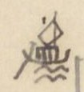{width=12%}

[NC: Tác giả vẽ một chiếc thuyền buồm nhỏ bên lề trái và kẻ một đường dọc suốt đoạn đi đường thủy dưới đây.]

| [Địa danh] | [Chữ Hán] | [Tầm] | [Ghi chú] |
|---|---|---|---|
| Cửa Rạch Hào | 沥 [?] 豪 | 328 | 水口 [cửa sông] |
| Cửa Tiểu Khê | 小溪口 | 200 | |
| Cửa sông Mũi Giùi | [?][?]江口 | 1.320 | Gọi Ngã ba Phạm Dinh (氾营) |
| Ngã ba Mũi ? | 𩠽 [?] [?] | 912 | |
| Ngã ba Rạch Cát | 沥 [?] 葛 | 4.680 | |
| Cửa ng. b. Mũi Rạch | 𩠽 [?] 沥 [?] | 1.980 | |
| Ng. b. Rạch Suối | 沥 [?] 源 | 160 | |
| Cửa Rạch Bản | 沥 [?] 板口 | 560 | |
| Rạch Chanh | 沥 [?] [木+正] | 100 | Bãi Bùn (罷[?]) |
| Ngã ba Cây Thị | 核柿 | 480 | |
| Ngã ba Sổ Đũa | [?][?] | 320 | |
| Cửa Rạch Chanh | 沥 [?] [木+正] 口 | 180 | |
| Ng. b. Cù Lao Dẹo Bria | 岣 [?] 嶗 [?] [?] | 400 | 金[?] |
| Cửa Lạch Nghệ | 沥 [?] 芸 [?] 口 | 1.400 | |
| Ngã tư | 我罒 | 150 | |
| Ngã ba Cây Khô | 核枯 | 900 | |
| Ngã ba Đầu Sấu | 頭[?] | 450 | Nhiều cá sấu |
| Cửa sông Bắt Quả [?] | [?]瓜 | 300 | |
| Cửa sông Bắt Đôi Nữ | [?][?]女 | 475 | |
| Cửa Tắt Tổ Câu | 祖[?]口 | 500 | |
| Ngã ba Đầm Nang | 潭[?] | 1.500 | |

[NC: "Ng. b." = ngã ba. Chữ "rạch" tác giả viết bằng chữ Nôm (氵+ một chữ tựa 匠/㢀), tạm ghi 沥 [?]. Nhiều chữ Nôm ở đoạn đường thủy này viết thảo, chưa đọc chắc. Ở dòng đầu, chữ "miếu" viết thêm phía trên.]

# Trang PDF 315 - Thăng Long đi Nam: Trấn Biên - dinh Phiên Trấn; phụ lục đường bộ

*Đầu trang: TL vào Nam. 49. Trấn Biên; số trang bản thảo: 156*

[NC: Tiếp đoạn đường thủy, tác giả vẫn kẻ đường dọc bên lề trái đến hết dòng Phiên Trấn.]

| [Địa danh] | [Chữ Hán] | [Tầm] | [Ghi chú] |
|---|---|---|---|
| Ngã ba Đầm Nát | 潭[?] | 450 | ra |
| Cửa Tắt Bài | [?]牌口 [?] | 560 | Chảy ra cửa Cần Giờ (芹[?]) |
| Ngã ba Đầm Mai | 潭[?]枚 | 4.350 | |
| Cửa Rạch Vĩnh Cẩm | 泳 [?] 錦 | 2.550 | Từ đây có nhiều cá sấu |
| Cửa Rạch Lão Kiều | 老橋 | 6.080 | |
| Cửa Rạch Bãi | 沥 [?] 罷 | 730 | |
| Cửa ng. b. Phú Gia (*mực tím:* Nhà Bè) | [?][?] | | Tên ngã ba Nhà Bè (茹筏). Cách trạm Mũi Giùi ([?][?]) 33.315 tầm |
| Cửa sông Tây Nam | 西南江口 | 2.595 | |
| Cửa Rạch Lão Tố | 老素沥 [?] 口 | 350 | |
| Cửa Rạch Cá Trê | [?][?] | 1.419 | |
| Đồn Cá Trê | 〃 土屯 | 41 | Đồn đất. Năm Mậu Thân (1788) về Gia Định đắp. Trấn Biên hồi Gia Định từ đây. |
| Cửa Rạch Lão Dịch | 老迪 | 260 | |
| Cửa Rạch Miếu | 廟沥 [?] 口 | 392 | |
| Cửa Rạch Lão Kỹ | 老[?] | 103 | |
| Chợ Thủ Thiêm | 首添 | | qua |
| Bến Nghé | 渡[?] | | Bến Nghé ([?]津次) ở Đại Giang (大江) (viết lầm ra [?], [?]). Giáp |
| **PHIÊN TRẤN** dinh | 藩鎮營 | | Cách ngã ba (三岐) 6.160 tầm. Trấn Biên hồi từ đây giao trạm Thuận Phương (順芳) (Bình Thuận) qua 3 trạm, 64.686 tầm. Cõi Trấn Biên (鎮边) từ trạm Thuận Biên (順边) đến đây 60.006 tầm. Phiên An thừa từ đây giao bờ nam Đại Giang ở Trấn Định (鎮定), theo đường thủy, đi 22.170. Dinh Phiên Trấn cách dinh Bình Thuận 136.817 tầm |

Ghi bên lề trái dòng Phiên Trấn (chữ nhỏ, chồng lên nhau): 安界 [?]; 藩鎮界 [?]; 〃 承; 鎮边回 [giới Phiên An; Phiên Trấn thừa; Trấn Biên hồi].

Tiếp ở tr. 50

---

Phụ lục đường bộ [cả thảy 42.781 tầm] nối vào tr. 48

| [Địa danh] | [Loại] | [Chữ Hán] | [Tầm] | [Ghi chú] |
|---|---|---|---|---|
| **Mũi Giùi** | trạm | [?][?] | | |
| Cầu Mũi Giùi | c | 〃 | | Dài 22T |
| Cửa Lũy Phúc Trung | | 福忠 | 2.402 | Từ đây, nhiều tê, tượng, hổ, lang |
| Tràng Dài | | 狀[?] | 768 | |
| Đống Bồ | | 全 [?] 𤙭 [?] | 576 | |
| Sở Trại Đèn | | 寨畑 [?] 所 [?] | 696 | |
| Khe Chu Pha | | 朱坡 | 1.810 | Rộng 5 tầm |
| Suối Sâu | | 源[?] | 2.700 | Rộng 2T |
| Nước Luồn | cầu | 渃淪 | 3.600 | Dài 10T |

[NC: "Tiếp ở tr. 50" và "nối vào tr. 48" chỉ các trang con của mục "TL đi Nam" (Thăng Long đi Nam). Chữ "về Gia Định" ở dòng Đồn Cá Trê có chấm dưới chữ, có lẽ tác giả còn ngờ cách đọc.]

# Trang PDF 316 - TL đi Nam 50: Trấn Biên - Phiên An

*Đầu trang: TL đi Nam - 50. Trấn biên - Phiên An; số trang bản thảo: không ghi*

[NC: Bảng lộ trình; tên địa danh phần lớn viết bằng chữ Nôm (ví dụ 媒 = mụ, 渃 = nước, 仝 = đồng, 館 = quán, 求 = cầu). "Tầm" = 2,045 m.]

| [Địa danh] | [Chữ Hán/Nôm] | [Khoảng cách] | [Ghi chú] |
|---|---|---|---|
| Cầu Mụ Ký | 媒記 | 1.090 | Dài 13 tầm |
| Lũy đất | 土壘 [?] | 2.400 | |
| Đồng Hươi - cầu | 仝㹀 [?] | 735 | Dài 5 tầm |
| Ngã ba Đồng Môn | 仝門 | 615 | Có thủ sở (守所) [đồn canh] |
| Cầu quán Thủ | 館守 | 2.650 | Dài 12 tầm |
| Cầu nước Trong | 渃冲 | 3.523 | Dài 12 tầm. *(mực tím)* Trấn biên 5/46 |
| Cầu Lá Bon | 蘿 [?] 蒡 [?] | 7.164 | Thôn Phúc Tân (福新). Dài 17 tầm |
| Khu Mụ Lang | 坵媒諒 | 711 | |
| **TRẤN-BIÊN dinh** | 鎮邊營 | 52 | Lỵ sở |
| Chợ Bàn Lân | 檻 [?] 橉 | 728 | |
| Bến Rạch Cát | 泒葛 | 90 | Phúc Lô [?] (福蘆 [?]). Rộng 80 tầm |
| Bến đò sông Đồng Nai | 仝狔 | | Rộng 165 tầm |
| Chợ Lò Giấy | 炉紙 | 150 | Thôn Bình Tiên (平箋 [?]) |
| Cầu Quan | 求官 | 1.033 | Dài 3 tầm |
| Cầu Ba Ván | 巴板 | 500 | Dài 2 tầm |
| Núi Châu Thái | 周泰山 | 3.489 | |
| Cầu Suối Nhâm | 𤂬 [?] 壬 | 780 | Dài 5 tầm |
| Quán Mít | 館櫗 | 2.400 | Thôn Bình Đán (平旦) |
| Quán Ngã ba Đồng Chảy | 仝𤈠 [?] | 229 | 館我巴 (quán ngã ba) |
| Đò Đồng Chảy | 渡仝𤈠 [?] | | Rộng 110 tầm, đến đầu cõi dinh Phiên an (藩安). |

[Xem nói ở sau, trương 52; ở bản có chú thích:] Xét *Đại Việt sử ký tiệp lục* (大越史記捷錄) [Đại Việt sử ký chép tóm tắt], ở *tựa* (總序 [?]) có nói: Phúc Chu (福淍), thụy Hiếu minh (孝明王), đánh lấy đất Cao-miên (高綿), đặt ra hai huyện Phúc long (福隆) và Tân bình (新平) thuộc phủ Gia-định (嘉定). Còn đâu là Phúc-thụ (福澍), thụy Hiếu Ninh (孝寧王).

(Tiếp vào tr. 52)

---

Sau đây là đo đường thủy [Phan-An - Trấn định] (nối theo trương 49)

[NC: Nửa dưới trang là tiêu đề in VERRERIE DU NORD in ngược; ở nửa phải trang có nét chữ của trang bên kia hiện qua giấy. Chữ Nôm gõ ở cột thứ hai là theo tự dạng bản thảo, nhiều chữ chưa chắc.]

# Trang PDF 317 - TL đi Nam 51: Phiên An

*Đầu trang: T.L. đi Nam 51 Phiên An; số trang bản thảo: 157*

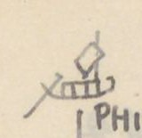{width=12%}

Chữ trên hình: không có.

## PHIÊN-AN trấn dinh: thành GIA-ĐỊNH (嘉定城) (nối vào tr. 49)

Gia định, xưa là đất Chân lạp, sau là đất Cao Mên (真臘, 高綿). Hiếu ninh vương (孝寧王) mở và lập phủ. Năm Giáp ngọ (1774), có binh biến, Hiếu định vương (孝定王) đến đó. Đến sau, bị Tây sơn (西山) chiếm chừng 10 năm. Tháng 8 năm Mậu thân (1788), đại binh từ Tiêm la (暹羅) về, đuổi vua Tây sơn là Đông định vương (東定王), bắt được Thái bảo Sâm (太保參). Đắp thành Liên Hoa (蓮花) mở tám cửa. Mậu thân (戊申) là năm Quang trung thứ [...] ([...] ra *nguyên niên* (元年) [năm đầu] [...]) Lê (黎) mất. Thì thiên mệnh về Nguyễn triều.

[NC: Cuối đoạn có mấy chữ bị gạch xóa lẫn chữ viết lại trong ngoặc, chưa đọc rõ; ý có lẽ là: sách viết lầm năm Mậu thân là năm Quang Trung nguyên niên.]

| [Địa danh] | [Chữ Hán/Nôm] | [Khoảng cách] | [Ghi chú] |
|---|---|---|---|
| Cửa Li-minh | 離明門 | 385 | |
| Bến Đại giang | 大江御 [?] | 84 | 津次 (*tân thứ*) [bến đò]. Đi bộ |
| Bến Bè tre | 筏椥 | 35 | |
| Kênh Ngưu Tân | 牛津 | 164 | Bến Ngã ba Vàm Bến Nghé (汜渡犧 [?]) |
| Cầu đò Cây | 棋渡 | 66 | |
| Bến suối Lò Vôi | 炉灰 | 578 | |
| Lạch bến Chùa | 泒渡廚 | 140 | |
| Kho tứ dinh | 四營公庫 | 247 | Năm Mậu tuất (1798) trở về lập |
| Ng.b. Bến Ông lớn | 螉 [?] 吝 | 355 | |
| Cửa Bến Ông bé | 螉 [?] 閉 | 960 | |
| Cầu Mụ Châu | 媒珠 | 64 | Long Vĩnh (龍永) |
| Cầu Đường | 求唐 | 92 | |
| Cầu Khâm Sai | 欽差 | 223 | |
| Cầu Phú-lâm | 富臨 | 331 | |
| Cầu Cây Kè Bời [?] | 核棋 [?] | 655 (lại 745) | lại |
| Ng.b. Rạch Lau | 泒撈 | 1.320 | |
| Ng.b. Rạch Cát | 泒葛 | 1.201 | |
| Ngã Tư | 我罒 | 2.796 | |
| Quán Ba Khâm [?] | 巴櫒 [?] | 1.435 | |
| Lạch Cây Trâm | 核𣜿 [?] | 1.110 | |
| Cửa Rạch Tre | 泒椥 | 1.890 | |
| Cửa kênh Bến Lạt | 渡溧 | 321 | Ra Đại giang (大江) |
| Cửa Kênh Bả Tân | 把津 | 1.914 | |
| Lạch Thủ Huấn | 泒首訓 | 1.215 | 〃 |
| Ng.b. giáp nước đông | 夾渃東 | 1.598 | |
| Cầu Xã Hưng | 社興 | 394 | Dài 7 tầm |
| Lạch giáp Cây Tai | 核才 | 560 | 泒夾水夾核才 |
| Cầu cây Tai | 求 〃 | 1.598 | |
| Sông lớn Vĩnh Cù [?] | 泳衢 [?] | | 大 [?] ... 大江. Rộng 67 tầm |

[NC: "Ng.b." = ngã ba. Ở dòng "Ng.b. Bến Ông lớn", chữ "Ngã" viết đầu bị gạch. Phần lớn tên ở cột thứ hai là chữ Nôm (泒 = rạch/lạch, 核 = cây, 椥 = tre, 渃 = nước, 媒 = mụ, 求 = cầu). Ở dòng cuối, sau cột chữ có một chữ viết thảo (như 大 + 彡) chưa đọc được.]

# Trang PDF 318 - TL đi Nam 52: Phiên An - Trấn định

*Đầu trang: T.L. đi Nam 52 - Phiên An - Trấn [định]; số trang bản thảo: không ghi*

*(Bên lề trái, chữ Hán:)* 鎮定界 [Giới Trấn Định]; 〃 交 [giao Trấn Định]; 藩安回 [Phiên An hồi].

**Bờ Nam Đại giang** (南岸津次 [bến đò bờ nam]). - Bến giáp địa giới Trấn định (鎮定). Cách Đại giang ngự tân thứ (大江御津次) [bến ngự sông lớn] 22.170 tầm. Phiên-an hồi từ đây giao Đại giang ngự tân thứ (Trấn biên) qua đường thủy, 22.170 tầm. Cõi Phiên-an (藩安) từ Đại giang ngự tân thứ đến đây 22.170 tầm. Trấn định thừa (鎮定承 [?]) từ Đại giang bờ nam (đây) giao cửa Rạch Cái Thìa (丐匙 [?]) (Vĩnh trấn 永鎮) qua 2 trạm, 30.961 tầm. Mậu thân (戊申) là năm Quang trung nguyên niên (1788). Hiếu định vương là Phúc Thuần (福淳).

(Tiếp với tr. 53)

---

Phụ lục đường bộ [Phiên An - Trấn định] nối vào tr. 50.

| [Địa danh] | [Chữ Hán/Nôm] | [Khoảng cách] | [Ghi chú] |
|---|---|---|---|
| (Bến đò Đồng chảy | 仝𤈠 [?] | 2.765 [?] | Theo quan lộ đến thành Gia định, cửa Cấn chỉ (艮止) có 3.700 tầm) |
| Cầu Sơn | 求山 | 227 | Dài 14 tầm |
| Cầu Lầu | 求樓 | 545 | Dài 9 tầm |
| Cầu Mụ Nghi | 媒儀 [?] | 40 | Dài 22 tầm |
| Đường Ngã tư | 四岐路 | 225 | |
| Ngã tư ngoài thành trại [?] | 埸 [?] 城 | 155 | 外四岐路 [đường ngã tư ngoài] |
| Cửa Cấn chỉ | 艮止 | | Cửa vào |
| **PHIÊN-AN trấn** | 藩安鎮 | | Thành GIA-ĐỊNH |
| Cửa Đoài thuận | 巽順 | 255 | cửa thành Gia định |
| Chợ Na Sâm | 梛椮 [?] | 223 | |
| Chợ Rối | 𢄂 [?] 紂 | 81 | |
| Ng.b. Điều Khiển | 調譴 | 46 | |
| Chợ Điều Khiển | 〃 市 | 314 | |
| Chùa Kim Chương | 金章 | 98 | |
| Ng.b. chợ Tân lộc | 新祿 | 70 | |
| Đền Hiển-trung | 顯忠祠 | 87 | Thờ trận vong công thần |
| Miếu Hội Đồng | 會同廟 | 110 | |
| Đình Lão Hưởng trà | 老餉茶 | 775 | 亭 |
| Chợ Hôm | 𢄂 [?] 歆 | 41 | |
| Miếu Quan-đế | 関帝 | 152 | |

[NC: Dòng thứ hai của bảng ("Cửa thành Cấn chỉ 艮止") bị gạch xóa; hai dòng đầu được đặt trong ngoặc. Số khoảng cách dòng đầu viết đè, chưa chắc. Ở dòng "Cửa Đoài thuận", chữ Hán tác giả viết là 巽順 (*Tốn thuận*), tức cửa Tốn Thuận của thành Gia Định; quốc ngữ có lẽ viết lầm. Nửa dưới trang có tiêu đề in VERRERIE DU NORD in ngược.]

# Trang PDF 319 - TL đi Nam 53: Phan An - Trấn định

*Đầu trang: TL đi Nam 53. Phan-An - Trấn định; số trang bản thảo: 158*

| [Địa danh] | [Chữ Hán/Nôm] | [Khoảng cách] | [Ghi chú] |
|---|---|---|---|
| Cầu phố Sài gòn | 柴棍 | 194 | Dài 6 tầm |
| Chợ Phú lâm | 富臨 | 715 | |
| Cầu Ván | 求板 | 322 | Dài 2 tầm. Phía tây có chùa Cây Mai (核梅). Khách có thơ rằng: (xem dưới) |
| Chùa Cây Mai | 核梅 | | |
| Chợ Cây Gũ ? | 核椇 [?] | 412 | |
| Ngã ba | 我巴 | 224 | |
| Cầu Lão Bôn [?] | 老梈 [?] | 1.408 | Dài 6 tầm |
| Rạch | 泒 | 814 | Rộng 18 tầm |
| Rạch Nước Lên ? | 渃蓮 | 1.310 | Rộng 12 tầm |
| Cầu Rạch Cọc | 泒椈 [?] | 24 | Dài 9 tầm |
| Bến đò Ngã tư | 我罒江 | 2.660 | 渡津次 [bến đò]. Rộng 14 tầm. Cách cửa Đoài thuận thành Gia định (巽順門) 7.502 tầm |
| Đồn Khu Điếm | 坵顛 [?] | 142 | |
| Cầu Cây Khóm | 核櫒 [?] | 145 | Dài 5 tầm |
| Cầu cây Trâm | 核𣜿 [?] | 2.671 | Dài 5 tầm |
| Đò Đa Nông [?] | 沱濃 | 2.040 | Rộng 114 tầm |
| Cầu Cây Dao | 核刀 | 1.341 | Dài 4 tầm |
| Cầu thôn Bình Nghị | 平議 | 2.714 | Dài 4 tầm |
| Sông Vĩnh Cù (lớn) | 泳衢 [?] | | 大江 [sông lớn]. Rộng 67 tầm. |
| Bờ nam Đại giang | 南岸 | | Đầu cõi Trấn định (鎮定). Cách bến đò Ngã tư 11.913 tầm. Cách cửa Đoài thuận (巽順) (Gia định) 19.417 tầm. Đường bộ, cõi Phiên an từ bến đò Đồng chảy (仝𤈠 [?]) đến đây là 23.117 tầm. |

Thơ khách đề chùa Cây Mai:

*Thiền môn hà xứ phỏng dao hoa, tạm giải chinh an thuyết Phạn gia. Hương nhập trà âu yên chính noãn, nhất sinh trần lự bán tiêu ma* (禪門何處訪瑤花，暫解征鞍說梵家。香入茶甌煙正煖，一生塵慮半消磨).

**Dịch:** Cửa thiền nơi nào tìm hoa quỳnh? Tạm cởi yên ngựa đường xa, chuyện trò nhà Phật. Hương vào chén trà, khói đang ấm; mối lo trần một đời đã tiêu mòn quá nửa.

(Tiếp với tr. 55)

---

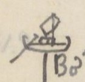{width=12%}

Chữ trên hình: không có.

Đường thủy (Trấn định - Vĩnh trấn) nối tr. 52

| [Địa danh] | [Chữ Hán/Nôm] | [Khoảng cách] | [Ghi chú] |
|---|---|---|---|
| Bờ nam Đại giang | 泳衢 [?] | 3.006 | Vĩnh-cù |
| Cầu Lão Bỉnh | 老秉 | 192 | |
| Cầu Mụ Lý | 媒李 | 948 | |
| Quán Mụ Hợi | 媒亥 | 1.740 | |
| Cầu Trông Trường [?] | 竜 [?] 場 | 1.658 | |
| Chợ bến Tranh | 渡争 | 2.035 | |
| Rạch bến Chùa | 泒渡廚 | 860 | |
| Cửa rạch Cai Ngang | 泒丐昂 | 1.700 | |

[NC: Trong bảng trên, chữ 巽順 tác giả đọc là "Đoài thuận" (đúng ra là cửa Tốn Thuận). Nửa dưới trang có tiêu đề in VERRERIE DU NORD hiện ngược.]

# Trang PDF 320 - TL đi Nam 54: Trấn định

*Đầu trang: TL. đi Nam 54. Trấn định; số trang bản thảo: không ghi*

| [Địa danh] | [Chữ Hán/Nôm] | [Khoảng cách] | [Ghi chú] |
|---|---|---|---|
| Rạch Cái Cát | 丐葛 | 659 | |
| **TRẤN-ĐỊNH Khổn** | 鎮定閫 | | Trạm bến trước Khổn (閫前津次江驛站). Cách bờ nam Đại giang Vĩnh Cù 12.797 T. Cách bến Gia định (嘉定) 34.967 |
| (ĐỊNH-TƯỜNG trấn) | 定祥 | 380 | |
| Cửa Kênh | 涇口 | 2.170 | Ra sông Mỹ Tho (美湫大江) |
| Rạch Giui Mép [?] | 校 [?] 𧋆 [?] | 6.605 | |
| Rạch Sầm | 泒涔 | 1.582 | |
| Rạch Rau răm | 蒌菻 | 1.952 | |
| Chợ Cương-đế [?] | 綱底 | 2.247 | |
| Rạch Trà lụt | 茶津 [?] | 1.152 | |
| Rạch Bà Rồi | 婆 [?] 淶 | 426 | |
| Rạch Cái Lá | 丐蕒 [?] | 1125 | |
| Rạch Cái Bè | 丐筏 | 1.505 | |
| Rạch Trà lụt | 茶津 [?] | 2.020 | |
| Rạch Cái Thìa | 丐匙 [?] | | (xem dưới) |

*(Ghi chú dòng Rạch Cái Thìa:)* Cách bến trước Trấn định Khổn 18.164. Cõi Trấn định (鎮定) từ bờ nam Đại giang Vĩnh Cù (泳衢 [?]) đến đây có 30.961 tầm. Vĩnh trấn (永鎮) thừa (承) từ đây đến Cao Miên (高綿), qua ba trạm 43.219 tầm. Trấn định hồi (鎮定回) từ đây giao bờ nam Đại giang Phiên an (藩安), do đường thủy, qua 2 trạm, 30.911 [?] tầm. Từ đây ngoài cửa Rạch Cái thìa theo bờ bắc Đại giang (大江) mà ngược, đi 30.949 đến đồn phân thủ (分守) đạo Hùng ngự (雄禦道), giáp Cao miên.

(Tiếp với tr. ...)

[NC: "Khổn" (閫) = lỵ sở của trấn. "thừa" (承) = đi tiếp, "hồi" (回) = đi về. Tác giả để trống số trang ở câu "Tiếp với tr.". Nửa dưới trang là tiêu đề in VERRERIE DU NORD in ngược.]

# Trang PDF 321 - TL đi Nam 55: Trấn định - Vĩnh thanh

*Đầu trang: TL đi Nam 55 - (Trấn định - Vĩnh thanh); số trang bản thảo: 159*

Phụ lục đường bộ (Trấn định - Vĩnh trấn) nối vào t. 53

| [Địa danh] | [Chữ Hán/Nôm] | [Khoảng cách] | [Ghi chú] |
|---|---|---|---|
| Bờ nam Đại giang | 大江南岸 | 1.153 | Theo đường quan lộ 39.205 đến Cần lộ (芹露) |
| Dồng cai Én | 壋丐鷰 [?] | 3.906 | Dài 760 T |
| Chợ Kiến định | 建定 | 162 | |
| Dồng Kiến định | 壋 〃 | 20 | Chỗ ngã ba |
| Dồng Kỳ lân .. | 麒麟 [?] | 1.280 | Rào Quạ (𣘈 [?] 鴉 [?]). Dài 1.150 tầm |
| Dồng dị | 壋櫇 [?] | 2.900 | Dài 108 T |
| Dồng Lão Lã | 老呂 | 100 | Dài 775 T |
| Dồng Trà Lụt | 茶津 [?] | 1.052 | Dài 981 T |
| Dồng Gốc [?] Lao | 榕牢 | 155 | Dài 1.521 T |
| Cầu Cây Lễ | 核礼 | 28 | Dài 12 T |
| Dồng Lão Áng | 老盎 | 2.670 | Dài 257 T |
| Dồng Lao | 壋牢 | 703 | Dài 627 T |
| Dồng Trú Triệu [?] | 住吕 [?] | 5.020 | Dài 119 T |
| Cầu Cái Thìa | 丐匙 [?] | 2.306 | Dài 34 T |
| Dồng Rạch Miếu | 泒庙 | 7.692 | Dài 10 T |
| Cầu cái Lao hạ | 丐牢下 | 1.114 | Dài 12 T |
| Cầu cái Bần [?] | 丐瀕 [?] | 2.563 | Dài 15 T |
| Cần lộ | 芹露 | | Cách Bờ Nam Đại giang 39.205 T. Ngoa [?] (TTNĐ thừa một dòng) |
| Cửa Rạch Cái Thìa | 丐匙 [?] | | qua.. |
| Đại giang | 大江 | | vào. |
| Sông Long hồ | 竜湖 | | |
| Bến trước trấn | 前 [?] 鎮營 | | Cách bến trước Khổn Định tường (定祥) 18.164 tầm |
| **VĨNH-TRẤN** trạm | 津次 | | |

(Tiếp với trương ...)

[NC: "Dồng" (chữ Nôm 壋) có lẽ là "giồng" (gò đất cát cao ở Nam Bộ). "T" = tầm. Ở dòng Cần lộ, chữ đầu ghi chú viết rồi gạch một phần, đọc như "Ngoa"; chưa chắc.]

---

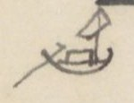{width=12%}

Chữ trên hình: không có.

Đường thủy (Vĩnh thanh) nối vào

| [Địa danh] | [Chữ Hán/Nôm] | [Khoảng cách] | [Ghi chú] |
|---|---|---|---|
| Bến trước Khổn | | | |
| **TRẤN VĨNH THANH** | 永清鎮 | 300 | |
| Cửa sông Long hồ | 竜湖 | 58 | |
| Rạch Cái Cá | 丐魜 [?] | 700 | |
| Rạch Cái Cam | 丐昆甘 [?] | 312 | |
| Rạch Cáp Côn [?] | 擂 [?] 甘 [?] | 130 | 丐昆 (Rạch Cái côn) |
| Rạch Thất thượng | 㬥 [?] 挿 [?] | | |
| (Thập lão [?]) | 老寶 [?] 上 | 1.025 | |
| Rạch Cái Dôi | 丐堆 | 2.500 | |

[NC: Hai dòng "Rạch Cáp Côn" và "Rạch Thất thượng / Thập lão" viết đè, sửa nhiều lần, đọc chưa chắc. Nửa dưới trang có tiêu đề in VERRERIE DU NORD hiện ngược.]

# Trang PDF 322 - TL đi Nam 56: Vĩnh thanh

*Đầu trang: TL đi Nam 56. Vĩnh thanh; số trang bản thảo: không ghi*

| [Địa danh] | [Chữ Hán/Nôm] | [Khoảng cách] | [Ghi chú] |
|---|---|---|---|
| Rạch cái Da | 丐耳卩 [?] | 1.200 | |
| Rạch cái Tàu hạ | 丐艚下 | 1.000 | |
| Rạch cái Rau | 丐蒌 | 75 | |
| Rạch Nha Vũ | 芽娬 | 3.000 | |
| Rạch Cái Sắt | 丐吡 [?] | 50 | |
| Rạch Chảo Vạc | 沼 [?] 鑊 | 700 | |
| Rạch Cần Thơ | 芹苴 | 310 | |
| Rạch Cái Sơn | 丐山 | 930 | |
| Cửa đông Sông Sa đéc | 沙泊江 [?] | 577 | 東口. 道任所 [nơi đạo đóng]. Sở đạo nhậm. Cách bến trước trấn khổn 12.290 tầm |
| Rạch Long phượng | 竜鳳 | 1.230 | |
| Rạch Cái bè cạn | 丐筏泮 [?] | 1.000 | |
| Rạch Cây Khoa | 核科 | 3.040 | |
| Rạch Mang Đào | 芒陶 | 3.718 | |
| Rạch Thủ Cữ | 守窶 [?] | 1.300 | |
| Rạch Cái Cữ | 丐窶 [?] | 950 | |
| Rạch Cái Châu | 該珠 | 450 | |
| Rạch đất Sét | 坦 [?] 㘸 [?] | 780 | |
| Rạch Cái Tàu thượng | 丐艚上 | 2.460 | |
| Rạch Đồ Bà | 閣 [?] 𣳔 [?] | 1.750 | |
| Rạch Trà thôn | 茶村 | 80 | |
| Đồn Chiến sai đạo | 戰差道 | 3.330 | phân thủ (分守) |
| Rạch Ông Chưởng thượng | 翁掌上 | 200 | Quan Khâm sai trước Lễ thành hầu (礼誠侯) đánh Cao mên có công. Dân nhờ ơn lập đền thờ |
| Rạch nhỏ trước cây Liễu | 𠰘 [?] 椅 [?] 柳 | 300 | |
| Rạch Vàm ? | 汜沛 | | |
| [Rạch Vàm] thượng | 上 | 200 | |
| Rạch tắt Cây Cảnh | 熜 [?] 核樈 [?] | 5.200 | |

[NC: Lễ thành hầu tức Nguyễn Hữu Cảnh (Nguyễn Hữu Kính). Nửa dưới trang là tiêu đề in VERRERIE DU NORD in ngược; ở góc phải có hình thuyền của trang bên kia hiện qua giấy.]

# Trang PDF 323 - TL đi Nam 57: Vĩnh thanh; tổng kết đường Thăng long - Gia định

*Đầu trang: TL đi Nam 57 [?]. Vĩnh thanh; số trang bản thảo: 160*

| [Địa danh] | [Chữ Hán/Nôm] | [Khoảng cách] | [Ghi chú] |
|---|---|---|---|
| Rạch Chúc Nạn | 祝灘 [?] | 5.400 | |
| Rạch Cái Mới - cửa | 丐買 | | |
| Cao Miên | 高綿 | | (xem dưới) |

*(Bên lề trái, cạnh dòng Cao Miên:)* 永清回 [Vĩnh Thanh hồi].

*(Ghi chú dòng Cao Miên:)* Cách Đông khẩu đạo (東口道) 30.929 tầm. Cách điếm bến trấn Vĩnh thanh (永清鎮閫前津次江站) 43.219 tầm. Vĩnh thanh trấn hồi (回) từ đây giao cửa rạch Cái Thìa (丐匙 [?]) (Trấn định 鎮定) qua ba trạm, 43.219 tầm. Cõi Vĩnh thanh trấn từ cửa rạch Cái Thìa đến đây 43.219 tầm.

TTNĐ không chép đường bộ.

---

Từ Cửa Nam thành Thăng long đi về Nam:

- 303.153 tầm đến thành Phú xuân; lại
- 489.513 tầm đến thành Gia định; lại
- 96.350 tầm đến cõi Cao-Miên

Nay vua đặt trạm từ Hoàng Mai (黃梅) đến Thượng An (上安) cộng 36 trạm:

- Khẩn nhất, hạn đi là 3 ngày đêm 6 giờ rưỡi
- Khẩn vừa, hạn đi là 5 ngày 3 giờ hơn
- Khẩn thường, hạn đi là 8 ngày 2 giờ rưỡi

Từ An-nông (安農) đến Mũi Gui [?] (每 [?] 檜 [?]) cộng 60 trạm:

- Khẩn nhất, hạn đi là 5 ngày 2 giờ rưỡi
- Khẩn vừa, hạn đi là 7 ngày 9 giờ rưỡi
- Khẩn thường, hạn đi là 12 ngày 3 giờ

Lương lệ (粮例) [lệ cấp lương], thì nếu đi may mắn (cát hành 吉行), sẽ phải:

| [Nơi] | [Số ngày từng chặng] | [Cộng dồn] |
|---|---|---|
| Thăng long | | Từ T.L |
| Thanh hóa | 5 ngày | |
| Nghệ-an | 4 | 9 |
| Quảng-bình | 5 | 14 |
| Phú-xuân | 4 | 18 |
| | | Từ P.X |
| Quảng Nam | 2 | |
| Quảng Nghĩa | 3 | 5 |
| Bình Định | 3 | 8 |
| Phú Yên | 2 | 10 |
| Bình hòa | 5 | 15 |
| Bình thuận | 5 | 20 |
| Gia Định | 5 | 25 |
| | | 43 ngày |

[NC: Trong bản thảo, số ngày từng chặng viết lệch giữa hai dòng địa danh (tức số ngày đi từ nơi trên đến nơi dưới). "P.X" = Phú Xuân. 43 ngày = 18 + 25. Ở dòng "Khẩn vừa" thứ hai có một chữ bị gạch trước "rưỡi". Nửa dưới trang có tiêu đề in VERRERIE DU NORD hiện ngược.]

# Trang PDF 324 - Trang trắng

[Mặt sau của tờ trước: chỉ có giấy tiêu đề in sẵn VERRERIE DU NORD, Hanoi, le ... 194..; nét chữ tờ bên kia hiện qua giấy. Không có chữ viết.]

# Trang PDF 325 - Thăng Long đi Tây 1

*Số trang bản thảo: 161*

## THĂNG-LONG đi Tây 1.

(TTNĐ và T.LYL. chép như nhau) A584/123a; A2717/

| [Địa danh] | [Loại] | [Chữ Hán/Nôm] | [Khoảng cách] | [Ghi chú] |
|---|---|---|---|---|
| Cửa Tây | | 西門 | 144 | |
| Ngã tư | | 四岐路 | 243,1 | |
| Cửa Ô Cầu Giấy | | 塢求紙 | 1.484 | Cửa thành đất (土城). Có điếm phân thủ |
| Cầu Giấy | c | 求紙 | 1.711 | Cầu xã Thượng An Quyết (上安抉). Dài 7 tầm |
| Dịch Vọng | xã điếm | 驛望 | 1.199 | Kẻ Vọng (几紇 [?]) |
| Cầu Phú Diễn | c | 扶演 | 820 | Dài 13 tầm. Cầu Diễn (演) |
| Chợ Phú Diễn | ch | 〃 市 | 1.100 | |
| Tu hoàng | điếm | 脩黃 | 440 | |
| Chợ Lôi | ch | 𢄂雷 | 1.100 | Chợ Vi (微市) |
| Ngã tư Quán Cả | | 館奇 | 427 | Xã Thụy Ứng (瑞應). Có điếm |
| Cầu Đầm | c | 求潭 | 615 | Xã Phượng trì (鳳池). Dài 3 T. |
| Cửa Hát giang | đ | 喝江 | 1.112 | Rộng 105 tầm. Phu đò 3 người.. |
| Đê xã Hiệp Sông [?] | | 叶滝 [?] | 1.416 | 官堤 [đê quan] |
| Chợ Bún [?] | ch | 𢄂粿 [?] | 1.620 | Xã Hoành Cảo (横杲) |
| Cảo thượng | x. điếm | 杲上社 | 1.320 | |
| Cầu Đều [?] | c | 求稠 [?] | 428 | Xã Hòa Triền (和廛 [?]). |
| Chợ Thác ? | ch | 𢄂坧 [?] | 2.377 | Xã Ô Cách (烏格) |
| Tiền huân | x. điếm | 前勳 | 1.458 | |
| Chợ Phú Nhi | ch | 富兒 | 1016,4 | |
| **SƠN TÂY** trấn | | 山西 | | Cách cửa thành Thăng long 19.528 T. Cộng: Cầu sông 4 đoạn |
| Cửa tả | | 左門 | 1.900 | |
| Chợ Cường | | 𢄂閎 [?] | 3.070,23 | Xã Cao cường (高崗 [?]) |
| Phú xuyên | điếm | 富川 | 2.686,4 | |
| La-phẩm | điếm | 羅 [?] 品 | 745 | |
| Sông La phẩm | | 〃 江 | 460,15 | Rộng 460,15. Thuở có cá Anh-vũ |
| (Tuần Hạc) | | 巡鶴 | 2.793,1 | |
| Quán Lầu thượng | | 樓上 | 2.940 | Dài 12 T,4. Quán chín gian (九間) |
| Chợ Lâm | | 𢄂覧 | 787 | Xã Cao lãm (高覧) |
| Cầu Tranh | | 求爭 | 1.680 | Xã Nhượng Cáo (讓告). Dài 11 tầm |
| Bãi Nhà Ngói [?] | | 茄𡏦 [?] | 334 | |
| Quán Bạt | | 館𠄼 [?] | 1.860 | Điếm An đạo (安道). Qua rừng hoang |
| Chợ Nghe | | 𢄂聵 [?] | 298 | Xã Thượng hạ Nha (上下衙) |
| Cầu Nghe | | 求 〃 | 2.990 | Dài 7 tầm |
| Chợ Vai | | 𢄂𦟐 [?] | 3.200 | Xã Hạ hoàng (下黄) |
| Lệ Mỹ | điếm | 麗美 | 2446 | qua núi. Có ác thú |

[NC: Cột [Loại] do tác giả ghi tắt: c = cầu, ch = chợ, đ = đò, x. = xã. A584 = TTNĐ, A2717 = TLYL (ký hiệu sách Viễn Đông Bác Cổ). Chữ Nôm "chợ" viết là 𢄂 (tự dạng trong bản thảo gần với 墅/聚). Số lẻ sau dấu phẩy là phần lẻ của tầm. Nửa dưới trang có tiêu đề in VERRERIE DU NORD hiện ngược.]

# Trang PDF 326 - TL đi Tây 2: Sơn Tây - Tuyên Quang

*Đầu trang: T.L đi Tây 2. Sơn Tây - Tuyên quang; số trang bản thảo: không ghi*

| [Địa danh] | [Loại] | [Chữ Hán/Nôm] | [Khoảng cách] | [Ghi chú] |
|---|---|---|---|---|
| Cầu Đầm | | 求潭 | 5.540 | Cầu triền - A Kha (𠃌 [?] 妸). Dài 6 T,2 |
| Chợ Trầm | | 𢄂沈 | 232 | Chợ Thái hòa (泰和) |
| Cầu Ngòi | | 求汼 [?] | 1.380 | Dài 5 T,1 |
| Chợ Sóc đăng | | 朔登 | 380 | |
| Cầu Tế | | 求細 | 1.312 | Dài 13 T. |
| Quả Cảm | điếm | 果敢 | 77 | |
| Sông Trôi | | 滝[氵+雷] | 122 | Phía nam có đồn phủ Đoan Hùng (端雄). Sông rộng 7 T,4 |
| Chợ Ngã ba | | 我巴 | 1.288 | Chợ Ngọc Chúc (玉燭) |
| Xuân Áng | điếm | 春盎 | 3.609 | |
| Hữu thổ | điếm | 有土 | 5.046 | |
| Cầu Mía | | 求椥 [?] | 531 | Xã Hòa mục (和睦). Dài 2 tầm |
| Chợ Chủ [?] | | 𢄂杓 [?] | 3.158 | Xã Đông thủy (東水) |
| Phường Chả thị | | 煮 | 222 | (Chợ chả ??) |
| Tuần [?] phố Tam Kỳ | | 三岐 | 113 | 巡庯 [phố tuần]. *(mực tím)* (TLYL chép 123. Chắc là 133, xem 5 dòng dưới) |
| Cầu Hũ | | 求吁 [?] | 11 | Dài 9 tầm |
| **TUYÊN QUANG** | | 宣光鎮 | | 所 [lỵ sở]. Cách trấn sở Sơn tây (山西) 51.721,T4. Cầu Sông 10 đoạn |
| Cửa Tiền | | 前門 | 11 | |
| Cầu Hũ ? *(mực tím)* | | 求 | 133 | Dài 9 tầm |
| Phố Tam Kỳ | | 三岐 | 222 | |
| Phường Chả thị | | 煮市 | 8.898 | |
| Phục lễ xã | | 復礼 | 2.053 | Qua rừng rậm, khe, 13 đoạn |
| Bến Dịch Tích | | 腋 [?] 碏 [?] | 5.407 | Sông Ba Hà (波河) (theo TTNĐ); Lôi Hà (Lôi [氵+雷]河 theo TLYL). Rộng 50 tầm. Trên thông Hưng hóa (興化), dưới tới Nhị hà (珥河) |
| Đại đồng chợ | | 大同 | 7.113,2 | Có Đồn thủ. Qua núi rừng |
| Sông Trôi. Bến đò Giàu | | [氵+雷]河渡; 渡𡨸 [?] | 6.335,1 | Rộng 53 tầm. Qua núi rừng, gồ ghề, nhiều voi rừng ra vào. |
| Hạ Lịch xã | | 下瀝 [?] | 9.224 | Qua đường nhiều voi |
| Đồng Lãng xã | | 同浪 | 8.782 | Qua đường núi gồ ghề. Qua 32 khe |

[NC: Ở dòng Bến Dịch Tích, chữ "Ba" trong "Ba Hà" viết đè. Chữ Nôm "Trôi"/"Lôi" tác giả viết bộ thủy + 雷, không tìm được mã chữ chắc chắn nên ghi [氵+雷]. Nửa dưới trang có tiêu đề in VERRERIE DU NORD in ngược.]

# Trang PDF 327 - TL đi Tây 3: Tuyên Quang

*Đầu trang: T.L. đi Tây 3. Tuyên Quang; số trang bản thảo: 162*

| [Địa danh] | [Chữ Hán/Nôm] | [Khoảng cách] | [Ghi chú] |
|---|---|---|---|
| Phố Tiên Yên | 先安 | 6.269 | Qua rừng núi, 22 khe |
| Sông An long | 安隆 [?] | 5.417 | Rộng 33 tầm. Qua rừng núi hiểm trở, 40 khe |
| Đường đá Nghĩa phì | 義 [?] 肥 | 9.207 | Dài 226 tầm. Qua rừng núi hiểm trở; 19 khe |
| Sông Lô | 泸河 | 3.306 | Rộng 62 tầm. Qua đường núi gồ ghề. Đi ngựa không được. Qua 40 đoạn khe |
| Hướng minh x. | 向銘 | 8.606 | Qua rừng rú. Ngựa khó đi được. Khe 9 đoạn |
| Đồng thôn | 同村 | 6.627 | Qua đường núi. Người, ngựa khó đi. Khe 42 đoạn |
| Linh hồ xã | 灵湖 | 9.419 | Đường núi gồ ghề. Khe 24 đoạn; trong ấy có Ngòi Dầu (渄油). Có ngọn ngòi: thứ nhất sông Miện (黾 [?]) chảy ra, thứ hai Ngòi Mã (馬), thứ ba ngòi Dầu. Sông Gâm (吟) chưa kể vào đâu. Đều nói về nước độc |
| **HÀ GIANG** phố | 河洋 | 20 *(mực tím: TLYL)* | Qua khe 19 đoạn. Phía đông có đồn Ninh biên (寧边) |
| Bến Hà tân | 河津 | 799 | Sông Lô gọi (泸河). Rộng 22 tầm |
| Phố Ải khẩu | 隘口 | 12.498 | Đường qua núi, khe 21 đoạn. Có điếm thu thuế |
| Phố Kinh thủy | 涇水 | 8.160 | Xã Bình di (平夷). Qua đường núi, khe 39 đoạn. Có điếm đánh thuế |
| Phố xưởng đồng Tụ long | 聚龍銅廠 | 2.142 | Qua 11 dãy núi, 11 khe. Có đồn giữ |
| Phố Ải Bắc Vu | 北干隘 | 7.719 | 庯屯巡 [có phố, đồn, tuần]. Có đồn thủ. Qua đường núi gồ ghề |
| Sông con | 小河 | | Giáp đất Tàu (內地). Đường qua hai núi Đồng trọng (銅重) và Mã yên (馬鞍). |
| **NỘI ĐỊA** | | | Cách trấn sở Tuyên quang 134.943. Qua 337 khe, 13 dãy núi. |

Sông con kia có tên là Mã-bạch (馬白), lại có tên Đỗ chúc (賭呪). Chỗ phân cương đất nước Nam. Đều có bia. Quan Quốc tử giám tế tửu đời Lê (黎) là Nguyễn công Thước (阮公鑠) và quan Binh bộ thị lang Nguyễn Huy Nhuận (阮輝潤) phụng mệnh lập bia ở bờ nam sông. Trong bia có khắc: "*An Nam giới thủ, dĩ hà vi để [?], ngoại [?] thập thất sơn*" (安南界首以河為抵 [?]，外 [?] 十七山); cõi Annam lấy sông làm sở cứ. Phần [?]

[NC: "Nội địa" (內地) đây là đất nhà Thanh. Câu khắc trên bia: **Dịch:** Đầu cõi An Nam, lấy sông làm giới hạn, [ngoài] mười bảy núi. Chữ thứ 7 và thứ 8 đọc chưa chắc. Câu văn tiếp sang trang sau. Theo sử, người lập bia là Nguyễn Công Thái (阮公寀); tác giả đọc là "Thước". Nửa dưới trang có tiêu đề in VERRERIE DU NORD hiện ngược.]

# Trang PDF 328 - TL đi Tây 4: Tuyên Quang

*Đầu trang: T.L đi Tây 4. Tuyên Quang; số trang bản thảo: không ghi*

mười bảy núi.

Đề năm Ung Chính (雍正) thứ 6 (六年) tháng chín (九月), ngày 18 (十八日).

[NC: Ung Chính 6 = 1728. Phần còn lại của trang để trống; nét chữ tờ bên kia hiện qua giấy; nửa dưới là tiêu đề in VERRERIE DU NORD in ngược.]

# Trang PDF 329 - Thăng Long - Phú Xuân 1

*Đầu trang: TL - Phú Xuân 1; số trang bản thảo: 163*

## THĂNG-LONG - PHÚ XUÂN

| [Số cung] | [Địa danh] | [Chữ Hán/Nôm] |
|---|---|---|
| | Thăng long thành | 昇隆城 |
| | Cầu Giền | 梂 [?] 蘧 [?] |
| | Hoàng mai | 黄梅 |
| | Văn điển | 文典 |
| | Tương trúc | 湘竹 |
| | Phố Sàng | 庯床 |
| | Quán gánh | 館梗 |
| | Bạch hoa | 白華 |
| | Bình vọng | 平望 |
| 1° | **Cung Hồi** (Thượng phúc) | 宮回 (上福) |
| | Quán đúc | 館 [?] |
| | Làng Văn tự | 廊文字 |
| | Làng Điềm Nghệ | 廊恬芸 |
| 2° | **Cung làng Dị** (Phú xuyên) | 宮廊禩 [?] (富川) |
| | Cầu Sàng | 求床 |
| | Đò Gang | 渡 [?] |
| 3° | **Cung Trần Cầu** (Sơn nam thượng) | 宮鎮求 (山南上鎮) |
| | Chùa Bầu | 廚瓢 [?] |
| | Cầu Gừng | 求姜 |
| | Quán Gỏi | 館鱠 |
| 4° | **Cung Gấm** (Thanh liêm) | 宮錦 (青廉) |
| | Kẽm Trống | 歛 [?] 皷 |
| | Đò Thanh quyết | 渡青厥 |
| | Ngã ba Gián | 我巴諫 (嘉遠) |
| | Cầu La mai | 求羅梅 |
| | Làng Đa Giá | 廊多稼 |
| 5° | **Cung Đá sạy** | 宮 [?] [?] |

Nay Vua bình xong Tây-sơn (西山) năm Nhâm tuất 1802, có thiên hạ. Cầu, đường được sửa chữa, so với trước, không thể không khác. Định từ Thăng long thành đến Phú xuân thành (富春城) làm 17 nhật trình. Đặt 34 hành cung. Mỗi cung cách nhau chừng 9500 tầm. Ngày đi hai cung, ước chừng 2 vạn tầm. Theo trình bây giờ, lược chép sau:

[NC: Số thứ tự hành cung (1°, 2°...) tác giả ghi ở lề trái, tên cung gạch chân. Chữ Nôm của "Đò Gang" và "Cung Đá sạy" viết thảo, chưa đọc được. Nửa dưới trang có tiêu đề in VERRERIE DU NORD hiện ngược.]

# Trang PDF 330 - Thăng Long - Phú Xuân 2

*Đầu trang: không ghi; số trang bản thảo: không ghi*

| [Số cung] | [Địa danh] | [Chữ Hán/Nôm] |
|---|---|---|
| | Vân sàng trấn | 雲床鎮 |
| | Bến đò Trải | 渡 [?] 渡 [?] |
| | (Thanh hoa ngoại) | (清華外) |
| | Chợ Vó | 𢄂 [?] |
| | Cầu Gềnh | 求 [?] |
| 6° | **Cung Đồn Du** | 宮遊 [?] 屯 |
| | Quán Khe | 館溪 |
| | Dặm Vái trời | 點 [?] 拜𡗶 |
| | Quán Cháo | 館 [?] |
| | Trại Dâu | 寨 [?] |
| | Núi Tam điệp | 三疊山 |
| | Sùng sơn | 崇山 |
| | Đồn Bướm | 屯蝶 [?] |
| | Trại Quang lãng | 光朗寨 |
| 7° | **Cung Bình hòa** (Thanh hoa nội) | 宮平和 (清華內) |
| | Bến chợ Củi | 渡 [?] 𢄂檜 |
| | Núi chồng mâm [?] | [chữ Nôm chưa đọc được] (弓 [?] 斗 [?] 代 [?]) |
| | Chợ Dà (na) | 𢄂那 |
| | Quán Củi | 館檜 |
| | Chùa Tranh | 廚貞 |
| 8° | **Cung Trấn Dương** (Đông sơn) | 宮鎮揚 (東山) |
| | Bố vệ | 布衛 |
| 9° | **Cung Thái** (Quảng xương) | 宮泰 (廣昌) |
| | Hà liên | 河蓮 |
| | Hồ báu | 胡宝 |
| 10° | **Cung Liên xá** | 宮蓮舍 |
| | Làng Hữu lộc | 廊有祿 |
| | Đồn Thổ sơn | 屯土山 |
| 11° | **Núi Mũi Rít [?]** | 每蝶 [?] 山 |

[NC: Trang này là mặt sau, không ghi đầu trang, nối tiếp danh sách hành cung Thăng Long - Phú Xuân ở trang trước. Ngoặc nhọn bên phải gộp hai dòng "Trại Quang lãng" và "Cung Bình hòa". Nhiều chữ Nôm viết thảo, chưa đọc được. Nửa dưới trang có tiêu đề in VERRERIE DU NORD in ngược.]

# Trang PDF 331 - Thăng Long - Phú Xuân 3

*Đầu trang: Thăng-long Phú Xuân 3; số trang bản thảo: 164*

| [Số cung] | [Địa danh] | [Chữ Hán/Nôm] |
|---|---|---|
| | Khe (Nước) Lạnh | 溪渃泠 |
| | Eo Ủng | 腰甕 [?] |
| | (Nghệ an) | (乂安) |
| | Làng Ngang | 廊昂 |
| | Làng dọc | 廊育 |
| | Cầu Lờn món | 求瀾漫 |
| | Chợ Hoàng mai | 黄枚市 |
| | Eo Ổi | 腰 [?] |
| | Non Thông | 嫩椿 |
| | (Quỳnh lưu) | (瓊瑠) |
| 12° | **Đồn** | 屯抹 [?] |
| | Chợ Bầu | 𢄂瓢 [?] |
| | Chùa Rồng | 廚𧍰 [?] |
| | Quán Lủi | 館 [?] |
| | Cầu Dát | 求 [?] |
| 13 | **Cung Sài** (棌) | 宮棌 [?] |
| | Đông tháp | 東塔 |
| | Chợ Si | 𢄂痴 |
| | Cầu Tràm nhịp | 求 [?] 𣘈 [?] |
| | Bãi Sò | 𡓇 [?] 蝫 [?] |
| 14 | **Mũi Dâm** (Đông thành) | 每侵 (東城) |
| | Miếu Kinh dương v. | 庙涇阳王 |
| | Kênh Sắt | 涇鉄 |
| | Đền Chúa Mẹ | 祠主媄 |
| 15 | **Cung Me** | 宮眉 |
| | Quán Sen | 館蓮 |
| | Quán Bầu | 館瓢 [?] |
| | Quán Mới | 館買 |
| 16 | **Cung Vĩnh** | 宮永 |
| | Tuần Cô độc | 巡孤独 |
| | Chợ chế | 𢄂制 |
| | Bãi Vọt | 𡓇 [?] 越 [?] |
| 17 | **Cung Treo** (Nghi xuân) | 宮撩 (宜春) |
| | Đông treo | 東撩 |
| | Hà vàng | 河鐄 |
| | Chợ Cầu Nghèn | 𢄂求研 |
| 18 | **Làng Đan chế** | 廊丹制 |

[NC: "v." = vương (Kinh Dương vương). Ở dòng 13, tác giả ghi thêm chữ 棌 sau tên "Cung Sài". Nhiều chữ Nôm ở trang này viết thảo, chưa đọc chắc. Nửa dưới trang có tiêu đề in VERRERIE DU NORD hiện ngược.]

# Trang PDF 332 - Thăng Long - Phú Xuân 4

*Đầu trang: T.L - Phú Xuân 4; số trang bản thảo: không ghi*

| [Số cung] | [Địa danh] | [Chữ Hán/Nôm] |
|---|---|---|
| | Ba giang | 巴三江 |
| | Quán Cây | 館棋 |
| | Đại tiết | 大節 |
| | Trung tiết | 中節 |
| | Đồn Nài | 屯奈 |
| 19 | **Cung Na** (Thạch hà) | 宮那 (石河) |
| 20 | **Truông Voi** | 坤 [?] 𤠄 [?] |
| | Khe Gà | 溪𪃿 [?] |
| | Quán Chào | 館嘲 |
| 21 | **Cung Cầu** | 宮求 |
| | Nhân lý | 仁里 |
| | Cầu Trí | 求智 |
| | Đá tảng | 䂖 [?] 𥕄 [?] |
| | Đá Bàn | 䂖 [?] 盘 |
| | Chợ Cây Na | 𢄂核那 |
| 22 | **Nham phật** (Kỳ hoa) | 岩伕 [?] (奇華) |
| | Lũy Ông Ninh | 壘翁寧 |
| | Đèo ngang | 岧昂社 [?] |
| | Xã Cảnh Dương | 社景陽 |
| | Làng Di luân | 廊弥綸 |
| 23 | **Cung Rờn** | 宮吝 [?] |
| | Ba đồn | 巴屯 |
| | La hà | 羅 [?] 河 |
| 24 | **Cung Thanh hà** (Thuận hóa) | 宮清河 (順化) |
| | Đá nhảy | 䂖 [?] 跳 [?] |
| | Núi Cát | 𡶀 [?] 葛 |
| | Lý hòa | 里和 |
| | Đông Cao | 東皐 |
| 25 | **Cung Đôn** | 宮頓 |

[NC: Ở cột chữ, "Đá" tác giả viết bằng chữ Nôm 石 + 多 (䂖). Nhiều chữ Nôm chưa đọc chắc. Nửa dưới trang là tiêu đề in VERRERIE DU NORD in ngược.]

# Trang PDF 333 - Thăng Long - Phú Xuân 5

*Đầu trang: TL - Phú xuân 5; số trang bản thảo: 165*

| [Số cung] | [Địa danh] | [Chữ Hán/Nôm] |
|---|---|---|
| | Dinh Ngói | 營𡏦 [?] |
| | Núi Đầu mâu | 𡶀 [?] 兜鍪 [?] |
| | Lũy Thầy | 壘柴 (祿溪侯) |
| 26 | **Cung Động hải** | 宮洞海 |
| | Đò Hầu | 渡候 |
| | Làng Võ xá | 廊武舍 |
| | Quán Trà | 館茶 |
| | Dinh Mười | 營𨒒 |
| 27 | **Làng Thạch xá** | 廊石舍 |
| | An định | 安定 |
| | Cồn Bói | 𡏧 [?] 貝 [?] |
| | Hòa luật | 和律 |
| | Phù tông | 扶宗 |
| 28 | **Quán Cát** (Lệ thủy) | 館葛 (麗水) |
| | Quán Sen | 館蓮 |
| 29 | **Cung Nhà hồ** | 宮茹胡 |
| | Bến Minh lương | 渡明良 |
| | Làng Chu-thị | 廊朱示 |
| | Đèo Nghiêu | 岧 [?] 嶤 [?] |
| | Liêm công | 廉公 |
| 30 | **Cung Cao xá** (Minh linh) | 宮高舍 (明灵) |
| | Chợ Cầu | 𢄂求 |
| | Quán Dốc | 館篤 |
| | Chợ Sùng | 𢄂崇 |
| 31 | **An lạc** | 安樂 |
| | Đò Lai | 渡來 |
| | Bến Điếu | 渡弔 |
| | Dinh Quảng trị | 廣治營 (茄 [?] 營葛) |
| | Đá hàn | 䂖 [?] 翰 |
| 32 | **Cung Thượng xá** | 宮上舍 |
| | Dặm Cát | 點 [?] 吉 |
| | Kẻ lượng | 几量 |
| | Làng Sông Độc | 廊滝独 |
| 33 | **Cung Mỹ xuyên** | 宮美川 |
| | Nhà Nỏ | 茹 [?] |
| | Quán bánh đúc | 館餅篤 [?] |
| | Cao ban | 高頒 |
| 34 | **Cung Thượng an** (Hương trà) | 宮上安 (香茶) |

[NC: Lộc Khê hầu (祿溪侯) tức Đào Duy Từ, người đắp lũy Thầy. Ở dòng 34, chữ 舍 viết rồi đổi thành 安. Nửa dưới trang có tiêu đề in VERRERIE DU NORD hiện ngược.]

# Trang PDF 334 - Thăng Long - Phú Xuân 6: tổng số

*Đầu trang: không ghi; số trang bản thảo: không ghi*

*(Góc trái trên, chữ nhỏ:)* 34 Cam [?]

Theo đo từ cửa Đông nam thành Thăng long đến cửa Tây bắc thành Phú xuân được 309.905 tầm 1 thước. Quan đi mỗi ngày 30 dặm, chỉ 24 ngày.

Lại đo từ cửa Tây bắc thành Phú xuân đến Bến ngự thành Gia định được 512.611 tầm 2 thước. Quan đi phải 40 ngày.

Tổng cộng 822.566 tầm 3 thước. Quan đi mất 64 ngày.

[NC: Phần còn lại của trang để trống; nét chữ tờ bên kia hiện qua giấy; nửa dưới là tiêu đề in VERRERIE DU NORD in ngược.]

# Trang PDF 335 - Tuyên Quang 1: Tuyên Quang - Ải Bình Môn

*Đầu trang: Tuyên Quang 1; số trang bản thảo: 166*

## TUYÊN QUANG - ẢI BÌNH MÔN (91.794)

| [Địa danh] | [Chữ Hán/Nôm] | [Khoảng cách] | [Ghi chú] |
|---|---|---|---|
| Cửa tả | 左門 | 14 | |
| Cầu | 求 | 56 | Dài 9 T,1 |
| Chợ Tân an | 新安 | 1.298 | |
| Linh sơn điếm | 灵山 | 5.003² | |
| Đèo Chín A | 𠃩 [?] 柯 | 2.535 | Núi đất Hoàng nhậm ([...] 任 [?]). Qua rừng núi. Khe 10 đoạn |
| Xuân mai xã | 春枚 | 7.949 | Rừng núi. Qua 9 khe |
| Sông Lô | 泸河 | 8.180 | Rộng 91 T. Đường núi. Khe 10 đoạn |
| Chợ Vĩnh Gia | 永嘉 | 9.325¹ | Rừng núi; 21 khe |
| Hùng thôn xã | 雄村 [?] | 4.441 | Rừng núi hiểm trở; 17 khe |
| Phố Nghe | 聵 [?] 庯 | 8.394² | Rừng núi; 12 khe. Có một đường qua sông Sâm (岑河) đến Đèo Vàng (岧鐄) giáp Thái nguyên (太原) → |
| Khánh xã | 慶社 | 2.090 | Núi rừng hiểm trở; 14 khe |
| Sông Côn lôn [?] | 滝崑崘 [?] | 8.246 | Rộng 50 T. Rừng núi; 10 khe. |
| An viễn xã | 安遠社 | 6.909 | Rừng núi hiểm; 36 khe |
| Lạc thổ xã | 樂土社 | 7.958 | 〃; 17 khe |
| Phố Đãng Cá | 蕩 [?] 庯 | 9.458 | 〃; 13 khe |
| Phố Bắc tỷ | 北比 〃 | 6.014 | 〃; 19 khe |
| Giai lạc xã | 偕樂 | 2.024 | 〃; 10 khe |
| Đò Vân trung | 雲中江 | | Rộng 50 T. Có một đường đi núi Nậm chủ (淰渚山), giáp Cao bằng (高平) → |
| Phố Vân trung | 〃 庯 | 1.201 | Rừng núi hiểm trở; 5 khe |
| Ải Bình môn | 平門隘 | | Giáp đất phủ Thái bình (太平) |
| Phủ Thái bình | 太平府 | | Nội địa |

[NC: Số mũ nhỏ (², ¹) sau khoảng cách là số thước lẻ, tác giả viết nhỏ phía trên. Mũi tên "→" ở lề phải là của tác giả, chỉ đường rẽ. Nửa dưới trang có tiêu đề in VERRERIE DU NORD hiện ngược.]

# Trang PDF 336 - Tuyên Quang 2: Tuyên Quang - Tụ Long

*Đầu trang: Tuyên Quang 2. (Tụ long); số trang bản thảo: không ghi*

## TUYÊN-QUANG - TỤ LONG

| [Số dòng] | [Địa danh] | [Chữ Hán/Nôm] | [Ngày] | [Ghi chú] |
|---|---|---|---|---|
| 1 | *(khoanh đỏ: 1°)* Trấn Tam Kỳ | 三岐鎮 | | huyện Phúc Yên (福安) |
| | Hùng Dị tổng | 雄異 | | 總 [tổng] |
| | Đò An lũng | 安隴 [?] | | 渡 [đò] .. |
| | Đường núi An lũng | 〃 | | 山路 [đường núi]. Sang ngang |
| 5 | Phù luân | 扶輪 | | Dọc sông |
| | Vị xuyên | 渭川 | | |
| | Vô niệm xã | 無粘 | | Sông Bình hành (平衡) (TTNĐ 衡) |
| | Cửa Khe Ngòi Xảo | 渄巧 | | 溪口 [cửa khe]. Lên... |
| | Linh hồ xã | 灵湖 | | |
| 10 | Ninh biên | 寧边 | | |
| 11 | Sông Ninh biên | 〃 江 | | |
| | Đồn Hà giang | 河洋屯 | 6 ngày | |
| | Ải Bắc phẩu | 北剖隘 | | |
| | Bình di | 平夷 | | |
| 15 | **Tụ long** | 聚龍 | 3 ngày | Cả thảy 9 ngày |
| | *(khoanh đỏ: 2°)* ... Đường núi An lũng | 安隴山 | | 路. Như trên (1, 2, 3) |
| | Đèo Gà | 岧𪃿 [?] | | |
| | Châu Đại Man | 大蠻 | | |
| | Ngòi Quảng | 渄廣 | | |
| 20 | Đại man trung | 大蠻中 | | |
| | Mường Đà Xếch | 芒沱 [?] [?] | | |
| | Châu Vị xuyên | 渭川 | | |
| | Sông Bình hành | 平衡 | | 總社; ra.. |
| | Ngòi Xảo | 渄巧 | | Lại lên |
| 25 | Linh hồ | 灵湖 | | theo đường trên (10, 11) |
| | Đồn Hà giang | 河洋 | 7 ngày | theo đường trên (13, 14) |
| | **Tụ long** | 聚龍 | 3 ngày | Cộng 10 ngày |

[NC: Hai đường đi từ Tuyên Quang đến mỏ đồng Tụ Long: đường 1° hết 9 ngày, đường 2° hết 10 ngày. Số dòng (1, 5, 10...) do tác giả ghi ở lề trái; số "11" viết mờ. Chữ "Vị" ở dòng 6 viết đè. Nửa dưới trang là tiêu đề in VERRERIE DU NORD in ngược.]

# Trang PDF 337 - Tuyên Quang 3: Tụ Long

*Đầu trang: Tuyên quang 3. Tụ long; số trang bản thảo: 167*

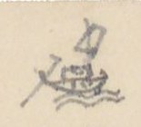{width=12%}

Chữ trên hình: không có.

| [Số dòng] | [Địa danh] | [Chữ Hán/Nôm] | [Ngày / Lối đi] | [Ghi chú] |
|---|---|---|---|---|
| | 3° Ngã ba Ngọc chúc | 玉燭 | (Bộ) | Thuộc Sơn tây (山西). Đường bộ theo đê |
| | Sông Lôi | [氵+雷]河 | | |
| 30 | Tuần hiên | 巡軒 | | |
| | (Thu vật châu) | 收物 | | Lên |
| | Lục An châu | 陸安州 | | |
| | Vị xuyên châu | 渭川州 | | |
| | Lâm trường Tổng | 林場 | | 總 [tổng] |
| 34 | **Tụ long** | 聚龍 | 12 ng. | Đường bộ rất gồ ghề |
| | 4° Ngã ba Nố [?] | 我巴 [?] | (Thủy) | Cửa sông, vào ngang |
| | Sông An lũng | 安隴 [?] | | |
| | Đò Bát | 渡鉢 | | |
| | Vạn Hỉ | 澫嘻 | | Qua.. |
| | Cửa sông An long | 安竜 | | Lên. |
| 40 | Khe Xảo (cửa) | 巧溪 | | 口 [cửa] |
| | **Hà giang** | 河洋 | 16 ng. | Đường đây, lên bộ |
| | **Tụ long** | 聚竜 | | |
| | 5° Ngã ba Ngọc chúc | 玉燭 | Thủy | Vào |
| | Cửa sông Lôi | [氵+雷]江口 | | |
| 45 | Thác Cái | 托丐 | | |
| | Thác Ngô đồng | 托梧桐 | | Lên thác |
| | (Thu Vật) sông | 收物 | | |
| | Tuần Hiên | 巡軒 | | |
| | Phố Đại đồng | 大同 | | 庯 [phố]. Dừng lên bộ. Đi theo đường [Tuyên Quang 3/ số 31, 32, 33.] |
| | **Tụ long** | 聚竜 | | |

[NC: Tiếp theo trang trước: đường thứ 3° (đường bộ, 12 ngày), 4° (đường thủy lên Hà Giang rồi lên bộ, 16 ngày) và 5° (đường thủy sông Lô/sông Lôi rồi lên bộ). "ng." = ngày. Chữ "Nố" và chữ Hán thứ ba của "Ngã ba Nố" chưa đọc chắc. Nửa dưới trang có tiêu đề in VERRERIE DU NORD hiện ngược.]

# Trang PDF 338 - Trang trắng

[Mặt sau của tờ trước: chỉ có giấy tiêu đề in sẵn VERRERIE DU NORD, Hanoi, le ... 194..; nét chữ tờ bên kia hiện qua giấy. Không có chữ viết.]

# Trang PDF 339 - Tuyên Quang hành dịch (trang bản thảo 168)

*Đầu trang: "Tuyên quang H.D 1" [?] (bút chì rất mờ); số trang bản thảo: 168*

## TUYÊN QUANG HÀNH DỊCH (宣光行役)

[NC: tên bài nghĩa là "Đi việc quan ở Tuyên Quang". H.D = hành dịch. Đây là bài ca quốc ngữ (song thất lục bát) tác giả chép lại, chữ Hán ghi ở giữa dòng hoặc ở lề phải để chú địa danh, chữ khó.]

(Phan Kính 潘璥, Thám hoa khoa 1733, năm Canh thìn (1760) bổ làm Đốc đồng Tuyên quang, coi việc trấn thủ, soạn)

[NC: "Ct.th (1760)" viết đè lên chữ đã gạch "Ất ... 1735". Chữ thứ hai của tên Phan Kính viết là 璥.]

> Vừa năm Quí hợi (1733) khai khoa
> Phúc nhà may đậu thám-hoa ngay đình
> Hàng uyên chen gót công khanh
> Sang năm Ất sửu (1735) sai hành việc quan
> Mũ đồng áo sắt lên an
> Cờ sai trống hiệu dập dồn tướng quân
> Dây gai, đạp sóng quen chân
> Cõi ngoài trộm 濫 [lạm] được nhiều (nguyên: với mấy) lần đông nhung
> Hội công danh rắp vẫy vùng
> Bút niềm ngay thảo (覲 → 瑾 [?]), mấy trùng nước non
> Khoát tay mười bốn thu tròn
> Cõi nam tới những Lao 牢 [?] Bồn 盆 đâu đâu
> Ngược xuôi thủy vĩ ngàn-đầu 岸頭 [?]
> Quen no mặt tướng, thuộc làu tên quân
> Bường Càn 乾 đã tình hồi phân 分 [?]
> Ở ngôi đồng-các chầu gần điện phong 楓
>
> Biết vừa Kỉ mão (1759) quí-đông 季冬
> Ơn trên văn mệnh đốc-đồng 督同 xứ Tuyên 宣
> Tháng hai, mồng sáu, năm Thìn (1760)
> Rời thuyền bến Nhị trở miền phương tây   *(lề phải:* 渡珥 *)*
> Hứng xui phong cảnh sẵn vầy 圍
> Rượi kẻo [?] chén ngọc, thơ bày chữ châu
> Kìa đâu thức khói đen ~~màu~~ mù
> Ấy phường Thạch Khối những lò nung vôi   *(lề phải:* 石塊 *)*
> Cảnh-Hàn mũi nước chảy xuôi   *(lề phải:* 翹韓 [?] *)*
> Ấy nơi quân thủy đua bơi trên ghềnh
> Bác cung trên rủ bức mành 幔 [?]
> Sẵn bài giá-ngự 駕馭 [?] tập tành chư quân
> Tây hồ dồn phẳng 西湧 [?] bờ Ngân 銀   *(lề phải:* 西湖 *)*
> Trâu vàng cách lạ (撗 → 犢 [?]) Hùm vằn dễ dạ (thoa [?]) *(viết thêm phía dưới: gió)*
> Nhật chiếu 日昭 ác dãi thổ lò   *(lề phải:* 日昭 *)*
> Lê te [?] thuyền đậu, phất phơ cờ tuần

[NC: Trong ngoặc là chữ tác giả ghi dị bản hoặc chữ Hán tương ứng; nhiều chữ Hán viết nhỏ và nhanh, chưa đọc chắc. Theo niên biểu, Quí hợi là 1743 và Ất sửu là 1745 (không phải 1733, 1735); có lẽ tác giả (hoặc bản gốc) nhầm. Dòng "Hùm vằn dễ dạ" có chữ "gió" viết thêm phía dưới chữ "dạ" như một dị bản.]

# Trang PDF 340 - Tuyên Quang hành dịch (tiếp)

*Đầu trang: Tuyên Quang H-D 2*

> Chòm lau dạng trúc tần vần
> Một khu Vạn bảo nước phân hai dòng   *(lề phải:* 萬宝 *)*
> Hôn xao lữ khách quán hồng
> Đây là phố Gà tới vòng Sơn tây (山西)   *(lề phải:* 庯珂 [?] *)*
> Nền khói; cửa tướng quai [?] bày
> Qua làng Đông Ngạc 東鄂, rẽ dây đến Trêm   *(lề phải:* 露 [?] *)*
> Miếu thờ Ông Lý trang nghiêm   *(lề phải:* 翁李廟 *)*
> Dây sân cây lục 綠, nhiều thềm đá xanh
> Một phen ải Bắc ra danh
> Đúc đồng làm tượng còn kinh ngựa Hồ 胡
> Đưa thuyền, buông 卷 [?] bức rèm châu
> Nhớ quê, để gọi san-hô 珊瑚 biếng nằm
> Xa nhà chửa xứa bao lăm
> Một tuần ray lại thêm dăm bảy ngày
> Chữ rằng my [...] 盤 [?] đã vầy
> Nhác cân bên hiếu đã tày bên trung
> Chồn chân (嘬嗔 → 鎮 [?]) đường tía bụi hồng
> Một năm một tuổi đã hòng năm mươi
> Sĩ đồ 仕途 lắm thẩn [?] nực cười
> Rằng ngu thì phải, rằng lười cũng nên
> Rạng ngày dữ mối (繡 → 瑞 [?]) ra thuyền
> Bắt qua Đáy, Kẻ, để miền Đông Cao   *(lề phải:* 踏几 [?]; 東皐 *)*
> Mái mau, lạch thẳng dòi đào 濤 [?]
> Phân lưu có ngả tre 擳 [?], vào Hát giang   *(lề phải:* 渴江 *)*
> Nữ trung đấng ấy khác thường
> Nẻo trong (nguyên: xa) nọ Miếu Trưng vương còn thờ   *(lề phải:* 徵王廟 *)*
> Một đời liễu yếu đào thơ
> Thù chồng phải mước [?] 鏵 [?] 徐 [?] quân Ngô
> Làm chi đến chước khỏa-lồ
> Anh hùng chẳng dở 捐 [?] thẹn thò thuyền quyên
> Trận [?] ~~...~~ nằm trốc lại nông 抉埋濡 [?] lên
> Nhà Đông giao cọc 東交谷 [?], bãi liền cát sa.

[NC: "Hát giang" ở lề viết 渴江; "Trưng vương" ở lề viết 徵王廟 (徵 thay cho 徴). Nhiều chữ Hán nhỏ chưa đọc chắc.]

# Trang PDF 341 - Tuyên Quang hành dịch (tiếp) (trang bản thảo 169)

*Đầu trang: Tuyên Quang H.D 3; số trang bản thảo: 169*

> E ê bóng ác ban tà
> Chỉ miền Cam giá 甘[...] xưa là trấn doanh   *(lề phải:* 甘[...] [?] *)*
> Tản viên một đỉnh xanh xanh   *(lề phải:* 傘圓 *)*
> Huân xao ba miếu, anh linh muôn đời
> Hùng vương 雄王 cũng khéo trêu người
> Mà hòng một cuộc, đổi nơi cầu thù [?]
> Xa trông mái hửi [?] mù mù
> Độc tôn tam đảo tướng đồ tranh in   *(lề phải:* 独尊三島 *)*
> Kể chi ếch giếng loài hèn
> Khoe nhiều quân cờ, cậy bền lụy tre
> Lôi đình phút chốc ra uy
> Chẳng toan 指 [?] cảnh, một bề chắp tay
> Tham mưu nhớ thuở bình tây
> Kể từ năm ấy đến rày mười thu
> Châu Chàng ngọn nước đỏ xô   *(lề phải:* 洲橦 *)*
> Chèo ngang sang tới bến đò Đình hương   *(lề phải:* 亭香 *)*
> Nhà dân lấp thấp cạnh đường
> Có đò đưa khách tiện phương đi về
> Ấy danh bay lời việc gì
> Lên mái, xuống mạn thương khi thường đây!
> Tới nơi Tuần Hạc vui thay   *(lề phải:* 巡鶴 *)*
> Thơ xôn xao khách, rượu say sưa người
> Trống canh dinh trấn nhặt hồi   *(lề phải:* 營鎮 *)*
> Bến kia Lập [?] Phẩm 壘[?]品 mới dời năm xưa   *(lề phải:* 壘[?]品 *)*
> Sông Thao hợp với sông Lô   *(lề phải:* 滔, 瀘 [?] *)*
> Bến như quấy cát, nền như vắt chàm
> Cớ sao thuở dựng trời nam
> Chẳng phân thanh trọc, lộn làm một sông
> Cạy chèo 柁, lên ngả sông trong
> Thái nguyên 太原. Sông Đáy có dòng chảy ra   *(lề phải:* 滝底 [?] *)*
> Sơn đông buổi chợ khi qua   *(lề phải:* 山東 *)*
> Cửa dừng chân chưa, bánh qua Khê lê 溪黎
> Nóc lều chợ nổi so le
> Đã qua Lạch Rang lại kề Gềnh Thông   *(lề phải:* 沥[?]糊[?], 崇[?]椿 *)*
> Bà tươi [?] bếp nhóm 皆 [?] lửa hồng
> Hôm ngồi Bến Dốc, sớm dong Chợ Nghè   *(lề phải:* 渡篤 [?], 帮[?]儀 [?] *)*
> Đá chông, lửa 搢 [?] mọc khắt khe
> Xem nhường khấp khểnh, có bề cheo leo

[NC: Các địa danh viết ở lề phải là chữ Hán tương ứng với các địa danh gạch chân trong dòng; nhiều chữ viết nhanh, chưa đọc chắc.]

# Trang PDF 342 - Tuyên Quang hành dịch (tiếp)

*Đầu trang: 4 [NC: tức Tuyên Quang H.D 4]*

> "Ông bà" ai khéo đặt điều
> Rằng xưa kéo xuống lại trèo được lên
> Bởi đâu gây dựng cho nên
> Vô tình hay cũng có duyên nữa gì
> Kẻ Vài dựng đá sù sì 皺[?]皴[?]   *(lề phải:* 几萊 [?] *)*
> Giống hình như cóc, mọc 棱 [?] trửa dòng
> Đầu non phấp phới lá bông
> Bán đây Chợ Sảo liền dừng mọi nơi   *(lề phải:* 帮[?]稍 [?] *)*
> Gác chèo Vũng Sét 滓[?]霹[?] nghỉ ngơi   *(lề phải:* 滓[?]霹[?] *)*
> Nhà bè tựa bãi phỏng mười nóc dư
> Bến kia tòa đá khấp ~~vừa~~ bờ 皮 [?]
> Gọi (Phầm) Kẻ Cơm gói lời xưa còn rằng   *(lề phải:* 几𩚵[?]僧[?] *)*
> Lại rằng được ở cung trăng
> Hẳn xưa thế vậy, ả Hằng sao dung
> Hay là cung Quảng 廣 lạnh lùng
> Nói ngon mằn mẹ 醰[?]醲[?] can lòng cũng xiêu
> Kẻ ngang 几昂 dụ thú ngư tiều
> Con thuyền bến đất cái diều 鐃 [?] trên mây   *(lề phải:* 武巴 [?] *)*
> Khỏi Dầm 杋[?] đến ngã ba Chảy   *(lề phải:* 棪[?], 柴 [?] *)*
> Ngạc 灣 [?] kìa sông Chảy, ngạc này sông Lô   *(lề phải:* 沚[?], 瀘 *)*
> Hương bay sườn núi một từ 祠
> Gió đưa tiền-mã 仙[?]馬 (?) nhởn nhơ trước mành 幔 [?]
> Nữ trung đấng ấy tinh anh
> Cõi trần thuở trước thác sanh một nhà
> Làm thần có miếu cả ba
> Tam Kỳ đá cả, đây là một nơi   *(lề phải:* 三岐 *)*
> Cung thiềm dựng tỏ gương trời
> Chiều hôm tiểu trú 駐, sớm dời bến Giai   *(lề phải:* 渡佳 *)*
> Khôn khôi [?] 圃[?]鬼[?] rau rô, cá chai 蒌[?]薈[?]
> Đây là Chợ Đê, cõi Đoài 兑 từ đây   *(lề phải:* 帮[?]堤 (兑) *)*

[NC: Ở dòng "Gọi (Phầm) Kẻ Cơm gói", tác giả viết chữ "Kẻ" phía trên, gạch chữ "bản" [?]. Chữ "mằn mẹ" viết bằng mực khác (hồng nhạt). Nhiều chữ Hán nhỏ chưa đọc chắc.]

# Trang PDF 343 - Tuyên Quang hành dịch (tiếp) (trang bản thảo 170)

*Đầu trang: Tuyên quang HD 5; số trang bản thảo: 170*

> Thủy trình kể đã mười ngày
> Thẳng miền Doanh Dược mới này cõi Tuyên   *(lề phải:* 營藥 (宣) *)*
> Hãy còn bờ lũy như in
> Nguyên xưa chốn ấy là miền Trấn ti   *(lề phải:* 鎮司 *)*
> Lại nơi Bãi Phủ gần kề   *(lề phải:* 堺[?]府 *)*
> Vách thành nửa đổ, chữ bia nét mòn
> Đời nào xây tháp Ỷ Khôn?   *(lề phải:* 倚坤 *)*
> Quan nào ở đấy, nào còn ai hay!
> Sông còn Vũng Khổng tuôn đầy   *(lề phải:* 滓[?]孔 *)*
> Doanh Tranh có vực, rằng này thủy cung   *(lề phải:* 溫[?]𣾷[?]梯[?] *)*
> Gềnh 橦 [?] lại thác Ngựa lồng   *(lề phải:* 馭[?]篭[?] *)*
> Tam Kỳ đá cả đã trông thấy đồn   *(lề phải:* 三岐, 碍[?]奇[?] *)*
> Đồng hồ rầm rịch 驛[?]役 cạy dồn 掋[?]𠿯[?]
> Một giây đến trước doanh-môn vào thuyền   *(lề phải:* 營門 *)*
>
> Nhìn xem cảnh vật một miền
> Hai nơi họp chợ, một bến đặt tuần
> Có từ 祠 trên chúa 仙[?]主 nẻo gần
> Núi Rườm [?] 𡽫[?] còn nét mỏ ngân rành rành
> Non cao tấm bức phơi tranh
> Pha lê lấp lánh một doanh giăng quen 扛[?]鵬[?]
> Vạn chài 滿[?]紂[?] chập chơi mấy thuyền
> Phơi cánh cốc, bãi in chân cò
> Gà rừng gáy dộng 嘡 o o 鳴
> Cảnh này *(viết phía trên: chiều)* 熅 [?] cũng thanh tao   *(mực tím, ở lề phải:* (đứt mất) *)*
> Non vàng sông bạc chỉn nhiều *(viết phía trên: yêu)*   *(lề phải: dấu nhắc lại* " *)*
> duyên 鉛 có mỏ, diêm tiêu có lò
> Từ 姜[?]祠 kinh bỉ tác đồ
> Vẻo von liếng nhạn, gẫy gò mất chim câu 鳩 [?]
> Rày tuy thẩn 蠢[?]蠢[?] đã chìm lâu
> Chưa vui hoàn định 还[?]定 còn âu điêu tàn
> Nha môn ít có việc có việc vạn 萬
> Hoa rời sân kiện, ngục gian chẳng phiền
> Cảnh sơ già bụi 㐲[?]字[?] non liền
> Mây che mây cửa, nguyệt xuyên chân thành
> Gieo neo hai chiếc thuyền hành
> Nhà bè hai mảng đảo gành đạo ngay.

[NC: Ở hai dòng "Cảnh này ... cũng thanh tao" và "Non vàng sông bạc chỉn nhiều", tác giả để khoảng trống và ghi thêm phía trên các chữ "chiều", "yêu"; bên phải ghi mực tím "(đứt mất)" và dấu nhắc lại, tức bản gốc bị mất chữ ở đó. Chữ "duyên" có lẽ thuộc cuối câu trước hoặc đầu câu sau.]

# Trang PDF 344 - Trang trắng

[Trang trắng: mặt sau tờ trước, chỉ có giấy tiêu đề in sẵn VERRERIE DU NORD; nét chữ trang bên kia hiện ngược qua giấy.]

# Trang PDF 345 - Trấn Biên: đường bộ (trang bản thảo 171)

*Đầu trang: Trấn biên 1; số trang bản thảo: 171*

## TRẤN BIÊN - Đường bộ

[NC: Trấn Biên (鎮邊) là tên trấn thời Gia Long, nay vùng Biên Hòa - Đồng Nai. Con số là số tầm; "T." = tầm.]

| [Địa danh] | Chữ Hán | [Số tầm] | [Ghi chú] |
|---|---|---|---|
| ① **Dinh Khổn** | 營閫 | 100 | Đi về Tây |
| Miếu Hội đồng | 會同 | 91 | Năm Ất mão mới lập (1795) |
| Ngã ba tả | 我巴左 | 160 | Qua đường đi Tây nam 1.765 đến thôn Tân Hưng 新興 qua bến chợ Điếm lá 坫[?]莫[?]市津次 |
| Cầu Đá | 石橋 | 6.350 | Dài 100T. Mụ Đôi Hòa 媒[?]陽和 lập. |
| Ngã ba Chổ Sa | 坴[?]沙 | 4.221 | Có một chi đi về Tây nam, đi 2.650 đến đò bờ bắc, bến Đò đường sứ 渡渡唐使. Qua sông đến bến Đường sứ đạo thủ 唐使道守. (Xem sau) |
| Cầu Khe nhỏ | 小溪 | 52 | Dài 6T. Tên Cầu Rạch Đông |
| Ba can đạo thủ | 巴干道守 | 923 | Thu thổ sản thuế |
| Bến trạm Mụ Văn | 媒文 | 1.353 | 坫津 [điếm tân] |
| Bến Cát bờ đông | 渡葛 | | 東岸 [bờ đông]. Rộng 85T |
| Điếm Bến Cát | 〃 站 | 3.753 | Từ đây đường đi Tây bắc |
| Ngã ba cây gạo (Giao dịch trường phân thủ) | 核[?]梏[?] 交易場 分守 | | Cách dinh Khổn 1.7.194 tầm. Chia ra hai đường |

[NC: *Giao dịch trường phân thủ* (交易場分守) [đồn phân thủ ở nơi buôn bán]. Số "1.7.194" viết như vậy trong bản thảo, có lẽ là 17.194.]

**a)** (Đường hữu về Bắc)

| [Địa danh] | Chữ Hán | [Số tầm] |
|---|---|---|
| Sông | 江 | 15.612 |
| Suối Lạc đốc (về tây) | 源[?]勒篤 | 14.531 |
| S. La nga (qua sông) | 哭[?]涐江 | 48.944 |
| Cuối s. Đồng nai | 仝[?]狔江 | |
| Núi Ba ba (nam) | 巴巴山 | 28.801 |

**b)** (Đường tả) về Tây nam 6.570

| [Địa danh] | Chữ Hán | [Số tầm] |
|---|---|---|
| Ngã ba (về nam) | 我巴 | 3.780 |
| Ng. ba Đông hạ | 東下 | |
| Vàm Đạt điếm | 沈[?]達 | |

| [Địa danh] | Chữ Hán | [Số tầm] | [Ghi chú] |
|---|---|---|---|
| Ngã ba Đông hạ | 東下 | | Trở lại Cây gạo (xem đường b) |
| Trường Giao dịch Cây gạo | 核[?]梏[?] 場 | | Ở trường này có gỗ lai du [?] 獺[?]油 người ta lấy dầu. Lại có gỗ mun? 木[?]杈[?], thịt sáng như san hô. |

| [Địa danh] | Chữ Hán | [Số tầm] | [Ghi chú] |
|---|---|---|---|
| ② **Ngã ba Chổ sa** | 坴[?]沙 | 2.650 | [Xem Trấn biên 1/32] |
| Bến Đường sứ đạo | 唐使道 | 1.150 | 守 [thủ] |
| Ng. b Tân hòa th. | 新和 | 38.346 | Cuối rạch Đông lũy 東壘. Hai ngả? |
| (Đi Tây nam) | | ~~38.346~~ | Một chi đi tây nam 10.435 đến đồn Cần Bông 芹蓬守 |
| Điếm Vàm Đạt | 沈[?]達坫 | 4.470 | |
| Ngã ba (về nam) | | 5.260 | Một đường về tây 3.780 đến Ngã ba |
| Ngã ba Tham linh | 參[?]員[?] | 13.550 | Có đồn phân thủ, lối về tây 20.677 đến ~~...~~ sách Ngã ba ~~...~~ Vũ viên 武員 |

[NC: "Ng. b Tân hòa th." = Ngã ba Tân hòa thôn [?]. Số khoanh tròn đỏ ①, ② là số tác giả đánh cho từng tuyến đường.]

# Trang PDF 346 - Trấn Biên (tiếp)

*Đầu trang: Trấn biên 2*

[NC: Tiếp tuyến ② ở trang trước.]

| [Địa danh] | Chữ Hán | [Số tầm] | [Ghi chú] |
|---|---|---|---|
| Giản sách | 檵[?]間 冊 | 2.1859 | Giáp bộ lạc mọi 荒[?]蠻[?] |
| Bông trà la | 樬[?]梌[?]羅[?] | | Có đồn 守 [thủ] |

[NC: Số "2.1859" chép đúng như bản thảo (có lẽ là 21.859). Phần còn lại của trang để trống; nửa dưới có tiêu đề in VERRERIE DU NORD in ngược, chữ trang bên kia hiện qua giấy.]

# Trang PDF 347 - Trấn Biên: đường thủy, Nhà Bè (trang bản thảo 172)

*Đầu trang: Trấn biên (đường thủy) 3; số trang bản thảo: 172*

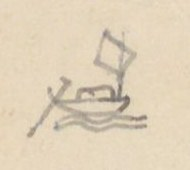{width=12%}

## TRẤN-BIÊN - Đường thủy - Nhà Bè

| [Địa danh] | Chữ Hán | [Số tầm] | [Ghi chú] |
|---|---|---|---|
| 1° **Bến trấn Khổn** | 鎮閫 | 4.711 | Trước dinh, trên Đại giang, đi xuôi |
| Chợ Tân lân th. | 新鄰 | | |
| Ngã ba R. Cát | 沠[?]葛 | | Đò ngang xuôi 1884 đến Sông Sau 滝𢹇[?]. Rạch chảy ra Đại giang. Phía tả sông có bãi lớn, tức là Cù lao Phố 岢[?]勞[?]庯, dài 1.500 [?], rộng 1070T. Thời xưa phố xá nhà ngói liền nhau. Thuyền buôn hay trú đó. Đến đời Tây sơn 西山 thì hóa ra ruộng vườn hết. |
| Bình tiên th. | 平箋 | | |
| Đò chợ Đồn | 帮[?]屯渡 | | |
| Miếu Lễ thành hầu | 禮[?]誠侯 | | Quan Chưởng cơ 掌奇. Tướng tiền triều đánh nhau với Cao miên 高綿 chết ở đó. Lập miếu thờ; quốc tế Phong Khai quốc công thần 開國公臣. Đời Tây sơn 西山, có tao nhân qua miếu đề thơ (xem dưới). |
| Đá Hàn | 碍[?]寒 | | |
| Cửa R. Thủ hoằng | 首弘 | | Chảy về nam 1150 đến cuối, có cầu bắc ngang, gọi Cầu Quan 求[?]官 |
| Tân Vạn th. | 新萬 | | |
| Chợ Đồng Nai | 仝狔 | | |
| Tân phúc th. | 新福 | | |
| Chùa Sắc tứ | 敕賜 | | Do quan Thống suất 統率 Vân long hầu 雲竜侯 đời tiền triều lập, sau được sắc tứ. |
| Sông Sau | 滝[?]𢹇[?] | | Hay là Cù lao Phố hạ 岢[?]勞[?]庯下滝 |
| Cửa R. Mụ Lộ | 媒露 | | Chảy về nam 1200 đến Rạch Cai Quý 該貴, đến ngã ba R. Đồng trôn 仝[?]𡲤[?]. Lại 650 là cùng, đến đường quan lộ. Có cầu Ba văn 三板橫求[?] |
| Cửa Rạch Ốc | 沠[?]渥[?] | | Quanh phía bắc 1510T, xuống phía đông tới R. Tham ôn 參溫, chảy ra Đại giang. |
| Chùa Vãi Lượng | 媪[?]諒 | | Vãi Lượng dựng ~~...~~ nên. Khách có thơ (xem dưới). |
| Cửa R. Cai quí | 該貴 | | Chảy về nam 947 giáp ngã ba Mụ lộ 媒露, Đồng trôn 仝[?]𡲤[?]. |

[NC: Chữ "Tân lân th.", "Tân Vạn th." = thôn. Ba dòng Bình tiên - Đò chợ Đồn - Miếu Lễ thành hầu và hai cặp Tân Vạn - Chợ Đồng Nai, Tân phúc - Chùa Sắc tứ được tác giả gộp bằng dấu ngoặc. "Phong Khai quốc công thần" chép theo bản thảo, có lẽ là "phong Khai quốc công thần".]

Thơ đề ở miếu Lễ thành hầu (đời Tây sơn):

*Bạch thảo thê thê cổ tái trần, hoang thành hoàn kiến dã hoa tân. Thiên tương sự nghiệp lưu tiền đại, địa dĩ sơn hà thuộc hậu nhân. Phong vũ vị yếm kinh chiến cốt, tử tôn hoàn thác loạn ly thân. Bình sinh nhất trích tầm thường lệ, bất khấp trung thần khấp loạn thần [?].* (白草凄凄古塞塵，荒城還見野花新。天將事業留前代，地以山河屬後人。風雨未厭經戰骨，子孫還托亂離身。平生一滴尋常淚，不泣忠臣泣亂臣 [?]。)

**Dịch:** Cỏ trắng úa buồn, bụi ải xưa; thành hoang lại thấy hoa đồng tươi mới. Trời đem sự nghiệp để lại cho đời trước, đất lấy núi sông giao thuộc người sau. Mưa gió chưa chán vùi xương chiến trận, cháu con còn gửi tấm thân loạn ly. Bình sinh một giọt lệ tầm thường, chẳng khóc trung thần lại khóc loạn thần [?].

[NC: Chữ cuối câu 1 viết giống 坐, đọc là 塵 (dạng viết tắt 尘); chữ đầu câu 5 viết giống 兄雨, đọc là 風雨; chữ cuối câu 8 viết như 匡, chưa chắc.]

Thơ đề ở chùa Vãi Lượng:

*Sơ lâm di [?] phế tự, hoang kính tỏa chinh trần. Bảo tháp quy ngưu lộ, liên trì ẩm mã tân. Hoa hàm chung cổ hận, thảo trưởng vãng niên xuân. Mãn mục bi [?] linh lạc, u hoài [?] nhập vận tân.* (~~郴~~踈林遺[?]廢寺。荒徑鎖征塵。寶塔歸牛路。蓮池飲馬津。花含終古恨。草長往年春。滿目悲[?]零落。幽懷[?]入韻新。)

**Dịch:** Rừng thưa còn chùa bỏ hoang, lối cỏ khóa bụi đường xa. Tháp báu thành lối trâu về, ao sen thành bến ngựa uống nước. Hoa ngậm mối hận muôn đời, cỏ mọc như xuân năm trước. Đầy mắt cảnh tàn tạ, nỗi u hoài vào vần thơ mới.

[NC: Câu đầu tác giả viết rồi sửa nhiều chữ (遠, 舊 [?] gạch hoặc viết đè); câu cuối có chữ 頁 [?] gạch. Ở lề trái gần cuối trang có dấu tròn mờ của thư viện.]

# Trang PDF 348 - Trấn Biên: đường thủy (tiếp)

*Đầu trang: Trấn Biên 4*

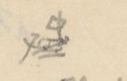{width=12%}

| [Địa danh] | Chữ Hán | [Số tầm] | [Ghi chú] |
|---|---|---|---|
| Phúc hòa th. | 福和 | | |
| Miếu Long vương | 龍王 | | Quan Thống suất Vân long hầu 雲竜 lấy nền để tạ ơn |
| Cửa R. Sâm Man | 參漫 | | Chảy (vành [?]) về bắc 990T, giáp R. Ốc 沠[?]渥[?]滝[?] |
| Cửa R. Đồng trôn | 仝[?]𡲤[?] | | Chảy về nam 940 giáp ngã ba Mụ Lộ 媒露, Cai quí 該貴 |
| Chùa Xã Quát | 社檜[?] | | Tên là Chùa Khánh long 慶竜. Khách có thơ (xem dưới). |
| Chợ Chỉ tượng | 紙匠 | | |
| Cửa R. Đồng Chân | 仝禛[?] | | Chảy về bắc, tới chợ bến Khổ 渡楛[?] ở An hòa 安和, chảy về đông đến ~~...~~ Cửa R. Lò thổi 炉[?]𠺙[?]. Chảy về đông bắc gặp R. Lai Bồn 萸[?]奔[?] hợp lưu. |
| Ng. b. Cái Tắt trên | 丐[?]𤈿[?]上 | | 三岐 [tam kỳ]. Ngã ba Cái Tắt. Trửa có bãi cát dài 2.850, rộng 1580, tên là Cù lao Cái Tắt 岢[?]勞[?]丐[?]𤈿[?]. Dân ở thành đất ruộng. Dòng phía Bắc to, phía nam [nhỏ]. |

[NC: "Ng. b." = Ngã ba.]

Thơ ở chùa Xã Quát (chùa Khánh long):

*Tiêu sơ lĩnh thụ quải tà dương, bộ nhập khê nham phỏng đạo tràng. Chử [?] mính vô yên sào hạc tĩnh, khả liên thiền vị chính thê lương.* (蕭踈嶺樹掛斜陽。步入溪岩訪道場。烧[?]茗無烟巢鶴靜。可憐禪位正凄涼。)

**Dịch:** Cây núi lơ thơ treo bóng chiều, bước vào khe đá thăm đạo tràng. Nấu trà không khói, tổ hạc lặng im; thương thay ngôi thiền đang buồn hiu quạnh.

**a)** (Ngành Nam) 小江 [sông nhỏ] 3380

| [Địa danh] | Chữ Hán | [Ghi chú] |
|---|---|---|
| Cửa R. Khu Công | 堰[?]鴣[?] | Có cồn dài 1675, rộng 980. Lại chảy 1.320T rồi chia làm hai phái: phái nam chảy 260T hết; phái tây chảy 950T đến Suối Ông 源[?]𣘃[?], qua quan lộ. Lại ngược lên 900 là hết, tên là Suối Cai lan 該[?]蘭 |
| Cửa R. Rào qua | 撣[?]𣘃[?] | Có cồn dài 750, rộng 430. Trong dưa hấu 西瓜 [?] hợp. Lại đi 1.300T là cùng. |
| Cửa R. Tôm | 沠[?]𩵜[?] | Chảy 610 đến cửa rạch Ngã Tắt Lão nhiêu 我𤈿[?]老鐃[?] cùng Đại giang hợp chảy |
| Cửa Giang hạ | 江下 | Tức là hạ lưu Cái tắt 丐[?]𤈿[?] |
| Chảy vào Đại giang | 大江 | |

# Trang PDF 349 - Trấn Biên: đường thủy (tiếp) (trang bản thảo 173)

*Đầu trang: Trấn biên 5; số trang bản thảo: 173*

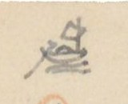{width=12%}

**b)** (Ngành bắc) 大江 [sông lớn] 349

| [Địa danh] | Chữ Hán | [Số tầm] | [Ghi chú] |
|---|---|---|---|
| Cửa R. Lái Nguyệt | 𣑺[?]月 | 1.320 | Chảy về bắc 450 giáp R. Lá Bồn 萸[?]奔[?] hợp lưu |
| Cửa R. Lá Bồn | 萸[?]奔[?] | 258 | Từ kinh vào 2450 giáp cửa R. Lái Nguyệt 𣑺[?]月. Lại 2.435 giáp cửa R. Đồng Chân 仝禛[?]. Lại 4985 đến Quan lộ, Cầu Lá bồn 萸[?]奔[?] [TL đi Nam 50/7]. Phía bắc Cầu đi 3.320 đến đồn Lá bồn 守屯, để thu thuế thổ sản; 5.820 đến Ngã ba: phía đông có rạch nhỏ đi 12.500 đến cuối nguồn, tên Suối Sâu 源[?]深[?], giáp Lăng [?]; phía đông, Rạch Lá bồn rẽ về Tây *(mực tím: ngược)* 5350 đến ghềnh lớn, tên Thác đá 瀑[?]漫[?]. Nước dựng đá, tiếng kêu dội hay núi. Đến đó lên bộ vào miền Mọi 蠻 giao dịch. Rồi không biết mấy ngàn vạn tầm mới đến cuối nguồn |
| Cửa R. Mụ Chảo | 媒[?]𣘃[?] | 550 | Chảy về Bắc 1650 đến cùng |
| Cửa R. Nước Trong | 渃冲 | 450 | Chảy về Bắc 2770 đến Điếm Mụ Mới 媒買. Lại 1660 đến Suối Ông gặp quan lộ ở Cầu Nước Trong [TL đi Nam 50/6]. Lại về Tây bắc 300T đến cuối. |
| Cửa R. Đồng Môn | 仝門 | 905 | Chảy về đ.b. (đông bắc) 2.540 đến nguồn Suối trú 源住; chảy về t. 1.254 đến Quan lộ Cầu nước trong [50/6]. Từ cửa Suối Ông 源𣘃[?] lại chảy về đ.b. 690T đến cửa Suối quán thủ 源舘守, ~~có đồn thủ~~ ở bờ bắc có ~~...~~ suối 泉[?], chảy về T.b. 1395 đến quan lộ, Cầu Quán thủ [50/5], lại đi về t.b 2.700 đến cùng. Suối ấy có tên Ngọn suối cùng 𡽫[?]源窮. Ở bờ nam có năm đồn đất 土屯 (có lẽ 土壘?) như hình năm sao. Từ Cửa Quán Suối thủ (hay cửa suối quán thủ?) chảy về đ.b. 100T đến Cầu. Theo đường khô đi về bắc 300T lên đến Đồng môn đạo 仝門道, giáp Quan lộ [50/4], đi về nam 2900T xuống thông Chợ Rạch Toại 沠[?]遂. Từ đò ngang chảy sang đông 360 đến cuối, có chợ Đồng Môn 市[?]仝門. Lại đi 60 đến R. Rào qua 撣[?]𣘃[?], 570 gặp suối Đồng Hưới (nguyên viết: Chuôi) 仝𣘃[?]; ngược lên tây 675 đến Cầu Đồng Hưới 仝𣘃[?] gặp quan lộ *(mực tím:* (𣘃[?]) *)* [50/3]. Lại 6.750 đến Cùng: tên là suối Mụ lở 媒𣆐[?]. Từ ~~cửa~~ suối Đồng hưới 仝𣘃[?] chảy về đông 2.943, giáp Sông Mụ Kỷ 媒記 [TL đi Nam 50/1] |
| Cửa Cái Tắt dưới | 丐[?]𤈿[?]下 | 400 | Lên 3.910 giáp cửa Cái Tắt trên 丐[?]𤈿[?]上, hợp với Đại giang. Bờ nam tức là Cù lao Lão nhiêu 岢[?]勞[?]老鐃[?] |
| Ngã ba giang Ô | 杈[?]江烏 | 5.200 | Ở trửa nổi bãi cát to. Dài 1000 tầm, rộng 900T, tên là Cù lao Mõi mũi 蜯[?]咮[?] *(mực tím, phía dưới: muỗi* 生末 [?]*)*. Dòng chảy |

[NC: "[TL đi Nam 50/7]" là chỗ tác giả dẫn sang mục *Thăng long đi Nam* trang 50 dòng 7 (theo quy ước ở Mục lục); các chỗ [50/6], [50/5], [50/4], [50/3] cũng vậy. "đ.b." = đông bắc; "t.b." = tây bắc; "t." = tây. Các số gạch chân trong bản thảo không giữ gạch chân. Chữ Hán của nhiều địa danh viết nhỏ, chưa chắc.]

# Trang PDF 350 - Trấn Biên: đường thủy (tiếp)

*Đầu trang: Trấn Biên 6*

[NC: Tiếp ghi chú của dòng "Ngã ba giang Ô" ở trang trước.]

là dòng nhỏ, bọc phía tả bãi, 6.545 xuống giáp đuôi sông Ngã ba Mõi Muỗi 蜯[?]咮[?] cùng Đại giang hợp. Trước (先) 1500 đến Rạch Toại 遂 ở bờ Bắc; chảy về đ.b. 1300T đến cuối. Có chợ tên chợ Rạch Toại. Dòng chính chảy phía nam bãi, đến

| [Địa danh] | Chữ Hán | [Số tầm] | [Ghi chú] |
|---|---|---|---|
| ~~Ngã ba Nhà Bè~~ | ~~𣘃[?]家三~~ | | ~~岐. Phái t.n (tây nam) qua Bến Nghé 渡[?]𤙭[?]~~ |
| Ngã Tắt Lão Nhiêu | 我𤈿[?] | 20 | 老鐃[?], ngược lên 1.200T giáp cửa lạch. Đó là đường tắt |
| Ngã ba Mõi muỗi | 蜯[?]𧍉[?] | 1.690 | Đi 990 đến bờ nam tên là Mai các lý 枚各里 |
| **Ngã ba Nhà bè** | 𣘃[?]家三 | | 岐. Phái t.n. đi về Tây, qua Bến Nghé 渡[?]𤙭[?]. Thượng lưu sông 101.575 đến suối Thủy bột trên 水勃上; Phái đ.n chảy xuống 24.970 ra cửa Cần giờ. Người ta nói rằng, ở tổng Tân chính 新政 có nhà giàu tên Thủ Hoằng 首弘 kết bè làm nhà ở Ngã ba, trữ đồ ăn, phát chẩn cho người đi đường. Cho nên có tên Ngã ba Nhà Bè. Ngã ba Nhà bè cách Cái Tắt trên 11.117 tầm |

[NC: Tác giả gạch bỏ dòng "Ngã ba Nhà Bè" đầu tiên rồi viết lại ở dưới. "三岐" = ngã ba; "t.n." = tây nam; "đ.n" = đông nam. Ở lề phải trên cùng có hình thuyền nhỏ và số khoanh đỏ của trang sau hiện qua giấy. Nửa dưới trang để trống.]

# Trang PDF 351 - Trấn Biên: Nhà Bè (trang bản thảo 174)

*Đầu trang: Trấn Biên 9 [?]; số trang bản thảo: 174*

[NC: Chữ số ở đầu trang trông như "9", nhưng trang trước là "Trấn Biên 6", có lẽ là "7".]

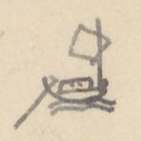{width=12%}

## NHÀ-BÈ

| [Địa danh] | Chữ Hán | [Số tầm] | [Ghi chú] |
|---|---|---|---|
| 1° **Ngã ba Nhà bè** | 𣘃[?]家 | | [TL vào Nam 49/7] |
| Bến Thủ thiêm | 首添津 | 1.102 | [〃 49/17] |
| Cửa Rạch Tích [?] | 沠[?]𢱢[?] | 2.613 | Dọc sông ở bờ nam có cửa R. Mụ Nghi 媒儀, lại có cửa R. Cái Tắt cầu sơn 丐[?]𤈿[?]求[?]山. ~~Chảy~~ Đi lên bắc 1.090 đến cuối. |
| Cửa R. Đồng nhiên | 仝然 | 647 | Đi bắc 1327 đến cùng |
| Bến Trùm Cháy | 仝[?]𤇮[?] | 700 | |
| Cửa R. Thủ đức | 首德[?] | 2.801 | Trên có chợ Thủ đức |
| Cửa R. Khu dừa | 堰[?]𣘃[?] | 2.080 | Cuối có chợ Khu dừa |
| Cửa R. Lái thiêu | 𣑺[?]燒 | 3.018 | Trên có chợ Lái thiêu. Dọc đường đi 730T có R. Cái Tắt 丐[?]𤈿[?] thông với R. Mụ nghi 媒儀 |
| Cửa R. Mụ Lũ | 媒縷[?] | 2.240 | Bờ nam dọc đường có rạch Tra đối 渣對. R. Muồi [?] chảy về bắc 2.400 là cuối |
| Đồn Băng bột đạo | 氷渤道 | 1.747 | Đồn Phân thủ thu thổ sản thuế |
| Cửa R. Cây Kè | 沠[?]棋[?] | 2.180 | Đi về bắc 1.080 là cuối |
| Cửa R. Mụ Quyên | 媒絹[?] | 2.280 | Đi về bắc 4.088 là cuối |
| Bến Lão Rào | 老撣[?] | 1.120 | |
| Cửa R. Lão Mạn | 老慢 | 1.120 | Đi về bắc 2.280 đến cuối |
| Cửa R. Mộc | 沠[?]木[?] | 2.220 | Đi về bắc 1.170 là cuối |
| Ng. b. Ngã Con | 我昆 | | Ngã ba Cái con 丐[?]昆. Chia 2 phái |
| ⓐ (Phái Bắc) | | | Tên là Ngã ba Con 我巴昆 đi 56.462 đến Giao dịch trường bến Bút 渡[?]筆[?] |
| Cửa Phái | 派口 | 1.115 | Bờ bắc thuộc Trấn biên 鎮边, bờ nam thuộc Phiên trấn 藩鎮 |
| Bến Lão Quả | 老果 | 1.035 | |
| Cửa R. Mới | 沠[?]買 | 1.120 | Đi bắc 6.380 là cuối. Có bến Đa chảy 多蚳[?], tên là Bưng Dế 𣷭[?]蚳[?] |
| Cửa R. Cây | 沠[?]棋[?] | 3.280 | Đi bắc 6.660 đến cuối: tên Bến Dương 渡楊 |
| Bến Tranh | 渡爭 | 840 | |
| Cửa R. Cái Cát dưới | 丐[?]葛下 | 1.030 | Đi bắc 7.860 đến chỗ giao thủy hai sông Bến Súc 渡[?]𣽗[?] và Bến Gỗ 渡[?]𣘃[?] thông với R. Mụ Kiên 媒坚 |
| Cửa R. Cái Cát trên | 丐[?]葛上 | 4.590 | Đi bắc 3.340 là cuối |
| Điếm Bến Sắn | 渡[?]橽[?] | 5.780 | |
| Bến Lão Lã | 老呂 | 4.280 | |

[NC: "[TL vào Nam 49/7]" là chỗ dẫn sang mục Thăng long đi Nam, trang 49 dòng 7. "Ng. b." = Ngã ba.]

# Trang PDF 352 - Trấn Biên: Nhà Bè (tiếp)

*Đầu trang: Trấn biên 8*

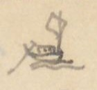{width=12%}

| [Địa danh] | Chữ Hán | [Số tầm] | [Ghi chú] |
|---|---|---|---|
| Bến Tả Môn | 𨰇[?]𣘃[?]門 [?] | 3.725 | |
| Bến Lão Tiến | 老進 | 4.949 | |
| Bến Trường Hươi | 圍[?]𤙭[?] | 4.820 | |
| Cửa R. Hớp | 沠[?]哈 | 3.980 | Về bắc 6.750 là cuối |
| Cửa R. Núi | 沠[?]𡶀[?] | 4.108 | Đi 320T là cuối |
| Cửa R. Bột | 沠[?]渤 | 3.810 | Đi 400 là cuối |
| Bến Lão Thiết | 老切 | 4.120 | |
| Cửa R. Cam xa | 甘車 | 3.880 | Đi nam 360 là cuối |
| **Bến Bút** (Trường Giao dịch) | 渡[?]筆[?] 交易場 | | 分守 [phân thủ] |

**ⓑ** (Phái Nam [?]) - Tên là Ngã ba Qui 我巴歸[?] ở cõi Phiên trấn 藩鎮. Từ Tầm vông tích thủ 尋[?]樬[?]積守 ngược 69.547 đến Ngã ba sông Lam 我巴滝[?]檻[?]

| [Địa danh] | Chữ Hán | [Số tầm] | [Ghi chú] |
|---|---|---|---|
| Tầm vông tích thủ | 尋[?]樬[?]積守 | 2.780 | |
| Điếm Bãi Bùn | 坫𡋂[?]粿[?] | 2.700 | |
| Bến Tha la | 他哭[?]津 | 670 | |
| Bến Nước trọc | 渃濁 | 50 | |
| Miếu Ngũ Công | 五公庙 | 3.070 | Miếu ở bờ nam, suối có 5 thác ngăn lòng sông. Thuyền dừng phải lặng ắt trôi. Hành nhân sở mà lập miếu. Thần vị hiệu là: Tà mỗ [?] quốc công 斜[?]𦛌[?]国公, Tà môn 斜[?]𣘃[?] quận công, Tà nông 斜[?]農, Tà Vọt 斜[?]𣳔[?], Tà Khuông 斜[?]匡 quận công. Sự tích không rõ [chỉ là tên các thác] *(mực tím: xem sau)*. |
| Cửa R. Bưng Lam | 𣷭[?]檻[?] | 28.990 | Đi tây nam 46.200 (là cuối). Tên điếm Mụ Điều 媒妙[?]. Trước đó 3.900T, phía nam sông có phái nhỏ về Tây, không biết mấy ngàn vạn Tầm. |
| Cửa R. Tre | 沠[?]椥[?] | 9.380 | Về nam 9.870 là cuối |
| Bến Trà Vấy | 樣[?]梯[?] | 5.200 | |
| Đại than thạch | 大灘石 | 6.012 | Đá ghềnh ở phía nam sông |

[NC: "Phái Nam" viết đè, đọc chưa chắc. *Đại than thạch* (大灘石) [ghềnh đá lớn]. Các tên "Tà ..." ở miếu Ngũ Công có lẽ là tên Việt hoặc tên dân tộc của 5 thác, chữ Hán đầu đều là chữ 斜 [?].]

# Trang PDF 353 - Trấn Biên: Nhà Bè (tiếp) (trang bản thảo 175)

*Đầu trang: Trấn Biên 9; số trang bản thảo: 175*

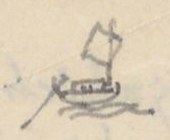{width=12%}

[NC: Tiếp ghi chú của dòng "Đại than thạch" ở cuối trang trước.]

| [Địa danh] | Chữ Hán | [Số tầm] | [Ghi chú] |
|---|---|---|---|
| | | | Ngăn lòng sông. Nước vỗ sóng dồn rất là dữ. Đặt tên là Tà Môn quận công 稱[?]斜[?]𣘃[?]郡公 |
| Bông Trà la (thủ) | 樬[?]梌[?]羅[?] | 750 | Đồn thủ |
| Cửa Than hớp | 灘哈 | 110 | |
| Đại Than thạch | 大灘石 | 320 | Đá ghềnh |
| Đại Than thạch | | 3820 | Tên là Tà Mỗ quốc công 斜[?]𦛌[?]国公 [X. Trấn biên 8/20] |
| Thác Chế Em | 制淹 | 515 | |
| Đại than thạch | | 5.200 | Đá ghềnh, tên Tà Nông quận công 斜[?]農. Các thác ấy, thuyền đi qua rất đáng sợ |
| **Ngã ba Sông Lam** | 滝[?]檻[?] | | 三岐 [tam kỳ]. Chi về t.n., tên Sông Lam 檻[?] 3970 đến Đại than thạch tên Tà Vọt quận công 斜[?]𣳔[?]郡公, rồi lên không biết mấy ngàn vạn tầm mới cùng |
| chi tây bắc (Sông Dụ) | 滝[?]喻[?] | 2930 | |
| Đại than thạch | 大灘石 | | Tà Khuông quận công 斜[?]匡. Lên không biết mấy ngàn vạn tầm mới cùng |

[NC: "[X. Trấn biên 8/20]" = xem Trấn biên trang 8 dòng 20.]

### 2° Nhà Bè

| [Địa danh] | Chữ Hán | [Số tầm] | [Ghi chú] |
|---|---|---|---|
| Tắt Bãi (cửa sông) | 𤈿[?]牌 | 7.450 | 水口 [thủy khẩu] [TL vào Nam 49/2]. Chảy xuống |

Bờ nam [có các cửa đổi [?]]:

| [Địa danh] | Chữ Hán | [Số tầm] |
|---|---|---|
| | | 1.400 |
| Cửa Vàm Giăng xay | 沉[?]杠[?]𡏧[?] | 1.300 |
| Cửa Vàm Lão tiều | 沉[?]老小 | 980 |
| Cửa R. | 沠[?]𢫕[?] | 2728 |
| Vàm Móng gà | 沉[?]𤙭[?]鴟[?] | 290 |
| C. Vàm Cái bầu | 丐[?]𤁘[?] | |

(Đều ở cõi Phiên trấn) [3/10]

| [Địa danh] | Chữ Hán | [Số tầm] | [Ghi chú] |
|---|---|---|---|
| Cửa Ngã Vàm | 我沉[?]口 | 1950 | Đi về Đông bắc 900 đến Cái Tắt Đợi nữ 丐[?]𤈿[?]𣆐[?]女; về đông giáp Sông Mỏ 某[?]江. Từ Tắt Đợi nữ vàm chảy về bắc 450 đến sông Tắt Bãi 𤈿[?]牌 giáp Ng. b Đầm Nang 潭[?]囊[?] rồi hợp lưu |
| Ngã ba Cơi | 槐[?]𣘃[?] | 1300 | Dọc sông có: 1000 về tây nam có cửa Vàm Động đình 洞庭; lại 450 đến cửa Vàm Cái Súc 丐[?]𩛂[?]. Sông ngã ba chảy đông bắc 100T đến Ng ba |

[NC: "C." = cửa; "Vàm" = cửa rạch, cửa sông (tiếng Nam Bộ).]

# Trang PDF 354 - Trấn Biên: Nhà Bè (tiếp)

*Đầu trang: Trấn biên 10*

[NC: Tiếp ghi chú của dòng "Ngã ba Cơi" ở trang trước.]

| [Địa danh] | Chữ Hán | [Số tầm] | [Ghi chú] |
|---|---|---|---|
| | | | Cá nhiệm 𩵜[?]𩶬[?]. Đó có sông nhỏ chảy về đông 2260 đến Mũi Cái mách 𡲤[?]丐[?]𠰍[?]. Chảy xuống ra cửa Cần giờ 芹蒢. Từ Ngã ba Cá Nhiệm chảy về đ.b. 402 đến Ngã tư. Hợp lưu |
| Mũi Cái Mách | 𡲤[?]丐[?]𠰍[?] | | Phía đông nam có cửa Vàm Cù lao Cái Súc 岢[?]勞[?]丐[?]𩛂[?]. Lại 500, có Vàm Thủ khoán 守券. Lại 210 đối với Cần Giờ 芹蒢 |
| **Cửa Cần giờ** | 芹蒢 | | 海門 [cửa biển] |
| ③ **Cửa sông Mũi Bìm** | 𣘃[?]𣘃[?] | 2.050 | [TL đi Nam 48/15] Đi về đông 10.345 đến Cửa Tắc Khái 塞[?]槩[?]海門 |
| Rạch Cỏ May | 䓆[?]埋 | 500 | Đi đ.n. 2180; phía tả có dân ở tên Điếm *(viết thêm: Xóm)* Khu Sam 坫堰[?]𩶬[?]. Lại 3.250, tả có Kênh Tắt Lão chủ 𤈿[?]老𢭸[?], chảy phía đông 3250 ra sông Tắc Khái 塞[?]槩[?] hợp lưu. Lại từ Cái Tắt Lão chủ đi đ.n. 2100 đến Cửa R. Mụ Bố 媒布, chảy đ.b 300 đến điếm Mụ bố; lại 100T là hết. Từ Cửa rạch Mụ bố 媒布 chảy về đông 1100 đến điếm R. Tra 沠[?]𣘃[?], lại 2800 đến Gành lại 石[?]𡃍[?]瀨[?], ra sông Đá 碍[?]江 |
| Rạch Vịnh Diễn | 泳[?]演[?] | 2.670 | Đi bắc 999T là cuối |
| Cửa R. Mụ Địa | 媒地 | 1.000 | Đi bắc 875 là cuối, đến chợ bến đò 帮[?]渡渡 |
| Cửa R. Cái tranh | 丐[?]爭 | 2.050 | Đi 50T là cuối |
| Xóm Lò vôi | 炉灰坫 | 1.075 | |
| Cửa R. Tắt lão chủ | 𤈿[?]老𢭸[?] | 1.000 | Đi 3250T hợp dòng Xóm Khu Sam 堰[?]𩶬[?]坫流 |
| **Cửa Tắc Khái** | 塞[?]槩[?]海門 | | Có đồn phân thủ. Bờ nam tên Xóm Cửa lấp 𣘃[?]門坵[?]坫. Bờ bắc tên xóm Giềng Vũng 汫[?]滓[?] |

[NC: "Cửa Tắc Khái" đọc theo chữ Hán 塞槩 [?], nay quen gọi là cửa Soài Rạp [?]; chưa chắc. "đ.n." = đông nam.]

# Trang PDF 355 - Trấn Định: dinh Mỹ Tho (trang bản thảo 176)

*Đầu trang: Trấn định 1; số trang bản thảo: 176*

## TRẤN-ĐỊNH dinh - Mỹ Tho...

[NC: Trấn Định (鎮定) là tên dinh/trấn thời Gia Long, nay vùng Mỹ Tho - Tiền Giang.]

| [Địa danh] | Chữ Hán | [Số tầm] | [Ghi chú] |
|---|---|---|---|
| ① **Dinh Khổn** | 鎮營閫 | 5.639 | Từ phía bắc trấn |
| Chợ Mỹ tho | 美湫[?] | | Đầu chợ có ngã ba. Nam đến đồn *(viết phía trên: cầu?)* (2) *(mực tím: dứt t. [?])*; đông đến chợ Khu Cát 堰[?]葛; bắc đến Cầu Mụ dương 媒楊, lại 2799 đến cầu Bến Tranh 求[?]渡爭, lại 1077 đến Giồng Kiến định 建定 chỗ ngã ba |
| Cầu Mỹ tho | 美湫[?] | | |
| Cầu Cái Ngang | 丐[?]昂 | | |
| Cầu Bến chùa | 渡廚 | | |
| **Giồng Kiến định** (ngã ba) | 建定壋[?] 三岐 | | Chia hai ngã; ngã phía tây đi 33.232 đến Cần Dộ 芹露[?]. Ngã |
| | | 5.981 | phía bắc |
| **Bến Vĩnh Xưng** | 泳[?]𣽗[?] | | 津次 [bến đò] |

[NC: Chữ "Dinh" ở dòng ① viết đè lên chữ khác. Các dòng này là đường bộ.]

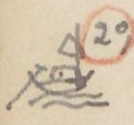{width=12%}

| [Địa danh] | Chữ Hán | [Số tầm] | [Ghi chú] |
|---|---|---|---|
| ② **Bến trước ~~dinh~~ Khổn** | 鎮閫 | 3249 | |
| Sông Mỹ Tho | 美湫[?] | | Xưa tên Vàm Ba 沉[?]波. Từ năm Đinh tị (1797) Đại binh ở Xiêm la về, trửa sông có nổi một bãi hơn 1000 tầm. Cây cỏ um tùm. Vàm Ba ~~trong~~ nước thành trong và êm sóng. Dân khỏi bị hại. Vâng đặt tên Cù lao Rồng 岢[?]勞[?]蠬[?] |

**ⓐ** Kênh Đào 涇[?]陶

| [Địa danh] | Chữ Hán | [Số tầm] | [Ghi chú] |
|---|---|---|---|
| **Sông Ba lai** (Cõi Vĩnh trấn) | 婆[?]淶江 | | Thượng lưu 6.620 đến Cù lao Thầy 岢[?]勞[?]𢂞[?] hợp với sông Mỹ tho 美湫[?] |
| Hạ lưu | | 4.372 | |
| Chợ Cái Vạn | 丐[?]𣘃[?] | 10.365 | |
| Đồn Ba lai | 婆[?]來屯[?]守 | 925 | |
| Cửa Ba lai (bể) | 〃 海門 | 2.435 | |
| Mụ Khảm xay | 媒坎[?]𡏧[?] | 7.613 | |
| Đại hải môn | 大海門 | | |

[NC: Tác giả để các dòng Hạ lưu - Đại hải môn ở nửa phải trang, nối tiếp ghi chú của dòng Sông Ba lai.]

**ⓑ** Đại giang - Theo dòng xuôi

| [Địa danh] | Chữ Hán | [Số tầm] | [Ghi chú] |
|---|---|---|---|
| Cửa Kênh | 涇[?]口 | 1536 | |
| Rạch Cây *(mực tím:* Ly *)* | 𣘃[?]梩[?] | 3892 | Từ cửa 2.453 đến chợ Cây *(mực tím:* ly *)* 𣘃[?]梩[?], 380 đến Bến 渡[?]... *(mực tím:* (dứt) *)* chia ra hai chi: Một chi về Đông, 434 đến Chợ Gạo 帮[?]粿[?]; 6.205 đến giáp R. Mương Đào 涇[?]陶. Một chi: 111 đến Chợ Quán Lương 舘粮; 2.918 đến chợ Lão Văn 老文, 2340 chợ Lão Sinh 老生, 2690 Lạch Tra 沠[?]渣, ra Đại giang 大江 |

[NC: "(dứt)" bằng mực tím là ghi chú của tác giả rằng bản gốc bị đứt chữ ở đây.]

# Trang PDF 356 - Trấn Định (tiếp)

*Đầu trang: Trấn Định 2*

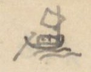{width=12%}

| [Địa danh] | Chữ Hán | [Số tầm] | [Ghi chú] |
|---|---|---|---|
| Ngã ba Cửa Đại | 𣘃[?]門大 | 3.892 | Chi phía nam đi 13.020 đến Cửa Đại 大𣘃[?]海門, rộng 1.604, sâu 5T. Đảo trước tên là Cù lao Nhật bản 岢[?]勞[?]日本. Dân ở vài trăm nhà. Có đồn phân thủ phòng giặc bể |
| Rạch Cái | 丐[?]𣘃[?]沠[?] | 5288 | Trên có chợ |
| Rạch Dịch | 沠[?]𢶢[?] | 1.080 | 820 đến ngã ba: chi đ.b. đi 1640 gặp R. Long Uông 竜汪; chi b. đi 5204 đến Ngã ba, giáp R. Khu cong 堰[?]工[?], Ra Đại giang 大江, về cửa bể Soi rạp 㷐[?]𣘃[?] |
| Rạch Long Uông | 竜汪 | 285 | Đi 2705 [?] đến ngã ba. ~~Chi đ.b. đi~~ Sân Khỉ 𡐙[?]𤞻[?]: một chi đi về đông 860 đến Lạch Than 沠[?]灘. Một chi về Bắc 5035 giáp Lá Cần dọc 萸[?]芹祿[?], đến Rạch Lấp 沠[?]垃[?]; ra cửa Soi rạp 㷐[?]𣘃[?] |
| **Cửa Tiểu Đồn** | 小海門 | 1.115 | Có đồn phân thủ 分守 |
| R. Than | 沠[?]灘 | 1.500 | Đi 3.356 là hết |
| **Cửa bể Tiểu** | 小海門 | | |
| 3° Bến trấn Khổn | 鎮閫 | | 前津次 [bến trước] |
| Cửa Kênh Vĩnh Tùng [?] (đi ngược) | 永衝[?] | 2.294 | Do Đại giang đi ngược 40.455 đến Tuyên Uy 宣威道守 đạo thủ, giáp địa đầu Cao miên 高綿 |
| Cửa R. Cần Đước | 芹𣽗[?] | 897 | Đi 3.348 T. đến Rạch Gốc 沠[?]格[?] |
| Rạch Chanh | 沠[?]𣘃[?] | 3.704 | Có chợ, đi 1.400T đến ngã ba R. Gốc. Chi phía nam đi 2737 đến chợ Củ chi 𦬑[?]支. Chi phía Tây đi 1.392 đến ngã ba Quảng 廣, giáp Kênh Tân 涇津 suốt sông Đại giang Ba lai 婆[?]淶 |
| Rạch Bát đông | 八東 | 13.343 | Có chợ |
| Rạch Nước trong | 渃冲 | 2.342 | |
| Rạch Cái Đạm [?] | 丐[?]𧋆[?] | 2.825 | |
| Rạch Cái Thơm | 丐[?]𣘃[?] | 1.583 | Đi 1680 đến cùng |
| Rạch Cái Mối | 丐[?]𧍉[?] | 1.575 | Đi 450T đến cùng |

[NC: "Cửa Tiểu Đồn" và "Cửa bể Tiểu" được gạch chân; "Soi rạp" tức Soài Rạp. Dòng "Rạch Long Uông" tác giả viết số "2705" đè lên số khác.]

# Trang PDF 357 - Trấn Định (tiếp) (trang bản thảo 177)

*Đầu trang: Trấn định 3; số trang bản thảo: 177*

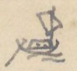{width=12%}

| [Địa danh] | Chữ Hán | [Số tầm] | [Ghi chú] |
|---|---|---|---|
| R. Cái Tôm | 丐[?]𩵜[?] | 704 | Đi 2.980 là cùng |
| Bông Cây Uinh [?] | 𣘃[?]椅明[?] | 3000 | Đồn phân thủ. Một chi đi Cao miên |
| R. Sông Thiết | 滝[?]鉄 | 1.005 | 3.616 đến cuối |
| R. Uyển Dài | 宛[?]𨱽[?] | 1.020 | 2.100 đến cuối |
| R. Uyển Cột | 宛[?]𣘃[?] | 2.540 | 770 đến cuối |
| R. Mụ Hến | 媒蜆 | 470 | 315 đến cuối |
| Tuyên Uy đạo thủ (Giáp Cao mên) | 宣威道 | | 守 [thủ]. Thu cảo hàng hóa, 1 phần 10. Trở lên 8.083 đến Ngã ba Nhập Tức 入息. Chia làm hai: Một chi đi 15.424, một chi 8.190 thì hợp. Gọi là Ngã ba Bò 𣘃[?]𣘃[?]. Bãi giữa, dân Cao mên ở hai sóc 𣽗[?]: một, tên Vũ [?] Sóc 巴[?]鳥[?]𣽗[?]; một, tên Bò 𣘃[?]𣘃[?]. Từ đó 4.935 đến đồn phân thủ Thông bình 通平. Đồn ấy, dân cùng Cao miên ở lẫn lộn, có Giao dịch trường. Bờ bắc có một chi thông với Nguồn Quang hóa 光化源. Lại từ Thông bình đi 15.989, giáp ~~...~~ rạch chảy ra Đại giang Tân châu 新洲 lên Nam vang 南荣 ở Cao Miên |

[NC: *Thu cảo hàng hóa, 1 phần 10* = thu thuế hàng hóa một phần mười. "sóc" = làng của người Khmer.]

| [Địa danh] | Chữ Hán | [Số tầm] | [Ghi chú] |
|---|---|---|---|
| ④ **Bến trấn Khổn** | 鎮閫 | | |
| Cửa Kênh Vĩnh Xưng (đi xuôi) | 泳[?]𣽗[?] | 2.985 | Do Đại giang đi xuôi 36.245 đến cửa bể Soi rạp 㷐[?]𣘃[?] |
| Rạch Mác | 沠[?]鎮[?] | 9.238 | Đi 3.020 là cùng |
| R. Kỳ lớn | 岐[?]𡘯[?] | 2.592 | Trên có chợ. Đi 3.427, giáp R. Mụ 媒... *(mực tím: dứt)* |
| R. Tầm vu | 尋于 | 2.110 | Gần chợ Lão Tam 老三. Đi 2670 đến chợ Tầm vu, đi 2.482 giáp R. Mụ Lý 媒李 |
| R. Thuộc láng | 屬[?]𣵰[?] | 5.856 | Trên có chợ. Đi 5728, giáp R. Tra 沠[?]查 Cây Ke [?] *(viết thêm phía trên: Li)* 𣘃[?]梩[?] |
| R. Tra | 沠[?]查 | 7.092 | Đi 828 đến Ngã ba Khu Công 堰[?]工 *(mực tím:* (1) *)*, Chi phía nam đi 7406 đến chợ Khu Công. Lại 46 đến đường Ngã ba: Một chi hết, một chi chảy giáp R. Dịch 沠[?]𢶢[?] ra Đại giang 大江, về Cửa Tiểu 小海門; *(mực tím:* (2) *)* Chi phía tây đi 1.830 đến Ngã ba Rạch Lá 沠[?]萸[?], có một chi đi 982 đến chợ Rạch Lá; một chi 2.646 giáp Cây Li 𣘃[?]梩[?], Rạch Thuộc Láng |
| R. Chính chấp | 正𡏧[?] | 5.892 | Đi 9649 đến R. Khu công 堰[?]工, Gọi là Ngã ba Khu Lộ 堰[?]鷺[?] |
| R. Lá Cần Đước | 萸[?]芹祿[?] | 480 | Đi 4.904 đến Ngã ba. Một chi chảy về Đông 2.700 đến R. Khâu |

# Trang PDF 358 - Trấn Định (tiếp)

*Đầu trang: Trấn Định 4*

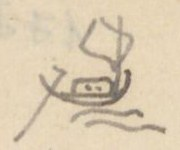{width=12%}

[NC: Tiếp ghi chú của dòng "R. Lá Cần Đước" ở trang trước.]

| [Địa danh] | Chữ Hán | [Số tầm] | [Ghi chú] |
|---|---|---|---|
| | | | 沠[?]垃[?] chảy ra Bể. Một chi nữa chảy về Nam giáp R. Long Uông 竜汪, ra Đại giang, chảy ra cửa Tiểu 小海門 |
| **Cửa Soi rạp** | 㷐[?]𣘃[?]海門 | | |
| ⑤ **Cửa R. Cái Thia** | 丐[?]𧋆[?] | 160 | |
| R. Cái Bức | 丐[?]𣘃[?] | 1810 | Đi 136 vào R. Cái Củ 丐[?]檜[?] |
| R. Cổ lịch | 古𡉏[?] | 4.425 | Đi 520 đến Ngã ba: một chi đi 1.698 vào rạch Cái Củ, một chi 2200 cũng vào R. Cái củ |
| R. Cái Cang | 丐[?]釭[?] | 1.120 | Đi 2636 vào R. Cái Củ |
| R. Cái Sơn | 丐[?]山 | 1.678 | Đi 1.737 vào R. Cái Củ |
| R. Vàm Hàn | 沉[?]韓 | 1.698 | Đi 900 giáp Quán Ba chùa 巴廚小舘, vào R. Cái Củ, chảy thông |
| R. Cái Rào hạ | 丐[?]撣[?]下 | 1.074 | Đi 1.735 là hết |
| R. Cái Bầu | 丐[?]瀑[?] | 1.335 | Đi 1383 đến Ngã ba: chi về bắc đi 785 là cùng. Chi về t.n. đi 1.212 giáp R. Long Ẩn 竜隱 |
| R. Long Ẩn | 龍隱 | 3.615 | Đi 1.283 đến Ngã ba: Chi bắc vào cuối (入末). Chi t.n. đi 1990 đến Đại giang 大江 |
| R. Cần Lộ | 芹露 | 1.826 | Đi 5.432 vào hết 入末 |
| R. Cái Lao Hạ | 丐[?]牢下 | 6.987 | Đi 3.000 đến Chợ; 2.066 ra Đại giang |
| R. Trâu trắng | 𤛠[?]𤽸[?] | 4.143 | Đi 8.658 đến cùng |
| R. Dốc Vàng hạ | 篤[?]鐄[?]下 | 658 | Đi 8.417 đến cùng |
| R. Dốc Vàng thượng | 〃 上 | 20 | Đi 8.417 (?) đến cùng |
| Tân châu tam đạo (Cõi Cao Mên) | 津[?]洲三道分守 | | Đồn phân thủ *(mực tím:* 新洲 *)*. Bờ nam có Đồn Ngự đạo 堆[?]禦道 thuộc dinh Trấn Định. Bờ bắc có Chiến sai đạo 戰差道 thuộc Vĩnh trấn 永鎮, ở chỗ quan tân 関津. Tân châu đạo 新洲道 thu thuế. Một chi đi 14.652 đến R. Hiệp ân 洽恩, bên cạnh có Cao mên đồn phân thủ. Lại từ Hiệp ân thì không biết bao ngàn vạn tầm đến Nam Vang 南荣 ở Cao mên. |

[NC: *入末* [vào đến cuối]; *quan tân* (関津) [cửa ải bến sông có đặt thuế]. "Tân châu tam đạo" chữ Hán tác giả viết 津洲 rồi ghi mực tím 新洲 bên cạnh để sửa.]

# Trang PDF 359 - Trung - Việt: đường từ Trung Quốc tới nước ta (trang bản thảo 178)

*Đầu trang: Trung - Việt 1; số trang bản thảo: 178*

## Đường từ Trung quốc tới nước ta

(Theo *Việt kiệu thư* (越嶠書) [Sách về miền núi nước Việt]) Q. I *(mực tím:* 124b *)*

Sách TTNĐ (4b) chép theo như V.K.T, chỉ khác một vài nơi, vì chép sót hoặc sai. Sách *Việt nam đạo lộ* (越南道路) [Đường sá nước Việt Nam] (VNĐL) của Từ Diên Húc 徐延旭 chép hơi khác. Sau này sẽ dẫn.

[NC: V.K.T = *Việt kiệu thư*; Q. I = quyển I; VNĐL = *Việt Nam đạo lộ*. Tên tác giả viết "Trừ Diên Húc" [?], chữ Hán 徐延旭 đọc là Từ Diên Húc. "ng." = ngày đường.]

### A. ĐƯỜNG QUẢNG TÂY

(có ba đường đến Thị cầu)

| [Địa danh] | Chữ Hán | [Số ngày] | [Ghi chú] |
|---|---|---|---|
| 1° **Bằng tường** | 憑祥 | | |
| Ải Nam quan | 南関 | 1 ng. | |
| Trạm Pha lũy | 坡壘 | 1 ng. | Qua phía bắc Châu Văn Uyên 文淵. Rồi qua phía bắc châu Thoát lang 脫朗 |
| Lạng sơn vệ | 諒山衛 | 1 ng. | (TTNĐ chép 諒山衙 [?]) (VNĐL chỉ chép 諒山) |
| Đường hẻm ở bắc Ôn châu | 温州北之陰徑 | 1/2 | |
| Quỷ môn quan | 鬼門関 | 1 ng. | |
| Thôn Tân lệ | 新麗 | 1 ng | Ở miền nam Ôn châu |
| Huyện Bảo lộc | 保祿 | 1/2 | Đường qua hai sông nhỏ (TTNĐ chép 12 sông, VNĐL không chép) |
| Đò Xương giang | 昌江渡 | 1 ng. | |
| Bờ bắc Sông Thị Cầu | 市橋[?]北岸 | | Ở phía nam huyện Yên Việt 安越 |
| | cộng | 7 ng. | (TTNĐ chép 6 1/2) |
| 2° **Phủ Tư minh** | 思明 | 1 ng | |
| Dãy núi Thiên ma | 摩天嶺 | | |
| Châu Tư lăng | 思陵 | 1 ng | (TTNĐ chép 思陰) |
| Ải Biên cường | 辛[?]辨[?]強[?] | | |
| Châu Lộc bình | 祿平 | | Phía tây có đường đi 1 ng. 1/2 đến Lạng Sơn. Nếu đi phía đông nam thì qua |
| Sông Ha lý | 車里江 | 1 1/2 | (VNĐL chép 千里). Đầu đời Vĩnh lạc 永樂, Hồ quí ly lấp sông này để ngăn quân quan. Sau đó được mới đào lại để quân đi. |
| Châu An bác | 安博 | 1 1/2 | |
| Động Hao quân | 耗軍洞 | 1 | Đường núi hiểm trở |

[NC: *Ma thiên lĩnh* (摩天嶺) [dãy núi chạm trời]; tác giả ghi quốc ngữ "Thiên ma". "Sông Ha lý" chữ Hán 車里江 [?] (đọc theo chữ là Xa lý giang). Hai dòng Châu An bác - Động Hao quân được gộp bằng ngoặc với ghi chú "Đường núi hiểm trở".]

# Trang PDF 360 - Trung - Việt (tiếp)

*Đầu trang: Trung - Việt 2*

| [Địa danh] | Chữ Hán | [Số ngày] | [Ghi chú] |
|---|---|---|---|
| Huyện Phượng Nhãn | 鳳眼 | | Chia ra hai lối |
| a) | | 1 ng. | |
| Huyện Bảo lộc | 保祿 | 1 ng. | (TTNĐ chép hai đường này lẫn làm một; VNĐL chép y VKT). |
| Đò Xương giang | | | |
| b) | | | |
| Lạng giang phủ | 諒江府 | 1 ng | |
| Sông Thị Cầu | 市橋[?] | | |
| 3° **Long châu** | 龍州 | 1 ng | |
| Ải Bình nhi | 平而 | 1 ng | |
| Châu Thất nguyên | 七源 | 2 ng. | |
| Xã Bình Gia | 平茄 | | Ở châu Văn lan 文蘭 (TTNĐ. 㰀[?]). Từ đây chia làm hai đường |
| a) Châu Văn lan | 文蘭 | 1 ng | |
| Đường núi phía Bắc châu Hữu-lũng | 右隴北山徑 | | (TTNĐ và VNĐL đều chép núi Bắc sơn ở châu Hữu lũng 右隴縣之北山 - TTNĐ không có chữ chi 之) |
| Ra ~~phía~~ dưới Quỷ môn quan 40 dặm | 出鬼门関下四十里 | | (VNĐL: qua Quỷ môn quan chỗ đất bằng 40 dặm 经鬼门関平地四十里) và (TTNĐ: chép 出鬼门関西平四十里; có lẽ là 出鬼门関西, 下地 [viết đè lên 平] 四十里: ra phía tây Quỷ môn quan (chỗ đất bằng), đi xuống [?] 40 dặm. Qua |
| Đò Xương giang ở thượng nguyên | 昌江上源 | 1 ng. | |
| Phía nam Hữu-lũng | 右隴南 | | (Đoạn này TTNĐ không chép) |
| Theo bờ nam sông | 沿江南岸 | | 〃 |
| Đất bằng Yên thế h. | 安世平地 | 1/2 | 〃 |
| Yên Dũng huyện | 安勇縣 | 1 ng. | |
| Trửa h. Yên Việt | 安越縣之中 | | Ở phía bắc Sông Thị Cầu |

[NC: "h." = huyện. Ba dòng Phía nam Hữu-lũng, Theo bờ nam sông, Đất bằng Yên thế được gộp bằng ngoặc với ghi chú "(Đoạn này TTNĐ không chép)". Tác giả dùng chữ 门 (giản thể) trong 鬼门関. Ở dòng "Ra dưới Quỷ môn quan", câu so sánh các bản còn tiếp sang trang sau.]

# Trang PDF 361 - Trung - Việt (tiếp) (trang bản thảo 179)

*Đầu trang: Trung Việt 3; số trang bản thảo: 179*

| [Địa danh] | Chữ Hán | [Số ngày] | [Ghi chú] |
|---|---|---|---|
| b) Phía Tây xã Bình Gia | 平茄社西 | 1 1/2 | |
| Đường núi châu Vũ nhai | 武崖山徑 | 2 | |
| Đất bằng huyện Tư nông | 司農平地 | 1 1/2 | |
| Phía Bắc Huyện Yên Việt | 安越之一北 [?] | | |
| Thượng lưu bắc ngạn Sông Thị cầu | 市橋[?]江上流北岸 | | |
| 4° **Thị cầu** (Sông) | 市橋[?]江 | 1 ng | VKT và VNĐL đều chép 市橋. Ở trong cõi huyện Yên Việt, ở phía Nam Sông Xương 昌江. Các đường đều hội về đó. Tuy các chỗ đều cho quân qua được, rồi |
| Phủ Từ Sơn | 慈山府 | | |
| Đông ngạn h. | 東岸 | | |
| Gia lâm h. | 嘉林 | | |
| Sông Phú lương | 富良江 | | [Thực ra là Sông Nhị hà] |
| Giao châu | 交州 | | [Hà nội đời Minh] |

[NC: Tác giả viết chữ "Thị cầu" ở cột chữ Hán bằng một tự dạng gần như 市梂 [?], rồi ghi chú là VKT và VNĐL đều chép 市橋. Câu ghi chú ở dòng 4° bỏ dở ("rồi"). Phần dưới trang để trống; chữ in VERRERIE DU NORD và chữ trang sau hiện qua giấy.]

# Trang PDF 362 - Đường Vân Nam (Trung Việt 4)

*Đầu trang: Trung-Việt 4*

## B. Đường VÂN-NAM

(có 2 đường)

[NC: "ng" ở cột khoảng cách = ngày (đường).]

| [Số] | [Địa danh] | [Chữ Hán] | [Ngày] | [Ghi chú] |
|---|---|---|---|---|
| 1° | H. Mông tự | 蒙自縣 | | (Đường này bình dị dễ đi) |
| | Thác Liên hoa | 蓮花灘 | | |
| | Quan Thạch lung | 石瀧關 | | (TTNĐ và VNĐL chép 石隴 [?] 關) [NC: VNĐL chưa rõ là sách nào, có lẽ một sách địa lý về Vân Nam.] |
| | Động Trình lan | 程瀾峒 | | (TTNĐ chép 呈..) |
| | Hữu ngạn sông Thao nguồn | 沘江右岸源 | 4 ng | |
| | Châu Thủy vĩ | 水尾州 | 8 ng | (TTNĐ không chép ch. Thủy vĩ mà lại chép 5 ngày (sai) đến ch. Văn bàn |
| | Châu Văn bàn | 文盤州 | 5 ng | |
| | H. Trấn an | 鎮安 | 5 | |
| | H. Hạ hoa | 夏華 | 3 | |
| | H. Thanh ba | 清波 | 3 | |
| | Phủ Lâm thao | 臨洮 | 3 | Sông Thao 洮 là thượng lưu sông Phú lương 富良 (nhị hà). Sông chảy lên bắc là sông Tuyên quang 宣光江, sông chảy phía nam là Đà giang 沱江. Đó là gọi Tam giang 三江 |
| | H. Sơn vi | 山圍 | 2 | |
| | P. Hưng hóa | 興化府 | 1 | trước xưa là thành Đa bang 多邦城 |
| | ngã ba miếu Bạch hạc | 白鶴神廟三岐江 | 4 | [Đoạn này TTNĐ chép sót nhiều. Sau Lâm thao, chép: "Hưng hóa đến miếu.. 3 ng; đến Rồi [?] qua sông.. L ngã ba.. ng. [?], đến Giao châu 2 ngày]. |
| | Huyện Bạch hạc | 白鶴 | | |
| | Phú lương giang | 富良江 | | |
| 2° | Ải Hà giang | 河陽隘 | 10 | (Đường này núi non khó đi). |
| | Tả ngạn sông Thao | 沘江左岸 | | (Đây là nói miền tả ngạn mà thôi) |
| | ch. Bình nguyên | 平源州 | 5 | |
| | H. Phúc yên | 福安縣 | 1 | |
| | P. Tuyên quang | 宣光府 | 2 | |
| | P. Đoan hùng | 端雄 | 5 | |
| | Ngã ba Bạch hạc | 白鶴 | | |

[NC: Tác giả viết 沘 (Thao) ở chỗ tên sông Thao; trong ghi chú lại viết 洮. Nửa dưới trang là tiêu đề in VERRERIE DU NORD in ngược.]

# Trang PDF 363 - Đường Quảng Đông (Trung Việt 5)

*Đầu trang: Trung-Việt 5; số trang bản thảo: 180*

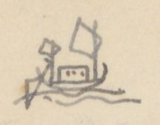{width=12%}

## C. ĐƯỜNG QUẢNG ĐÔNG

| [Số] | [Địa danh] | [Chữ Hán] | [Ngày] | [Ghi chú] |
|---|---|---|---|---|
| 1° | Núi Ô-lôi | 烏雷山 | 1 ngày | Ở Liêm châu 廉. Nếu gió bấc thuận thì 1, 2 hôm có thể tới thẳng phủ Hải đông 海東府 thuộc Giao châu 交州. Nếu đi dọc bờ bể thì |
| | Núi Bạch long vĩ | 白龍尾 | 2 ng. | Ở châu Vĩnh an 永安 |
| | Cửa Ngọc sơn | 玉山門 | 1 | |
| | Vạn ninh châu | 萬寧州 | 1 | |
| | Miếu sơn | 廟山 | 1 | |
| | Đồn tốt (tuần ti) | 屯卒 (巡司) | 2 | (TTNĐ chép 屯卒; VNĐL chép 屯山) |
| | Phủ Hải đông | 海東府 | 2 | (TTNĐ chép 3 ngày; VNĐL chép 1 ngày đến huyện Hải đông) |
| | Xã Kênh thục | 經熟 [?] | 1 | Đó có Thạch đê (đê đá). Nhà Trần 陳 đắp nên để ngăn quân Nguyên (Xem đường vào ở dưới). Nếu đi qua |
| a, | Cửa Bạch đằng | 白藤 | | |
| | Tuần ti Thiên liêu | 天寮巡司 | | |
| b, | Cửa An dương | 安陽 | 1 | (Xem đường vào ở dưới) Đi xuống thì |
| c, | Cửa Đồ sơn | 塗山 | 1 | (Xem đường vào dưới) |
| d, | Cửa Đa ngư | 多魚 | | (Xem đường vào ở dưới) |
| e. | Cửa Thái bình | 太平 | | ( 〃 ) |
| 2° a- | Cửa Bạch đằng | 白藤 | | |
| | H. Thủy đường | 水棠縣 | | (Bên trái là theo TTNĐ và VNĐL; còn VKT chép: qua h. An dương 安陽 đến phủ Kinh môn 荊門 cũng tới... đó là lầm với mục sau 3° b). |
| | H. Đông triều | 東潮 | | |
| | P. Hải dương | 海陽 | | |
| | H. Chí linh | 至灵 | | |
| | Sông Hoàng kinh | 黃涇江 | | |
| | Sông Bình than | 平灘江 | | (Xem nối ở mục 3° b) |
| 3° b. | Cửa An dương | 安陽 | | (Ở TTNĐ chép nhầm lẫn với 4° c) |
| | H. An dương | 〃 縣 | | |
| | P. Kinh môn | 荊門 | | |
| | Sông Hoàng kinh | 黃涇 | | |
| | Sông Bình than | 平灘 | | |
| | Phía bắc Nam sách | 南策 | | |
| | 〃 Thượng hồng | 上洪 | | |

[NC: VKT là một nguồn tác giả dùng để đối chiếu, chưa rõ tên sách. Nửa dưới trang có chữ in VERRERIE DU NORD hiện qua giấy.]

# Trang PDF 364 - Đường Quảng Đông (tiếp) (Trung Việt 6)

*Đầu trang: Trung Việt 6*

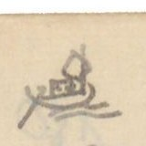{width=12%}

| [Số] | [Địa danh] | [Chữ Hán] | [Ghi chú] |
|---|---|---|---|
| 4° c | Cửa Đồ sơn | 塗山 | |
| | Cổ trai | 古齋 [?] | |
| | H. Nghi dương phía bắc | 宜陽之北 | (VKT chép 宣陽, VNĐL chép Cổ dương 古陽, TTNĐ chép 宜陽之北) |
| | Phía bắc An lão | 安老之北 | (TTNĐ không chép) |
| | H. Bình hà | 平河 | |
| | Phía nam Nam sách | 南策 | |
| | Phía nam Thượng hồng | 上洪 | |
| 5° d | Cửa Đa ngư | 多魚 | |
| | An lão h. | 安老縣 | |
| | Tân minh h. | 新明 | (TTNĐ chép 先明, là tên sau đời Lê trung hưng đổi. Xem thế biết VKT và VNĐL dùng tài liệu trước đời ấy) |
| | Sông Sóc hồng (h. Tứ kỳ) | 溯洪江 (四岐) | ở h. Tứ kỳ. |
| | Hàm tử quan (Khoái châu) | 鹹子關 (快州) | |
| 6° e | Cửa Thái bình | 太平 | |
| | P. Thái bình | 〃 府 | |
| | P. Tân hưng | 新興 | |
| | Khoái châu P | 快州 | |
| | Phú lương giang | 富良江 | (nhị hà). |

Phía đông Giao châu 交州 có các phủ Hải dương 海陽, Kinh môn 荊門, Nam sách 南策, Thượng hồng 上洪, Hạ hồng 下洪, Thuận an 順安, Khoái châu 快州. Cách bể không xa. Đều có kênh nhánh xuyên qua vài trăm dặm. Các thuyền lớn [?] không vào được. Cho nên người Giao chỉ làm thuyền cạn đáy để tiện sự đi lại. (VKT không có đoạn này)

[NC: Nửa dưới trang là tiêu đề in VERRERIE DU NORD in ngược.]

# Trang PDF 365 - Vĩnh Trấn (Vĩnh trấn 1)

*Đầu trang: Vĩnh trấn 1; số trang bản thảo: 181*

## VĨNH TRẤN

Xét phong thổ Vĩnh trấn 永鎮, đất rất rộng mà thấp ướt. Sông hồ giăng dọc, thủy đạo bao bọc. Thông bốn bề, suốt tám nẻo. Đường khô khó quá. Không dùng thuyền thì không lọt. Đất rất tốt, mà nhiều phù sa nổi trưa nước. Hai bên bờ sông, nhiều dân cư. Trước vườn, sau ruộng. Vườn thì trồng cau (*tân lang* 檳榔), dân được lời nhiều. Ruộng thì bùn lầy, không cần trâu cày. Chỉ lấy nhân lực bạt cỏ, cấy mạ. Cỏ mục và lúa lớn. Công ít mà thóc nhiều. Tấm gạo rải rác ngoài đồng. Đất tốt, bùn lầy. Cỏ bụi mọc đầy. Loài cá rất nhiều mà cá 魮 [?] 魚 nhiều nhất. Vì thế: lúa cùng cá, ăn không hết là ở đất Vĩnh trấn.

[NC: chữ "tân lang" trong ngoặc viết thảo, đọc chưa chắc. Đoạn này và các đoạn sau có lẽ dịch từ *Gia Định thành thông chí* (嘉定城通志); con số ở cột giữa là số tầm.]

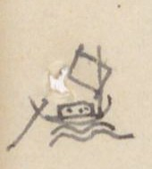{width=12%}

| [Số] | [Địa danh] | [Chữ Hán] | [Tầm] | [Ghi chú] |
|---|---|---|---|---|
| ① | Bến Trấn khổn | 鎮閫 [?] | 1.986 | 前津次 (*tiền tân thứ* [bến đỗ phía trước]). Đi về bắc |
| | Cửa s. Long hồ | 龍湖 | | |
| | Ng. b. Tuần Cái hạ | 巡丐下 | | 三岐水口 (*tam kỳ thủy khẩu* [ngã ba cửa sông]). Chi tả quanh vào bãi châu 津洲 [?] đến Tuần Cái thượng 巡丐上 hợp với Đại giang 大江. Chi hữu thông mương Đảo Mụ Bố 媒布洲 [?] 陶 [?] thông với cửa bể Cổ Đê [chiên] [...] [...] 海口. Phía hữu có bãi tên Cù lao Bá 播 |
| | R. Cái Mơi thượng | 丐坶 [?] 上 | | Đi 50 đến ngã ba: Chi hữu do bãi nổi 浮洲 đi 36 đến mương Mụ bố 媒布, ra Đại giang, chảy ra cửa Cổ Đê [chiên] [...] [...] 海口. Chi tả đi 285, thông R. Cái Mơi hạ 丐坶 [?] 下 ra Đại giang, đến cửa bể Bãi ngao [...] 鰲 海口 |
| | Tuần Cái thượng | 巡丐上 | 895 | Ra Tiền giang. Đi 16075 đến Ng. b. Hàm luông. |
| | (Tiền giang) | 前江 | | Ra hai cửa bể: Bãi ngao [...] 鰲, và Ba lai 波淶. |

*(mực tím, dưới Đảo Mụ Bố)* (Xem Vĩnh trấn 5)

Rạch Tuần Cái thượng, xưa có bãi tên Cù lao Cái Mơi 丐坶 [?]. Phía nam rạch chia làm hai: chi nam thông Long hồ 龍湖, suốt bến Trấn khổn [Vĩnh trấn 1/16]. Chi tây suốt R. sông Sa đéc 沙[...], lên bắc, thông R. Cái Thia 丐[...], thuộc sông Trấn định 鎮定. Đường trạm Trấn định Vĩnh trấn 鎮定永鎮 là theo đường ấy.

| | [Địa danh] | [Chữ Hán] | [Tầm] | [Ghi chú] |
|---|---|---|---|---|
| | R. Mụ Cô | 媒鴣 [?] | 1000 | Đi 1.300, quanh phía tả hai bãi Cái Sâu 丐[...] Cái Thâm 丐[...], ra Đại giang |

[NC: Tác giả viết "Cổ Đê", sau thêm chữ "chiên" bằng mực tím phía trên (tức Cổ Chiên). Chữ Hán của tên này tác giả viết bằng hai chữ bộ cách 革 (革+古, 革+玄 [?]); chữ đầu của "Bãi ngao" viết bộ thổ 土 với 黑; chữ "Mơi" viết bộ thổ 土 với 每. Không gõ được chính xác nên để [...] hoặc chữ gần đúng kèm [?]. Số 16.075 ở cột tầm bị gạch, viết lại 895.]

# Trang PDF 366 - Vĩnh Trấn (Vĩnh trấn 2)

*Đầu trang: Vĩnh trấn 2*

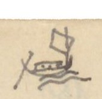{width=12%}

| [Số] | [Địa danh] | [Chữ Hán] | [Tầm] | [Ghi chú] |
|---|---|---|---|---|
| | R. Cái Sâu | 丐溇 | 2.876 | Đi 520 đến ngã ba, tả ra R. Cái Thơm 檳 [?]. Hữu ra R. Mụ Cô 媒鴣 [?] |
| | R. Cái Thơm | 丐檳 [?] | 670 | Đi 700 đến ng. ba: một thông R. Mụ Cô, một thông R. Cái Sâu 丐溇 |
| | R. Cái Mơi hạ | 丐坶 [?] 下 | 918 | Đi 280 đến ngã ba: hữu lên R. Mụ Bố 媒布 hợp với Tiền giang 前江; tả thông R. Cái Mơi 丐坶 [?] 上 thượng ra Tuần Cái |
| | R. Cái Dứu thượng | 丐柚上 | 998 | |
| | R. Cái Dứu trung | 丐柚中 | 1218 | |
| | R. Cái Dứu hạ | 丐柚下 | 7.500 | Rộng 2.858 |
| | Ng. b. Hàm Long (Rộng 1.218 T, sâu 49 T) | 含龍 | 48 | Tả chảy vào Tả Tiền giang 左前江. Thông ra cửa bể Ba lai 巴淶. Hữu ra hữu Tiền giang 右前江, thoát cửa bể Bãi Ngao [...] 鰲. Cách cửa R. Tuần Cái thượng 巡丐上 16.075 T, và cách cửa bể Bãi Ngao 18.290 T |
| ⓐ | (Phái hữu) | | | |
| | R. Cái Giúc [?] | 丐叱 [?] | 600 | Đi 80 đến ngã ba. Phía hữu qua chợ Cần thơ 芹苴, thông với R. Cần thơ thượng 芹苴上, ra Đại giang Cổ Đê [...] [...]; phía hữu qua R. Cái Thơm 丐檳 [?] thông R. Cần thơ hạ 芹苴下, chảy vào Tiền giang tả biên 左边前江 (ở phía tả) tức là R. Hàm luông |
| | R. Miễu Xảo | 庙泝 [?] | 58 | |
| | R. Cần Thơ hạ | 芹苴下 | 680 | |
| | R. Cái Uông | 丐枉 | 206 | Hai bên bờ, người Tây dương ở 西洋 |
| | R. Cái Gà | 丐鷄 [?] | 700 | |
| | R. Cái Mương Cự | 丐洸 [?] 䶙 [?] | 125 | Đi về nam 2100 đến R. Lan Vái [?] 欄洒 [?]; đi 3060, qua ngã ba, đến R. Cái Tắt 丐[...]; 5300 ra Hữu biên Hậu giang 左边後江. Lại từ R. Cái tắt phía tả xuống phía đông 43 T đến chợ Ba Vát 巴[...], đi 2.400 đến R. Kè Kè [...]; Sau chợ có đường bộ đi Giồng Thơm [...] 貢 [?] 市; 1002 đến R. Nước trong 渃冲, thông với tả biên Tiền giang 左边前江. Phía bắc Rạch sông chia hai chi: tả đến R. Cái Sơn 丐山, hữu với tả hợp phái chảy ngang R. Nước trong 渃冲. |

[NC: "T" = tầm. Ở dòng Cái Mương Cự, tác giả viết "Hữu biên Hậu giang" nhưng chữ Hán lại là 左边後江 (tả biên); có thể viết nhầm. Các chữ Hán viết bằng chữ ghép riêng của Nam Bộ (bộ 木 + 貪, 土 + 每...) không gõ được chính xác, để [...] hoặc chữ gần đúng kèm [?].]

# Trang PDF 367 - Vĩnh Trấn (Vĩnh trấn 3)

*Đầu trang: Vĩnh trấn 3; số trang bản thảo: 182*

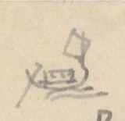{width=12%}

| [Địa danh] | [Chữ Hán] | [Tầm] | [Ghi chú] |
|---|---|---|---|
| R. Súc Sể hạ | 潘 [?] 仕下 | 400 | Chia hai chi: hữu trong, tả đục, nước đều ngọt và có mùi mè (thơm) như thể Bồng doanh nhược thủy lại. Vài [?] chè rất ngon. Đất tên là ... thủy . 水 (đúc [?]). Chuyển phía bắc đến ngã ba: tả đến R. Kè Kè 棋 [?], trên thông với R. Súc Sể thượng 潘 [?] 仕上, chảy ra tả biên Tiền giang 左边前江, hữu thông R. Thuộc Đạo 屬 [?] 道. Lại hợp với tả biên Tiền giang. |
| R. Cái Quang | 丐曠 [?] | 130 | Thông với R. Cái Nhum 丐汝 [?] đến R. Mỹ Lung 美竜, Cù lao Cấm 禁. Nhiều hổ |
| R. Cái Nhum | 丐枚 [?] | 318 | |
| R. Phú Mả (đúc [?]) | 卜馬 [?] | 285 | |
| R. Ký Hiên | 記軒 | 473 | |
| R. Mỹ Lung | 美竜 | 1.100 | Phía nam đến R. Củi 檜 [?] chợ Bến tre 渡 [?] 橪 [?]. Đến R. Cái Sơn 丐山 thông R. Cái Sĩ 丐仕 |
| R. Nước trong | 渃冲 | 1.200 | Đi 1000 đến ngã ba. Tả đến chợ Mỏ cày 媒棋, hữu đến chợ Ba Vát 巴[...], đến R. Cái Tắt 丐[...] |
| R. Mụ Cửu | 媒玖 | 3.064 | |
| R. Cái Mít | 丐檵 [?] | 1.500 | Phía đông Rạch có bãi nổi. Rạch chia: 1 chi trên tới châu trung, 2 chi tiền phái (đông) 中小派 [?] chảy ra phía đây đi 2.000 đến R. Sơn đốc 山篤; Chi tả chuyển về bắc rồi sang đông 4.000 T cũng tới R. Sơn đốc 山篤 |
| R. Sơn Đốc | 山篤 | 2.500 | Trước đây có bãi Cù lao Hươu 洲 [?]. Phía hữu sông có Rạch Cái Thơm 丐檳 [?]. R. Sơn đốc trên thông với R. Cái Mít 丐檵 [?] |
| Ngã ba | 三岐 | 500 | Trước sông có hai bãi, bãi hữu là Cù lao Cát 葛, bãi tả là Cù lao Đất 土坦 [?]. Đến kênh Bãi Ngao [...] 鰲, cửa quan Song ngư quan tỏa 双魚關鎖 là cửa ngăn sông Hàm long 含龍 |
| R. Cái Bông | 丐芃 [?] | 473 | |
| R. Cái Xảo | 丐泝 [?] | 550 | |
| Cửa bể Bãi Ngao | [...] 鰲 | | Chi trước từ Cù lao Trung 中 xuống thẳng 2.400 ra cửa bể. Chi hữu do Cù lao Đất 土 [?] phía nam qua R. Bến Bông 渡滝 [?] 4.000 T đến Cái Cá Xảo 丐[...]泝; 2.500 đến R. Miễu Xảo 庙泝; 3.300 đến R. Giao Xảo 架泝 [?], 4.800 ra phía hữu Cửa bể Băng Côn 氷昆 [?]. Bên hữu là đồn phân thủ Cù lao Cát 葛, bên tả là đồn phân thủ 分守 Bãi Ngao [...] 鰲. Cửa bể ấy có hai phần: tả là Bãi Ngao, hữu là Băng Côn. Theo dọc bãi bể đến cửa Cổ Đê [...] [...] |

[NC: Đoạn ghi chú dòng Cái Mít có số nhỏ viết chồng ("1 chi", "2 chi") và chữ "(đông)" viết thêm, đọc chưa chắc. "Đất tên là ... thủy" để trống một chỗ trong bản thảo. Nửa dưới trang có chữ in VERRERIE DU NORD hiện qua giấy.]

# Trang PDF 368 - Vĩnh Trấn (Vĩnh trấn 4)

*Đầu trang: Vĩnh trấn 4*

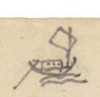{width=12%}

| [Số] | [Địa danh] | [Chữ Hán] | [Tầm] | [Ghi chú] |
|---|---|---|---|---|
| ⓑ | Ngã ba Hàm Long (Phái tả) | | 623 | Chảy về bắc rồi sang đông, đi 12.804 đến Cửa bể Ba lai 巴淶. Trước sông có Cù lao Trà Lộc 茶禄 [?] |
| | R. Súc Sể thượng | 潘 [?] 仕上 | 940 | Bên nam 1.530 đến Ng. b. Kè 棋 [?], phái tả thông với R. Súc Sể hạ 潘 [?] 仕下, hợp với phái hữu thông R. Cái Kè 丐棋 [?] |
| | R. Thuộc Đạo | 屬 [?] 道 | 376 | Đi 2.031 thông các R. Súc Sể thượng và hạ |
| | Cái Răn Xảo *(mực tím: chảo [?])* | 丐蔞 [?] 泝 | 642 | Bên tả có Cù lao Cò 鴣 [?], sinh nhiều thùy liễu 水柳 |
| | R. Cái Cấm | 丐噤 | 231 | Trước đây có Cù lao Thổng 桶 [?] |
| | R. Cái Chấn | 丐蠢 [?] | 321 | Trước đường có Cù lao Lăng 陵 |
| | R. Cái Mai | 丐梅 [?] | 1.012 | |
| | R. Cái Đậy [?] | 丐杜 [?] | [...]02 | Trước đường có Cù lao Bản 板 [?]; Đi 1060 thông Mỹ lung 美竜 hợp với sông hữu 右江 |
| | R. Thơm Quí [?] | 檳 [?] 癸 [?] | 1.903 | Dọc sông rộng 1.350 T |
| | R. Ba Tri Cá | 巴知[...] | 811 | Đi 2.106, hữu biên có chợ cũng có chợ Giồng Trôm 壇 [?] 簪 [?], chi tả quanh phía đông thông R. Cái Ngang 丐昂, một chi thông Ba Tri Lam giang 藍江, một chi thông R. Mỹ ân 美恩 chảy vào Tả biên Tiền giang 左边前江 |
| | R. Cái Ngang | 丐昂 | 539 | Trên thông với R. Cá Ba Tri 巴知[...]泝 |
| | R. Lam Ba Tri | 巴知藍泝 | 645 | Trên thông với R. Cá Ba Tri |
| | R. Cái Bẹp | 丐[...] | 921 | |
| | R. Mỹ Ân | 美恩 | [...]9 | Phía tả sông có Cù lao Đất 土坦 [?]. R. Mỹ ân trên thông với R. Cá Ba Tri 巴知 |
| | R. Lan trang | 欄庄 | 461 | |
| | R. Cát Xảo | 葛泝 | 1.032 | Phía tả có đồn phân thủ |
| | Mù U Xảo | 械 [?] 椹 [?] 泝 | 343 | *(mực tím)* Chảo [?] Mùa [?] |
| | R. Bãi Bùn | [...] 溘 [?] | 1.043 | |
| | R. Bãi Ngao | [...] 鰲 | | |
| | Cửa bể Ba lai | 巴淶海門 | | |

[NC: Số tầm ở dòng R. Cái Đậy và R. Mỹ Ân bị viết chồng, không đọc chắc. Chữ "Cá" trong "Ba Tri Cá" tác giả viết 丐 + 斯 ghép (cũng gặp ở "Cái Cá Xảo" trang trước). Nửa dưới trang là tiêu đề in VERRERIE DU NORD in ngược.]

# Trang PDF 369 - Vĩnh Trấn (Vĩnh trấn 5)

*Đầu trang: Vĩnh trấn 5; số trang bản thảo: 183*

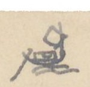{width=12%}

| [Số] | [Địa danh] | [Chữ Hán] | [Tầm] | [Ghi chú] |
|---|---|---|---|---|
| ② | Bến Trấn Khổn | 鎮閫 | 6.520 | Phía hữu |
| | Ba Kè đạo | 巴棋道 | 12.000 | Đồn phân thủ. Dọc đường qua R. Lão Mây 老楣. Rạch này phía hữu thông R. Cái Cá 丐[...] hợp với Tiền giang 前江, chuyển về phía đông qua R. Cái Cau 丐槔 [?], đến R. Cái Ngang 丐昂. Rạch này phía hữu thông Cái Tàu 丐[...] hạ, hợp với Tiền giang 前江; phía hữu đổ chảo [?] Lão Mây 老楣 qua xảo 泝 Lão Trai [?] 老嘷 [?]. Ngã ba này: một chi 5.800 qua Ngã ba Lá Bích [?] 罢 [?] 碧, Ngã ba Dinh 營 đến đồn phân thủ R. Trà Ôn 茶 [?] 温 hợp với Hậu giang 後江 |
| | Ngã ba R. Cái Uông *(mực tím: nhum; 柱 [?])* | 丐枉 | 7.530 | Dọc đường có một chi phía tả từ R. Khu Ân 坵 [?] 恩 đi 7.810 qua chảo [?] R. Lung xảo 竜泝 đến đồn chợ Vĩnh Liêm 永濂, rồi 470 đến R. Vĩnh Liêm hợp với Tiền giang 前江. Ở ngã ba, chi hữu thông R. Cây đôi 棋堆 hợp Tiền giang 前江 |
| | R. Mân Thiết (Tân thắng đạo) | 𣊚 [?] 泐 [?] / 新勝道 | | *(mực tím)* (có lẽ Mang thít) - Đồn phân thủ. Thông với. Cách Bến Trấn 25.054 Tầm |
| | Tả biên Tiền giang | 左边前江 | | |
| ③ | Bến Trấn Khổn | 鎮閫 | | [Vĩnh Trấn 1/16] |
| | Cửa s. Long Hồ | 竜湖 | 1.118 | Phía hữu, đi về đông 30.913 đến Cửa bể Cổ chiên [...] [...] |
| | Mương Đảo Mụ Bố | 媒布洲 [?] 陶 [?] | 3.365 | Đi 365 đến R. Cái Mơi 丐坶 [?]. Phía hữu Rạch có Cù lao Quảy the [?] 掛 [?] 絁 [?] |
| | R. Cái Sơn | 丐山 | 170 | |
| | R. Cái At | 丐杌 [?] | 210 | Dọc sông rộng 875 T. R. Cái At đi 5985 đến chợ Cần thơ. Chia làm hai: chi hữu 430 thông R. chợ Cần thơ 芹苴 ra sông Đại giang Cổ chiên [...] [...]. Chi tả về đông, suốt Đồng Rau Má 蒌 [?] 䳸 [?], về phía bắc suốt với R. Cái Ti 丐[...], hợp s. Hàm long |
| | R. Cái Lóc | 丐[...] | 605 | |
| | R. Cái Cau | 丐槔 [?] | 84 | Nhiều hổ lang |
| | R. Vàm Voi | 氿 [?] 鴆 [?] | 1.016 | |
| | R. Kè đôi | 棋堆 | 1.2[...]2 | Thuộc lưu 2.700 thông R. Cái Nhum 丐柱 [?]; 7530 ra sông Mân Thiết 𣊚 [?] 泐 [?] |
| | R. Cái Tra | 丐[...] | 1000 | Trước sông có Cù lao Hến 蜆. Bên hữu sông có hai R. Cái Tiêu 丐[...], Cái Rau 丐蒌. Bên tả sông có hai chảo Rạch Chùa 厨 [?] và Cái Thơm 丐檳 [?]. Nhiều hổ lang, nên cẩn thận. Bên hữu R. có R. Cái Quảy 丐[...] |

[NC: Sau dòng R. Kè đôi, tác giả gạch xóa hai dòng "R. Mân Thiết - Tân thắng đạo - Đồn phân thủ" (đã chép ở mục ②). Chữ "chảo" viết thêm phía trên có lẽ là chữ sửa cho "xảo" (rạch). Mang Thít: tên sông ở Vĩnh Long. Nửa dưới trang có chữ in VERRERIE DU NORD hiện qua giấy.]

# Trang PDF 370 - Vĩnh Trấn (Vĩnh trấn 6)

*Đầu trang: Vĩnh Trấn 6*

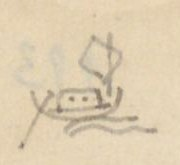{width=12%}

| [Địa danh] | [Chữ Hán] | [Tầm] | [Ghi chú] |
|---|---|---|---|
| | | | Đi 1000 đến R. Mân Thít |
| R. Mân Thít (Tân thắng đạo) | 𣊚 [?] 泐 [?] / 新勝 | 1.066 | Có đồn phân thủ. Thượng lưu đến Ngã ba Kè 棋, phía tả thông R. Trà Ôn 茶 [?] 温, bên hữu thông sông Long hồ 龍湖 |
| R. Cái Tôm | 丐[...] | 3.182 | Trước đây có bãi, tên Cù lao Dài 尚 [?] 蔣 [?] 䗅 [?], đầu giáp R. Mân Thít 𣊚 [?] 泐 [?], dưới giáp R. Lăng trang 陵庄. Sông chia 2 chi: chi tả theo cù lao dài, dọc bờ bắc, xuống phía đông, 1066 đến R. Cái Sơn 丐山; 500 đến R. Trù bá 佳 [?] 伯, các R. ấy đều ở phía tả sông; 1240 đến R. Cái Tắt mương 丐[...]泝; 5.139 thông Ba Vát 巴[...]. Rạch này nhiều hổ lang, ngày đêm thường đi lại; 3033 đến R. Ban tra hạ 班查下, 1.400 đến R. Lăng trang 陵庄, 5.9[...]8 chảy xuống R. Vàm thơm 泝檳 [?] hợp với Đại giang. Tả chi đến đó hợp. Hữu chi qua R. Bãi Không [...] 椌 chảy xuống |
| Vĩnh liêm | 永濂 | 400 | Cùng Mân thít, Trà ôn 𣊚 [?] 泐 [?], 茶 [?] 温, Long hồ 竜湖 hợp lưu |
| R. Cái Hiệp | 丐哈 [?] | 400 | |
| R. Bãi Không | [...] 椌 | 900 | |
| R. Láng The (đồn) | 湖 [?] 絁 [?] | 1.550 | Dọc sông rộng 800. Có Cù lao Bãi 沚 [?]. Đồn phân thủ. Đi 4 495 đến Súc thảo Nai 潘 [?] 托 [?] 泥 [?], suốt R. Cần Chông 芹蔠 [?], thông với Hậu giang 後江 |
| R. Trà Vinh (Quang phục đạo) | 茶 [?] 榮 [?] / 光復道 | 500 | Dọc sông rộng 1.800. Hữu ngạn có R. Cái thơm, trên suốt R. Lăng trang 陵庄. Đạo có đồn phân thủ |
| R. Tầm Vu | 尋 [?] 于 | 833 | |
| R. Cái Tiêu | 丐[...] | 800 | Trước sông có Cù lao Cổ chiên [...] [...] chia sông ra hai dòng |
| Chảo Rán [?] | 炟 [?] 泝 | 7.000 | |
| R. Cái At | 丐杌 [?] | 2.000 | |
| R. Cái Bãi | 丐[...] | 400 | |
| Cửa bể Cổ chiên | [...] [...] | | Ngoài có đảo Vàm nổi 坭 [?] 浮 [?] và đồng Ba côn 巴 [?] Côn Ba 昆巴三 [?] 尚 [?] |

[NC: Từ trang này tác giả viết "Cổ chiên" (không còn "Cổ Đê"). Nhiều chữ Nôm/chữ ghép riêng của địa danh Nam Bộ không gõ được, để [...] hoặc chữ gần đúng kèm [?]. Nửa dưới trang là tiêu đề in VERRERIE DU NORD in ngược.]

# Trang PDF 371 - Sa Đéc (Tiền Giang) - Hà Tiên (Vĩnh trấn 7)

*Đầu trang: Vĩnh trấn 7; số trang bản thảo: 184*

## *(mực tím)* SADEC (TIỀN GIANG) - HÀ TIÊN

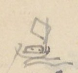{width=12%}

| [Địa danh] | [Chữ Hán] | [Tầm] | [Ghi chú] |
|---|---|---|---|
| Sông Sa đéc (Đông Khẩu đạo) | 沙泃 [?] | 7.129 | Đi về nam qua ngang Hậu giang 後江, lên phía tây đi 100.114 đến nhậm sở Kiên giang đạo 堅江道 |
| Ngã ba Nước Xuôi | 渃[...] | | Dọc đường chia ra hai chi: Chi hữu do R. Nhân sa 仁沙 thông R. Mương đào 泝陶 [?]; Chi tả do hai rạch Nàng hai 娘台 [?], Cái Sơn 丐山, ra Hậu giang 後江. Đến Ngã ba Nước Xuôi, chi tả 9.619 qua Cái Tắt Lai bông 丐[...]來芃 [?], R. Cái cờ 幹 [?] 旗, thông R. Dung 容, ra Hậu giang 後. Hữu chi qua: |
| Cái Tắt Lai bông | 丐[...]來芃 [?] | | chuyển ra phía hữu, qua.. |
| Chảo Nước chảy | 泝渃[...] | | thông với... |
| R. Thủ Ô | 首烏 | 3.880 | |
| Ngã ba | 三岐 | 13.248 | Lối hữu qua ba chảo Cái sơn 丐山, Cái Nai 丐[...], Lá cát 罢 [?] 吉, thông Rạch Cái Tàu thượng 丐[...]上, ra Tiền giang 前江. Chi tả: |
| Cường thành đạo | 強城道 | 100 | Có đồn phân thủ. Trước đường qua các chảo 泝 Cái Bần 丐檳 [?], Cái Sơn 丐山, Cái Lao 丐牢 [?] |
| R. Lấp vò | 垃圩 [?] | | ra Hậu giang. |
| Hậu giang | 後江 | 21.030 | Dọc theo sông xuống 21.030 |
| Cửa R. Cá hô | [...] 呼 | | |
| Cửa R. Cái Dầu | 丐油 | | |
| Cửa R. Sam Lung | 參 [?] 竜 | | |
| Cửa R. Lai bông | 來芃 [?] | | |
| Cửa R. Cái Mít | 丐檵 [?] | | |
| Cửa R. Cái Sâu | 丐溇 | | |
| Cửa R. Mương Hột *(mực tím: Bào)* | 泝 [?] 浥 [?] | | |
| Cửa R. Cái Bần | 丐檳 [?] | | |
| Cửa R. Bình thủy | 平水 | | |
| Cửa R. Trà mang | 茶 [?] 泝 [?] | | |
| Cửa R. Cái Khế | 丐楔 [?] | | |
| Cửa Chảo Cái Dầu | 丐油泝 | | Qua ngang sông 70 T, theo bờ... |
| Cù lao Lăng | 尚 [?] 蔣 [?] 陵 | | Thông Sông Hữu biên 右边江 |
| R. Cần thơ (Trấn giang đạo) | 芹苴 / 鎮江道 | 1.832 | Thủ sở 守所. Rạch phía tả theo sông thẳng xuống cửa bể Ba Thắc [?] 巴[...] |

[NC: Ở dòng Hậu giang, số 35.625 bị gạch, thay bằng 21.030. Nửa dưới trang có chữ in VERRERIE DU NORD hiện qua giấy.]

# Trang PDF 372 - Sa Đéc - Hà Tiên (tiếp) (Vĩnh trấn 8)

*Đầu trang: Vĩnh trấn 8*

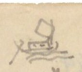{width=12%}

| [Địa danh] | [Chữ Hán] | [Tầm] | [Ghi chú] |
|---|---|---|---|
| Ngã ba Láng | 我巴 [?] 湖 [?] | 17.000 | |
| R. Láng Hầm | 湖 [?] 含 [?] | 35.625 | Trước đường, chi tả qua R. Cái Răng 丐[...], hợp vào Ngã Tắt to 我[...][...]. Chi hữu thông với hai rạch Bình thủy 平水 và Ô môn 鳥 [?] 門, ngược hợp với Hậu giang 後江 |
| Rạch Giá | 泝 [?] 架 | | Khoảng này đến Trà Minh nhiều muỗi. Mùa hạ lụt, mùa thu. 夏潦秋[...] [NC: chữ cuối tác giả viết, rồi ghi bên lề chữ 涇 [?] có dấu hỏi.] |
| Láng Trương Tranh | 种 [?] 䉶 [?] | | |
| R. Khu đất Trà Ninh | 坵坦茶 [?] 寧 [?] | | |
| Cửa bể | 牽 [?] 門閑 [?] | 200 | Ra sông (ngược 江 [?]) |
| R. Sỏi | 泝 [?] 碨 [?] | | Chảy vòng quanh nhậm sở đạo Kiên giang 堅江, thông với Rạch Giá 泝 [?] 架 ở bên tả |
| Kiên giang đạo | 堅江道 | | Nhậm sở. Trước mặt là bể (大海), tả là R. Sỏi 碨 [?], hữu là R. Giá 架 |

Thông với nhau mà bọc quanh. Từ đó theo bờ bể ra bể (洋), đi qua R. Răng Vàm đất 齒 [?] 菱 [?] 坭坦, R. Lai Vàm Chông vược 淶坭蔠 [?] [...], ra cửa bể Hà tiên 河仙. Ở bờ bắc có núi Tô châu 蘇洲. Góc đông nam ngoài bể có hai núi, có đồn phân thủ Hà tiên. Ngoài có một núi tên Vàm tre 坭[...]. [có thêm 河坭[...]?] Phía Nam Hà tiên rất xa có đảo lớn tên Vàm Phú quốc 坭富國. Từ đảo ấy đi hai hôm vượt bể sang thành Vọng các 望閣 ở nước Xiêm-la 暹羅.

[NC: Vọng Các là tên cũ của Bangkok. Nửa dưới trang là tiêu đề in VERRERIE DU NORD in ngược.]

# Trang PDF 373 - Châu Đốc (Vĩnh trấn 9)

*Đầu trang: Vĩnh Trấn 9; số trang bản thảo: 185*

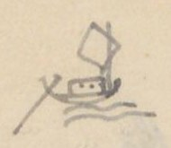{width=12%}

## CHÂU ĐỐC

| [Số] | [Địa danh] | [Chữ Hán] | [Tầm] | [Ghi chú] |
|---|---|---|---|---|
| 1° | Châu đốc đạo | 朱篤 | 1.400 | 道守所 (*đạo thủ sở*). Sở đồn thủ theo Đại giang sang tây rồi đông 72.458 đến cửa bể Ba Thắc 巴[...]. Đi lên đến Nam Vang 南榮 [?] ở Cao miên 高綿. Đi xuống là R. Châu đốc 朱篤 |
| | R. Sâm lung | 參 [?] 竜 | 400 | |
| | R. Cái dung | 丐鎔 [?] | 1000 | |
| | R. Trà Tân | 茶津 | 500 | |
| | R. Chông Cần trang | 蔠 [?] 芹庄 | 1000 | |
| | R. Diệc Bà | 亦妑 [?] 宛 [?] | 650 | |
| | R. Cái Dầu *(viết lại: Du)* | 丐油 | 2.000 | |
| | R. Cái Đầm | 丐潭 | 450 | Đi 17.500 thông R. Tắt cây sung [...] 核 [?] 椌 [?] hợp với Tả biên Tiền giang 左边前江 |
| | R. Năng Cư [?] | 能 [?] 衢 [?] | | |
| | R. Vàm Nao hạ | 氿 [?] 涝 [?] 下 | 1000 | Có đồn phân thủ. Đi 16.318 thông R. Vàm nao thượng 氿 [?] 涝 [?] 上 hợp Tiền giang 前江 |
| | R. Thâm bốn [?] | 貪 [?] 奔 [?] | 900 | |
| | R. Mạt Cần dưng | 末芹蒸 [?] 上 | 79 | Đi 3.700 thông R. Ba Khâm 巴[...] |
| | R. Đồng chúc | 仝 [?] 燭 | 1.700 | Đi 300 thông R. Súc chiết 畜 [?] 折 [?]. Phía hữu ra R. Ông chưởng hạ 翁掌下, thông với Hậu giang 後江; phía tả thông R. Ông tiền thượng 翁 [?] 仙 [?] 上 vào Tiền giang 前江. |
| | R. Bần lăng | 貧 [?] 棱 [?] | 1.300 | |
| | R. Ông Chưởng hạ (Hùng sai đạo) | 翁掌下 / 雄差 | 1.200 | Phân thủ. R. đi về bắc 110 đến ngã ba. Chi tả là R. Súc chiết 畜 [?] 折 [?], trên thông R. Đồng chúc 仝 [?] 燭, hợp với Hậu giang 後江; chi hữu 13.000 đến R. Ông Chưởng thượng 翁掌上, hợp với Tiền giang 前江. |
| | R. Ba Rách | 巴[...] | 1.047 [?] | (1035 [?]) Đến ngã ba: chi hữu thông R. Mạt dăng [?] cần 末蒸 [?] 上芹 *(mực tím: Vĩnh trấn 9/20)*; chi tả đến Cù lao Sài mạt 柴末, lại có ngã ba: chi hữu thông R. Châu đốc 朱篤, hợp với Đại giang 大江. Chi tả thông Trấn Hà tiên 河仙 |
| | Chảo Châm ba | 針 [?] 巴泝 | 1000 | |
| | R. Cái Sơn | 丐山 | 500 | |
| | R. Cái Đôi | 丐堆 | 1000 | |
| | R. Cái Lao | 丐牢 [?] | 500 | |
| | R. Trường Tiền | 場錢 | 500 | |

[NC: Nam Vang (Phnom Penh). Số ở dòng R. Ba Rách bị viết chồng, phía trên có ghi 1035. Nửa dưới trang có chữ in VERRERIE DU NORD hiện qua giấy.]

# Trang PDF 374 - Châu Đốc (tiếp) (Vĩnh trấn 10)

*Đầu trang: Vĩnh trấn 10*

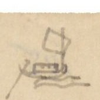{width=12%}

| [Địa danh] | [Chữ Hán] | [Tầm] | [Ghi chú] |
|---|---|---|---|
| R. Cái Phí | 丐費 | 500 | |
| R. Lấp vò | 垃圩 [?] | 2.100 | Bên tả 98 T đến ngã ba. Chi hữu thông R. Cái du 丐油 hợp Đại giang, chi tả do cửa Rạch 泝口 [?] 100 T đến Cường thành đồn phân thủ 強成, 50 T lại có ngã ba. Chi tả thông hai Rạch Cái phí 丐費, Trường tiền 場錢 hợp Hậu giang 後江. Phái hữu đi 15.115 đến ngã ba: Chi tả thông R. Cái Tàu thượng 丐[...]上 hợp Tiền giang 前江, chi hữu thông hai Rạch Thủ ô 首烏, Nước Xoáy [?] 渃[...] ra R. Sa đéc 沙泃 [?], cũng hợp Tiền giang 前江 |
| R. Cá Hô | [...] 呼 | 520 | |
| R. Cái Du | 丐油 | 2.000 | |
| R. Sam lung | 參 [?] 竜 | 3.000 | |
| R. Lai bông | 來芃 [?] | 2.000 | Đi 15.390 đến giáp thủy 夾水 [?] ra Ngã Nước Xuôi 渃[...]. Dọc đường trước sông có Cù lao Cát 尚 [?] 蔣 [?] 葛. Sông chia làm hai; một chi từ Rạch Sam lung 參 [?] 竜 ở Hữu biên đi về đông 3.500 T đến Chảo Mang Tân [?] 泝 [?] 辛 [?], 4.000 đến R. Ô môn 鳥 [?] 門, 4.000 đến ngã ba; chi tả đến R. Bình thủy 平水 hợp với Đại giang 大江. Phía hữu thông hữu biên giang, R. Cần thơ 芹苴 rồi vào Đạo Kiên giang 堅江道 |
| R. Cái Mít | 丐檵 [?] | 3.000 | |
| R. Cái Sâu | 丐溇 | 2.000 | |
| R. Bàu Vật | 泝 [?] 浥 [?] | 3.000 | Đi 200 đến ngã ba: chi tả suốt R. Cái Sâu 丐溇 hợp với Đại giang 大江; chi hữu 300 đến Chảo Sơn chiết 山折 là ngã ba Chảo Sơn chiết: nhánh hữu thông R. Trà mang 茶 [?] 泝 [?] hợp Đại giang 大江. Nhánh tả thông R. Cần Đai [?] 芹苴 [?] hợp Hậu giang 後江. |
| Chảo Cái Lãnh | 丐令 [?] 泝 | 2000 | |
| R. Bình thủy | 平水 | 360 | Đi 300 T đến ngã ba: chi hữu thông R. Ô môn 鳥 [?] 門, chi tả đến Ngã ba Láng 湖 [?]: nhánh tả thông R. Cần thơ 芹苴 hợp Hậu giang 後江, nhánh hữu thông R. Giá 泝 [?] 架湖 [?] đến Cửa Bể 牽 [?] 門閑 [?]. |

[NC: Bàu Vật: chữ Hán giống chữ tác giả viết cho "Mương Hột/Bào" ở Vĩnh trấn 7. Nửa dưới trang là tiêu đề in VERRERIE DU NORD in ngược.]

# Trang PDF 375 - Vĩnh Trấn (Vĩnh trấn 11)

*Đầu trang: Vĩnh Trấn 11; số trang bản thảo: 186*

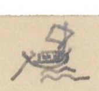{width=12%}

| [Địa danh] | [Chữ Hán] | [Tầm] | [Ghi chú] |
|---|---|---|---|
| Rạch Trà mang | 茶 [?] 泝 [?] | 1000 | |
| R. Cái Khế | 丐楔 [?] | 50 | |
| Chảo Cái Du | 丐油 | 70 | |
| R. Cần thơ (Đồn Trấn giang) | 芹苴 / 鎮江 | 240 | Chảy 1.832 đến ngã ba: Chi hữu thông hai rạch Ô môn 鳥 [?] 门 và 平水 [Bình thủy]. Chi tả đi 10.070 qua hai rạch Bẹp trơn 杙 [?] 䑳 [?], Láng hầm 湖 [?] 含 [?]; đi 35.825 qua Cửa Bé 牽 [?] 門閑 [?] đến đạo Kiên giang 堅江. Rất nhiều muỗi |
| R. Cái Lam | 丐[...] | 1000 | Đi 418 xuống thông với R. Cái.. 丐... lại một chi thông R. Nha Mân 芽[...] hợp với Tiền giang 前江 |
| Chảo R. Chanh | 泝 [?] 樦 [?] 泝 | 700 | |
| R. Mái Dầm [?] | 厦 [?] 槿 [?] | 300 | |
| R. Cái Bồn | 丐盆 | | |
| (Đồn Cường Đạo) | 強道 | 2.360 | Đồn phân thủ. Rạch ở mé tả, chảy về tây bắc 815 đến ngã ba: chi tả thông R. Cái Lam 丐[...], hợp với Hậu giang 後江. Chi hữu đi 37.000 thông R. Nha mân 芽[...] hợp với Tiền giang thủ sở 前江守所 |
| Đồn R. Trà Ôn | 茶 [?] 温 | 5.000 | 屯守 (*đồn thủ*). Đi 5.800 đến đồn phân thủ Ba Kè 巴棋, chia làm hai: Chi tả qua bến Trấn Khổn 鎮閫 suốt sông Long hồ 龍湖, chi hữu suốt (sông Long hồ 龍湖) [có lẽ sai] R. Mân thít 𣊚 [?] 泐 [?], thông R. Tiền giang 前江. Phía tây có đồn thủ, phía đông có đồn.. 䮒 [?] 屯 |
| Chảo R. Trà | 泝 [?] 查泝 | 2.000 | |
| Chảo Trà Cát | 茶 [?] 吉泝 | 3.000 | Nhiều gian ác ra vào phải sợ |
| R. Cái Sách trại | 丐柵寨 | 312 | |
| R. Bông Bụt | 芃 [?] 渤 [?] | 500 | |
| R. Trà Điêu | 茶 [?] 彫 | 600 | |
| R. Thơm đằng | 檳 [?] 藤 [?] | 1500 | |
| Đồn R. Ba Thắc | 巴[...] | 6.180 | Đi 1.700 đến R. Mặt bào 㮐 [?] [...], 300 T R. Cần chông 芹蔠 [?], 500 thông R. Láng the 湖 [?] 絁 [?] hợp với Tiền giang 前江, 4.000 đến R. Chặp chăng [?] 执 [?] 庄, 5000 đến R. Trà Cú 茶 [?] 鴣 [?]. Ở ngã ba Ba Thắc, chi tả thông đạo Long xuyên 龍川, suốt cửa bể Mỹ thanh 美清. Chi hữu thông Cửa Bé 牽 [?] 門閑 [?], suốt đạo Kiên giang 堅江 |
| Chảo Cây Vả | 椅 [?] 吧 | 5000 | |
| Chảo Nang Rô | 昂 [?] 鱸 [?] | 40 | |
| Đồn R. Vàm lai | 氿 [?] 來泝 | 300 | Đồn phân thủ |

[NC: Tác giả ghi "Ba Dắc/Ba Thắc" (Bassac). Nửa dưới trang có chữ in VERRERIE DU NORD hiện qua giấy.]

# Trang PDF 376 - Châu Đốc - Hà Tiên (Vĩnh trấn 12)

*Đầu trang: Vĩnh trấn 12*

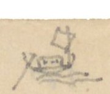{width=12%}

| [Số] | [Địa danh] | [Chữ Hán] | [Tầm] | [Ghi chú] |
|---|---|---|---|---|
| | R. Cái Giá | 丐架 | 200 | |
| | R. Cái Lóc | 丐[...] | 1.000 | |
| | R. Cái Đôi | 丐堆 | 100 | Bờ R. này đi mé hữu đến R. Láng thiếc 湖 [?] 鉄, tả thông Cửa Cổ chiên [...] [...] 海門. Bên hữu tiếp cửa Mỹ thanh 美清 |
| | Cửa bể Ba Thắc | 巴[...] | | |
| 2° | R. Châu đốc | 朱篤 | 43.570 | |
| | Cù lao Thày Mạt (ngã ba: chi hữu) | 柴末 | | Ngã ba. Dọc đường có R. Vàm Cần thảy 坭 [?] [...] [vài ngàn] 芹升 [?], Láng... đồn 淬 [?] 山, R. Lồng 竜 [?] 翔 [?] |

Ở ngã ba, phái tả ra R. Thuyết 説泝 [?], chuyển sang đông, 9.015, trước đường gặp khe Chiết trà mão 折茶卯 [?] 溪, đến ngã ba: chi hữu đến R. Ba rạch 巴泝 [?], chi tả thông R. Cần đăng 芹藤 [?]. Theo chi hữu đến:

| | [Địa danh] | [Chữ Hán] | | [Ghi chú] |
|---|---|---|---|---|
| | Đồn Hàn | 韓守 | | |
| | R. Ông Vạn | 翁萬 | | |
| | Hà tiên trấn | 河仙 | | Phía sau, mé hữu có núi Ngũ hổ 五虎山. Phía nam núi Dương long 陽龍 [?], có đường bộ đến Phủ trấn Đại đồng 大同鎮府 [?]. Từ đó qua Vọng các 望閣 xứ Tiêm la 暹羅 thành Mang Cốc 芒 [?] 谷 là chỗ quốc vương nước ấy ở. |

Xét thấy đất trấn Hà tiên 河仙 thuộc bờ bể. Cõi xa liền rộng. Đông liền đại hải, tây gần Tiêm la, nam giáp Cao miên, bắc tiếp Gia định. Đất (cấy) thì nhỏ hẹp, núi sông tú lệ; mộc thạch trân kỳ. Thật là một thắng địa cho khách nhàn tản. Đời Hiếu ninh vương 孝寧王 đánh miền nam, có Minh tướng Mạc Tổng binh [?] 鄚 (làm ra Trịnh) [...] 兵 ở bắc tới, đem quân vài trăm quân giúp, lập chiến công nhiều. Sau khi khai thác, xin đất Hà tiên mà ở; được phong làm Trấn thủ Hà tiên. Được 10 năm thì mất, con là Thiên tứ 天賜 (士 [?] 賜) nối chức. Khéo kết bạn với người kinh đô. Kẻ sĩ nhiều người theo. Từ đó chiêu tập nhân dân, xây chữa đồn bảo, bèn thành đất đẹp (樂土 [?]). Năm Nhâm thìn (1782 [?]) ngụy chúa Xiêm la Phi Nhã Tân 丕雅新 thừa hư đánh lấy đất ấy. Thiên tứ chạy ở nhờ Gia định 嘉定. Gia quyến bị Xiêm bắt. Năm Bính thân (1786 [?]) Tây sơn làm loạn. Thiên tứ hàng Xiêm rồi bị giết. Năm Mậu thân [?] (1798) đại giá về, thu phục Gia định. Năm Tân hợi [?] (1801) Xiêm la mới trả con hai Thiên tứ là Mạc Tử Thiêm 子添 về. Năm Gia long thứ 4 (1805) sắc cho y được làm trấn thủ Hà tiên, thuộc Gia định thống hạt.

[NC: "Mạc Tổng binh [?]" chỉ Mạc Cửu; Hiếu Ninh vương là chúa Nguyễn Phúc Chu. Phi Nhã Tân là Phraya Tân (Taksin). Các năm âm lịch và dương lịch tác giả ghi ở đây không khớp nhau (Nhâm thìn là 1772, Bính thân là 1776, Mậu ngọ là 1798, Tân dậu là 1801), có lẽ do chép nhanh; giữ nguyên như bản thảo. Mấy dòng cuối (từ "con hai Thiên tứ...") viết ở lề dưới, bên dưới chữ in VERRERIE DU NORD in ngược.]

# Trang PDF 377 - Ba Thắc - Long Xuyên (Vĩnh trấn 13)

*Đầu trang: Vĩnh Trấn 13; số trang bản thảo: 187*

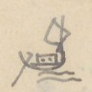{width=12%}

## Ba-dắc - Long xuyên

| [Địa danh] | [Chữ Hán] | [Tầm] | [Ghi chú] |
|---|---|---|---|
| R. Ba Thắc (Đạo Trấn di) | 巴[...] / 鎮夷 | 1.300 | Qua sông, chuyển về nam rồi sang đông, xuống 73.006 đến nhậm sở Long xuyên đạo 龍川道 |
| Phố Trường Tàu | 場[...] | 14.336 | |
| R. Súc | 潘 [?] 䗅 [?] | 1.800 | Chia đôi: chi hữu 5000 đến R. Bồ thảo 布討, thượng lưu 35.755, trước đường qua Chảo Ngã ba Dinh 我巴營泝, R. Chảo Tầm vu 尋 [?] 于, Ngã ba Cái Tàu 丐[...], R. Cái dang 丐[...], R. Thầy Lão 柴老, R. Cái nước 丐渃, R. Cái Tắt 丐[...] Cậu 舅; đến R. Cửa Lớn 牽 [?] 门吝 [?]. Chi hữu đi ngược 300 T đến Cửa Bé 牽 [?] 门閑 [?] qua R. Sỏi 碨 [?], đến đạo Kiên giang 堅江, giáp cửa bể Hà tiên 河仙 |
| Ngã ba | 三岐水路 | 3.000 | Trên có chợ, gọi Chợ Bãi Xàu [?] [...] [...]. Ban [?] muỗi đen như than. Nấu lại thì muỗi rất nhỏ, trắng và ngọc [?] |
| Ngã ba Cầu thơ [?] | 根 [?] 萩 [?] | 2.530 | Phía hữu thông R. Bồ thảo 布討 |
| Ngã ba Cò Cò | 古鷲 [?] | 40 | Chi tả 3.760 T, qua R. Tầm vu 尋 [?] 于, Chảo R. Tống 宋泝 [?] 泝, chảo R. Cời 泝 [?] 槐 [?] 泝; chi hữu qua chảo Vàm Chế 坭制 đến Cửa bể Mỹ thanh 美清, cùng cửa bể Ba Thắc 巴[...] kề; Có ba đảo Vàm lợi 坭利, Vàm Ông 坭翁, Vàm Trắng 坭[...] |
| Chảo Ôm Trà nỗ | 唵 [?] 茶弩 [?] | 17.600 | |
| Đồn R. Cái Lam | 丐[...] | 32.400 | Phân thủ. Dọc đường qua hai rạch Trà dinh 茶 [?] 丁 [?], Mặt giời 㮐 [?] [...]. Chi tả thông R. Cái Phác 丐朴 |
| Long xuyên đạo nhậm sở | 竜川道 / 任所 | | Trước lúc tới Long xuyên qua: R. Cái Phác 丐朴; R. Cái Chuột 丐[...]; R. chảo Cai trung láng 該 [?] 中湖 [?]; R. Láng Bầu 湖 [?] 瓢 [?]; Láng Luận 〃 論; R. Lam góc 櫃 [?] 榕 [?]; Láng bến 湖 [?] 渡; R. Giá lai 架淶; R. Ba Sài 巴柴 [?]. Phía hữu có chi qua Láng Bầu sen 瓢 [?] 蓮湖, chảo R. Dừa 泝 [?] 椰 [?] 泝, R. Ô Rô 烏[...], qua chảo Lão đội 老[...]. Đường ấy rất nhiều liễu nước 水柳 (Rong [?]) |

[NC: "Đạo Trấn di", "Long xuyên đạo": đơn vị hành chính thời Gia Long ở trấn Vĩnh Thanh. Nửa dưới trang có chữ in VERRERIE DU NORD hiện qua giấy.]

# Trang PDF 378 - Vĩnh Trấn (Vĩnh trấn 14)

*Đầu trang: Vĩnh trấn 14*

Phía nam đạo Long xuyên, qua R. Kênh đào 泝 [?] 陶, có ngã ba. Chi tả về đông, qua R. Cái Ngang 丐昂 thông cửa bể Gành Hào 石[...]石[...]. Chi hữu lên phía tây lại chia hai: phái tả có đồn phân thủ; chia làm ba lối: 1- ra cửa bể Cái Đôi 丐堆; 2- ra đồn Cửa bể Rạch Gốc 泝 [?] 榕 [?]; phái hữu thông với Đỗ Cự [?] 囷 [?] 䶙 [?]. Đường này ở mé tây qua R. Lưu lạp 溜笠, chỗ ngã ba: Chi tả đến R. Rắn 蛇 [?]. Trước có hai dòng, dòng tả thông Cái tắt Lão du 丐[...]老[...] đến Cửa bể Bãi hiệp [...] 哈 [?]; dòng hữu thông cửa bể Đầm 潭海門. Chi hữu thông R. Giồng Kè 壇 [?] 棋, đến đồn phân thủ Ngã ba Thầy 我巴柴: phái hữu [?] ra cửa bể Đốc Vàng 土篤鐄 [?], phái hữu [?] qua hai rạch Cái Tàu 丐[...], Cái Sắn 丐[...], qua R. Mương đào 泝 [?] 陶 chảy ra ngoài bể. Phía tả R. Mương đào có núi Bạch thạch 白石, thật là tú dị, đứng ngang bờ bể, gọi là Vàm đá bạc 坭[...]泊 [?]. Trên núi có miếu xưa, tường, nhà ngung nga, cây cối um tùm trông rất sinh long kính.

[NC: Ở cụm "phái hữu [?] qua hai rạch", tác giả ghi chữ có dấu (?) ngay sau, có lẽ tự nghi là "phái tả". "Vàm đá bạc": chữ "bạc" viết lại phía trên chữ bị gạch. Phần dưới trang để trống; chỉ có nét chữ trang sau hiện qua giấy.]

# Trang PDF 379 - Trang trắng

[Mặt sau tờ giấy tiêu đề in sẵn VERRERIE DU NORD, Hanoi, le ... 194..; không có chữ viết. Chữ viết tay trên bìa hồ sơ (18 Mars 1928, 117, Nam định...) hiện ngược qua giấy.]

# Trang PDF 380 - Tờ lót

[Tờ giấy màu nâu nhạt, để trống; chữ viết tay của bìa hồ sơ bên cạnh và tiêu đề in VERRERIE DU NORD in hằn mờ.]

# Trang PDF 381 - Mặt trong bìa hồ sơ tòa án cũ (bìa sau)

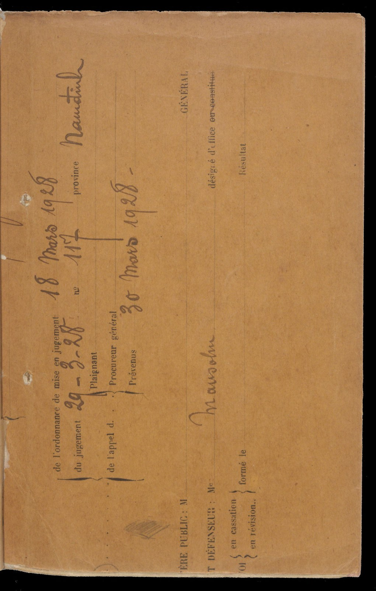{width=55%}

[NC: Bìa giấy vàng in sẵn, đặt nằm ngang (chữ chạy dọc trang). Đây là nửa còn lại của bìa hồ sơ tòa án đã thấy ở trang PDF 6, tác giả dùng làm bìa sau.]

Chữ trên hình:

- Chữ in (tiếng Pháp): de l'ordonnance de mise en jugement [lệnh đưa ra xét xử]; du jugement [bản án]; Plaignant [nguyên cáo]; de l'appel d. [kháng cáo của]; Procureur général [Chưởng lý]; Prévenus [bị cáo]; province [tỉnh]; nº; GÉNÉRAL; (MINIS)TÈRE PUBLIC: M [Viện công tố: ông]; (AVOCA)T DÉFENSEUR: Me [Luật sư bào chữa]; désigné d'office ~~ou constitué~~ [được chỉ định]; (POURV)OI en cassation / en révision, formé le [đơn xin phá án / xin xét lại, nộp ngày]; Résultat [kết quả].
- Viết tay: 18 Mars 1928 (ngày lệnh đưa ra xét xử); 29-3-28, nº 117 (bản án); province: Nam định [?] (viết "Namdinh"); Procureur général - 30 Mars 1928 (kháng cáo); Défenseur: Me Mansohn [?].

# Trang PDF 382 - Bìa sau: chữ thư pháp

{width=55%}

[NC: Tờ bìa giấy màu hồng, giữa trang có mấy chữ viết thảo rất phóng bằng bút lông mực đen, xếp thành hai hàng (hai chữ trên, hai chữ dưới [?]). Chưa đọc chắc được; có thể cùng tay bút với ba chữ thảo trên bìa ngoài (trang PDF 1). Cần người đọc chữ thảo kiểm tra.]

# Trang PDF 383 - Ảnh kiểm tra của thư viện (thang màu)

{width=55%}

[NC: Ảnh chụp kiểm định của thư viện: bên trái là thang màu - thang xám Don Williams (đơn vị inches/centimeters, mã M000907), bên phải là lại trang bản thảo "Vĩnh trấn 14" (đã chép ở trang PDF 378). Không có nội dung mới.]

---

*Hết.*
